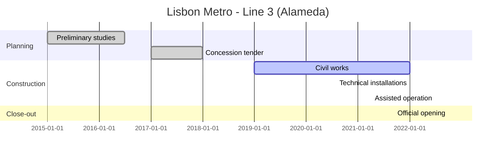
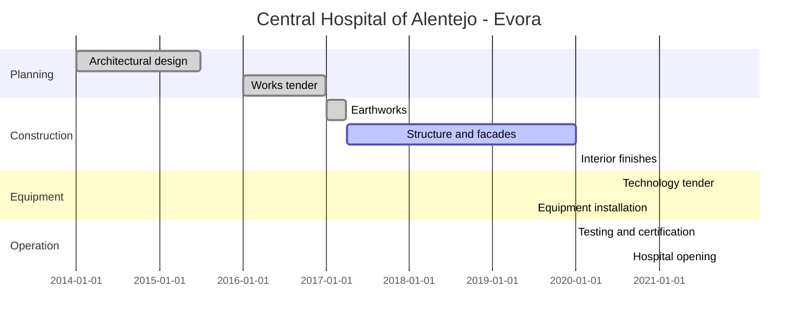
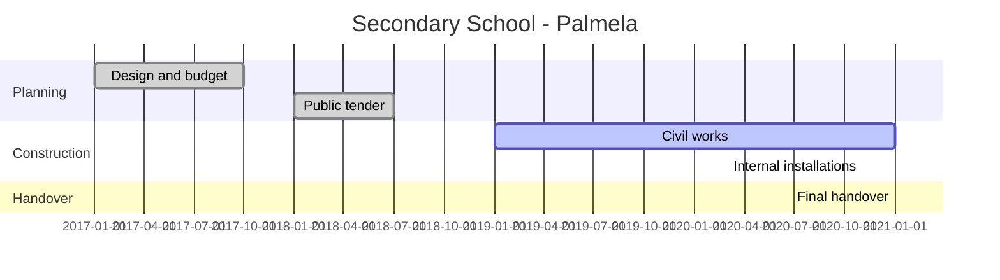
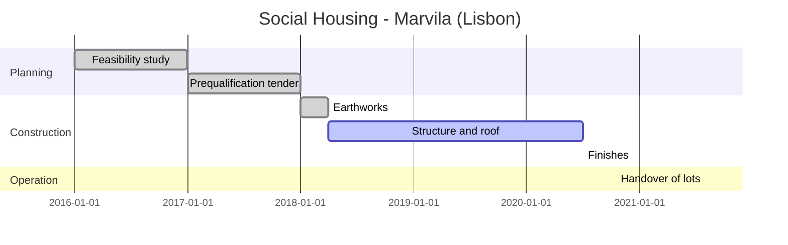
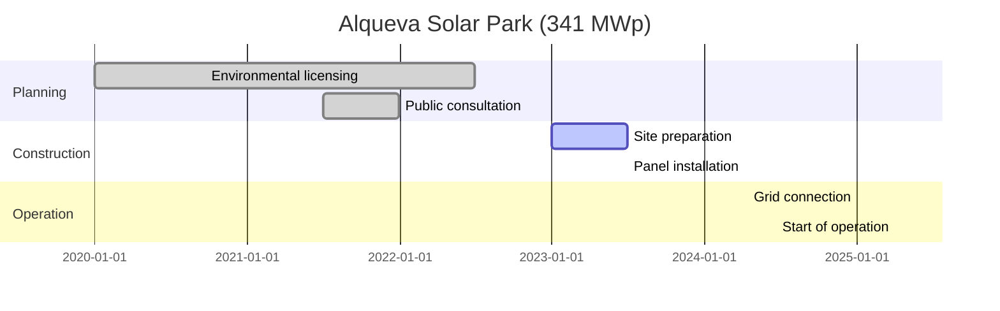

# Building & Public Works - Sector Cyber Resilience & Credit Intelligence: Research Record Q01-Q15

**Document type:** research record (no slide production). **Version:** 1.1-R (research update of the baseline edition).
**Research date of this update:** 27 October 2026.
**Evidence base and cut-offs:**
- Q01-Q07: unchanged from the baseline edition (public sources; evidence cut-off 14 October 2026; reporting period 1 September 2025 to 14 October 2026).
- Q10-Q15: updated on 27 October 2026 by merging the baseline evidence with a user-supplied research input on the Portuguese construction and public works market (legislation, market structure, sustainability and innovation, five project case studies, cost and delay benchmarks and recommendations). Per user instruction, the user-supplied information was accepted and merged **without source validation**.
- Q15, Q08 and Q09: synthesised from all of the above.

**Geography:** global, with primary focus on the EU, EEA and UK; Portugal added as a country deep dive through the user input; North America and Asia for comparison.
**Audience:** Senior Credit Officers and First Line of Defence (1LoD) operational management; second-line reviewers.
**Boundary:** public external evidence plus user-supplied research input. No internal bank, client or borrower data. Sector findings are inherent exposure only; they are not a borrower creditworthiness assessment, a control audit or a compliance finding.
**Status:** Provisional (no approved rating rubric and no questionnaire item list supplied). NEEDS_REVIEW items are listed in section F.

---

## 0. Reading guide

**Source identifiers.**
- `S-001` to `S-047`: public sources from the baseline edition, accessed on 14 October 2026 (full list in section G1). Tier 1 = official, legal, regulatory, affected organisation; Tier 2 = independent research with disclosed method; Tier 3 = media and discovery.
- `U-001` to `U-010`: user-supplied research input, merged on 27 October 2026 without validation (section G2). These are labelled **User-supplied (not validated)** wherever they support a finding.

**Evidence labels.** Confirmed fact (Tier 1/2 public source); Sector benchmark; Proxy; Analytical judgement; Scenario assumption; Unconfirmed allegation; User-supplied (not validated).

**Language.** The user-supplied input was in Portuguese; it is translated into English (UK) here. Portuguese legal names are kept with an English description.

---

## A. Scope statement

**Sector definition.** Building & Public Works (B&PW) covers organisations that design, build, maintain and operate buildings and civil engineering works, and the public bodies that commission them.

| Subsector | Business model | Main evidence sources |
|---|---|---|
| Construction companies (general contractors) | Project-based delivery, main contractor with subcontractor chains | S-001 to S-004, S-020, S-021, U-006, U-008 |
| Civil engineering and infrastructure construction | Large multi-year programmes, joint ventures and consortia, concessions and public-private partnerships (PPPs) | S-001 to S-004, U-006, U-008 |
| Public works contractors and operators | Construction plus operation of water, roads and plant | S-012, S-013, S-017 |
| Engineering, design, supervision and project-management consultancies | Professional services, information-intensive | U-006, S-020 |
| Building materials and equipment | Manufacturing and distribution, ERP-driven supply | S-015, S-016, S-020 |
| Construction technology platforms | Software-as-a-service (SaaS) for project information and payment | S-027 |
| Building-management and building-automation systems | Connected products and controllers | S-035, S-036 |
| Public-sector project owners | Municipalities, regional bodies, infrastructure owners | S-005 to S-010, U-006 |

**Horizons.** Historical landmarks (labelled historical); rolling 12 months to the 14 October 2026 cut-off; last 30 days before that cut-off. Developments after 14 October 2026 were not researched (gap). The user input adds a Portugal-specific project horizon covering roughly 2015-2025.

---

## B. Executive summary for Senior Credit Officers

**Provisional ratings (no approved rubric):**
- **Fraud: High, confidence Low** - public procurement, EU-funded programmes, dense subcontractor chains and frequent stage payments create structural fraud exposure; construction is specifically targeted by payment-diversion fraud, but no documented sector fraud case was available.
- **Cyber / ICT: High, confidence Medium** - construction ranks third of all sectors by publicly claimed ransomware victims over 12 months, and rapid adoption of building information modelling (BIM), Internet of Things (IoT) sensors, drones and digital twins widens the attack surface.
- **Operational resilience / TPRM: High, confidence Medium** - disruption spreads through owner shared IT, sector platforms and suppliers; Portuguese projects show recurring delays and overruns from supplier, permit and ground risks.
- **Governance / operating model: Medium, confidence Low** - large groups operate in about 20 countries through consortia, concessions and diversified holdings, but no contractor-level governance failure is documented in the evidence base.

**Three key findings.**
1. Time is the main financial transmission channel: weeks of site downtime and months of owner-side disruption delay certification and payment.
2. Portuguese public works routinely overrun cost and schedule even without cyber events (for example road works about 15% late on average), so cyber shocks land on already thin buffers.
3. The regulatory perimeter reaches contractors indirectly, through owners, procurement rules (including Portugal's Public Contracts Code) and product and data rules.

**What a lender should ask a B&PW borrower:** which owners, platforms and suppliers it depends on and how long it could certify and invoice without them; how payment-detail changes are confirmed; how procurement and subsidy compliance is controlled; and how contract terms allocate delay, ground and supply risks.

---

## C. Four-dimension rating matrix (Q15)

| Dimension | Proposed rating | Status | Confidence | Principal drivers | Key evidence | Lender consequence | Fraud-Cyber overlap note | Main gaps |
|---|---|---|---|---|---|---|---|---|
| Fraud | High | Provisional | Low | Public procurement intensity; EU and public funding; subcontractor density; frequent high-value stage payments; consortia and concessions | AFP construction BEC alert (S-026); Portuguese Public Contracts Code procedures incl. direct award and negotiation (U-001, U-005); EU funding of pilots and programmes (U-007, U-010) | Direct cash loss, contract exclusion, recovery and legal costs, working-capital strain | Payment diversion counted here for the deception and loss step; the email or account compromise step is counted under Cyber / ICT | No documented sector fraud case; no sector fraud dataset; UK/US fraud rules not researched |
| Cyber / ICT | High | Provisional | Medium | Ransomware targeting of contractors and materials suppliers; identity and edge access weaknesses; digitalisation (BIM, IoT, drones, digital twins, e-procurement); IT/OT convergence in public works | Dragos Q2 2026 176 construction claims (S-020); Black Kite third of all sectors (S-021); QBE 24-day downtime (S-018, S-019); BIM.PORTUGAL and IoT site monitoring (U-007) | Site and programme downtime, data-breach costs, delayed invoicing | Access and compromise counted here | No sector maturity survey; no BMS incident evidence |
| Operational resilience / TPRM | High | Provisional | Medium | Owner shared-service dependency; construction SaaS on hyperscale cloud; ERP-reliant materials suppliers; imported materials and equipment lead times; counterparty insolvency | RBKC shared IT (S-005 to S-008); Miljödata (S-010); Procore 10-K (S-027); Portuguese projects delayed by equipment and materials supply (U-008); Soares da Costa insolvency (U-006); InforConstrução 2024 delays (U-009) | Programme slippage, liquidated damages, cash-conversion delay, supplier default | Third-party payment fraud counted under Fraud | Substitutability and switching times not evidenced |
| Governance / operating model | Medium | Provisional | Low | Multinational groups in about 20 countries; conglomerate diversification; consortia, PPPs and concessions; multi-owner coordination; heavily amended procurement regime | Mota-Engil, Teixeira Duarte, Casais footprints (U-006); Metro de Lisboa coordination risks (U-008); RBKC auditor governance weakness (S-007, public owner) | Oversight gaps in joint ventures and subcontractor chains; dispute and claim exposure | Governance factors that enable fraud noted under Fraud, not double counted | No supervisory or prosecutor governance findings for contractors; no cross-sector governance benchmark |

Rating rules applied: no approved rubric, so all ratings are Provisional; confidence reflects evidence quality; Fraud confidence capped at Low-Medium because no investigated-case, enforcement or sector loss dataset is available; complexity is not treated as proof of weak governance.

---

# Part A - Core sector intelligence (Q01-Q07, unchanged from the baseline edition)

## Q01 - Sector operating model and key dependencies

**Essential processes.** Planning consent and permitting; design and project information management (drawings, requests for information (RFIs), permits-to-work); procurement and materials supply; site access and execution (including marine and tunnelling operations on large programmes); valuation, certification and payment; operation and maintenance of public-works assets.

**Dependency map (documented dependencies only).**

| Dependency | Essential process | Concentration pathway (evidence) | Who is exposed |
|---|---|---|---|
| Public-sector project owners' shared IT | Planning consent, repairs ordering, supplier payment | One shared IT estate served three London boroughs [S-005, S-008, S-009] | Contractors awaiting consents and payment |
| Public-sector software suppliers | Owner HR and records systems | One supplier served a majority of Swedish municipalities [S-010, S-011] | Owners, contractors, data subjects |
| Construction-management SaaS and cloud fourth party | Drawings, RFIs, permits-to-work, valuations | One platform reported 17,850 customers in about 160 countries, hosted on third-party data centres such as AWS [S-027] | Contractors, owners, consultants |
| Building materials and equipment suppliers | ERP-driven supply to tight timelines | Supplier tier repeatedly targeted by ransomware [S-020]; subsidiary incident contained by isolation [S-015] | Programmes relying on just-in-time materials |
| Public-works operational technology (OT) | Water and plant control | More than 30 community water systems with malicious activity on internet-exposed controllers [S-012, S-013] | Owners, operators, maintenance contractors |
| Payment chains | Stage payments to subcontractors | Supplier email compromise and bank-detail changes [S-026] | Contractors, subcontractors and their banks |

**Single points of failure (analytical judgement).** Owner shared services and a single project platform can stop several firms at once; the best-documented case halted planning for about 15 weeks [S-005, S-006]. Substitutability, switching time and platform market shares were not evidenced (gap).

**Operating-model features.** Large programmes are delivered by contractor joint ventures (for example Femern Link Contractors) [S-001, S-003]; public owners use shared-service models [S-005].

## Q02 - Historical and recent cyber incidents, including case studies

**Top five named incidents in the reporting period** (selection: event or regulatory outcome in period; existence supported by a Tier 1 or Tier 2 source; B&PW subsector; distinct lesson).

| # | Incident | Subsector | Geography and period | Mechanism and weakness | Consequence | Evidence |
|---|---|---|---|---|---|---|
| 1 | Femern Link Contractors | Infrastructure construction (joint venture) | Denmark and Germany; from 12 October 2026 | Not disclosed | Owner confirmed incident; media reported network shutdown, access-control loss and idle vessels; no cost disclosed | S-001 (Tier 1); S-002 to S-004 (Tier 3) |
| 2 | Royal Borough of Kensington and Chelsea (RBKC) shared IT | Public-sector project owner | London, UK; 24 November 2025 to 2026 | Human error per external auditor; fragmented legacy estate | Planning about 15 weeks, revenues and benefits about six months; data exfiltrated; GBP 1.2m recovery costs in 2025/26 | S-005 to S-009 |
| 3 | Miljödata | Software supplier to public owners and companies | Sweden; attack August 2025, fine 22 September 2026 | Insufficient software-installation checks; no real-time monitoring | About 2.2m people affected; SEK 1.8m GDPR fine; reviews of customers | S-010, S-011 |
| 4 | Minnesota community water systems | Public-works operators | Minnesota, US; 26-27 July 2026 | Remotely accessible PLCs and HMIs | Malicious activity at more than 30 systems; no water-use change requested | S-012, S-013, S-014 |
| 5 | SANKO TECHNO subsidiary | Building materials | Japan and Vietnam; 25-28 August 2026 | Ransomware at subsidiary | Contained by network isolation; financial impact under review | S-015, S-016 |

**Historical and contextual.** Interserve (UK, 2020 incident, 2022 penalty): phishing-led intrusion, GBP 4.4m ICO fine and, per insurer research, GBP 7m of recovery and advisory fees [S-030, S-018]. Bremanger dam (Norway, April 2025): outflow valves opened for about four hours; the Norwegian security service linked it to Russian methods [S-017, S-018].

**Last 30 days before cut-off.** Femern Link Contractors incident (12-13 October 2026) and Miljödata fine (22 September 2026) [S-001, S-010]. No dedicated 30-day scan was run and nothing after 14 October 2026 is covered (gap).

**Detailed case study (one of three required).** RBKC shared-IT attack: detection 24 November 2025; ICO notified 27 November and 22 December 2025; phased reopening from January 2026; planning system back on 9 March 2026; revenues and benefits restarted early June 2026; GBP 1.2m costs recognised in 2025/26; auditor reported a significant governance weakness, attributing the incident to human error and slow recovery to a fragmented ICT estate [S-005 to S-008]. The case does not establish quantified contractor losses, project delay, the initial access vector or insurance recovery. Second and third detailed cyber case studies: not covered (gap).

**Cyber-enabled fraud.** Business email compromise against construction accounts-payable teams (Australia) [S-026]; no named in-period sector BEC victim with primary disclosure.

## Q03 - Threat assessment, attack pathways and exploited weaknesses

| Threat pattern (mechanism) | Technique | Observed evidence | Operational consequence |
|---|---|---|---|
| P1 Ransomware and extortion (targeted disruption) | Encryption and data theft | 176 construction claims of 1,140 industrial claims in Q2 2026, reported as a manufacturing subsector [S-020]; 541 of 7,551 victims over April 2025 - March 2026, third of all sectors [S-021] | ERP, scheduling and site access halted; about 24 days average downtime [S-018, S-019] |
| P2 Identity and edge access (entry route) | Phishing; VPN without MFA; unpatched edge and backup servers | EU baseline: phishing about 60%, vulnerability exploitation 21.3% of initial access [S-023]; Akira exfiltration in just over two hours in some cases [S-022] | Fast intrusion and data theft |
| P3 Shared IT and SaaS (common dependency) | Compromise of a shared estate or supplier | RBKC; Miljödata [S-005, S-010] | Multi-organisation outage and notifications |
| P4 OT, field and building systems (targeted disruption) | Internet-exposed controllers; weak passwords; poor IT/OT separation | Minnesota; Bremanger (contextual) [S-013, S-017, S-018] | Plant manipulation risk; precautionary isolation |
| P5 Payment-chain fraud (supply-chain concentration) | Supplier email compromise; bank-detail change | AFP construction BEC alert [S-026] | Diverted stage payments |

Patterns are not ranked and impact levels were not rated in the baseline edition. Direction: rising in cross-sector leak-site counts (industrial claims up 12% quarter on quarter; all-sector victims up 24.9% year on year); no construction-specific trend baseline [S-020, S-021]. Inadequate IT/OT segmentation contributed to 81% of OT incident cases in 2025 (cross-industrial Dragos data relayed by QBE) [S-018].

## Q04 - Cyber resilience capabilities and sector control benchmarks

| Priority capability | Weakness evidenced | Patterns addressed | Horizon | Confidence |
|---|---|---|---|---|
| A1 Map shared dependencies and test offline continuity | Single shared estates and SaaS platforms [S-005, S-010, S-027] | P3 | 0-6 months | Medium |
| A2 Identity and remote access (MFA, edge and backup patching) | VPN without MFA, unpatched edge and backup [S-022]; human error [S-007] | P1, P2 | 0-3 months | High |
| A3 Segregate OT and site systems; remove internet exposure | Weak passwords, poor IT/OT separation [S-017, S-018]; Minnesota recommended actions [S-013] | P4 | 3-12 months | Medium |
| A4 Confirm payment-detail changes out of band | Supplier email compromise [S-026] | P5 | 0-3 months | High |
| A5 Contractual cyber flow-down and notification terms | Owner duties under NIS2, CER and procurement rules [S-032, S-034, S-038] | P3, P5 | 6-12 months | High |
| A6 Tested manual fallback for time-sensitive works | IT loss reported to stop vessels [S-002] | P1, P4 | 6-12 months | Medium |

Voluntary frameworks (not law): ISO 19650-5:2020 security-minded information management for built assets and BIM [S-043]; NIST CSF 2.0 [S-044]. No sector maturity benchmark was available (gap).

## Q05 - Financial impact, disruption trends and credit transmission

| Metric | Value | Period | Type and caveat |
|---|---|---|---|
| RBKC recovery costs | GBP 1.2m | FY 2025/26 | Accounts; further costs unquantified [S-007] |
| RBKC planning outage | 105 days | November 2025 - March 2026 | Derived from two official dates [S-005, S-006] |
| RBKC revenues and benefits outage | About six months | November 2025 - June 2026 | Approximate [S-008] |
| Miljödata GDPR fine | SEK 1.8m | September 2026 | Regulatory outcome only [S-010] |
| Construction ransomware downtime | 24 days average | 2025 | Insurer research; method undisclosed [S-018, S-019] |
| Interserve fine; recovery and advisory fees | GBP 4.4m; GBP 7m | 2020 incident, 2022 penalty | Historical; fees secondary [S-030, S-018] |
| Akira ransom proceeds | USD 244.17m | To late September 2025 | Criminal revenue, all sectors [S-022] |

Values differ in currency, statistic type and population and are never summed. Ransom payments by sector firms and five-year trends: not covered (gap).

**Credit transmission (baseline).** Disruption -> programme and site operations -> valuations and owner payments -> contractor cash flow and working capital -> margins and claims -> facility drawdown and debt service. Channels: owner payment constraint (a controlled run paid more than GBP 5m of invoices at RBKC) [S-005]; supplier fragility (construction led company insolvencies in England and Wales with 3,841 cases, 17% of cases with industry recorded, in the 12 months to July 2026 - a count, not a rate) [S-031]; payment-diversion fraud [S-026]; emergency liquidity precedent (UK Government backed a GBP 1.5bn commercial bank loan for a manufacturer's supply chain after a cyber stoppage) [S-029].

**Illustrative disruption bands (not forecasts or loss estimates).**

| Mechanism | 1 week | 4 weeks | 8 weeks |
|---|---|---|---|
| Common dependency: shared platform or cloud availability failure | Multi-day outage; 77% tolerate no more than five days without project documentation [S-018] | Duration not evidenced | Duration not evidenced |
| Targeted disruption: major contractor or public-works operator | Within baseline one-to-four-week band; one US town reportedly restored a plant in about 90 minutes [S-014] | Within baseline band; ransomware downtime averaged about 24 days [S-018] | Not evidenced for this mechanism; owner-side case restoration took about 15 weeks to six months [S-005, S-008] |
| Supply-chain concentration: shared supplier compromise | Duration not evidenced | Duration not evidenced | Duration not evidenced |

## Q06 - Regulatory authorities and cyber resilience expectations

| Jurisdiction | Instrument | Legal status | Relevance to B&PW |
|---|---|---|---|
| EU | NIS2 Directive (EU) 2022/2555 | Binding via national law; applies from 18 October 2024; four Member States referred to the Court of Justice on 8 July 2026 | Construction not a listed sector; owner supply-chain duties flow down [S-032, S-033] |
| EU | CER Directive (EU) 2022/2557 | Binding via national law; identification of designated entities due 17 July 2026 | Designated operators may impose resilience terms [S-034] |
| EU | Cyber Resilience Act (EU) 2024/2847 | Regulation; manufacturer reporting from 11 September 2026; main obligations from 11 December 2027 | Building-automation and site-product makers [S-035, S-036] |
| EU and UK | GDPR; UK GDPR and Data Protection Act 2018 | EU regulation; UK domestic law | Breach notification and fines [S-037, S-046] |
| EU | Public Procurement Act proposal COM(2026) 590 | Proposal only (9 September 2026) | Cybersecurity, security-of-supply and resilience terms in public works [S-038] |
| UK | NIS Regulations 2018 | Binding regulation | Construction not in scope [S-041] |
| UK | Cyber Security and Resilience Bill | Bill in House of Lords at 13 October 2026 | Could reach managed service providers and designated suppliers [S-039] |
| UK | PPN 014; Procurement Act 2023 | Policy note; statute (live 24 February 2025) | Cyber Essentials for central-government suppliers [S-040, S-042] |
| US | SEC Form 8-K Item 1.05 | Binding for SEC registrants (comparative) | Disclosure within four business days of a materiality determination [S-047] |
| US | Sector cyber regulation and supervision | Not covered | Gap |

## Q07 - Geopolitical cyber threats and systemic exposure

| Region | State-linked signal | Attribution status | Sector pathway |
|---|---|---|---|
| United States and Canada | Canadian authority judged Iranian cyber retaliation very likely after the February 2026 strikes [S-025]; malicious activity at more than 30 Minnesota water systems in July 2026 [S-012, S-013] | Bulletin is an estimative judgement; state made no attribution; media-reported Iran link is unconfirmed [S-014] | Internet-exposed controllers at public-works operators |
| Norway | Bremanger dam outflow valves opened for about four hours (April 2025) | Security service linked it to Russian methods (August 2025); contextual [S-017] | Weak passwords and poor IT/OT separation |
| Denmark and Germany | Femern Link Contractors incident (October 2026) | No attribution disclosed [S-001] | Cross-border infrastructure programme |

Judgement: exposed public-works OT is an active pressure point; construction firms are more likely collateral or access-path victims than primary targets; no baseline shows a rise and opportunistic scanning is a competing explanation. Dedicated geopolitical analysis, an exposed-region view and conflict-driven supply-chain exposure were not researched (gap).

---

# Part B - Classification evidence (Q10-Q14, updated 27 October 2026)

**Merge rule.** Baseline evidence (S-) is retained. User-supplied information (U-) is added where it addresses the question; where the user input is not cyber- or fraud-specific, it is used as structural context (for example procurement intensity, market concentration, delivery risk). Nothing in the user input was re-validated.

## Q10 - Sector fraud exposure and financial consequences

### Q10.1 Typology screen

| Typology | Materiality | Cyber classification | Reason (evidence) |
|---|---|---|---|
| Payment diversion | Material | Hybrid | Australian police warn construction is targeted because of high-value, frequent transactions [S-026]; frequent stage payments on public works paid after measurement [U-010] |
| Business email compromise (BEC) | Material | Cyber-enabled | Spoofed or compromised supplier email replacing bank details [S-026] |
| Invoice and procurement fraud | Possible (structurally material, no documented case) | Hybrid or non-cyber | Public works are procured under detailed procedures including direct award (ajuste direto) and negotiation with or without publication; large volumes of public contracts and price-revision mechanisms [U-001, U-005, U-009] |
| Supplier impersonation | Possible | Hybrid | Dense subcontractor and supplier chains; hundreds of regional SMEs [U-006]; supplier email channel [S-026] |
| Executive impersonation (incl. voice or video) | Not evidenced | Cyber-enabled | No sector evidence in either source set |
| Account takeover of ERP, banking or supplier portals | Possible | Cyber-enabled | ERP reliance of materials suppliers [S-020]; mandatory electronic procurement platforms [U-005] |
| Insider fraud | Not evidenced | Non-cyber | No sector evidence |
| Asset misappropriation | Possible | Non-cyber | Materials and equipment on distributed sites (structural); no documented case |
| Financial statement fraud | Not evidenced | Non-cyber | No sector evidence; margin pressure from unforeseen costs noted for large contractors [U-009] (structural incentive only) |
| Corruption and bribery | Possible | Non-cyber | Public procurement and concession awards [U-001, U-005]; no documented case |
| Identity fraud | Not evidenced | Cyber-enabled | No sector evidence |
| Grant, subsidy and tax fraud | Possible | Non-cyber or hybrid | EU and national funding of projects and pilots (EU funds, Recovery and Resilience Plan, Horizon Europe, Just Transition Fund) [U-007, U-008, U-010] |
| Fraud against the sector's customers | Not evidenced | - | No sector evidence |
| Other sector-specific: claims and price-revision abuse | Possible | Non-cyber | Price adjustments and scope variations are common overrun sources [U-009]; contractual reallocation of ground and delay risk [U-010] |

### Q10.2 Documented fraud cases

Shortfall: **no documented fraud case** (court judgment, prosecutor or regulator decision, or victim disclosure) concerning a B&PW organisation is present in the baseline evidence or the user input. The AFP release describes anonymised case studies (NSW AUD 41,800 fraudulent invoices fully recovered; South Australia AUD 338,000 fake invoice recovered; Tasmania AUD 120,000 not recoverable; Queensland over AUD 1m) without naming organisations or confirming they are all construction firms [S-026]. Candidate cases rejected: none identified in the merged sources.

### Q10.3 Quantitative evidence

| Figure | Value | Dataset type | Period | Population | Statistic | Note |
|---|---|---|---|---|---|---|
| BEC losses reported in Australia | AUD 152.6m (up 66% from AUD 91.6m) | Reported complaints | Calendar year 2024 | Australian businesses, all sectors | Annual total | Proxy; no construction cut [S-026] |
| BEC share of business cybercrime reports | 13% | Reported complaints | 2024 | Australian businesses | Share | Proxy [S-026] |

No sector-specific fraud frequency, median loss or five-year trend is available (gap). Figures are not combined with any other dataset.

### Q10.4 Structural fraud exposure

| Feature | Applies? | Evidence |
|---|---|---|
| Payment intensity and urgency | Yes | High-value, frequent transactions [S-026]; stage payments after measurement; recommendation of 30-day payment terms and penalties for delay [U-010] |
| Supplier and subcontractor density | Yes | Hundreds of regional SMEs alongside a few large groups [U-006]; Public Contracts Code regulates consortia and subcontracting [U-001] |
| Intermediaries and agents | Partly | Consultancies supervise works and projects (Engexpor, Egor, Consulgal, APDI, AFA, SYSTRA) [U-006] |
| Cash or high-value movable assets | Partly | Materials and equipment on sites (structural; no evidence of losses) |
| Public funding and public procurement | Yes (strong) | Public Contracts Code procedures, EU thresholds (EUR 5.336m for works as cited), R&D component of 1% on works of EUR 25m or more, EU funds [U-001, U-005, U-007, U-010] |
| Decentralised operations and payment authority | Yes | Multi-site projects; groups present in about 18-22 countries [U-006] |
| Cross-border flows | Yes | Mota-Engil (about 20 countries), Teixeira Duarte (about 22), Casais (about 18), Gabriel Couto (Africa) [U-006] |
| Revenue-recognition complexity | Yes (structural) | Multi-year contracts, price revisions and scope variations [U-009] |
| Customer-facing payment flows | Limited | Mostly business and public-sector customers |

### Q10.5 Controls, detection and governance

Recommendations in the user input that bear on fraud prevention (User-supplied, not validated): independent periodic audits of large works by the Court of Auditors (Tribunal de Contas); clear penalties for contractual delay; short legal payment periods; fair risk allocation; capacity building for public project managers [U-010]. From the baseline: verify payment changes through a trusted contact and apply the Australian Essential Eight [S-026]. No prosecutor, supervisor or audit-office findings on construction fraud controls are present (gap).

### Q10.6 Consequences

Direct loss and recovery (AFP case studies ranging from AUD 41,800 to over AUD 1m, some fully recovered) [S-026]; for procurement and subsidy fraud, exclusion from procedures and loss of funding are plausible consequences (analytical judgement; no case evidence). Liquidity effects for small subcontractors are amplified by the sector's insolvency profile [S-031] and the 2023 insolvency of a former top-50 European contractor (Soares da Costa) [U-006].

### Q10.7 Rules and expectations

| Jurisdiction | Instrument | Legal status | Fraud relevance |
|---|---|---|---|
| Portugal | Public Contracts Code (Código dos Contratos Públicos, CCP), Decree-Law 111-B/2017 of 31 August, as updated by Decree-Law 13-A/2025 (as cited); original regime Decree-Law 18/2008; amendments include Decree-Law 14-A/2020 and Law 82/2023 | Legislation | Procedures, qualification requirements, award criteria, guarantees, consortia, subcontracting; electronic procurement [U-001, U-005] |
| Portugal | Law 30/2021 (exceptional and temporary measures under the CCP); Decree-Law 104/2021 (as cited) | Legislation | Temporary procurement flexibilities (fraud-risk relevant where controls are relaxed - analytical judgement) [U-002] |
| EU | Directives 2014/23/EU, 2014/24/EU, 2014/25/EU (procurement and concessions) and 2014/55/EU (e-invoicing), transposed by the CCP | Directives | Procurement integrity and e-invoicing [U-001] |
| EU | Public Procurement Act proposal COM(2026) 590 | Proposal | Exclusion of operators during contract performance for security reasons [S-038] |
| UK, US | Corporate fraud-prevention offences, payee-confirmation and reimbursement rules, whistleblowing | Not covered | Gap |

### Q10.8 Emerging techniques

BEC and vendor email compromise against construction accounts-payable teams, using malware that captures email and banking logins, hidden mailbox rules and monitoring of conversations [S-026]. AI-enabled voice or video impersonation, instant-payment abuse and synthetic identities: no sector evidence (gap).

**Preliminary inherent fraud exposure:** High (Provisional), confidence Low - strong structural drivers, one law-enforcement benchmark, no documented case.

## Q11 - Sector ICT exposure and cybersecurity maturity

| Item | Finding | Evidence | Label |
|---|---|---|---|
| Digital dependency and technology intensity | Rising: BIM strongly promoted, including a sector programme (BIM.PORTUGAL) for public works; IoT sensors and drones for site monitoring and automatic structural inspection; big data and digital twins to simulate cost, risk and performance | U-007 | User-supplied (not validated) |
| Digital dependency (platforms) | Construction-management SaaS with 17,850 customers on third-party cloud; customers have low tolerance for interruption | S-027 | Confirmed fact |
| Electronic procurement | CCP sets electronic contracting obligations | U-005 | User-supplied (not validated) |
| IT/OT convergence | Connected site equipment, building systems (energy-efficiency systems, solar, heat pumps in public buildings) and public-works controllers | U-007; S-013; S-035 | Mixed |
| Attack surface and vulnerabilities | Phishing and edge exploitation dominate initial access (EU); VPN without MFA and unpatched backup servers (Akira) | S-023; S-022 | Confirmed fact |
| Cyber-enabled fraud attack surface | Supplier email and finance mailboxes; ERP reliance in materials supply | S-026; S-020 | Confirmed fact |
| Comparative incident trends | Third of all sectors by claimed ransomware victims (April 2025 - March 2026); 176 construction claims in Q2 2026 | S-021; S-020 | Sector benchmark |
| Maturity evidence | No sector maturity survey; recurring weaknesses in individual cases (human error and fragmented estate; missing monitoring; weak passwords and IT/OT separation) | S-007; S-010; S-017 | Individual-organisation findings |
| Preparedness for recovery | Segregation contained a supplier incident; manual restore within about 90 minutes in one town; multi-month owner-side restoration | S-015; S-014; S-005 | Mixed |
| Cross-sector comparison | See Q14 | S-021 | Sector benchmark |

**Analytical judgement.** Digitalisation in Portuguese and European public works (BIM mandates, IoT site monitoring, digital twins) increases dependence on shared project data and connected devices, which the baseline evidence shows are the main propagation paths. Inherent exposure: High. Observed maturity: not measurable at sector level.

## Q12 - Operational resilience and third-party concentration

### Q12.1 Documented disruptions

Cyber or ICT disruptions (baseline): Femern Link Contractors; RBKC; Miljödata; Minnesota water systems; SANKO TECHNO (see Q02).

Non-cyber delivery disruptions in Portuguese public works (User-supplied, not validated) [U-008]:

| Project | Sector | Schedule | Budget | Procurement | Risks materialised | Outcome | Lesson |
|---|---|---|---|---|---|---|---|
| Lisbon Metro Line 3 (Red) - Alameda station | Transport | Planning from 2015; construction 2019-2022; opening mid-2022 | About EUR 230m | Integrated public concession (PPP), partly EU-funded | Complex urban geotechnics, permit delays, coordination between Metro and Lisbon City Council | About 6 months late; costs 10% above plan due to unforeseen ground conditions | Detailed prior geological study; adjustment clauses and shared risk management in PPPs |
| New Central Hospital of Alentejo - Évora | Health | Tender 2016; construction 2017-2020; phased opening 2021 | About EUR 60m (400 beds) | Direct award to a public consortium (regional health administration and CNEC); conventional public works | Clay soil reinforcement; late delivery of equipment due to supply chains | Delivered, but start of works 4 months late; equipment tender run in parallel, creating interface overlap | Synchronise civil works with medical equipment procurement; manage geotechnical risk |
| Palmela Secondary School | Education | Design 2017; tender 2018; construction 2019-2020 | About EUR 15m | National public tender | COVID-19 interruptions (2020); late delivery of imported materials | Completed 2020, opened 2021; final budget 5% above plan | Pandemic and force majeure clauses; alternative suppliers |
| Marvila social housing - Lisbon | Housing | Pre-design 2016; restricted tender with prior qualification 2017; construction 2018-2021 | About EUR 50m (350 dwellings) | Restricted procedure with prior qualification | Unexpected archaeological find; negotiations with local authorities on social impact | Completed 2021; final cost 8% above plan; 10% of flats closed due to higher installation costs | Preliminary archaeological studies; community mediation; contingency margins |
| Alqueva photovoltaic park (341 MWp) | Energy | Licensing 2020-2022; works 2023-2025 (planned) | About EUR 150m | Administrative authorisation; construction under a works contract; public-private consortium (Lightsource bp, as cited) | Strong local opposition on landscape impact (Sophia case, Alentejo, as cited), requiring additional studies; layout adjusted | In progress; more than 12,000 public submissions; project advanced with environmental conditions | Wider public consultation; storage and hybridisation; clear community benefits |

Indicative timelines (as supplied, translated):

Internal consistency notes on the supplied material (not external validation): the Lisbon Metro text gives opening "mid-2022" while its timeline shows 1 October 2022; the Évora text states construction 2017-2020 and a 4-month late start, while its timeline starts earthworks on 1 January 2017. Both are reproduced as supplied.

### Q12.2-Q12.4 Essential processes, concentration and substitutability

| Concentration point | Evidence | Substitutability (evidence) |
|---|---|---|
| Large contractors | Market dominated by a small group of large multinational groups plus several dozen medium firms and hundreds of SMEs [U-006] | Not evidenced; large programmes depend on few capable groups (analytical judgement) |
| Public owners and project units | Municipal works departments, regional coordination bodies (CCDRs), Infraestruturas de Portugal (roads and rail), Lisbon and Porto metros, CP (rail), the central health-system administration and universities [U-006]; owner shared IT (RBKC) [S-005] | Not substitutable for a contractor on a given contract |
| Project information platforms and cloud | Procore on third-party cloud [S-027]; BIM programmes [U-007] | Switching time not evidenced |
| Materials and equipment supply | Imported materials and equipment delays (Palmela, Évora) [U-008]; materials suppliers targeted by ransomware [S-020] | Alternative suppliers recommended as a lesson [U-008] |
| Skilled labour | Construction union reports a shortage of 80,000 skilled workers [U-006] | Structural constraint |
| Permitting and environmental licensing | Urbanisation and Building Regime (RJUE, Decree-Law 555/99), General Urban Building Regulation (RGEU), Environmental Impact Assessment (Decree-Law 151-B/2013) [U-003]; permit delays in Lisbon Metro; licensing complexity in energy [U-008, U-009] | Not substitutable |

### Q12.5 Disruption durations and financial losses

| Indicator | Value | Source type | Note |
|---|---|---|---|
| Average delay, urban rehabilitation works | 12% | Industry report (InforConstrução 2024, as cited) | User-supplied (not validated) [U-009] |
| Average delay, road infrastructure | 15% | Industry report (InforConstrução 2024, as cited) | Main causes: poor management, then insufficient financing [U-009] |
| Cost overrun range, large infrastructure projects if poorly managed | 20-50% | Studies by OECD and McKinsey (as cited) | International; not Portugal-specific [U-009] |
| Typical unit cost, education buildings | EUR 1,000-1,500 per m2, 10-20% volatility | Benchmark (as cited) | [U-009] |
| Typical unit cost, roads | EUR 3-6m per km; delays of 6-12 months on average | Benchmark (as cited) | [U-009] |
| Illustrative overrun distribution | 50% within 10% of budget; 30% above +10%; 20% above +20% | Illustrative representation, "not exhaustive" | Not a dataset [U-009] |
| Illustrative delay causes | 40% design revision; 25% permits and fees; 20% financing; 15% logistics | Illustrative representation | Not a dataset [U-009] |
| Project overruns (case studies) | Lisbon Metro +10%, Palmela +5%, Marvila +8% | Case outcomes | [U-008] |
| Cyber downtime | 24 days average (ransomware, 2025) | Insurer research | [S-018] |

The user input itself states that exact values vary by study and detailed national data are scarce [U-009]. These delivery metrics are not cyber losses and are not combined with cyber metrics.

### Q12.6 Continuity and third-party maturity

Lessons from the supplied cases point to contractual and planning controls (pandemic and force majeure clauses, alternative suppliers, synchronised equipment procurement, geotechnical and archaeological pre-studies) [U-008]. No sector evidence on business continuity or disaster-recovery maturity for ICT (gap).

### Q12.7 Propagation

A single owner or platform incident propagates to many contractors (RBKC; Miljödata; Procore) [S-005, S-010, S-027]; a large contractor's failure propagates to subcontractors and programmes, illustrated by the 2023 insolvency of Soares da Costa, a former top-50 European contractor with road, rail and hydraulic works [U-006].

### Q12.8 Fraud through third parties

Subcontracting and consortia regulated by the CCP [U-001]; supplier email compromise and bank-detail change [S-026]; consultancies supervising works [U-006]. No documented case where a third party was the perpetrator (gap).

**Preliminary exposure:** High (Provisional), confidence Medium.

## Q13 - Governance structure and operating-model complexity

| Driver | Evidence | Label |
|---|---|---|
| Multinational groups | Mota-Engil (largest Portuguese contractor, about 20 countries; civil works, roads, rail, ports, sanitation, environment, transport concessions); Teixeira Duarte (about 22 countries; turnover about EUR 1.05bn and 11,000 employees in 2019); Casais (about 18 countries); Gabriel Couto (northern Portugal and Africa) | User-supplied (not validated) [U-006] |
| Conglomerate diversification | Teixeira Duarte spans construction, concessions, real estate, hospitality and distribution | U-006 |
| Joint ventures, consortia and PPPs | Integrated concessions (Lisbon Metro PPP), public consortia (Évora hospital), public-private consortium (Alqueva solar) | U-008; S-001 (FLC joint venture) |
| Multi-owner coordination | Coordination between Metro and Lisbon City Council; interfaces between civil works and equipment procurement | U-008 |
| Regulatory complexity | CCP heavily amended (Decree-Law 18/2008, 111-B/2017, 14-A/2020, 104/2021, Law 30/2021, Law 82/2023, Decree-Law 13-A/2025 as cited); planning, building, environmental, technical (Eurocodes, Regulation (EU) 305/2011) and energy-performance rules (Directive 2010/31/EU as amended by 2018/844/EU; national Decree-Law 118/2013) | U-001 to U-004 |
| Labour relations | Collective agreements; employer association AICCOPN and the construction union; shortage of 80,000 skilled workers | U-006 |
| Documented governance failures | Public owner: external auditor reported a significant governance weakness (RBKC) [S-007]; contractor-level failures not documented; Soares da Costa insolvency (cause not given) [U-006] | Confirmed fact (RBKC); User-supplied |
| Management accountability rules | NIS2 Article 20 management-body accountability for in-scope owners [S-032] | Confirmed fact |
| Capacity of public owners | Recommendation to train public project managers and create a central technical support unit or observatory for large investments | User-supplied recommendation [U-010] |

**Fraud-relevant governance factors.** Decentralised multi-country authority and consortia (structural); proposed independent audits by the Court of Auditors [U-010]. No whistleblowing, segregation-of-duties or restatement evidence (gap).

**Analytical judgement.** Structural complexity is high for the few large groups and for PPP and concession structures, but most of the sector consists of local SMEs with simpler structures, and no contractor-level governance failure is documented. Complexity is not treated as evidence of weak governance. Preliminary exposure: Medium (Provisional), confidence Low.

## Q14 - Cross-sector comparative analysis

| Dimension | Comparator | Dataset type | B&PW position | Limitation |
|---|---|---|---|---|
| Cyber / ICT | Publicly disclosed ransomware victims by industry, April 2025 - March 2026 | Leak-site monitoring (Black Kite) | Third of all sectors (541 of 7,551) [S-021] | Claims, not attack rates; no size normalisation |
| Cyber / ICT | Industrial ransomware claims, Q2 2026 | Leak-site monitoring (Dragos) | 176 of 1,140, reported within manufacturing (747) [S-020] | Different taxonomy and window; not combined with Black Kite |
| Operational resilience (fragility proxy) | Company insolvencies by industry, England and Wales, 12 months to July 2026 | Official statistics | Highest count, 17% of cases with industry recorded [S-031] | Count, not rate; not cyber-related |
| Fraud | BEC targeting by sector | Law-enforcement alert | Construction specifically named [S-026] | No sector split of losses |
| Delivery risk (intra-sector typology comparison) | Average delays: urban rehabilitation 12%, roads 15%; risk profiles by typology (transport, public buildings, housing, energy) | Industry report and analyst summary (as cited) | Infrastructure (roads, transport) more delay-prone than building rehabilitation [U-009] | Intra-sector, not cross-sector; user-supplied |
| Governance | No comparable governance-complexity indicator | - | Not assessable comparatively | Gap |

Typology risk profiles (User-supplied, not validated) [U-009]: transport - geotechnical and topographical risks in tunnels and bridges, environmental and archaeological obstacles; public buildings - interference with local roads, equipment supplier delays; housing - changes in planning or judicial rules; energy - complex licensing, public opposition and component price volatility.

No 24-sector comparison universe is available; ratings are therefore not calibrated against peer sectors (gap).

---

# Part C - Synthesis

## Q15 - Four-dimension classification (detail)

### Fraud - High (Provisional), confidence Low
- **Drivers:** (1) public funding and procurement intensity [U-001, U-005, U-007]; (2) supplier and subcontractor density [U-006]; (3) high-value, frequent stage payments [S-026, U-010]; (4) cross-border and decentralised operations [U-006]; (5) revenue-recognition complexity from price revisions and variations [U-009].
- **Strongest evidence:** AFP warning that construction is targeted by BEC, with AUD 152.6m all-sector BEC losses in 2024 [S-026].
- **Cyber / non-cyber split:** cyber-enabled and hybrid (BEC, payment diversion) evidenced; non-cyber (procurement, corruption, subsidy) structural only.
- **Consequences:** cash loss, exclusion from procurement, loss of funding, liquidity strain for subcontractors.
- **Limitations:** no documented case, no sector dataset; confidence capped at Low.

### Cyber / ICT - High (Provisional), confidence Medium
- **Drivers:** ransomware targeting of contractors and materials suppliers [S-020, S-021]; identity and edge access weaknesses [S-022, S-023]; digitalisation (BIM, IoT, drones, digital twins, e-procurement) [U-005, U-007, S-027]; IT/OT exposure in public works [S-013, S-017].
- **Consequences:** about 24 days average ransomware downtime [S-018]; programme stoppage; data-breach notifications and fines [S-010, S-030].
- **Cross-sector:** third of all sectors by claimed victims [S-021].
- **Limitations:** leak-site visibility bias; no maturity survey.

### Operational resilience / TPRM - High (Provisional), confidence Medium
- **Drivers:** owner shared-service dependency [S-005]; shared SaaS and cloud fourth party [S-027]; materials and equipment supply delays [U-008, S-020]; skilled-labour shortage [U-006]; counterparty insolvency [S-031, U-006].
- **Consequences:** delays of 4-6 months and overruns of 5-10% on Portuguese public projects from non-cyber causes [U-008]; average road-works delays of 15% [U-009]; multi-month owner-side recovery after a cyber attack [S-005, S-008].
- **Limitations:** substitutability and switching times not evidenced; user-supplied delivery data not validated.

### Governance / operating model - Medium (Provisional), confidence Low
- **Drivers:** multinational groups and conglomerates [U-006]; consortia, PPPs and concessions [U-008, S-001]; multi-owner coordination [U-008]; frequently amended procurement regime [U-001, U-002].
- **Evidence of failures:** public-owner governance weakness (RBKC) [S-007]; none documented at contractor level.
- **Limitations:** no supervisory or prosecutor findings; no cross-sector benchmark; most firms are SMEs with simpler structures.

**What would change the ratings.** Fraud: documented enforcement cases or a sector fraud dataset (up or down). Cyber / ICT: a sector maturity survey or normalised incident rates. Operational resilience: evidence of fast substitutability of platforms and suppliers (down) or a sector-wide platform outage (up). Governance: prosecutor or supervisory findings on contractor internal controls (up) or comparative indicators showing lower complexity than peers (down).

## Q08 - Questionnaire mapping and Credit Officer engagement (Provisional)

No questionnaire item list was supplied; identifiers use the PROV- prefix and are placeholders, not questionnaire items. Borrower answers are self-reported, are not confirmed evidence and never trigger an automatic adverse credit judgement.

| PROV ID and topic | Threat and evidence | Operational -> credit consequence | Suggested client questions | Materiality factors |
|---|---|---|---|---|
| PROV-01 Owner and third-party dependency | P3; RBKC, Miljödata, Procore [S-005, S-010, S-027] | Consents and payments stop -> working-capital strain | Which owners, platforms and cloud regions do you rely on? Could you certify and invoice for 30 days without them? | Share of revenue from public owners; reliance on one platform |
| PROV-02 Identity and remote access | P2; Akira advisory [S-022] | Fast intrusion and data theft -> outage and breach costs | Is MFA enforced on all remote access? Are edge and backup systems patched? | Remote-site connectivity; third-party access |
| PROV-03 OT, site and building systems | P4; Minnesota, Bremanger [S-013, S-017]; IoT and drones on sites [U-007] | Plant or site stoppage -> delay damages | Are controllers off the internet and segregated from IT? Are site IoT devices inventoried? | Public-works operation and maintenance revenue |
| PROV-04 Payment controls | P5; AFP alert [S-026] | Diverted stage payments -> cash loss | Are payment-detail changes confirmed out of band? Who approves supplier bank changes? | Stage-payment volume; number of subcontractors |
| PROV-05 Contractual cyber and notification terms | NIS2, CER, procurement flow-down [S-032, S-034, S-038] | Owner-term breach -> claims or exclusion | Do contracts reflect owner cyber and notification terms? | Share of contracts with designated operators |
| PROV-06 Continuity of time-sensitive works | P1; Femern [S-001, S-002] | Missed milestones -> liquidated damages | Is manual fallback tested for access, positioning and scheduling? | Marine, tunnelling and sequenced works |
| PROV-07 Procurement and subsidy integrity | Public procurement and EU funding [U-001, U-005, U-007] | Irregularity -> exclusion, repayment of funds | How are procurement compliance and grant conditions monitored? Are audits by public auditors expected? | Dependence on public and EU-funded contracts |
| PROV-08 Supply-chain and materials continuity | Supplier delays and ransomware on materials suppliers [U-008, S-020] | Late materials -> delay and cost overrun | Do you hold alternative suppliers for key imported materials and equipment? | Imported materials share; just-in-time scheduling |
| PROV-09 Risk allocation and contingency | Ground, archaeological, pandemic and price risks [U-008, U-009, U-010] | Unallocated risk -> margin erosion | How do contracts allocate ground, delay and price-revision risk? What contingency is held? | Fixed-price exposure; PPP structures |

**Early-warning indicators.** Owner or platform incident notices; joint advisories on edge flaws; agency alerts on exposed OT; police BEC alerts naming construction; leak-site claims above the Q2 2026 baseline of 176 construction claims per quarter; counterparty insolvencies; legal milestones (UK bill, NIS2 rulings, EU procurement regulation, CRA reporting) [S-001, S-020, S-022, S-026, S-031, S-033, S-036, S-038, S-039].

**Specialist referral triggers (analytical judgement).** Reliance on one owner or platform without tested fallback; remote access without MFA; internet-exposed controllers; no out-of-band confirmation of payment changes; an outage of one to four weeks would cross a contractual milestone.

## Q09 - Final synthesis

**Sector narrative.** B&PW combines project-based, low-margin delivery with heavy dependence on public owners, shared digital platforms and dense supplier chains. Cyber disruption in the period reached owners, suppliers and site operations; the financial effect runs mainly through time (delayed certification and payment) and liquidity, landing on a sector that already shows recurring non-cyber overruns in Portuguese public works (delays of 12-15% on average by typology; individual overruns of 5-10%) and the highest insolvency count in England and Wales.

**Credit relevance.** Inherent exposure is High on Fraud, Cyber / ICT and Operational resilience, and Medium on Governance, all Provisional. Borrower materiality depends on public-owner revenue share, platform and supplier concentration, contract risk allocation, payment controls and liquidity headroom.

**Product scope of this update.** Research record only; no slide deck, report re-issue or evidence annex was produced at the user's request.

---

## F. Gaps, limitations and NEEDS_REVIEW items

1. **User-supplied information not validated** (U-001 to U-010), at the user's instruction. Several items should be confirmed against primary records before external use, including case-study dates, budgets, procurement forms and project names in U-008 (analyst note; no change made to the content).
2. **Fraud:** no documented sector fraud case, no sector fraud dataset, no UK or US fraud-prevention rules researched.
3. **Q07 geopolitical:** fragments only; no dedicated analysis.
4. **30-day window:** nothing after 14 October 2026 for Q01-Q07.
5. **Case studies:** one detailed cyber case (RBKC); the five Portuguese cases are non-cyber delivery cases.
6. **US regulation:** comparative only (SEC disclosure).
7. **Cross-sector comparison (Q14):** no 24-sector universe; ratings uncalibrated.
8. **Substitutability and switching times:** not evidenced.
9. **Building-automation incidents:** none identified in period.
10. **No approved rubric or questionnaire:** ratings and mapping are Provisional.

---

## G. Source list

### G1. Public sources from the baseline edition (accessed 14 October 2026)

| ID | Source | Publisher | Published (basis) | Tier | Temporal class | Locator | URL |
|---|---|---|---|---|---|---|---|
| S-001 | FLC cyber incident notice | Femern A/S | 2026-10-13 (exact) | 1 | current | News item; Villemoes quotes | https://femern.com/da/presse/nyheder/hovedentreprenor-pa-femern-projektet-ramt-af-cyberhaendelse/ |
| S-002 | Cyber incident hits contractor building Fehmarn Belt tunnel | The Copenhagen Post | 2026-10-13 (exact) | 3 | current | Article body | https://cphpost.dk/2026-10-13/news/round-up/cyber-incident-hits-contractor-building-fehmarn-belt-tunnel |
| S-003 | Fehmarnbelt-Tunnel: Cybervorfall trifft Hauptauftragnehmer | MS Aktuell | 2026-10-13 (exact) | 3 | current | Parties and schedule sections | https://ms-aktuell.de/welt/fehmarnbelt-tunnel-cyberangriff-13-10-2026/ |
| S-004 | Femern-projektet ramt af hackerangreb | Ingeniøren | 2026-10-13 (exact) | 3 | current | Lead paragraphs | https://ing.dk/artikel/femern-projektet-ramt-af-hackerangreb |
| S-005 | Cyber-attack: incident summary and recovery plans (KD2000006) | RBKC | 2026-01-13 (exact) | 1 | current | Paras 1.1, 4.1-4.3, 5.2-5.9, 6.7 | https://www.rbkc.gov.uk/committees/documents/s32223/7.2%20Cyber%20Incident%20Update.pdf |
| S-006 | Cyber Attack Recovery Update | RBKC | 2026-03 (month) | 1 | current | Paras 1.3-5.4 | https://rbkc.moderngov.co.uk/committees/documents/s32148/4.%20Cyber%20recovery%20update%20-%20March%2026%20-%20final.pdf |
| S-007 | Audit and Transparency Committee pack 28 September 2026 | RBKC / Grant Thornton | 2026-09 (month) | 1 | current | Minutes Item 5 p.8; AAR p.9 | https://www.rbkc.gov.uk/Committees/documents/g4241/Public%20reports%20pack%2028th-Sep-2026%2018.30%20Audit%20Transparency%20Committee.pdf?T=10 |
| S-008 | Cyber security attack FAQs | RBKC | 2026-07-03 (page update) | 1 | current | FAQ sections | https://www.rbkc.gov.uk/cyber-security-incident-faq |
| S-009 | Data was copied without authorisation ... London boroughs reveal | Local Government Lawyer | 2025-12-18 (exact) | 3 | current | Article body | https://www.localgovernmentlawyer.co.uk/information-law/398-information-law-news/99318-data-was-copied-without-authorisation-in-recent-cyber-attack-with-criminal-intent-london-boroughs-reveal |
| S-010 | Sanktionsavgift mot Miljödata | IMY (Sweden) | 2026-09-22 (exact) | 1 | current | Decision notice | https://www.imy.se/nyheter/sanktionsavgift-mot-miljodata-for-bristande-sakerhet/ |
| S-011 | Sweden fines Miljödata over breach affecting 2.2 million | BleepingComputer | 2026-09-22 (exact) | 3 | current | Article body | https://www.bleepingcomputer.com/news/security/sweden-fines-milj-data-183-000-over-breach-affecting-22-million/amp/ |
| S-012 | MNIT statewide cybersecurity response (title abbreviated) | Minnesota IT Services | 2026-07-28 (exact) | 1 | current | Release body | https://mn.gov/mnit/media/blog/?id=38-761869 |
| S-013 | Minnesota continues response to cyber activity affecting community water systems | Minnesota IT Services | 2026-07-30 (exact) | 1 | current | Release body | https://mn.gov/mnit/media/blog/?id=38-762209 |
| S-014 | US officials believe Iran likely behind Minnesota water system cyberattack (preliminary) | KFYR-TV (AP) | 2026-07-30 (exact) | 3 | current | Article body | https://www.kfyrtv.com/2026/07/30/update-us-officials-believe-iran-likely-behind-minnesota-water-system-cyberattack-though-assessment-is-preliminary/ |
| S-015 | Ransomware attack on overseas subsidiary | SANKO TECHNO via TDnet | 2026-08-28 (exact) | 1 | current | Disclosure body | https://www2.jpx.co.jp/disc/34350/140120260828527717.pdf |
| S-016 | Company Overview | SANKO TECHNO | undated | 1 | contextual | Business description | https://sanko-techno.co.jp/en/overview |
| S-017 | Need for continuous increased vigilance ... ICT security work | Havtil (Norway) | 2025-08-21 (exact) | 1 | H2_prior | News body | https://www.havtil.no/en/explore-technical-subjects2/technical-competence/news/2025/need-for-continuous-increased-vigilance-and-heightened-preparedness-in-the-ict-security-work/ |
| S-018 | From blueprints to breaches | QBE Europe with Control Risks | 2026-05-06 (exact) | 2 | current | Statistics, case studies, Figure 7 | https://qbeeurope.com/sector-resilience/from-blueprints-to-breaches/ |
| S-019 | Cyber incidents risking UK construction project delivery | QBE Europe | 2026-05-06 (exact) | 2 | current | Release body | https://qbeeurope.com/news-and-events/press-releases/cyber-incidents-risking-uk-construction-project-delivery/ |
| S-020 | Industrial Ransomware Analysis for Q2 2026 | Dragos | 2026-08-10 (exact) | 2 | current | Key findings; sector and region sections | https://www.dragos.com/blog/dragos-industrial-ransomware-analysis-q2-2026 |
| S-021 | 2026 Ransomware Report | Black Kite | 2026 (year) | 2 | current | Headline totals, industry ranking | https://blackkite.com/reports/2026-ransomware-report |
| S-022 | #StopRansomware: Akira Ransomware (updated 13 November 2025) | CISA, FBI and partners | 2025-11-13 (exact) | 1 | H2_prior | pp.3, 6, 9 | https://www.ic3.gov/CSA/2025/251113.pdf |
| S-023 | ENISA Threat Landscape 2025 | ENISA | 2025-10 (month) | 1 | H2_prior | pp.6-9, 16-17, 28 | https://www.enisa.europa.eu/sites/default/files/2026-09/ENISA%20Threat%20Landscape%202025_v1.3_September2026_0.pdf |
| S-024 | UK experiencing four nationally significant cyber attacks every week | NCSC | 2025-10-14 (exact) | 1 | H2_prior | Opening paragraphs | https://www.ncsc.gov.uk/news/uk-experiencing-four-nationally-significant-cyber-attacks-weekly |
| S-025 | Cyber Threat Bulletin: Iranian Cyber Threat Response to US/Israel Strikes | Canadian Centre for Cyber Security | 2026-03-01 (exact) | 1 | current | Key judgements | https://www.cyber.gc.ca/en/guidance/cyber-threat-bulletin-iranian-cyber-threat-response-usisrael-strikes-february-2026 |
| S-026 | Criminals target construction sector with BEC scams | Australian Federal Police | 2025-10-28 (exact) | 1 | H2_prior | Release body | https://afp.gov.au/news-centre/media-release/criminals-target-construction-sector-business-email-compromise-scams |
| S-027 | Form 10-K FY2025 | Procore Technologies | 2026 (year) | 1 | current | Item 1; Item 1A | https://www.sec.gov/Archives/edgar/data/1611052/000162828026011055/pcor-20251231.htm |
| S-028 | AWS says drones hit two of its datacenters in UAE | The Register | 2026-03-02 (exact) | 3 | current | Article body | https://www.theregister.com/2026/03/02/amazon_outages_middle_east/ |
| S-029 | Government backs Jaguar Land Rover with GBP 1.5 billion loan guarantee | UK Government | 2025-09-28 (exact) | 1 | H2_prior | Release and notes | https://www.gov.uk/government/news/government-backs-jaguar-land-rover-with-15-billion-loan-guarantee |
| S-030 | Biggest cyber risk is complacency, not hackers (Interserve penalty) | ICO | 2022-10 (month) | 1 | historical | News body | https://ico.org.uk/about-the-ico/media-centre/news-and-blogs/2022/10/biggest-cyber-risk-is-complacency-not-hackers |
| S-031 | Company insolvency statistics - July 2026 | The Gazette / Insolvency Service | 2026-08-18 (exact) | 1 | current | Industry paragraph | https://www.thegazette.co.uk/all-notices/content/company-insolvency-statistics-july-2026 |
| S-032 | Directive (EU) 2022/2555 (NIS2) | EUR-Lex | 2022-12-27 (exact) | 1 | contextual | Arts 20, 21(2)(d), 23(4), 41(1); Annexes | https://eur-lex.europa.eu/eli/dir/2022/2555/oj/eng |
| S-033 | Commission refers Ireland, Spain, France and the Netherlands to the Court of Justice (NIS2) | European Commission | 2026-07-08 (exact) | 1 | current | News body | https://digital-strategy.ec.europa.eu/mt/news/commission-refers-ireland-spain-france-and-netherlands-court-justice-failing-transpose-rules |
| S-034 | Directive (EU) 2022/2557 (CER) | EUR-Lex | 2022-12-27 (exact) | 1 | contextual | Arts 6(1), 26(1); Annex | https://eur-lex.europa.eu/eli/dir/2022/2557/oj/eng |
| S-035 | Regulation (EU) 2024/2847 (Cyber Resilience Act) | EUR-Lex | 2024-10-23 (exact) | 1 | contextual | Arts 14, 71 | https://eur-lex.europa.eu/eli/reg/2024/2847/oj/eng |
| S-036 | CRA reporting obligations | European Commission | 2026-09-11 (page update) | 1 | current | Page body | https://digital-strategy.ec.europa.eu/en/policies/cra-reporting |
| S-037 | Regulation (EU) 2016/679 (GDPR) | EUR-Lex | 2016-05-04 (exact) | 1 | contextual | Arts 28, 32, 33 | https://eur-lex.europa.eu/eli/reg/2016/679/oj/eng |
| S-038 | Proposal COM(2026) 590 Public Procurement Act (Council doc. 12969/26) | Council of the EU | 2026-09-10 (exact) | 1 | current | Explanatory memorandum Ch.4; recitals 29-30 | https://data.consilium.europa.eu/doc/document/ST-12969-2026-INIT/en/pdf |
| S-039 | Cyber Security and Resilience (NIS) Bill | UK Parliament | 2026-10-13 (page update) | 1 | current | Bill page | https://bills.parliament.uk/bills/4035 |
| S-040 | PPN 014: Cyber Essentials scheme | Cabinet Office | 2025-02-17 (exact) | 1 | contextual | Scope, paras 6 and 10 | https://www.gov.uk/government/publications/ppn-014-cyber-essentials-scheme/ppn-014-cyber-essentials-scheme-html |
| S-041 | Network and Information Systems Regulations 2018 | legislation.gov.uk | 2018-04-19 (exact) | 1 | historical | Reg 1(1); Schedules 1-2 | https://www.legislation.gov.uk/uksi/2018/506/made?view=plain |
| S-042 | Update on the Procurement Act 2023 | Local Government Association | 2024-10-02 (exact) | 1 | historical | Briefing body | https://www.local.gov.uk/parliament/briefings-and-responses/update-procurement-act-2023-briefing-senior-leaders |
| S-043 | ISO 19650-5:2020 | ISO | 2020-06-10 (exact) | 1 | historical | Abstract and status | https://www.iso.org/standard/74206.html?browse=tc |
| S-044 | NIST Cybersecurity Framework 2.0 | NIST | 2024-02-26 (exact) | 1 | historical | Publication page | https://csrc.nist.gov/pubs/cswp/29/the-nist-cybersecurity-framework-csf-20/final |
| S-045 | Small construction firm collapses after ransomware attack | SC Media | 2026-10-09 (exact) | 3 | current | Brief body | https://www.scworld.com/brief/small-construction-firm-collapses-after-ransomware-attack-while-another-narrowly-avoids-disaster |
| S-046 | Data Protection Act 2018 | legislation.gov.uk | 2018-05-23 (exact) | 1 | historical | Part 2 | https://www.legislation.gov.uk/ukpga/2018/12/made?view=plain |
| S-047 | Cybersecurity incident disclosure guide (Release 33-11216) | US SEC | 2023-07-26 (exact) | 1 | historical | Form 8-K Item 1.05 | https://www.sec.gov/corpfin/secg-cybersecurity |

S-028 and S-045 support no material finding in this record and are retained for completeness.

### G2. User-supplied research input (merged 27 October 2026; not validated)

| ID | Content (as supplied, translated) | Attribution given in the input | Used in |
|---|---|---|---|
| U-001 | Public Contracts Code (CCP): Decree-Law 111-B/2017 of 31 August, updated by Decree-Law 13-A/2025; transposes Directives 2014/23/EU, 2014/24/EU, 2014/25/EU and 2014/55/EU; original regime Decree-Law 18/2008 of 29 January; amendments including Decree-Law 14-A/2020 and Law 82/2023; procedures, qualification, award, guarantees, consortia, subcontracting | Legislation as cited | Q10, Q12, Q13 |
| U-002 | Law 30/2021 of 19 May (exceptional and temporary measures under the CCP); Decree-Law 104/2021 ("2021 version of the CCP" as described); Labour Code and construction collective agreements | Legislation as cited | Q10, Q13 |
| U-003 | Urbanisation and Building Regime (RJUE, Decree-Law 555/99); General Urban Building Regulation (RGEU, cited as Decree-Law 553/99); Environmental Impact Assessment (Decree-Law 151-B/2013, cited as transposing Directive 2014/52/EU) | Legislation as cited | Q12, Q13 |
| U-004 | Technical standards: Eurocodes EN 1990-EN 1999; NP and EN material standards; ISO 9001, 14001, 45001; Regulation (EU) 305/2011 (construction products); Energy Performance of Buildings Directive 2010/31/EU as amended by 2018/844/EU; national Decree-Law 118/2013; EU Green Public Procurement criteria | Instruments as cited | Q13 |
| U-005 | Procurement rules: EU thresholds (EUR 5.336m for works as cited); national simplified procedures below thresholds; procedure types (public tender, restricted with prior qualification, direct award, negotiation with or without publication, competitive dialogue, innovation partnership); electronic contracting obligations; R&D component of 1% of contract value on works of EUR 25m or more; implementing orders on bid deadlines and qualification | CCP as cited | Q10, Q11 |
| U-006 | Market structure: dominated by a small group of large multinational groups and several dozen medium firms; Mota-Engil (about 20 countries; about EUR 2.3bn turnover, 2014); Teixeira Duarte (about 22 countries; about EUR 1.05bn turnover and 11,000 employees, 2019); Casais (about 18 countries); Soares da Costa (former top-50 European, insolvent 2023); Gabriel Couto; Lena Engenharia; Alves Ribeiro; consultancies Engexpor, Egor, Consulgal, APDI, AFA, SYSTRA; regional SMEs (examples given: Vista Alegre, Conduril, J. Pereira da Silva); public project units (municipal works departments, CCDRs, Infraestruturas de Portugal, Lisbon and Porto metros, CP, central health-system administration, universities); AICCOPN, CIP and the construction union (shortage of 80,000 skilled workers) | Official sites and company reports (approximate values) | Q10, Q12, Q13 |
| U-007 | Sustainability and innovation: Green Deal, Renovation Wave, national green public procurement strategy; circular materials and life-cycle assessment; Waste Framework Directive 2008/98/EC; NZEB and energy efficiency in public buildings; BIM (BIM.PORTUGAL), IoT sensors, drones, big data and digital twins; modular and prefabricated construction, 3D printing and robotics pilots; EU funding (Horizon Europe, Just Transition Fund); example projects (accessible housing in Lisbon, MITH building in Braga; Green Building Programme and LIFE projects) | Policy and programme names as cited | Q10, Q11, Q15 |
| U-008 | Five Portuguese public works case studies with schedules, budgets, procurement forms, risks, outcomes, lessons and Gantt timelines: Lisbon Metro Line 3 (Alameda); Central Hospital of Alentejo (Évora); Palmela Secondary School; Marvila social housing; Alqueva photovoltaic park (341 MWp) | Not attributed | Q12, Q13, Q15, Q08 |
| U-009 | Costs, delays and risks by typology: OECD and McKinsey studies (20-50% overruns on large infrastructure if poorly managed); Deloitte research on global contractors including Mota-Engil (revenue growth with tighter margins); InforConstrução 2024 Report (urban rehabilitation delays 12%, roads 15%; causes: poor management, then insufficient financing); unit-cost benchmarks; illustrative overrun and delay-cause distributions; note that exact values vary and national data are scarce | Studies as cited | Q10, Q12, Q14, Q15 |
| U-010 | Recommendations: life-cycle cost evaluation and green criteria (LEED/BREEAM); BIM generalisation and project databases; short payment periods (for example 30 days after measurement) and penalties for delay; independent audits by the Court of Auditors; fair risk allocation and provisions for extraordinary events; capacity building and a central technical support unit; innovation incentives linked to EU funds (Recovery and Resilience Plan, Horizon Europe) | Described as international good practice | Q10, Q12, Q13, Q08 |

---

## H. Change log against the baseline edition

| Area | Change |
|---|---|
| Q01-Q07 | No change in evidence; reorganised by research question from the baseline report and registers |
| Q10 | New: typology screen, structural exposure (Portuguese procurement and EU funding), Portuguese procurement rules; documented-case shortfall stated |
| Q11 | New: digitalisation evidence (BIM.PORTUGAL, IoT, drones, digital twins, e-procurement) |
| Q12 | New: five Portuguese delivery case studies with timelines; market concentration; supply, labour and permitting constraints; delay and overrun benchmarks |
| Q13 | New: multinational and conglomerate structures; PPP and consortium models; regulatory complexity |
| Q14 | New: intra-sector typology comparison; cross-sector gaps restated |
| Q15 | Updated: Fraud moved from Not assessable to High (Provisional, Low); Operational resilience confidence raised from Low to Medium; Governance moved from Not assessable to Medium (Provisional, Low); Cyber / ICT unchanged (High, Medium) |
| Q08 | Extended: PROV-07 to PROV-09 added (procurement and subsidy integrity, materials continuity, risk allocation) |
