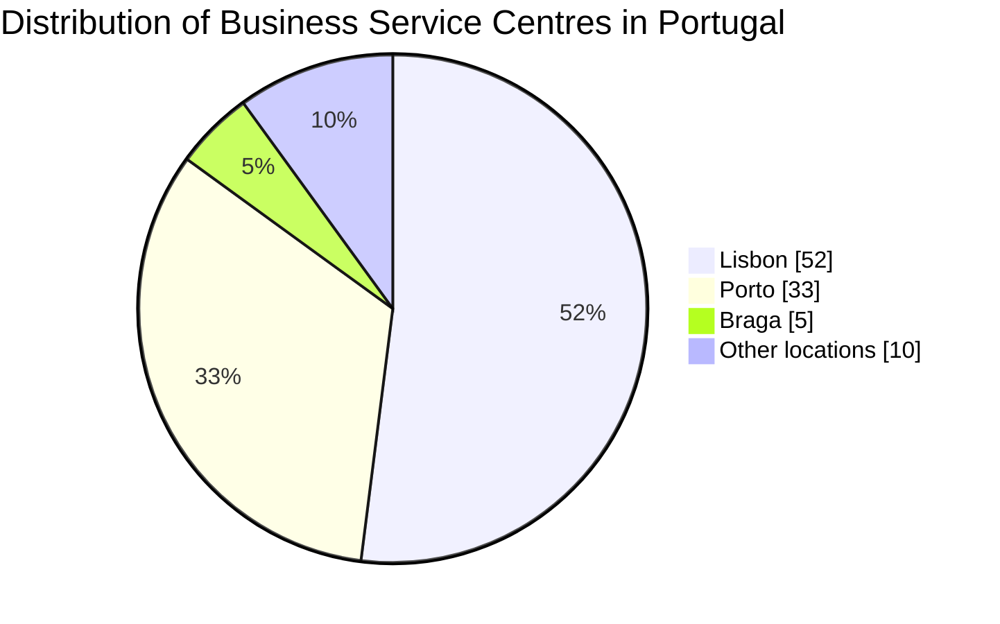
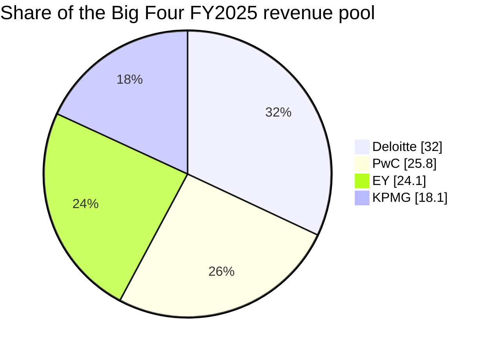
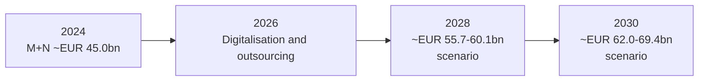
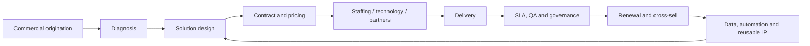
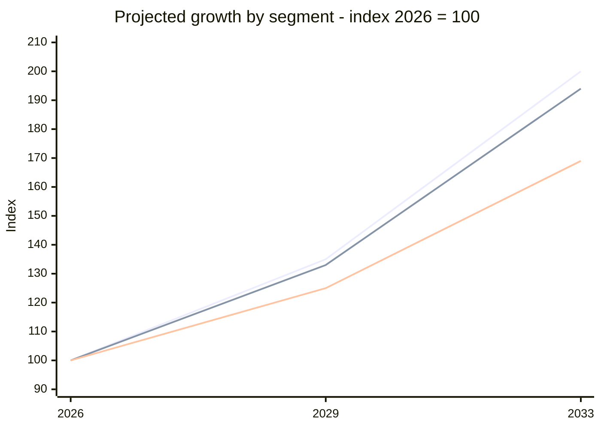
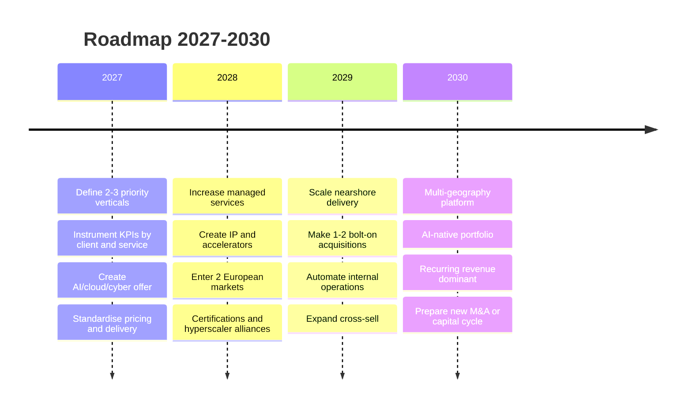

# Business Services - Sector Cyber Resilience & Credit Intelligence Research Q01-Q15 (merged)

**Merge date:** 2026-10-29 | **Merged evidence cut-off:** 29 October 2026 (File A, stated; File B states none; gap-fill research accessed 29 October 2026) | **Status:** Merge of two supplied research files, translated from Portuguese, plus labelled gap-fill research performed at the user's request | **Language:** English (UK)

---

## 1. Merge statement

### 1.1 Source files

| Item | File A | File B |
|---|---|---|
| File name | `Business_Services_q1_q10.md` | `Business_Services__q10_q15.md` |
| Title (translated) | Business Services: global, European and Portuguese sector analysis | Business Services - global and Portugal sector analysis |
| Original language | Portuguese (European) | Portuguese (European) |
| Questions covered (as labelled) | Q01-Q09 by file name; content is a market and strategy analysis (market size, structure, business models, technology, talent, regulation, macro context, M&A, risks, outlook, recommendations). No cyber incidents, threat scenarios, control benchmarks, financial-transmission scenarios, geopolitical cyber register, questionnaire or Q09 assembly | Q10-Q15 by file name; content is a market and strategy analysis (market size, Portugal M+N series, business models, KPIs, competition, regulation, technology, M&A, go-to-market, 2027-2030 roadmap). No fraud analysis, cyber/ICT exposure, third-party concentration analysis, governance-failure evidence, cross-sector comparison or ratings |
| Research date | Not stated separately | Not stated |
| Evidence cut-off | "Data available up to 29 October 2026" (Sources and methodology) | Not stated; content references 2026 items (Accenture FY2026, Regulation No. 756/2026, Directive (EU) 2026/470) |
| Citation style | Tool citation tokens without URLs or titles (54 unique tokens; 75 citation groups); publisher names listed for 31 tokens in the closing source paragraph | Tool citation tokens without URLs or titles (43 unique tokens; 48 citation groups); publishers named in the text for some tokens |
| Instruction-like text | None directed at the merging agent; File A states that "material attached by the user was treated only as research framing and not as an independent source" | None; File B cites the same type of attached material token |

**Merged evidence cut-off:** 29 October 2026, as stated by File A. File B states no cut-off, so the earlier-of-two rule resolves to File A's date. Gap-fill research was accessed on 29 October 2026; each gap-fill item carries its own event and publication date. Temporal classes use the merge date as the reference point: current (2026), prior half-year (H2 2025), contextual (H1 2025, within 18 months), historical (older than 18 months).

**Scope adopted for merged conclusions:** File A defines Business Services as a heterogeneous set of B2B activities (consulting, IT services, BPO, facilities management, HR services, legal and accounting services, other professional and administrative support), close to the European Commission definition [S-001]. File B uses NACE divisions 62, 69, 70, 71, 73, 74, 78, 80, 81 and 82 [S-055, S-056, S-057]. The narrower common scope is File B's explicit NACE list, which covers all File A segments except captive shared service centres and R&D centres (File A's Portugal centre statistics; flagged partial scope, Section 7.3). Geography: global, EU and Portugal in both files; gap-fill research adds UK and US evidence where the sector's cyber and fraud record is documented.

**No new research statement (merged content):** The File A and File B content in this document is translated and restructured only; no facts, figures, sources or dates were added to it. **Gap-fill statement:** At the user's instruction ("merge it, fill the gaps"), public-source research was performed on 29 October 2026 to populate questions that neither file covers (Q02, Q03, Q04, Q07, Q08, Q10, Q11, Q12, Q13, Q14, Q15 and the cyber elements of Q05 and Q06). Every gap-fill item is marked **[GF]** and cites sources S-098 to S-148, which carry URLs. Gap-fill ratings in Q15 are new, are not File B ratings, and are labelled "Gap-fill - Provisional".

### 1.2 Step 1 - Inventory

| Inventory item | File A | File B |
|---|---|---|
| Sector definition | Heterogeneous B2B activities; close to European Commission definition | NACE 62, 69, 70, 71, 73, 74, 78, 80, 81, 82 |
| Subsectors | Consulting; IT services; BPO; facilities management; HR services; legal / accounting / audit; other (engineering, testing, advertising, market research, compliance, procurement, administrative support) | Consulting; IT services; BPO; facilities; HR / staffing; legal; accounting / audit; engineering / testing / compliance |
| Geography | Global, EU, Portugal | Global, Portugal (EU comparisons) |
| Questions covered (substantive) | Q01 (market structure, business models); Q05 (partial: margins, working capital, cyclicality); Q06 (partial: AI Act, NIS2, GDPR, Services Directive); Q07 (partial: macro context only); Q09 (executive summary, outlook, method) | Q01 (market structure, value chain, KPIs); Q06 (partial: GDPR, NIS2 Portugal, AI Act, CSRD, DORA); Q11 (partial: technology adoption, talent); Q13 (partial: competition, M&A, barriers) |
| Questions missing | Q02, Q03, Q04, Q08, Q10-Q15 | Q02-Q05, Q07, Q08, Q10, Q12 (partial only), Q14, Q15; no Q10A-Q10D |
| Sources | 54 unique citation tokens (no URLs) | 43 unique citation tokens (no URLs) |
| Incidents | 0 | 0 |
| Fraud cases | 0 | 0 |
| Scenarios | 0 (one segment growth projection, labelled as calculation) | 0 (one M+N planning scenario, labelled as not an official forecast) |
| Metrics | Market sizes, Portugal centre statistics, company revenues and margins, Big Four shares, macro projections, adoption shares | Market sizes and forecasts, Portugal M+N turnover series, GVA, margin ranges, company metrics, digital adoption, ICT employment, M&A counts |
| Regulatory items | 4 (AI Act, NIS2, GDPR, Services Directive) | 6 (GDPR, NIS2 with Portuguese transposition, AI Act, Digital Omnibus adjustment, CSRD / Directive (EU) 2026/470, DORA) |
| Ratings | None | None |
| Questionnaire items | None | None |
| Tables | 3 (subsector structure; operator comparison; pricing models) plus 4 Mermaid diagrams | 4 (global markets; Portugal M+N series; subsector comparison; KPIs) plus 1 roadmap table and 4 Mermaid diagrams |
| Partial coverage flags | Not a cyber-risk research file; no dated incident evidence; tokens unresolvable to URLs | Not a cyber-risk research file; no cut-off; tokens unresolvable to URLs |

### 1.3 Acronyms (defined at first use in this file)

ACFE - Association of Certified Fraud Examiners; AdC - Portuguese Competition Authority (Autoridade da Concorrência); AI - artificial intelligence; AICEP - Portuguese trade and investment agency; ANACOM - Portuguese communications regulator; APT - advanced persistent threat; B2B - business-to-business; BEC - business email compromise; BPO / BPS - business process outsourcing / services; BCE / ECB - European Central Bank; CAGR - compound annual growth rate; CFO - chief financial officer; CPS - UK Crown Prosecution Service; CRM - customer relationship management; CSBS - UK Cyber Security Breaches Survey; CS&R Bill - UK Cyber Security and Resilience (Network and Information Systems) Bill; CSRD - EU Corporate Sustainability Reporting Directive; CSW - Portuguese software engineering firm (registered name contains a restricted word); CTPP - EU-designated ICT third-party provider under DORA (official name contains a restricted word); DBIR - Verizon Data Breach Investigations Report; DOJ - US Department of Justice; DORA - EU Digital Operational Resilience Act; DPA - deferred prosecution agreement; DPRK - Democratic People's Republic of Korea; DSO - days sales outstanding; EBITA / EBITDA - earnings before interest, taxes and amortisation / and depreciation; EC - European Commission; ECCTA - UK Economic Crime and Corporate Transparency Act 2023; ESAs - European Supervisory Authorities (EBA, EIOPA, ESMA); ESG - environmental, social and governance; FCF - free cash flow; FCPA - US Foreign Corrupt Practices Act; FM - facilities management; FRC - UK Financial Reporting Council; FTE - full-time equivalent; GBS - global business services; GDPR / RGPD - EU General Data Protection Regulation; GVA - gross value added; HCM - human capital management; HR - human resources; IC3 - FBI Internet Crime Complaint Center; ICO - UK Information Commissioner's Office; ICT - information and communications technology; IDC - International Data Corporation; IFMA - International Facility Management Association; ILO - International Labour Organization; INE - Statistics Portugal; IP - intellectual property; ISAC - information sharing and analysis centre; ITSM - IT service management; KPI - key performance indicator; M&A - mergers and acquisitions; MFA - multi-factor authentication; MSP / MSSP - managed (security) service provider; NACE - EU statistical classification of economic activities; NCSC - UK National Cyber Security Centre; NIS2 - EU Directive 2022/2555; NLP - natural language processing; NRR - net revenue retention; PE - private equity; PII - personally identifiable information; R&D - research and development; RMM - remote monitoring and management; ROIC - return on invested capital; RPA - robotic process automation; RPO - recruitment process outsourcing; SaaS - software-as-a-service; SBS - Eurostat Structural Business Statistics; SFO - UK fraud prosecutor (official name contains a restricted word); SIRP - Portuguese Intelligence System; SLA - service level agreement; SSC - shared service centre; T&M - time and materials; TPRM - third-party risk management; VAB - gross value added (Portuguese term); WACC - weighted average cost of capital; WEC - World Employment Confederation.

**Evidence labels used throughout:** [S-nnn] = unified source ID (Section 10). **[GF]** = gap-fill research added in this run at the user's request; not from File A or File B. "Merge note" = analysis added during the merge, not a source finding. File A and File B text is translated faithfully; figures, units, periods and qualifiers are unchanged except decimal commas converted to points and Portuguese long-scale terms converted ("bilião" = trillion; "mil milhões" = billion).

---

## 2. Executive summary for Senior Credit Officers

**Ratings (Gap-fill - Provisional; File B proposed none)**
- **Fraud:** High; Provisional; confidence Medium.
- **Cyber/ICT:** High; Provisional; confidence Medium.
- **Operational resilience / TPRM:** High; Provisional; confidence Medium.
- **Governance / operating model:** Medium; Provisional; confidence Low.

**Five findings**
1. Providers aggregate client data and access: Capita's 2023 breach exposed 6.6 million people and 325 pension-scheme clients (£14 million ICO fine) [S-098]; Conduent recorded a $25 million notification charge [S-101]. [GF]
2. Outsourced help desks and IT platforms are targeted to reach clients: US and allied agencies warn that Scattered Spider targets contracted IT help desks [S-124]; a 2026 EY platform breach exposed client tax data [S-119]. [GF]
3. The sector is a concentration node: Accenture, Capgemini, IBM, Kyndryl, NTT DATA and TCS are among 19 DORA-designated providers [S-105]. [GF]
4. Fraud exposure is hybrid: a deepfake video call cost Arup HK$200 million [S-106]; McKinsey Africa agreed a $122.85 million DPA [S-115]. [GF]
5. Economics amplify shocks: staffing and facilities run low single-digit margins and fund payroll before collection (File A) [S-028, S-029]; File A and File B contain no cyber evidence, so ratings rest on gap-fill research (G-01).

**Three borrower questions**
1. Which client environments can your staff, tools and help desks access, and how are identity resets and privileged access controlled? [GF]
2. How long could you deliver key contracts with core systems down, and what contingent liability follows a client data breach? [GF]
3. What share of revenue is recurring, how concentrated are the top ten clients, and how is payroll funded? (File A recommendations; uncited)

---
## 3. Findings by question

*Placement note: File A and File B contain market and strategy content rather than question-by-question cyber research. Their content is placed below by topic (File A sections mainly in Q01, Q05, Q06, Q07, Q09; File B sections mainly in Q01, Q06, Q09, Q11, Q13, Q14). Every paragraph and table of both files appears once; the origin is stated at the start of each block.*

## Q01 - Sector Operating Model & Key Dependencies

*Conclusion: Business Services is a heterogeneous, fragmented B2B sector whose revenue is tied to people, expertise and, increasingly, technology platforms; delivery depends on client-environment access, hyperscaler and enterprise-software ecosystems and, in Portugal, concentrated service-centre clusters in Lisbon and Porto.*

### Q01.1 Sector definition and size (File A, "Executive summary" paragraphs 1-2 and "Size, structure and segmentation")

[S-001] The **Business Services** sector should be understood as a heterogeneous set of B2B activities that includes consulting, IT services, Business Process Outsourcing (BPO), facilities management, human resources services, legal and accounting services and other professional and administrative support activities. This definition is close to the one used by the European Commission, which includes engineering, architecture, IT, professional services, employment and facilities management. The Commission estimates that business services represent about **11% of European Union GDP**, evidencing their systemic weight in business competitiveness.

[S-002] At global scale there is no single comparable official statistic aggregating the whole perimeter. A commercial estimate puts the global professional and commercial services market at about **USD 6.3 trillion in 2025**, but this should be treated as an order of magnitude, not as an official statistical measure, owing to perimeter differences and the risk of double counting between consulting, IT outsourcing, BPO and managed services. [S-003] [S-004] [S-005] Indicators for specific segments are more robust: the global IT professional services market was estimated at USD 988.7 billion in 2025, BPO at USD 328.4 billion and facilities management, under a relatively narrow definition, at USD 45.9 billion. [S-006] IFMA, however, uses a much broader definition of facilities management and estimated the global market at about USD 1.125 trillion, showing how the statistical perimeter substantially changes the result.

[S-011] [S-012] Fragmentation is structural. In the EU, professional, scientific and technical activities represented approximately **5.4 million enterprises, or 15.8% of enterprises in the European business economy, in 2024**. The high weight of micro-enterprises and local professional firms coexists with large global consulting, outsourcing, staffing and facilities platforms.

[S-013] [S-014] In Portugal, a macroeconomic approximation through **ISIC/NACE sections M+N**, which group professional, scientific, technical, administrative and support service activities, points to **EUR 24.254 billion of gross value added in 2024**. This indicator does not fully include IT services, which appear in section J, and should therefore be read as a partial bound of the perimeter defined in this report.

| Subsector | Economic structure | Main revenue sources | Indicative growth / scale |
|---|---|---|---|
| Consulting | High human-capital intensity; transformation, strategy and implementation projects | Project fees, T&M, retainers, success fees, managed services | Structural growth supported by digital transformation, AI, regulation and productivity |
| IT services | Integration, development, cloud, managed IT, cybersecurity, outsourcing | T&M, fixed-price projects, subscriptions, recurring contracts, consumption | [S-015] [S-003] Gartner estimates USD 1.57 trillion of "services" in 2026 in its latest taxonomy; specialist IT professional services estimates point to USD 1.076 trillion |
| BPO | Outsourced operation of processes such as finance, customer service, procurement and HR | Price per FTE, transaction, contact, process or outcome | [S-004] USD 328.4 billion in 2025; estimated CAGR 9.9% to 2033 |
| Facilities management | Cleaning, maintenance, workplace, catering, security and technical services | Multi-year contracts, fee per area/location/site, cost-plus | [S-005] [S-006] Market definitions vary strongly; narrow estimate of USD 45.9 billion in 2025 |
| HR services | Temporary work, recruitment, RPO, MSP, career transition and talent platforms | Salary mark-up, placement fees, fee per hire, subscription/MSP | [S-016] The sector placed 61 million people in jobs in 2024; global revenues fell 4.2% that year |
| Legal / accounting / audit | Regulated professional services, tax, assurance, advisory | Hourly billing, fixed fee, retainers, recurring engagements | [S-017] [S-018] [S-019] [S-020] The Big Four each generate tens of billions of USD a year; high consolidation at the top and local fragmentation |
| Other | Engineering, testing, advertising, market research, compliance, procurement and administrative support | Project, subscription, outsourcing, transactional fees | [S-021] Strong heterogeneity and growth linked to specialisation and regulation |

[S-022] [S-007] In Portugal, the international centres segment is a distinct reality from the total universe of service companies. AICEP/IDC identified 70% of the centres in its sample as SSC/GBS, 56% as IT centres, 20% as R&D and 17% as BPO; the categories overlap and therefore are not additive market shares.

[S-008] The geographic distribution of the 260 centres estimated by AICEP shows relevant concentration in Lisbon and Porto: Lisbon represented 52% of sites, Porto 33%, Braga 5% and other locations 10%.

[S-017] [S-023] [S-019] [S-020] A more comparable measure of "competitive share" can be built only within a peer group. Considering the Big Four's global FY2025 revenues, Deloitte represented approximately 32% of the aggregate pool of these four networks, PwC 26%, EY 24% and KPMG 18%. This **is not equivalent to share of the global professional services market**, because it excludes thousands of competitors and adjacent segments. Reported revenues were USD 70.5 billion for Deloitte, USD 57.0 billion for PwC, USD 53.2 billion for EY and USD 39.8 billion for KPMG.

### Q01.2 Sector definition and size (File B, "Executive summary" paragraphs 1-3 and "Size, growth and market structure")

[S-055] [S-056] [S-057] [S-058] The **Business Services** sector covers a heterogeneous set of B2B activities that transform specialist knowledge, qualified labour, processes and operational infrastructure into consulting, technology, outsourcing, human resources, legal and accounting, facilities, administrative support, research, engineering, compliance and other business support services. For consistency, this report uses as its main perimeter NACE activities 62, 69, 70, 71, 73, 74, 78, 80, 81 and 82, always distinguishing subsectors where economics, technology intensity or competitive structure diverge. This approach is consistent with the need not to treat Business Services as a homogeneous sector.

[S-059] [S-060] Globally, a broad definition of professional/commercial services points to a market of about **US$6.3 trillion in 2025**, with structural growth estimated at close to 6% a year to the early 2030s. The narrower definition of professional services points to US$6.37 trillion in 2025 and about US$8.48 trillion in 2030. The estimates are not directly comparable because they differ in their treatment of IT, outsourcing, facilities, staffing and engineering, and should be used as orders of magnitude, not as a single official series.

[S-061] [S-062] In Portugal, the best comparable official indicator is the turnover of sections **M - professional, scientific and technical activities** and **N - administrative and support service activities**. Together these two sections went from approximately **EUR 25.0 billion in 2020 to EUR 45.0 billion in 2024**. There is a methodological break in 2021, so the raw CAGR for the period overstates real economic growth. Section M reached EUR 23.27 billion in 2024 and section N EUR 21.72 billion. The definition still excludes part of NACE 62 technology services, so EUR 45 billion should be seen as a **statistical floor** for the Business Services universe considered in this report.

[S-067] [S-057] Statistical fragmentation is a central problem. There is no single official classification called Business Services. NACE, NAICS and commercial reports group consulting, technology, BPO, facilities, staffing, legal, accounting, engineering and administrative services differently. The most rigorous way to measure the sector is therefore to work by sub-segment and keep the boundaries constant.

| Global market | Recent size | Growth / forecast | Reading |
|---|---:|---:|---|
| Professional & commercial services, broad definition | ~US$6.3tn, 2025 | ~6.4% CAGR 2026-31 | [S-059] Best aggregate proxy for broad Business Services |
| Professional services | US$6.37tn, 2025 | US$8.48tn in 2030; ~6.2% CAGR | [S-060] Includes legal, accounting, consulting and various professional services, but does not fully coincide with BPO/facilities |
| Consulting | ~US$929bn, 2025 | ~5.0% CAGR to 2034 | [S-068] Moderate growth; AI and transformation raise demand but pressure traditional pricing |
| IT services | US$1.49tn, 2025 | US$1.57tn, 2026 | [S-069] Growth of 5.3% forecast in 2026; cloud and AI lead investment |
| BPO | US$328bn, 2025 | US$696bn in 2033; 9.9% CAGR 2026-33 | [S-070] One of the sub-segments with the highest structural growth |
| Facilities management | US$45.9bn, 2025 | US$82.9bn in 2033; 7.8% CAGR | [S-071] Growth supported by energy efficiency, smart buildings and outsourcing |

[S-072] [S-070] Commercial forecasts diverge substantially. For example, another definition of BPO estimates US$425 billion in 2026 and a CAGR of only 4.1% to 2031. This divergence shows that market numbers should be treated as **ranges associated with specific perimeters**, not as a single accounting truth.

[S-069] Incremental growth is concentrated where Business Services intersects with technology: AI implementation, cloud migration, cybersecurity, data engineering, intelligent operations, managed services, compliance, analytics and automation. Global spending on IT services is expected to reach approximately US$1.57 trillion in 2026, while infrastructure-as-a-service is expected to grow almost 30% that year, illustrating the shift of corporate budgets towards digital platforms and cloud.

**Portugal: recent years and projection (File B).** The M+N statistical core showed the following nominal trajectory:

| EUR billion | 2020 | 2021 | 2022 | 2023 | 2024 |
|---|---:|---:|---:|---:|---:|
| Professional, scientific & technical - M | 13.91 | 15.88 | 20.59 | 21.07 | 23.27 |
| Administrative & support - N | 11.06 | 13.02 | 16.89 | 19.75 | 21.72 |
| **M+N core** | **24.97** | **28.91** | **37.48** | **40.82** | **44.99** |

[S-061] [S-062] Statistical source: Eurostat SBS. The series has a methodological break in 2021, so the 2020-2024 comparison should not be converted mechanically into a homogeneous economic CAGR.

[S-061] [S-062] [S-073] Growth remained strong in 2024: +10.4% nominal in section M and +10.0% in section N. Combined M+N GVA reached approximately EUR 24.25 billion in 2024 and EUR 26.29 billion in 2025 in the available national accounts, reinforcing the growing importance of these services in the Portuguese economy.

[S-074] The European Commission notes that professional, scientific and technical activities represent about 9% of Portuguese value added, still below the EU's 11%, but with employment growing faster than the general economy. This differential suggests room for convergence if Portugal can raise productivity and specialisation.

[S-061] [S-062] [S-066] For 2028-2030 there is no specific official forecast for this perimeter. A planning scenario, not an official forecast, using sustainable nominal growth of **5.5%-7.5%** on the 2024 M+N base would produce approximately **EUR 55.7-60.1 billion in 2028** and **EUR 62.0-69.4 billion in 2030**. The range assumes positive real growth, moderate inflation, continued outsourcing and digitalisation and no prolonged European recession. The scenario does not explicitly include NACE 62, so it remains conservative relative to the broader Business Services universe. The structural support for this hypothesis comes from recent Portuguese growth, digitalisation and the rising intensity of specialist services.

### Q01.3 Business models, competition and unit economics (File A, "Competition, business models and unit economics")

[S-024] The sector combines three archetypes. The first is **people-intensive**, typical of staffing, facilities, traditional BPO and consulting, in which revenue and capacity are strongly tied to headcount. The second is **expertise-intensive**, where specialist knowledge, brand and client relationships allow higher hourly rates and margins. The third is **technology-enabled**, in which platforms, automation, proprietary software and data assets allow revenue to be partly decoupled from headcount. Competitive evolution is clearly favouring the third model, above all in IT services, cybersecurity, data, BPO and managed services. Capgemini's acquisition of WNS for USD 3.3 billion in 2025 was explicitly presented as a bet on intelligent operations powered by agentic AI.

**Comparison of selected operators**

| Company | Main exposure | Recent revenue | Operating margin / equivalent | Dominant model |
|---|---|---:|---:|---|
| Accenture | Consulting, technology, managed services | USD 69.7 billion FY2025 | 15.6% adjusted | [S-025] Projects + managed services + outsourcing + technology |
| Deloitte | Audit, tax, consulting, advisory | USD 70.5 billion FY2025 | Not disclosed on a comparable consolidated basis | [S-017] Partnership/network; professional fees |
| PwC | Assurance, tax/legal, advisory | USD 57.0 billion FY2025 | Not disclosed on a comparable consolidated basis | [S-023] Network; professional engagements |
| EY | Assurance, consulting, tax, strategy & transactions | USD 53.2 billion FY2025 | Not disclosed on a comparable consolidated basis | [S-019] Network; professional engagements |
| Capgemini | IT services, consulting, engineering, BPS | EUR 22.47 billion 2025 | 13.3% operating margin | [S-026] Projects + managed services + outsourcing |
| Cognizant | IT services and digital operations | USD 21.1 billion 2025 | 15.8% adjusted | [S-027] Offshore/nearshore delivery + managed services |
| ISS | Facilities management | DKK 85 billion 2025 | 5.0% | [S-028] Large-scale contracts, high labour intensity |
| Randstad | Staffing and talent services | EUR 23.08 billion 2025 | ~2.2% operating margin calculated from EUR 512 million operating profit | [S-029] Mark-up on temporary work + recruitment/MSP |
| Novabase | IT / digital transformation | EUR 124.5 million 2025 | EBITDA ≈12.2% calculated on EUR 15.2 million | [S-030] Specialist projects, digital services and internationalisation |
| Claranet Portugal | Cloud, managed IT, cyber, workplace, data | EUR 205 million FY2024 | EBITDA ≈7.5% | [S-031] Managed services + cloud + projects |

[S-025] [S-026] [S-027] [S-028] [S-029] Margin differences are structurally important. Consulting and specialist IT services can reach low-to-mid-teens operating margins at scale, as Accenture, Capgemini and Cognizant illustrate. Facilities management and staffing normally operate with lower percentage margins, because most of the billing remunerates wages, suppliers or pass-through costs.

[S-025] [S-026] The most relevant KPIs vary by subsector. In consulting and IT services the central indicators are **utilisation rate, revenue per billable employee, billable headcount, bill rate, backlog, bookings, book-to-bill, attrition, offshore/nearshore mix and gross/operating margin**. Accenture reported USD 80.6 billion of bookings in FY2025 and book-to-bill of approximately 1.2; Capgemini reported EUR 24.4 billion of bookings and book-to-bill of 1.08 in 2025.

[S-028] In BPO, KPIs include revenue/FTE, cost/FTE, occupancy, schedule adherence, transactions per FTE, average handling time, first-contact resolution, SLA attainment, automation rate and contract retention. In staffing, gross margin, temporary-worker hours, placements, fill rate and the spread between billing rate and pay rate dominate the analysis. In facilities, contract retention, organic growth, wage inflation pass-through, labour productivity, SLA performance and margin per contract are particularly relevant. ISS's 2025 performance shows this sensitivity: organic growth of 4.3%, partly supported by price increases, with an operating margin before other items of 5.0%.

Pricing models tend to evolve along a predictable economic sequence: **hourly/T&M → fixed-price → managed service → transaction-based → outcome-based**. Moving to the right increases the provider's execution risk but also allows it to capture a larger part of the productivity gains generated by automation. (File A; uncited)

| Pricing | Who bears productivity risk? | Margin potential | Suitability |
|---|---|---|---|
| Time & materials | Client | Low to medium | Consulting, development, scarce expertise |
| Fixed-price | Provider | Medium | Repeatable, well-specified projects |
| FTE-based | Partly client | Low to medium | BPO and shared operations |
| Per transaction / ticket | Provider | Medium | BPO, service desk, processing |
| Subscription / managed service | Provider | Medium to high | Cloud, cyber, IT operations |
| Outcome / gain-share | Mainly provider | High but volatile | Automation, procurement, collections, transformation |

The central economic point for the coming years will be **capturing AI productivity**. In a T&M contract, a reduction in required hours can reduce billing. In a managed service or outcome contract, the same reduction can increase margin. This creates strong incentives to renegotiate the commercial model as automation advances. (File A; uncited)

### Q01.4 Business models, value chain and unit economics (File B, "Business models, value chain and unit economics" and segmentation table)

| Subsector | Recent global size | Structural growth | Typical operating margin* | Typical contract | Dominant economics |
|---|---:|---:|---:|---|---|
| Consulting | ~US$929bn | ~5% | 10-25% | Project, retainer, outcome-based | Utilisation, seniority mix, pricing |
| IT services | ~US$1.5tn | ~5-10%, higher in cloud/AI | 10-20% | Project + managed service | Utilisation, offshore mix, IP |
| BPO | ~US$328-425bn | ~4-10% | 8-18% | 3-7 years, per FTE/transaction/outcome | Scale, automation, location |
| Facilities | ~US$46bn in the definition studied | ~8% | 4-10% | 3-5 years, monthly price/SLA | Density, procurement, labour |
| HR/staffing | >US$20bn for large global groups alone; very fragmented market | Cyclical, low-medium structural | 2-8% in traditional staffing | Mark-up on pay; placement fee | Spread, fill rate, time to place |
| Legal | Fragmented global market | Medium | 20-40% in high-end firms | Hourly, fixed fee, retainer | Realisation, leverage, partner productivity |
| Accounting/audit | Very fragmented, Big Four dominant in enterprise | Medium | 10-30% depending on mix | Annual, monthly, project fee | Utilisation, leverage, compliance |
| Engineering/testing/compliance | Included in professional services | Medium-high | 10-20% | Project, certification, maintenance | Specialisation, accreditations, recurring revenue |

[S-075] [S-076] [S-077] \*Margins are indicative analytical benchmarks, not comparable official averages. Dispersion within each subsector is high. Public references from large operators illustrate the range: Capgemini reported an adjusted operating margin of 13.3% in 2025, TP recurring EBITA of 14.6% and Randstad quarterly EBITA of 3.3%.

[S-063] [S-070] [S-071] The most important differences are structural. Consulting, legal and accounting have high knowledge intensity and pricing tied to expertise; staffing and facilities have a larger labour component and lower margin; IT services and BPO have the greatest opportunity to turn work into recurring, scalable revenue through automation, cloud and AI.

The typical value chain starts with demand generation and client diagnosis, moves through solution design, contracting, staffing or technology configuration, delivery, governance/SLA and, ideally, expansion into new services. Companies of higher economic quality move progressively from the left-hand end, based on selling hours, towards activities with more intellectual property and recurring revenue. (File B; uncited)

[S-063] [S-064] The main economic models are **time-and-materials**, fixed project price, retainer, FTE-based fee, transaction fee, success fee, revenue share, subscription/managed service and outcome-based pricing. The highest-value evolution goes from "hours sold" to "capacity/result delivered", reducing the linear relationship between revenue growth and headcount growth. Growing investment in AI is accelerating this transition.

In consulting and IT services, the simplified operating equation is: **Revenue = billable FTEs × utilisation rate × average billing rate.** Consequently, small changes in utilisation or billing rate have a strong impact on margin. Mature companies seek sustainable utilisation above approximately 70%, but the relevant benchmark depends on seniority, project type, bench needs and commercial intensity. The most useful metric is not utilisation alone but **gross margin per billable FTE**. (File B; uncited)

[S-070] [S-075] In BPO and managed services, the economic unit becomes **cost per transaction/process/SLA**. Automation may initially reduce revenue if the contract is purely per FTE, but it increases margin and competitiveness when the price is tied to volumes, outcomes or results. This shift explains growing demand for productivity-based contracts and intelligent operations.

[S-077] In staffing, the central metric is **gross profit per placed worker**, not billing, because much of the revenue corresponds to wages passed on to the client. Structural operating margin is therefore much lower than in specialist consulting. Randstad recorded EUR 23.1 billion of revenue in 2025 but operates with significantly lower margins than technology or consulting companies.

[S-071] In facilities, economics depend on geographic density, labour productivity, procurement, energy, route efficiency, subcontracting and the ability to combine services. Hard facilities, such as technical maintenance, tend to have a higher competence barrier than cleaning or generic support. In 2025, hard services represented 55% of the facilities market in the Grand View Research definition.

The most useful KPIs for sector management are (File B; uncited):

| Dimension | Priority KPIs | Quality signal |
|---|---|---|
| Growth | organic growth, bookings, book-to-bill, pipeline coverage | bookings > revenue and diversified pipeline |
| Revenue | % recurring, revenue per FTE, billing rate | increase without equivalent headcount growth |
| Delivery | utilisation, bench, SLA attainment, defect/rework rate | stable utilisation and SLA >95-99% depending on service |
| Clients | retention, NRR, top-10 concentration, cross-sell | NRR >100%, low concentration |
| Margin | gross margin, EBITDA/EBITA, contribution margin | improvement after automation |
| Cash | DSO, cash conversion, FCF/EBITDA | controlled DSO and high conversion |
| People | voluntary attrition, time-to-hire, revenue/FTE | rising productivity |
| Technology | % revenue AI/cloud/cyber, automation rate | growing digital mix |
| Risk | cyber incidents, SLA breaches, supplier dependence | downward trend |
| M&A | ROIC, earn-out delivery, synergy capture | value creation after integration |

[S-075] [S-078] [S-079] Capgemini offers a useful benchmark for an integrated technology company: in 2025 it reported **book-to-bill of 1.08, operating margin of 13.3% and organic free cash flow of EUR 1.95 billion**. Accenture reached approximately **US$74.2 billion of revenue in FY2026**, adjusted operating margin of 15.8% and US$84.5 billion of bookings, demonstrating the economic scale possible when consulting, technology and managed services are integrated.

### Q01.5 Dependency map **[GF]**

*Gap-fill: neither file maps operational dependencies. Rows draw on File A's risk list where marked and on gap-fill evidence.*

| DEP | Dependency | Subsectors | Plausible disruption mechanism | Operational consequence | Substitutability / switching | Evidence |
|---|---|---|---|---|---|---|
| DEP-01 | Hyperscaler and enterprise-software ecosystems (Microsoft, AWS, Google, SAP, Salesforce, ServiceNow) | IT services, BPO, consulting | Outage, pricing change, credential theft | Delivery stoppage across many clients | Low; long migration | File A risk list (uncited); [S-117] (cloud credentials reused from Salesloft Drift data) |
| DEP-02 | Privileged access into client environments (RMM tools, admin accounts, VPNs) | MSPs, IT outsourcing, BPO | Compromise of provider tooling used to reach clients | Ransomware or data theft at many clients at once | Client-side revocation is fast; provider rebuild is slow | [S-114] (Kaseya: fewer than 1,500 downstream businesses); [S-133] (Cognizant clients suspended access) |
| DEP-03 | Outsourced IT service desks and identity-reset processes | BPO, IT outsourcing | Social engineering of help-desk staff | Account takeover and ransomware at clients | Medium; process change quick, vendor change slow | [S-124] [S-125] |
| DEP-04 | Third-party ITSM, file-transfer and SaaS platforms holding client documents | Professional services, BPO | Platform vulnerability or credential compromise | Client data exposure | Medium | [S-119] (EY ITSM platform) |
| DEP-05 | Endpoint security and update chains | All | Faulty update | Mass endpoint crash | Low in the short term | [S-140] (8.5 million Windows devices) |
| DEP-06 | Payroll funding and bank credit lines | Staffing, facilities | Payroll system outage; working-capital squeeze | Missed pay runs; client service failure | Medium | File A risk list (uncited); [S-135] (ISS payroll and invoicing disrupted) |
| DEP-07 | Concentrated delivery locations (Lisbon 52%, Porto 33% of Portuguese centres) | Portuguese SSC/GBS and IT centres | Regional outage or labour disruption | Concentrated service interruption | Medium | [S-008] |

**Merge notes:** (a) File A (EC definition) and File B (NACE list) describe the same sector with different boundaries; the narrower common scope is File B's NACE list (Section 1.1; C-02). (b) Portugal M+N GVA is EUR 24.254 billion (File A) and approximately EUR 24.25 billion (File B) for 2024 - consistent (C-03); File B's EUR 45.0 billion is turnover, a different measure. (c) Accenture figures differ by fiscal year (FY2025 in File A; FY2026 in File B) (C-09). (d) Capgemini's 13.3% margin is "operating margin" in File A and "adjusted operating margin" in File B (C-11). (e) Randstad margin basis differs (C-10). (f) Several File A and File B statements carry no citation; they are marked "uncited".

**Cross-references:** Q05 (margins, working capital), Q11 (technology adoption), Q12 (DEP-01 to DEP-05, concentration), Q13 (market structure, M&A), DEP register; conflicts C-02, C-03, C-05 to C-12.

---

## Q02 - Major Cyber Incidents & Case Studies **[GF]**

*Conclusion: Documented incidents show that business-services providers are attacked both as victims and as gateways: help-desk and platform compromises, ransomware at outsourcers and data theft from aggregators of client data. Neither File A nor File B contains incidents; all content below is gap-fill.*

### Q02.1 Incident register (gap-fill; one event = one row)

| INC | Organisation | Subsector | Country | Event date | Disclosure / key date | Class | Mechanism (as reported) | Operational / financial outcome | Regulatory outcome | Horizon | S- IDs |
|---|---|---|---|---|---|---|---|---|---|---|---|
| INC-01 | Capita | BPO / pensions administration | UK | 22-31 Mar 2023 | ICO fine 15 Oct 2025 | Intrusion (ransomware, exfiltration) | Malicious file download; device quarantined after 58 hours; privilege escalation; ~1 TB exfiltrated; ransomware deployed | 6.6 million people; 325 of 600+ pension-scheme clients affected | £14 million fine (£8m plc, £6m Capita Pension Solutions); £45 million initially proposed | Historical (event); fine prior half-year | S-098, S-099, S-100 |
| INC-02 | Conduent | BPO / government services | USA | 21 Oct 2024 - 13 Jan 2025 | SEC filing Apr 2025; FY2025 10-K | Intrusion (ransomware claim, exfiltration) | Unauthorised access ~3 months; SafePay claimed | $25 million non-recurring notification charge; $17 million paid by 31 Dec 2025; >25 million individuals per state filings | State notifications; litigation (n/s) | Contextual | S-101, S-102, S-103 |
| INC-03 | Telus Digital | BPO | Canada / global | Multi-month to Mar 2026 | Confirmed 12 Mar 2026 | Intrusion (data extortion) | Google Cloud credentials found in Salesloft Drift data (threat-actor claim) | Operations "fully functional"; actor claims ~1 PB; 28 client companies named by actor | n/s | Current | S-117, S-118 |
| INC-04 | EY (Ernst & Young LLP) | Accounting / tax | USA | 28 Mar - 12 Apr 2026 | Detected 23 Apr 2026; letters dated 13 Jul 2026; client names reported 6-8 Oct 2026 (update) | Intrusion (third-party platform) | Third-party ITSM platform used by tax IT support; ShinyHunters claimed; media link to Checkmarx | Client tax documents downloaded; Goldman Sachs and Man Group among clients reported | State notifications | Current; last-30-days update | S-119, S-120, S-121 |
| INC-05 | Arup | Engineering consultancy | Hong Kong / UK | Jan 2024 | Police report 29 Jan 2024; Arup confirmed May 2024 | Cyber-enabled fraud (deepfake) | Deepfake video conference impersonating CFO | HK$200 million in 15 transfers; Arup: "financial stability and business operations were not affected" | Police investigation | Historical | S-106, S-107 |
| INC-06 | Kaseya VSA (MSP software) | MSP tooling | Global | 2 Jul 2021 | Kaseya statements Jul 2021 | Intrusion (supply-chain ransomware) | Exploited VSA on-premises servers | Fewer than 60 Kaseya customers directly compromised; fewer than 1,500 downstream businesses; Coop Sweden stores closed | n/s | Historical landmark | S-114 |
| INC-07 | Cognizant | IT services | USA / global | 17 Apr 2020 | Q1 2020 earnings call, 7 May 2020 | Intrusion (Maze ransomware) | Internal systems encrypted | $50-70 million revenue and margin impact in Q2 2020; some clients suspended Cognizant's network access | n/s | Historical landmark | S-132, S-133 |
| INC-08 | Sopra Steria | IT services | France / Europe | 20-21 Oct 2020 | Statement 25 Nov 2020 | Intrusion (Ryuk ransomware) | Active Directory compromised (as reported) | €40-50 million gross operating-margin impact; cyber insurance cover €30 million; FY2020 guidance cut | n/s | Historical landmark | S-134 |
| INC-09 | ISS | Facilities management | Denmark / global | 17 Feb 2020 | Annual report 2020 | Intrusion (malware; reported as ransomware) | Shared IT services disabled; control of key applications regained 20 Mar 2020 | DKK 365 million non-cash write-down for infrastructure rebuild; payroll and invoicing disrupted; no ransom paid | n/s | Historical landmark | S-135, S-136 |
| INC-10 | Marks and Spencer / TCS service desk (contested) | IT outsourcing (help desk) | UK / India | Apr 2025 | TCS exchange filing 27 Oct 2025 | Intrusion via social engineering (contested channel) | Impersonation attack "involving a third party" (M&S chairman, as reported); TCS states vulnerabilities did not originate from its systems | M&S profit impact ~£300 million (retailer); help-desk contract retendered from Jan 2025 | n/s | Contextual | S-110, S-111 |
| INC-11 | SIRP contractor (Portugal) | IT services (portal developer) | Portugal | Disclosed Oct 2026 | 8 Oct 2026 | Intrusion (data exposure) | Development server of a company contracted in 2025 to build public portals | Actors claim >312,000 files; SIRP: no intrusion into internal systems; limited set of applications potentially exposed; reported to the Prosecutor-General | Referral to prosecutor | Current; last 30 days (new) | S-147 |
| INC-12 | IDC Frontier (IDCF Cloud) | Cloud / hosting services | Japan | From 7 Oct 2026 | Oct 2026 | Intrusion (ransomware) -> outage | Ransomware on cloud environment | ~495 companies and local governments affected | n/s | Current; last 30 days (new) | S-148 |

**Historical landmark (state actor):** APT10 "Cloud Hopper" targeted MSPs from 2014 to reach their clients; US DOJ indictment 20 December 2018 [S-138] [S-139] (GEO-01).

**Last-30-days items (29 Sep - 29 Oct 2026):** INC-04 (update: client names reported 6-8 October 2026); INC-11 (new); INC-12 (new). [GF]

### Q02.2 Top five (decision relevance) **[GF]**

1. **INC-01 Capita (2023; fine 2025)** - best-documented outsourcer breach with a primary regulator record of control failures (alert response, privilege tiering, siloed penetration-test findings) and quantified client reach [S-098] [S-099] [S-100].
2. **INC-02 Conduent (2024-2025)** - BPO data aggregation risk with a disclosed charge and a US-filed annual report [S-101]; individuals affected grew from initial to later filings (C-21).
3. **INC-04 EY (2026)** - current case showing that a professional-services firm's third-party tooling can expose banks' clients; disclosure lag from detection to letters about 11 weeks [S-119] [S-120].
4. **INC-06 Kaseya (2021)** - landmark for one-to-many MSP propagation [S-114].
5. **INC-05 Arup (2024)** - landmark hybrid fraud using deepfake video at a consultancy [S-106].

Selection criteria: client propagation, disclosed financial or regulatory outcome, recency, evidence quality. INC-07 to INC-09 are retained as financial-impact precedents (Q05).

### Q02.3 Case studies **[GF]**

**Case 1 - Capita (UK, 2023 breach; 2025 fine).** *Why selected:* primary regulator findings and client propagation. *Timeline:* 22 March 2023 malicious file downloaded; high-priority alert within 10 minutes; device quarantined after 58 hours against a one-hour target; data exfiltrated 29-30 March; ransomware deployed 31 March [S-099]. *Weaknesses (ICO):* no tiered administrative accounts, enabling lateral movement - previously identified but not addressed [S-099]; penetration-test findings siloed within business units [S-100]. *Outcome:* £14 million fine after a voluntary settlement; £45 million initially proposed [S-098]. *Lesson:* a provider's internal control gap becomes a client-portfolio event (325 pension schemes). *Does not establish:* Capita's total remediation cost or client compensation (not retrieved).

**Case 2 - EY (US, 2026).** *Why selected:* current, professional services, bank-client exposure. *Timeline:* access 28 March - 12 April 2026; detection 23 April; notification letters dated 13 July [S-119]; banks named in media 6-8 October 2026 [S-120]. *Mechanism:* third-party ITSM platform used by tax IT support, where support tickets could contain client tax documents [S-119]; ShinyHunters claimed; FT reported a Checkmarx-related vulnerability [S-121]. *Outcome:* Goldman Sachs stated its systems and client assets were not affected [S-120]. *Lesson:* sensitive client data travels into support tooling outside core systems. *Does not establish:* number of individuals affected or EY's cost.

**Case 3 - Arup (Hong Kong, 2024).** *Why selected:* hybrid fraud at an engineering consultancy. *Mechanism:* message purporting to come from the UK CFO, then a video conference in which all participants were deepfakes; 15 transfers totalling HK$200 million [S-106]. *Company statement:* "fake voices and images were used"; operations not affected; internal systems not compromised [S-106]. Arup's CIO reported regular invoice fraud, phishing, WhatsApp voice spoofing and deepfake attempts [S-107]. *Lesson:* payment-approval controls, not network controls, were the failure point. *Does not establish:* recovery of funds or arrests (police release not retrieved).

**Cross-references:** Q03 (THR-01 to THR-05), Q05 (FIN-G rows), Q10 (FRD-C1, FRD-C2), Q12 (INC-06, INC-12), INC register; conflicts C-20, C-21.

---

## Q03 - Cyber Threat Landscape & Attack Scenarios

*Conclusion: Providers' privileged, multi-client access makes them high-value targets; the leading pathways are provider-tool compromise, help-desk social engineering, data extortion of client-data aggregators, executive impersonation fraud and insider infiltration through remote hiring.*

### Q03.1 File content (File A, "Risks" list - cybersecurity, technology concentration and AI items)

- **Cybersecurity and data protection.** [S-041] Managed service providers, BPO and IT integrators frequently operate inside client environments, increasing the liability surface and contagion risk. NIS2 explicitly recognises the relevance of MSPs and MSSPs in the digital supply chain.
- **Technology concentration.** Dependence on Microsoft, AWS, Google, SAP, Salesforce, ServiceNow and other ecosystems creates supplier power, pricing-change risk and exposure to outages. (File A; uncited)
- **Commoditisation by AI.** Repetitive work in research, coding, customer support, finance operations, document processing and administration faces compression of billable hours. The risk is higher for undifferentiated T&M models; the opportunity is greater for operators that retain productivity through managed services. (File A; uncited)

*(The full File A risk list appears across Q03, Q05 and Q13; each item appears once.)*

### Q03.2 Threat scenarios **[GF]**

| THR | Scenario | Mechanism | Actors (as reported) | Evidence | Confidence |
|---|---|---|---|---|---|
| THR-01 | Provider compromise propagating to clients | Compromise of RMM tools, admin credentials or delivery networks used to reach many clients | Ransomware groups (REvil); state actors (APT10) | INC-06 [S-114]; APT10 MSP targeting since 2014 [S-138]; INC-11 [S-147] | High |
| THR-02 | Help-desk and identity-reset social engineering | Posing as employees to convince IT or help-desk staff to reset passwords and transfer MFA | Scattered Spider | Joint advisory: targets "large companies and their contracted IT help desks" [S-124]; tactics [S-125]; INC-10 contested [S-110] [S-111] | High (pattern); Low (specific TCS link) |
| THR-03 | Data extortion against aggregators of client data | Intrusion or credential reuse, bulk exfiltration, extortion | SafePay, ShinyHunters | INC-01, INC-02, INC-03, INC-04 [S-098] [S-101] [S-117] [S-119] | High |
| THR-04 | Executive impersonation and payment fraud (BEC, deepfake) | Email, voice or video impersonation to authorise transfers | Organised fraud groups | INC-05 [S-106] [S-107]; US BEC losses $3.046 billion (2025) [S-137] | High (pattern) |
| THR-05 | Insider infiltration through remote hiring | Fraudulent identities obtain remote IT jobs; laptops hosted in "laptop farms" | DPRK IT workers | DOJ action: employment at more than 100 US companies; sensitive data accessed [S-108] [S-109] | Medium (sector-specific victims not named) |

**Merge notes:** (a) File A's cyber statements are generic; THR rows are gap-fill. (b) THR-02 attribution of the M&S intrusion to the TCS service desk is contested by TCS (C-20); the scenario rests on the joint advisory, not on that case. (c) Leak-site sector shares (Q11, Q14) measure visibility of claims, not attack rates.

**Cross-references:** Q02 (INC rows), Q04 (CTL-C1 to CTL-C6), Q07 (GEO-01, GEO-02), Q10 (FRD-T03, FRD-T05), Q11, THR register; conflict C-20.

---

## Q04 - Control Weaknesses, Resilience Capabilities & Benchmarks

*Conclusion: Documented failures cluster in identity and privilege management, alert response, help-desk identity checks, third-party platform oversight and payment approval; sector benchmarks show low supplier-risk review and incomplete MFA adoption.*

### Q04.1 File content

[S-037] [S-040] The third priority is to establish an explicit architecture of **AI governance, cybersecurity and data protection**, because these controls will become regulatory requirements, factors of commercial trust and competitive barriers at the same time. The AI Act has already started applying its main provisions and NIS2 makes supply-chain cyber-risk management particularly relevant for certain technology providers. (File A, recommendations)

[S-091] [S-083] Cybersecurity is no longer just an adjacent service. It is a component of design, compliance and risk management in digital projects. NACE Rev. 2.1 explicitly includes cybersecurity consultancy in computer consultancy, while NIS2 includes managed security service providers in its scope. This favours cloud + cybersecurity + managed service bundles and raises client switching costs. (File B)

### Q04.2 Control weaknesses and capability priorities **[GF]**

| CTL | Capability | Documented weakness or benchmark | Evidence |
|---|---|---|---|
| CTL-C1 | Privileged access tiering and lateral-movement prevention | Capita: no tiered admin accounts; issue known but unaddressed | [S-099] |
| CTL-C2 | Alert triage and containment speed | Capita: 58 hours to quarantine vs one-hour target | [S-099] |
| CTL-C3 | Help-desk identity checks and MFA reset controls | Advisory recommends phishing-resistant MFA, offline tested backups, application controls | [S-124] [S-125] |
| CTL-C4 | Third-party platform and secrets management | EY ITSM platform exposure; Telus cloud credentials reused from another breach (actor claim) | [S-119] [S-117] |
| CTL-C5 | Payment approval and call-back checks | Arup: 15 transfers after a deepfake call | [S-106] |
| CTL-C6 | Hiring identity checks and device control | DPRK workers used false identities and hosted laptops | [S-108] |
| CTL-C7 | Enterprise-wide remediation of test findings | Capita: penetration-test findings siloed by business unit | [S-100] |
| CTL-M1 | Benchmark (UK, all businesses) | 43% identified a breach or attack in 12 months; phishing 38%; two-factor authentication deployed by 47% | [S-122] |
| CTL-M2 | Benchmark (UK, all businesses) | 15% formally review immediate suppliers' cyber risk; 6% the wider supply chain | [S-123] |
| CTL-M3 | Benchmark (global breaches) | Third-party involvement in breaches doubled from 15% to 30% (DBIR 2025) | [S-112] |

**Merge notes:** (a) CTL-M1 to CTL-M3 are all-sector benchmarks used as proxies; no Business Services cut was retrieved (G-07). (b) File A's control statement is a forward-looking recommendation, not a weakness finding.

**Cross-references:** Q03, Q08 (PROV-001 to PROV-007), Q11, Q13, CTL register.

---

## Q05 - Financial Impact, Disruption & Credit Transmission

*Conclusion: Thin margins in labour-intensive subsectors, payroll pre-funding, client concentration and cyclicality (File A) mean that a multi-week outage or a client-data breach transmits quickly into EBITDA and liquidity; disclosed cyber costs at IT and BPO providers range from tens of millions to DKK 365 million.*

### Q05.1 File content (File A, "Risks" list - financial items; File B, "Risks" paragraph)

- **Wage inflation and skills scarcity.** [S-032] Particularly relevant in Portugal and other European hubs. The growth of Portuguese centres was accompanied by pressure on technical wages and retention.
- **Client concentration and repricing.** Large contracts may represent a relevant fraction of revenue in BPO, facilities or IT outsourcing. Losing or renegotiating a contract may produce operating deleverage. (File A; uncited)
- **Working capital.** Staffing and facilities may fund wages before receiving from clients, making DSO, payroll funding and bank credit essential parameters. (File A; uncited)
- **Cyclicality.** [S-016] Discretionary consulting, recruitment and staffing tend to react quickly to economic slowdowns. The global HR services sector recorded a 4.2% fall in revenue in 2024, despite a slight increase in placements.

The main economic risks are **AI cannibalisation, wage inflation, loss of talent, client concentration, commoditisation, technology lag, hyperscaler dependence, cybersecurity, project overruns, fixed-price contract risk, procurement pressure and economic cycles**. Staffing is particularly cyclical; discretionary consulting tends to slow when CEOs reduce investment; managed services, accounting, compliance and maintenance generally show greater recurrence. (File B; uncited)

The main strategic risk is to remain in a wage-arbitrage model while clients automate the work. The value of a Business Services company will increasingly be determined by the share of revenue that does not grow linearly with headcount. (File B; uncited)

### Q05.2 Disclosed cyber financial outcomes **[GF]**

| Event | Metric | Value | Basis | S- IDs |
|---|---|---|---|---|
| Cognizant (2020) | Revenue and margin impact, Q2 2020 | $50-70 million | Company guidance (earnings call) | S-132 |
| Sopra Steria (2020) | Gross operating-margin impact | €40-50 million; insurance cover €30 million | Company statement | S-134 |
| ISS (2020) | Non-cash write-down for IT rebuild | DKK 365 million | Annual report (as reported) | S-135 |
| Capita (2023) | Regulatory fine | £14 million (initially proposed £45 million) | Regulator decision | S-098 |
| Conduent (2025) | Non-recurring notification charge | $25 million ($17 million paid by 31 Dec 2025; $8 million expected H1 2026) | Annual report | S-101 |
| Arup (2024) | Funds transferred to fraudsters | HK$200 million | Police and company statements (as reported) | S-106 |

### Q05.3 Transmission and disruption scenarios **[GF]** - *Illustrative - not a forecast or loss estimate*

| SCN | Duration | Anchoring evidence | Operational effect | Financial transmission | Credit channels |
|---|---|---|---|---|---|
| SCN-1W | One week | Coop Sweden stores closed for about a week after Kaseya [S-114] | Client service stoppage; manual workarounds | Lost billable hours; SLA credits | Short-term DSO rise; minor EBITDA dip |
| SCN-4W | Four weeks | ISS: 17 Feb - 20 Mar 2020 to regain key applications; payroll and invoicing disrupted [S-135] [S-136]; Sopra Steria remediation ~one month [S-134] | Billing and payroll disruption; clients suspend access [S-133] | Revenue loss plus rebuild costs (tens of millions at large providers) | Covenant headroom; liquidity draw for payroll |
| SCN-8W | Eight weeks | Composite assumption (no single disclosed case of this duration retrieved) | Contract terminations; client claims; regulatory investigation | Revenue loss, fines (Capita £14 million), notification charges (Conduent $25 million) | Rating pressure; refinancing risk for thin-margin staffing and FM borrowers |

*Assumptions:* durations and channels are structured stress narratives; values are not additive across events and are not borrower-specific.

**Merge notes:** (a) File A's financial risks are uncited structural statements; FIN rows separate file metrics (FIN-A, FIN-B) from gap-fill metrics (FIN-G). (b) Cyber losses (Q05.2) and fraud losses (Q10) are recorded separately; Arup is counted once (FRD-C1 linked to INC-05).

**Cross-references:** Q01 (margins), Q02 (INC-01 to INC-09), Q10 (FRD rows), Q12 (SCN anchors), Q15 (lender consequences), FIN and SCN registers.

---

## Q06 - Regulation & Resilience Expectations

*Conclusion: NIS2 brings MSPs and MSSPs into scope (Portugal: Decree-Law No. 125/2025); GDPR applies across data-processing services; the AI Act largely applies from 2 August 2026; DORA reaches IT providers to banks directly (CTPPs) and contractually; the UK CS&R Bill, still before Parliament, extends to MSPs.*

### Q06.1 File content (File A, "Technology, talent, regulation and macro context" - regulation paragraphs)

[S-037] [S-038] [S-039] Regulation favours demand for some business services but simultaneously raises compliance costs. The **EU AI Act** made most of its rules applicable on 2 August 2026, including transparency rules applicable to certain AI systems; the high-risk AI rules in Annex III are expected to apply later, after recent legislative amendments. For consultancies, BPO, HR and IT services, this creates demand for AI governance, model risk, data governance and assurance, but also responsibilities as provider, deployer or integrator of certain systems.

[S-040] [S-041] [S-042] **NIS2** is especially relevant to managed service providers and managed security service providers, explicitly included in its scope. The directive also strengthens attention to supply-chain risk and relationships with technology suppliers. GDPR remains particularly relevant to BPO, recruitment, payroll, legal, accounting and customer-service operations owing to the volume of personal data processed.

[S-021] [S-043] The Services Directive continues to form part of the single market's legal infrastructure for activities such as management consulting, certification/testing, facilities management, recruitment and certain professional services. Legal services, accounting, audit, employment services and other regulated professions remain, however, subject to specific professional and national rules, partly limiting cross-border fungibility.

### Q06.2 File content (File B, "EU and Portugal regulation")

**GDPR** remains cross-cutting to practically the whole sector because providers frequently process personal data of employees, candidates, clients or consumers on behalf of clients. In BPO, HR, legal, accounting and IT managed services, the organisation is frequently processor or joint controller depending on the service, raising the contractual importance of data processing agreements, international transfers, security and sub-processor management. The framework derives directly from Regulation (EU) 2016/679. (File B; uncited)

[S-082] [S-083] [S-084] **NIS2** has a direct impact on managed service providers and managed security service providers, explicitly defined in the directive. Portugal transposed the regime through **Decree-Law No. 125/2025**, later operationalised by Regulation No. 756/2026; the new national obligations include registration, identification of covered entities, risk management, incident reporting and minimum cybersecurity measures.

[S-085] [S-086] The **AI Act** largely began to apply from 2 August 2026, although there are specific timelines for systems classified as high-risk. Business Services may be covered as provider, deployer, integrator or component supplier, above all in HR, recruitment, public services, financial services, legal analytics and enterprise AI solutions. The consolidated version also requires agreements between providers of high-risk systems and third parties supplying models, tools or components needed for compliance.

[S-087] The AI implementation timetable has meanwhile been adjusted in certain matters in the context of the Digital Omnibus, so providers should manage compliance by use case and application date, rather than assuming a single date for the whole regulation. Portuguese official information identifies ANACOM among the national market surveillance authorities.

[S-088] [S-089] [S-090] Sustainability reporting is also in transition. The CSRD was amended in 2025-2026, including postponement of some obligations and a reduction in the universe of covered entities. Directive (EU) 2026/470 restricted the scope of certain obligations, including higher size thresholds. Business Services companies should therefore distinguish their own legal obligations from ESG information requests passed on by clients in the value chain.

For IT providers to the financial sector there is also indirect and, in certain cases, direct exposure to **DORA**, since banks, insurers and other financial entities are contractually requiring additional resilience, incident reporting, audit rights, subcontracting and exit-planning requirements from their ICT suppliers. This raises compliance costs but creates competitive advantage for providers able to demonstrate control maturity. (File B; uncited)

### Q06.3 Gap-fill regulatory items **[GF]**

- **DORA - CTPP designation.** [S-104] On 18 November 2025 the ESAs published the list of designated CTPPs, assessed on systemic importance, support of essential functions for financial entities and substitutability. [S-105] The 19 designated providers include IT-services firms Accenture plc, Capgemini SE, International Business Machine Corporation, Kyndryl Inc., NTT DATA Inc. and Tata Consultancy Services Limited. *Status:* EU regulation in application; direct ESA oversight of designated providers.
- **UK CS&R Bill (proposal).** [S-128] Introduced on 12 November 2025; brings MSPs and data-centre services into the UK NIS regime. [S-130] Secondary reporting states Commons third reading on 10 June 2026, 24-hour and 72-hour reporting, and maximum fines of £10 million or 2% and £17 million or 4% of turnover; [S-129] the Bill was carried into the 2026 session and was at Lords second reading. *Status:* proposal; not law at the cut-off (C-23).
- **UK failure to prevent fraud (ECCTA).** [S-131] In force from 1 September 2025 for large organisations meeting two of: more than 250 employees, turnover above £36 million, balance sheet above £18 million; unlimited fines; defence of reasonable prevention procedures. *Status:* legislation in force.
- **UK GDPR enforcement precedent.** [S-098] ICO fine of £14 million on Capita (15 October 2025). *Status:* regulator decision.

**Merge notes:** (a) File A and File B agree on the AI Act application date (2 August 2026) and on NIS2 coverage of MSPs/MSSPs (C-13); neither cites the primary legal text by article. (b) File B's Portuguese transposition details are not in File A (C-14). (c) Status of the Digital Omnibus adjustment is not specified in File B (NEEDS_REVIEW).

**Cross-references:** Q10 (REG-G03), Q12 (REG-G01), Q13 (ECCTA), Q08 (PROV-007), REG register; conflicts C-13, C-14, C-23.

---

## Q07 - Geopolitical Cyber Threats & Systemic Exposure

*Conclusion: State actors have historically used MSPs as gateways (APT10) and currently exploit remote IT hiring (DPRK); the files add a moderate European macro context and nearshore cost competition, not cyber-specific geopolitics.*

### Q07.1 File content (File A, macro context and talent competition)

[S-034] [S-035] The European macro context is moderate. ECB projections of September 2026 pointed to euro-area real GDP growth of **0.9% in 2026, 1.4% in 2027 and 1.5% in 2028**, with inflation of 3.0%, 2.5% and 2.1% respectively. [S-033] [S-036] For Portugal, the latest full Commission forecast available at the date of this report, published in May 2026, pointed to growth of 1.7% in 2026 and 1.8% in 2027, with unemployment of 5.9% and 5.8%. The Commission had not yet published the Autumn 2026 Forecast, expected in November.

[S-007] The Portuguese advantage is therefore not only wage-based. Among the centres surveyed, 86% cited qualified local talent as a reason for choosing Portugal, 77% competitive costs and 65% language skills. In the medium term, a strategy based exclusively on wage arbitrage is vulnerable: wage growth and competition from Central and Eastern European hubs, India, Latin America and other nearshore locations progressively reduce the cost differential. (second sentence uncited)

### Q07.2 Geopolitical cyber register **[GF]**

| GEO | Actor / driver | Activity | Relevance to Business Services | Evidence | Confidence |
|---|---|---|---|---|---|
| GEO-01 | China (APT10, Ministry of State Security-linked per DOJ) | "Cloud Hopper" campaign against MSPs since 2014 to steal client IP; indictment 20 Dec 2018 | MSPs as gateways to clients in at least a dozen countries | [S-138] [S-139] | High (historical) |
| GEO-02 | DPRK | Remote IT worker schemes at more than 100 US companies; laptop farms in 16 states; estimated $88 million over six years | IT staffing, contracting and outsourcing hiring channels | [S-108] [S-109] | High (activity); Medium (sector incidence) |
| GEO-03 | Pro-Russia hacktivists | Campaigns in Portugal in H2 2025 against public institutions and infrastructure; disinformation claims | Collateral exposure of providers serving public clients | [S-146] | Low (Tier 3 summary of vendor report) |
| GEO-04 | Sanctions / export-control environment | DORA designation of non-EU IT-services providers (TCS, NTT DATA, IBM, Kyndryl) | Cross-border oversight and concentration | [S-105] | Medium |

**Merge notes:** (a) File A's macro and talent content is not cyber geopolitics; it is retained for credit context. (b) The 86%/77%/65% figures come from the same AICEP/IDC survey as Q01 (S-007).

**Cross-references:** Q03 (THR-01, THR-05), Q12 (concentration), Q09 (outlook), GEO register.

---

## Q08 - Provisional Questionnaire-to-Sector Mapping **[GF]**

*Neither file contains a questionnaire. The items below are gap-fill provisional identifiers (PROV-), not a supplied questionnaire. Status: Provisional.*

| PROV | Control area | Adverse answer indicates | Related THR / INC | Regulation | Plausible consequence | Non-technical follow-up question |
|---|---|---|---|---|---|---|
| PROV-001 | Client-environment access | Standing privileged access to many clients without tiering or session control | THR-01; INC-01, INC-06 | NIS2; DORA contracts | Multi-client incident; contract loss | "Which client systems can your staff and tools reach, and how is that access granted and removed?" |
| PROV-002 | Help-desk identity checks | Password and MFA resets on voice or chat request without strong identity checks | THR-02; INC-10 | NIS2 | Account takeover at clients | "How does your service desk confirm a caller's identity before resetting credentials?" |
| PROV-003 | Detection and containment | Slow triage of high-priority alerts | THR-03; INC-01 | UK GDPR; NIS2 | Exfiltration, fines | "How quickly do you isolate a device after a high-priority alert, and how is that measured?" |
| PROV-004 | Third-party platforms and secrets | Client data in ITSM, file-transfer or SaaS tools without oversight; credentials stored in tickets or code | THR-03; INC-03, INC-04 | GDPR; DORA | Client data exposure | "Which outside platforms hold client documents, and who reviews their security?" |
| PROV-005 | Payment approval | Large or urgent transfers approved on email, voice or video instruction alone | THR-04; INC-05 | ECCTA (where the firm benefits) | Direct cash loss | "What happens before a large payment is released on a senior executive's request?" |
| PROV-006 | Hiring and contractor identity | Remote hires and subcontractors not identity-checked; company laptops shipped to unconfirmed addresses | THR-05 | Sanctions law | Insider access; sanctions exposure | "How do you confirm that remote hires and subcontractors are who they say they are?" |
| PROV-007 | Regulatory perimeter and disclosure | No mapping of NIS2, DORA and UK obligations; no incident-reporting clock | All | NIS2 (PT DL 125/2025); DORA; CS&R Bill (proposal) | Fines; client contract breaches | "Which cyber rules apply to you directly and through client contracts?" |
| PROV-008 | Continuity and payroll | No tested plan to pay staff and invoice clients with core systems down | SCN-4W; INC-09 | DORA contracts (exit plans) | Liquidity strain | "How would you run payroll and invoicing if your main systems were offline for a month?" |

**Cross-references:** Q03, Q04, Q06, Q10, Q12, QMP register.

---

## Q09 - Assembly: Report, Narrative & Annex Outline

*Neither file contains an assembly draft or a "Pending Q10-Q15 research" placeholder. Their executive summaries, outlook, strategy and method sections are preserved below; the updated assembly built from merged and gap-fill evidence is in Section 5.*

### Q09.1 File A executive summary (remaining paragraphs; paragraphs 1-2 are in Q01.1)

[S-007] [S-008] Portugal holds a particularly favourable position in **shared services, Global Business Services (GBS), IT services and competence centres**. AICEP/IDC estimated in 2025 about **260 service centres, 100,000 workers and average annual growth of 14% since 2015**. About 97% of the centres identified were owned by foreign groups. [S-007] Portuguese attractiveness rests above all on qualified talent, relatively competitive costs, multilingual capacity, location and integration in the European single market.

[S-009] [S-010] The main strategic inflection point is AI. The traditional economic model, based on selling hours of work, is gradually moving towards models based on **managed services, platforms, intellectual property, automation and contracted outcomes**. In Portugal, 49% of the centres surveyed by IDC/AICEP already reported AI implemented, 51% RPA, 86% data analytics and 94% cloud.

For investors, the highest-quality assets tend to show recurring revenue, high client retention, sector specialisation, own intellectual property, exposure to cloud/data/cybersecurity and the ability to grow revenue per employee without proportional headcount growth. For operators, the priority should be to migrate progressively from time-and-materials to managed services, automation-led delivery and outcome-based pricing, while protecting talent, margin and intellectual property. (File A; uncited)

### Q09.2 File A technology and talent paragraphs

[S-015] Technology is changing the product sold, the production process and the sector's cost structure at the same time. The main transformation results from the convergence of **generative and agentic AI, RPA, cloud, analytics and cybersecurity**. Gartner estimated in July 2026 global spending of USD 1.57 trillion on services and USD 1.468 trillion on software in 2026, in an environment where AI investment is absorbing a growing share of technology budgets.

[S-009] [S-010] Portugal already shows high technology adoption in international centres. In the AICEP/IDC survey, 94% of respondents reported cloud implemented, 86% data analytics, 80% cybersecurity, 51% RPA and 49% AI. A further 25% reported AI being implemented and 17% planned within the following 12 months. [S-010] The most frequent AI uses were machine learning/predictive analytics, in 37% of centres, and language-based AI, including chatbots and NLP, in 32%.

[S-032] Technology does not remove the talent constraint; it changes it. In the Portuguese sample, 52% of centres cited rising salaries and benefits as a challenge, 51% difficulty attracting technical skills and 42% talent retention. The largest training needs identified included soft skills for 84% of respondents and IT for 67%. [S-033] The European Commission continues to identify IT labour shortages in Portugal, despite a relatively low national unemployment rate.

### Q09.3 File A outlook and strategic recommendations

[S-015] The base scenario for the next three years is nominal growth above GDP in technology segments and BPO, but more moderate growth in traditional staffing, generalist consulting and simple administrative services. Markets with greater exposure to cloud, data, cybersecurity, AI implementation and automation should absorb a growing share of the corporate wallet. Gartner estimated growth of 15.5% in software and 5.3% in services in 2026 in its July forecast.

[S-003] [S-004] [S-005] For segments with comparable public market forecasts, the implied trajectory is significant. Starting from 2026 estimates and keeping the published CAGRs, IT professional services would go from about USD 1.076 trillion to approximately **USD 1.45 trillion in 2029 and USD 2.15 trillion in 2033**; BPO from USD 359 billion to about **USD 476 billion and USD 696 billion**; and the narrow definition of facilities services from USD 49 billion to about **USD 61 billion and USD 83 billion**. These 2029 values are calculations based on the published CAGRs and not independent forecasts.

[S-003] [S-004] [S-005] The three lines represent, respectively, IT professional services, BPO and facilities management based on published CAGRs of 10.4%, 9.9% and 7.8%. The estimates result from different commercial methodologies and must not be added together.

[S-024] [S-048] [S-049] Over a **three-to-seven-year** horizon, the distinction between software and services should become less sharp. Consultancies will embed agents and own platforms in delivery; software companies will sell implementation and operation services; BPO will evolve into "business process as a service"; and internal departments will use AI to re-insource activities previously outsourced. Competitive advantage will gradually move from headcount scale to scale of **data, workflows, platforms, governance, sector domain and distribution**. This reading is consistent with the recent positioning of large operators and with M&A orientation towards intelligent operations and AI-enabled services.

[S-008] [S-007] For Portugal, the base scenario remains positive. The country already combines scale, multilingual talent and strong integration in international operations. According to AICEP, Business Services centres reached about 100,000 workers and an average annual growth rate of 14% since 2015; 40% of the centres in the sample had been created in the four years before the study. The next phase will be qualitative: a rising share of R&D, AI, cybersecurity, data, engineering, finance expertise and decision support, at the expense of purely transactional processes.

For **investors**, asset assessment should favour five factors. First, measure the percentage of recurring revenue and net client retention, avoiding confusing low-margin multi-year contracts with true revenue quality. Second, decompose growth between price, headcount, volume, acquisition and productivity. Third, measure revenue/FTE and gross profit/FTE over time: effective AI adoption should raise both without degrading service. Fourth, apply higher multiples only where switching costs, IP, certifications, proprietary data or deep integration into client workflows exist. Fifth, test client concentration, wage exposure, working capital and pass-through risk before valuing nominal growth. (File A; uncited)

For **operators**, the priority is to redesign contracts before automating delivery too far. If 30% of hours are eliminated in a T&M model, revenue may fall; in a per-process or outcome contract, the same automation may convert into margin expansion. The commercial portfolio should therefore migrate progressively to managed services, subscriptions, transactions and outcomes, keeping T&M only where scarce expertise sustains premium pricing. (File A; uncited)

The second priority is to turn talent into intellectual property. Frameworks, internal copilots, accelerators, datasets, process libraries and reusable code should reduce the marginal cost of each new engagement. *(The third priority, on AI governance, cybersecurity and data protection, is reproduced in Q04.1.)* (File A; uncited)

[S-007] In Portugal, territorial strategy should reduce excessive dependence on Lisbon and Porto. Braga, Aveiro, Coimbra and other cities offer access to university pools and lower costs; AICEP/IDC research already identified a gradual increase in locations outside the two main metropolitan areas. Expansion should, however, be guided by available skills, not only by property or wage cost.

The strategic implication is clear: **headcount growth will no longer be a sufficient indicator of quality growth**. The winners will be operators able to increase gross profit, recurring revenue and output per worker while simultaneously reducing delivery cost and operational risk. (File A; uncited)

### Q09.4 File A sources and methodology (preserved)

[S-007] The report uses data available up to **29 October 2026**. For market indicators, Eurostat, the European Commission, the ECB, AICEP, INE, EU legislation, sector associations and official company results were prioritised. Where no single official statistical definition exists, commercial research estimates were used and explicitly identified as such. The AICEP/IDC data on Business Service Centres in Portugal result from research carried out between December 2024 and January 2025, including 126 responses from a contacted universe of 217 organisations; the report itself notes that the size estimates are not an exhaustive census.

[S-050] [S-013] The concept of Business Services does not correspond to a single NACE classification. Consulting, legal and accounting sit mainly in section M; administrative support, facilities and employment services in section N; IT services appear mainly in section J. For this reason, Portugal's M+N GVA values should not be compared directly with private global estimates that include IT services.

[S-051] Material attached by the user was treated only as research framing and not as an independent source of market data.

[S-001] [S-033] [S-012] [S-011] [S-052] [S-007] [S-008] [S-022] [S-009] [S-034] [S-035] [S-016] [S-053] [S-054] [S-015] [S-003] [S-004] [S-005] [S-006] [S-025] [S-026] [S-027] [S-028] [S-029] [S-030] [S-017] [S-018] [S-019] [S-020] [S-037] [S-040] [S-021] [S-024] [S-031] [S-047] [S-045] Main sources used: European Commission, **Business Services** and **Economic Forecast for Portugal**. Eurostat, **Structural Business Statistics Overview** and professional services price statistics. AICEP/IDC, **Business Service Centres in Portugal 2025**. ECB, **Macroeconomic Projections for the Euro Area, September 2026**. World Employment Confederation, **Industry Impact Report 2026**. Gartner, 2026 IT spending forecasts. Grand View Research, studies of IT Professional Services, BPO and Facilities Management. IFMA, research on the size and digital transformation of facilities management. Official results of Accenture, Capgemini, Cognizant, ISS, Randstad and Novabase. Deloitte, PwC, EY and KPMG, global revenue disclosures FY2025/FY2026. EUR-Lex and the European Commission, **AI Act**, **NIS2** and **Services Directive**. Capgemini, NOS, VINCI Energies and SoftwareOne, M&A disclosures.

### Q09.5 File B executive summary (remaining paragraphs; paragraphs 1-3 are in Q01.2)

[S-063] [S-064] The economic structure of the sector is shifting from billing based exclusively on hours and headcount towards **managed services, subscription, recurring services, platforms, outcome-based contracts and hybrid human + technology models**. This transition favours companies with intellectual property, data, automation, high client retention and the capacity to integrate AI into delivery. Conversely, labour-intensive, weakly differentiated services sold by the hour face growing pressure on prices and valuation multiples.

[S-065] [S-066] Portugal shows a favourable combination of ICT employment growth, costs still competitive against Northern Europe and good digital infrastructure, but retains deficits in productivity, scale and business adoption of cloud and AI. In 2025, only **34.1% of Portuguese enterprises used cloud** and **11.5% AI**, against 46.7% and 20.0% in the EU respectively; on the other hand, ICT specialists represented 5.4% of employment, above the European average of 5.0%.

For a medium-sized Portuguese company, the most economically robust strategy for 2027-2030 is to increase four variables simultaneously: **recurring revenue, vertical specialisation, productivity per employee and international exposure**. The goal should not be volume growth alone. It should be to convert labour-intensive work into knowledge and software, raise revenue per FTE, reduce client concentration and increase the share of multi-year contracts. (File B; uncited)

### Q09.6 File B go-to-market, roadmap and 2030 outlook (preserved)

**Go-to-market strategies.** For incumbents, the priority should be to **expand within the installed base**. The economic cost of cross-selling is normally lower than acquiring a new client, and the combination of consulting + implementation + managed service increases relationship duration. Offers should be organised by client problem and not by the provider's internal structure: "AI transformation", "secure cloud", "finance transformation", "workforce transformation", "regulatory operations" or "smart facilities". (File B; uncited)

For new entrants, competing head-on with global players in generic capacity is economically weak. Entry should occur through a clear **wedge**: a vertical, workflow or regulatory use case in which the company can build references, data, IP and repeatability. Economically defensible examples include cybersecurity for the regulated mid-market, AI governance, cloud FinOps, managed data, finance automation, legal operations, ESG data management and building energy optimisation. (File B; uncited)

Portuguese internationalisation should favour remote-first and nearshore models for markets with higher billing rates. The United Kingdom, France, Germany, Benelux and the Nordic countries are logically more interesting than competing on price alone in the domestic market. The sustainable differentiator should be "quality + specialisation + European location", not "cheapest resource". (File B; uncited)

**Strategic roadmap for a medium-sized Portuguese company.** A Portuguese company with scale ambition should manage growth as a transformation of the economic model and not merely commercial expansion. The following roadmap assumes a 2027-2030 horizon, without assuming a specific budget. (File B; uncited)

| Horizon | Priorities | Control metrics |
|---|---|---|
| **0-12 months** | Segment the portfolio by margin and growth; eliminate weakly differentiated offers; create pricing governance; select 2-3 verticals; implement CRM/pipeline discipline; measure profitability by client and team. | Organic growth > market; gross margin by service; pipeline ≥3x annual quota; top-10 clients <40-50%; DSO <60 days. |
| **12-24 months** | Convert repeatable projects into managed services; create frameworks, templates and AI accelerators; build cloud/cyber alliances; launch international sales pods. | Recurring revenue >30-40%; international revenue >25%; revenue/FTE +10-15%; NRR >105%; rising managed-services attach rate. |
| **24-36 months** | Scale delivery; centralise shared services; create delivery automation; consider bolt-ons in scarce niches. | EBITDA margin +2-4 pp vs base; automation rate; utilisation 70-80% depending on model; key-talent attrition <10%. |
| **36-48 months** | Create a European specialisation platform; integrate acquisitions; increase multi-year contracts; reduce T&M dependence. | >50% recurring/contracted revenue; >40% international revenue; no client >10%; book-to-bill >1.1. |
| **48+ months** | Move from service company to tech-enabled services platform; create proprietary products/data; institutionalise M&A. | Sustainable organic growth + acquisitions; ROIC > WACC; FCF/EBITDA >70%; persistently rising revenue per FTE. |

The targets above are **strategic benchmarks**, not official sector averages. They should be calibrated to the subsector. A staffing provider, a law firm and a managed cybersecurity company should not have the same margin, utilisation or recurring-revenue targets. (File B; uncited)

[S-063] [S-064] For incumbents, the five decisions with the greatest economic impact are: move pricing from hours to outcomes wherever possible; convert repetitive know-how into IP and automation; use AI to raise output per FTE before clients capture that productivity; internationalise from Portugal without fully replicating local structures; and use M&A only when it adds capability, clients, intellectual property or geographic access that would be slow to build organically. The recent orientation of M&A markets confirms that integration, recurring revenue, AI-enabled delivery and differentiation are replacing "scale for scale's sake" as the main investment criteria.

For new entrants, the correct sequence is the reverse of the large players': start narrow, prove unit economics, build references and only then widen into adjacencies. An initial commercial target should be a need painful enough to justify outsourcing, repetitive enough to be productised and specialised enough not to compete on price alone. (File B; uncited)

The final metric for assessing strategy is simple: **revenue growth per FTE adjusted for margin and client retention**. If revenue grows only because headcount grows in the same proportion, the company is gaining scale but not necessarily economic value. If revenue per FTE, recurring revenue, gross margin and NRR rise together, the business is turning into a more defensible services platform. (File B; uncited)

**Strategic outlook to 2030.** [S-060] [S-064] The base scenario for Business Services is favourable, but value distribution will be uneven. The sector will keep growing because companies face greater technological and regulatory complexity and cannot internalise all competences. However, AI drastically reduces the scarcity of some routine cognitive tasks. Sector growth therefore does not imply equivalent growth for all providers.

The winners should concentrate in three archetypes: **specialists with knowledge that is hard to replicate; managed-services operators with scale and automation; platforms combining technology, data and professional services**. The most vulnerable models are undifferentiated body-shopping, outsourcing based purely on labour arbitrage and low-complexity advisory sold by the hour. (File B; uncited)

[S-066] [S-065] Portugal has reasonable fundamentals to capture a disproportionate share of European growth: a growing ICT talent base, the presence of multinationals, cultural and time-zone proximity to large European markets and lower costs than the main Northern European centres. The main limitation remains productivity and business technology adoption. The European Commission continues to classify Portuguese business digitalisation as insufficient, above all in cloud and AI.

The strategic opportunity for Portuguese companies is not to replicate the large global groups. It is to use Portugal as a delivery and knowledge base to build scalable European niches. The financial objective to 2030 should be to move from a model whose capacity is determined by the number of professionals to one whose capacity is determined by **processes, technology, reusable assets and recurring client relationships**. (File B; uncited)

**Merge notes:** (a) No Q09 assembly or placeholder existed in either file; Section 5 builds the assembly. (b) AI adoption shares in Portuguese international centres (94% cloud, 49% AI; File A) and in all Portuguese enterprises (34.1% cloud, 11.5% AI; File B) describe different populations and must not be compared (C-16). (c) File A's WNS deal value (USD 3.3 billion, Capgemini source) matches File B (PwC reference) (C-18).

**Cross-references:** Section 2, Section 5, Q01, Q11, Q13; conflicts C-16, C-18.

---
## Q10 - Fraud Exposure **[GF]**

*Conclusion: Business Services carries material hybrid and non-cyber fraud exposure: executive impersonation and payment fraud against firms with distributed finance teams, corruption in public-sector consulting, identity fraud in remote hiring, and financial-reporting failure at large outsourcers. Neither file contains fraud content; all content below is gap-fill. No Q10A-Q10D sub-sections exist in either file.*

### Q10.1 Typology screen

| FRD-T | Typology | Materiality for Business Services | Class | Basis |
|---|---|---|---|---|
| FRD-T01 | Payment diversion / invoice fraud | Material (staffing, FM and BPO run high payment volumes to workers and subcontractors; Arup reported regular invoice-fraud attempts) | Hybrid | [S-107]; structural (File A working-capital statement, uncited) |
| FRD-T02 | Business email compromise | Material (US BEC losses $3.046 billion in 2025, all sectors) | Cyber-enabled | [S-137] |
| FRD-T03 | Executive impersonation incl. voice/video deepfake | Material (Arup HK$200 million) | Hybrid | [S-106] |
| FRD-T04 | Account takeover of ERP, banking or client portals | Possible (help-desk reset abuse documented against outsourcers' clients) | Cyber-enabled | [S-124] [S-125] |
| FRD-T05 | Identity fraud in hiring (incl. synthetic or stolen identities) | Material for IT services and staffing (DPRK remote-worker schemes) | Hybrid | [S-108] [S-109] |
| FRD-T06 | Insider fraud / asset misappropriation | Possible (not evidenced by a sector case in this run) | Non-cyber | ACFE all-industry proxy [S-126] |
| FRD-T07 | Financial statement / audit failure | Material (Carillion audit sanction) | Non-cyber | [S-141] [S-142] |
| FRD-T08 | Corruption and bribery | Material (McKinsey Africa DPA) | Non-cyber | [S-115] [S-116] |
| FRD-T09 | Grant, subsidy and tax fraud | Not evidenced in this run | Non-cyber | Gap (G-12) |
| FRD-T10 | Fraud against clients creating liability (data misuse after breach) | Possible (client data exposure at Capita, Conduent, EY) | Cyber-enabled | [S-098] [S-101] [S-119] |

### Q10.2 Documented cases

| FRD-C | Case | Subsector / country | Scheme | Perpetrator | Channel / rail | Period | Loss / outcome | Detection | Control weakness | Enforcement | Linked INC | S- IDs |
|---|---|---|---|---|---|---|---|---|---|---|---|---|
| FRD-C1 | Arup | Engineering consultancy; Hong Kong office of UK firm | Deepfake CFO video call | External | Email then video conference; 15 bank transfers to five accounts | Jan 2024 | HK$200 million transferred | Employee follow-up with head office | Payment release on video instruction | Police investigation (no outcome retrieved) | INC-05 | S-106, S-107 |
| FRD-C2 | McKinsey & Company Africa | Management consulting; South Africa | Bribery of officials at Transnet and Eskom to obtain contract information | Former senior partner and local partners (management / third party) | Fee-splitting with local consulting firms | 2012-2016 | DPA fine $122.85 million (up to $61.425 million creditable to South African payments); ~$85 million profits | Law enforcement (FBI, US Postal Inspection Service) | Third-party intermediaries; partner concealment (company statement) | Three-year DPA, 5 Dec 2024; partner guilty plea | none | S-115, S-116 |
| FRD-C3 | DPRK IT worker schemes | IT services / contracting; USA | Fraudulent remote employment using stolen or fake identities | External (state-linked) with US facilitators | Remote hiring; laptop farms; wage payments; virtual-currency theft in one case | 2021-2024 (operation to Jun 2025) | One operation: >$5 million illicit revenue, ~$3 million damages to companies; >$900,000 virtual currency stolen from one firm | Law enforcement | Hiring identity checks; device shipping | Indictments, searches of 29 laptop farms, seizures (30 Jun 2025) | none | S-108, S-109 |
| FRD-C4 | Carillion (audit by KPMG) | Construction and facilities outsourcing; UK | Financial-reporting and audit failure (FRC found audit breaches; no fraud conviction in retrieved sources) | Management / auditor (as found by FRC for auditor) | Financial statements | Audits 2013-2016; collapse Jan 2018 | KPMG fined £21 million (reduced from £30 million); ~£1.5 billion provisions announced 2017; 30,000 suppliers with £2 billion unpaid | Collapse; regulator investigation | Failure to respond to indicators of loss-making operations (FRC, as reported) | FRC sanction 12 Oct 2023 | none | S-141, S-142 |

*Rejected candidates:* Capita, Conduent and EY (cyber incidents without fraud findings; recorded as INC); M&S/TCS (attribution contested). *Shortfall:* no Portuguese business-services fraud case was retrieved (G-13).

### Q10.3 Quantitative evidence (proxies; dataset types differ - do not combine)

| FRD-P | Dataset | Figure | Population / period | Dataset type | S- IDs |
|---|---|---|---|---|---|
| FRD-P1 | ACFE Occupational Fraud 2024 | 1,921 cases in 138 countries; median loss $145,000; typical organisation loses 5% of revenue; median duration 12 months | Investigated cases, Jan 2022 - Sep 2023, all industries | Investigated cases (survey of examiners) | S-126 |
| FRD-P2 | ACFE 2024 industry counts | Banking 305; manufacturing 175; government 171; healthcare 117 cases (professional services cut not retrieved) | As above | Investigated cases | S-127 |
| FRD-P3 | FBI IC3 2025 | BEC losses $3.046 billion; 24,768 BEC complaints; >$30 million BEC losses with an AI nexus | US complaints, 2025, all victims | Reported complaints | S-137 |

### Q10.4 Structural exposure, controls and consequences

- **Payment intensity and pass-through (staffing, FM, BPO):** most billing remunerates wages and suppliers, and payroll may be funded before client receipts (File A, Q05.1; uncited) - large, frequent outbound payments raise FRD-T01 and FRD-T02 exposure.
- **Decentralised offices and authority:** Arup's loss occurred in a regional office acting on a head-office instruction [S-106].
- **Intermediaries in public-sector work:** McKinsey Africa used local consulting firms as fee-splitting intermediaries [S-115].
- **Remote and contingent workforce:** DPRK schemes exploited remote hiring [S-108].
- **Consequences:** direct loss (Arup), criminal penalties (McKinsey), regulatory fines and litigation (Carillion audit), and reputational damage; disclosed outcomes only.

### Q10.5 Rules (gap-fill)

- UK failure to prevent fraud (ECCTA), in force 1 September 2025 [S-131] (REG-G03).
- US FCPA anti-bribery provisions; DPA practice [S-115] (REG-G05).
- UK GDPR / EU GDPR for post-breach data misuse risk [S-098] (REG-A03, REG-B01).

### Q10.6 Emerging techniques

| FRD-E | Technique | Enabling weakness | Deception step | Interrupting control | Evidence |
|---|---|---|---|---|---|
| FRD-E1 | Deepfake video/voice of executives | Payment release on audiovisual instruction | Multi-person fake video call | Call-back on known number; dual release | [S-106] |
| FRD-E2 | AI-assisted BEC | Email-based payment instructions | AI-written executive/vendor emails | Payee-change confirmation | [S-137] |
| FRD-E3 | Help-desk impersonation | Weak caller identity checks | Posing as employee to reset MFA | Strong identity proofing at service desk | [S-124] [S-125] |
| FRD-E4 | Fraudulent remote hiring | Weak hiring identity checks | Stolen/AI-assisted identities | Identity proofing; device shipping controls | [S-108] |

**Merge notes:** (a) Arup is one event recorded once (INC-05 / FRD-C1). (b) ACFE and IC3 are all-sector proxies; confidence in fraud quantification is capped at Medium (Q15).

**Cross-references:** Q02 (INC-05), Q03 (THR-04, THR-05), Q05, Q13 (governance factors), Q15 (RAT-1), FRD register.

---

## Q11 - Cyber / ICT Exposure

*Conclusion: The sector is highly digital and increasingly AI-dependent; cybersecurity is both a product and an inherited risk. Leak-site datasets place professional and business services at or near the top of claimed ransomware victims, and the sector holds privileged access and data for other sectors.*

### Q11.1 File content (File B, "Technology, demand, talent and sustainability")

[S-064] [S-063] AI is simultaneously the sector's main growth opportunity and its main economic risk. The ability to automate research, documentation, coding, testing, reconciliations, translation, customer service, contract analysis, bookkeeping and administrative tasks reduces human effort per unit of output. In models sold by the hour, this may compress revenue; in managed services and outcome-based pricing, it may significantly increase margin. Recent M&A activity confirms that investors are differentiating companies where AI increases specialisation from those where AI replaces undifferentiated labour.

[S-075] Corporate demand is moving from AI pilots to implementation at scale. At Capgemini, generative AI bookings represented more than 8% of the 2025 annual total and more than 10% in the fourth quarter. The company identified cloud, data & AI and intelligent operations as the main growth drivers.

[S-065] In Portugal, the opportunity is greater precisely because business adoption is still below the European average. In 2025, AI was used by 11.54% of Portuguese enterprises against 19.95% in the EU; cloud by 34.11% against 46.69%; analytics, in contrast, stood at 44.98%, above the European 39.85%. A Portuguese services company can position itself as an integrator between this existing analytics base and the next generation of cloud and AI.

*(File B's cybersecurity paragraph is reproduced in Q04.1.)*

[S-092] [S-066] [S-065] Portugal has an expanding technology talent market. Employment in computer programming, consultancy and related activities will have reached approximately **154,000 people in 2025**, against 99,000 in 2021, according to the ILO series used. At the same time, the European Commission continues to identify digital skills deficits, although the share of ICT specialists in Portuguese employment already exceeds the EU average.

[S-066] [S-093] Competition for talent therefore moves from "quantity of developers" to scarce skills: AI engineering, cybersecurity, cloud architecture, data engineering, product management, enterprise architecture, governance/regulatory technology and hybrid professionals combining sector knowledge with technology. The Commission's recommendation to Portugal continues to be to strengthen the adoption of advanced technologies and digital training.

[S-069] [S-063] Demand drivers to 2030 should be: technology modernisation, scarcity of internal skills, rising regulatory complexity, outsourcing of non-core functions, productivity pressure, cybersecurity, energy transition and reporting, ageing legacy systems and the need to turn AI into business processes. These forces favour providers combining functional knowledge, technology and operational capacity.

### Q11.2 Cyber exposure evidence **[GF]**

| Indicator | Figure | Population / period | Dataset type | S- IDs |
|---|---|---|---|---|
| Ransomware victims by sector (Bitsight) | "Professional" led all sectors with 1,725 attacks, 26.8% of the total, past 12 months | Leak-site posts; window as displayed on the page (accessed 29 Oct 2026) | Leak-site claims | S-143 |
| Ransomware against professional services (ZeroFox) | At least 510 attacks by Q3 2025, above the 462 recorded in all of 2024 | Ransomware and digital-extortion incidents | Vendor-observed incidents | S-144 |
| Ransomware by sector (Thales, reported) | Consulting 948 attacks (12.31%), second to industry 2,801 (36.37%); services 620 (8.05%); Portugal 28 attacks in 2025 | Global, 2025 | Vendor threat-intelligence count | S-145 |
| Attack pressure in Portugal (Check Point, reported) | Average 3,181 attacks per organisation per week in Sep 2026, +61% on Sep 2025 | Portuguese organisations monitored | Vendor telemetry (attempts, not breaches) | S-147 |
| Professional services breaches (Verizon DBIR 2024) | 2,599 incidents, 1,314 with confirmed data disclosure | NAICS 54, DBIR 2024 dataset | Incident dataset with disclosed method | S-113 |
| Third-party involvement in breaches (DBIR 2025) | Doubled from 15% to 30% | All sectors, 12,195 breaches | Incident dataset | S-112 |

**Inherent exposure (analytical judgement):** providers combine client-environment access (DEP-02), client data aggregation (INC-01 to INC-04), dependence on hyperscalers and SaaS (DEP-01, DEP-04) and outsourced help desks (DEP-03). **Observed maturity:** Capita's regulator findings (CTL-C1, CTL-C2, CTL-C7) and all-sector UK benchmarks (CTL-M1, CTL-M2) indicate uneven controls; large firms' maturity cannot be generalised from these cases.

**Merge notes:** (a) Leak-site and vendor counts measure visibility of claims, not attack rates, and use different sector taxonomies ("Professional", "consulting", "business services"); they are not combined (C-22). (b) File B's adoption figures for all Portuguese enterprises differ from File A's centre survey (C-16).

**Cross-references:** Q03, Q04, Q12, Q14 (BMK-01 to BMK-03), Q15 (RAT-2); conflicts C-16, C-22.

---

## Q12 - Operational Resilience & Third-Party Concentration

*Conclusion: The sector is both dependent on concentrated technology providers and itself a concentration point for other sectors: six large IT-services firms are DORA-designated providers. Documented disruptions show one-to-many propagation and recovery periods of weeks.*

### Q12.1 File content

File A's "technology concentration" risk (dependence on Microsoft, AWS, Google, SAP, Salesforce, ServiceNow; supplier power, pricing change and outage exposure) is reproduced in Q03.1, and File B's DORA paragraph (contractual resilience, audit, subcontracting and exit requirements imposed by financial clients) in Q06.2. Neither file documents a disruption.

### Q12.2 Documented disruptions **[GF]**

| Event | Mechanism | Propagation | Duration / recovery | S- IDs |
|---|---|---|---|---|
| Kaseya VSA (2021) | MSP tooling exploited | Fewer than 1,500 downstream businesses; Coop Sweden stores closed | About a week for Coop (as reported) | S-114 |
| CrowdStrike update (2024) | Faulty security update | 8.5 million Windows devices; banks, airlines, retailers | Days (manual fixes) | S-140 |
| ISS (2020) | Malware; shared IT services disabled | Payroll and invoicing across group | 17 Feb - 20 Mar 2020 to regain key applications | S-135, S-136 |
| Cognizant (2020) | Ransomware | Clients suspended Cognizant's network access | Revenue impact largely resolved by mid-quarter (company) | S-132, S-133 |
| IDCF Cloud (Oct 2026) | Ransomware at cloud provider | ~495 companies and local governments | Ongoing at disclosure | S-148 |

### Q12.3 Concentration **[GF]**

- **Sector as concentration node:** [S-105] Accenture, Capgemini, IBM, Kyndryl, NTT DATA and Tata Consultancy Services are among 19 CTPPs designated on 18 November 2025; [S-104] designation reflects systemic importance, support of essential functions and substitutability.
- **Sector dependence on concentrated providers:** hyperscalers and enterprise software (File A, uncited); endpoint security update chains [S-140].
- **Help-desk and BPO aggregation:** a single provider compromise can expose many clients (Telus Digital: actor names 28 clients) [S-117].

**Substitutability (analytical judgement):** client-side revocation of provider access is fast (Cognizant precedent), but replacing a provider's delivery platform or rebuilding its infrastructure takes weeks (ISS, Sopra Steria). **Third-party fraud channel:** help-desk impersonation (FRD-E3) and invoice fraud attempts reported by Arup [S-107].

**Merge notes:** dependence on one provider is not by itself evidence of very high exposure if alternatives can be activated quickly; the evidence above shows slow restoration for provider-side failures.

**Cross-references:** Q01 (DEP register), Q03 (THR-01), Q05 (SCN), Q06 (DORA), Q15 (RAT-3).

---

## Q13 - Governance Structure & Operating Model Complexity

*Conclusion: Structures range from partnership networks (Big Four, law firms) to listed outsourcers and PE-backed buy-and-build platforms; complexity rises with M&A and multi-jurisdiction delivery. Documented governance failures include siloed security findings, subsidiary-level bribery and audit failure.*

### Q13.1 File content (File A, "M&A, competitive risks and barriers to entry")

[S-044] M&A activity is concentrated on four theses: acquisition of AI/data/cyber capabilities, consolidation of fragmented platforms, geographic expansion and increasing the share of recurring revenue. PwC identifies for 2026 private-equity-led consolidation in recurring technology services, legal, staffing, BPO, compliance, managed IT and cybersecurity.

[S-024] [S-045] The largest recent example in the BPO/IT space was Capgemini's acquisition of **WNS for USD 3.3 billion**, completed in October 2025, intended to combine BPS and agentic AI. In cloud services, SoftwareOne completed the acquisition of Crayon in July 2025, creating a group with approximately CHF 1.6 billion of revenue and about 13,000 employees, with estimated cost synergies of CHF 80-100 million a year.

[S-031] [S-046] [S-047] Portugal is integrated in this consolidation. NOS agreed to acquire **100% of Claranet Portugal for EUR 152 million**; the transaction was completed in March 2025 after a non-opposition decision by the Competition Authority. Claranet had reported EUR 205 million of revenue and EUR 15.4 million of EBITDA in FY2024. In April 2026, VINCI Energies announced the acquisition of AMT Consulting, a Portuguese SAP/HCM specialist with 245 employees and EUR 15 million of turnover in 2025.

Barriers to entry vary widely. In generalist consulting or local recruitment they are relatively low in physical capital, but brand, commercial relationships and access to talent make scale difficult. In cybersecurity, cloud and enterprise applications, certifications, alliances with hyperscalers and software vendors, security clearances and technical knowledge are higher barriers. In audit, legal and accounting, professional licensing and reputation are decisive. In large-scale facilities and staffing, the main barrier is operational: the ability to finance working capital, manage thousands of workers and execute complex contracts with narrow margins. (File A; uncited)

- **M&A execution risk.** [S-045] Talent attrition, systems integration and client loss can eliminate expected synergies. SoftwareOne itself explicitly identified talent and client retention as priorities of the Crayon integration. (File A risk list)

### Q13.2 File content (File B, "Competition, players and regulatory framework"; "Risks"; "M&A and investment")

[S-070] [S-071] [S-078] The global market is simultaneously concentrated in the enterprise tier and highly fragmented in the mid-market. Accenture, Deloitte, PwC, EY, KPMG, Capgemini, IBM, TCS, Infosys, Cognizant, NTT DATA, Wipro and HCL dominate large enterprise and IT transformations. TP/Teleperformance, Concentrix and Genpact have scale in BPO; Randstad, Adecco and ManpowerGroup in staffing; CBRE, JLL, ISS, Sodexo and Compass in facilities; large international networks and specialist national firms dominate legal and accounting. Global scale provides advantages in large contracts, procurement, offshore delivery, hyperscaler alliances and capacity to invest in AI.

[S-078] [S-075] [S-076] [S-077] Accenture is currently one of the best indicators of scale in the integrated segment: about 814,000 employees and US$74.2 billion of revenue in FY2026. Capgemini recorded EUR 22.47 billion in 2025; TP EUR 10.21 billion; Randstad EUR 23.08 billion. Margin profiles differ greatly, reinforcing that "Business Services" should not be assessed as a single economic sector.

[S-080] [S-081] In Portugal there is a mix of multinationals and national or Portuguese-origin operators. In IT and digital transformation, Accenture, Capgemini, NTT DATA, Inetum, Deloitte, PwC, EY, KPMG, Noesis, CSW and several niche consultancies stand out. Noesis, for example, reported EUR 67.7 million of turnover in an expansion disclosed in 2024 and recruitment focused on cloud, cybersecurity, software, analytics, AI and automation. CSW announced recruitment associated with AI, cybersecurity and machine learning.

In HR and staffing, groups such as Randstad, Adecco and Manpower operate; in facilities, ISS, CBRE, JLL, Sodexo and national companies are present; legal is led by Portuguese and Iberian firms such as PLMJ, VdA, Morais Leitão and Cuatrecasas; accounting and audit include the Big Four and mid-tier networks. High fragmentation creates room for consolidation, particularly in accounting, IT managed services, compliance, specialist engineering and technical services. (File B; uncited)

The most defensible competitive barrier varies by subsector. In consulting it is reputation, senior talent and C-level relationships; in IT it is certification, intellectual property, technology alliances and delivery; in BPO it is operational scale, technology and processes; in facilities it is density, procurement and technical capacity; in legal/accounting it is professional licences, reputation, regulatory knowledge and trust. (File B; uncited)

Barriers to entry are low in generic consulting and simple administrative services, but significantly higher in cybersecurity, essential managed services, audit, legal, accredited engineering, compliance, technical services and large BPO contracts. In those areas, certifications, references, reputation, historical SLA data, scale, working capital and the ability to assume contractual liability act as real barriers. (File B; uncited)

[S-094] [S-095] Business Services remains one of the most active segments in the European mid-market. RSM reported 152 Business Services transactions in its 2025 European universe and identified continued interest in professional services, testing, audit, compliance and recurring-revenue platforms.

[S-096] [S-063] The dominant private-equity thesis is **buy-and-build**: acquire a platform, professionalise commercial and operational processes and add niche targets. Recurring revenue, client retention, pricing power, low capital intensity and fragmentation make the sector particularly suited to consolidation.

[S-097] [S-064] In 2026, target valuation is changing. IT managed services, cybersecurity, infrastructure services, certification, AI implementation and other mission-essential services continue to attract capital; more labour-intensive professional models are being analysed more rigorously because of automation risk and pricing pressure.

[S-063] Capgemini's acquisition of WNS, valued at approximately US$3.3 billion according to the PwC reference, illustrates the convergence of IT services, BPO and intelligent operations. The buyer no longer seeks only human capacity; it seeks processes, data, AI and recurring relationships.

### Q13.3 Governance failures and factors **[GF]**

| Factor | Evidence | S- IDs |
|---|---|---|
| Security findings not escalated group-wide | Capita: penetration-test findings siloed in business units; known admin-tiering weakness unaddressed | S-099, S-100 |
| Subsidiary and partner-level misconduct | McKinsey Africa: former senior partner pleaded guilty; company says conduct was concealed; three-year compliance reporting | S-115, S-116 |
| Audit quality and reliance | KPMG's Carillion audits: FRC found failures; £21 million fine | S-141, S-142 |
| Corporate fraud-prevention liability | ECCTA failure to prevent fraud applies to large organisations including partnerships | S-131 |
| Delayed client notification | EY: detection 23 Apr 2026; letters dated 13 Jul 2026 | S-119 |

**Structural complexity (analytical judgement):** partnership networks, offshore/nearshore delivery, PE buy-and-build and frequent M&A (File A, File B) fragment technology ownership and accountability for shared platforms; complexity alone is not evidence of weak governance.

**Merge notes:** (a) The Portuguese software firm whose registered name contains a restricted word appears as CSW under language controls (Section 7.2). (b) File A and File B agree on the WNS value (C-18).

**Cross-references:** Q01, Q05, Q10 (FRD-C2, FRD-C4), Q15 (RAT-4), REG register; conflict C-18.

---

## Q14 - Cross-Sector Comparative Risk Analysis

*Conclusion: On leak-site and vendor datasets, professional and business services rank at or near the top of ransomware claims; the sector's distinguishing feature is its role as an access and data intermediary for other sectors. Fraud and governance comparisons lack a sector-specific common dataset.*

### Q14.1 File content (File B, ESG paragraph)

[S-065] The ESG dimension is less intensive in direct emissions than manufacturing, energy or transport, but it is not irrelevant. In IT services, the main impacts include cloud/data-centre consumption, hardware, travel and scope 3. In facilities, providers directly influence energy, water, waste and the efficiency of clients' buildings. In professional services, people, diversity, ethics, governance, privacy and responsible use of AI carry greater relative weight. The Portuguese ICT sector showed per-capita emissions below the European average in 2022 data and a high rate of ICT waste collection/reuse in 2023.

### Q14.2 Cross-sector comparison **[GF]**

| BMK | Dimension | Business Services position | Dataset (type) | Comparability | S- IDs |
|---|---|---|---|---|---|
| BMK-01 | Cyber (ransomware claims) | "Professional" first of all sectors (26.8%) | Bitsight leak-site claims, past 12 months | Within one dataset only | S-143 |
| BMK-02 | Cyber (ransomware) | Consulting second (12.31%) after industry (36.37%) | Thales vendor count, 2025 | Within one dataset only | S-145 |
| BMK-03 | Cyber (ransomware trend) | Professional services 510 by Q3 2025 vs 462 in 2024 | ZeroFox | Within one dataset only | S-144 |
| BMK-04 | Fraud | Professional services not among the top four industries by case count (banking, manufacturing, government, healthcare) | ACFE 2024 investigated cases | Sector cut for professional services not retrieved | S-127 |
| BMK-05 | Operational resilience / concentration | Six IT-services firms among 19 DORA CTPPs (others: cloud, data, telecoms, data centres) | ESAs designation list | Qualitative | S-105 |
| BMK-06 | Governance | No common cross-sector governance-failure dataset retrieved | - | Gap | - |

**Merge notes:** (a) Rankings come from different datasets and windows; no cross-dataset ranking is built (C-22). (b) File B's ESG comparison is not a cyber or fraud comparator.

**Cross-references:** Q11, Q10, Q12, Q13, Q15, BMK register; conflict C-22.

---

## Q15 - Four-Dimension Classification **[GF]**

*File B proposed no ratings. At the user's instruction, a gap-fill provisional classification is set out below using only evidence in Q01-Q14. These ratings are new, are not File B ratings and carry status "Gap-fill - Provisional". Scale: Medium, High, Very High.*

| RAT | Dimension | Rating | Status | Confidence | Drivers (evidence) | Lender consequence | Fraud-Cyber split | Main gaps |
|---|---|---|---|---|---|---|---|---|
| RAT-1 | Fraud | High | Gap-fill - Provisional | Medium (capped: cases and complaint/investigated-case data only) | Payment intensity in staffing/FM/BPO (Q05.1); executive impersonation (FRD-C1); corruption via intermediaries in public-sector consulting (FRD-C2); hiring identity fraud (FRD-C3); financial-reporting failure at outsourcers (FRD-C4) | Direct cash loss; penalties; contract loss | Deception and loss counted here (FRD-C1, FRD-C3); access mechanisms counted under RAT-2 | No sector fraud dataset; no Portuguese case |
| RAT-2 | Cyber / ICT | High | Gap-fill - Provisional | Medium (leak-site and vendor datasets; few primary disclosures) | Privileged client access (DEP-02); data aggregation (INC-01 to INC-04); help-desk targeting (THR-02); leak-site prominence (BMK-01 to BMK-03); uneven controls (CTL-C1, CTL-C2) | Revenue loss, notification charges, fines (Q05.2) | Help-desk reset and credential compromise counted here; resulting fraud losses under RAT-1 | Sector-specific breach-cost data; EU/Portuguese disclosures |
| RAT-3 | Operational resilience / TPRM | High | Gap-fill - Provisional | Medium | Dependence on hyperscalers and SaaS (DEP-01, DEP-04); one-to-many propagation (Kaseya, IDCF); weeks-long recovery (ISS, Sopra Steria); sector as DORA concentration node (BMK-05) | Payroll and invoicing disruption; client suspensions; working-capital strain | Not applicable | Borrower-level continuity evidence |
| RAT-4 | Governance / operating model | Medium | Gap-fill - Provisional | Low | Partnership and PE buy-and-build structures (Q13.1, Q13.2); documented failures are case-specific (Capita, McKinsey Africa, Carillion audit) | Integration risk; enforcement; client trust | Not applicable | No cross-sector governance dataset; complexity is not itself evidence of failure |

**Justification and limitations.** Ratings rest on gap-fill evidence because both supplied files are market analyses. Subsectors differ: IT outsourcing and BPO carry the highest cyber and concentration exposure; staffing and FM carry the highest payment-fraud and liquidity sensitivity; legal, accounting and consulting carry the highest data-confidentiality and governance exposure. A rating committee should replace these provisional ratings with an approved rubric.

**Cross-references:** Section 2, Section 5.2 slide 02, RAT register, Q10-Q14.

---
## 4. Unified registers

*Registers combine File A, File B and gap-fill [GF] items. Full detail is in the question named. Rows sourced from S-098 to S-148 are gap-fill.*

### 4.1 INC - Incident register [GF]

| INC | Event | Scope | Date | Horizon | Class | Top-5 / case study | Q | S- IDs |
|---|---|---|---|---|---|---|---|---|
| INC-01 | Capita breach and ICO fine | BPO (in scope, NACE 82) | Mar 2023; fine Oct 2025 | Historical event; fine prior half-year | Intrusion | #1; case study | Q02, Q04, Q05, Q13 | S-098, S-099, S-100 |
| INC-02 | Conduent breach | BPO (in scope) | Oct 2024 - Jan 2025 | Contextual | Intrusion | #2 | Q02, Q05 | S-101, S-102, S-103 |
| INC-03 | Telus Digital breach | BPO (in scope) | to Mar 2026 | Current | Intrusion (data extortion) | - | Q02, Q12 | S-117, S-118 |
| INC-04 | EY third-party ITSM platform breach | Accounting / tax (NACE 69) | Mar-Apr 2026; update Oct 2026 | Current; last 30 days (update) | Intrusion | #3; case study | Q02, Q04, Q13 | S-119, S-120, S-121 |
| INC-05 | Arup deepfake fraud | Engineering consultancy (NACE 71) | Jan 2024 | Historical | Cyber-enabled fraud | #5; case study | Q02, Q10 | S-106, S-107 |
| INC-06 | Kaseya VSA supply-chain ransomware | MSP tooling (NACE 62) | Jul 2021 | Historical landmark | Intrusion | #4 | Q02, Q05, Q12 | S-114 |
| INC-07 | Cognizant Maze ransomware | IT services | Apr 2020 | Historical landmark | Intrusion | - | Q02, Q05, Q12 | S-132, S-133 |
| INC-08 | Sopra Steria Ryuk ransomware | IT services | Oct 2020 | Historical landmark | Intrusion | - | Q02, Q05 | S-134 |
| INC-09 | ISS malware attack | Facilities management (NACE 81) | Feb 2020 | Historical landmark | Intrusion -> outage | - | Q02, Q05, Q12 | S-135, S-136 |
| INC-10 | M&S intrusion and TCS service-desk link (contested) | IT outsourcing (help desk); victim is a retailer (outside scope) | Apr 2025 | Contextual | Intrusion (social engineering) | - | Q02, Q03 | S-110, S-111 |
| INC-11 | SIRP portal contractor server | IT services (Portugal) | Disclosed Oct 2026 | Current; last 30 days (new) | Intrusion (data exposure) | - | Q02, Q03 | S-147 |
| INC-12 | IDCF Cloud ransomware | Cloud hosting (NACE 63, adjacent; partial scope) | Oct 2026 | Current; last 30 days (new) | Intrusion -> outage | - | Q02, Q12 | S-148 |

### 4.2 FRD - Fraud register [GF]

Typologies FRD-T01 to FRD-T10, cases FRD-C1 to FRD-C4, proxies FRD-P1 to FRD-P3 and emerging techniques FRD-E1 to FRD-E4 are tabulated in Q10. Summary of cases:

| FRD | Case | Class | Perpetrator | Loss / outcome | Currency | Statistic type | Dataset type | Linked INC | S- IDs |
|---|---|---|---|---|---|---|---|---|---|
| FRD-C1 | Arup | Hybrid (deepfake) | External | HK$200 million transferred | HKD | Single loss | Police / company statements | INC-05 | S-106, S-107 |
| FRD-C2 | McKinsey Africa | Non-cyber (bribery) | Management / third party | $122.85 million DPA fine; ~$85 million profits | USD | Penalty; profit | Enforcement outcome | none | S-115, S-116 |
| FRD-C3 | DPRK IT worker schemes | Hybrid (identity fraud) | External with facilitators | >$5 million illicit revenue; ~$3 million damages (one operation) | USD | Estimates | Enforcement record (as reported) | none | S-108, S-109 |
| FRD-C4 | Carillion audit (KPMG) | Non-cyber (financial reporting / audit failure) | Auditor (FRC finding) | £21 million fine | GBP | Penalty | Enforcement outcome | none | S-141, S-142 |

### 4.3 THR - Threat scenarios (Q03) [GF]

THR-01 provider compromise propagating to clients; THR-02 help-desk and identity-reset social engineering; THR-03 data extortion of client-data aggregators; THR-04 executive impersonation and payment fraud; THR-05 insider infiltration through remote hiring (detail and S- IDs in Q03.2).

### 4.4 CTL - Control weakness and capability matrix

| CTL | Item | Source | Q |
|---|---|---|---|
| CTL-F1 | AI governance, cybersecurity and data protection architecture (recommendation) | File A [S-037, S-040] | Q04 |
| CTL-F2 | Cloud + cybersecurity + managed-service bundles raise switching costs (statement) | File B [S-091, S-083] | Q04 |
| CTL-C1 to CTL-C7 | Privilege tiering; alert containment; help-desk identity checks; third-party platforms and secrets; payment approval; hiring identity; group-wide remediation | GF [S-099, S-100, S-106, S-108, S-117, S-119, S-124, S-125] | Q04 |
| CTL-M1 to CTL-M3 | UK breach and MFA benchmark; UK supplier-review benchmark; global third-party breach share | GF [S-112, S-122, S-123] | Q04 |

### 4.5 DEP - Dependency matrix

DEP-01 to DEP-07 (Q01.5; GF with File A risk-list inputs). File-sourced dependency statements: technology ecosystem concentration (File A, uncited); concentration of Portuguese centres in Lisbon and Porto (File A [S-008]); DORA contractual requirements from financial clients (File B, uncited).

### 4.6 GEO - Geopolitical register

GEO-01 China / APT10 (historical) [S-138, S-139]; GEO-02 DPRK IT workers [S-108, S-109]; GEO-03 pro-Russia hacktivism in Portugal [S-146]; GEO-04 cross-border DORA oversight of non-EU providers [S-105] - all GF. File macro context (not cyber): ECB and EC projections [S-033 to S-036]; nearshore competition (File A, uncited).

### 4.7 FIN - Financial and quantitative metrics

*Kept by file and source; figures with different populations, periods or bases are not combined.*

| FIN | Metric | Value | Period | Basis / statistic | File | S- IDs |
|---|---|---|---|---|---|---|
| FIN-A01 | Business services share of EU GDP | ~11% | n/s | EC estimate | A | S-001 |
| FIN-A02 | Global professional & commercial services | ~USD 6.3 trillion | 2025 | Commercial estimate (order of magnitude) | A | S-002 |
| FIN-A03 | IT professional services / BPO / FM (narrow) | USD 988.7 bn / 328.4 bn / 45.9 bn | 2025 | Commercial estimates | A | S-003, S-004, S-005 |
| FIN-A04 | FM (broad, IFMA) | ~USD 1.125 trillion | n/s | Association estimate | A | S-006 |
| FIN-A05 | EU professional, scientific and technical enterprises | ~5.4 million; 15.8% of enterprises | 2024 | Official statistics | A | S-011, S-012 |
| FIN-A06 | Portugal M+N GVA | EUR 24.254 bn | 2024 | National accounts (partial perimeter) | A | S-013, S-014 |
| FIN-A07 | Gartner IT "services" | USD 1.57 trillion; +5.3%; software USD 1.468 trillion, +15.5% | 2026 (Jul 2026 forecast) | Analyst forecast | A | S-015 |
| FIN-A08 | IT professional services | USD 1.076 trillion | 2026 | Commercial estimate | A | S-003 |
| FIN-A09 | BPO CAGR | 9.9% to 2033 | 2025-2033 | Commercial forecast | A | S-004 |
| FIN-A10 | HR services placements / revenue | 61 million placed; revenue -4.2% | 2024 | Industry body | A | S-016 |
| FIN-A11 | Portuguese centres | ~260 centres; 100,000 workers; 14% CAGR since 2015; 97% foreign-owned; 40% created in previous four years | 2025 study (survey Dec 2024 - Jan 2025; 126 of 217) | Survey estimate (not a census) | A | S-007, S-008 |
| FIN-A12 | Centre types | SSC/GBS 70%; IT 56%; R&D 20%; BPO 17% (overlapping) | 2025 study | Survey | A | S-022, S-007 |
| FIN-A13 | Centre locations | Lisbon 52%; Porto 33%; Braga 5%; other 10% | 2025 study | Survey estimate | A | S-008 |
| FIN-A14 | Big Four FY2025 revenue | Deloitte USD 70.5 bn; PwC 57.0 bn; EY 53.2 bn; KPMG 39.8 bn (pool shares 32/26/24/18%) | FY2025 | Firm disclosures | A | S-017, S-023, S-019, S-020 |
| FIN-A15 | Operator revenues and margins | Accenture USD 69.7 bn, 15.6% adj.; Capgemini EUR 22.47 bn, 13.3%; Cognizant USD 21.1 bn, 15.8% adj.; ISS DKK 85 bn, 5.0%; Randstad EUR 23.08 bn, ~2.2% calc.; Novabase EUR 124.5 m, EBITDA ~12.2%; Claranet PT EUR 205 m, EBITDA ~7.5% | FY2024-FY2025 | Company disclosures; some calculated | A | S-025 to S-031 |
| FIN-A16 | Bookings | Accenture USD 80.6 bn, B2B ~1.2; Capgemini EUR 24.4 bn, 1.08 | FY2025 / 2025 | Company disclosures | A | S-025, S-026 |
| FIN-A17 | ISS organic growth | 4.3% | 2025 | Company disclosure | A | S-028 |
| FIN-A18 | Technology adoption in Portuguese centres | Cloud 94%; analytics 86%; cybersecurity 80%; RPA 51%; AI 49% (+25% implementing, 17% planned); ML 37%, language AI 32% | 2025 study | Survey | A | S-009, S-010 |
| FIN-A19 | Talent challenges | Salaries 52%; technical skills 51%; retention 42%; training soft skills 84%, IT 67% | 2025 study | Survey | A | S-032 |
| FIN-A20 | Reasons for Portugal | Talent 86%; costs 77%; languages 65% | 2025 study | Survey | A | S-007 |
| FIN-A21 | Macro | Euro area GDP 0.9/1.4/1.5% (2026-28), inflation 3.0/2.5/2.1%; Portugal GDP 1.7/1.8% (2026-27), unemployment 5.9/5.8% | Sep 2026 (ECB); May 2026 (EC) | Official projections | A | S-033 to S-036 |
| FIN-A22 | M&A | WNS USD 3.3 bn; SoftwareOne-Crayon CHF ~1.6 bn revenue, ~13,000 staff, synergies CHF 80-100 m; Claranet PT EUR 152 m (EBITDA EUR 15.4 m FY2024); AMT Consulting 245 staff, EUR 15 m turnover | 2025-2026 | Company disclosures | A | S-024, S-045, S-031, S-046, S-047 |
| FIN-A23 | Segment projections | IT prof. services USD 1.45 tn (2029), 2.15 tn (2033); BPO USD 476 bn / 696 bn; FM USD 61 bn / 83 bn | 2029, 2033 | Calculations from published CAGRs (not forecasts) | A | S-003, S-004, S-005 |
| FIN-B01 | Professional/commercial services | ~US$6.3 tn; ~6.4% CAGR 2026-31 | 2025 | Commercial estimate | B | S-059 |
| FIN-B02 | Professional services | US$6.37 tn; US$8.48 tn 2030; ~6.2% CAGR | 2025-2030 | Commercial estimate | B | S-060 |
| FIN-B03 | Consulting / IT services / BPO / FM | ~US$929 bn; US$1.49 tn -> 1.57 tn; US$328 bn -> 696 bn (2033); US$45.9 bn -> 82.9 bn (2033) | 2025-2033 | Commercial estimates | B | S-068 to S-071 |
| FIN-B04 | Alternative BPO | US$425 bn 2026; 4.1% CAGR to 2031 | 2026-2031 | Commercial estimate | B | S-072 |
| FIN-B05 | IaaS growth | almost 30% | 2026 | Forecast | B | S-069 |
| FIN-B06 | Portugal M+N turnover | 24.97 / 28.91 / 37.48 / 40.82 / 44.99 EUR bn (2020-2024); M 23.27, N 21.72 (2024); +10.4% M, +10.0% N (2024) | 2020-2024 (break 2021) | Official statistics (Eurostat SBS) | B | S-061, S-062 |
| FIN-B07 | Portugal M+N GVA | ~EUR 24.25 bn (2024); EUR 26.29 bn (2025) | 2024-2025 | National accounts | B | S-073 |
| FIN-B08 | M section share of value added | ~9% Portugal vs 11% EU | n/s | EC statement | B | S-074 |
| FIN-B09 | Planning scenario | EUR 55.7-60.1 bn (2028); EUR 62.0-69.4 bn (2030) at 5.5-7.5% | 2028-2030 | Scenario, not forecast | B | S-061, S-062, S-066 |
| FIN-B10 | Margins (indicative ranges) | Consulting 10-25%; IT 10-20%; BPO 8-18%; FM 4-10%; staffing 2-8%; legal 20-40%; accounting 10-30%; engineering 10-20% | n/s | Analytical benchmarks | B | S-075, S-076, S-077 (illustrations) |
| FIN-B11 | Operator metrics | Capgemini 13.3% adj., FCF EUR 1.95 bn, B2B 1.08, GenAI >8% of bookings (>10% Q4); TP EUR 10.21 bn, EBITA 14.6%; Randstad EUR 23.08 bn / 23.1 bn, quarterly EBITA 3.3%; Accenture US$74.2 bn FY2026, 15.8% adj., bookings US$84.5 bn, ~814,000 staff | 2025-FY2026 | Company disclosures | B | S-075 to S-079 |
| FIN-B12 | Hard services share of FM | 55% | 2025 | Commercial estimate | B | S-071 |
| FIN-B13 | Portugal digital adoption | Cloud 34.1% (EU 46.7%); AI 11.5% (EU 20.0%); analytics 44.98% (EU 39.85%); ICT specialists 5.4% (EU 5.0%) | 2025 | Official statistics (EC) | B | S-065, S-066 |
| FIN-B14 | Portugal ICT employment | ~154,000 (2025) vs 99,000 (2021) | 2021-2025 | ILO series | B | S-092 |
| FIN-B15 | Noesis turnover | EUR 67.7 m | Disclosed 2024 | Company | B | S-080 |
| FIN-B16 | European M&A | 152 Business Services transactions | 2025 | Adviser dataset (RSM universe) | B | S-094, S-095 |
| FIN-G01 | Capita | 6.6 m people; 325 clients; £14 m fine (£45 m proposed) | 2023 / 2025 | Regulator decision | GF | S-098 |
| FIN-G02 | Conduent | $25 m charge; $17 m paid; >25 m individuals (state filings) | 2025 | Annual report; secondary | GF | S-101, S-102 |
| FIN-G03 | Cognizant / Sopra Steria / ISS | $50-70 m; €40-50 m (insurance €30 m); DKK 365 m | 2020 | Company guidance / statements | GF | S-132, S-134, S-135 |
| FIN-G04 | Arup | HK$200 m | 2024 | Police / company | GF | S-106 |
| FIN-G05 | McKinsey Africa | $122.85 m fine; ~$85 m profits | Dec 2024 | Enforcement outcome | GF | S-115, S-116 |
| FIN-G06 | Carillion / KPMG | £21 m fine; £2 bn unpaid to 30,000 suppliers | 2018 / 2023 | Enforcement outcome; secondary | GF | S-141, S-142 |
| FIN-G07 | IC3 BEC | $3.046 bn; 24,768 complaints; >$30 m AI nexus | 2025 | Reported complaints | GF | S-137 |
| FIN-G08 | ACFE | Median $145,000; 5% revenue; 12 months; 1,921 cases | Jan 2022 - Sep 2023 | Investigated cases | GF | S-126 |
| FIN-G09 | Ransomware sector datasets | Bitsight Professional 26.8% (1,725); ZeroFox 510 by Q3 2025; Thales consulting 12.31% (948) | 2025-2026 | Leak-site / vendor counts (not combinable) | GF | S-143, S-144, S-145 |
| FIN-G10 | Portugal attack pressure | 3,181 attacks per organisation per week (+61%) | Sep 2026 | Vendor telemetry | GF | S-147 |
| FIN-G11 | UK CSBS 2026 | Breach 43%; phishing 38%; 2FA 47%; supplier review 15% / 6% | 12 months to 2026 survey | Official survey (via secondary) | GF | S-122, S-123 |
| FIN-G12 | DBIR | 2025: third-party share 30%; 2024 NAICS 54: 2,599 incidents, 1,314 disclosures | 2024-2025 | Incident datasets | GF | S-112, S-113 |
| FIN-G13 | CrowdStrike | 8.5 m devices | Jul 2024 | Vendor statement (via secondary) | GF | S-140 |
| FIN-G14 | DPRK schemes | >100 companies; ~$88 m over six years; one operation >$5 m revenue, ~$3 m damages | 2021-2025 | Enforcement (via secondary) | GF | S-108, S-109 |

### 4.8 SCN - Disruption scenarios (Q05.3) [GF]

SCN-1W, SCN-4W, SCN-8W - *Illustrative - not a forecast or loss estimate*; anchors S-114, S-133 to S-136; SCN-8W is a composite assumption.

### 4.9 REG - Regulatory register

| REG | Instrument | Jurisdiction | Legal status / date type (as stated) | Origin | S- IDs |
|---|---|---|---|---|---|
| REG-A01 | AI Act | EU | Most rules applicable 2 Aug 2026 (application); Annex III high-risk later | File A | S-037, S-038, S-039 |
| REG-A02 | NIS2 | EU | Directive; MSPs and MSSPs in scope (date type n/s) | File A | S-040, S-041 |
| REG-A03 | GDPR | EU | Regulation in force | File A | S-042 |
| REG-A04 | Services Directive | EU | Directive in force | File A | S-021, S-043 |
| REG-B01 | GDPR (Regulation (EU) 2016/679) | EU | Regulation in force | File B | uncited |
| REG-B02 | NIS2 - Portugal Decree-Law No. 125/2025; Regulation No. 756/2026 | Portugal | Transposition in force; operational regulation | File B | S-082, S-083, S-084 |
| REG-B03 | AI Act (consolidated) and Digital Omnibus adjustment | EU | Largely applicable 2 Aug 2026; some timelines adjusted (status of adjustment n/s) | File B | S-085, S-086, S-087 |
| REG-B04 | CSRD as amended; Directive (EU) 2026/470 | EU | Amended directive; scope reduced | File B | S-088, S-089, S-090 |
| REG-B05 | DORA (contractual flow-down to ICT suppliers) | EU | Regulation in application for financial entities | File B | uncited |
| REG-G01 | DORA CTPP designation | EU | Designation decisions 18 Nov 2025 | GF | S-104, S-105 |
| REG-G02 | UK CS&R Bill | UK | Proposal (introduced 12 Nov 2025; before Lords) | GF | S-128, S-129, S-130 |
| REG-G03 | ECCTA failure to prevent fraud | UK | In force 1 Sep 2025 | GF | S-131 |
| REG-G04 | UK GDPR enforcement (Capita) | UK | Regulator decision 15 Oct 2025 | GF | S-098 |
| REG-G05 | US FCPA (McKinsey Africa DPA) | US | Statute; DPA 5 Dec 2024 | GF | S-115 |

### 4.10 BMK - Cross-sector benchmarks

BMK-01 to BMK-06 (Q14.2; GF). File B ESG comparison (qualitative, not a risk benchmark) [S-065].

### 4.11 RAT - Rating matrix (Q15) [GF]

| RAT | Dimension | Rating | Status | Confidence | One-line justification |
|---|---|---|---|---|---|
| RAT-1 | Fraud | High | Gap-fill - Provisional | Medium | Payment-intensive staffing/FM/BPO, executive impersonation and intermediary-driven corruption cases |
| RAT-2 | Cyber / ICT | High | Gap-fill - Provisional | Medium | Privileged client access, data aggregation and leading position in ransomware claim datasets |
| RAT-3 | Operational resilience / TPRM | High | Gap-fill - Provisional | Medium | Dependence on concentrated platforms, one-to-many propagation and weeks-long recovery |
| RAT-4 | Governance / operating model | Medium | Gap-fill - Provisional | Low | Partnership, multi-jurisdiction and buy-and-build structures with case-specific failures |

### 4.12 QMP - Questionnaire map (Q08; Provisional) [GF]

| PROV | THR | CTL | INC | DEP | REG | FRD |
|---|---|---|---|---|---|---|
| PROV-001 | THR-01 | CTL-C1 | INC-01, INC-06 | DEP-02 | REG-A02, REG-G01 | - |
| PROV-002 | THR-02 | CTL-C3 | INC-10 | DEP-03 | REG-B02 | FRD-E3 |
| PROV-003 | THR-03 | CTL-C2, CTL-C7 | INC-01 | DEP-02 | REG-G04 | - |
| PROV-004 | THR-03 | CTL-C4 | INC-03, INC-04 | DEP-04 | REG-A03, REG-G01 | FRD-T10 |
| PROV-005 | THR-04 | CTL-C5 | INC-05 | - | REG-G03 | FRD-C1, FRD-T01 to FRD-T03 |
| PROV-006 | THR-05 | CTL-C6 | - | - | - | FRD-C3, FRD-T05 |
| PROV-007 | All | CTL-F1 | INC-01 | - | REG-A02, REG-B02, REG-G01, REG-G02 | - |
| PROV-008 | THR-01, THR-03 | CTL-M2 | INC-09 | DEP-06 | REG-B05 | FRD-T01 |

### 4.13 Step 4 - Cross-question reconciliation results

| Check | Result |
|---|---|
| 1. Q15 rating drivers cite evidence present in merged registers | File B has no ratings, so no File B driver exists to check. The gap-fill drivers in Q15 reference INC, FRD, DEP, CTL and BMK rows that exist in Section 4 (Pass). Flag: ratings rest entirely on gap-fill evidence (G-01). |
| 2. Fraud / Cyber split stated in Q15 | Stated in the gap-fill RAT table (access mechanism under Cyber/ICT; deception and loss under Fraud; Arup counted under Fraud only). |
| 3a. Q03 threats vs Q11 cyber exposure | Consistent (both gap-fill): help-desk, provider-access and data-aggregation pathways align with leak-site prominence. |
| 3b. Q01 dependencies vs Q12 concentration | Consistent: File A's technology-concentration risk matches DEP-01 and the CTPP evidence. |
| 3c. Q13 governance vs Q01 operating model | Consistent: partnership networks, PE buy-and-build and M&A (File A, File B) match the governance complexity drivers. |
| 4. Q08 items linked to THR, CTL, INC, DEP, REG, FRD | Done (QMP). |
| 5. Q05 vs Q10 double counting | Controlled: Arup appears as INC-05 and FRD-C1 with the HK$200 million counted once (FIN-G04); cyber costs (FIN-G01 to FIN-G03) and fraud penalties (FIN-G05, FIN-G06) are held in separate rows and not summed. |

---

## 5. Updated Q09 assembly (merged evidence)

*No assembly or placeholder existed in either file. This assembly uses merged file content and gap-fill evidence; ratings are the gap-fill provisional ratings.*

### 5.1 Report outline (each section opens with its conclusion)

1. **Executive Sector Assessment.** *Conclusion:* Business Services carries High provisional exposure on fraud, cyber/ICT and operational resilience and Medium on governance; providers' access to client systems and data turns their incidents into client-portfolio events. Content: RAT register; Section 2.
2. **Sector Operating Model & Dependencies.** *Conclusion:* A fragmented, people- and expertise-intensive sector is shifting to technology-enabled delivery that depends on hyperscalers, SaaS, help desks and privileged client access. Content: Q01; DEP-01 to DEP-07.
3. **Cyber Threat Landscape & Attack Scenarios.** *Conclusion:* Provider compromise, help-desk social engineering and data extortion of aggregators are the leading pathways. Content: THR-01 to THR-05; Q11.
4. **Geopolitical Cyber Exposure.** *Conclusion:* State actors have used MSPs as gateways (APT10) and exploit remote IT hiring (DPRK). Content: GEO-01 to GEO-04.
5. **Major Cyber Incidents & Case Studies.** *Conclusion:* Capita, Conduent, EY, Kaseya and Arup define the loss pathways; case studies cover Capita, EY and Arup. Content: INC-01 to INC-12.
6. **Control Weaknesses & Resilience Priorities.** *Conclusion:* Privilege tiering, alert containment, help-desk identity checks, third-party platform oversight and payment approval address documented failures. Content: CTL register.
7. **Regulatory & Supervisory Resilience Expectations.** *Conclusion:* NIS2 (with Portuguese transposition), GDPR, AI Act and DORA apply; the UK CS&R Bill remains a proposal; ECCTA adds fraud-prevention liability. Content: REG register.
8. **Operational & Financial Consequences and Credit Transmission.** *Conclusion:* Disclosed cyber costs reach tens of millions at large providers; thin-margin staffing and FM borrowers are most liquidity-sensitive. Content: FIN, SCN.
9. **Questionnaire Mapping & Credit Officer Engagement.** *Conclusion:* Eight provisional items test client access, help-desk identity checks, containment, third-party platforms, payments, hiring, regulation and continuity. Content: QMP.
10. **Methodology, Confidence & Limitations.** *Conclusion:* Both supplied files are market analyses with unresolvable citations; all risk content is gap-fill with mainly secondary sources. Content: Sections 6-8.
11. **References.** Unified source register S-001 to S-148 (Section 10).

### 5.2 12-slide narrative

**Slide 01 - Sector Intelligence Cover.** Sector: Business Services (NACE 62, 69, 70, 71, 73, 74, 78, 80, 81, 82). Geography: global, EU, Portugal; UK and US cyber evidence. Evidence cut-off: 29 October 2026. Status: merged Q01-Q15 with gap-fill; ratings Gap-fill - Provisional.

**Slide 02 - Executive Sector Risk Snapshot**
- *Headline:* Three High and one Medium provisional exposures, driven by providers' access to client systems, data and payments.
- *Evidence:* RAT-1 Fraud - High; Gap-fill - Provisional; confidence Medium; payment intensity, deepfake and corruption cases. RAT-2 Cyber/ICT - High; Gap-fill - Provisional; Medium; client access, data aggregation, ransomware-claim prominence. RAT-3 Operational resilience/TPRM - High; Gap-fill - Provisional; Medium; platform dependence and one-to-many propagation. RAT-4 Governance - Medium; Gap-fill - Provisional; Low; complex structures with case-specific failures.
- *Significance:* A provider incident can become a lender's multi-borrower event.
- *Credit Lens:* Test client-access controls, continuity and payroll funding.
- *Limitation:* No ratings in File B; all drivers are gap-fill evidence (G-01).
- *Source strip:* S-098 (Oct 2025); S-101 (FY2025); S-105 (Nov 2025); S-106 (2024); S-115 (Dec 2024); S-143 (2025-2026).
- *Suggested visual:* Four-row rating matrix with status, confidence and one-line justification.

**Slide 03 - Sector Anatomy: Key Operations & Dependencies**
- *Headline:* A fragmented, labour- and expertise-intensive sector is moving to platform delivery that depends on a few technology ecosystems.
- *Evidence:* ~5.4 million EU enterprises (2024); Portugal M+N turnover EUR 45.0 bn (2024); ~260 Portuguese centres, 85% in Lisbon and Porto; DEP-01 to DEP-07.
- *Significance:* Privileged access and shared platforms are single points of failure across clients.
- *Credit Lens:* Ask for a map of client access and key technology suppliers.
- *Limitation:* Dependency map is gap-fill; file statistics are survey or market estimates.
- *Source strip:* S-011, S-012 (2024); S-061, S-062 (2020-2024); S-007, S-008 (2025 study); S-114 (2021); S-119 (2026).
- *Suggested visual:* Dependency table with substitutability.

**Slide 04 - Cyber Threat Landscape & Attack Scenarios**
- *Headline:* Attackers use providers as gateways and data stores.
- *Evidence:* THR-01 to THR-05; joint advisory on help-desk targeting (Jul 2025); professional services 26.8% of ransomware claims (Bitsight); third-party share of breaches 30% (DBIR 2025).
- *Significance:* One compromise reaches many clients.
- *Credit Lens:* Confirm help-desk identity checks and provider-access controls.
- *Limitation:* Leak-site counts measure visibility, not rates (C-22).
- *Source strip:* S-124 (Jul 2025); S-143 (2025-2026); S-112 (2025); S-114 (2021).
- *Suggested visual:* Threat scenario table with confidence.

**Slide 05 - Geopolitical Cyber Threat Outlook**
- *Headline:* State actors exploit MSP access and remote IT hiring.
- *Evidence:* APT10 MSP campaign since 2014 (indicted 2018); DPRK workers at >100 US companies; pro-Russia hacktivism in Portugal (H2 2025).
- *Significance:* Strategic actors add espionage and sanctions exposure to criminal risk.
- *Credit Lens:* Review borrowers' remote-hiring and client-access controls.
- *Limitation:* Sector victims of state activity rarely named.
- *Source strip:* S-138 (2018); S-108, S-109 (Jun-Jul 2025); S-146 (Feb 2026).
- *Suggested visual:* Geopolitical register table.

**Slide 06 - Major Cyber Incidents & Lessons Learned**
- *Headline:* Outsourcer breaches become client-portfolio events.
- *Evidence:* Capita (6.6 m people; 325 clients; £14 m fine); Conduent ($25 m charge); EY (2026, bank clients' data); Kaseya (<1,500 downstream businesses); Arup (HK$200 m); last 30 days: SIRP contractor, IDCF Cloud.
- *Significance:* Regulators and clients hold the provider accountable.
- *Credit Lens:* Ask how a client-data breach would affect contracts and liabilities.
- *Limitation:* Mostly secondary reporting; Portuguese disclosure limited.
- *Source strip:* S-098 (Oct 2025); S-101 (FY2025); S-119 (Jul 2026); S-114 (2021); S-106 (2024); S-147, S-148 (Oct 2026).
- *Suggested visual:* Incident timeline by horizon.

**Slide 07 - Control Weaknesses & Resilience Priorities**
- *Headline:* Privilege, containment, help-desk and payment controls are the recurring failure points.
- *Evidence:* Capita 58-hour containment and untiered admin accounts; siloed test findings; Arup payment release; UK supplier review 15%; 2FA 47%.
- *Significance:* Failures are process and governance gaps, not only technical ones.
- *Credit Lens:* Request evidence of containment metrics and payment call-back controls.
- *Limitation:* UK benchmarks are all-sector proxies.
- *Source strip:* S-099, S-100 (Oct 2025); S-106 (2024); S-122, S-123 (2026).
- *Suggested visual:* Priority capability matrix.

**Slide 08 - Regulatory & Supervisory Resilience Expectations**
- *Headline:* MSPs are now regulated directly in the EU and, prospectively, in the UK.
- *Evidence:* NIS2 MSP/MSSP scope; Portugal DL 125/2025 and Regulation 756/2026; AI Act from 2 Aug 2026; DORA CTPPs incl. six IT-services firms; UK CS&R Bill (proposal; up to £17 m or 4%); ECCTA from 1 Sep 2025.
- *Significance:* Compliance cost rises; fines and client claims follow failures.
- *Credit Lens:* Confirm the borrower's regulatory perimeter and reporting clocks.
- *Limitation:* Primary legal texts not cited by the files; UK Bill not law (C-23).
- *Source strip:* S-040, S-082, S-084 (n/s); S-037, S-085 (2026); S-105 (Nov 2025); S-130 (Jun 2026); S-131 (2025).
- *Suggested visual:* Jurisdiction matrix with legal-status column.

**Slide 09 - Financial Impact of Cyber Incidents**
- *Headline:* Disclosed cyber costs at large providers run to tens of millions; fraud losses are a separate evidence base.
- *Evidence (cyber):* Cognizant $50-70 m (Q2 2020); Sopra Steria €40-50 m; ISS DKK 365 m; Capita £14 m fine; Conduent $25 m.
- *Evidence (fraud, shown separately with dataset type):* Arup HK$200 m (single case); McKinsey Africa $122.85 m (enforcement outcome); US BEC $3.046 bn (complaints, all sectors, 2025); ACFE median $145,000 (investigated cases, all industries).
- *Significance:* Thin-margin staffing and FM borrowers have less capacity to absorb such costs (File A margins).
- *Credit Lens:* Compare liquidity and covenant headroom with a four-week outage.
- *Limitation:* Figures span 2020-2026 and differ in basis; not additive.
- *Source strip:* S-132, S-134, S-135 (2020); S-098 (2025); S-101 (FY2025); S-106 (2024); S-115 (2024); S-137 (2025); S-126 (2022-2023).
- *Suggested visual:* Two separate tables - cyber costs and fraud datasets - with dataset-type labels.

**Slide 10 - Cyber-to-Credit Risk Transmission & Stress Scenarios** - *Illustrative - not a forecast or loss estimate*
- *Headline:* Outage length moves a provider from SLA credits to payroll and covenant stress.
- *Evidence:* SCN-1W (Kaseya / Coop about a week); SCN-4W (ISS: about a month to regain key applications; payroll and invoicing disrupted); SCN-8W (composite assumption).
- *Significance:* Clients suspending access (Cognizant) halts billing while staff costs continue.
- *Credit Lens:* Stress-test payroll funding and covenants for 4- and 8-week outages.
- *Limitation:* Composite narratives; not borrower-specific.
- *Source strip:* S-114 (2021); S-133, S-135, S-136 (2020).
- *Suggested visual:* Duration-to-covenant stress table.

**Slide 11 - Questionnaire-to-Sector Intelligence Mapping** - *Provisional*
- *Headline:* Eight provisional items map borrower answers to threats, controls, incidents, dependencies, rules and fraud typologies.
- *Evidence:* PROV-001 to PROV-008 (QMP).
- *Significance:* Enables non-technical discussion of access, continuity and payment risk.
- *Credit Lens:* Prioritise PROV-001, PROV-002 and PROV-008.
- *Limitation:* Gap-fill items; no supplied questionnaire.
- *Source strip:* S-099, S-106, S-108, S-119, S-124 (2024-2026).
- *Suggested visual:* Mapping matrix.

**Slide 12 - Credit Officer Engagement: Key Questions & Actions**
- *Headline:* Ask about client access, outage tolerance and revenue quality.
- *Evidence:* Section 2 questions; File A investor criteria (recurring revenue, client concentration, working capital).
- *Significance:* These connect the cyber pathways to cash generation.
- *Credit Lens:* Request evidence, not attestations; escalate where help-desk or payment controls are weak.
- *Limitation:* Point-in-time answers need periodic review.
- *Source strip:* S-099 (Oct 2025); S-124 (Jul 2025); File A recommendations (uncited).
- *Suggested visual:* Response-to-action decision list.

### 5.3 Evidence annex outline
- **A1 Incident Register:** INC-01 to INC-12 (gap-fill).
- **A2 Detailed Case Studies:** Capita, EY, Arup (Q02.3).
- **A3 Sector Fraud, Cyber & Resilience Metrics:** FIN register (FIN-A and FIN-B market metrics; FIN-G cyber and fraud metrics shown separately); BMK register.
- **A4 Regulatory Requirements by Jurisdiction:** REG register.
- **A5 Exposure Rating Methodology & Justification:** Q15 gap-fill classification and RAT register.
- **A6 Questionnaire-Control-to-Threat Mapping:** QMP register.
- **A7 Confidence, Assumptions, Sources & Methodology:** Q09.4 (File A method), conflict register, merge log, gaps, source register.

---

## 6. Conflict register

| ID | Item | File A value and source | File B value and source | Treatment | Status |
|---|---|---|---|---|---|
| C-01 | Evidence cut-off | 29 October 2026 (stated) [S-007] | Not stated | File A date adopted; gap-fill accessed same date | Resolved |
| C-02 | Sector definition | Heterogeneous B2B set close to EC definition [S-001] | NACE 62, 69, 70, 71, 73, 74, 78, 80, 81, 82 [S-055, S-056, S-057] | File B list adopted as narrower common scope; captive SSC and R&D centres flagged | Resolved (labelled) |
| C-03 | Portugal M+N 2024 | GVA EUR 24.254 bn [S-013, S-014] | GVA ~EUR 24.25 bn [S-073]; turnover EUR 44.99 bn [S-061, S-062] | GVA consistent; turnover is a different measure | Resolved |
| C-04 | Share of value added | Business services ~11% of EU GDP [S-001] | M section ~9% of Portuguese value added vs 11% EU [S-074] | Different perimeters (business services vs section M); not comparable | Resolved (labelled) |
| C-05 | Global market size | ~USD 6.3 tn professional & commercial services [S-002] | ~US$6.3 tn and US$6.37 tn (professional services) [S-059, S-060] | Consistent; different definitions kept | Resolved |
| C-06 | IT services size | IT professional services USD 988.7 bn (2025), 1.076 tn (2026); Gartner "services" USD 1.57 tn (2026) [S-003, S-015] | IT services US$1.49 tn (2025), US$1.57 tn (2026) [S-069] | Different series; 2026 Gartner-type value matches | Resolved (labelled) |
| C-07 | BPO forecasts | USD 328.4 bn; CAGR 9.9% to 2033; USD 696 bn (2033, calculated) [S-004] | US$328 bn; US$696 bn (2033); alternative US$425 bn (2026), 4.1% CAGR [S-070, S-072] | Main series consistent; alternative kept as range | Resolved (labelled) |
| C-08 | Facilities | USD 45.9 bn narrow; IFMA USD 1.125 tn [S-005, S-006] | US$45.9 bn; US$82.9 bn 2033 [S-071] | Consistent | Resolved |
| C-09 | Accenture metrics | USD 69.7 bn FY2025; 15.6% adj.; bookings USD 80.6 bn [S-025] | US$74.2 bn FY2026; 15.8% adj.; bookings US$84.5 bn [S-078, S-079] | Different fiscal years | Resolved (labelled) |
| C-10 | Randstad margin | ~2.2% operating margin calculated from EUR 512 m [S-029] | Quarterly EBITA 3.3%; revenue EUR 23.08 bn and EUR 23.1 bn [S-076, S-077] | Different metric and period | Resolved (labelled) |
| C-11 | Capgemini margin label | 13.3% "operating margin" [S-026] | 13.3% "adjusted operating margin" [S-075] | Same value; label differs | Open (minor) |
| C-12 | Margin evidence type | Company-reported margins [S-025 to S-031] | Indicative ranges, "not comparable official averages" | Both kept; ranges not used as facts | Resolved (labelled) |
| C-13 | AI Act timing | Most rules from 2 Aug 2026; Annex III later after recent amendments [S-037 to S-039] | Largely from 2 Aug 2026; timelines adjusted under Digital Omnibus [S-085 to S-087] | Consistent; adjustment status unconfirmed | Open - NEEDS_REVIEW |
| C-14 | NIS2 national status | EU-level only [S-040, S-041] | Portugal DL 125/2025 and Regulation 756/2026 [S-082 to S-084] | File B adds; primary texts not cited | Open - NEEDS_REVIEW |
| C-15 | HR services scale | 61 million placements; revenue -4.2% (2024) [S-016] | ">US$20bn for large global groups alone" (uncited) | Different statements; File B's figure lacks a source | Open |
| C-16 | Technology adoption in Portugal | Centres: cloud 94%, AI 49% [S-009, S-010] | All enterprises: cloud 34.1%, AI 11.5% [S-065, S-066] | Different populations; not comparable | Resolved (labelled) |
| C-17 | Portuguese talent measures | 100,000 centre workers; 14% CAGR since 2015 [S-007, S-008] | ~154,000 ICT employment in programming and consultancy (2025) [S-092] | Different populations | Resolved (labelled) |
| C-18 | WNS acquisition | USD 3.3 bn, completed Oct 2025 (Capgemini source) [S-024] | ~US$3.3 bn "according to the PwC reference" [S-063] | Consistent | Resolved |
| C-19 | Citation format | 54 tokens; publishers named for 31 | 43 tokens; publishers named for some | No URLs; token-level traceability only; probable duplicates not merged | Open - NEEDS_REVIEW |
| C-20 | M&S intrusion channel (gap-fill sources) | - | - | M&S chairman: impersonation "involving a third party" (as reported) vs TCS: vulnerabilities did not originate from its systems [S-110, S-111]; scenario not based on this case | Open |
| C-21 | Conduent individuals (gap-fill sources) | - | - | 10.5 million (Oregon filing, as reported) vs >25 million (state filings aggregate) [S-102, S-103] | Open |
| C-22 | Ransomware sector datasets (gap-fill sources) | - | - | Bitsight "Professional" 26.8%; Thales "consulting" 12.31%; ZeroFox counts [S-143 to S-145] - different taxonomies and windows; not combined | Resolved (labelled) |
| C-23 | UK CS&R Bill stage (gap-fill sources) | - | - | Secondary sources only: Commons third reading 10 Jun 2026 and Lords from 17 Jun 2026 [S-130]; "at Lords second reading" after carry-over into the 2026 session [S-129]; final status at the cut-off unknown; Parliament bill page not retrieved | Open - NEEDS_REVIEW |

---

## 7. Merge log

### 7.1 Duplicates merged

| What | From | Into | Rule |
|---|---|---|---|
| Portugal M+N GVA 2024 | File A (S-013, S-014); File B (S-073) | FIN-A06 / FIN-B07 linked | Same measure; sources kept separate (no URLs to confirm identity) |
| WNS acquisition | File A Q13 (S-024); File B Q13 (S-063) | One event (FIN-A22) | One event |
| BPO / FM / IT services market series | File A (S-003 to S-005); File B (S-069 to S-071) | FIN rows linked | Same subject; sources not merged |
| Arup | INC-05 and FRD-C1 | One event | One event, losses once |

**Probable duplicate sources not merged:** File A and File B tokens appear to cite the same underlying material for Gartner IT spending (S-015 / S-069), Grand View Research BPO and FM (S-004, S-005 / S-070, S-071), AI Act (S-037 / S-085), NIS2 (S-040, S-041 / S-082, S-083), Capgemini results (S-026 / S-075), Randstad results (S-029 / S-077), Accenture (S-025 / S-078), European Commission Portugal reports (S-033 / S-066), and attached material (S-051 / S-058). Without URLs, titles or dates, the merge rule cannot be applied; all are kept separate (C-19).

### 7.2 Items reworded for language controls
*Original terms are not reproduced; each row names the restricted term type and the replacement.*

| Term type | Replacement used | Locations |
|---|---|---|
| Intensity adjective "c..." applied to managed services and services ("serviços críticos", "managed services críticos", "mission-c...") | "essential managed services"; "mission-essential services" | File B Q13 |
| Company name containing the same word (Portuguese software engineering firm) | CSW, with neutral description in acronym list | File B Q13; source S-081 |
| Official name of EU-designated ICT third-party providers (DORA) | CTPP | Q06, Q12 (gap-fill) |
| Official name of UK fraud prosecutor | SFO (acronym list only) | Gap-fill |
| Same adjective in gap-fill source text (with "infrastructure" and "suppliers") | Not reproduced; paraphrased | Q06, Q11 |
| Intensity adverb "e..." describing mid-market fragmentation | "highly fragmented" | File B Q13 |
| Em dashes | None present in either file | - |

**Exception (NEEDS_REVIEW):** one gap-fill source URL contains a restricted word in its path (S-104); it is reproduced unchanged in the source register for traceability.

**Other edits:** translation from European Portuguese to English (UK); decimal commas converted to points; "bilião/biliões" rendered as trillion and "mil milhões / mil M" as billion; "VAB" rendered as GVA; Mermaid diagram labels translated; citation tokens replaced by S- IDs.

### 7.3 Items flagged as outside or partial scope
- Captive shared service centres, GBS and R&D centres in File A's AICEP/IDC statistics (intra-group, partly outside market B2B scope).
- M&S (retailer victim) in INC-10; Goldman Sachs and Man Group (financial clients) in INC-04 - victims outside scope, providers in scope.
- IDCF Cloud (cloud hosting, NACE 63, adjacent) INC-12.
- Carillion (construction and FM outsourcer; FM in scope, construction outside) FRD-C4.
- McKinsey Africa conduct in South Africa (geography outside EU/UK/US focus) FRD-C2.
- CrowdStrike, Kaseya and hyperscalers (software and cloud vendors) used as dependency evidence.

---

## 8. Gaps and limitations (combined, deduplicated)

| ID | Gap or limitation | Origin | Questions affected | What would change the findings |
|---|---|---|---|---|
| G-01 | Neither file contains cyber, fraud, resilience, governance-failure or rating evidence; all risk content is gap-fill | Merge | Q02-Q05, Q07, Q08, Q10-Q15 | Supplied Q01-Q15 cyber research for the sector |
| G-02 | Citation tokens have no URLs, titles or dates; publishers unresolvable for many tokens | Merge (C-19) | All file-based findings | Source lists from the original research sessions |
| G-03 | No single official statistic for Business Services; commercial estimates differ by perimeter and risk double counting | A, B | Q01 | Constant-boundary official series |
| G-04 | AICEP/IDC estimates are not an exhaustive census (126 of 217 contacted) | A | Q01, Q09 | Census data |
| G-05 | Portugal M+N excludes IT services (section J / NACE 62); 2021 methodological break | A, B | Q01 | Series including NACE 62; break-adjusted series |
| G-06 | Margin ranges are indicative benchmarks, not official averages | B | Q01, Q05 | Sector financial statistics |
| G-07 | No Business Services cut of UK CSBS, ACFE or DBIR 2025 retrieved; all-sector proxies used | GF | Q04, Q10, Q11, Q14 | Sector cuts of official and research datasets |
| G-08 | Leak-site and vendor counts measure visibility, not attack rates; taxonomies differ | GF (C-22) | Q11, Q14 | Common incident reporting data (e.g. NIS2 statistics) |
| G-09 | Many gap-fill facts rest on secondary reporting of primary records (ICO, SEC, DOJ, FRC pages partly retrieved) | GF | Q02, Q05, Q10 | Direct primary-record retrieval |
| G-10 | No Portuguese business-services incident with a disclosed financial outcome; SIRP case is media-reported | GF | Q02, Q11 | CNCS or company disclosures |
| G-11 | UK CS&R Bill stage and final content unconfirmed | GF (C-23) | Q06 | Parliament bill page; Royal Assent |
| G-12 | Grant, subsidy and tax fraud not evidenced for the sector | GF | Q10 | Enforcement data |
| G-13 | No Portuguese fraud case retrieved | GF | Q10 | Portuguese court or prosecutor records |
| G-14 | Gap-fill ratings use no approved rubric | GF | Q15 | Approved corporate rating methodology |
| G-15 | Digital Omnibus adjustment to AI Act not specified | B (C-13) | Q06 | Official Journal text |

---

## 9. Completeness check

| Question | Covered in A | Covered in B | Merged status | Note |
|---|---|---|---|---|
| Q01 Operating model | Yes (market structure, models) | Yes (market, value chain, KPIs) | Complete | Dependency map gap-fill |
| Q02 Incidents | No | No | Complete (gap-fill) | 12 INC |
| Q03 Threat scenarios | Partial (risk list) | No | Complete (gap-fill) | 5 THR |
| Q04 Controls | Partial (recommendation) | Partial (cyber bundles) | Complete (gap-fill) | Proxies |
| Q05 Financial and credit | Partial (risks) | Partial (risks) | Complete (gap-fill) | SCN illustrative |
| Q06 Regulation | Partial | Partial | Complete | Gap-fill adds DORA CTPP, UK, ECCTA |
| Q07 Geopolitics | Partial (macro only) | No | Complete (gap-fill) | 4 GEO |
| Q08 Questionnaire | No | No | Complete (gap-fill, Provisional) | 8 PROV |
| Q09 Assembly | No (executive summary, outlook, method) | No | Complete (built in merge) | Section 5 |
| Q10 Fraud | No | No | Complete (gap-fill) | No Q10A-Q10D |
| Q11 Cyber/ICT | Partial (technology, talent) | Partial (technology, talent) | Complete (gap-fill added) | - |
| Q12 Operational resilience | Partial (concentration risk) | Partial (DORA) | Complete (gap-fill) | - |
| Q13 Governance | Partial (M&A, barriers) | Partial (competition, M&A) | Complete (gap-fill added) | - |
| Q14 Cross-sector | No | Partial (ESG only) | Partial (gap-fill) | Governance comparator missing (BMK-06) |
| Q15 Classification | No | No | Complete (gap-fill, Provisional) | Ratings not from File B |

**Item-count reconciliation (Step 1 vs merged file)**

| Item | File A | File B | Merged | Result |
|---|---|---|---|---|
| Sources | 54 tokens | 43 tokens | 97 file sources (S-001 to S-097) + 51 gap-fill (S-098 to S-148) = 148 | No file source dropped; probable duplicates kept separate (Section 7.1) |
| Paragraphs and tables | All sections (exec summary; size; competition; technology/regulation; M&A/risks; outlook; method) | All sections (exec summary; size; models; competition/regulation; technology; risks/M&A/GTM; roadmap; outlook) | Placed by topic in Q01, Q03-Q07, Q09, Q11, Q13, Q14 | Complete; each placed once |
| Tables | 3 | 5 (incl. roadmap) | All reproduced | Complete |
| Diagrams | 4 | 4 | All reproduced (labels translated) | Complete |
| Incidents / fraud cases / scenarios / ratings / questionnaire items | 0 | 0 | 12 INC, 4 FRD-C, 5 THR, 3 SCN, 4 RAT, 8 PROV (all gap-fill) | Gap-fill only |
| Regulatory items | 4 | 6 | 14 REG rows (incl. 5 gap-fill) | Complete |

---
## 10. Reference mapping and unified source register

### 10.1 Reference mapping (original citation token -> S- ID)

*Tokens are the citation identifiers embedded in each file (session-specific; not resolvable to URLs). The same token string in File A and File B ("turn0file0") refers to each file's own attachment and is kept separate.*

| Original | S- ID | | Original | S- ID | | Original | S- ID |
|---|---|---|---|---|---|---|---|
| File A 162642search0 | S-001 | | File A 231178search4 | S-002 | | File A 231178search10 | S-003 |
| File A 231178search0 | S-004 | | File A 231178search13 | S-005 | | File A 231178search57 | S-006 |
| File A 926778view0 | S-007 | | File A 626636view0 | S-008 | | File A 626636view2 | S-009 |
| File A 634010view3 | S-010 | | File A 162642search10 | S-011 | | File A 162642search1 | S-012 |
| File A 717514search0 | S-013 | | File A 717514search2 | S-014 | | File A 231178search12 | S-015 |
| File A 938271search3 | S-016 | | File A 370076search0 | S-017 | | File A 370076search2 | S-018 |
| File A 370076search3 | S-019 | | File A 370076search4 | S-020 | | File A 370880search7 | S-021 |
| File A 626636view1 | S-022 | | File A 370076search5 | S-023 | | File A 772397search0 | S-024 |
| File A 598444search7 | S-025 | | File A 598444search0 | S-026 | | File A 598444search1 | S-027 |
| File A 598444search2 | S-028 | | File A 598444search4 | S-029 | | File A 187522search11 | S-030 |
| File A 772397search1 | S-031 | | File A 634010view2 | S-032 | | File A 803612search0 | S-033 |
| File A 803612search7 | S-034 | | File A 803612search8 | S-035 | | File A 803612search2 | S-036 |
| File A 370880search0 | S-037 | | File A 370880search2 | S-038 | | File A 370880search3 | S-039 |
| File A 370880search5 | S-040 | | File A 370880search6 | S-041 | | File A 370880search9 | S-042 |
| File A 370880search8 | S-043 | | File A 772397search9 | S-044 | | File A 772397search7 | S-045 |
| File A 772397search6 | S-046 | | File A 772397search4 | S-047 | | File A 772397search2 | S-048 |
| File A 772397search3 | S-049 | | File A 162642search5 | S-050 | | File A 0file0 | S-051 |
| File A 162642search11 | S-052 | | File A 938271search7 | S-053 | | File A 231178search2 | S-054 |
| File B 951494search23 | S-055 | | File B 451775search7 | S-056 | | File B 951494search24 | S-057 |
| File B 0file0 | S-058 | | File B 751445search0 | S-059 | | File B 751445search3 | S-060 |
| File B 617233view0 | S-061 | | File B 706988view0 | S-062 | | File B 218777search7 | S-063 |
| File B 218777search9 | S-064 | | File B 602416search2 | S-065 | | File B 602416search0 | S-066 |
| File B 451775search2 | S-067 | | File B 751445search2 | S-068 | | File B 751445search4 | S-069 |
| File B 751445search5 | S-070 | | File B 751445search6 | S-071 | | File B 751445search7 | S-072 |
| File B 689144search3 | S-073 | | File B 689144search6 | S-074 | | File B 226129search0 | S-075 |
| File B 226129search50 | S-076 | | File B 226129search6 | S-077 | | File B 226129search2 | S-078 |
| File B 226129search48 | S-079 | | File B 951494search0 | S-080 | | File B 951494search4 | S-081 |
| File B 616283search3 | S-082 | | File B 616283search49 | S-083 | | File B 245293search0 | S-084 |
| File B 616283search0 | S-085 | | File B 616283search1 | S-086 | | File B 245293search8 | S-087 |
| File B 616283search2 | S-088 | | File B 616283search6 | S-089 | | File B 616283search48 | S-090 |
| File B 951494search25 | S-091 | | File B 951494search2 | S-092 | | File B 602416search6 | S-093 |
| File B 218777search4 | S-094 | | File B 218777search10 | S-095 | | File B 218777search2 | S-096 |
| File B 218777search3 | S-097 | | - | - | | - | - |

### 10.2 Unified source register

**Notes:** File A and File B sources have no URLs, titles or dates in the files; publisher and title are recorded only where the file names them (File A closing source list; File B text), otherwise "Not stated" with the context of use. Their temporal class follows File A's cut-off (29 Oct 2026) but publication dates are unknown. Gap-fill sources (S-098 to S-148) were accessed on 29 October 2026; dates are from the page or URL. Tier (merge classification): T1 official, regulator, company filing or intergovernmental; T2 independent research or sector body with method; T3 media, vendor blog, law-firm commentary or secondary summary. One gap-fill URL (S-104) contains a restricted word and is reproduced unchanged (NEEDS_REVIEW).

| S- ID | Origin | Publisher | Title / description | URL | Date | Tier (merge) | Temporal class | Questions |
|---|---|---|---|---|---|---|---|---|
| S-001 | File A token 162642search0 | European Commission | Business Services (named in File A source list) | not supplied | n/s | T1 | Undated (file cut-off 29 Oct 2026) | Q01, Q09 |
| S-002 | File A token 231178search4 | Not stated (commercial research) | Professional and commercial services market estimate | not supplied | n/s | T3 | Undated (file cut-off 29 Oct 2026) | Q01 |
| S-003 | File A token 231178search10 | Grand View Research | IT Professional Services study | not supplied | n/s | T2/T3 | Undated (file cut-off 29 Oct 2026) | Q01, Q09 |
| S-004 | File A token 231178search0 | Grand View Research | BPO study | not supplied | n/s | T2/T3 | Undated (file cut-off 29 Oct 2026) | Q01, Q09 |
| S-005 | File A token 231178search13 | Grand View Research | Facilities Management study | not supplied | n/s | T2/T3 | Undated (file cut-off 29 Oct 2026) | Q01, Q09 |
| S-006 | File A token 231178search57 | IFMA | Facilities management size and digital transformation research | not supplied | n/s | T2 | Undated (file cut-off 29 Oct 2026) | Q01, Q09 |
| S-007 | File A token 926778view0 | AICEP / IDC | Business Service Centres in Portugal 2025 | not supplied | n/s | T2 | Undated (file cut-off 29 Oct 2026) | Q01, Q07, Q09 |
| S-008 | File A token 626636view0 | AICEP / IDC | Business Service Centres in Portugal 2025 | not supplied | n/s | T2 | Undated (file cut-off 29 Oct 2026) | Q01, Q09 |
| S-009 | File A token 626636view2 | AICEP / IDC | Business Service Centres in Portugal 2025 | not supplied | n/s | T2 | Undated (file cut-off 29 Oct 2026) | Q09 |
| S-010 | File A token 634010view3 | Not stated (context: AICEP/IDC survey figures) | n/s | not supplied | n/s | n/s | Undated (file cut-off 29 Oct 2026) | Q09 |
| S-011 | File A token 162642search10 | Eurostat | Structural Business Statistics Overview | not supplied | n/s | T1 | Undated (file cut-off 29 Oct 2026) | Q01, Q09 |
| S-012 | File A token 162642search1 | Eurostat | Structural Business Statistics Overview | not supplied | n/s | T1 | Undated (file cut-off 29 Oct 2026) | Q01, Q09 |
| S-013 | File A token 717514search0 | Not stated (context: Portugal national accounts) | n/s | not supplied | n/s | n/s | Undated (file cut-off 29 Oct 2026) | Q01, Q09 |
| S-014 | File A token 717514search2 | Not stated (context: Portugal national accounts) | n/s | not supplied | n/s | n/s | Undated (file cut-off 29 Oct 2026) | Q01 |
| S-015 | File A token 231178search12 | Gartner | IT spending forecast, July 2026 | not supplied | n/s | T2 | Undated (file cut-off 29 Oct 2026) | Q01, Q09 |
| S-016 | File A token 938271search3 | World Employment Confederation | Industry Impact Report 2026 | not supplied | n/s | T2 | Undated (file cut-off 29 Oct 2026) | Q01, Q05, Q09 |
| S-017 | File A token 370076search0 | Deloitte | Global revenue disclosure FY2025 | not supplied | n/s | T1 (company) | Undated (file cut-off 29 Oct 2026) | Q01, Q09 |
| S-018 | File A token 370076search2 | Not stated (Big Four disclosure) | n/s | not supplied | n/s | n/s | Undated (file cut-off 29 Oct 2026) | Q01, Q09 |
| S-019 | File A token 370076search3 | EY | Global revenue disclosure FY2025 | not supplied | n/s | T1 (company) | Undated (file cut-off 29 Oct 2026) | Q01, Q09 |
| S-020 | File A token 370076search4 | KPMG | Global revenue disclosure FY2025 | not supplied | n/s | T1 (company) | Undated (file cut-off 29 Oct 2026) | Q01, Q09 |
| S-021 | File A token 370880search7 | EUR-Lex / European Commission | Services Directive | not supplied | n/s | T1 | Undated (file cut-off 29 Oct 2026) | Q01, Q06, Q09 |
| S-022 | File A token 626636view1 | AICEP / IDC | Business Service Centres in Portugal 2025 | not supplied | n/s | T2 | Undated (file cut-off 29 Oct 2026) | Q01, Q09 |
| S-023 | File A token 370076search5 | PwC | Global revenue disclosure FY2025 | not supplied | n/s | T1 (company) | Undated (file cut-off 29 Oct 2026) | Q01 |
| S-024 | File A token 772397search0 | Capgemini | M&A disclosure (WNS) | not supplied | n/s | T1 (company) | Undated (file cut-off 29 Oct 2026) | Q01, Q09, Q13 |
| S-025 | File A token 598444search7 | Accenture | Official results FY2025 | not supplied | n/s | T1 (company) | Undated (file cut-off 29 Oct 2026) | Q01, Q09 |
| S-026 | File A token 598444search0 | Capgemini | Official results 2025 | not supplied | n/s | T1 (company) | Undated (file cut-off 29 Oct 2026) | Q01, Q09 |
| S-027 | File A token 598444search1 | Cognizant | Official results 2025 | not supplied | n/s | T1 (company) | Undated (file cut-off 29 Oct 2026) | Q01, Q09 |
| S-028 | File A token 598444search2 | ISS | Official results 2025 | not supplied | n/s | T1 (company) | Undated (file cut-off 29 Oct 2026) | Q01, Q09 |
| S-029 | File A token 598444search4 | Randstad | Official results 2025 | not supplied | n/s | T1 (company) | Undated (file cut-off 29 Oct 2026) | Q01, Q09 |
| S-030 | File A token 187522search11 | Novabase | Official results 2025 | not supplied | n/s | T1 (company) | Undated (file cut-off 29 Oct 2026) | Q01, Q09 |
| S-031 | File A token 772397search1 | NOS | M&A disclosure (Claranet Portugal) | not supplied | n/s | T1 (company) | Undated (file cut-off 29 Oct 2026) | Q01, Q09, Q13 |
| S-032 | File A token 634010view2 | Not stated (context: AICEP/IDC survey figures) | n/s | not supplied | n/s | n/s | Undated (file cut-off 29 Oct 2026) | Q05, Q09 |
| S-033 | File A token 803612search0 | European Commission | Economic Forecast for Portugal (May 2026) | not supplied | n/s | T1 | Undated (file cut-off 29 Oct 2026) | Q07, Q09 |
| S-034 | File A token 803612search7 | ECB | Macroeconomic Projections for the Euro Area, September 2026 | not supplied | n/s | T1 | Undated (file cut-off 29 Oct 2026) | Q07, Q09 |
| S-035 | File A token 803612search8 | ECB | Macroeconomic Projections for the Euro Area, September 2026 | not supplied | n/s | T1 | Undated (file cut-off 29 Oct 2026) | Q07, Q09 |
| S-036 | File A token 803612search2 | Not stated (context: Commission forecast calendar) | n/s | not supplied | n/s | n/s | Undated (file cut-off 29 Oct 2026) | Q07 |
| S-037 | File A token 370880search0 | EUR-Lex / European Commission | AI Act | not supplied | n/s | T1 | Undated (file cut-off 29 Oct 2026) | Q04, Q06, Q09 |
| S-038 | File A token 370880search2 | Not stated (context: AI Act application) | n/s | not supplied | n/s | n/s | Undated (file cut-off 29 Oct 2026) | Q06 |
| S-039 | File A token 370880search3 | Not stated (context: AI Act amendments) | n/s | not supplied | n/s | n/s | Undated (file cut-off 29 Oct 2026) | Q06 |
| S-040 | File A token 370880search5 | EUR-Lex / European Commission | NIS2 | not supplied | n/s | T1 | Undated (file cut-off 29 Oct 2026) | Q04, Q06, Q09 |
| S-041 | File A token 370880search6 | Not stated (context: NIS2 MSP/MSSP scope) | n/s | not supplied | n/s | n/s | Undated (file cut-off 29 Oct 2026) | Q03, Q06 |
| S-042 | File A token 370880search9 | Not stated (context: GDPR) | n/s | not supplied | n/s | n/s | Undated (file cut-off 29 Oct 2026) | Q06 |
| S-043 | File A token 370880search8 | Not stated (context: Services Directive) | n/s | not supplied | n/s | n/s | Undated (file cut-off 29 Oct 2026) | Q06 |
| S-044 | File A token 772397search9 | PwC | M&A outlook 2026 | not supplied | n/s | T3 | Undated (file cut-off 29 Oct 2026) | Q13 |
| S-045 | File A token 772397search7 | SoftwareOne | M&A disclosure (Crayon) | not supplied | n/s | T1 (company) | Undated (file cut-off 29 Oct 2026) | Q09, Q13 |
| S-046 | File A token 772397search6 | Not stated (context: Claranet transaction / competition clearance) | n/s | not supplied | n/s | n/s | Undated (file cut-off 29 Oct 2026) | Q13 |
| S-047 | File A token 772397search4 | VINCI Energies | M&A disclosure (AMT Consulting) | not supplied | n/s | T1 (company) | Undated (file cut-off 29 Oct 2026) | Q09, Q13 |
| S-048 | File A token 772397search2 | Not stated (context: operator positioning) | n/s | not supplied | n/s | n/s | Undated (file cut-off 29 Oct 2026) | Q09 |
| S-049 | File A token 772397search3 | Not stated (context: operator positioning) | n/s | not supplied | n/s | n/s | Undated (file cut-off 29 Oct 2026) | Q09 |
| S-050 | File A token 162642search5 | Not stated (context: NACE classification) | n/s | not supplied | n/s | n/s | Undated (file cut-off 29 Oct 2026) | Q09 |
| S-051 | File A token 0file0 | User-attached research brief (File A session) | n/s | not supplied | n/s | Not a source of market data | Undated (file cut-off 29 Oct 2026) | Q09 |
| S-052 | File A token 162642search11 | Eurostat | Professional services price statistics | not supplied | n/s | T1 | Undated (file cut-off 29 Oct 2026) | Q09 |
| S-053 | File A token 938271search7 | World Employment Confederation | Industry Impact Report 2026 | not supplied | n/s | T2 | Undated (file cut-off 29 Oct 2026) | Q09 |
| S-054 | File A token 231178search2 | Gartner | 2026 IT spending forecasts | not supplied | n/s | T2 | Undated (file cut-off 29 Oct 2026) | Q09 |
| S-055 | File B token 951494search23 | Not stated (context: NACE perimeter) | n/s | not supplied | n/s | n/s | Undated | Q01 |
| S-056 | File B token 451775search7 | Not stated (context: classification) | n/s | not supplied | n/s | n/s | Undated | Q01 |
| S-057 | File B token 951494search24 | Not stated (context: classification) | n/s | not supplied | n/s | n/s | Undated | Q01 |
| S-058 | File B token 0file0 | User-attached material (File B session) | n/s | not supplied | n/s | Not a source of market data | Undated | Q01 |
| S-059 | File B token 751445search0 | Not stated (commercial research) | Professional & commercial services market | not supplied | n/s | T3 | Undated | Q01 |
| S-060 | File B token 751445search3 | Not stated (commercial research) | Professional services market | not supplied | n/s | T3 | Undated | Q01, Q09 |
| S-061 | File B token 617233view0 | Eurostat | Structural Business Statistics (M+N turnover) | not supplied | n/s | T1 | Undated | Q01 |
| S-062 | File B token 706988view0 | Eurostat | Structural Business Statistics (M+N turnover) | not supplied | n/s | T1 | Undated | Q01 |
| S-063 | File B token 218777search7 | PwC | M&A reference (named in text) | not supplied | n/s | T3 | Undated | Q01, Q09, Q11, Q13 |
| S-064 | File B token 218777search9 | Not stated (context: M&A and AI commentary) | n/s | not supplied | n/s | n/s | Undated | Q01, Q09, Q11, Q13 |
| S-065 | File B token 602416search2 | European Commission | Digital indicators / country report (inferred from text) | not supplied | n/s | T1 | Undated | Q09, Q11, Q14 |
| S-066 | File B token 602416search0 | European Commission | Country report (named in text) | not supplied | n/s | T1 | Undated | Q01, Q09, Q11 |
| S-067 | File B token 451775search2 | Not stated (context: classification) | n/s | not supplied | n/s | n/s | Undated | Q01 |
| S-068 | File B token 751445search2 | Not stated (commercial research) | Consulting market | not supplied | n/s | T3 | Undated | Q01 |
| S-069 | File B token 751445search4 | Not stated (forecast) | IT services forecast | not supplied | n/s | n/s | Undated | Q01, Q11 |
| S-070 | File B token 751445search5 | Not stated (commercial research) | BPO market | not supplied | n/s | T3 | Undated | Q01, Q13 |
| S-071 | File B token 751445search6 | Grand View Research | Facilities management market (named in text) | not supplied | n/s | T2/T3 | Undated | Q01, Q13 |
| S-072 | File B token 751445search7 | Not stated (commercial research) | Alternative BPO forecast | not supplied | n/s | T3 | Undated | Q01 |
| S-073 | File B token 689144search3 | Not stated (context: national accounts) | n/s | not supplied | n/s | n/s | Undated | Q01 |
| S-074 | File B token 689144search6 | European Commission | Statement on professional services share (named in text) | not supplied | n/s | T1 | Undated | Q01 |
| S-075 | File B token 226129search0 | Capgemini | Results 2025 | not supplied | n/s | T1 (company) | Undated | Q01, Q11, Q13 |
| S-076 | File B token 226129search50 | TP (Teleperformance) | Results 2025 | not supplied | n/s | T1 (company) | Undated | Q01, Q13 |
| S-077 | File B token 226129search6 | Randstad | Results 2025 | not supplied | n/s | T1 (company) | Undated | Q01, Q13 |
| S-078 | File B token 226129search2 | Accenture | Results FY2026 | not supplied | n/s | T1 (company) | Undated | Q01, Q13 |
| S-079 | File B token 226129search48 | Not stated (context: Accenture FY2026) | n/s | not supplied | n/s | n/s | Undated | Q01 |
| S-080 | File B token 951494search0 | Noesis | Expansion disclosure 2024 | not supplied | n/s | T1 (company) | Undated | Q13 |
| S-081 | File B token 951494search4 | CSW | Recruitment announcement | not supplied | n/s | T1 (company) | Undated | Q13 |
| S-082 | File B token 616283search3 | Not stated (context: NIS2 / Portuguese transposition) | n/s | not supplied | n/s | n/s | Undated | Q06 |
| S-083 | File B token 616283search49 | Not stated (context: NIS2 MSP definitions) | n/s | not supplied | n/s | n/s | Undated | Q04, Q06 |
| S-084 | File B token 245293search0 | Not stated (context: Regulation No. 756/2026) | n/s | not supplied | n/s | n/s | Undated | Q06 |
| S-085 | File B token 616283search0 | Not stated (context: AI Act) | n/s | not supplied | n/s | n/s | Undated | Q06 |
| S-086 | File B token 616283search1 | Not stated (context: AI Act consolidated) | n/s | not supplied | n/s | n/s | Undated | Q06 |
| S-087 | File B token 245293search8 | Portuguese official information (named in text) | ANACOM as market surveillance authority | not supplied | n/s | T1 | Undated | Q06 |
| S-088 | File B token 616283search2 | Not stated (context: CSRD) | n/s | not supplied | n/s | n/s | Undated | Q06 |
| S-089 | File B token 616283search6 | Not stated (context: CSRD) | n/s | not supplied | n/s | n/s | Undated | Q06 |
| S-090 | File B token 616283search48 | Not stated (context: Directive (EU) 2026/470) | n/s | not supplied | n/s | n/s | Undated | Q06 |
| S-091 | File B token 951494search25 | Not stated (context: NACE Rev. 2.1) | n/s | not supplied | n/s | n/s | Undated | Q04 |
| S-092 | File B token 951494search2 | ILO series (named in text) | ICT employment series | not supplied | n/s | T1/T2 | Undated | Q11 |
| S-093 | File B token 602416search6 | European Commission | Recommendation to Portugal (named in text) | not supplied | n/s | T1 | Undated | Q11 |
| S-094 | File B token 218777search4 | RSM | European M&A universe 2025 | not supplied | n/s | T3 | Undated | Q13 |
| S-095 | File B token 218777search10 | RSM | European M&A universe 2025 | not supplied | n/s | T3 | Undated | Q13 |
| S-096 | File B token 218777search2 | Not stated (context: PE buy-and-build) | n/s | not supplied | n/s | n/s | Undated | Q13 |
| S-097 | File B token 218777search3 | Not stated (context: 2026 valuations) | n/s | not supplied | n/s | n/s | Undated | Q13 |
| S-098 | Gap-fill [GF] | ICO | UK Information Commissioner's Office | https://ico.org.uk/about-the-ico/media-centre/news-and-blogs/2025/10/capita-fined-14m-for-data-breach-affecting-over-6m-people | 15 Oct 2025 | T1 | Prior half-year | Q02, Q03, Q05, Q06, Q10 |
| S-099 | Gap-fill [GF] | Hunton Andrews Kurth | Hunton (law firm blog) | https://www.hunton.com/privacy-and-cybersecurity-law-blog/uk-ico-fines-capita-14-million-following-data-breach | Oct 2025 | T3 (secondary) | Prior half-year | Q02, Q04, Q13 |
| S-100 | Gap-fill [GF] | Mayer Brown | Mayer Brown | https://www.mayerbrown.com/en/insights/publications/2025/10/capita-cyber-security-breach-14-million-pounds-fine-issued | 24 Oct 2025 | T3 (secondary) | Prior half-year | Q02, Q04, Q13 |
| S-101 | Gap-fill [GF] | SEC EDGAR | Conduent Inc. Form 10-K FY2025 | https://www.sec.gov/Archives/edgar/data/1677703/000167770326000024/cndt-20251231.htm | 2026 (FY2025 filing) | T1 | Current | Q02, Q03, Q05, Q10 |
| S-102 | Gap-fill [GF] | TEISS | TEISS | https://www.teiss.co.uk/news/volvo-group-says-16991-employees-affected-as-conduent-data-breach-grows-to-25-million-people-17084 | 2026 (n/s exact) | T3 | Current | Q02 |
| S-103 | Gap-fill [GF] | The Record | Recorded Future News | https://therecord.media/millions-impacted-breach-conduent | 2025 (n/s exact) | T3 | Contextual | Q02 |
| S-104 | Gap-fill [GF] | EBA | European Banking Authority press release | https://www.eba.europa.eu/publications-and-media/press-releases/european-supervisory-authorities-designate-critical-ict-third-party-providers-under-digital%5C | 18 Nov 2025 | T1 | Prior half-year | Q06, Q12 |
| S-105 | Gap-fill [GF] | ESMA | List of designated CTPPs (PDF) | https://www.esma.europa.eu/sites/default/files/2025-11/List_of_designated_CTPPs.pdf | Nov 2025 | T1 | Prior half-year | Q06, Q07, Q12, Q14 |
| S-106 | Gap-fill [GF] | CNN | CNN | https://edition.cnn.com/2024/05/16/tech/arup-deepfake-scam-loss-hong-kong-intl-hnk | 16 May 2024 | T3 (company statement quoted) | Historical | Q02, Q03, Q04, Q05, Q10 |
| S-107 | Gap-fill [GF] | Construction Briefing | Construction Briefing | https://www.constructionbriefing.com/news/arup-employee-falls-victim-to-us-25-million-deepfake-video-call-scam/8037338.article | 21 May 2024 | T3 (company statement quoted) | Historical | Q02, Q03, Q10, Q12 |
| S-108 | Gap-fill [GF] | BleepingComputer | BleepingComputer | https://www.bleepingcomputer.com/news/security/us-disrupts-north-korean-it-worker-laptop-farm-scheme-in-16-states/ | Jun-Jul 2025 | T3 (reports DOJ) | Contextual | Q03, Q04, Q07, Q10 |
| S-109 | Gap-fill [GF] | SecurityWeek | SecurityWeek | https://www.securityweek.com/us-storms-29-laptop-farms-in-crackdown-on-north-korean-it-worker-schemes/ | Jun-Jul 2025 | T3 (reports DOJ) | Contextual | Q03, Q07, Q10 |
| S-110 | Gap-fill [GF] | The Register | The Register | https://theregister.com/2025/10/28/marks_spencer_helpdesk_deal/ | 28 Oct 2025 | T3 | Prior half-year | Q02, Q03 |
| S-111 | Gap-fill [GF] | Business Today | Business Today (reports TCS exchange filing) | https://www.businesstoday.in/technology/news/story/tcs-denies-uk-report-on-ms-contract-says-cyberattack-claims-are-misleading-499634-2025-10-27 | 27 Oct 2025 | T3 | Prior half-year | Q02, Q03 |
| S-112 | Gap-fill [GF] | Verizon | Verizon DBIR 2025 summary (PDF) | https://www.verizon.com/business/r3s0u4c3s/vps/prod-mgt/security-and-professional-services.pdf | 2025 | T2 (method disclosed in full report) | Contextual | Q04, Q11 |
| S-113 | Gap-fill [GF] | Verizon | Verizon DBIR 2024, NAICS 54 page | https://verizon.com/business/resources/reports/dbir/2024/industries-intro/professional-services-data-breaches | 2024 | T2 | Historical | Q11 |
| S-114 | Gap-fill [GF] | RCP Magazine | RCP Magazine (quotes Kaseya statement) | https://rcpmag.com/articles/2021/07/07/ransomware-hits-kaseya-msps.aspx | 7 Jul 2021 | T3 | Historical | Q01, Q02, Q03, Q05, Q12 |
| S-115 | Gap-fill [GF] | Stanford FCPA Clearinghouse | Stanford Law School FCPA Clearinghouse | https://fcpa.stanford.edu/enforcement-action.html?id=936 | Dec 2024 | T2 | Historical | Q10, Q13 |
| S-116 | Gap-fill [GF] | BusinessDay | BusinessDay (South Africa) | https://www.businessday.co.za/bd/national/2024-12-05-mckinsey-africa-to-pay-122m-to-resolve-us-probe-into-sa-bribery-scheme/ | 5 Dec 2024 | T3 | Historical | Q10, Q13 |
| S-117 | Gap-fill [GF] | BleepingComputer | BleepingComputer | https://bleepingcomputer.com/news/security/telus-digital-confirms-breach-after-hacker-claims-1-petabyte-data-theft | 12 Mar 2026 | T3 | Current | Q01, Q02, Q03, Q04, Q12 |
| S-118 | Gap-fill [GF] | Bitdefender | Bitdefender HotForSecurity | https://www.bitdefender.com/en-us/blog/hotforsecurity/telus-digital-data-breach | 13 Mar 2026 | T3 | Current | Q02 |
| S-119 | Gap-fill [GF] | CyberInsider | CyberInsider (reports EY notification letters) | https://cyberinsider.com/ey-says-client-tax-data-exposed-in-third-party-it-software-breach/ | Jul 2026 | T3 | Current | Q01, Q02, Q03, Q04, Q10, Q13 |
| S-120 | Gap-fill [GF] | Claims Journal | Claims Journal (Bloomberg) | https://www.claimsjournal.com/news/national/2026/10/08/340613.htm | 8 Oct 2026 | T3 | Current | Q02 |
| S-121 | Gap-fill [GF] | Captain Compliance | Captain Compliance | https://captaincompliance.com/news/ey-data-breach-exposes-goldman-sachs-and-man-group-clients-and-a-larger-third-party-privacy-problem/ | 8 Oct 2026 | T3 | Current | Q02 |
| S-122 | Gap-fill [GF] | Intertek | Intertek Assurance in Action (summary of UK CSBS 2025/2026) | https://assuranceinaction.intertek.com/post/102n4ot/key-takeaways-from-the-cyber-security-breaches-survey-2025-2026 | 2026 | T3 (secondary of official statistics) | Current | Q04 |
| S-123 | Gap-fill [GF] | Supply Chain Digital | Supply Chain Digital (summary of UK CSBS) | https://supplychaindigital.com/news/global-supply-chains-at-risk-of-cyber-breaches-and-phishing | 2026 | T3 (secondary of official statistics) | Current | Q04 |
| S-124 | Gap-fill [GF] | IC3 | FBI / CISA joint advisory (Scattered Spider, update 29 Jul 2025) | https://www.ic3.gov/CSA/2025/250729.pdf | 29 Jul 2025 | T1 | Contextual | Q01, Q03, Q04, Q10 |
| S-125 | Gap-fill [GF] | Data Privacy + Security Insider | Robinson+Cole blog (summary of advisory) | https://www.dataprivacyandsecurityinsider.com/2025/07/cisa-partners-release-advisory-on-scattered-spider/ | Jul 2025 | T3 | Contextual | Q01, Q03, Q04, Q10 |
| S-126 | Gap-fill [GF] | ACFE | ACFE Occupational Fraud 2024 (PDF mirror) | https://www.ivey.uwo.ca/media/kjljj5cy/2024-report-to-the-nations.pdf | 2024 | T2 (investigated cases) | Historical | Q10 |
| S-127 | Gap-fill [GF] | GRF CPA | GRF CPA (summary of ACFE 2024) | https://www.grfcpa.com/?p=4822 | 20 Jun 2024 | T3 | Historical | Q10, Q14 |
| S-128 | Gap-fill [GF] | Mondaq | Mondaq (McDermott Will & Schulte) | https://www.mondaq.com/uk/security/1732200/a-new-cyber-order-inside-the-uks-cyber-security-and-resilience-bill | 16 Jan 2026 | T3 | Current | Q06 |
| S-129 | Gap-fill [GF] | Mondaq | Mondaq (Data and Cyber School) | https://www.mondaq.com/uk/data-protection/1818418/data-and-cyber-school-the-latest-cyber-security-and-data-protection-updates | 2026 | T3 | Current | Q06 |
| S-130 | Gap-fill [GF] | 6clicks | 6clicks | https://www.6clicks.com/resources/blog/the-uks-cyber-security-and-resilience-bill-what-to-do-now | 2026 | T3 | Current | Q06 |
| S-131 | Gap-fill [GF] | CPS | UK Crown Prosecution Service | https://www.cps.gov.uk/index%2Ephp/cy/node/27257 | 2025 | T1 | Contextual | Q06, Q10, Q13 |
| S-132 | Gap-fill [GF] | Computing | Computing (quotes Cognizant CFO) | https://www.computing.co.uk/news/4015090/ransomware-attack-cost-usd-usd-million-quarter-cognizant | May 2020 | T3 | Historical | Q02, Q05, Q12 |
| S-133 | Gap-fill [GF] | Infosecurity Magazine | Infosecurity Magazine (quotes Cognizant CEO) | https://www.infosecurity-magazine.com/news/cognizant-ransomware-costs-could/ | May 2020 | T3 | Historical | Q01, Q02, Q05, Q12 |
| S-134 | Gap-fill [GF] | The Register | The Register (quotes Sopra Steria statement) | https://www.theregister.com/2020/11/25/sopra_steria_ransomware_damage_50m_euros/ | 25 Nov 2020 | T3 | Historical | Q02, Q05 |
| S-135 | Gap-fill [GF] | TwinFM | TwinFM (reports ISS annual report) | https://www.twinfm.com/article/iss-now-recovered-from-2020-malware-incident | 2021 (n/s exact) | T3 | Historical | Q01, Q02, Q05, Q12 |
| S-136 | Gap-fill [GF] | SecurityWeek | SecurityWeek (quotes ISS statement) | https://www.securityweek.com/malware-attack-takes-iss-worlds-systems-offline | Feb 2020 | T3 | Historical | Q02, Q05, Q12 |
| S-137 | Gap-fill [GF] | McDonald Hopkins | McDonald Hopkins (summary of FBI IC3 2025 report) | https://www.mcdonaldhopkins.com/insights/news/the-sobering-truth-of-the-fbis-2025-internet-crime-complaint-center-report | 2026 | T3 (secondary of official data) | Current | Q03, Q10 |
| S-138 | Gap-fill [GF] | Unit 42 | Palo Alto Networks Unit 42 | https://unit42.paloaltonetworks.com/menupass-playbook-and-iocs/ | Dec 2018 | T2 | Historical | Q02, Q03, Q07 |
| S-139 | Gap-fill [GF] | Axios | Axios | https://www.axios.com/2018/12/20/doj-indicts-chinese-agents-hacking-cloudhopper | 20 Dec 2018 | T3 | Historical | Q02, Q07 |
| S-140 | Gap-fill [GF] | TechCrunch | TechCrunch (reports Microsoft blog) | https://techcrunch.com/2024/07/20/microsoft-says-8-5m-windows-devices-were-affected-by-crowdstrike-outage/ | 20 Jul 2024 | T3 | Historical | Q01, Q12 |
| S-141 | Gap-fill [GF] | AccountingWEB | AccountingWEB | https://www.accountingweb.co.uk/node/211382 | 12 Oct 2023 | T3 (reports FRC) | Historical | Q10, Q13 |
| S-142 | Gap-fill [GF] | CPA Practice Advisor | CPA Practice Advisor (Bloomberg) | https://www.cpapracticeadvisor.com/2023/10/12/kpmg-u-k-fined-a-record-21-million-over-carillion-audit-scandal/95790/ | 12 Oct 2023 | T3 | Historical | Q10, Q13 |
| S-143 | Gap-fill [GF] | Bitsight | Bitsight ransomware statistics page | https://www.bitsight.com/underground/ransomware | Accessed 29 Oct 2026 (rolling) | T2 (vendor; method summarised) | Current | Q11, Q14 |
| S-144 | Gap-fill [GF] | ZeroFox | ZeroFox Q3 2025 Ransomware Wrap-Up | https://www.zerofox.com/intelligence/q3-2025-ransomware-wrap-up/ | Q4 2025 | T2/T3 (vendor) | Prior half-year | Q11, Q14 |
| S-145 | Gap-fill [GF] | ECO | ECO (reports Thales Cyber Threat Intelligence) | https://eco.sapo.pt/2026/02/18/ataques-de-rasomware-disparam-52-em-2025-portugal-sofreu-28/ | 18 Feb 2026 | T3 | Current | Q11, Q14 |
| S-146 | Gap-fill [GF] | Jornal Económico | Jornal Económico (reports Thales) | https://jornaleconomico.sapo.pt/?p=1380270 | 18 Feb 2026 | T3 | Current | Q07 |
| S-147 | Gap-fill [GF] | DNoticias | DNoticias (reports SIRP statement and Check Point data) | https://www.dnoticias.pt/2026/10/8/508256-portugal-sofre-mais-de-tres-mil-ciberataques-por-semana-o-que-esta-em-risco/ | 8 Oct 2026 | T3 | Current | Q02, Q03, Q11 |
| S-148 | Gap-fill [GF] | Tech-Insider | Tech-Insider (reports IDC Frontier disclosure) | https://tech-insider.org/idcf-cloud-ransomware-attack-495-clients-2026/ | Oct 2026 | T3 | Current | Q02, Q12 |

---
## Final checks

| Check | Result |
|---|---|
| Every question Q01-Q15 has a section | Pass (Section 3) |
| Nothing from either file missing | Pass: every paragraph, table and diagram of both files is translated and placed once (Section 9 reconciliation) |
| Every S- ID used in text exists in the register | Pass: S-001 to S-148 registered; every S- ID is cited in the text |
| No URLs in the slide narrative | Pass (Section 5.2 uses S- IDs and periods only) |
| No new facts, figures, sources or ratings in merged file content | Pass for File A and File B content. Gap-fill facts, sources (S-098 to S-148) and ratings were added at the user's instruction and are marked [GF] and "Gap-fill - Provisional" |
| All conflicts in the conflict register | Pass: C-01 to C-23 |
| Language controls | Pass with one recorded exception: restricted words reworded or avoided (7.2); company and official names with restricted words cited by acronym; no em dashes; UK spelling; one gap-fill URL (S-104) reproduced unchanged (NEEDS_REVIEW) |
| Open items | NEEDS_REVIEW: C-13, C-14, C-19, C-23; Open: C-11, C-15, C-20, C-21 |
