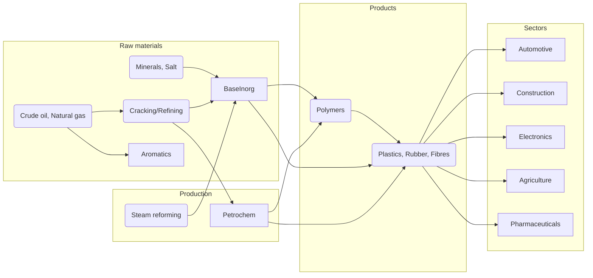

# Chemicals (excl. Pharmaceuticals) - Sector Cyber Resilience & Credit Intelligence Research Q01-Q15 (merged)

**Merge date:** 2026-10-29 | **Merged evidence cut-off:** not stated in either file; gap-fill research accessed 29 October 2026 (see Section 1.1, C-01) | **Status:** Merge of two supplied research files, translated from Portuguese, plus labelled gap-fill research | **Language:** English (UK)

---

## 1. Merge statement

### 1.1 Source files

| Item | File A | File B |
|---|---|---|
| File name | `Chemicals__excl._Pharmaceuticals__q1_q09.md` | `Chemicals__excl._Pharmaceuticals__q110_q_15.md` |
| Title (translated) | Chemical Industry (excluding Pharmaceuticals) | Executive Summary (no document title) |
| Original language | Portuguese (mixed European and Brazilian usage) | Portuguese (mixed European and Brazilian usage) |
| Questions covered (as labelled) | Q01-Q09 by file name; content is a market, value-chain, technology, regulation, finance, risk and strategy analysis. No cyber incidents, threat scenarios, controls, credit-transmission scenarios, geopolitical cyber register, questionnaire or Q09 assembly | Q10-Q15 by file name; content is a market, inputs, geopolitical supply, regulation, technology, decarbonisation, M&A, cost-structure, demand and scenario analysis. No fraud, cyber/ICT, third-party concentration, governance-failure, cross-sector or rating analysis |
| Research date | Not stated | Not stated (cites "Cefic (2025)" and 2025 company sales) |
| Evidence cut-off | Not stated; latest data year 2024 | Not stated; latest data year 2025 |
| Citations | No inline citations; one closing line naming Cefic, ICIS/PRNewswire, APQuímica/European Commission, IEA, ICIS and Business Research Co. as sources "cited in the excerpts above" | No inline citations or source list; Cefic (2025), IEA and C&EN ("CEN") named in the text |
| Figures | Two figures referenced but not present ("Composition of EU chemical sales 2024"; "Evolution 2004-2024 of main exporters to the EU"); one Mermaid value-chain diagram | One figure referenced but not present ("Evolution of EU27 share of the global chemical market 2004-2024"); "comparative table and charts" mentioned in the summary, one table present |
| Instruction-like text | None | None |

**Merged evidence cut-off:** neither file states a cut-off or research date, so the earlier-of-two rule cannot be applied. File A's latest data point is 2024 (EU trade surplus, China import share, EU global share); File B's latest is 2025 (Cefic 2025 report; company chemical sales 2025). Gap-fill research was accessed on 29 October 2026; each gap-fill item carries its own event and publication date. Temporal classes use the merge date: current (2026), prior half-year (H2 2025), contextual (H1 2025, within 18 months), historical (older than 18 months).

**Scope adopted for merged conclusions:** File A covers the chemical industry excluding pharmaceuticals, segmented into basic/inorganic chemicals, petrochemicals, polymers, specialities, agrochemicals and other/consumer chemicals; it includes "fine pharmaceutical chemicals (chemical part)" within specialities and pharmaceuticals as an end-user sector. File B covers basic chemicals, speciality chemicals, agrochemicals, polymers/plastics and industrial gases, and names Bayer AG among EU chemical leaders. The narrower common scope is: basic and petrochemicals (including inorganics and fertilisers), polymers, speciality chemicals (excluding pharmaceutical actives and fine pharmaceutical chemicals), agrochemicals, industrial gases and consumer chemicals; chemical distribution is included where gap-fill evidence concerns distributors. Pharmaceutical activity, aluminium and other metals, oil and gas upstream, and refining are flagged outside scope (Section 7.3). Geography: global and EU in both files; File A adds Portugal (no data found); gap-fill adds US, UK and Middle East evidence.

**Merge statement (supplied content):** File A and File B content is translated and restructured only; no facts, figures, sources or dates were added to it. **Gap-fill statement:** both files are market and strategy studies without cyber, fraud, resilience, governance-failure or rating content. Following the user's instruction in the previous sector run ("merge it, fill the gaps and make sure that the final result comes in English"), the same approach is applied here: public-source research performed on 29 October 2026 fills the missing questions. Every gap-fill item is marked **[GF]**, cites sources S-011 onward, and gap-fill ratings in Q15 are labelled "Gap-fill - Provisional" (File B proposed none).

### 1.2 Step 1 - Inventory

| Inventory item | File A | File B |
|---|---|---|
| Sector definition | Chemical industry excluding pharmaceuticals | Chemical industry (title scope "excl. Pharmaceuticals" from file name) |
| Subsectors | Basic/inorganic; petrochemicals; polymers; specialities; agrochemicals; other (consumer chemicals) | Basic chemicals; specialities; agrochemicals; polymers/plastics; industrial gases |
| Geography | Global; EU27; Portugal (no data) | Global; EU27; US and China comparisons |
| Questions covered (substantive) | Q01 (market, segments, value chain, companies, supply chain and trade); Q05 (partial: leverage, financial risks); Q06 (partial: Green Deal, Chemicals Strategy, REACH/CLP/PFAS, circular economy); Q07 (partial: geopolitical and supply risks); Q11 (partial: technology trends); Q13 (partial: M&A, capex, ESG finance); Q09 (executive summary, opportunities, recommendations) | Q01 (market, segments, companies, value chain and inputs, end markets); Q05 (partial: cost structure, margins, three market scenarios); Q06 (partial: REACH, ETS, CBAM, IED); Q07 (partial: energy dependence, China, Middle East); Q11 (partial: technology); Q13 (partial: M&A, SMEs); Q09 (executive summary, recommendations) |
| Questions missing | Q02, Q03, Q04, Q08, Q10, Q12, Q14, Q15 | Q02, Q03, Q04, Q08, Q10, Q12, Q14, Q15; no Q10A-Q10D |
| Sources | 7 named publishers in one line (ICIS named twice); no URLs | 3 named publishers in text; no URLs |
| Incidents / fraud cases | 0 / 0 | 0 / 0 |
| Scenarios | 0 | 3 market scenarios (base, accelerated transition, supply shock) |
| Metrics | Market size, EU sales and jobs, EU share, China share, company revenues, trade balance series, import shares, gas dependence | Market size, EU turnover and jobs, EU and China shares, top-50 sales, energy efficiency, sales growth multiple, bio-based market, emissions, cost and margin ranges, gas price ratio, SME share |
| Regulatory items | 7 (Green Deal/climate neutrality, EU ETS, CBAM, Chemicals Strategy for Sustainability, REACH/CLP and PFAS/endocrine disruptors, circular economy/plastics, other directives) | 8 (REACH, ECHA, EU ETS, CBAM, IED/BREFs, PFAS/microplastics, waste and plastics rules, green taxonomy) plus Fit-for-55 targets |
| Ratings / questionnaire | None / None | None / None |
| Tables | 1 (global top 15) plus 1 Mermaid diagram | 1 (top 5 global chemical sales 2025) |
| Partial coverage flags | No citations at statement level; two missing figures; several unclear statements (C-15) | No citations at statement level; one missing figure; several unclear statements (C-16) |

### 1.3 Acronyms (defined at first use in this file)

ACFE - Association of Certified Fraud Examiners; APT - advanced persistent threat; BEC - business email compromise; BREF - EU Best Available Techniques reference document; BTX - benzene, toluene, xylenes; CAGR - compound annual growth rate; CBAM - EU Carbon Border Adjustment Mechanism; CCUS - carbon capture, utilisation and storage; Cefic - European Chemical Industry Council; C&EN - Chemical & Engineering News; CFATS - US Chemical Facility Anti-Terrorism Standards; CISA - US Cybersecurity and Infrastructure Security Agency; CLP - EU Classification, Labelling and Packaging Regulation; CPS - UK Crown Prosecution Service; CSBS - UK Cyber Security Breaches Survey; DBIR - Verizon Data Breach Investigations Report; EBITDA - earnings before interest, taxes, depreciation and amortisation; EC - European Commission; ECCTA - UK Economic Crime and Corporate Transparency Act 2023; ECHA - European Chemicals Agency; EIB - European Investment Bank; ENISA - EU Agency for Cybersecurity; ESG - environmental, social and governance; EU ETS - EU Emissions Trading System; EV - electric vehicle; FBI - US Federal Bureau of Investigation; GHG - greenhouse gas; IC3 - FBI Internet Crime Complaint Center; ICS - industrial control systems; IEA - International Energy Agency; IED - EU Industrial Emissions Directive; INCIBE - Spanish National Cybersecurity Institute; IoT - internet of things; IPCEI - Important Project of Common European Interest; ISSB - International Sustainability Standards Board; IT - information technology; LNG - liquefied natural gas; M&A - mergers and acquisitions; MFT - managed file transfer; MOF - metal-organic framework; NBP - UK National Balancing Point gas hub; NIS2 - EU Directive 2022/2555; NCSC - National Cyber Security Centre (Ireland, where cited); OFAC - US Office of Foreign Assets Control; OT - operational technology; PE - private equity; PFAS - per- and polyfluoroalkyl substances; PLC - programmable logic controller; PPP - public-private partnership; R&D - research and development; RaaS - ransomware-as-a-service; REACH - EU Regulation (EC) No 1907/2006 on chemicals; SBTi - Science Based Targets initiative; SCF - solvent fluid held above its thermodynamic transition point (full technical term contains a restricted word); SIS - safety instrumented system; SME - small and medium-sized enterprise; TsNIIKhM - Russian Central Scientific Research Institute of Chemistry and Mechanics; VOC - volatile organic compound.

**Evidence labels used throughout:** [S-nnn] = unified source ID (Section 10). **[GF]** = gap-fill research added in this run; not from File A or File B. File A sources S-001 to S-007 are a file-level list, not attached to individual statements; File A statements are therefore marked "(File A; file-level sources only)". File B statements without a named source are marked "(File B; uncited)". "Merge note" = analysis added during the merge. Translations keep figures, units, periods and qualifiers; decimal commas are converted to points; Portuguese "triliões"/"T" in File A and "biliões"/"T" in File B are rendered as trillion and "mil milhões"/"B"/"bn" as billion.

---

## 2. Executive summary for Senior Credit Officers

**Ratings (Gap-fill - Provisional; File B proposed none)**
- **Fraud:** High; Provisional; confidence Medium.
- **Cyber/ICT:** High; Provisional; confidence Medium.
- **Operational resilience / TPRM:** High; Provisional; confidence Medium.
- **Governance / operating model:** Medium; Provisional; confidence Low.

**Five findings**
1. Payment fraud is the largest disclosed cyber-related loss: Orion lost about $60 million to fraudulent wire transfers in 2024 [S-038]; LG Chem paid $21 million to a fake supplier account in 2016 [S-040]. [GF]
2. OT and safety systems are a state target: Triton malware hit a Saudi petrochemical plant's safety system in 2017; the US sanctioned a Russian state institute in 2020 [S-014, S-015]. [GF]
3. Ransomware disruption is rising: Dragos counted 1,140 industrial ransomware incidents in Q2 2026, 65% in manufacturing [S-028]; Brenntag paid $4.4 million [S-012]. [GF]
4. Governance failures are reporting-driven: Chemours executives timed payables and receivables to meet cash-flow targets [S-022]; Clariant revised reported results after an investigation into provisions and accruals [S-042]. [GF]
5. Structural pressure is high (files): EU share fell from 21% (2009) to 13% (2024); EU gas costs about three times US levels; commodity margins 5-10% (File A, File B).

**Three borrower questions**
1. How are supplier bank-detail changes and urgent payment requests confirmed before release? [GF]
2. Are plant control and safety systems segmented from business IT, and how long could sites run if IT were down? [GF]
3. How exposed are margins and covenants to a renewed gas-price shock? (File B scenarios; uncited)

---
## 3. Findings by question

*Placement note: both files are thematic market studies. Their sections are placed below by topic; every paragraph, bullet and table of both files appears once, with its origin stated. Gap-fill blocks are marked [GF].*

## Q01 - Sector Operating Model & Key Dependencies

*Conclusion: A capital-intensive, globally traded, energy- and feedstock-dependent sector with integrated production sites, long-lived assets and concentrated raw-material sources; the EU is losing global share to China and to lower-energy-cost regions, and IT/OT systems link plants, logistics and trading.*

### Q01.1 Market and growth (File A, "Market and Growth")

(File A; file-level sources only)
- **Global:** In 2022 the value of the global chemical market was ~$4.69 trillion. Moderate growth (CAGR ~4-5%). World chemical exports increased (China leads, 45% of world sales). Demand for chemicals grew in sectors such as energy (plastic fuels), automotive, electronics and construction.
- **Europe:** The EU27 chemical industry reported ~€635 billion in revenues (2019). Low growth: almost stagnant owing to high energy costs and external competition. The EU's global share fell from 21% (2009) to 13% (2024). Data for Portugal were not found; a modest contribution in the EU context is presumed.
- **Product segmentation:** In the EU, petrochemicals and speciality chemicals (>50% of sales) dominate. Other segments: basic/inorganic products, polymers, fertilisers/agrochemicals and consumer chemicals (paints, detergents, etc.). The figure below illustrates the structure of EU chemical sales (2024) by segment:

  *Figure: Composition (%) of EU chemical sales in 2024, by product type.* (Figure not present in File A.)

  - **Basic/inorganic chemicals:** Include soda solutions, acids, fertilisers, industrial gases. Depend on oil, gas and minerals (e.g. salt, sulphur).
  - **Petrochemicals:** Include olefins (ethylene, propylene), aromatics (benzene, toluene), alkanes (methane→methanol), produced via naphtha/gas cracking and catalytic reforming.
  - **Polymers:** Polyethylene, polypropylene, PVC, polystyrene, polyamides, PVC, etc. Depend on petrochemicals and basically renewable (biopolymers growing). *(As written; "PVC" listed twice.)*
  - **Specialities:** Paints, coatings, adhesives, lubricants, catalysts, additives, electrolytes, fine pharmaceutical chemicals (chemical part), fine chemicals for electronics, etc. Higher margins.
  - **Agrochemicals:** Fertilisers (nitrogen-based, phosphate-based), pesticides and herbicides. Europe imports large volumes of phosphate and potassium.
  - **Other (miscellaneous inorganics, consumer chemicals):** Hygiene products, detergents, cosmetics, electrolytes, dyes, etc.

### Q01.2 Value chain (File A, "Value Chain")

(File A; file-level sources only) Key raw materials: **Oil and natural gas** (carbon/H₂ source for naphtha and synthesis gas); **Ores and salts** (e.g. rock salt, sulphur, metallic minerals); **Biomass** (wood, agricultural residues for bio-based chemicals). Common processes: steam reforming, cracking, distillation, synthesis (ammonia via Haber-Bosch, methanol via synthesis gas), polymerisation, specialised reactions (catalytic, photochemical). As follows:

*Figure: Chemical industry value chain - from raw materials to final products (user sectors).*

End-user sectors include: **Automotive** (plastics and rubbers), **Construction** (paints, cement additives, waterproofing), **Packaging** (plastics, adhesives), **Electronics** (engineering polymers, semiconductors, solvents), **Agriculture** (fertilisers, pesticides, adjuvants) and **Health/Consumer** (cleaning products, hygiene, medical articles).

### Q01.3 Leading companies (File A, "Main Companies")

(File A; file-level sources only) **Global (Top 15).** Largest players include (approximate revenues 2022-2023, main segments, headquarters):

| Company (HQ) | Revenue | Main segments |
|---|---|---|
| BASF (Germany) | €68.9B (2023) | Basic chemicals (soda, acids), specialities, plastics |
| Sinopec (China) | ~$78.2B (2022) | Oil & gas, petrochemicals (olefins, aromatics) |
| Dow Inc. (USA) | $56.9B (2022) | Polymers (PE, PP), specialities, silicones |
| Sabic (Saudi Arabia) | $52.9B (2022) | Olefins and aromatics, fertilisers, plastics |
| INEOS (United Kingdom) | $51.9B (2022) | Olefins, PVC, synthetic resins |
| Formosa Plastics (Taiwan) | ~$35B (2022) | PVC, olefins, specialities |
| LG Chem (Korea) | ~₩30T (2022) | Polymers, batteries, electrolytes |
| LyondellBasell (NL/USA) | ~$27B (2022) | Polyolefins, aromatics, coking plants |
| Air Liquide (France) | €22B (2022) | Industrial gases, inorganic chemicals |
| Evonik (Germany) | €18B (2022) | Speciality chemicals, dyes, silicones |
| Covestro (Germany) | €18B (2022) | Polymers (polyurethanes, polycarbonates) |
| AkzoNobel (NL) | €10.5B (2022) | Paints, industrial coatings |
| Arkema (France) | €10B (2022) | High-performance materials, specialities |
| Solvay (Belgium) | €10B (2022) | Speciality chemicals (batteries, foam) |
| DSM (Netherlands) | €10B (2022) | Bioculture, specialities (nutraceuticals, plastics) |

**EU27 (Top 15).** Among the 15 largest headquartered in the EU (revenues, segments): BASF (Germany, €68.9B); LyondellBasell (NL/USA, $27B); INEOS (United Kingdom, $51.9B); Air Liquide (France, €22B); Evonik (Germany, €18B); Covestro (Germany, €18B); Arkema (France, €10B); AkzoNobel (NL, €10.5B); Solvay (Belgium, €10B); Borealis (Austria, €10B, polymers); Yara (Norway, €6.8B, fertilisers); Nutrien (Canada, outside the EU); Norquímica and other smaller European companies. These companies dominate exports and have invested in digitalisation and sustainability.

### Q01.4 Supply chain and trade flows (File A, "Supply Chain and Trade Flows")

(File A; file-level sources only)
- **Raw material imports:** The EU depends on imports of oil, natural gas, coal and minerals. Until 2022, about 40% of the gas consumed came from Russia, drastically reduced after 2022 through diversification (US LNG, Qatar). Abundant raw materials (C, H₂, O) in the US and China explain their leadership.
- **Trade flows:** The EU27 maintained an average annual surplus of €43B (2011-21). This surplus fell to €3.2B in 2022 (energy shock) but recovered to €35B in 2023 and €47.3B in 2024. Today the US is the main destination of EU chemical exports, while China is the largest origin of imports (18% of the total in 2024 vs 9% in 2014). Below, the evolution of the EU's main importing partners in 2004 vs 2024 is illustrated.

  *Figure: Evolution (2004-2024) of the main countries exporting chemicals to the EU (values in € billion).* (Figure not present in File A.)

- **Chokepoints and risks:** Dependence on pipelines/transit (e.g. the Ukraine war cut flows), port congestion (e.g. Europe receives petrochemical bulk via Rotterdam, Hamburg), concentration of material production (e.g. 80% of nickel in a few mines, 60% of magnesium in China). Interruptions can paralyse refineries and plants.
- **Intra-EU trade:** Countries such as Germany, France, Italy and Spain lead sales. For strategy purposes, a high degree of intra-bloc integration is observed: ~40% of EU production circulates internally before export.

### Q01.5 Global and EU market (File B, "Global and EU Market"; "Main Subsegments"; "Main Companies")

[S-008] The global market currently amounts to several trillion euros. Industry estimates suggest about **€4.9 trillion** globally (the EU27, with €635 bn, represents ~13%). The global growth trend has slowed recently (growth ~0% in 2023-24), especially in the basic segment, owing to petrochemical overcapacity and weak demand. [S-009] According to the IEA, energy for chemical products rose slightly from 2015 to 2024, but energy efficiency improved (+40% since 1990). Global sales volume has soared since 2004 (3.6× larger in 2024).

*Figure: Evolution of the EU27 share of the global chemical market (2004-2024).* (Figure not present in File B.)

(File B; uncited) The sector divides into **basic chemicals** (petrochemicals, fertilisers, acids, bases), **speciality chemicals** (performance products, detergents, additives, paints), **agrochemicals**, **polymers/plastics**, and **industrial gases** (oxygen, nitrogen, hydrogen, etc.). In the EU, petrochemicals (olefins, aromatics) and specialities are dominant (>50% of sales). Polymers (PE, PP, PVC, PET) make up a large part of basics. Industrial gases are represented by leaders such as Linde and Air Liquide (see below). Agrochemicals (fertilisers and pesticides) carry relevant weight - the Europe region, although not the global leader, has strong companies (e.g. Yara, BASF). There are no detailed public data for each segment, but basics are more volatile with low margins, while specialities (value vector) tend to higher margins.

(File B; uncited) The world's largest producers include BASF (DE), Sinopec (CN), PetroChina (CN), ExxonMobil (US) and Dow (US). In 2025, **BASF** was the leader with chemical sales of USD 67.4 B. Other global leaders: Linde (US/DE, gases), LG Chem (KR), Sabic (SA), Air Liquide (FR), LyondellBasell (NL/US). In the EU, BASF, Linde, Air Liquide and large integrated chemical groups (AkzoNobel, Covestro, Evonik, Bayer AG - although part has already exited chemicals) stand out. The table below summarises the chemical sales of the global top 5 (2025 data).

| Company | HQ | Chemical sales 2025 (US$ B) |
|---|---|---|
| BASF | Germany | 67.4 |
| Sinopec | China | 52.6 |
| PetroChina | China | 41.0 |
| ExxonMobil (Chemicals) | USA | 40.0 |
| Dow | USA | 40.0 |

(File B; uncited) Market share is concentrated among large groups; in Europe chemical sales per capita are lower than in the US owing to strong Asian competition and energy costs (see below).

### Q01.6 Value chain and key inputs (File B, "Value Chain and Key Inputs")

(File B; uncited) The chain starts with **fossil raw materials**: oil (naphtha, LPG) and natural gas (methane, ethane) provide the pillars of the basic segment. Refined crudes produce naphtha, feeding crackers for ethylene, propylene and aromatics (BTX); propylene, for example, generates PP and other derivatives. Natural gas goes to reformers to produce ammonia (NH₃, input for fertilisers and intermediates), methanol and hydrogen. China still uses extensive coal gasification ("C-MBG", as written) for ammonia and methanol. In specialities and plastics, inputs include vegetable oils (oleochemicals), biomass (bio-plastics) and electricity (new processes). **Main feedstocks**:
- **Oil/Naphtha** - base for polyolefins and solvents; fluctuates with the barrel price.
- **Natural gas** - source of ethane (ethylene), methane (ammonia, methanol), hydrogen; its price soared in the EU after the Ukraine crisis.
- **Coal** - still relevant in Asia (methanol, fertilisers).
- **Biomass and vegetable oils** - bioethanol, bioplastics rising, but <10% of the total. Studies forecast rapid growth of this niche.

(File B; uncited) Logistics involve pipelines, ships, trucks and storage. Chemical production is asset-heavy (refineries, petrochemical plants) and long-lived, which makes it difficult to relocate or react to sudden shocks (COVID-19, conflicts).

### Q01.7 Demand and end sectors (File B, "Demand and End Sectors")

(File B; uncited) Chemical production serves as an essential input to several sectors: **automotive** (polymers and additives for parts and batteries), **construction** (paints, PVC, insulation), **packaging** (light plastics), **electronics** (silicon, semiconductors, UV curing), **agriculture** (fertilisers, pesticides), **health/personal care** (pharmaceuticals, cosmetics), among others. The growth of these markets drives chemical demand: e.g. EV expansion may raise demand for polymers and composite materials; green construction fosters advanced composites and bio-plastic products. However, technological transitions (e.g. digitalisation, circularity) may replace or reduce some traditional chemicals, forcing reallocation. In global slowdown scenarios, cyclical sectors such as automotive tend to pull chemical demand down, while pandemic medicines and food security keep pharmaceutical and agrochemical products robust. Diversification into new markets (green hydrogen for energy) is strategic but investment-intensive.

### Q01.8 Dependency map **[GF]**

| DEP | Dependency | Mechanism of cyber or third-party disruption | Consequence | Substitutability | Evidence |
|---|---|---|---|---|---|
| DEP-01 | Feedstock and energy (oil/naphtha, natural gas, coal in Asia) | Supply shock, price spike (files); attacks on energy suppliers (precedent) | Margin compression; output cuts | Low in short term (files: asset-heavy, long-lived) | File A Q01.4; File B Q01.6 |
| DEP-02 | Plant OT and safety instrumented systems | Malware targeting SIS controllers; ransomware spreading from IT | Shutdown; safety risk | Very low (plant-specific) | [S-014] [S-015] [S-028] |
| DEP-03 | Enterprise IT (ERP, email, Active Directory) underpinning order-to-cash and logistics | Ransomware encryption; precautionary shutdown | Shipping and ordering halts | Medium | [S-032] [S-033] [S-036] |
| DEP-04 | Managed file transfer and logistics data exchange with transport partners | Mass exploitation of MFT software | Data theft from logistics servers | Medium | [S-035] |
| DEP-05 | Ports and bulk logistics (Rotterdam, Hamburg), pipelines | Congestion or transit cut (files); cyber outage at logistics providers | Feedstock and product flow interruption | Low-medium | File A Q01.4 |
| DEP-06 | Concentrated mineral inputs (nickel, magnesium, phosphate, potassium, lithium, rare earths) | Export restriction; geopolitical disruption | Input shortage | Low | File A Q01.1, Q01.4, Q07.1 |
| DEP-07 | Treasury payment processes with high-value supplier and feedstock payments | BEC and supplier bank-detail fraud | Direct cash loss | Process change is quick | [S-038] [S-040] [S-041] |

**Merge notes:** (a) Global market size: ~$4.69 trillion (2022, File A) vs ~€4.9 trillion (File B, undated industry estimate) (C-02). (b) EU €635 billion and 1.2 million jobs: dated 2019 in File A, 2024 in File B citing Cefic 2025 (C-03). (c) China share ~45% (File A) vs ~46% (File B) (C-04). (d) Growth: CAGR ~4-5% (File A) vs ~0% in 2023-24 (File B) (C-05). (e) Company revenue lists and years differ (C-06 to C-08). (f) File A's "EU27" list includes INEOS (UK), Yara (Norway) and Nutrien (Canada, noted by File A as outside the EU) (C-10). (g) Russian gas share: "40% of gas consumed" (File A) vs "40% of gas used in chemical production" (File B) (C-09). (h) Specialities include "fine pharmaceutical chemicals" (File A), and Bayer AG is named by File B; pharmaceutical activity is outside the merged scope (C-17).

**Cross-references:** Q05 (cost structure), Q07 (supply risks), Q11 (OT), Q12 (concentration), DEP register; conflicts C-02 to C-10, C-17.

---

## Q02 - Major Cyber Incidents & Case Studies **[GF]**

*Conclusion: Chemical-sector incidents show three loss pathways - ransomware halting IT-dependent operations (Brenntag, Symrise, Hexion/Momentive), data theft through shared software and sites (Covestro via Cleo, AkzoNobel), and state sabotage of safety systems (Triton at a Saudi petrochemical plant); the largest single disclosed loss is a payment fraud (Orion, Q10). Neither file contains incidents.*

### Q02.1 Incident register

| INC | Organisation | Subsector | Country | Event date | Class | Mechanism (as reported) | Outcome | Horizon | S- IDs |
|---|---|---|---|---|---|---|---|---|---|
| INC-01 | Petrochemical facility (Petro Rabigh, as named by a secondary source) | Petrochemicals | Saudi Arabia | Aug 2017 | Intrusion (OT sabotage) | Triton malware targeting Schneider Electric Triconex SIS controllers; remote access to SIS connected to ICS | Plant shut down for over a week (UK sanctions note); "tens of millions of dollars" lost (secondary); US OFAC sanctioned TsNIIKhM on 23 Oct 2020 | Historical landmark | S-014, S-015, S-016 |
| INC-02 | Hexion and Momentive (Apollo-controlled) | Thermoset resins; silicones | USA | 12 Mar 2019 | Intrusion (LockerGoga ransomware) | Encryption of Windows systems; email shut down for containment | Companies: corporate networks affected, minimal manufacturing interruption; CEO email (reported): "global IT outage", hundreds of new computers ordered | Historical landmark | S-031, S-032, S-033 |
| INC-03 | Symrise | Flavours and fragrances (speciality chemicals) | Germany | Dec 2020 | Intrusion (Clop ransomware) | Phishing (actor claim); ~1,000 devices encrypted; 500 GB claimed stolen | Essential systems shut down; production temporarily halted | Historical | S-036, S-037 |
| INC-04 | Brenntag North America | Chemical distribution | USA | From 26 Apr 2021 | Intrusion (DarkSide ransomware) | Access via stolen credentials (reported as purchased from an initial access broker); 150 GB stolen | Ransom 133.65 BTC (~$7.5 million) demanded; $4.4 million paid 11 May 2021; personal data incl. Social Security numbers | Historical landmark | S-011, S-012, S-013 |
| INC-05 | Covestro | Polymers | Germany / USA | Dec 2024 - Jan 2025 | Intrusion (Clop via Cleo MFT vulnerability) | Exploitation of Cleo file-transfer software | Unauthorised access to a US logistics server used to exchange shipment details with transport partners; "majority of the information … not considered sensitive"; data on darknet (Jan 2025) | Historical (H1 2025; older than 18 months) | S-034, S-035 |
| INC-06 | AkzoNobel | Paints and coatings | USA site (NL group) | Disclosed Mar 2026 | Intrusion (Anubis ransomware, data theft) | n/s by company | Company: incident limited to one US site and contained; actor claims 170 GB / ~170,000 files including client agreements and passport scans | Current | S-044 |
| INC-07 | Spectrum Chemical Mfg Corp | Chemical manufacturing | USA | Claimed 14 Jul 2026 | Intrusion (claim by Chaos ransomware) | n/s | Leak-site claim and ultimatum; no company confirmation retrieved | Current (unconfirmed allegation) | S-045 |

**Last-30-days items (29 Sep - 29 Oct 2026):** none retrieved for the chemicals sector (G-10).

### Q02.2 Top five (decision relevance)

1. **INC-01 Triton (2017)** - only documented attack on chemical-plant safety systems; official attribution and sanctions [S-014] [S-015].
2. **INC-04 Brenntag (2021)** - distributor ransomware with disclosed ransom and data theft [S-012] [S-013].
3. **INC-05 Covestro (2025)** - third-party software (MFT) pathway into logistics data [S-035].
4. **INC-03 Symrise (2020)** - production halt at a speciality producer [S-036] [S-037].
5. **INC-06 AkzoNobel (2026)** - current data-extortion case at a major coatings group [S-044].

Selection criteria: operational or safety consequence, disclosed outcome, recency and evidence quality. The Orion payment fraud is ranked in Q10 (FRD-C1) to avoid double counting.

### Q02.3 Case studies

**Case 1 - Triton at a Saudi petrochemical plant (2017).** *Mechanism:* malware designed to target and manipulate Triconex safety instrumented systems [S-014]. *Effect:* plant shut down for over a week; UK sanctions text states the shutdown appears inadvertent while the actors attempted to cause a highly dangerous physical consequence by disabling safety systems [S-015]. *Attribution:* US Treasury designated TsNIIKhM on 23 October 2020 as responsible for building the customised tools [S-014]. *Lesson:* safety systems are a target, not only a control. *Does not establish:* the full financial loss (only a secondary "tens of millions of dollars") [S-016].

**Case 2 - Brenntag (2021).** *Timeline:* systems accessed from 26 April 2021; ransom negotiated from about $7.5 million to $4.4 million and paid on 11 May [S-012] [S-013]. *Mechanism:* stolen credentials, reportedly bought from an initial access broker [S-013]. *Data:* Social Security numbers, dates of birth, driver's licence numbers and some medical information [S-013]. *Lesson:* identity hygiene and credential monitoring at distributors with many sites. *Does not establish:* operational downtime or total cost.

**Case 3 - Covestro via Cleo MFT (2024-2025).** *Mechanism:* Clop mass-exploited a vulnerability in Cleo file-transfer products [S-035]. *Effect:* access to a US logistics server used for shipment data with transport partners; Covestro improved monitoring and notified customers [S-035]. *Lesson:* shared supply-chain software is a common point of failure across many firms. *Does not establish:* any production impact or cost.

**Cross-references:** Q03 (THR-01 to THR-04), Q05 (FIN-G rows), Q10 (FRD-C1), Q11, Q12, INC register; conflict C-20.

---

## Q03 - Cyber Threat Landscape & Attack Scenarios **[GF]**

*Conclusion: Ransomware through IT is the most frequent disruptive pathway; state actors target OT and safety systems; shared logistics software and stolen credentials provide entry; payment fraud produces the largest disclosed losses.*

| THR | Scenario | Mechanism | Actors (as reported) | Evidence | Confidence |
|---|---|---|---|---|---|
| THR-01 | Ransomware via enterprise IT forcing precautionary shutdowns | Credential theft or phishing, encryption of IT, isolation of plants | DarkSide, Clop, LockerGoga operators, Anubis; Qilin, Akira and The Gentlemen lead industrial victim volumes in Q2 2026 | INC-02 to INC-04, INC-06 [S-012] [S-036] [S-044]; Dragos Q2 2026 [S-028] | High |
| THR-02 | State sabotage of OT and safety systems | Malware targeting SIS controllers | TsNIIKhM-linked actors (Triton) | INC-01 [S-014] [S-015]; INCIBE notes escalating APT activity on OT and SIS consequences in the chemical industry [S-046] | Medium (rare but high impact) |
| THR-03 | Supply-chain software exploitation | Mass exploitation of MFT and file-transfer tools | Clop | INC-05 [S-035] | High (pattern) |
| THR-04 | Payment fraud via email compromise | Impersonation of suppliers or executives; bank-detail change | Organised fraud groups | FRD-C1 to FRD-C3 [S-038] [S-040] [S-041] | High |

**Merge notes:** File A notes "digitalisation: digital twins, IoT and sensors" (Q11) and File B notes "Industry 4.0 (process simulation, IoT monitoring)" (Q11); neither discusses cyber threats. Dragos states that no ransomware operator manipulated a control system in Q2 2026; plant stoppages came from encryption or isolation of enterprise and virtualisation systems [S-028].

**Cross-references:** Q02, Q04, Q07 (GEO-01), Q10, Q11, THR register.

---

## Q04 - Control Weaknesses, Resilience Capabilities & Benchmarks **[GF]**

*Conclusion: Documented weaknesses are credential exposure, phishing, unpatched third-party software, IT/OT dependence that forces precautionary plant shutdowns, and payment approval; OT detection gaps lengthen dwell time.*

| CTL | Capability / weakness | Evidence | S- IDs |
|---|---|---|---|
| CTL-C1 | Credential protection and monitoring for initial-access broker sales | Brenntag access via stolen credentials | S-013 |
| CTL-C2 | Phishing resistance | Symrise attack vector per actor | S-036 |
| CTL-C3 | Third-party software patching (MFT) | Covestro via Cleo | S-035 |
| CTL-C4 | IT/OT segmentation and OT-specific recovery | Dragos: multi-day outages requiring OT-specific recovery; plant stoppages from IT encryption | S-028, S-030 |
| CTL-C5 | Safety-system integrity monitoring | Triton targeted SIS | S-014 |
| CTL-C6 | Payment release and bank-detail change confirmation | Orion, LG Chem, Air Liquide Canada cases | S-038, S-040, S-041 |
| CTL-M1 | OT visibility benchmark | Ransomware stayed in OT environments 42 days on average in 2025 vs 5 days with comprehensive OT visibility (Dragos, via secondary) | S-029 |
| CTL-M2 | Supplier risk review (UK, all businesses) | 15% review immediate suppliers' cyber risk | S-051 |
| CTL-M3 | Third-party share of breaches (global) | Doubled from 15% to 30% (DBIR 2025) | S-050 |

File A and File B mention digitalisation, IoT and Industry 4.0 as efficiency levers (Q11) without control content.

**Cross-references:** Q03, Q08, Q11, Q12, CTL register.

---

## Q05 - Financial Impact, Disruption & Credit Transmission

*Conclusion: Feedstock and energy are 50-70% of operating costs, commodity margins are 5-10% and many players carry high leverage (files); cyber and fraud events add one-off charges (Orion ~$60 million) and production stoppages, which transmit quickly to EBITDA and covenants in a sector already in its "worst recession in decades" (File B).*

### Q05.1 Cost structure and margins (File B, "Cost Structure and Margins")

(File B; uncited) Sector costs are dominated by raw materials and energy (≈50-70% of operating costs). Oil and gas represent the largest fraction of the input cost of basics; in specialities, fine and R&D-intensive components can be up to 30%. Labour is less relevant (<20%) given high automation. The European energy crisis pressured costs: average gas prices at the NBP are triple those of the US, creating a cost burden of €10-15 per chemical good (according to sector analyses). Operating margins vary: petrochemical commodities around 5-10%, specialities may reach 15-25% (depending on price/elasticity). Market volatility (oil, exchange rates) causes unstable margins. Innovation and the climate transition imply high CAPEX (reconfiguration of plants for cleaner processes), pressuring short-term profits in exchange for long-term advantages.

### Q05.2 Financial risk statements (File A)

(File A; file-level sources only) From "Financial Trends and Investment" - ESG finance bullet (second part): Debt/EBITDA high in many players owing to high energy costs; capital reinforcement through sale of non-core assets (e.g. Clariant sells bentonite business). *(Full bullet in Q13.1.)*

(File A; file-level sources only) From "Risks": **Financial:** High global interest rates pressure the cost of capital; high indebtedness of some companies (after expansion in recent years). Credit risk if margins fall; currency exposure in companies exporting/importing raw materials. *(Other File A risk items in Q07.1.)*

### Q05.3 Market scenarios (File B, "Scenario Analysis")

(File B; uncited)
- **Base Scenario (Continuation):** In the short term, moderate retraction continues with slow demand recovery. Expectation of stable-to-low margins and cautious investment. The EU should keep losing market share to Asia without correction of energy costs.
- **Accelerated Climate Transition:** Accelerated implementation of green policies (investment in renewables, CCUS, electric cars, strict green legislation). Changes product mix: substitution of petrochemicals by bio-based, leverage of recycled. Financial consequences: high initial CAPEX to reconfigure plants, but possible premium for "green" products. European companies with clean technologies may gain new niches, but international competition remains fierce; reinforcement of protection mechanisms (flexible ETS, transition finance) would be essential.
- **Supply Shock:** Energy shocks (new gas crisis), geopolitical conflicts interrupting supplies (e.g. instability in the Strait of Hormuz) or major natural disasters (hurricanes, fires) may lead to high-impact disruptions. The reaction tends to be urgency to diversify sources (hydrogen, biomethane, solar energy), safety stocks (ammonia, ETBE) and multiple locations. In the short term, cost spikes and occasional shortages pressure prices and profits, with possible temporary rationing of essential chemical products in sectors such as agriculture.

### Q05.4 Disclosed cyber and fraud financial outcomes **[GF]**

| Event | Metric | Value | Basis | S- IDs |
|---|---|---|---|---|
| Orion (2024) | One-time pre-tax charge for unrecovered fraudulent wire transfers | ~$60 million (8-K); Q3 2024 net loss included $43 million net loss due to the fraud; losses and professional fees aggregated $60.7 million | SEC filings | S-038, S-039 |
| LG Chem (2016) | Wire payment to fraudulent account | US$21 million | Media (company spokesman quoted) | S-040 |
| Brenntag (2021) | Ransom paid | $4.4 million (demand ~$7.5 million) | Media (BleepingComputer sources) | S-012 |
| Triton (2017) | Loss | "Tens of millions of dollars" | Secondary blog | S-016 |
| Air Liquide Canada (n/s) | Misdirected supplier payment | CAD 221,422.38 (currency as reported in Canadian case summary) | Court case summary | S-041 |

### Q05.5 Disruption scenarios **[GF]** - *Illustrative - not a forecast or loss estimate*

| SCN | Duration | Anchoring evidence | Operational effect | Credit channels |
|---|---|---|---|---|
| SCN-1W | One week | Triton plant shutdown "over a week" [S-015]; Symrise production halt [S-037] | Single-site or group production halt; safety reviews before restart | Lost volume; fixed-cost absorption; minor EBITDA dip |
| SCN-4W | Four weeks | Dragos: multi-day outages requiring OT-specific recovery [S-030]; Hexion/Momentive replacement of hundreds of computers [S-033] | Multi-site IT rebuild; manual operations; delayed shipping | Working-capital strain; customer penalties; covenant headroom at commodity margins of 5-10% (File B) |
| SCN-8W | Eight weeks | Composite assumption combined with File B supply-shock scenario (no single cyber case of this duration retrieved) | Extended outage during an energy or feedstock shock | Liquidity draw; refinancing risk for highly leveraged players (File A) |

**Merge notes:** (a) File A's leverage statement and File B's cost structure are uncited structural statements. (b) Orion's three figures are different measures (C-21). (c) Fraud losses are listed here and in Q10 once each, linked by FRD ID (no double count).

**Cross-references:** Q01, Q07, Q10, Q13, FIN and SCN registers; conflict C-21.

---

## Q06 - Regulation & Resilience Expectations

*Conclusion: Chemical regulation in the files is environmental and product-safety focused (REACH, CLP, PFAS, ETS, CBAM, IED); gap-fill adds that chemical manufacturers and distributors are NIS2 Annex II "important entities", that US CFATS authority has lapsed since July 2023, and that the UK failure-to-prevent-fraud offence applies from September 2025.*

### Q06.1 File A, "Sustainability and Regulation"

(File A; file-level sources only)
- **Green Deal and Climate:** The EU aims for carbon neutrality in 2050. The chemical industry is within the EU ETS ("SCE QUARTEIRO", as written), subject to allowances/carbon pricing and carbon-reduction plans. Current reforms include possible extension of the ETS to industrial fuels and introduction of CBAM to avoid carbon leakage (still under discussion for chemicals).
- **Chemicals Strategy:** In Oct. 2020 the EC published the *Chemicals Strategy for Sustainability*, part of the Green Deal. Objectives: ban non-essential toxic substances, promote safer chemicals by design, assess combined risks of mixtures, accelerate safe innovation. New principles: prevention instead of repair of chemical pollution, restrictive authorisation of the most hazardous chemicals. Implementing standards will require revisions to REACH (registration and restriction of chemicals), to CLP (hazard classification) and to plastics and waste standards.
- **REACH, CLP and PFAS:** The EU strengthens controls under REACH, authorises harmful chemicals only if essential, restricts endocrine disruptors, PFAS (microplastics) and other substances of concern. Regulations on single-use plastics and eco-design require a circular life cycle. The chemical industry prepares for higher compliance costs.
- **Circular Economy:** Target of 100% recyclable plastics by 2030. Incentives for chemical recycling facilities ("chemical recycling"). End-of-waste guidelines for chemical by-products. "Take-back" policies for collection of solvents and used chemicals.
- **Specific regulations:** Waste Framework Directive, RoHS/REACH in electronics and construction, water directive (limits on chemical contaminants), biodiversity regulations (restriction of harmful agricultural chemicals, e.g. neonicotinoids).

### Q06.2 File B, "Regulation and Regulatory Environment"; "Sustainability and Decarbonisation Pathways"

(File B; uncited) In the EU, strict rules shape the sector. **REACH** (Regulation 1907/2006) stands out, in force since 2007, requiring registration of chemical substances and restricting the most hazardous. **ECHA** manages compliance, with thousands of dossiers. Climate targets involve the **EU ETS** (carbon market), which has made CO₂ emissions more expensive since 2005, and **CBAM** (carbon border mechanism), which will cover emissions-intensive imports (e.g. fertilisers, steel) from 2026. Other rules: regulation of diffuse emissions and effluents (IED directives, BREFs), limits on persistent substances (PFAS, microplastics), recycling ("Zero Landfill Directive", as written; tax on virgin plastic) and transport of chemicals (REACH, CLP, F-gases, pesticides). Waste legislation (PL, clothing, electronics, as written) and the green taxonomy shape product life cycles. In summary, the European sector faces high regulatory costs in exchange for internal-market access. For example, industry studies warn that climate rules without compensation burden local productive capacity.

(File B; uncited) Chemicals generate ~10% of global industrial emissions. In a carbon-neutral scenario, chemical routes would be drastically redesigned: renewable hydrogen production, electrochemical converters, "bio-rareficadores" (as written). Recent targets (Fit-for-55, Green Deal) require -55% emissions by 2030 in the EU; the European chemical sector needs to cut CO₂ intensities (currently ~4tCO₂/t chemicals, as written). Some reduction comes from lower intensity (energy efficiency +40% since 1990), but it is insufficient. CO₂ capture (CCUS) and green hydrogen for ammonia/methanol are essential. Sustainability indicators include eco-efficiency, recyclability and the carbon footprint of chemical products. Companies set targets (e.g. BASF Net-Zero 2050, Air Liquide 2035) and sustainability reports (involving "EPA/ISSB", GRI). Emissions accounting includes scopes 1-3; large groups have been "discounting" methane and NOx (as written).

### Q06.3 Cyber, security and fraud rules **[GF]**

| Instrument | Jurisdiction | Legal status / date type | Relevance | S- IDs |
|---|---|---|---|---|
| NIS2 Directive (EU) 2022/2555, Annex II point 3 "Manufacture, production and distribution of chemicals" | EU | Directive; transposition deadline 17 Oct 2024; measures applied from 18 Oct 2024 (secondary) | Undertakings manufacturing or distributing substances or mixtures (REACH Art. 3(9),(14)) and producing articles from them are in scope as important entities (medium and large) | S-017, S-018, S-034, S-019 |
| CFATS (6 CFR Part 27) | USA | Regulation inactive: statutory authority expired 28 Jul 2023; CISA cannot enforce | Previously covered more than 3,200 high-risk chemical facilities | S-020, S-021 |
| UK failure to prevent fraud (ECCTA) | UK | Legislation in force 1 Sep 2025 | Large organisations liable for fraud by associated persons for their benefit | S-052 |
| EU antitrust (Art. 101 TFEU) - ethylene purchasing cartel decision | EU | Commission decision 14 Jul 2020 | Purchasing collusion penalised in the sector | S-025 |
| US SEC Form 8-K disclosure (material cyber incidents; other events) | USA | Rule in force | Orion and Chemours disclosures | S-038, S-022 |

**Merge notes:** (a) CBAM: File A says "still under discussion for chemicals"; File B says CBAM will cover emissions-intensive imports such as fertilisers from 2026 (C-13). (b) Several File A and File B regulatory names are unclear or not identifiable as instruments (C-14, C-15, C-16). (c) NIS2 is absent from both files.

**Cross-references:** Q08 (PROV-007), Q10, Q12, Q13, REG register; conflicts C-13 to C-16.

---

## Q07 - Geopolitical Cyber Threats & Systemic Exposure

*Conclusion: The files describe energy, feedstock and trade geopolitics (Russian gas, Chinese overcapacity and mineral concentration, Middle East instability); gap-fill adds that a Russian state institute developed malware used against a petrochemical safety system and that industrial ransomware activity includes state-aligned actors.*

### Q07.1 File A, "Risks" (geopolitical, energy, raw materials, regulatory, market)

(File A; file-level sources only)
- **Geopolitical:** Conflicts and sanctions alter supplies: the invasion of Ukraine cut Russian gas and Russian fertiliser supply; China-US tensions threaten chains (export controls on semiconductors and chemicals). Global interdependence: embargo on inputs from Asia/Brazil ("Santander litigation e.g. luteciose?", as written).
- **Energy supply:** Sharp fluctuations in energy prices (see 2021-22 crises) pressure costs. US and China with cheap energy attract relocations (some EU production leaking to the US). Risk of rationing or blackouts at winter peaks.
- **Raw materials:** Volatility in oil/gas causes margin uncertainty. Heavy dependence on imported minerals (phosphate, lithium, rare earths). Example: a lithium export restriction by China may hold back related battery production.
- **Regulatory demands:** Stricter environmental and health standards may raise costs (e.g. REACH testing, substitution of banned chemicals). Regulatory uncertainty ("Calculate which technology to adopt?", as written) may delay investment. Extraterritoriality risk: global companies outside the EU may have competitive advantages if regulations differ.
- **Market/Competition:** Competition from low-cost Asian chemicals (China, India) and the Gulf. Counter-protectionism may affect exports. Emergence of substitutes (e.g. composite materials replacing conventional plastics) may shake traditional segments.
- *(Financial risk item in Q05.2.)*

### Q07.2 File B, "Geopolitical and Supply Risks"

(File B; uncited) Dependence on external sources raises risks. The invasion of Ukraine highlighted Europe's high **energy dependence**: sanctions on Russia threatened 40% of the gas used in chemical production, forcing a recomposition of imports. The war raised costs (oil at USD 120/barrel) and forced payments in roubles; part of the gas was cut. Consequently, average gas prices in the EU remain ~3× higher than in the US, harming Europe's comparative competitiveness. In addition, Chinese dominance (~46% of the global market) implies a risk of **oversupply** and dumping, pressuring global margins. Other risks: instability in the Middle East (impact on oil exports), exchange-rate volatility, trade barriers (tariffs/quotas), divergent environmental regimes (competition from regions with lenient rules). The pandemic (interrupted chain), conflicts and natural disasters (Gulf of Mexico hurricanes closed US chemical industries) reinforce the need for logistics resilience.

### Q07.3 Geopolitical cyber register **[GF]**

| GEO | Actor / driver | Activity | Relevance | Evidence | Confidence |
|---|---|---|---|---|---|
| GEO-01 | Russia (TsNIIKhM) | Triton tools used against a Saudi petrochemical facility (2017); actors reported scanning US facilities; OFAC designation 23 Oct 2020 | Safety-system sabotage capability against chemical and petrochemical plants | [S-014] [S-015] | High (official attribution) |
| GEO-02 | State-aligned actors behind ransomware branding | Persisted through Q2 2026 in industrial ransomware activity | Plausible deniability for disruption | [S-028] | Medium |
| GEO-03 | APT activity on OT in the chemical industry (Spain/EU) | Escalation of state-motivated APT activity on OT environments in 2025 (as summarised by INCIBE) | Direct physical consequences via SIS | [S-046] | Medium (summary page only) |
| GEO-04 | Energy and feedstock geopolitics (files) | Russian gas cut; China share and oversupply; Middle East / Hormuz | Margin and supply shocks that amplify cyber outages | File A Q07.1; File B Q07.2 | High (files; uncited) |

**Merge notes:** (a) Russian gas figure differs in population (C-09). (b) China share 45% vs 46% (C-04). (c) File A's "Santander litigation" phrase is unclear (C-15).

**Cross-references:** Q01, Q03 (THR-02), Q05 (supply-shock scenario), GEO register; conflicts C-04, C-09, C-15.

---

## Q08 - Provisional Questionnaire-to-Sector Mapping **[GF]**

*Neither file contains a questionnaire; items are gap-fill provisional identifiers. Status: Provisional.*

| PROV | Control area | Adverse answer indicates | Related | Plausible consequence | Non-technical question |
|---|---|---|---|---|---|
| PROV-001 | Payment release and bank-detail changes | Bank details changed or urgent transfers released on email instruction alone | THR-04; FRD-C1 to FRD-C3 | Direct cash loss (Orion ~$60 million) | "What must happen before a supplier's bank details are changed or a large urgent payment is released?" |
| PROV-002 | IT/OT segmentation and plant continuity | Plants must stop when business IT is encrypted | THR-01; INC-02, INC-03 | Production halt | "If office systems were down for two weeks, which plants could keep running safely?" |
| PROV-003 | Safety-system integrity | SIS reachable from business networks; no integrity monitoring | THR-02; INC-01 | Safety incident; long shutdown | "How do you know your safety shutdown systems have not been tampered with?" |
| PROV-004 | Credential and identity protection | No MFA on remote access; no monitoring for leaked credentials | THR-01; INC-04 | Ransomware entry | "How do you stop stolen passwords being used to enter your network?" |
| PROV-005 | Third-party software and logistics data | Unpatched file-transfer or logistics platforms | THR-03; INC-05 | Data theft; partner exposure | "Which outside platforms exchange shipment data, and how quickly are they patched?" |
| PROV-006 | OT detection and recovery | No OT visibility; no tested OT recovery plan | CTL-M1 | Longer dwell time and restart delay | "How would you detect an intruder in plant systems, and when did you last test a restart?" |
| PROV-007 | Regulatory perimeter | NIS2 status unknown; no incident-reporting process | REG-G01 | Fines; disclosure failures | "Are you in scope of NIS2 and how would you report an incident within 24 hours?" |
| PROV-008 | Financial reporting controls | Incentive metrics open to timing manipulation | FRD-C4, FRD-C5 | Restatement; management change | "How are cash-flow and provision figures challenged before they reach incentive plans?" |

**Cross-references:** Q03, Q04, Q06, Q10, Q13, QMP register.

---

## Q09 - Assembly: Report, Narrative & Annex Outline

*Neither file contains an assembly or placeholder. The executive summaries, opportunities, recommendations and source lines are preserved below; the updated assembly is in Section 5.*

### Q09.1 File A executive summary (preserved)

(File A; file-level sources only) The global chemical market is worth about $4.69 trillion (2022). The EU27 generates ~€635 billion in sales and 1.2M jobs (2019), but has only ~13% of the global market (share fell from 21% in 2009 to 13% in 2024). China concentrates ~45% of world sales. Key segments include petrochemicals, basic/inorganic, specialities, polymers and agrochemicals. Typical value chain: raw materials (oil, gas, minerals) → basic processes (cracking, reforming) → intermediates (olefins, aromatics, inorganic chemicals) → polymers, speciality chemicals → final products (plastics, paints, fertilisers etc.) → sectors (automotive, construction, packaging, electronics, agri, consumer). The largest global companies in 2022 were BASF (Germany, €68.9B), Sinopec (China, $78.2B), Dow (USA, $56.9B), SABIC (Saudi Arabia, $52.9B) and INEOS (United Kingdom, $51.9B). In the EU, BASF, INEOS, LyondellBasell, Air Liquide, Evonik, Covestro, Arkema, AkzoNobel, Solvay, DSM and Yara (fertiliser maker) stand out. The EU had a chemical trade surplus of €47.3B in 2024; the US is the main export destination, China the main import origin (in 2024, 18% of EU imports came from China). Technology trends: electrochemistry and process electrification, green hydrogen, CO₂ capture/storage (CCUS), biofuels and bio-based feedstocks, process intensification and digitalisation (AI, digital twins). Regulation: the Green Deal and the "European Chemicals Strategy" (2020) introduce restrictions on toxic chemicals (REACH/CLP under revision, restrictions on PFAS and endocrine disruptors, single-use plastics legislation). Finance: strong M&A activity, investment in clean energy (e.g. green H₂ installations) and ESG financing (green bonds). Key risks include raw-material volatility (oil, gas, minerals), geopolitical insecurity (dependence on Russian gas, trade tensions), currency and commodity-price fluctuations, and regulatory pressure. Opportunities: decarbonisation (new value chains with H₂, CCUS and electrification), circular economy (chemical recycling and recyclable plastics), development of new materials (bioplastics, advanced alloys) and regional industrial repositioning to reduce dependencies.

### Q09.2 File A "Opportunities"

(File A; file-level sources only)
- **Decarbonisation:** Demand for green chemicals (H₂, renewable methanol, green ammonia). Added value in low-carbon processes may raise future margins. Lead niche markets for sustainable chemicals (bio-resins, "green insulins", etc., as written).
- **Circularity:** Collection and recovery of plastic waste in new businesses (pyrolysis, gasification, advanced recycling). Expanding market for "second-life" chemicals. Examples: chemical companies cooperating with food companies to recycle packaging.
- **New Materials:** Invest in high-value materials (nanocomposites, conductive polymers, specialised alloys) for applications in energy (batteries), health (biopolymers for prostheses), electronics ("ultraviolet plastics", as written).
- **Market proximity:** Strategic reshoring: bring plants back to Europe to avoid supply risks, increasing resilience (already occurring in essential products). Regional partnerships for integration (e.g. chemical cluster in the Ruhr pole or "Pilzen", as written).
- **Innovation and Digital:** Accelerate R&D in sustainable chemistry (funded by EU PPP funds). Use of AI to accelerate discovery of molecules/routes. Intensive automation in factories to gain productivity.

### Q09.3 File A "Strategic Recommendations" and sources line

(File A; file-level sources only)
- **For industry leaders:** Accelerate investment in renewable energy and clean technologies (e.g. integrate green H₂ production in refineries). Diversify energy/raw-material suppliers. Support the transition to circular models (products designed for recycling). Develop internal competences in digital technologies (AI and digital twins for R&D and operations). Engage actively with regulators to shape realistic standards.
- **For public decision-makers:** Ensure stable carbon policies (ETS and eventual CBAM) to guide investment. Fund R&D in sustainable chemistry (grants for pilot-scale CCUS, biorefineries). Simplify administrative procedures for green plants. Establish public-private partnerships and industrial clusters focused on clean chemistry. Promote specialised technical training for the energy transition in the chemical sector.
- **For both:** Foster industry-academia partnerships on innovative solutions, share infrastructure (e.g. biofuel validation centres), and continuously monitor geopolitical risks to adapt long-term strategies.

[S-001] [S-002] [S-003] [S-004] [S-005] [S-006] [S-007] **Sources:** Cefic data, ICIS/PRNewswire reports, APQuímica/European Commission, industry articles and research (IEA, ICIS, Business Research Co.) cited in the excerpts above.

### Q09.4 File B executive summary (preserved)

[S-008] The global chemical industry moves several trillion dollars and integrates segments such as petrochemicals, specialities, agrochemicals ("agrotóxicos"), polymers and industrial gases. According to Cefic (2025), the EU27 recorded turnover of **€635 billion** in 2024 and 1.2 M jobs, serving key sectors (automotive, construction, electronics, agriculture, pharmaceutical, health, cosmetics). However, Europe lost global market share (from 21% in 2009 to 13% in 2024) while China leads with about 46%. The recent recession (with the 50 largest companies totalling USD 1.014 trillion in sales in 2024, almost stable versus 2023) reflects petrochemical overcapacity and weak demand. Green technologies (bio-feedstocks, electrification, CCUS, circular economy, digitalisation) and regulatory pressure (REACH, ETS/CBAM, emissions targets, waste/plastics) are reconfiguring the sector. A comparative table and charts illustrate market shares and regulatory standards. Recommendations include investment in sustainable R&D and logistics resilience.

### Q09.5 File B "Recommendations for Investors and Managers" and closing

(File B; uncited)
- **Focus on Sustainable Innovation:** Prioritise portfolios of eco-efficient products (fine chemistry, biopolymers, recycled). Align R&D with low-carbon targets (e.g. advanced catalysis, electric processes).
- **Diversify the Supply Chain:** Ensure multiple raw-material sources (local biomass, renewable hydrogen, gas storage) to reduce geopolitical risk. Explore logistics partnerships and long-term contracts to guard against scarcity.
- **Regulatory Adaptation:** Anticipate regulatory changes (REACH 2.0, PFAS, CBAM) by integrating compliance into planning. Assess carbon-price scenarios in investment projects.
- **Digitalisation and Efficiency:** Invest in automation and industrial analytics to optimise energy and raw-material consumption, improving margins and environmental footprint.
- **Collaboration and Industrial Philanthropy:** Engage in regional clusters (e.g. bio-refining or CCUS centres), using public transition funds (Green Deal, InvestEU). Pursue strategic mergers to gain scale in green technologies or access to emerging markets (Asia and Latin America).
- **Financial Resilience:** Keep leverage moderate given regulatory risk. Consider geopolitical risk insurance and make supply contracts more flexible. Study hedging in commodities and carbon.

The recommendations above aim to shape a more competitive and sustainable chemical industry. Only strategies integrating advanced technology, risk management and a long-term view will allow investors and managers to overcome the sector's geopolitical, regulatory and market challenges. **There are no guarantees; self-sufficiency and continuous innovation are crucial.** (File B; uncited; final word "crucial" retained as a translation of "cruciais", not a restricted term)

**Merge notes:** (a) No Q09 assembly or placeholder existed; Section 5 builds it. (b) File A's executive summary dates BASF €68.9B to 2022, while its table dates it to 2023 (C-06). (c) File B states a "comparative table and charts" illustrate shares and standards; only one company table is present (G-04).

**Cross-references:** Section 2, Section 5, Q01, Q05, Q06, Q07; conflicts C-06, C-15, C-16.

---
## Q10 - Fraud Typologies & Loss Drivers **[GF]**

*Conclusion: The largest disclosed losses in the sector are payment frauds against treasury processes (Orion ~$60 million, LG Chem $21 million); financial-reporting manipulation (Chemours, Clariant) and purchasing collusion (ethylene cartel) are the governance-led fraud patterns. Neither file contains fraud content.*

### Q10.1 Fraud case register

| FRD | Organisation | Country | Period | Typology | Mechanism (as reported) | Outcome | S- IDs |
|---|---|---|---|---|---|---|---|
| FRD-C1 | Orion S.A. (carbon black) | Luxembourg / USA | Disclosed 10 Aug 2024 | Business email compromise (BEC) | Non-employee third party induced an employee to transfer funds to accounts outside the company; no system access by the third party | ~$60 million one-time pre-tax charge; Q3 2024 net loss of $43 million from the fraud; losses and fees $60.7 million; operations and accounting systems unaffected (company) | S-038, S-039 |
| FRD-C2 | LG Chem | South Korea | May 2016 | BEC (supplier impersonation) | Email impersonating Saudi Aramco requested payment to a different account | US$21 million wired to a fraudulent account | S-040 |
| FRD-C3 | Air Liquide Canada | Canada | n/s | BEC (supplier bank-detail change) | Supplier email account compromised; payment redirected | CAD 221,422.38; court case summary | S-041 |
| FRD-C4 | The Chemours Company | USA | 2023 - early 2024 | Financial-reporting manipulation (timing) | Executives managed payables and receivables timing to meet free-cash-flow targets tied to incentive compensation; triggered by an internal hotline report | CEO, CFO and principal accounting officer placed on leave; material weaknesses including tone at the top; immaterial revisions | S-022, S-023, S-024 |
| FRD-C5 | Clariant | Switzerland | 2019 - 2021 | Financial-reporting manipulation (provisions and accruals) | Accruals and provisions booked with the potential aim of steering results | 2021 continuing-operations EBITDA margin 15.5% and EBITDA CHF 597 million after the investigation, compared in the company release with 15.0% and CHF 578 million; auditor qualification; CFO stepping down | S-042, S-043 |
| FRD-C6 | Ethylene purchasing cartel (Orbia, Clariant, Celanese, Westlake) | BE, FR, DE, NL | Dec 2011 - Mar 2017 | Collusion (purchase price fixing) | Coordination of purchase prices of ethylene | €260 million in fines (14 Jul 2020): Clariant €155.8 million, Celanese €82.3 million, Orbia €22.4 million; Westlake immunity (about €190 million avoided) | S-025, S-026, S-027 |

### Q10.2 Typology summary

| Typology | Primary channel | Cases | Cyber/Fraud split |
|---|---|---|---|
| Payment fraud via email | Treasury, accounts payable | FRD-C1 to FRD-C3 | Fraud (deception and loss); no system access in FRD-C1 |
| Financial-reporting manipulation | Management incentives, period-end accounting | FRD-C4, FRD-C5 | Fraud / governance |
| Purchasing collusion | Procurement, competition law | FRD-C6 | Fraud / conduct |
| Data-extortion ransomware | IT | INC-04, INC-06 | Cyber (counted once in Q02) |

### Q10.3 Proxies (cross-sector)

- [S-047] US Federal Bureau of Investigation (FBI) Internet Crime Complaint Center (IC3) 2025: BEC losses $3.046 billion across 24,768 complaints; more than $30 million in reported losses with an artificial intelligence (AI) nexus. Cross-sector, US complaints only.
- [S-048] ACFE 2024 Report to the Nations: 1,921 cases; median loss $145,000; organisations lose an estimated 5% of revenue to fraud; median duration 12 months.
- [S-049] ACFE 2024 (via secondary): manufacturing 175 cases, median loss $267,000.

**Merge notes:** (a) Orion figures are three different measures (C-21). (b) Clariant appears as both cartel member (FRD-C6) and reporting-manipulation case (FRD-C5): two separate events. (c) Clariant is also in File A as a seller of its bentonite business (Q13.1); no link to FRD-C5 is stated in either file. (d) Proxies are cross-sector and must not be read as chemical-sector frequency.

**Cross-references:** Q02, Q05.4, Q06.3, Q08, Q13, FRD register; conflict C-21.

---

## Q11 - Technology Adoption & Cyber Exposure

*Conclusion: Both files describe a sector adopting electrification, digital twins, IoT, AI, online trading, blockchain and modular plants; gap-fill evidence shows that the same connectivity extends ransomware reach into plant operations and that OT detection is weak.*

### Q11.1 File A, "Technology Trends and Innovation"

(File A; file-level sources only)
- **Process decarbonisation:** Replacement of fossil fuel by renewable electricity and green hydrogen. Examples: electric crackers, plasma furnaces, phosphorylation by electrolysis. The fertiliser industry invests in green ammonia (renewable H₂ + N₂).
- **Advanced catalysts:** New catalysts (based on precious metals, zeolites, MOFs) raise yield and reduce energy. Biological catalysts (enzymes) emerge in fine chemistry.
- **Process intensification:** Combination of steps (reactor plus separation), continuous micro-reactors, multi-component processes in a single reactor, reducing volume and energy consumption.
- **Biotechnology platforms:** Production of chemicals by microbial fermentation (e.g. organic acids, alcohols, solvents), use of waste and biomass as feedstock (e.g. conversion of cellulose into bio-ethanol and derivatives). Bio-hydrogen via fermentation.
- **Digitalisation:** Digital twins of plants, IoT and sensors for real-time optimisation, AI for R&D and demand forecasting, predictive maintenance, management of globalised chains.
- **CCUS (carbon capture, use and storage):** Pilot projects capture CO₂ from natural gas reforming for use in methanol or toluene production. Geological storage in depleted North Sea oil/gas fields (e.g. the Northern Lights platform).
- **Circular economy:** Chemically recycled chemicals (pyrolysis of plastics into monomers), renewable-based basic chemicals (bio-based ethanol leads to green ethylene), substitution of VOC solvents by safe alternatives (SCF solvents).
- **Digital infrastructure and short chains:** Digital trading platforms (online commodity trading), blockchain for input traceability, decentralised production (modular plants) to react to local fluctuations.

### Q11.2 File B, "Technology Trends and Sustainability"

[S-008] (File B; uncited except as noted) The transition requires innovation. **Green chemistry** (non-toxic, biodegradable products) and **biological feedstocks** are expanding: the global market for bio-based chemicals is expected to jump from ~US$47 B (2023) to ~US$142 B (2033), driven by bioplastics and biofuels (higher demand for sustainable materials). Electrification of chemical processes gains strength (electrolysis for hydrogen, electric furnaces in cracking) as a pathway to cut emissions. **CCUS** is financed in industrial clusters; there are pilot projects to capture CO₂ from ammonia and ethylene. The **circular economy** advances with chemical recycling of plastic and material savings (reverse polymer chemistry). For example, the EU is developing end-of-waste criteria for chemical recycling. Digitalisation/**Industry 4.0** (process simulation, IoT monitoring) seeks to optimise energy consumption and plant efficiency. Sector leaders started public-private partnerships and **R&D** funds (e.g. IPCEIs on sustainable chemistry) to develop such technologies. The sector also follows front-end chemistry innovations: new catalysts, low-temperature processes, microwave synthesis, etc., to reduce energy and waste. *(The [S-008] tag reflects File B's general attribution to Cefic; the bio-based market figure has no named source.)*

### Q11.3 Cyber exposure of the technology base **[GF]**

- [S-028] Dragos Q2 2026: 1,140 industrial ransomware incidents (+12% on 1,020 in Q1 2026); manufacturing 747 (65%); US 431 (38%); Germany rose from 37 to 68. Plant stoppages came from encryption or isolation of enterprise and virtualisation systems, not control-system manipulation.
- [S-029] Dragos 2025 Year in Review (via secondary): about 3,300 industrial organisations hit by ransomware in 2025; 119 groups (vs 80); manufacturing more than two-thirds of victims; average OT dwell time 42 days vs 5 days with comprehensive OT visibility.
- [S-030] Dragos (via secondary): 49% figure reported in the context of incidents and OT-specific recovery (metric definition unclear, C-19).
- [S-046] INCIBE: chemical-industry IT/OT convergence and safety instrumented systems as exposure points; NIS2 and the EU Cyber Resilience Act (CRA) as drivers.
- File A's "online commodity trading", "blockchain for input traceability" and "digital twins" (Q11.1), and File B's "IoT monitoring" (Q11.2), enlarge the connected surface; neither file assesses this.

**Cross-references:** Q03, Q04 (CTL-C4, CTL-M1), Q12; conflict C-19.

---

## Q12 - Third-Party, Concentration & Supply-Chain Cyber Risk **[GF]**

*Conclusion: Concentration sits in shared software (MFT tools), logistics data exchange, distributors serving many producers, a few OT and SIS vendors, and the energy and feedstock base described in both files.*

| DEP / Item | Concentration point | Evidence | Note |
|---|---|---|---|
| DEP-04 | Managed file transfer platforms (Cleo) | Clop exploitation reached Covestro and 59 organisations reported overall [S-035] | Single vulnerability, many victims |
| DEP-03 / INC-04 | Chemical distribution (Brenntag) | Ransomware at the largest distributor in North America [S-012] [S-013] | Distributor outage affects many producers and customers |
| DEP-02 | SIS vendor technology (Triconex) | Triton targeted a specific vendor's controllers [S-014] | Same controllers used across plants |
| DEP-01 / DEP-05 | Energy, feedstock, ports, pipelines | Files: Russian gas, Rotterdam/Hamburg, transit routes (Q01.4, Q07.2) | Physical concentration that amplifies cyber outages |
| CFATS lapse | US chemical-security oversight | >3,200 facilities no longer under an enforceable federal security programme since 28 Jul 2023 [S-020] [S-021] | ChemLock is voluntary |
| Third-party share | Breaches involving a third party | 30% (DBIR 2025) [S-050] | Cross-sector |

**Merge notes:** File A notes "~40% of EU production circulates internally before export" and File B notes "multiple sources" and "logistics partnerships" (Q09.5); neither addresses digital third-party concentration.

**Cross-references:** Q01.8, Q02 (INC-04, INC-05), Q06.3, DEP register.

---

## Q13 - Governance, Ownership & Management Quality

*Conclusion: The files describe consolidation, private-equity interest, portfolio disposals, ESG financing and high leverage in many players; gap-fill shows that incentive-linked metrics have been manipulated at two listed chemical groups and that collusion led to EU fines.*

### Q13.1 File A, "Financial Trends and Investment"

(File A; file-level sources only)
- **M&A:** 2020-2024 saw consolidation: acquisitions of commodity segments by integrated companies (e.g. "LG acquired Active Energy for H₂", as written); integration of chains (e.g. large oil companies selling or breaking up chemical units). Private equity funds bet on speciality chemicals and advanced components.
- **Capex and investment:** Large groups redirect investment to green H₂ plants (shared or joint ventures), CCUS units (e.g. the Norwegian "Longship" initiative funding capture in Norway), bio-product plants (bio-based plastics, green solvents). Moderate investment in new crackers owing to overcapacity; significant investment in modernisation ("integrated sites" in the style of BASF/INEOS) for energy efficiency.
- **ESG financing:** Issuance of green bonds for sustainable projects (BASF, Air Liquide, Dow launched bonds linked to CO₂ reduction). Banks and institutions ("EIB, BEI", as written; the same institution in English and Portuguese) offer favourable financing to green and circular chemical initiatives. Debt/EBITDA high in many players owing to high energy costs; capital reinforcement through the sale of non-core assets (e.g. Clariant sells its bentonite business).
- **Sector trends:** Most European chemical companies have CO₂ reduction targets (SBTi). Close relations with institutional investors press for greater sustainability. Government programmes support R&D in advanced chemicals (e.g. "EU Biocomponents PPP", Horizon Europe "red" and "green" chemistry projects, as written).

### Q13.2 File B, "Investment and Mergers & Acquisitions"

[S-010] (File B; C&EN named for one statement) After the peak of mergers in 2010-2019, the sector is in moderate consolidation. The cooling of the cycle led to a fall in capital raising: in 2023-24 strategic niche acquisitions or divestments of coal-related activities increased. C&EN highlights that managers call this the "worst recession in decades". Global fixed-capital investment in chemicals weakened (investors await regulatory/market clarity). The current focus is green portfolios: e.g. BASF bought sustainable polymer assets from Solvay. Private equity remains active in emerging speciality chemicals. SMEs, which dominate the business fabric (90% of the ~31k European companies are small), struggle to attract capital without state guarantees (excluding EU innovation programmes for biorefining and recycling). In Europe, administrative blockages and high energy charges reduce appeal to external investors; the REPowerEU agenda tries to reverse this with support for industrial renewables.

### Q13.3 Governance evidence **[GF]**

| Item | Evidence | Credit relevance | S- IDs |
|---|---|---|---|
| Incentive-linked metric manipulation | Chemours: free-cash-flow targets met through payables/receivables timing; CEO, CFO, PAO on leave; tone-at-the-top material weakness | Reliability of cash-flow covenants and management representations | S-022, S-023 |
| Results steering via provisions | Clariant: restated EBITDA; auditor qualification; CFO change | Quality of earnings | S-042, S-043 |
| Collusion | Ethylene purchasing cartel; €260 million fines; Clariant previously sanctioned (repeat) | Conduct and compliance culture | S-025, S-026 |
| Disclosure of cyber and fraud events | Orion 8-K (BEC); AkzoNobel confirmation; Covestro customer notice | Transparency benchmark | S-038, S-044, S-035 |

**Merge notes:** (a) "LG acquired Active Energy" and "BASF bought sustainable polymer assets from Solvay" are unsupported in the files and not checked (C-15, C-16). (b) "EIB, BEI" is one institution (logged in merge log). (c) "90% of ~31k" SMEs: base and source not stated (C-16).

**Cross-references:** Q05, Q10 (FRD-C4 to FRD-C6), Q14, Q15.

---

## Q14 - Peer Benchmarks & Sector Comparators **[GF]**

| BMK | Metric | Value | Population / period | S- IDs |
|---|---|---|---|---|
| BMK-01 | Industrial ransomware incidents | 1,140 in Q2 2026 (+12% q/q); manufacturing 65% | Global; leak-site and Dragos data | S-028 |
| BMK-02 | Industrial organisations hit by ransomware | ~3,300 in 2025; 119 groups | Global, 2025 | S-029 |
| BMK-03 | OT dwell time | 42 days average vs 5 days with full OT visibility | 2025 | S-029 |
| BMK-04 | BEC losses | $3.046 billion; 24,768 complaints | US IC3, 2025 | S-047 |
| BMK-05 | Occupational fraud median loss | $145,000 all sectors; $267,000 manufacturing | ACFE 2024, 1,921 cases | S-048, S-049 |
| BMK-06 | Third-party involvement in breaches | 30% (from 15%) | DBIR 2025, global | S-050 |
| BMK-07 | Supplier cyber review | 15% of UK businesses review immediate suppliers | UK CSBS | S-051 |
| BMK-08 | Sector financial context (files) | Commodity margins 5-10%; specialities 15-25%; feedstock and energy 50-70% of operating costs; top 50 sales USD 1.014 trillion (2024) | File B; uncited | File B |

*Benchmarks are cross-sector or industrial-wide unless stated; they describe exposure context, not chemical-sector frequency or a specific borrower.*

**Cross-references:** Q04, Q05, Q10, Q11, BMK register.

---

## Q15 - Exposure Ratings & Credit Watch-List Triggers **[GF]**

*Neither file contains ratings. All ratings are Gap-fill - Provisional (inherent / residual after typical sector controls).*

| RAT | Dimension | Inherent | Residual | Rationale | Evidence |
|---|---|---|---|---|---|
| RAT-01 | Fraud | High | Medium | Large disclosed BEC losses; reporting manipulation at two groups; cartel fines | FRD-C1 to FRD-C6 [S-038] [S-040] [S-022] [S-042] [S-025] |
| RAT-02 | Cyber | High | Medium | Manufacturing two-thirds of industrial ransomware; distributor and producer cases; MFT exploitation | INC-02 to INC-07 [S-028] [S-012] [S-035] |
| RAT-03 | Operational resilience | High | Medium | Asset-heavy, long-lived plants; SIS sabotage precedent; energy and feedstock shocks (files) | INC-01 [S-014] [S-015]; File B Q01.6, Q05.3 |
| RAT-04 | Governance | Medium | Low | Governance failures documented at specific firms; sector-wide pattern not established | FRD-C4 to FRD-C6 [S-022] [S-042] |

**Watch-list triggers (credit):**
1. Disclosure of a cyber or fraud event with a one-off charge, or ransomware leak-site listing of the borrower [S-038] [S-044] [S-045].
2. Plant shutdown attributed to IT or OT outage longer than one week [S-015] [S-037].
3. Restatement, auditor qualification or executive leave linked to accounting or incentive metrics [S-022] [S-042].
4. Competition-authority investigation or fine [S-025].
5. Exposure to a mass-exploited third-party platform used by the borrower [S-035].
6. Leverage pressure during an energy or feedstock shock (files: Debt/EBITDA high, margins 5-10%) combined with any trigger above.

**Cross-references:** Section 2, Q02, Q05, Q10, Q13, RAT register.

---
## 4. Unified registers

*Registers combine File A, File B and gap-fill [GF] items. Full detail is in the question named. Rows sourced from S-011 to S-052 are gap-fill.*

### 4.1 INC - Incident register [GF]

| INC | Event | Scope | Date | Horizon | Class | Top-5 / case study | Q | S- IDs |
|---|---|---|---|---|---|---|---|---|
| INC-01 | Triton malware at a Saudi petrochemical plant | Petrochemicals (in scope) | Aug 2017; OFAC designation 23 Oct 2020 | Historical landmark | Intrusion (OT/SIS sabotage) | #1; case study | Q02, Q03, Q07, Q12 | S-014, S-015, S-016 |
| INC-02 | Hexion and Momentive LockerGoga ransomware | Resins and silicones (in scope) | 12 Mar 2019 | Historical landmark | Intrusion | - | Q02, Q03, Q05 | S-031, S-032, S-033 |
| INC-03 | Symrise Clop ransomware | Flavours and fragrances (in scope) | Dec 2020 | Historical | Intrusion -> production halt | #4 | Q02, Q04, Q05 | S-036, S-037 |
| INC-04 | Brenntag North America DarkSide ransomware | Chemical distribution (in scope) | 26 Apr - 11 May 2021 | Historical landmark | Intrusion (data extortion) | #2; case study | Q02, Q04, Q05, Q12 | S-011, S-012, S-013 |
| INC-05 | Covestro US logistics server via Cleo MFT | Polymers (in scope) | Dec 2024 - Jan 2025 | Historical (older than 18 months) | Intrusion (supply-chain software) | #3; case study | Q02, Q03, Q12 | S-034, S-035 |
| INC-06 | AkzoNobel US site, Anubis claim | Paints and coatings (in scope) | Mar 2026 | Current | Intrusion (data extortion) | #5 | Q02, Q13 | S-044 |
| INC-07 | Spectrum Chemical, Chaos claim | Chemical manufacturing (in scope) | 14 Jul 2026 | Current (unconfirmed) | Intrusion (claim) | - | Q02, Q15 | S-045 |
| Context | Norsk Hydro LockerGoga (NOK 300-350 million) | Aluminium (outside scope) | Mar 2019 | Historical | Intrusion | Context only | Q02 merge note | S-031 |

### 4.2 FRD - Fraud register [GF]

| FRD | Case | Class | Perpetrator | Loss / outcome | Currency | Statistic type | Dataset type | Linked INC | S- IDs |
|---|---|---|---|---|---|---|---|---|---|
| FRD-C1 | Orion BEC | Hybrid (email deception; no system access per company) | External | ~60 million charge; 43 million net loss (Q3 2024); 60.7 million losses and fees | USD | Charge; net loss; aggregate | SEC filings | none | S-038, S-039 |
| FRD-C2 | LG Chem supplier impersonation | Hybrid (BEC) | External | 21 million | USD | Single loss | Media | none | S-040 |
| FRD-C3 | Air Liquide Canada supplier bank-detail change | Hybrid (BEC) | External | 221,422.38 | CAD | Single loss | Court summary | none | S-041 |
| FRD-C4 | Chemours cash-flow timing | Non-cyber (financial reporting) | Management | Executives on leave; material weaknesses; immaterial revisions | n/a | Governance outcome | SEC 8-K; media | none | S-022, S-023, S-024 |
| FRD-C5 | Clariant provisions and accruals | Non-cyber (financial reporting) | Management | Revised results; auditor qualification; CFO change | CHF | Restatement comparison | Company release | none | S-042, S-043 |
| FRD-C6 | Ethylene purchasing cartel | Non-cyber (collusion) | Companies | 260 million fines in total | EUR | Penalty | Commission decision | none | S-025, S-026, S-027 |
| FRD-P1 to FRD-P3 | IC3 2025 BEC; ACFE 2024 all sectors; ACFE 2024 manufacturing | Proxies | - | 3.046 billion; median 145,000; median 267,000 | USD | Aggregate; medians | Complaints; survey | - | S-047, S-048, S-049 |

### 4.3 THR - Threat scenarios (Q03) [GF]

THR-01 ransomware via enterprise IT forcing plant shutdowns; THR-02 state sabotage of OT and safety systems; THR-03 supply-chain software exploitation; THR-04 payment fraud via email compromise (detail and S- IDs in Q03).

### 4.4 CTL - Control weakness and capability matrix

| CTL | Item | Source | Q |
|---|---|---|---|
| CTL-F1 | Digitalisation (digital twins, IoT, AI, predictive maintenance, blockchain, online trading) described as efficiency levers; no control content | File A (file-level) | Q11 |
| CTL-F2 | Industry 4.0 (process simulation, IoT monitoring); "logistics resilience" recommended | File B (uncited) | Q11, Q07 |
| CTL-C1 to CTL-C6 | Credential protection; phishing resistance; third-party software patching; IT/OT segmentation and OT recovery; SIS integrity; payment confirmation | GF [S-013, S-014, S-028, S-030, S-035, S-036, S-038, S-040, S-041] | Q04 |
| CTL-M1 to CTL-M3 | OT dwell-time benchmark; UK supplier-review benchmark; global third-party breach share | GF [S-029, S-050, S-051] | Q04 |

### 4.5 DEP - Dependency matrix

DEP-01 to DEP-07 (Q01.8). File-sourced dependency statements: feedstock and energy dependence (File A Q01.4; File B Q01.6); ports and pipelines (File A Q01.4); mineral concentration (File A Q01.4, Q07.1); asset-heavy, long-lived production (File B Q01.6). Cyber dependencies DEP-02 to DEP-04 and DEP-07 are GF.

### 4.6 GEO - Geopolitical register

GEO-01 Russia / TsNIIKhM (Triton) [S-014, S-015] (GF); GEO-02 state-aligned actors behind ransomware branding [S-028] (GF); GEO-03 APT activity on chemical OT [S-046] (GF); GEO-04 energy and feedstock geopolitics (File A Q07.1; File B Q07.2; uncited).

### 4.7 FIN - Financial and quantitative metrics

*Kept by file and source; figures with different populations, periods or bases are not combined. File A metrics carry file-level sources only (S-001 to S-007); File B metrics are uncited unless shown.*

| FIN | Metric | Value | Period | Basis / statistic | File | S- IDs |
|---|---|---|---|---|---|---|
| FIN-A01 | Global chemical market value | ~$4.69 trillion | 2022 | Market estimate | A | file-level |
| FIN-A02 | Global growth | CAGR ~4-5% | n/s | Estimate | A | file-level |
| FIN-A03 | China share of world chemical sales | 45% | n/s | Share | A | file-level |
| FIN-A04 | EU27 chemical revenues | ~€635 billion | 2019 | Revenue | A | file-level |
| FIN-A05 | EU27 jobs | 1.2 million | 2019 | Employment | A | file-level |
| FIN-A06 | EU share of global market | 21% -> 13% | 2009 -> 2024 | Share | A | file-level |
| FIN-A07 | Petrochemicals and specialities share of EU sales | >50% | n/s | Share | A | file-level |
| FIN-A08 | EU27 chemical trade surplus | Average €43B; €3.2B; €35B; €47.3B | 2011-21; 2022; 2023; 2024 | Trade balance | A | file-level |
| FIN-A09 | China share of EU chemical imports | 18% vs 9% | 2024 vs 2014 | Share | A | file-level |
| FIN-A10 | Russian share of gas consumed (until 2022) | ~40% | to 2022 | Share | A | file-level |
| FIN-A11 | Nickel in a few mines; magnesium in China | 80%; 60% | n/s | Concentration | A | file-level |
| FIN-A12 | EU production circulating internally before export | ~40% | n/s | Share | A | file-level |
| FIN-A13 | Company revenues (top 15 and EU list) | Q01.3 table | 2022-2023 | Revenue (mixed currencies) | A | file-level |
| FIN-B01 | Global chemical market | ~€4.9 trillion | n/s | Industry estimate | B | uncited |
| FIN-B02 | EU27 turnover; jobs; share | €635 bn; 1.2 M; ~13% | 2024 | Cefic (2025) | B | S-008 |
| FIN-B03 | Global growth | ~0% | 2023-24 | Growth | B | uncited |
| FIN-B04 | Chemical energy efficiency | +40% since 1990 | 1990-2024 | IEA (as attributed) | B | S-009 |
| FIN-B05 | Global sales volume multiple | 3.6x | 2004 -> 2024 | Volume | B | uncited |
| FIN-B06 | Top 5 chemical sales | BASF 67.4; Sinopec 52.6; PetroChina 41.0; ExxonMobil 40.0; Dow 40.0 (US$ B) | 2025 | Sales | B | uncited |
| FIN-B07 | China share of global market | ~46% | n/s | Share | B | uncited |
| FIN-B08 | Top 50 sales | USD 1.014 trillion | 2024 | Sales (almost stable vs 2023) | B | uncited |
| FIN-B09 | Russian gas share of chemical-production gas | 40% | n/s | Share | B | uncited |
| FIN-B10 | Oil price during the war | USD 120/barrel | 2022 (implied) | Price | B | uncited |
| FIN-B11 | EU vs US gas price | ~3x | n/s | Ratio (also stated for NBP) | B | uncited |
| FIN-B12 | Bio-based chemicals market | ~US$47 B -> ~US$142 B | 2023 -> 2033 | Forecast | B | uncited |
| FIN-B13 | Bio-based share of feedstock | <10% | n/s | Share | B | uncited |
| FIN-B14 | Chemicals share of global industrial emissions | ~10% | n/s | Share | B | uncited |
| FIN-B15 | CO₂ intensity | ~4tCO₂/t (as written) | n/s | Intensity | B | uncited |
| FIN-B16 | Feedstock and energy share of operating costs | ≈50-70% | n/s | Range | B | uncited |
| FIN-B17 | Fine and R&D-intensive component (specialities) | up to 30% | n/s | Share | B | uncited |
| FIN-B18 | Labour share | <20% | n/s | Share | B | uncited |
| FIN-B19 | Energy cost burden | €10-15 per chemical good (as written) | n/s | Sector analyses | B | uncited |
| FIN-B20 | Operating margins | Commodities 5-10%; specialities 15-25% | n/s | Range | B | uncited |
| FIN-B21 | SMEs | 90% of ~31k European companies are small | n/s | Share | B | uncited |
| FIN-G01 | Orion BEC | ~$60 million charge; $43 million net loss; $60.7 million losses and fees | 2024 | Company filings | GF | S-038, S-039 |
| FIN-G02 | LG Chem BEC | US$21 million | 2016 | Single loss | GF | S-040 |
| FIN-G03 | Brenntag ransom | $4.4 million paid (~$7.5 million demanded) | 2021 | Ransom | GF | S-012 |
| FIN-G04 | Triton loss | "Tens of millions of dollars" | 2017 | Secondary estimate | GF | S-016 |
| FIN-G05 | Air Liquide Canada BEC | CAD 221,422.38 | n/s | Single loss | GF | S-041 |
| FIN-G06 | Ethylene cartel fines | €260 million (Clariant €155.8 million; Celanese €82.3 million; Orbia €22.4 million) | 2020 | Penalty | GF | S-025, S-026 |
| FIN-G07 | Clariant post-investigation figures | EBITDA CHF 597 million; margin 15.5% (vs CHF 578 million; 15.0%) | 2021 | Company comparison | GF | S-042 |
| FIN-G08 | Industrial ransomware incidents | 1,140 (Q2 2026); ~3,300 organisations (2025) | 2025-2026 | Counts | GF | S-028, S-029 |

### 4.8 SCN - Disruption scenarios (Q05.5) [GF]

SCN-1W, SCN-4W, SCN-8W - *Illustrative - not a forecast or loss estimate*; anchors S-015, S-030, S-033, S-037; SCN-8W is a composite assumption combined with File B's supply-shock scenario. File B market scenarios (base; accelerated climate transition; supply shock) are in Q05.3 and are not cyber scenarios.

### 4.9 REG - Regulatory register

| REG | Instrument | Jurisdiction | Legal status / date type (as stated) | Origin | S- IDs |
|---|---|---|---|---|---|
| REG-A01 | Green Deal climate neutrality 2050 | EU | Policy target | File A | file-level |
| REG-A02 | EU ETS (and possible extension to industrial fuels) | EU | In force; reform under discussion | File A | file-level |
| REG-A03 | CBAM | EU | "Still under discussion for chemicals" | File A | file-level |
| REG-A04 | Chemicals Strategy for Sustainability | EU | Strategy published Oct 2020 | File A | file-level |
| REG-A05 | REACH, CLP, PFAS and endocrine-disruptor restrictions; single-use plastics; eco-design | EU | Revisions planned / in force (mixed) | File A | file-level |
| REG-A06 | Circular economy targets (100% recyclable plastics by 2030; end-of-waste) | EU | Targets and guidelines | File A | file-level |
| REG-A07 | Waste Framework Directive; RoHS; water directive; biodiversity (neonicotinoids) | EU | In force (date types n/s) | File A | file-level |
| REG-B01 | REACH (Regulation 1907/2006); ECHA | EU | In force since 2007 | File B | uncited |
| REG-B02 | EU ETS | EU | In force since 2005 | File B | uncited |
| REG-B03 | CBAM | EU | Covers emissions-intensive imports (e.g. fertilisers) from 2026 | File B | uncited |
| REG-B04 | IED and BREFs | EU | In force | File B | uncited |
| REG-B05 | PFAS and microplastics limits | EU | Restrictions (status n/s) | File B | uncited |
| REG-B06 | Recycling and waste rules ("Zero Landfill Directive", as written; virgin-plastic tax); CLP; F-gases; pesticides | EU | Mixed | File B | uncited |
| REG-B07 | Green taxonomy | EU | In force (date type n/s) | File B | uncited |
| REG-B08 | Fit-for-55 (-55% emissions by 2030) | EU | Policy target | File B | uncited |
| REG-G01 | NIS2 Annex II (chemicals) | EU | Directive; transposition deadline 17 Oct 2024 | GF | S-017, S-018, S-019, S-034 |
| REG-G02 | CFATS | US | Statutory authority expired 28 Jul 2023 | GF | S-020, S-021 |
| REG-G03 | ECCTA failure to prevent fraud | UK | In force 1 Sep 2025 | GF | S-052 |
| REG-G04 | Art. 101 TFEU ethylene cartel decision | EU | Decision 14 Jul 2020 | GF | S-025 |
| REG-G05 | SEC Form 8-K disclosures | US | Rule in force | GF | S-038, S-022 |
| REG-G06 | US OFAC sanctions on TsNIIKhM | US | Designation 23 Oct 2020 | GF | S-014 |
| REG-G07 | EU Cyber Resilience Act (as cited by INCIBE) | EU | Regulation (application dates n/s in source) | GF | S-046 |

### 4.10 BMK - Cross-sector benchmarks

BMK-01 to BMK-08 (Q14; BMK-01 to BMK-07 GF; BMK-08 File B).

### 4.11 RAT - Rating matrix (Q15) [GF]

| RAT | Dimension | Rating (inherent / residual) | Status | Confidence | One-line justification |
|---|---|---|---|---|---|
| RAT-01 | Fraud | High / Medium | Gap-fill - Provisional | Medium | Large BEC losses at producers; reporting manipulation at two groups; cartel fines |
| RAT-02 | Cyber / ICT | High / Medium | Gap-fill - Provisional | Medium | Manufacturing is about two-thirds of industrial ransomware; producer, distributor and MFT cases |
| RAT-03 | Operational resilience / TPRM | High / Medium | Gap-fill - Provisional | Medium | Asset-heavy plants; SIS sabotage precedent; energy and feedstock shocks |
| RAT-04 | Governance / operating model | Medium / Low | Gap-fill - Provisional | Low | Firm-specific failures; sector-wide pattern not established |

*Section 2 shows the inherent rating for each dimension.*

### 4.12 QMP - Questionnaire map (Q08; Provisional) [GF]

| PROV | THR | CTL | INC | DEP | REG | FRD |
|---|---|---|---|---|---|---|
| PROV-001 | THR-04 | CTL-C6 | - | DEP-07 | REG-G03, REG-G05 | FRD-C1 to FRD-C3 |
| PROV-002 | THR-01 | CTL-C4 | INC-02, INC-03 | DEP-02, DEP-03 | REG-G01 | - |
| PROV-003 | THR-02 | CTL-C5 | INC-01 | DEP-02 | REG-G06 | - |
| PROV-004 | THR-01 | CTL-C1 | INC-04 | DEP-03 | REG-G01 | - |
| PROV-005 | THR-03 | CTL-C3 | INC-05 | DEP-04 | REG-G01 | - |
| PROV-006 | THR-01, THR-02 | CTL-M1 | INC-01 | DEP-02 | - | - |
| PROV-007 | All | - | - | - | REG-G01, REG-G02, REG-G07 | - |
| PROV-008 | - | - | - | - | REG-G05 | FRD-C4, FRD-C5 |

### 4.13 Step 4 - Cross-question reconciliation results

| Check | Result |
|---|---|
| 1. Q15 rating drivers cite evidence present in merged registers | File B has no ratings, so no File B driver exists to check. Gap-fill drivers reference INC, FRD, DEP and file sections that exist in Section 4 (Pass). Flag: ratings rest on gap-fill evidence (G-01). |
| 2. Fraud / Cyber split stated in Q15 | Stated: access mechanism under Cyber (INC); deception and loss under Fraud (FRD). Orion is counted under Fraud only (company states no system access). |
| 3a. Q03 threats vs Q11 cyber exposure | Consistent (gap-fill): ransomware via IT, OT dwell time and file-transfer exploitation align with Dragos and INCIBE data. |
| 3b. Q01 dependencies vs Q12 concentration | Consistent: file feedstock, energy, port and mineral concentration matches DEP-01, DEP-05, DEP-06; digital concentration (DEP-02 to DEP-04) is gap-fill. |
| 3c. Q13 governance vs Q01 operating model | Consistent: consolidation, PE interest, disposals and leverage (files) match governance evidence on incentive metrics and conduct (gap-fill). |
| 4. Q08 items linked to THR, CTL, INC, DEP, REG, FRD | Done (QMP). |
| 5. Q05 vs Q10 double counting | Controlled: fraud losses are held in FIN-G01, FIN-G02, FIN-G05 and FRD rows once; ransom (FIN-G03) and Triton loss (FIN-G04) are cyber rows; cartel fines (FIN-G06) are penalties. No values are summed. |

---

## 5. Updated Q09 assembly (merged evidence)

*No assembly or placeholder existed in either file. This assembly uses merged file content and gap-fill evidence; ratings are the gap-fill provisional ratings.*

### 5.1 Report outline (each section opens with its conclusion)

1. **Executive Sector Assessment.** *Conclusion:* Chemicals (excl. pharmaceuticals) carries High provisional exposure on fraud, cyber/ICT and operational resilience and Medium on governance; thin commodity margins and high leverage make one-off losses and outages credit-relevant. Content: RAT register; Section 2.
2. **Sector Operating Model & Dependencies.** *Conclusion:* An asset-heavy, feedstock- and energy-dependent sector with integrated sites and concentrated mineral inputs; the EU is losing share to China and lower-energy-cost regions. Content: Q01; DEP-01 to DEP-07.
3. **Cyber Threat Landscape & Attack Scenarios.** *Conclusion:* Ransomware through IT, safety-system sabotage, file-transfer exploitation and payment fraud are the leading pathways. Content: THR-01 to THR-04; Q11.
4. **Geopolitical Cyber Exposure.** *Conclusion:* A Russian state institute built malware used against a petrochemical safety system; energy and feedstock geopolitics amplify outages. Content: GEO-01 to GEO-04.
5. **Major Cyber Incidents & Case Studies.** *Conclusion:* Triton, Brenntag, Covestro, Symrise and AkzoNobel define the loss pathways. Content: INC-01 to INC-07.
6. **Control Weaknesses & Resilience Priorities.** *Conclusion:* Credential protection, phishing resistance, third-party patching, IT/OT segmentation, SIS integrity and payment confirmation address documented failures. Content: CTL register.
7. **Regulatory & Supervisory Resilience Expectations.** *Conclusion:* Environmental and product rules dominate the files; NIS2 Annex II covers chemical manufacturers and distributors; US CFATS has lapsed; ECCTA adds fraud-prevention liability. Content: REG register.
8. **Operational & Financial Consequences and Credit Transmission.** *Conclusion:* Disclosed one-off losses reach tens of millions; with feedstock and energy at 50-70% of costs and commodity margins of 5-10%, outages during an energy shock strain covenants. Content: FIN, SCN.
9. **Questionnaire Mapping & Credit Officer Engagement.** *Conclusion:* Eight provisional items test payments, segmentation, safety systems, credentials, third-party software, OT detection, regulatory perimeter and reporting controls. Content: QMP.
10. **Methodology, Confidence & Limitations.** *Conclusion:* Both supplied files are uncited market analyses; all risk content is gap-fill, partly from secondary sources. Content: Sections 6-8.
11. **References.** Unified source register S-001 to S-052 (Section 10).

### 5.2 12-slide narrative

**Slide 01 - Sector Intelligence Cover.** Sector: Chemicals (excl. Pharmaceuticals) - basic and petrochemicals, polymers, specialities, agrochemicals, industrial gases, consumer chemicals; distribution where evidenced. Geography: global and EU; US, UK and Middle East cyber evidence. Evidence cut-off: 29 October 2026 (gap-fill access date; files state none). Status: merged Q01-Q15 with gap-fill; ratings Gap-fill - Provisional.

**Slide 02 - Executive Sector Risk Snapshot**
- *Headline:* Three High and one Medium provisional exposures, driven by payment fraud, ransomware disruption and plant-level operational dependence.
- *Evidence:* RAT-01 Fraud - High; Gap-fill - Provisional; confidence Medium. RAT-02 Cyber/ICT - High; Gap-fill - Provisional; Medium. RAT-03 Operational resilience/TPRM - High; Gap-fill - Provisional; Medium. RAT-04 Governance - Medium; Gap-fill - Provisional; Low.
- *Significance:* One-off losses and outages hit a sector already in a deep cyclical downturn (File B, C&EN).
- *Credit Lens:* Test payment controls, plant continuity and leverage headroom together.
- *Limitation:* No ratings in File B; drivers are gap-fill evidence (G-01).
- *Source strip:* S-028 (Q2 2026); S-038 (Aug 2024); S-014 (Oct 2020); S-022 (2024); S-010 (n/s).
- *Suggested visual:* Four-row rating matrix with inherent/residual, status, confidence and one-line justification.

**Slide 03 - Sector Anatomy: Key Operations & Dependencies**
- *Headline:* An asset-heavy, long-lived production base depends on oil, gas, minerals, ports and connected plant systems.
- *Evidence:* Global market ~$4.69 trillion (2022, File A) or ~€4.9 trillion (File B); EU27 €635 billion and 1.2 million jobs; EU share 21% -> 13% (2009-2024); China ~45-46%; feedstock and energy 50-70% of costs; DEP-01 to DEP-07.
- *Significance:* Long-lived assets cannot relocate or reconfigure quickly after a shock.
- *Credit Lens:* Ask which sites, inputs and systems are single points of failure.
- *Limitation:* File figures are uncited or file-level; market size and growth conflict (C-02, C-05).
- *Source strip:* S-001 to S-008 (files; dates n/s or 2025); S-014 (2020); S-035 (2025).
- *Suggested visual:* Value-chain diagram (Q01.2) annotated with DEP points.

**Slide 04 - Cyber Threat Landscape & Attack Scenarios**
- *Headline:* Ransomware through IT is the most frequent disruptive pathway; plant stoppages come from encrypting or isolating business systems.
- *Evidence:* THR-01 to THR-04; 1,140 industrial ransomware incidents in Q2 2026, 65% manufacturing; Germany 37 -> 68; OT dwell time 42 days vs 5 with full visibility.
- *Significance:* Plant uptime depends on IT even where OT is untouched.
- *Credit Lens:* Ask how long plants can run safely without business IT.
- *Limitation:* Leak-site counts measure visibility, not attack rates; 2025 figures via secondary source (G-14).
- *Source strip:* S-028 (Q2 2026); S-029 (2026); S-030 (2026); S-046 (2025).
- *Suggested visual:* Four-pathway threat table with mechanism and evidence.

**Slide 05 - Geopolitical Cyber Threat Outlook**
- *Headline:* State capability to sabotage chemical safety systems is documented; energy geopolitics amplifies any outage.
- *Evidence:* GEO-01 Triton/TsNIIKhM, OFAC designation 23 Oct 2020; GEO-02 state-aligned ransomware; GEO-03 APT activity on chemical OT (INCIBE); GEO-04 Russian gas cut, Chinese oversupply, Middle East risk (files).
- *Significance:* Safety-system attacks carry physical and long-shutdown consequences.
- *Credit Lens:* Weight Middle East and EU petrochemical exposures for combined geopolitical and cyber stress.
- *Limitation:* Triton is a single documented case; INCIBE evidence is a summary page (G-15).
- *Source strip:* S-014 (Oct 2020); S-015 (n/s); S-028 (Q2 2026); S-046 (2025).
- *Suggested visual:* Actor-capability-target table.

**Slide 06 - Major Cyber Incidents & Lessons Learned**
- *Headline:* Five cases define the pathways: safety sabotage, distributor ransomware, file-transfer exploitation, production halt and current data extortion.
- *Evidence:* INC-01 Triton (plant down over a week); INC-04 Brenntag ($4.4 million ransom); INC-05 Covestro via Cleo; INC-03 Symrise (production halted); INC-06 AkzoNobel (Mar 2026).
- *Significance:* Losses arise from credentials, phishing and shared software rather than novel techniques.
- *Credit Lens:* Map borrower exposure to each pathway.
- *Limitation:* Costs and downtime are undisclosed for most cases (G-06 to G-09).
- *Source strip:* S-014, S-015 (2017-2020); S-012, S-013 (2021); S-035 (2025); S-036, S-037 (2020); S-044 (2026).
- *Suggested visual:* Timeline 2017-2026 with mechanism and outcome.

**Slide 07 - Control Weaknesses & Resilience Priorities**
- *Headline:* Documented failures point to six control areas.
- *Evidence:* CTL-C1 credentials; CTL-C2 phishing; CTL-C3 third-party patching; CTL-C4 IT/OT segmentation and OT recovery; CTL-C5 SIS integrity; CTL-C6 payment confirmation; third-party share of breaches 30%.
- *Significance:* Each control maps to a disclosed loss.
- *Credit Lens:* Request evidence of OT recovery tests and payment call-back rules.
- *Limitation:* Benchmarks are cross-sector (G-12).
- *Source strip:* S-013 (2021); S-035 (2025); S-028 (2026); S-029 (2026); S-038 (2024); S-050 (2025).
- *Suggested visual:* Control-to-incident matrix.

**Slide 08 - Regulatory & Supervisory Resilience Expectations**
- *Headline:* NIS2 covers chemical manufacturers and distributors as important entities; US federal chemical-security oversight has lapsed.
- *Evidence:* REG-G01 NIS2 Annex II (deadline 17 Oct 2024); REG-G02 CFATS expired 28 Jul 2023 (>3,200 facilities); REG-G03 ECCTA from 1 Sep 2025; file rules REACH, CLP, ETS, CBAM (2026), PFAS.
- *Significance:* Cyber obligations sit alongside high environmental compliance costs.
- *Credit Lens:* Confirm NIS2 status and incident-reporting readiness.
- *Limitation:* National NIS2 transposition status not retrieved (G-13); CBAM conflict (C-13).
- *Source strip:* S-017, S-018 (n/s); S-020, S-021 (2023); S-052 (2025); File A, File B.
- *Suggested visual:* Jurisdiction table with legal status and date type.

**Slide 09 - Financial Impact of Cyber Incidents**
- *Headline:* Disclosed one-off losses reach tens of millions, led by payment fraud.
- *Evidence:* Orion ~$60 million charge (2024); LG Chem $21 million (2016); Brenntag $4.4 million ransom (2021); Triton "tens of millions" (secondary); ethylene cartel fines €260 million (2020).
- *Significance:* Losses of this size are material against commodity margins of 5-10%.
- *Credit Lens:* Treat a fraud charge as a governance signal, not only a cash event.
- *Limitation:* Few full-cost disclosures; values not summed (G-06 to G-08).
- *Source strip:* S-038, S-039 (2024); S-040 (2016); S-012 (2021); S-016 (2020); S-025 (2020).
- *Suggested visual:* Bar chart of disclosed amounts by type, labelled by currency and year.

**Slide 10 - Cyber-to-Credit Risk Transmission & Stress Scenarios** - *Illustrative - not a forecast or loss estimate*
- *Headline:* One-, four- and eight-week outages transmit through lost volume, working capital and leverage headroom.
- *Evidence:* SCN-1W anchored on Triton and Symrise; SCN-4W on Dragos OT recovery and Hexion/Momentive; SCN-8W composite with File B supply-shock scenario.
- *Significance:* Outages during an energy shock compound margin compression.
- *Credit Lens:* Run covenant headroom against SCN-4W for highly leveraged borrowers.
- *Limitation:* No chemical case with eight-week disclosed downtime; SCN-8W is an assumption.
- *Source strip:* S-015 (n/s); S-030 (2026); S-033 (2019); S-037 (2020); File B.
- *Suggested visual:* Three-column scenario table with credit channels.

**Slide 11 - Questionnaire-to-Sector Intelligence Mapping** - *Provisional*
- *Headline:* Eight provisional items translate the evidence into borrower questions.
- *Evidence:* PROV-001 to PROV-008 linked to THR, CTL, INC, DEP, REG and FRD (QMP).
- *Significance:* Each item targets a pathway with a disclosed loss.
- *Credit Lens:* Use adverse answers as watch-list inputs.
- *Limitation:* No questionnaire supplied; items are gap-fill identifiers.
- *Source strip:* QMP register; S-014, S-035, S-038, S-022.
- *Suggested visual:* Item-to-threat mapping table.

**Slide 12 - Credit Officer Engagement: Key Questions & Actions**
- *Headline:* Three questions and six watch-list triggers.
- *Evidence:* Section 2 questions; Q15 triggers (cyber or fraud charge; plant outage over one week; restatement or executive leave; competition investigation; mass-exploited platform; leverage pressure during an energy shock).
- *Significance:* Triggers combine cyber, fraud and structural signals.
- *Credit Lens:* Escalate when a cyber trigger coincides with leverage pressure.
- *Limitation:* Ratings and triggers are gap-fill and provisional.
- *Source strip:* S-038 (2024); S-015 (n/s); S-022 (2024); S-025 (2020); S-035 (2025); File A; File B.
- *Suggested visual:* Question and trigger checklist.

### 5.3 Evidence annex outline
- **A1 Incident Register:** INC-01 to INC-07 (gap-fill) plus out-of-scope context row.
- **A2 Detailed Case Studies:** Triton, Brenntag, Covestro (Q02.3).
- **A3 Sector Fraud, Cyber & Resilience Metrics:** FIN register (FIN-A and FIN-B market metrics; FIN-G cyber and fraud metrics separately); BMK register.
- **A4 Regulatory Requirements by Jurisdiction:** REG register.
- **A5 Exposure Rating Methodology & Justification:** Q15 and RAT register.
- **A6 Questionnaire-Control-to-Threat Mapping:** QMP register.
- **A7 Confidence, Assumptions, Sources & Methodology:** Section 1, conflict register, merge log, gaps, source register.

---

## 6. Conflict register

| ID | Item | File A value | File B value | Treatment | Status |
|---|---|---|---|---|---|
| C-01 | Evidence cut-off | Not stated (latest data 2024) | Not stated (latest data 2025) | Earlier-of-two rule cannot be applied; gap-fill access date 29 Oct 2026 shown | Open - NEEDS_REVIEW |
| C-02 | Global market size | ~$4.69 trillion (2022) | ~€4.9 trillion (undated industry estimate) | Different currency, year and source; both kept | Open |
| C-03 | EU27 €635 billion and 1.2 million jobs | Dated 2019 | Dated 2024 (Cefic 2025) [S-008] | Same values with different years; File B attribution kept; year unresolved | Open - NEEDS_REVIEW |
| C-04 | China share | ~45% of world sales | ~46% of global market | Similar; different wording and years n/s | Resolved (labelled) |
| C-05 | Growth | CAGR ~4-5% (period n/s) | ~0% in 2023-24 | Different periods; not reconciled | Open |
| C-06 | BASF revenue | €68.9B dated 2022 (exec summary) and 2023 (table) | USD 67.4 B chemical sales (2025) | Internal inconsistency in File A; different year and measure vs File B | Open |
| C-07 | Sinopec and Dow | Sinopec ~$78.2B; Dow $56.9B (2022) | Sinopec 52.6; Dow 40.0 (US$ B, 2025, chemical sales) | Different years and definitions | Resolved (labelled) |
| C-08 | Global top-5 composition | BASF, Sinopec, Dow, SABIC, INEOS | BASF, Sinopec, PetroChina, ExxonMobil, Dow | Different years and measures (total revenue vs chemical sales) | Resolved (labelled) |
| C-09 | Russian gas share | ~40% of gas consumed (until 2022) | 40% of gas used in chemical production | Different populations | Resolved (labelled) |
| C-10 | File A "EU27" company list | Includes INEOS (UK), Yara (Norway), Nutrien (Canada, noted outside EU); LG Chem in KRW in top-15 | - | Kept as written; non-EU entries flagged | Open |
| C-11 | Segment share | Petrochemicals and specialities >50% of EU sales | Same | Consistent | Resolved |
| C-12 | Renewable share of polymers | Polymers "basically renewable (biopolymers growing)" | Biomass <10% of total feedstock | Statements conflict; File A phrase likely a translation or drafting error | Open |
| C-13 | CBAM status for chemicals | "Still under discussion for chemicals" | Will cover emissions-intensive imports (e.g. fertilisers) from 2026 | Not reconciled; primary text not retrieved | Open - NEEDS_REVIEW |
| C-14 | ETS label | "SCE QUARTEIRO" (garbled) | - | Rendered "as written" | Open |
| C-15 | File A unclear statements | "LG acquired Active Energy for H₂"; "Santander litigation e.g. luteciose?"; "green insulins"; "Pilzen"; "Norquímica"; "EU Biocomponents PPP"; "PFAS (microplastics)"; "phosphorylation by electrolysis"; "ultraviolet plastics"; "Calculate which technology to adopt?" | - | Translated "as written"; not checked; not used in conclusions | Open - NEEDS_REVIEW |
| C-16 | File B unclear statements | - | "Zero Landfill Directive"; "C-MBG"; "bio-rareficadores"; "~4tCO₂/t"; "€10-15 per chemical good"; "EPA/ISSB"; "discounting methane and NOx"; "BASF bought sustainable polymer assets from Solvay"; "90% of ~31k" SMEs; "waste legislation (PL, clothing, electronics)" | Translated "as written"; not checked; not used in conclusions | Open - NEEDS_REVIEW |
| C-17 | Pharmaceutical scope | Specialities include "fine pharmaceutical chemicals"; pharmaceuticals listed as end sector | Bayer AG named among EU chemical leaders | Pharmaceutical activity excluded from merged conclusions | Resolved (labelled) |
| C-18 | Gas price comparator | - | "NBP" prices triple US (Q05.1) and "EU" prices ~3x US (Q07.2) | NBP is a UK hub; both kept | Open (minor) |
| C-19 | Dragos 49% (gap-fill) | - | - | Metric definition unclear in secondary source [S-030]; not used in conclusions | Open |
| C-20 | Hexion/Momentive impact (gap-fill) | - | - | Companies: minimal manufacturing interruption [S-032] vs CEO email "global IT outage" [S-033]; both kept | Resolved (labelled) |
| C-21 | Orion loss figures (gap-fill) | - | - | ~$60 million charge (8-K) vs $43 million net loss vs $60.7 million losses and fees [S-038, S-039]; different measures | Resolved (labelled) |

---

## 7. Merge log

### 7.1 Duplicates merged

| What | From | Into | Rule |
|---|---|---|---|
| EU27 €635 billion, 1.2 million jobs, EU share 21% -> 13% | File A exec summary and Q01.1; File B exec summary and Q01.5 | FIN-A04 to FIN-A06 linked to FIN-B02 | Same measures; year conflict logged (C-03) |
| China share | File A; File B | FIN-A03 / FIN-B07 | Linked (C-04) |
| Russian gas 40% | File A; File B | FIN-A10 / FIN-B09 | Different populations (C-09) |
| Value-chain description | File A Q01.2; File B Q01.6 | Both kept in Q01 | Complementary |
| Recommendations | File A; File B | Q09.3, Q09.5 | Kept separately (different audiences) |
| Clariant | File A (bentonite sale); FRD-C5; FRD-C6 | Three separate events | Not merged |

**Probable duplicate sources not merged:** Cefic (S-001 in File A; S-008 in File B) and IEA (S-006; S-009) probably refer to the same publishers but not necessarily the same documents; ICIS is named twice in File A's line (S-002 retained once, second mention logged). Without titles, dates or URLs, all are kept separate.

### 7.2 Items reworded for language controls
*Original terms are not reproduced; each row names the restricted term type and the replacement.*

| Term type | Replacement used | Locations |
|---|---|---|
| Intensity adjective "c..." in File A ("dependência c...", "produtos c...") | "heavy dependence"; "essential products" | File A Q07.1, Q09.2 |
| Same adjective in File B section title and text ("insumos c...", "insumo c...", "seria c...") | "key inputs"; "essential input"; "would be essential" | File B Q01.6, Q01.7, Q05.3 |
| Technical term "solventes super...c..." | SCF (defined in acronyms without the restricted term) | File A Q11.1 |
| Same adjective and "e..." intensity terms in gap-fill source text | Paraphrased ("key", "very high", "highly dangerous" where the source used other wording) | Q02, Q07 |
| En dashes (4 in File A; 13 in File B) | Spaced hyphen or plain hyphen in ranges | Throughout |
| Em dashes | None present | - |

**Exception (NEEDS_REVIEW):** gap-fill source URLs are reproduced unchanged in the source register for traceability; any restricted word inside a URL is logged in Section 10.

**Other edits:** translation from Portuguese to English (UK); decimal commas converted to points; "triliões/biliões/T" rendered as trillion and "mil milhões/B/bn" as billion; "BEI" (Portuguese for EIB) noted as the same institution; "CEN" rendered as C&EN; Mermaid labels translated; figure placeholders noted as absent.

### 7.3 Items flagged as outside or partial scope
- Pharmaceuticals as end-user sector and "fine pharmaceutical chemicals" (File A); Bayer AG (File B) - C-17.
- Norsk Hydro (aluminium) - context only.
- Upstream oil and gas and refining activity of Sinopec, PetroChina and ExxonMobil; File B uses chemical sales only.
- Nutrien (Canada), Yara (Norway), INEOS (UK) in File A's "EU27" list - C-10.
- Petro Rabigh is an integrated refining and petrochemical complex (partial scope).
- Gulf of Mexico hurricane closures (natural hazard, not cyber) - File B Q07.2.

---

## 8. Gaps and limitations (combined, deduplicated)

| ID | Gap or limitation | Origin | Questions affected | What would change the findings |
|---|---|---|---|---|
| G-01 | Neither file contains cyber, fraud, resilience, governance-failure or rating evidence; all risk content is gap-fill | Merge | Q02-Q04, Q08, Q10, Q12, Q14, Q15 | Supplied Q01-Q15 cyber research for the sector |
| G-02 | No statement-level citations in either file; File A has a file-level list only | A, B | All file-based findings | Source lists from the original research sessions |
| G-03 | Three figures referenced but absent (two in A, one in B) | A, B | Q01 | Original figures |
| G-04 | File B mentions a "comparative table and charts" for shares and regulatory standards; only one company table present | B | Q01, Q06 | Original tables |
| G-05 | No Portugal data (File A) | A | Q01 | National statistics |
| G-06 | Triton financial loss rests on a secondary source | GF | Q02, Q05 | Company disclosure |
| G-07 | Brenntag downtime and total cost not disclosed | GF | Q02, Q05 | Company filing |
| G-08 | Covestro and AkzoNobel costs and production impact not disclosed; AkzoNobel mechanism n/s | GF | Q02, Q05 | Company disclosures |
| G-09 | Spectrum Chemical claim unconfirmed | GF | Q02 | Company statement |
| G-10 | No chemical-sector incident retrieved for the last 30 days (29 Sep - 29 Oct 2026) | GF | Q02 | Continued monitoring |
| G-11 | Air Liquide Canada case date not stated in the summary retrieved | GF | Q10 | Full judgment |
| G-12 | No chemical-specific fraud or breach frequency dataset; cross-sector proxies used | GF | Q04, Q10, Q14 | Sector cuts of ACFE, DBIR, IC3 |
| G-13 | National NIS2 transposition status per member state not retrieved | GF | Q06 | National laws |
| G-14 | Dragos 2025 figures and 49% metric via secondary sources | GF (C-19) | Q11, Q14 | Dragos primary report |
| G-15 | INCIBE evidence is a summary page; no EU chemical OT incident with disclosed cost | GF | Q07, Q11 | Full report; disclosures |
| G-16 | CBAM coverage of chemicals unresolved | A, B (C-13) | Q06 | CBAM Regulation annexes |
| G-17 | Gap-fill ratings use no approved rubric | GF | Q15 | Approved corporate rating methodology |
| G-18 | No cut-off date in either file | A, B (C-01) | All | Research session metadata |

---

## 9. Completeness check

| Question | Covered in A | Covered in B | Merged status | Note |
|---|---|---|---|---|
| Q01 Operating model | Yes (market, segments, value chain, companies, trade) | Yes (market, segments, companies, inputs, demand) | Complete | Dependency map gap-fill |
| Q02 Incidents | No | No | Complete (gap-fill) | 7 INC + 1 context |
| Q03 Threat scenarios | No | No | Complete (gap-fill) | 4 THR |
| Q04 Controls | No (digitalisation only) | No (Industry 4.0 only) | Complete (gap-fill) | Proxies |
| Q05 Financial and credit | Partial (leverage, financial risk) | Partial (costs, margins, 3 market scenarios) | Complete (gap-fill added) | SCN illustrative |
| Q06 Regulation | Partial (environmental, product) | Partial (environmental, product) | Complete | Gap-fill adds NIS2, CFATS, ECCTA |
| Q07 Geopolitics | Partial (energy, trade) | Partial (energy, China, Middle East) | Complete (gap-fill added) | 4 GEO |
| Q08 Questionnaire | No | No | Complete (gap-fill, Provisional) | 8 PROV |
| Q09 Assembly | No (exec summary, opportunities, recommendations) | No (exec summary, recommendations) | Complete (built in merge) | Section 5 |
| Q10 Fraud | No | No | Complete (gap-fill) | No Q10A-Q10D in File B |
| Q11 Cyber/ICT | Partial (technology trends) | Partial (technology trends) | Complete (gap-fill added) | - |
| Q12 Operational resilience | No | No | Complete (gap-fill) | - |
| Q13 Governance | Partial (M&A, capex, ESG finance) | Partial (M&A, SMEs) | Complete (gap-fill added) | - |
| Q14 Cross-sector | No | Partial (margins, costs) | Complete (gap-fill) | Cross-sector proxies |
| Q15 Classification | No | No | Complete (gap-fill, Provisional) | Ratings not from File B |

**Item-count reconciliation (Step 1 vs merged file)**

| Item | File A | File B | Merged | Result |
|---|---|---|---|---|
| Sources | 7 publisher names (ICIS twice) | 3 named in text | 10 file sources (S-001 to S-010) + 42 gap-fill (S-011 to S-052) = 52 | No file source dropped; probable duplicates kept separate (Section 7.1) |
| Sections and paragraphs | 11 sections (exec summary; market; value chain; companies; supply chain; technology; sustainability/regulation; finance; risks; opportunities; recommendations) + sources line | 14 sections (exec summary; market; subsegments; companies; value chain; geopolitics; regulation; technology; decarbonisation; M&A; costs; demand; scenarios; recommendations) + closing | Placed by topic in Q01, Q05, Q06, Q07, Q09, Q11, Q13 | Complete; each placed once |
| Tables | 1 | 1 | Both reproduced | Complete |
| Diagrams | 1 Mermaid; 2 figure captions (figures absent) | 1 figure caption (figure absent) | Diagram reproduced (labels translated); captions retained with absence note | Complete |
| Incidents / fraud cases / scenarios / ratings / questionnaire items | 0 | 0 / 0 / 3 market scenarios / 0 / 0 | 7 INC, 6 FRD-C, 4 THR, 3 SCN (+3 File B market scenarios), 4 RAT, 8 PROV | File B scenarios kept; others gap-fill |
| Regulatory items | 7 | 8 | 22 REG rows (incl. 7 gap-fill) | Complete |

---
## 10. Reference mapping and unified source register

### 10.1 Reference mapping (original source -> S- ID)

*Neither file contains citation tokens or URLs. File A names publishers in one closing line; File B names three publishers in its text. Each named publisher is one S- ID per file.*

| Original | S- ID |
|---|---|
| File A: Cefic (European Chemical Industry Council) (File A closing source line) | S-001 |
| File A: ICIS (File A closing source line) | S-002 |
| File A: PRNewswire (File A closing source line) | S-003 |
| File A: APQuímica (Portuguese Chemical Industry Association) (File A closing source line) | S-004 |
| File A: European Commission (File A closing source line) | S-005 |
| File A: IEA (File A closing source line) | S-006 |
| File A: The Business Research Company (File A closing source line) | S-007 |
| File B: Cefic (File B text (exec summary)) | S-008 |
| File B: IEA (File B text (Q01.5)) | S-009 |
| File B: C&EN (Chemical & Engineering News) (File B text (Q13.2, "CEN")) | S-010 |

### 10.2 Unified source register

**Notes:** File A and File B sources have no URLs, titles or dates; publication dates and temporal class are therefore not stated. Gap-fill sources (S-011 to S-052) were accessed on 29 October 2026; dates are taken from the page, filing or URL, and "n/s" means not stated on the page retrieved. Temporal class is relative to the merge date (29 Oct 2026): current (2026), prior half-year (H2 2025), contextual (H1 2025 and within 18 months), historical (older than 18 months; retained for landmark cases, stable legal background or benchmarks). Tier (merge classification): T1 official, regulator, company filing or intergovernmental; T2 independent research or sector body with method; T3 media, vendor blog, law-firm commentary, aggregator or secondary summary. No gap-fill URL contains a restricted word.

| S- ID | Origin | Publisher | Title / description | URL | Date | Tier (merge) | Temporal class | Questions |
|---|---|---|---|---|---|---|---|---|
| S-001 | File A (File A closing source line) | Cefic (European Chemical Industry Council) | "Cefic data" (document n/s) | not supplied | n/s | T2 (sector body) | Undated | Q09 |
| S-002 | File A (File A closing source line) | ICIS | "ICIS ... reports"; named twice in the line (one ID) | not supplied | n/s | T3 | Undated | Q09 |
| S-003 | File A (File A closing source line) | PRNewswire | "PRNewswire reports" (document n/s) | not supplied | n/s | T3 | Undated | Q09 |
| S-004 | File A (File A closing source line) | APQuímica (Portuguese Chemical Industry Association) | Document n/s | not supplied | n/s | T2 (sector body) | Undated | Q09 |
| S-005 | File A (File A closing source line) | European Commission | Document n/s | not supplied | n/s | T1 | Undated | Q09 |
| S-006 | File A (File A closing source line) | IEA | "Industry articles and research" (document n/s) | not supplied | n/s | T1/T2 (intergovernmental) | Undated | Q09 |
| S-007 | File A (File A closing source line) | The Business Research Company | "Industry articles and research" (document n/s) | not supplied | n/s | T3 (commercial) | Undated | Q09 |
| S-008 | File B (File B text (exec summary)) | Cefic | "Cefic (2025)" - EU turnover, jobs and share | not supplied | n/s | T2 (sector body) | Undated | Q01, Q09, Q11 |
| S-009 | File B (File B text (Q01.5)) | IEA | Energy use and efficiency of chemical products 2015-2024 | not supplied | n/s | T1/T2 (intergovernmental) | Undated | Q01 |
| S-010 | File B (File B text (Q13.2, "CEN")) | C&EN (Chemical & Engineering News) | "Worst recession in decades" statement | not supplied | n/s | T3 | Undated | Q13 |
| S-011 | Gap-fill [GF] | SecurityWeek | DarkSide ransomware hits Toshiba Tec group (Brenntag context) | https://www.securityweek.com/darkside-ransomware-hits-toshiba-tec-group/amp/ | May 2021 | T3 | Historical | Q02 |
| S-012 | Gap-fill [GF] | Threatpost | DarkSide, Toshiba and XSS ransomware ban (Brenntag ransom) | https://threatpost.com/darkside-toshiba-xss-bans-ransomware/166210/ | May 2021 | T3 | Historical | Q02, Q03, Q05, Q12, Q15 |
| S-013 | Gap-fill [GF] | Cloud Security Alliance | Security spotlight: ransomware woes continue (Brenntag) | https://cloudsecurityalliance.org/blog/2021/06/15/security-spotlight-ransomware-woes-continue-even-as-darkside-shuts-down-after-claiming-multiple-victims | 15 Jun 2021 | T3 | Historical | Q02, Q04, Q12 |
| S-014 | Gap-fill [GF] | SecurityWeek | US Treasury sanctions Russian institute linked to Triton malware | https://www.securityweek.com/us-treasury-sanctions-russian-institute-linked-triton-malware/amp/ | Oct 2020 | T3 (reports OFAC action) | Historical | Q01, Q02, Q03, Q04, Q07, Q12, Q15 |
| S-015 | Gap-fill [GF] | Lursoft (UK sanctions list entry, TsNIIKhM) | UK sanctions designation note UK-15044 | https://sanctions.lursoft.lv/person/tsniikhm/UK-15044?pdf=1 | n/s | T1 content via T3 aggregator | Historical (event 2017) | Q01, Q02, Q03, Q05, Q07, Q15 |
| S-016 | Gap-fill [GF] | IELR Blog | US sanctions Russian government research institution with connections to Triton malware | https://ielrblog.com/index.php/2020/11/10/u-s-sanctions-russian-government-research-institution-with-connections-to-triton-malware/ | 10 Nov 2020 | T3 | Historical | Q02, Q05 |
| S-017 | Gap-fill [GF] | Prighter (NIS2 text) | NIS2 Directive Annex II | https://prighter.com/resources/laws/nis2/articles/annex-ii.md | n/s (Directive 2022) | T1 text via T3 host | Historical (stable legal background) | Q06 |
| S-018 | Gap-fill [GF] | Ireland NCSC | NIS2 Guide | https://www.ncsc.gov.ie/pdfs/NCSC_NIS2_Guide.pdf | n/s | T1 | Contextual (stable legal background) | Q06 |
| S-019 | Gap-fill [GF] | Shoosmiths | Cyber rules reshape manufacturing | https://www.shoosmiths.com/perspectives/stories/articles/cyber-rules-reshape-manufacturing | n/s | T3 (law firm) | n/s | Q06 |
| S-020 | Gap-fill [GF] | CISA | CFATS process fact sheets | https://cisa.gov/resources-tools/resources/chemical-facility-anti-terrorism-standards-cfats-process-fact-sheets | n/s (after 28 Jul 2023) | T1 | Historical (status continuing) | Q06, Q12 |
| S-021 | Gap-fill [GF] | Federal News Network | CISA concerns over losing chemical security staff during reauthorization stalemate | https://federalnewsnetwork.com/cybersecurity/2023/08/cisa-faces-significant-concerns-over-losing-chemical-security-staff-during-reauthorization-stalemate/ | Aug 2023 | T3 | Historical | Q06, Q12 |
| S-022 | Gap-fill [GF] | SEC EDGAR | The Chemours Company Form 8-K exhibit 99.1 | https://www.sec.gov/Archives/edgar/data/1627223/000119312524061056/d806416dex991.htm | 2024 | T1 | Historical | Q06, Q10, Q13, Q15 |
| S-023 | Gap-fill [GF] | CFO.com | Chemours CFO resignation, ethics violations, SEC | https://cfo.com/news/chemours-cfo-jonathan-lock-resignation-ethics-violations-SEC/714837/ | 2024 | T3 | Historical | Q10, Q13 |
| S-024 | Gap-fill [GF] | Manufacturing.net | Chemours appoints new president and CEO following internal probe | https://www.manufacturing.net/operations/news/22891677/chemours-appoints-new-president-ceo-following-internal-probe | 2024 | T3 | Historical | Q10 |
| S-025 | Gap-fill [GF] | European Commission | Press release IP/20/1348 - ethylene purchasing cartel | https://ec.europa.eu/commission/presscorner/api/files/document/print/es/ip_20_1348/IP_20_1348_EN.pdf | 14 Jul 2020 | T1 | Historical | Q06, Q10, Q13, Q15 |
| S-026 | Gap-fill [GF] | Slaughter and May | Competition and regulatory newsletter | https://slaughterandmay.com/insights/importedcontent/competition-regulatory-newsletter-10 | 2020 | T3 (law firm) | Historical | Q10, Q13 |
| S-027 | Gap-fill [GF] | Agence Europe | Commission fines ethylene purchasers EUR 260 million in cartel settlement | https://agenceurope.eu/en/bulletin/article/12527/18/commission-fines-ethylene-purchasers-eur260-million-in-cartel-settlement | Jul 2020 | T3 | Historical | Q10 |
| S-028 | Gap-fill [GF] | Dragos | Industrial ransomware analysis Q2 2026 | https://www.dragos.com/blog/dragos-industrial-ransomware-analysis-q2-2026 | 2026 | T2 (vendor with method) | Current | Q01, Q03, Q04, Q07, Q11, Q14, Q15 |
| S-029 | Gap-fill [GF] | Stingrai | OT/ICS cyberattack statistics 2026 (reports Dragos data) | https://www.stingrai.io/blog/ot-ics-cyberattack-statistics-2026 | 2026 | T3 (secondary) | Current | Q04, Q11, Q14 |
| S-030 | Gap-fill [GF] | CIO Influence | Dragos OT cybersecurity report: adversaries increase real-world impact | https://cioinfluence.com/security/dragos-ot-cybersecurity-report-adversaries-increase-real-world-impact-map-control-loops-across-industrial-infrastructure | 2026 | T3 (secondary) | Current | Q04, Q05, Q11 |
| S-031 | Gap-fill [GF] | Chemistry World | Hexion, Momentive and Norsk Hydro all hit by ransomware cyber attacks | https://www.chemistryworld.com/news/hexion-momentive-and-norsk-hydro-all-hit-by-ransomware-cyber-attacks/3010328.article | Mar 2019 | T3 | Historical | Q02 |
| S-032 | Gap-fill [GF] | SC World | Two US chemical companies disclose cyberattack (LockerGoga) | https://www.scworld.com/news/two-u-s-chemical-companies-disclose-cyberattack-lockergoga-ransomware-reportedly-the-culprit-following-norsk-hydro-ransomware-attack-two-u-s-chemical-companies-disclose-reportedly-similar-inciden | Mar 2019 | T3 | Historical | Q01, Q02 |
| S-033 | Gap-fill [GF] | Bitdefender | LockerGoga ransomware operators set sights on the US | https://www.bitdefender.com/en-us/blog/hotforsecurity/lockergoga-ransomware-operators-set-sights-on-the-u-s | Mar 2019 | T3 (vendor blog) | Historical | Q01, Q02, Q05 |
| S-034 | Gap-fill [GF] | CHEManager | Cyber resilience: from the human factor to audits | https://chemanager-online.com/de/themen/cyberresilienz-vom-faktor-mensch-bis-zu-audits | 2025 | T3 (trade press) | Historical (2025; date n/s exact) | Q02, Q06 |
| S-035 | Gap-fill [GF] | inkl | 59 organisations reportedly victim to breaches caused by Cleo software bug | https://www.inkl.com/news/59-organizations-reportedly-victim-to-breaches-caused-by-cleo-software-bug | Jan 2025 | T3 (aggregator) | Historical (older than 18 months) | Q01, Q02, Q03, Q04, Q12, Q13, Q15 |
| S-036 | Gap-fill [GF] | SecurityAffairs | Clop ransomware hits Symrise | https://securityaffairs.com/112494/malware/clop-ransomware-symrise.html | Dec 2020 | T3 | Historical | Q01, Q02, Q03, Q04 |
| S-037 | Gap-fill [GF] | Vumetric | Flavours designer Symrise halts production after Clop ransomware attack | https://cyber.vumetric.com/security-news/2020/12/20/flavors-designer-symrise-halts-production-after-clop-ransomware-attack | 20 Dec 2020 | T3 (aggregator) | Historical | Q02, Q05, Q15 |
| S-038 | Gap-fill [GF] | SEC EDGAR | Orion S.A. Form 8-K (fraud loss) | https://www.sec.gov/Archives/edgar/data/1609804/000095014224002170/eh240519238_8k.htm | Aug 2024 | T1 | Historical | Q01, Q03, Q04, Q05, Q06, Q10, Q13, Q15 |
| S-039 | Gap-fill [GF] | SEC EDGAR | Orion S.A. Q3 2024 earnings release | https://www.sec.gov/Archives/edgar/data/1609804/000160980424000032/a2024q3earningsrelease.htm | Q4 2024 (Q3 2024 results) | T1 | Historical | Q05, Q10 |
| S-040 | Gap-fill [GF] | Plastemart | LG Chem makes US$21 million wire payment to a fraudulent account claiming to be Saudi Aramco | https://www.plastemart.com/news-plastics-information/lg-chem-makes-us$21-mln-wire-payment-to-a-fraudulent-company-account-claiming-to-be-saudi-aramco/28886 | 2016 | T3 | Historical | Q01, Q03, Q04, Q05, Q10, Q15 |
| S-041 | Gap-fill [GF] | Canadian Lawyer | Case summary 14532 (Air Liquide Canada) | https://www.canadianlawyermag.com/cl-plus/cases/14532 | n/s | T3 (case summary) | n/s | Q01, Q03, Q04, Q05, Q10 |
| S-042 | Gap-fill [GF] | Clariant | Clariant concludes investigation (press release) | https://www.clariant.com/en/Corporate/News/2022/04/Clariant-concludes-investigation-with-preliminary-continuing-operations-EBITDA-margin-of-155--for-20 | 27 Apr 2022 | T1 (company) | Historical | Q10, Q13, Q15 |
| S-043 | Gap-fill [GF] | Clariant | Integrated Report 2021 - notes to the consolidated financial statements | https://reports.clariant.com/2021/financial-report/notes-to-the-consolidated-financial-statements | 2022 | T1 (company) | Historical | Q10, Q13 |
| S-044 | Gap-fill [GF] | BleepingComputer | Paint maker giant AkzoNobel confirms cyberattack on US site | https://www.bleepingcomputer.com/news/security/paint-maker-giant-akzonobel-confirms-cyberattack-on-us-site/ | Mar 2026 | T3 | Current | Q02, Q03, Q13, Q15 |
| S-045 | Gap-fill [GF] | DeXpose | Chaos ransomware targets Spectrum Chemical Mfg Corp | https://www.dexpose.io/chaos-ransomware-targets-spectrum-chemical-mfg-corp/ | Jul 2026 | T3 (threat-intelligence vendor) | Current | Q02, Q15 |
| S-046 | Gap-fill [GF] | INCIBE | Cybersecurity situation report 2025 (summary page) | https://www.incibe.es/empresas/blog/informe-de-situacion-de-ciberseguridad-2025-ya-disponible-para-las-entidades-miembro | n/s (2025 report) | T1 (summary) | n/s | Q03, Q07, Q11 |
| S-047 | Gap-fill [GF] | McDonald Hopkins | The sobering truth of the FBI 2025 IC3 report | https://www.mcdonaldhopkins.com/insights/news/the-sobering-truth-of-the-fbis-2025-internet-crime-complaint-center-report | 2026 | T3 (law firm; reports T1 data) | Current | Q10, Q14 |
| S-048 | Gap-fill [GF] | ACFE | Occupational Fraud 2024: A Report to the Nations | https://www.ivey.uwo.ca/media/kjljj5cy/2024-report-to-the-nations.pdf | 2024 | T2 | Historical (contextual benchmark) | Q10, Q14 |
| S-049 | Gap-fill [GF] | GRF CPAs & Advisors | ACFE 2024 manufacturing summary | https://www.grfcpa.com/?p=4822 | 2024 | T3 (secondary) | Historical (contextual benchmark) | Q10, Q14 |
| S-050 | Gap-fill [GF] | Verizon | DBIR 2025 summary | https://www.verizon.com/business/r3s0u4c3s/vps/prod-mgt/security-and-professional-services.pdf | 2025 | T2 | Historical (contextual benchmark) | Q04, Q12, Q14 |
| S-051 | Gap-fill [GF] | Supply Chain Digital | Global supply chains at risk of cyber breaches and phishing (reports UK CSBS) | https://supplychaindigital.com/news/global-supply-chains-at-risk-of-cyber-breaches-and-phishing | n/s | T3 (reports T1 data) | n/s | Q04, Q14 |
| S-052 | Gap-fill [GF] | Crown Prosecution Service | Failure to prevent fraud guidance (ECCTA) | https://www.cps.gov.uk/index%2Ephp/cy/node/27257 | 2025 | T1 | Prior half-year (in force 1 Sep 2025) | Q06 |

---
## Final checks

| Check | Result |
|---|---|
| No new facts added to supplied content | Pass for File A and File B content (translated and restructured only). Gap-fill content is added at the user's standing instruction from the previous sector run and is marked [GF] with S-011 to S-052. |
| Nothing dropped | Pass: every section, bullet, table, diagram and caption of both files is placed once (Section 9 reconciliation). |
| One event = one record | Pass: Orion counted under Fraud only; Clariant's three events kept separate; no values summed. |
| Conflicts shown | Pass: C-01 to C-21 (Section 6); 13 remain open, 5 of them NEEDS_REVIEW; 8 resolved or labelled. |
| Cut-off and scope | Neither file states a cut-off (C-01, NEEDS_REVIEW); narrower common scope applied (Section 1.1); out-of-scope items listed (Section 7.3). |
| Source register integrity | Pass: S-001 to S-052 all used; no unknown IDs. |
| Language controls | Pass: restricted words absent outside URLs; no em or en dashes; UK spelling; acronyms defined (Section 1.3). |
| Executive summary length | Pass: within 300 words (4 ratings, 5 findings, 3 questions). |
| Section 5 contains no URLs | Pass. |
| Slide 10 and Slide 11 labels | Pass: "Illustrative - not a forecast or loss estimate"; "Provisional". |
| Ratings status | All four ratings Gap-fill - Provisional (File B proposed none). |
| Unresolved items | NEEDS_REVIEW: C-01, C-03, C-13, C-15, C-16; gaps G-01 to G-18. |
