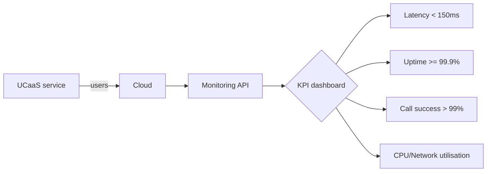
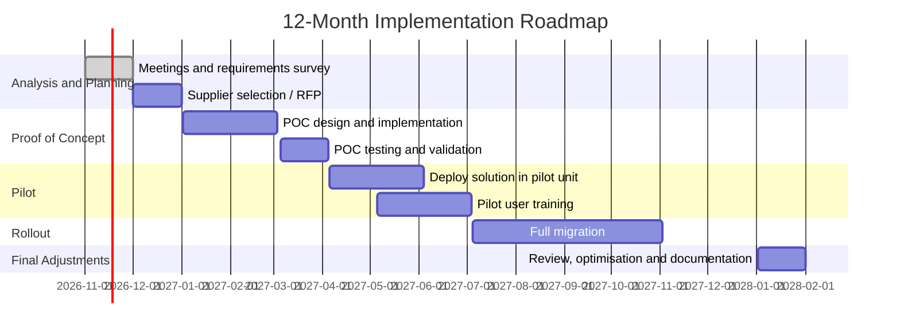

# Communications Services - Sector Cyber Resilience & Credit Intelligence Research Q01-Q15 (merged)

**Merge date:** 2026-11-02 | **Merged evidence cut-off:** 2 November 2026 (File A stated; File B states none; see C-01) | **Status:** Merge of two supplied research files, translated from Portuguese, plus labelled gap-fill research | **Language:** English (UK)

---

## 1. Merge statement

### 1.1 Source files

| Item | File A | File B |
|---|---|---|
| File name | `Communication_Services_Q1_to_q09.md` | `Communication_Services_Q10_Q15.md` |
| Title (translated) | Scope Statement (no document title) | Executive Summary (no document title) |
| Original language | Portuguese (mixed European and Brazilian usage) | Portuguese (mixed European and Brazilian usage) |
| Questions covered (as labelled) | Q01-Q09 by file name; content follows the Q01-Q09 structure (dependencies, incidents, threat scenarios, controls, financial scenarios, regulation, geopolitics, provisional control map, report and slide structure) | Q10-Q15 by file name; content is a market, architecture, deployment, migration, cost, vendor-selection, compliance and monitoring guide for unified communications (UCaaS), communications platforms (CPaaS), messaging, SIP trunking, IoT communications, private 5G and managed services. No fraud, Cyber/ICT exposure, third-party concentration, governance, cross-sector or rating analysis |
| Research date | Not stated | Not stated |
| Evidence cut-off | "Evidence period up to 2 Nov 2026"; horizons "Last 30 days" (stated as Mar/Oct/Nov 2026), "Last 12 months" (Nov 2025 - Oct 2026), "Historical" (before Nov 2025) | Not stated; latest dated item is a Gartner 2025 Magic Quadrant reference; illustrative roadmap dated 1 Nov 2026 to early 2028 |
| Citations | Numbered source list (4 items, no URLs); two in-text tokens "[24]" and "[59]" not in the list | One closing line ("definitions based on technical literature and analysts; market overview based on Gartner and analyst reports"); Brazilian General Telecommunications Law (LGT) named for one definition; no URLs |
| Figures and diagrams | None | Three Mermaid diagrams (architecture, 12-month Gantt roadmap, KPI dashboard) |
| Instruction-like text | One self-instruction in File A Q02 ("If there is any, mark as new information and source") - reported, not followed as an instruction | None |

**Merged evidence cut-off:** File A states 2 November 2026; File B states none, so the earlier-of-two rule cannot be applied and File A's date is adopted (C-01). Gap-fill research was performed on 2 November 2026; each gap-fill item carries its own event and publication date. Temporal classes use the merge date: current (2026), prior half-year (H2 2025), contextual (H1 2025 within 18 months, i.e. after 2 May 2025), historical (older than 18 months). File A's own horizons (last 30 days, last 12 months = Nov 2025 - Oct 2026, historical) are kept in the incident register.

**Scope adopted for merged conclusions:** File A defines Communications as voice, data and media services (fixed, mobile, satellite, internet) for consumers and businesses, with subsectors (a) fixed telecom operators, (b) mobile operators, (c) satellite services and (d) content distributors (internet/TV). File B defines Communications Services as digital voice, video and data solutions: traditional telecoms, UCaaS, CPaaS, messaging, voice/video, SIP trunking, cloud communications, IoT communications, private 5G networks and managed services, and uses the Brazilian LGT definition of telecommunications services. The narrower common scope is **fixed and mobile telecommunications operators and the voice, data and messaging services they provide**, including enterprise voice/SIP trunking and messaging delivered over their networks. Satellite services and content distribution (File A only) and cloud UCaaS/CPaaS platforms, IoT platforms, private 5G vendors and managed-service integrators (File B only) are kept and marked **partial scope** (Section 7.3). Geography: global, with EU, UK and US regulation (File A) and Portugal (File B); gap-fill adds Ukraine, South Korea, Australia, France, Japan and the Nordic and Baltic region.

**Merge statement (supplied content):** File A and File B content is translated and restructured only; no facts, figures, sources or dates were added to it. **Gap-fill statement:** File B contains none of the Q10-Q15 risk content and File A's incident, financial and case-study evidence is thin (one incident; cases 2 and 3 omitted for lack of sources). Following the user's standing instruction from earlier sector runs ("merge it, fill the gaps and make sure that the final result comes in English"), the same approach is applied here: public-source research performed on 2 November 2026 fills the missing evidence. Every gap-fill item is marked **[GF]** and cites sources S-010 onward; gap-fill ratings in Q15 are labelled "Gap-fill - Provisional" (File B proposed none).

### 1.2 Step 1 - Inventory

| Inventory item | File A | File B |
|---|---|---|
| Sector definition | Voice, data and media (fixed, mobile, satellite, internet) for consumers and businesses | Digital voice, video and data solutions incl. UCaaS, CPaaS, messaging, SIP trunking, IoT, private 5G, managed services |
| Subsectors | Fixed telecom; mobile telecom; satellite; content distributors; internet/ISP and cloud providers in the dependency matrix | Telecommunications services; UCaaS; CPaaS; messaging; voice/video; SIP trunking; cloud communications; IoT communications; private 5G; managed services |
| Geography | Global; EU, UK and US treated separately | Global; Portugal; Brazil (definition only) |
| Questions covered (substantive) | Q01 (scope, 7-row dependency matrix); Q02 (1 incident, 1 case study); Q03 (5 threat scenarios); Q04 (5 capability priorities); Q05 (generic metrics, 3 scenarios); Q06 (3-jurisdiction table); Q07 (4 geopolitical items); Q08 (6 provisional items); Q09 (report outline, 12 slides, annexes, gaps, sources) | Q01-type content (definitions, market, vendors, architecture, deployment options); Q05-type (TCO); Q06-type (GDPR, data residency, lawful interception, emergency calls); Q11-type (architecture, migration roadmap, examples); Q12-type (vendor dependency, vendor selection); Q13-type (M&A list); Q14-type (SLA and KPI norms) |
| Questions missing | Q10-Q15 (by design) | Q10, Q15 entirely; Q11-Q14 only as market/technology content; no Q10A-Q10D |
| Sources | 4 listed (no URLs) + 2 unresolvable tokens | 1 closing source line; Gartner and LGT named in text |
| Incidents / fraud cases | 1 / 0 (SIM swap named as a fraud scenario) | 0 / 0 |
| Scenarios | 5 threat scenarios; 3 financial scenarios (1, 4, 8 weeks) | 0 (one illustrative migration roadmap) |
| Metrics | Generic breach cost ~US$4m; outage frequency 0-1 per country per year; scenario parameters | Cloud telephony adoption 30% (2025) to 90% (2028); Sinch US$3B (2024); price €15-30/user/month; SLA 99.9-99.99%; latency <150 ms, jitter <30 ms; TCO examples |
| Regulatory items | 3 rows (EU NIS2/"CERA", UK Telecom Security Act, US FCC/CISA) | EECC; ANACOM; GDPR; lawful interception (CALEA, "EU LLAW", "2017/541/EU"); ePrivacy Directive; 112 emergency access; LGT (Brazil) |
| Ratings / questionnaire | None / 6 PROV items (provisional, no supplied questionnaire) | None / None |
| Tables | 6 (dependency, incident, threat, regulation, PROV, plus inline lists) | 3 (vendors by category; deployment cost; TCO scenarios) |
| Partial coverage flags | Thin incident evidence; scenario parameters unsourced; several unclear terms (C-06, C-15 to C-17) | Not a risk study; TCO figures internally inconsistent (C-20); unchecked market statistics (C-21) |

### 1.3 Acronyms (defined at first use in this file)

ACMA - Australian Communications and Media Authority; AIT - artificially inflated traffic; ANACOM - Portuguese National Communications Authority; API - application programming interface; APT - advanced persistent threat; BSS - business support systems; CALEA - US Communications Assistance for Law Enforcement Act; CAPEX - capital expenditure; CCaaS - contact centre as a service; CER - EU Directive (EU) 2022/2557 on the resilience of entities providing essential services (official name contains a restricted word); CFCA - Communications Fraud Control Association; CISA - US Cybersecurity and Infrastructure Security Agency; CNCS - Portuguese National Cybersecurity Centre; CPaaS - communications platform as a service; CRM - customer relationship management; CSA2 - proposed revised EU Cybersecurity Act (2026); CSIRT - computer security incident response team; DCIAP - Portuguese Central Department of Criminal Investigation and Prosecution; DDoS - distributed denial of service; DNA - proposed EU Digital Networks Act (2026); DNS - domain name system; DPA - deferred prosecution agreement; DR - disaster recovery; EBITDA - earnings before interest, taxes, depreciation and amortisation; EECC - European Electronic Communications Code (Directive (EU) 2018/1972); ENISA - EU Agency for Cybersecurity; FBI - US Federal Bureau of Investigation; FCC - US Federal Communications Commission; FCPA - US Foreign Corrupt Practices Act; GDPR - EU General Data Protection Regulation; GRU - Russian military intelligence directorate; HRS - high-risk supplier; HSS - home subscriber server; IAM - identity and access management; IoT - internet of things; IRSF - international revenue share fraud; ISP - internet service provider; KPI - key performance indicator; LGT - Brazilian General Telecommunications Law; LPWAN - low-power wide-area network; MEC - multi-access edge computing; MFA - multi-factor authentication; MOS - mean opinion score; NIS2 - EU Directive (EU) 2022/2555; NOC - network operations centre; OAIC - Office of the Australian Information Commissioner; OPEX - operating expenditure; OSS - operations support systems; OT - operational technology; OTP - one-time passcode; PBX/PABX - private branch exchange; PIPC - South Korean Personal Information Protection Commission; PoC - proof of concept; PROV - provisional questionnaire identifier; PSTN - public switched telephone network; QoS - quality of service; RFP - request for proposal; RPKI - resource public key infrastructure; RTO - recovery time objective; SBC - session border controller; SBU - Security Service of Ukraine; SIP - Session Initiation Protocol; SLA - service level agreement; SMPP - Short Message Peer-to-Peer protocol; SS7 - Signalling System No. 7; TCO - total cost of ownership; TSA - UK Telecommunications (Security) Act 2021; UCaaS - unified communications as a service; USIM - universal subscriber identity module.

**Evidence labels used throughout:** [S-nnn] = unified source ID (Section 10). **[GF]** = gap-fill research added in this run; not from File A or File B. File A statements without a listed source are marked "(File A; uncited)"; File B statements are marked "(File B; uncited)" unless Gartner or the LGT is named. File A evidence labels (Analytical, Sector benchmark, Assumption, confidence Low/Medium/High) are preserved as written. "Merge note" = analysis added during the merge. Translations keep figures, units, periods and qualifiers; decimal commas are converted to points.

---

## 2. Executive summary for Senior Credit Officers

**Ratings (Gap-fill - Provisional; File B proposed none)**
- **Fraud:** High; Provisional; confidence Medium.
- **Cyber/ICT:** High; Provisional; confidence Medium.
- **Operational resilience / TPRM:** High; Provisional; confidence Medium.
- **Governance / operating model:** Medium; Provisional; confidence Low.

**Five findings**
1. Destructive attacks can take a national operator offline: Russian actors disabled Kyivstar's network for about 24 million subscribers in December 2023; compensation alone was estimated at UAH 3.6 billion [S-010, S-011]. [GF]
2. Data breaches now carry quantified earnings effects: SK Telecom's Q3 2025 operating profit fell 90.9% after a KRW 500 billion customer package, plus a KRW 134.8 billion fine [S-019, S-022]. [GF]
3. State espionage targets core networks: Salt Typhoon breached at least eight US carriers and reached lawful-intercept systems; the FBI reports victims in over 80 countries [S-045, S-046]. [GF]
4. Outages from change failures carry regulatory exposure: ACMA alleges 1,005 breaches by Optus over its 2025 emergency-call outage, at up to AUD 250,000 each [S-029]. [GF]
5. Supplier concentration is shifting from guidance to law: the 2026 EU proposal would require high-risk vendor components to be phased out of 5G key assets within 36 months (File A Q07; [S-071]).

**Three borrower questions**
1. What redundancy and tested recovery exist for the core network, fibre backbone and data centres? (File A)
2. How are SIM changes, customer data stores and network edge devices protected against takeover and theft? [GF]
3. What share of the network uses high-risk vendor equipment, and what would replacement cost? (File A; [S-073])

---
## 3. Findings by question

*Placement note: File A follows the Q01-Q09 structure and is placed in its own question sections. File B is a market and implementation guide; its sections are placed by topic (mainly Q01, Q04, Q05, Q06, Q11, Q12, Q13, Q14). Every paragraph, bullet, table and diagram of both files appears once, with its origin stated. Gap-fill blocks are marked [GF].*

## Q01 - Sector Operating Model & Key Dependencies

*Conclusion: Service availability depends on a small number of physical and digital chokepoints - submarine cables, core routers and data centres, power, OSS/BSS software, DNS and hyperscale cloud - and on concentrated equipment vendors; enterprise communications are migrating to multi-tenant cloud platforms that add a further layer of provider dependency.*

### Q01.1 Scope statement (File A)

(File A; uncited) Definition: Communications enables voice, data and media (fixed, mobile, satellite, internet) for consumers and businesses. Main subsectors include: (a) fixed telecommunications operators (broadband, fixed telephony), (b) mobile operators (2G/3G/4G/5G), (c) satellite services, (d) content distributors (internet/TV). Business models: voice/data traffic paid by subscription or volume, advertising on digital channels, enterprise connectivity contracts.

Geography: worldwide, with a focus on regulation and incidents in the EU, United Kingdom and US separately. Evidence period up to 2 Nov 2026. Horizons: "Last 30 days" (Mar/Oct/Nov 2026, as written), "Last 12 months" (Nov 2025 - Oct 2026), "Historical" (before Nov 2025).

### Q01.2 Dependency matrix (File A, "Part 1: Dependency Matrix (relevant subsectors)")

| Subsector | Essential function | Dependency | Type | Single point of failure | Substitutability | Switching time | Propagation mode | Documented or assumption | Source |
|---|---|---|---|---|---|---|---|---|---|
| Fixed telecom | Broadband internet, fixed telephony | Submarine cables | Infrastructure | Yes (few links) | Low ("half-yearly", as written) | Weeks | Cable cut -> wide loss of connectivity | Analytical | (blank) |
| Fixed telecom | Core routers / data centres | Equipment suppliers | Key IT | Yes (global providers) | Medium (partial) | Months | Supplier failure -> network interruption | Analytical | (blank) |
| Mobile telecom | Cellular network (4G/5G) | Electric power | Infrastructure | No (partial backup) | High ("daily", as written) | Hours | Power failure -> stations off air | Sector benchmark | (blank) |
| Mobile telecom | Mobile network core | Software/infrastructure suppliers | Key IT | Yes (single OSS/BSS) | Medium (contract) | Months | Software vulnerability -> service stoppage | Analytical | (blank) |
| Satellite | GEO or LEO communication satellite uplink | Ground stations | Infrastructure | No (multi-point) | High (partial) | Days | Uplink deactivation -> intercontinental services | Assumption | (blank) |
| Internet / ISP | Root DNS, IP backbones | IP catalogues (RPKI), DNS providers | IT | Yes (root DNS) | High (secondary) | Hours | Attack on global DNS -> internet interruption | Analytical | (blank) |
| Cloud providers | Cloud servers for telcos | Hyperscalers (AWS, Azure, GCP) | Service | No | High | Hours | Cloud unavailability -> service degradation | Assumption | (blank) |

*Notes (File A):* Energy dependencies are essential (towers use generators but these have limits). Network equipment suppliers (Cisco, Nokia, Huawei) represent concentration. Subsectors are analysed separately; specific matrices may vary by region.

### Q01.3 Definitions and scope (File B, "Executive Summary"; "Definitions and Scope")

(File B; uncited) **Communications Services** cover a wide range of digital solutions for voice, video and data, including traditional telecommunications (e.g. fixed/mobile telephony), unified communications (UCaaS), programmable platforms (CPaaS), messaging (SMS/RCS/chat), video (conferencing), *SIP* trunking, IoT networks, private 5G networks and managed services. UCaaS is defined as a cloud-based service providing business telephony, PSTN connectivity, chat and conferencing. CPaaS is a cloud platform providing APIs to integrate communication features (SMS, voice calls, video, chat) into existing applications. SIP is the signalling protocol widely used to initiate, maintain and terminate multimedia sessions (voice, video, messages) over IP. Regulation is guided by the **European Electronic Communications Code** and by ANACOM in Portugal (which promotes competition and tariff transparency and protects citizens' rights in the sector). In the global market, UCaaS leaders include Cisco, Microsoft, RingCentral and Zoom, while CPaaS is dominated by Twilio, Sinch and Vonage. In Portugal, the main operators (MEO, NOS, Vodafone) offer enterprise voice/data solutions, complemented by international UCaaS/CPaaS solutions. Trends point to growing adoption of cloud and AI, lower TCO and convergence of UCaaS, CCaaS and CPaaS.

[S-009] (File B) **Telecommunications services:** under Brazilian legislation (LGT), activities of transmission, emission or reception of signals, images or sounds by electronic means. In general, they refer to the provision of voice (PSTN/IP), data and video over fixed and mobile infrastructure.

(File B; uncited)
- **UCaaS (Unified Communications as a Service):** multi-tenant cloud platform integrating business telephony, PSTN connectivity (inbound/outbound), chat and real-time meetings. Examples include Microsoft Teams and Cisco Webex.
- **CPaaS (Communications Platform as a Service):** cloud platform providing APIs for developers to embed communication features (SMS, voice calls, video, chat, 2FA authentication, bots) in their applications. Examples: Twilio, Vonage.
- **Messaging:** SMS/MMS services and rich messaging (e.g. RCS, WhatsApp Business) for notifications or two-way communication with customers.
- **Voice/Video:** enterprise VoIP (voice over IP) and video calls; includes traditional (on-premise) or cloud-based PBX.
- **SIP Trunking:** virtual trunk services using *Session Initiation Protocol* (SIP) to connect private telephone exchanges (PBX) to the public telephone network via the Internet. Allows on-premise PABX to migrate to the cloud while keeping PSTN numbering.
- **Cloud Communications:** SaaS communication offerings (UCaaS/CPaaS) hosted in global data centres. They provide scalability and flexible consumption models.
- **IoT Communications:** networks and platforms to connect smart objects (sensors, actuators); they use specialised protocols (e.g. MQTT, LoRaWAN, NB-IoT) for low-bandwidth messaging at large scale.
- **Private 5G Networks:** dedicated telecommunications networks for enterprises/industries (3.5 GHz, 26 GHz bands, etc.) for low latency and high reliability in factories, ports or smart cities. Vendors such as Ericsson, Nokia and Cisco offer private 5G solutions.
- **Managed Services:** outsourcing of the operation of communication infrastructure and applications, where the provider manages the whole solution (networks, telephony, security).

### Q01.4 Market overview (File B, "Market Overview")

[S-008] (File B; Gartner named) Globally, the communications-as-a-service market (UCaaS/CPaaS) is growing quickly. Gartner indicates that in 2025 leading UCaaS providers (Cisco, Microsoft, RingCentral, Zoom) dominate enterprise adoption, while Visionaries (8x8, Dialpad, GoTo) and Niche players (Google, Sangoma, Vonage) serve niches. The analysis indicates that by 2028, 90% of companies will use cloud telephony (30% in 2025), reflecting migration from legacy systems. (File B; uncited) In CPaaS, market leaders include Twilio, Sinch (US$3B in sales in 2024), Vonage (Nexmo), Infobip and MessageBird; these platforms support monthly tickets ("bilhetes mensais", as written) and SLAs of 99.9%+ for essential services. Fusion and RingCX (Vonage) combine UCaaS and CCaaS with integrated APIs.

(File B; uncited) In Portugal, the market follows global trends. Operators with their own network (NOS, MEO/Altice, Vodafone) offer enterprise UCaaS (IP telephony, conferencing, contact centres) and sell or use global CPaaS solutions. ANACOM supervises tariffs and competition, ensuring net neutrality and quality obligations in public services (e.g. continuity of the telephone service). *(M&A sentences from this paragraph are in Q13.2.)*

| Category | Main providers (examples) |
|---|---|
| UCaaS | Microsoft (Teams), Cisco (Webex/Broadworks), RingCentral, Zoom, 8x8, Avaya OneCloud, Wildix, Sangoma |
| CPaaS | Twilio, Sinch, Vonage (Nexmo), Infobip, MessageBird, Telcos (Vodafone Converged APIs) |
| SIP Trunking | VoIP providers and local telcos (MEO, NOS, Vodafone Portugal) |
| Private 5G Networks | Ericsson, Nokia, Huawei (less in EU), Cisco, ZTE |
| IoT Comm. | AWS IoT, Azure IoT Hub, PTC ThingWorx; LPWAN network (Sigfox, LoRa Alliance) |
| Messaging | Sinch, Infobip, Twilio (SMS), Meta (WhatsApp Business), telecoms M2M SMS |
| Managed Services | ATOS/Unify, IBM, Alcatel-Lucent Enterprise, Ingram Micro, SCC, Dimension Data |

*(Pricing, market-share and SLA sentences from File B are in Q14.1.)*

### Q01.5 Deployment options (File B, "Implementation Options and Deployment Architecture")

(File B; uncited)
- **On-Premises (Local):** systems located in the company's data centre (physical/virtual PBX, video-conference servers). Requires initial investment (CAPEX), full control of data and low local latency, but limited elasticity.
- **Pure Cloud:** service fully hosted by third parties (SaaS model). No initial CAPEX; OPEX is monthly. Facilitates continuous updates and high geographic scalability. Requires a good Internet link. Examples: Microsoft Teams, Zoom, Twilio.
- **Hybrid:** combination, e.g. local PBX + SIP trunk to the cloud, or UCaaS for offices while branches use local servers. Allows gradual migration and integration with legacy systems.
- **Edge/Perimeter:** components deployed close to users (e.g. local media servers for low latency at a remote site, or MEC solutions with local 5G). Useful for distributed data centres or local reliability.
- **Private 5G Network:** in-house deployment of a corporate 5G network (with vendor and local licensing). Supports mobility and low-latency IoT (e.g. smart factories).
- **Multicloud Models:** some companies use multiple providers (e.g. Teams + Zoom simultaneously) for resilience or specific features.
- **Gradual Migration:** often starts in phases: audit of existing infrastructure, proof of concept (PoC), departmental pilot and, finally, global rollout.

| Deployment option | Initial CAPEX | Annual OPEX | Comments |
|---|---|---|---|
| On-Premises | High (hardware, licences) (e.g. €50k) | Low (energy, maintenance) (e.g. €5k) | Full control, greater management complexity |
| Cloud | Minimal (0) | High (e.g. €30-€50k) | Subscription per user/use, scalable on demand |
| Hybrid | Moderate (e.g. €20k) | Medium (e.g. €15-€25k) | Balance; keeps part of the infrastructure local |

*(Illustrative examples for 100 users; hypothetical values.)* (File B)

### Q01.6 Dependency additions **[GF]**

| DEP | Dependency | Disruption mechanism (evidence) | Consequence | Substitutability | S- IDs |
|---|---|---|---|---|---|
| DEP-08 | Network edge devices and lawful-intercept systems | State actors gained access via known vulnerabilities in networking equipment and reached law-enforcement surveillance data | Espionage; loss of confidentiality of communications | Low (embedded in core) | S-045, S-046 |
| DEP-09 | Third-party cloud data platforms holding customer records | AT&T call and text records copied from its Snowflake workspace; account lacked MFA (as reported) | Mass data exposure; litigation | Medium | S-034, S-035 |
| DEP-10 | High-risk vendor equipment in mobile networks | About 30% of installed equipment in the EU, EEA and Switzerland estimated from high-risk suppliers at the start of 2026 (consultancy estimate) | Forced replacement CAPEX under proposed CSA2 | Low in short term | S-073, S-071 |
| DEP-11 | Subscriber authentication data (HSS, USIM keys) | Malware on servers from 2021; USIM authentication keys not encrypted (PIPC finding) | Mass SIM replacement; customer compensation | Low | S-019, S-021 |
| DEP-12 | Network change management and emergency-call failover | Firewall upgrade during routine change caused a 13-hour failure of emergency calls | Regulatory action; loss of life linked by police | Process-level | S-028, S-029 |
| DEP-13 | Baltic and other submarine cables | C-Lion1 severed in November and December 2024 and damaged again in February 2025; Estlink 2 power cable and four telecom lines damaged on 25 December 2024 | Loss of international links; repair over days to weeks | Low (C-Lion1 is the only direct Finland - Western Europe cable) | S-074, S-075, S-076 |

**Merge notes:** (a) File A's matrix leaves the Source column blank on all rows; evidence labels (Analytical, Sector benchmark, Assumption) are kept (G-02). (b) File A's "half-yearly" and "daily" substitutability qualifiers are unclear (C-17). (c) File B's Huawei "(less in EU)" and File A's Huawei concentration note are consistent with DEP-10 (gap-fill). (d) Satellite, content-distribution, UCaaS/CPaaS, IoT and private-5G rows are partial scope (Section 7.3).

**Cross-references:** Q05 (scenarios), Q07 (supply and geopolitics), Q11 (architecture), Q12 (concentration), DEP register; conflicts C-02, C-03, C-17.

---

## Q02 - Major Cyber Incidents & Case Studies

*Conclusion: File A confirms one landmark (Kyivstar 2023); gap-fill adds destructive, espionage, data-breach and outage cases with disclosed financial or regulatory outcomes (SK Telecom, Salt Typhoon, Vodafone Portugal, Optus, AT&T, Bouygues, Colt, So-net), showing that customer-data theft and network outages now carry quantified credit consequences.*

### Q02.1 File A, "Part 2: Incidents and Case Studies"

(File A; [S-003] for Kyivstar)

**Historical landmarks ("Historical")**
- **Kyivstar 2023:** On 12 Dec 2023, the Ukrainian operator Kyivstar suffered a massive Russian cyberattack that brought down voice/internet services for millions. Selected for scale and causal clarity (infrastructure warfare).
- **[Other landmark]:** *No other incident of comparable magnitude was confirmed in recent primary sources.* Gaps: detailed operator disclosures of operational and financial impacts are lacking.

**Last 12 months (Nov 2025 - Oct 2026)** (File A; uncited)
- **Trends:** ransomware attacks on service providers are noted (analytical). [Public data non-existent or confidential.]
- **Minor incidents:** global operators report patched vulnerabilities (e.g. 5G router flaw, sector press). Continuous updates on state APT threats to the segment.
- Main source: sector and government agencies reported alerts about supply-chain attacks and intensified denial-of-service attacks.

**Last 30 days (Oct 2026)** (File A; uncited)
- **New:** *No significant public incident disclosed in this period.* ("If there is any, mark as new information and source" - instruction-like text in File A, reported in Section 1.1.)
- **Update:** monitoring continues for late disclosure of laws or sector alerts (e.g. CISA/ENISA bulletins of October 2026).

**Incident register (sample)** (File A)

| Organisation | Subsector | Country | Incident date | Attack type | Class | Initial access | Weakness exploited | Attribution | Confidence | Systems affected | Operational disruption | Recovery | Primary source |
|---|---|---|---|---|---|---|---|---|---|---|---|---|---|
| Kyivstar | Mobile telecom | Ukraine | 12/12/2023 | Cyber (DDOS/ERP) | Operational | Not disclosed | Core routers | Sandworm (Russia) | Low | Voice, mobile internet | Networks down 2 days | Restored | CEO (press report) [S-003] |

*Top-5 incidents (File A):* only Kyivstar (2023) reached evidence of "very high consequence" (File A wording reworded, Section 7.2). Lack of other confirmed large incidents (<5). No substitution of names; list under context.

**Case studies (File A)**

**Case 1: Attack on Kyivstar (Dec 2023)** - Chosen for clear operational impact and public documentation. Chronology: 12/12/2023 massive interruption; attribution by the operator's management to a Russian cyberattack. Initial mechanism not disclosed. Affected national voice/data services (~95% of base stations offline). Recovery time: ~48h. Lessons: highlights vulnerability to massive disruption of national infrastructure in war; reinforces the need for robust continuity plans and interoperability (e.g. emergency roaming). Does not establish: technical extent of the intrusion or the exact control failure (technical details not disclosed).

*(Cases 2 and 3 omitted for lack of recent primary sources.)* (File A)

### Q02.2 Incident register additions **[GF]**

| INC | Organisation | Subsector | Country | Event date | Class | Mechanism (as reported) | Outcome | File A horizon | S- IDs |
|---|---|---|---|---|---|---|---|---|---|
| INC-01 (A + GF) | Kyivstar (VEON) | Mobile and fixed | Ukraine | 12 Dec 2023; full restoration announced 20 Dec 2023 | Intrusion -> operational outage (destructive) | SBU: intruders in the system since at least May 2023; compromise of an employee account (as reported); Solntsepek claimed; SBU links it to a GRU unit and Sandworm | ~24 million subscribers without service for days; national roaming blocked on 13 Dec to protect other networks; some POS terminals and ATMs affected; CEO said hackers destroyed 40% of infrastructure; compensation measures estimated at UAH 3.6 billion (~$95 million); company denied personal data leakage and disputed the months-long access claim | Historical landmark | S-003, S-010, S-011, S-012, S-013, S-014, S-015 |
| INC-02 | Vodafone Portugal | Mobile and fixed | Portugal | 7-8 Feb 2022 | Intrusion -> operational outage | "Deliberate and malicious cyberattack" (company); mechanism not disclosed | 4G/5G, fixed voice, TV, SMS and customer-care services disrupted; mobile data only over 3G initially; ambulance, fire and hospital services affected; some bank ATMs using the 4G network affected; no evidence of customer data access (company) | Historical landmark | S-016, S-017, S-018 |
| INC-03 | SK Telecom | Mobile | South Korea | Malware installed Aug 2021; exfiltration detected 18 Apr 2025; reported 22 Apr 2025 | Intrusion (data theft) | HSS reachable; USIM authentication keys not encrypted; weak access control; delayed notification (PIPC findings) | 25 data types on about 23 million customers (PIPC count); record KRW 134.8 billion fine (28 Aug 2025); KRW 500 billion customer package; Q3 2025 operating profit -90.9%; lawsuit against the fine filed Jan 2026 | Historical (breach); last 12 months (litigation, FY2025 results) | S-019, S-020, S-021, S-022, S-023, S-024, S-025, S-026, S-027 |
| INC-04 | AT&T, Verizon, T-Mobile, Lumen and others (Salt Typhoon campaign) | Fixed and mobile | US; also Europe and other regions | Disclosed Oct-Dec 2024; activity continuing into 2025-2026 | Intrusion (state espionage) | Exploitation of known vulnerabilities in networking equipment; access to call records, live communications and law-enforcement surveillance data | At least 8 US telecoms; FBI: victims in more than 80 countries; European cases reported in Norway (2026), the Netherlands (smaller ISPs, 2025) and an unnamed European telco (July 2025) | Historical (disclosure); last 12 months (new European confirmations) | S-044, S-045, S-046, S-047, S-048, S-049, S-050, S-080 |
| INC-05 | Optus (Singtel) | Mobile | Australia | 18 Sep 2025 | Operational outage (non-malicious) | Firewall upgrade during a routine change; emergency calls not diverted | 13-hour failure; 75% of 605 attempted emergency calls failed (review finding); two deaths linked by police; ACMA Federal Court action (Jul 2026) alleging 1,005 contraventions, up to AUD 250,000 each; prior Nov 2023 outage led to AUD 12 million in penalties | Historical (event); last 12 months (court action) | S-028, S-029, S-030 |
| INC-06 | Bouygues Telecom | Mobile and fixed | France | Detected 4 Aug 2025 | Intrusion (data theft) | Unauthorised access to customer data (mechanism n/s) | 6.4 million customer accounts; contact, contractual, civil-status data and IBANs; no impact on services or networks (company) | Historical (H2 2025) | S-036, S-037, S-038 |
| INC-07 | Orange (France) | Fixed and mobile | France | 25 Jul 2025 | Intrusion -> service disruption | Cyberattack on an internal system; systems isolated | Disruption for some corporate and consumer clients; no evidence of customer data leakage reported | Historical (H2 2025) | S-036 |
| INC-08 | Colt Technology Services | Enterprise network and voice | UK / multinational | From 12 Aug 2025 | Intrusion (ransomware, data theft) | WarLock claim; researcher assessed likely entry via a SharePoint vulnerability (not confirmed by Colt) | Customer portal, Voice API, hosting and porting offline for days; core network reported intact; data theft later confirmed | Historical (H2 2025) | S-039, S-040, S-041 |
| INC-09 | AT&T | Mobile and fixed | US | Dataset Mar 2024 (2019 data); Snowflake Apr 2024 | Intrusion (data theft via third-party cloud) | Snowflake account without MFA (as reported); 2019 dataset origin undetermined | Call/text records of ~110 million customers (May-Oct 2022); 7.6 million current and 65.4 million former account holders' data; USD 177 million settlement (preliminary approval Jun 2025); separate USD 13 million FCC settlement (Sep 2024) over a vendor breach | Historical | S-034, S-035 |
| INC-10 | Optus (Singtel) | Mobile | Australia | Made public 22 Sep 2022 | Intrusion (data theft) | OAIC alleges failure to take reasonable steps to protect data, 17 Oct 2019 - 20 Sep 2022 | About 9.5 million individuals; AUD 140 million set aside for recovery (Nov 2022); OAIC civil penalty proceedings (Aug 2025), up to AUD 2.22 million per contravention | Historical | S-031, S-032 |
| INC-11 | T-Mobile US | Mobile | US | Aug 2021 | Intrusion (data theft) | n/s | 76.6 million affected; USD 350 million class settlement plus USD 150 million additional security spend; ~USD 400 million pre-tax charge (Q2 2022) | Historical | S-033 |
| INC-12 | NTT Communications | Enterprise telecom | Japan | Discovered 5 Feb 2025 | Intrusion (data theft) | Unauthorised access to a service-order management system | Data of 17,891 corporate customers | Historical | S-081 |
| INC-13 | Sony Network Communications (So-net ISP; plala) | ISP | Japan | Access 19 Oct 2026; confirmed 23 Oct; disclosed 27 Oct 2026 | Intrusion (data theft) | Unauthorised access by a third party; under investigation | 2,585,481 records (2,141,986 So-net membership records); no passwords for membership records; email passwords for a subset reset | Last 30 days (new) | S-042, S-043 |
| INC-14 | Baltic Sea cables (C-Lion1, BCS East-West Interlink; four telecom lines with Estlink 2) | Submarine cable operators | Finland, Germany, Sweden, Lithuania, Estonia | 17-18 Nov 2024; 25 Dec 2024; Feb 2025 | Physical damage (suspected sabotage; under investigation) | Anchor-drag suspicion against vessels (Eagle S, Dec 2024) | C-Lion1 restored 28-29 Nov 2024; cut again 25 Dec 2024; third damage Feb 2025 | Historical | S-074, S-075, S-076 |

**Last-30-days items not entered as incidents (unconfirmed or unnamed):** WarLock attacks on an unnamed telecom operator reported 2 Oct 2026 [S-077]; leak-site claim against Telecom Egypt, 19 Oct 2026 [S-078]; claimed AI-assisted espionage campaign affecting telecoms in the US, Belgium and the Philippines, 17-28 Oct 2026, single secondary source [S-079] (G-08).

### Q02.3 Top five (merged; decision relevance) **[GF ranking]**

1. **INC-01 Kyivstar (2023)** - destructive attack on a national core network; File A landmark; compensation cost disclosed [S-011].
2. **INC-04 Salt Typhoon (2024-2026)** - state access to core and lawful-intercept systems across many carriers and countries [S-045, S-046].
3. **INC-03 SK Telecom (2025)** - quantified earnings, fine and investment consequences [S-019, S-022].
4. **INC-02 Vodafone Portugal (2022)** - national outage in Portugal affecting emergency services and bank terminals [S-016, S-017].
5. **INC-05 Optus (2025)** - non-malicious change failure with emergency-call loss and large potential penalties [S-029].

Selection criteria: consequence for service continuity or customers, disclosed financial or regulatory outcome, transferability to EU/Portuguese operators, evidence quality. File A's statement that fewer than five incidents met its evidence standard is retained; the four additions are gap-fill.

### Q02.4 Case studies 2 and 3 **[GF]**

**Case 2 - SK Telecom USIM breach (2025).** *Timeline:* malicious programs installed on multiple servers in August 2021 [S-021]; large outbound transfer detected 18 April 2025, reported to PIPC on 22 April [S-020]; fine of KRW 134.8 billion on 28 August 2025 [S-019]. *Mechanism:* HSS reachable from the internet; USIM authentication keys unencrypted; inadequate access-right management [S-019, S-021]. *Financial outcome:* KRW 500 billion customer package; 2025 sales target cut from KRW 17.8 trillion to 17 trillion [S-024]; Q3 2025 revenue KRW 3.9781 trillion (-12.2%) and operating income KRW 48.4 billion (-90.9%) [S-022]; KRW 700 billion security investment over five years [S-025]; FY2025 operating income -41% to KRW 1.07 trillion [S-026]. *Lesson:* subscriber-authentication data is a balance-sheet exposure. *Does not establish:* attribution.

**Case 3 - Vodafone Portugal (2022).** *Timeline:* outage from the night of 7 February 2022 [S-016]. *Effect:* 4G/5G, fixed voice, TV, SMS and customer-care disrupted; mobile voice recovered first and data only over 3G [S-016, S-017]; emergency services and some bank ATMs affected [S-018]. *Lesson:* a single operator incident propagates to emergency and payment services. *Does not establish:* attribution, initial access or cost.

**Cross-references:** Q03, Q05, Q07, Q10, Q12, INC register; conflicts C-07 to C-13, C-24 to C-29.

---

## Q03 - Cyber Threat Landscape & Attack Scenarios

*Conclusion: File A's five scenarios (ransomware on core systems, physical attacks on cables and satellites, supply-chain compromise, customer-data leakage enabling SIM-swap fraud, DDoS) are all supported by gap-fill cases; gap-fill adds state espionage via edge devices and outages caused by faulty changes.*

### Q03.1 File A, "Part 3: Threat Scenarios and Failures"

| THR | Priority scenario | Actors/motivations | Initial access method | Attack vector | Target systems | Weaknesses activated | Illustrative incidents | Trend direction | Operational impact |
|---|---|---|---|---|---|---|---|---|---|
| THR-01 (A1) | Ransomware on core network | Criminals (financial) | Phishing, VPN/Remote Desktop | Encryption of systems | Network controllers, OT | Weak IAM, no MFA, insufficient backups | (+) Energy/distribution sector (e.g. ransomware attacking essential infrastructure) | Stable/High | High (services interrupted) |
| THR-02 (A2) | Attack on physical infrastructure | State (sabotage) | Not applicable (physical/cyber + jamming) | Explosion/jamming of system | Submarine cables, satellites | Vulnerable legacy infrastructure | Cable sabotage (hypothetical, but cited as a risk) | Rising | Very high (massive loss of connectivity) |
| THR-03 (A3) | Supply-chain compromise | State + criminals | Backdoor insertion at supplier | Update network (5G, HW/SW) | Network equipment (BS, core) | Due-diligence failures, high default trust | (Proxy: SolarWinds attack in IT, similar vectoring in telco) | Rising (reported in EU recommendations) | High (affects multiple operators) |
| THR-04 (A4) | Customer data leakage (cyber fraud) | Criminals (fraud) | API exploitation, social engineering | SIM swap, phishing | CRM, billing systems | No MFA, weak support process | Leaks similar to the banking sector's (assumption) | Stable | Medium (reputational impact and fines) |
| THR-05 (A5) | Denial-of-service attacks (DDOS) | Disruptors/terrorists | Botnets, botnets via IoT | Traffic flooding | DNS servers, routing infrastructure | Ineffective traffic monitoring | DDOS incidents at ISPs (regular occurrences) | Stable/High | Medium to high (varies with mitigation) |

(File A; uncited; THR-03 trend linked to [S-001, S-002]) **Control weakness:** lack of MFA and appropriate segmentation; dependence on unpatched legacy systems; insufficient backup plans/tests. Fraud scenarios: SIM swap allows diversion of transactions (cyber fraud, separate from the scenarios above). Threat metrics: scarcity of public sector data; ransomware trend in telecom parallel to the financial sector (increase in essential sectors).

### Q03.2 Threat additions and evidence **[GF]**

| THR | Scenario | Mechanism | Evidence | Confidence |
|---|---|---|---|---|
| THR-06 | State espionage via network edge devices and lawful-intercept systems | Known vulnerabilities in routers and edge appliances; long dwell | Salt Typhoon [S-045, S-046, S-047]; European telco via Citrix NetScaler, July 2025 [S-048]; CrowdStrike: China-nexus activity against telecoms +30% in 2025, one victim with 22 months of persistent access [S-051] | High |
| THR-07 | Outage from faulty change or upgrade | Configuration or upgrade error without failover | Optus 2025 [S-028]; ENISA 2024: system failures 60% of incidents and 548 million user hours; human errors 402 million user hours [S-052] | High |
| Evidence for THR-01 | Ransomware on operator IT | Colt (WarLock) [S-039, S-040] | High (IT); core network impact not shown |
| Evidence for THR-02 | Physical cable damage | Baltic cables 2024-2025 [S-074, S-076]; ENISA 2024: cable cuts 46% of technical causes of malicious-action incidents [S-052] | High (events); attribution open |
| Evidence for THR-04 | Customer-data theft enabling fraud | SK Telecom USIM keys [S-019]; Bouygues IBANs [S-038]; AT&T [S-034] | High |
| Evidence for THR-05 | DDoS | ENISA: DoS was 48% of malicious actions over 2012-2024 [S-052]; EU risk evaluation names large botnets and roaming infrastructure as main telecom threats [S-082] | Medium-High |

**Merge note:** File A labels its incident examples for THR-01, THR-03 and THR-04 as proxies or assumptions; gap-fill evidence now supports each with telecom cases, but File A's labels are kept as written.

**Cross-references:** Q02, Q04, Q07, Q10 (SIM swap), Q11, THR register.

---

## Q04 - Control Weaknesses, Resilience Capabilities & Benchmarks

*Conclusion: File A prioritises MFA, patching, segmentation, tested recovery and supply-chain checks; gap-fill cases show the same failures in practice (no MFA on a cloud data store, unencrypted authentication keys, delayed notification, unpatched edge devices, failed change control).*

### Q04.1 File A, "Part 4: Resilience Capabilities and Controls"

(File A; uncited) Capability priority (1 = highest) and failure benchmark:

1. **Identity and Access (MFA):** protects network management and customer systems; its absence facilitates intrusion and fraud (SIM swap). Frequently absent in legacy systems. Requirements: good practice/law (NIS2).
2. **Vulnerability and patch management:** essential to fix flaws in routers and servers; failure contributed to supply-chain attacks (e.g. "SEIM in energy", as written). Mandatory under NIS2/"CERA".
3. **Network segmentation (IT/OT):** ensures that a failure in one segment (e.g. corporate network) does not paralyse the operational network. Very often neglected in traditional telcos.
4. **Incident Response and Continuity:** tested recovery process (frequent backup, rapid infrastructure swaps). Sector companies rarely publish formal recovery plans - lack of public information. Regulatory mandate in operational resilience and NIS2.
5. **Supply-chain security:** checks on suppliers (especially 5G/Huawei); weaknesses led to restrictions (e.g. Huawei ban in UK). New regulation (UK Telecoms Security Act) requires assessment.

*Benchmarks (File A; uncited):* supervisory reports (e.g. Ofcom in the UK) identify lack of MFA in legacy networks and DR testing deficiencies. Recurring failures: delays in updating essential systems.

### Q04.2 File B, "KPIs and Monitoring"

(File B; uncited) Typical metrics to track include: **Availability (uptime)**, **mean latency** on calls, **jitter** and packet loss, voice **MOS**, number of calls/messages processed, **failure (drop) rate** and **resource utilisation** (CPU, bandwidth). In the monitoring dashboard, charts show traffic trends (calls per hour), degraded-QoS alerts, microservice status and SLA compliance. A simplified dashboard example (Mermaid for hypothetical visualisation):



Monitoring tools use SNMP and APIs (e.g. Prometheus/Grafana) for real-time alerts. Periodic reports show SLA compliance (accumulated downtime, mean time to restore).

### Q04.3 Control evidence **[GF]**

| CTL | Capability / weakness | Evidence | S- IDs |
|---|---|---|---|
| CTL-G1 | MFA on third-party cloud data stores | AT&T Snowflake account without MFA (as reported) | S-034 |
| CTL-G2 | Encryption and access control for subscriber authentication data | SK Telecom: USIM keys unencrypted; access rights not managed | S-019, S-020 |
| CTL-G3 | Timely breach notification | SK Telecom notification delay cited by PIPC | S-019 |
| CTL-G4 | Edge-device patching and hardening | Salt Typhoon initial access via known vulnerabilities; joint hardening guidance (Dec 2024) | S-045, S-046 |
| CTL-G5 | Change management and emergency-call failover | Optus 2025 firewall upgrade; calls not diverted | S-028, S-029 |
| CTL-G6 | Ownership of internet-facing assets | OAIC recommends clear ownership and responsibility over internet-facing domains | S-031 |
| CTL-G7 | Patching of collaboration servers | Colt: likely entry via SharePoint vulnerability (researcher view) | S-039 |
| CTL-G8 | SIM-swap and port-out authentication | FCC rules require secure authentication and customer notice before SIM change or port-out | S-056 |
| CTL-M1 | Root-cause benchmark (EU) | ENISA 2024: 188 major incidents; system failures 60%; malicious actions 8%; third-party failures 65 incidents | S-052 |

**Merge notes:** (a) File A's Ofcom benchmark statement has no citation (G-02). (b) "CERA" and "SEIM" are unclear (C-06, C-17).

**Cross-references:** Q03, Q08, Q11, Q12, CTL register; conflicts C-06, C-17.

---

## Q05 - Financial Impact, Disruption & Credit Transmission

*Conclusion: File A has no telecom-specific cost data and presents three illustrative scenarios; gap-fill supplies disclosed outcomes (Kyivstar UAH 3.6 billion; SK Telecom Q3 operating profit -90.9%; T-Mobile ~USD 400 million charge; AT&T USD 177 million; Optus AUD 140 million) showing that compensation, revenue waivers and litigation drive losses more than ransom or recovery.*

### Q05.1 File A, "Part 5: Financial Impact and Scenarios"

(File A; generic metric linked to [S-004])
- **Sector metrics:** specific public estimates for telecom not available. Generic average breach cost ~US$4m, but not separated by sector. Average ransom: depends on size; use of data encryption at operators would be high (as written). Frequency of major interruptions: low (annually 0-1 major event per country), but with far-reaching effects.
- **Documented cases:** *Kyivstar (2023)* affected thousands ("milhares", as written; see C-09), requiring emergency investment for recovery (cost not disclosed). Indirect financial impact (customers without service, compensation). No public data on short-term EBITDA/profit effects in the sector.
- **Illustrative scenarios:** (a) *1 week* - submarine cable failure: loss of international connectivity; revenue falls 50%; working capital used to route traffic via satellite/alternative carriers; insurance mitigates part. (b) *4 weeks* - ransomware "criptonetwork" (as written): loss of 80% of the mobile network; voice/data revenue interrupted; emergency loans; activation of outsourced NOC contracts. (c) *8 weeks* - attack on central data centre: telecoms forced to use on-premises backup; significant accumulated loss; rating downgrade if continuity fails. *Assumptions:* "tax usage fees" (as written), fixed profit margin, partial insurance cover. Questions for clients: insurance availability, international redundancy, data-centre recovery.

### Q05.2 File B, "Cost Considerations and TCO Models"

(File B; uncited) TCO calculation should compare CAPEX (equipment, licences, installation) against OPEX (subscription, maintenance, network). Normally:
- **On-Premises:** high initial investment (servers, PABX/IP-PBX, SIP trunks, software, installation labour). Reduced month-to-month costs (electricity, hardware maintenance). E.g. 100 ports may cost ~€30-€50K in hardware + licences, with ~€5K/year maintenance.
- **Cloud/SaaS:** almost no CAPEX; continuous OPEX per user/minute. Example: 100 users at €20/month = €24K/year. Contracts generally without long lock-in; easy upgrade; costs proportional to use.
- **Hybrid:** mix of both; part CAPEX (for local connectivity) and part OPEX.

| Scenario | Initial CAPEX | Annual OPEX | Notes |
|---|---|---|---|
| On-premises | €50,000 | €5,000 | Local PABX/IP-PBX, infrastructure |
| Cloud (SaaS) | €0 | €30,000 | €25/month/user for 100 users |
| Hybrid | €20,000 | €18,000 | Part local infrastructure + reduced subscription |

*(Illustrative estimates, variable by scale and provider.)* (File B)

### Q05.3 Disclosed financial outcomes **[GF]**

| Event | Metric | Value | Basis | S- IDs |
|---|---|---|---|---|
| Kyivstar (2023) | Cost of customer compensation measures | UAH 3.6 billion (~$95 million) | Parent company estimate reported by Reuters (secondary) | S-011 |
| SK Telecom (2025) | Customer Appreciation Package | KRW 500 billion | Company | S-022 |
| SK Telecom (2025) | Q3 2025 revenue / operating income | KRW 3.9781 trillion (-12.2%) / KRW 48.4 billion (-90.9%); net loss KRW 167 billion | Company results | S-022 |
| SK Telecom (2025) | PIPC fine | KRW 134.8 billion (recognised as non-operating expense in Q3) | Regulator; earnings call | S-019, S-023 |
| SK Telecom (2025) | Security investment plan | KRW 700 billion over five years | Media (company plan) | S-025 |
| SK Telecom (FY2025) | Operating income / revenue | KRW 1.07 trillion (-41%) / KRW 17.1 trillion (-4.7%) | Media | S-026 |
| T-Mobile (2021 breach) | Settlement; added security spend; charge | USD 350 million; USD 150 million; ~USD 400 million pre-tax (Q2 2022) | SEC filing (as reported) | S-033 |
| AT&T (2024 breaches) | Class settlement | USD 177 million (USD 149 million + USD 28 million) | Court (preliminary approval) | S-034, S-035 |
| Optus (2022 breach) | Exceptional expense | AUD 140 million | Company (as reported) | S-032 |
| Optus (2023 outage) | Penalties | AUD 12 million | Regulator (as reported) | S-028 |
| Optus (2025 outage) | Maximum penalty sought | Up to AUD 250,000 per contravention; 1,005 alleged (up to ~AUD 251 million) | Regulator (court action) | S-029, S-030 |

### Q05.4 Disruption scenarios **[GF anchors]** - *Illustrative - not a forecast or loss estimate*

| SCN | File A scenario | Anchoring evidence | Credit channels |
|---|---|---|---|
| SCN-1W | Submarine cable failure; revenue -50% (File A assumption) | Baltic cable cuts repaired in about ten days (C-Lion1, Nov 2024) [S-075]; Kyivstar basic services restored in about eight days [S-012] | Revenue loss; rerouting cost; compensation credits |
| SCN-4W | Ransomware; 80% of mobile network lost (File A assumption) | No telecom case of four weeks' network loss retrieved; Colt support systems offline for days [S-039] | Revenue waiver and churn; liquidity draw; covenant headroom |
| SCN-8W | Attack on central data centre; rating downgrade if continuity fails (File A) | Composite assumption; SK Telecom shows a full quarter of profit impact from compensation [S-022] | Earnings and leverage; fines; litigation |

**Merge notes:** (a) File A's scenario percentages are assumptions without sources (G-18). (b) "Thousands" (Q05) vs "millions" (Q02) for Kyivstar is an internal File A inconsistency (C-09). (c) Fines and settlements are listed once here and linked to INC records; none are summed.

**Cross-references:** Q02, Q10, Q13, Q14, FIN and SCN registers; conflicts C-09, C-20, C-27.

---

## Q06 - Regulation & Resilience Expectations

*Conclusion: EU and UK rules are binding and moving towards mandatory de-risking of high-risk vendors; NIS2 replaced EECC security articles from 18 October 2024 and Portugal applied it from April 2026; the US relies on sector rules (FCC SIM-swap rules) and guidance.*

### Q06.1 File A, "Part 6: Regulation and Expectations"

| Region | Authority/Law | Scope (entities) | Security obligations | Incident notification | Continuity/Resilience | Third parties / supply chain | Deadlines / entry into force | Enforcement examples |
|---|---|---|---|---|---|---|---|---|
| **EU** | NIS2 Directive / "CERA" | *Essential* telecom providers (EECC) | Risk management, MFA, response | 24h initial, 72h extended report | Continuity plans, regular testing | Due diligence of vectors | NIS2 ("application May 2024", as written) | National supervision (e.g. "ANSPDCP", as written) |
| **UK** | Telecom Security Act (Ofcom) | Telecom operators (100k+ subscribers) | Supply-chain security, risk management | No specific requirement beyond NIS | Operational resilience mandate | Hardware import restriction (e.g. Huawei) | In force (2021 Act) | Ofcom (fines for IT failures) |
| **US** | FCC / CISA (initiatives) | Key telecommunications ("C/NoV/CAR", as written) | Good practice (non-prescriptive) | No unified federal law | Recommended (essential infrastructure) | Public-private partnerships | Planned enforcement (various) | CISA alerts, FCC fines ("exig. 4/9", as written) |

*Note (File A; uncited):* EU and UK have binding regulation (NIS2 transposed, Telecom Acts); the US lacks a single law but applies essential-communications oversight via CISA and FCC (e.g. revocation of high-risk equipment). Non-compliance penalties may include fines and licensing restrictions.

### Q06.2 File B regulatory content ("Technical Architectures"; "Risks, Compliance and Privacy")

(File B; uncited)
- Regulations require **Lawful Interception** (CALEA/"EU LLAW", as written) in public networks - enterprise providers generally delegate this requirement to the terminating carrier.
- **GDPR and Privacy:** communications (voice, text, video) may contain sensitive personal data (conversations, customer information). The provider must ensure processing under GDPR (consent, encryption, anonymisation). It is advisable to choose providers with data centres in the EU to meet data residency.
- **Data Residency:** storing recordings or logs outside the EU may breach protection laws. Recommended solutions use encryption of data at rest and local multicloud options.
- **Telecom regulation:** voice service providers must comply with national telecom legislation, such as the lawful interception obligation ("2017/541/EU", ePrivacy Directive, as written) and access to emergency services. Purely app-based services do not replace operator requirements for 112 calls.
- *(File B's statements on the EECC and ANACOM are in Q01.3 and Q01.4.)*

### Q06.3 Regulatory additions **[GF]**

| Instrument | Jurisdiction | Legal status / date type | Relevance | S- IDs |
|---|---|---|---|---|
| NIS2 Directive (EU) 2022/2555 | EU | Directive; repeals EECC Articles 40-41 (security and incident reporting) as of 18 Oct 2024 | Telecom security and incident reporting move to NIS2 | S-052 |
| Decree-Law 125/2025 (Regime Jurídico da Cibersegurança) | Portugal | Published 4 Dec 2025; in force 3 Apr 2026; 12-month grace on fines for organisations demonstrating structured adaptation | NIS2 transposition; CNCS competent authority; ANACOM sectoral authority for electronic communications | S-067, S-069 |
| CNCS Regulation 756/2026 | Portugal | Regulation of 22 Jun 2026 | Operational rules for DL 125/2025 | S-068 |
| UK Telecommunications (Security) Act 2021; Electronic Communications (Security Measures) Regulations 2022; Code of Practice | UK | Act in force Nov 2021; Regulations in force 1 Oct 2022; Tier 1 (≥£1 billion relevant turnover) first measures by 31 Mar 2024; Tier 2 (£50 million - £1 billion) by 31 Mar 2025; penalties up to 10% of relevant turnover | Tiers defined by turnover, not subscribers (C-30) | S-065, S-066 |
| Huawei designated vendor direction | UK | Removal of Huawei equipment from 5G networks by 31 Dec 2027 | High-risk vendor replacement | S-066 |
| CSA2 proposal (revised Cybersecurity Act) | EU | Proposal, 20 Jan 2026 | Prohibits high-risk supplier components in key ICT assets of mobile, fixed and satellite networks; phase-out within 36 months | S-071, S-070 |
| Digital Networks Act proposal | EU | Proposal, 21 Jan 2026; would repeal and replace the EECC | Future telecom framework | S-072 |
| FCC SIM swap and port-out fraud rules (FCC 23-95) | US | Adopted 15 Nov 2023; compliance waived until OMB approval (Jul 2024 order) | Authentication and notice before SIM change/port-out | S-056, S-057 |
| Australian emergency call obligations | Australia | Enforced via Federal Court action (Jul 2026) | Outage regulatory exposure | S-029 |
| Korean Personal Information Protection Act (PIPC enforcement) | South Korea | Fine 28 Aug 2025; under court challenge | Data-breach penalties | S-019, S-027 |

**Merge notes:** (a) File A's NIS2 date "application May 2024" conflicts with the ENISA statement of 18 Oct 2024 (C-04). (b) File A's executive summary places NIS2 in the UK and the Telecom Security Act in the US, while its table places the Act in the UK (C-05). (c) File B's lawful-interception citation "2017/541/EU" is the EU directive on combating terrorism, not an interception instrument (C-18). (d) File B uses a Brazilian legal definition (C-19).

**Cross-references:** Q04, Q08, Q10, Q12, REG register; conflicts C-04 to C-06, C-15, C-16, C-18, C-19, C-30.

---

## Q07 - Geopolitical Cyber Threats & Systemic Exposure

*Conclusion: Russian destructive operations (Kyivstar), Chinese espionage (Salt Typhoon) and suspected hybrid sabotage of Baltic cables establish telecom networks as geopolitical targets; EU and UK policy is converting vendor de-risking into binding replacement obligations.*

### Q07.1 File A, "Part 7: Geopolitical Threats and Systemic Exposure"

(File A; uncited)
- **Russia-Ukraine conflict:** *Documented campaign:* the Sandworm/"SVIBLOV" (as written) group attacked Ukrainian telecom infrastructure (Kyivstar) and emergency services. *Mechanism:* massive DDOS combined with malware in hardware. *Exposure:* Eastern European operators; dependence on NATO/Starlink systems. *Indicators:* increase in network interception, escalation of false messages by attackers (hacked civil alerts).
- **"Spain and NATO (US vs China)"** (as written): *Case:* sanctions on Chinese companies (Huawei/ZTE) force replacement of key equipment in the 5G network, creating disruption risks during transition. *Exposure:* allied countries that depend on "high-risk" equipment; core routers/carriers. *Indicator:* legislation blocking foreign manufacturers; required audits.
- **North Korea / cybercrime:** banks and mobile operators as money-laundering vectors ("Kim-Cartel" operating illicit sites through mobile networks, as written). *Propagation:* cyber fraud and coordinated DDoS attacks. *Observed:* attacks on Asian telecom infrastructure aiming at ransomware (citations from CISA/KISA agencies).
- **Global geopolitics:** in trade tensions, states may restrict intercontinental services (e.g. "Iranian satellite blocking", as written). Shared infrastructure ("CSPs, data centres in the US/US", as written) may propagate international interruptions.

### Q07.2 Geopolitical register additions **[GF]**

| GEO | Actor / driver | Activity | Relevance | Evidence | Confidence |
|---|---|---|---|---|---|
| GEO-05 | China (Salt Typhoon; MSS-linked per secondary sources) | Espionage against carriers in more than 80 countries; access to lawful-intercept data; European confirmations 2025-2026 | Confidentiality and regulatory exposure for operators and their enterprise clients | [S-045, S-046, S-047, S-049, S-050] | High |
| GEO-06 | Russia (GRU-linked; Solntsepek/Sandworm per SBU) | Destructive attack on Kyivstar core | Wartime availability risk; Eastern European operators | [S-012, S-014] | High (attribution by SBU) |
| GEO-07 | Suspected hybrid sabotage (Baltic) | Cable damage Nov 2024 - Feb 2025; vessel investigations | International connectivity in the Nordic-Baltic region | [S-074, S-076] | Medium (causes under investigation) |
| GEO-08 | EU de-risking policy | CSA2 proposal: phase-out of high-risk supplier components within 36 months; Commission acknowledges significant economic cost | Replacement CAPEX for exposed operators | [S-071, S-070, S-073] | Medium (proposal) |

**Merge notes:** (a) File A's "Sandworm/SVIBLOV", "Kim-Cartel", "Spain and NATO" and "Iranian satellite blocking" labels are unclear and not checked (C-17). (b) File A's "malware in hardware" mechanism is not confirmed by gap-fill sources (C-08).

**Cross-references:** Q01, Q02 (INC-01, INC-04, INC-14), Q03 (THR-02, THR-06), Q06, GEO register; conflicts C-08, C-10, C-17.

---

## Q08 - Provisional Questionnaire-to-Sector Mapping

*File A supplies six provisional items (no questionnaire was supplied); gap-fill adds three. Status: Provisional.*

### Q08.1 File A, "Part 8: Provisional Control Map and Q&A"

| Code | Control area | Weakness indicated | Related scenarios/incidents | Key dependencies | Credit questions (non-technical) | Mitigations/practices | Specialist review indicators |
|---|---|---|---|---|---|---|---|
| PROV-001 | **Access Management (MFA)** | Access without MFA | Ransomware, SIM swap | IAM, SS7, billing systems | Is strong authentication in place on key accounts? Is there CI ("certified identity", as written)? | Implement MFA on admin and remote access | Login audit; penetration tests |
| PROV-002 | **Patch & Vulnerability** | Unpatched legacy systems | Zero-day exploits, supply chain | SW suppliers (OSS/BSS) | What is the patch cycle for key infrastructure? Which suppliers are subscribed ("assin?", as written)? | Continuous patch management; segmentation | Check of asset and patch inventory |
| PROV-003 | **Power Resilience** | Lack of power backup | Power cut at data centre/tower | Utilities, generators | Is there power redundancy (generators, UPS)? | Emergency supply agreements | Power failover tests; DR plans |
| PROV-004 | **Supply Chain Security** | Vendor reliability | Malicious hardware, compromised 5G network | HW/SW suppliers | Are suppliers assessed for origin/security? | Supplier certification/vetting | Chain-of-custody audit; pentests at supplier |
| PROV-005 | **Backup & Recovery** | Invalid backups | Recovery error after attack | Data centres, cloud | Is recovery tested regularly? RTO SLA? | Secure/tested backup routines | Backup integrity check |
| PROV-006 | **Incident Response** | Outdated plans | Poor operational crisis control | CSIRT team, partners | Is there a formal crisis plan? Coordination with authorities? | Regular exercises; CSIRT partnerships | Post-incident review, lessons analysis |

[S-005] [S-006] *Note (File A):* provisional items based on identified vulnerabilities (e.g. PROV-001-MFA would have prevented the massive attack described in [24] and [59]). Credit questions should focus on context (e.g. presence of cyber insurance, geographic and business dependence on key network functions). They do not imply an automatic negative rating but help prioritise due diligence.

### Q08.2 Provisional items added **[GF]**

| PROV | Control area | Adverse answer indicates | Related | Non-technical question |
|---|---|---|---|---|
| PROV-007 | Edge-device and lawful-intercept security | Unpatched routers/edge appliances; no monitoring of intercept systems | THR-06; INC-04; DEP-08 | "How quickly are internet-facing network devices patched, and who monitors access to lawful-intercept systems?" |
| PROV-008 | Change management and emergency-call failover | Network changes without tested rollback or emergency-call diversion | THR-07; INC-05; DEP-12 | "What stops a routine network change from cutting emergency calls, and when was failover last tested?" |
| PROV-009 | Customer-data and SIM-change protection | No MFA on cloud data stores; unencrypted authentication keys; weak SIM-change checks | THR-04; INC-03, INC-06, INC-09; FRD-C1 | "How are customer databases and SIM-change requests protected against theft and takeover?" |

**Merge notes:** (a) File A's slide 11 refers to "8-12 questions" while its table has six items (C-31). (b) Tokens [24] and [59] do not resolve to File A's source list (C-14).

**Cross-references:** Q03, Q04, Q06, Q10, QMP register; conflicts C-14, C-31.

---

## Q09 - Assembly: Report, Narrative & Annex Outline

*File A contains an executive summary, a report outline, a 12-slide narrative, an annex list, a limitations paragraph and a source list; these are preserved below. No "Pending Q10-Q15" placeholder was present. The updated assembly is in Section 5.*

### Q09.1 File A, "Executive Summary (Senior Lenders)"

(File A; uncited except as noted)
- **Exposure 1: Dependence on key networks and scarce inputs.** Service availability depends on central infrastructure (base stations, submarine cables, data centres) and on concentrated suppliers (network equipment, global routers). Failures or attacks on these points cause massive outages. **Importance:** an attack on a key provider or physical sabotage (e.g. submarine cable) can interrupt services for millions, affecting revenue and solvency. Key question: *What redundancies and recovery plans do the central operations (backbone, fibre, data centres) have?*
- **Exposure 2: Growing cyber threat - ransomware and espionage.** The sector is targeted by state-sponsored attacks (espionage, disinformation) and criminals (ransomware, wipers). For example, in Dec 2023 a Russian attack paralysed mobile networks in Ukraine. **Importance:** communication interruption compromises essential services (emergencies, commerce), pressuring business continuity and potentially generating regulatory penalties. Key question: *How does the client protect key systems (OT/IT) against ransomware and with intrusion detection?*
- **Exposure 3: Regulatory and external-supplier risk.** New rules (NIS2 in the EU/UK, Telecom Security Act in the US, as written) impose strict controls; dependence on high-risk suppliers (e.g. network equipment from China) may require remediation and unforeseen costs. **Importance:** non-compliance or geopolitical change (sanctions) may require replacement of costly assets, affecting CAPEX and operations. Key question: *Does the client assess high-risk IT providers ("TI/TI", as written) and have replacement plans in case of a block?*

### Q09.2 File A, "Part 9: Report Structure, Slides and Annexes" - report outline

1. Executive Assessment: key exposures (e.g. key dependencies, key threats).
2. Operating Model and Dependencies: summary of essential functions and dependencies (based on Part 1).
3. Cyber Threats & Scenarios: current attacks (ransomware, espionage, supply chain) with source.
4. Geopolitical Threat: impact of the Russia-Ukraine war and strategic competition (4G/5G, satellites).
5. Major Incidents & Lessons: highlight Kyivstar case and trends (identity, backup).
6. Control Gaps & Priorities: repeated failures (MFA, patch, segmentation) and recommendations.
7. Regulation: main EU/UK/US obligations (NIS2, Telecom Security) summarised in a table (not presented here).
8. Operational/Financial Consequences: creditor exposures ("from minutes - merchandising of failures", as written) and scenarios (e.g. cable cut) described in Part 5.
9. Questionnaire-Sector Mapping & Engagement: items PROV-001… and relevant questions (table above).
10. Methodology, Confidence & Limitations: explanation of the approach based on official sources and sector data gaps (e.g. lack of public financial-impact statistics).
*Each section starts with a sourced central conclusion.*

### Q09.3 File A 12-slide narrative (preserved; "Respect fixed order")

01. Cover: section, geographic perimeter, evidence date, confidentiality.
02. Risk Overview: *Headline:* "Telecom infrastructures constitute a systemic vector of cyber risk". *Evidence:* "EU study identifies espionage and 5G chains as key threats" [S-001, S-002]. *Relevance:* dependencies on 5G and energy. *Credit:* question supply-chain security and continuity plans. *Limitation:* some threats under-reported (governments keep secrecy). Suggested visual: vulnerability vs impact matrix.
03. Sector Anatomy: "Telecom interconnects energy, logistics and IT; failures in cables/satellites have a cascade effect." (Based on Part 1). *Evidence:* dependencies on submarine cables and single suppliers. *Relevance:* exposes crisis transmission channels. *Credit:* how do they switch routes/other providers? *Limitation:* limited public data on replicable capacities. Visual: dependency map.
04. Cyber Landscape & Scenarios: "Ransomware and advanced malware represent emerging threats to the communications backbone". *Evidence:* EU recommendation highlights ransomware and wipers [S-001]. *Relevance:* paralyses essential services, raises response costs. *Credit:* ask about tested response and backup plans. *Limitation:* future APT attack scenario uncertain. Visual: attack flow (vector to consequence).
05. Geopolitical Threat: "Russia-Ukraine cyber war has already hit Ukrainian mobile networks; US-Asia tensions hit 5G infrastructure". *Evidence:* Russian attack brought down the Kyivstar network; EU alert on cable sabotage. *Relevance:* regulation and security in focus; risk of technology boycott. *Credit:* assess supplier vs geopolitical location and crisis plans. *Limitation:* new actors may emerge. Visual: timeline of conflicts vs attacks.
06. Incidents and Lessons: "Ransomware in essential sectors is rare but disruptive - Kyivstar case illustrates widespread damage". *Evidence:* case data (network offline, 2 days). *Relevance:* urgency in contingency and crisis communication. *Credit:* check recovery tests. *Limitation:* does not generalise frequency (rare event). Visual: top incidents ranking.
07. Controls & Capabilities: "MFA, segmentation and backups are key gaps in the sector". *Evidence:* EU recommendations emphasise MFA and monitoring. *Relevance:* supports investment in these essential areas. *Credit:* check adherence to benchmarks (NIS2). *Limitation:* investment varies by company. Visual: control priorities table.
08. Regulation: "Telecom law in EU/UK/US will impose stricter oversight of suppliers and rapid reporting". *Evidence:* NIS2/"CERA" and the UK Telecom Security Act require advanced risk management. *Relevance:* non-compliance may restrict operations/balance sheet. *Credit:* request inventory of regulatory requirements met. *Limitation:* regulatory changes under way. Visual: EU/UK/US comparison table.
09. Financial Impact: "Average interruption cost is high; hypothetical scenarios show cash vulnerability" (based on Part 5). *Evidence:* sector lacks public data; general studies point to multi-million losses (e.g. Verizon DBIR) [S-004]. *Relevance:* assesses financial exposure. *Credit:* ask about insurance and financial buffers. *Limitation:* very few public sector numbers. Visual: cost/loss-duration chart.
10. Transmission to Credit Risk: "Weekly to monthly interruptions may impact EBITDA and debt at material scale" (illustrative). *Evidence:* interruption scenarios (Part 5) highlight higher Capex and lower revenue. *Relevance:* defines potential financial stress. *Credit:* monitor debt maturities if crises arise. *Limitation:* illustration does not replace specific analysis. Visual: financial flowchart of the scenario.
11. Questionnaire Mapping (Provisional): "Key controls vs risks: MFA (PROV-001), Patching (PROV-002), etc." *Evidence:* alignment of 8-12 questions with scenarios (table above). *Relevance:* basis for qualitative discussion with client. *Credit:* basis for the risk manager's due diligence. *Limitation:* provisional map, requires validation by the risk manager. Visual: control-threat map diagram.
12. Credit Officer Engagement: "Central questions and actions: *network protections*, *continuity*, *IT partners*." *Evidence:* recaps top-3 questions from the summary. *Relevance:* enables the analyst to question the client. *Limitation:* perspectives change over time. Visual: bullet list of key actions.

### Q09.4 File A annexes, limitations and sources (preserved)

- **Annexes (File A):** A1 (full Incident Register), A2 (case details), A3 (cyber-impact metrics), A4 (EU/UK/US regulatory requirements), A5 (classification methodology), A6 (questionnaire mapping), A7 (sources and confidence).
- **Gaps and Limitations (File A):** detailed cost/damage statistics for communications are lacking publicly; operator incidents are under-reported (network security often confidential). Searches of official databases (FCC, ENISA, CISA) did not reveal sector-specific data on financial losses or attack frequencies. Incident data rely mostly on secondary reporting (primary confirmation required). Scenarios and metrics are illustrative, based on general reports and best estimates. New developments in the Russia-Ukraine conflict or technology policies may significantly change this picture. *(Merged into Section 8.)*
- **Source list (File A):**
  1. [S-001] European Commission - *Risk assessment report on cyber resilience of EU telecoms* (EU report, 24 Jul 2024) - highlights supply-chain, ransomware and physical-sabotage risks (Primary, sector analysis, high).
  2. [S-002] European Commission - *Press release: EU recommendations telecoms & energy* (24 Jul 2024) - identifies espionage threats and 5G suppliers (Primary, government, high).
  3. [S-003] Kyivstar (Ukrainian operator) - CEO statement on the attack (12 Dec 2023) - describes Russian attack on mobile network (Secondary, original via CEO, medium confidence).
  4. [S-004] [Generic complementary data]* - global cyber-incident studies (e.g. Verizon DBIR) for average costs (not located) (Secondary, report, low for specific sector).
  - (*Note: many specific communications-network sources are confidential; we used public agency and media sources for key findings.)

### Q09.5 File B closing line

[S-007] [S-008] *Sources (File B):* definitions based on technical literature and analysts. Market overview based on Gartner and analyst reports. In all sections, we assume illustrative data according to typical business context.

**Merge notes:** (a) File A's slide narrative omits source strips; Section 5 adds them. (b) File A slide 06 describes Kyivstar as "ransomware", while File A Q02 classifies it as DDoS/ERP and gap-fill sources describe destruction (C-08). (c) File A slide 11 cites "8-12 questions" (C-31).

**Cross-references:** Section 2, Section 5, Q01-Q08; conflicts C-05, C-08, C-31.

---
## Q10 - Fraud Typologies & Loss Drivers **[GF]**

*Conclusion: Telecom fraud is a recurring revenue leakage (CFCA estimates about 2.5% of global telecom revenue in 2023), driven by SIM swap and port-out takeovers, artificially inflated traffic and revenue-share schemes; governance-led fraud appears as procurement corruption (Altice Portugal) and foreign bribery (Ericsson). File A names SIM swap as a cyber-fraud scenario (THR-04); File B contains no fraud content.*

### Q10.1 Fraud register

| FRD | Case / typology | Class | Perpetrator | Channel | Loss / outcome | Currency | Statistic type | Dataset type | Linked | S- IDs |
|---|---|---|---|---|---|---|---|---|---|---|
| FRD-C1 | SIM swap and port-out fraud | Cyber-enabled | External (with social engineering of operator staff) | Retail and support channels | FBI investigated 1,075 SIM-swap attacks in 2023 with losses approaching USD 50 million; FCC rules adopted Nov 2023 | USD | Aggregate (US) | Law-enforcement statistic (secondary) | THR-04 (File A); PROV-001, PROV-009 | S-058, S-056 |
| FRD-C2 | SMS pumping / artificially inflated traffic (AIT) | Cyber-enabled | External with rogue intermediaries | A2P SMS, OTP flows (CPaaS) | Twitter owner claimed ~USD 60 million a year lost (2022-2023 statement) | USD | Company claim | Public statement (as reported by vendor) | Q11.3 | S-055 |
| FRD-C3 | International revenue share fraud (IRSF) | Hybrid | External | Voice interconnect | CFCA 2021: IRSF USD 6.69 billion | USD | Survey estimate | Industry survey (secondary) | FRD-P2 | S-054 |
| FRD-C4 | Ericsson foreign bribery (FCPA) | Non-cyber (corruption) | Company agents and consultants | Third-party agents, slush funds | 2019 DPA: USD 520 million criminal penalty + USD 540 million SEC; 2023 guilty plea and fine of USD 206,728,848 after breach of DPA | USD | Penalties | Enforcement outcome | Q13 | S-059, S-060 |
| FRD-C5 | Altice Portugal "Operação Picoas" | Non-cyber (procurement corruption; money laundering; alleged) | Co-founder and associates (alleged) | Procurement | Investigation launched 13 Jul 2023 (~90 searches); co-founder indicted ("indiciado") for 11 crimes; house arrest Jul-Oct 2023 then EUR 10 million bail; Altice internal investigation; employees suspended | EUR | Bail; no loss figure | Criminal investigation (media) | Q13 | S-061, S-062, S-063, S-064 |
| FRD-C6 | Fraud risk from stolen bank details | Cyber-enabled (downstream) | External | Direct debit | Bouygues warned that fraudsters could attempt unauthorised direct debits using stolen IBANs | n/a | Qualitative | Company statement (as reported) | INC-06 | S-036 |
| FRD-P1 | CFCA Global Fraud Loss Survey 2023 | Proxy | - | All | USD 38.95 billion; 2.5% of global telecom revenue; +12% vs 2021 | USD | Survey estimate | Industry survey (secondary) | BMK-03 | S-053 |
| FRD-P2 | CFCA Global Fraud Loss Survey 2021 | Proxy | - | All | USD 39.89 billion; 2.22% of revenue | USD | Survey estimate | Industry survey (secondary) | BMK-03 | S-054 |

### Q10.2 Typology summary and Cyber/Fraud split

| Typology | Access mechanism (Cyber) | Deception and loss (Fraud) | Counted under |
|---|---|---|---|
| SIM swap / port-out | Weak customer authentication at operator | Account takeover of the customer (banking, crypto) | Fraud (FRD-C1); control weakness under Cyber (CTL-G8) |
| SMS pumping / AIT | Bot abuse of OTP endpoints | Inflated SMS charges | Fraud (FRD-C2) |
| IRSF | Interconnect manipulation | Revenue-share payouts | Fraud (FRD-C3) |
| Data theft enabling fraud | Intrusion (INC-03, INC-06, INC-09) | Downstream phishing and direct-debit fraud | Cyber (INC); downstream fraud noted only (FRD-C6) |
| Corruption | - | Bribery, procurement rigging | Fraud / governance (FRD-C4, FRD-C5) |

**Merge notes:** (a) CFCA figures are association survey estimates reported by vendors; the survey itself is available to members only (G-09). (b) The Twitter figure is an owner's public claim, not an audited loss. (c) Altice: the legal status at the cut-off (indictment, trial) was not confirmed (G-11). (d) No fraud losses are summed with cyber losses (Step 4).

**Cross-references:** Q03 (THR-04), Q05, Q08 (PROV-001, PROV-009), Q13, FRD register.

---

## Q11 - Technology Adoption & Cyber Exposure

*Conclusion: File B describes a shift to API-driven, cloud-hosted and multi-tenant communications (SIP, WebRTC, REST APIs, SMPP, Kubernetes) with standard security controls; gap-fill shows that the same exposure points - edge devices, collaboration servers, OTP/SMS APIs and cloud data stores - are where telecom compromises occurred.*

### Q11.1 File B, "Technical Architectures and Integration Patterns"

(File B; uncited)
- **APIs and Protocols:** modern platforms expose REST/JSON APIs for integration (asynchronously or via Webhooks). SIP is the standard protocol for VoIP call signalling. WebRTC allows browsers to communicate in real time via RTP/SRTP with DTLS security. For SMS, the SMPP protocol is used between CPaaS and SMS centres. Authentication via OAuth/OIDC for portals and APIs; caller identity supported by STIR/SHAKEN (anti-fraud).
- **Security:** TLS/SRTP encryption for signalling and media end-to-end prevents interception. Storage of data and recordings must follow GDPR (encryption at rest). Strong identity (2FA) and access management protect administrative control. Enterprise services block media DDoS (e.g. Cloudflare Spectrum or SBCs at the edge). *(Lawful-interception sentence in Q06.2.)*
- **Scalability and Quality:** cloud-based infrastructures use autoscaling (microservices on Kubernetes, edge compute) to meet peaks. Media servers support multiplexing and load balancing. For voice/video, client counts and codecs adjust dynamically (e.g. Opus for audio). Quality is ensured via QoS on corporate networks (e.g. DSCP and priority queue for RTP), minimising latency/jitter. <150 ms network latency is expected for acceptable voice, jitter <30 ms. *Interoperability* is ensured via open standards (SIP, WebRTC) or gateways (e.g. SIP-PSTN links).
- **Architecture example:** common solutions include IP clients (softphones, browser or app video-conferencing), SIP/SBC connectors and the UCaaS/CPaaS provider's public cloud. Below, a simplified diagram (client <-> Internet <-> UCaaS/CPaaS platform) modelled in Mermaid.

```mermaid
graph LR
  subgraph Enterprise Network
    PC[User (Softphone/Browser)] -->|SIP/WebRTC| SBC[Session Border Controller]
    SBC -->|SIP| CloudUC[UCaaS Cloud Platform]
  end
  subgraph Public Cloud
    CloudUC -->|REST API| CRM[Corporate System/CRM]
    CloudUC --> PSTN[PSTN]
    CloudUC --> Datacenter[Application Servers]
  end
```

*Citations (File B, as written):* SIP and WebRTC are standards used for voice and video over IP networks. CPaaS exposes REST APIs to embed features (SMS, voice, video) in apps.

### Q11.2 File B, "Migration Strategy and Implementation Roadmap (12 months)"; "Case Studies/Examples"

(File B; uncited) A typical 12-month plan includes interactive ("interativas", as written) phases:
1. **Planning (1-2 months):** survey of business requirements, analysis of current traffic, assessment of networks and data centres. Initial supplier selection.
2. **Proof of Concept (2-3 months):** pilot implementation with few users or a pilot unit; integration with existing systems (e.g. CRM, AD); load and call-quality tests. Configuration and security adjustments.
3. **Expanded Pilot (3-5 months):** rollout to key departments (HR, Sales, Call Centre), refinement of QoS policies, user onboarding and training. Intensive monitoring and continuous adjustments.
4. **General Implementation (6-10 months):** mass migration of remaining users and branches; decommissioning of legacy systems; internal communication (training, documentation).
5. **Optimisation and Closure (11-12 months):** performance measurement (KPIs), final training and debrief, resolution of outstanding items.



(File B; uncited) Globally, many companies migrated to UCaaS/CPaaS for cost and collaboration. For example, a European financial institution implemented Microsoft Teams (UCaaS) and integrated Twilio (CPaaS) for transactional notifications, reducing TCO by ~30%. In the public sector, governments have adopted private 5G for security and AI (e.g. smart factories or private 5G hospitals). In Portugal, the most common implementation is the migration of legacy PABX to cloud platforms via SIP trunking with continuity of old numbers. Less common, but emerging, are 5G campus pilots in technology parks (e.g. Porto Digital).

### Q11.3 Cyber exposure of the technology base **[GF]**

- [S-045] [S-046] Salt Typhoon gained initial access via known vulnerabilities in networking equipment and reached law-enforcement surveillance data (THR-06).
- [S-048] An intrusion attempt against a European telecom organisation in July 2025 used a Citrix NetScaler vulnerability (vendor analysis; actor assessed as likely Salt Typhoon).
- [S-051] CrowdStrike 2026 Global Threat Report (as reported): China-nexus attacks on telecommunications organisations rose 30% in 2025.
- [S-039] [S-041] Colt's Voice API and customer portal were taken offline after a ransomware attack (enterprise voice/API exposure).
- [S-055] SMS OTP endpoints are the attack surface for SMS pumping (FRD-C2), relevant to File B's CPaaS and messaging segments.
- [S-034] Customer call records were copied from a third-party cloud data platform (AT&T/Snowflake), relevant to File B's cloud-hosted model.
- [S-052] ENISA 2024: mobile telephony was affected in 57% of major incidents and mobile internet in 49%; fixed internet rose from 16% (2023) to 26% (2024).

**Merge notes:** (a) File B's Gantt runs from 1 Nov 2026 to early February 2028, about 15 months against the "12-month" label (C-20). (b) The "~30% TCO" case is unnamed and uncited (C-21).

**Cross-references:** Q03 (THR-06), Q04, Q10 (FRD-C2), Q12; conflicts C-20, C-21.

---

## Q12 - Third-Party, Concentration & Supply-Chain Cyber Risk

*Conclusion: Concentration sits in a few network-equipment vendors (including high-risk suppliers), shared cloud platforms, submarine cables, lawful-intercept and edge systems, and hyperscale UCaaS/CPaaS providers; File B recommends hybrid architectures and rollback planning, and gap-fill evidence shows the third-party share of EU telecom incidents rising.*

### Q12.1 File B risk and selection content ("Risks, Compliance and Privacy"; "Vendor Selection Criteria and RFP Checklist")

(File B; uncited)
- **Security and DDoS:** communication networks are attack targets (e.g. SIP flooding). Use of SBCs and DDoS mitigation services is crucial.
- **Vendor Dependency:** risk of "lock-in" when migrating, or widespread service outage at cloud providers. Rollback planning or hybrid architecture mitigates this.

(File B; uncited) Key criteria include: **compliance and security** (ISO27001 certifications, GDPR), **geographic coverage** (data centres in the EU/PT), **features offered** (collaboration, contact centre, analytics), **scale and performance** (capacity for number of users and simultaneous calls), **integrations** (LDAP/AD, CRM, ERP), **support and SLA** (response time, uptime guarantees), **price and contract model** (tariff transparency). The RFP should list questions on available APIs, contingency plans (DR), migration plans, sector experience, data governance, local hardware requirements, compatibility with existing devices and compliance policies (privacy, data retention, lawful interception).

### Q12.2 Concentration evidence **[GF]**

| Item | Concentration point | Evidence | S- IDs |
|---|---|---|---|
| DEP-10 | High-risk vendor equipment | ~30% of installed EU/EEA/Swiss mobile equipment from high-risk suppliers at the start of 2026; about 60 of ~100 EU mobile networks "clean" (consultancy estimate) | S-073 |
| DEP-08 | Edge devices and lawful-intercept systems | Shared vendor flaws exploited across many carriers | S-045, S-046 |
| DEP-09 | Shared cloud data platform | AT&T call records via Snowflake account | S-034 |
| DEP-13 | Submarine cables | C-Lion1 is the only direct cable linking Finland with Western Europe | S-075 |
| Third-party failures | Share of EU major telecom incidents | 65 incidents (37% of total) in 2024, up from 38 in 2023 | S-052 |
| Enterprise voice provider | Colt Voice API and porting services | Multi-day outage affecting customers' automated voice services | S-039 |
| Vendor-risk policy | EU and UK | CSA2 proposal (36-month phase-out); UK Huawei 5G removal by end-2027 | S-071, S-066 |

**Merge notes:** (a) File A DEP-02, DEP-04 and DEP-07 (equipment suppliers, OSS/BSS, hyperscalers) and File B's vendor-dependency risk are consistent with gap-fill evidence. (b) ENISA's third-party figure has an internal inconsistency (25% increase on p. 4 vs 37% share on p. 12) (C-23).

**Cross-references:** Q01 (DEP register), Q06, Q07 (GEO-08), Q11; conflict C-23.

---

## Q13 - Governance, Ownership & Management Quality

*Conclusion: File B records platform consolidation through M&A; gap-fill shows governance failures in procurement (Altice Portugal), anti-bribery compliance (Ericsson) and data protection, where regulators ordered governance changes (SK Telecom).*

### Q13.1 File B M&A statements ("Market Overview")

(File B; uncited) Notable recent mergers include global consolidation (Cisco-BroadSoft in 2017; Genesys bought Bold360 in 2019; "avos, etc.", as written) and CPaaS acquisitions (Twilio-Segment 2020; Sinch-Pathwire 2021). In Portugal there are no recent relevant mergers of global giants.

### Q13.2 Governance evidence **[GF]**

| Item | Evidence | Credit relevance | S- IDs |
|---|---|---|---|
| Procurement corruption (alleged) | Altice Portugal: co-founder detained and indicted for 11 crimes; managers and employees suspended; internal investigation; co-CEO for Europe resigned; prices of Altice bonds fell after the revelations (as reported) | Integrity of procurement and capex; bond market access | S-061, S-062, S-063, S-064 |
| Breach of a DPA | Ericsson pleaded guilty in 2023 for failing to disclose information under its 2019 DPA; monitor extended (as reported) | Compliance culture; repeat enforcement | S-059, S-060 |
| Regulator-ordered governance change | PIPC ordered SK Telecom to revamp governance so that its chief privacy officer can act effectively, alongside the fine | Board oversight of data protection | S-019 |
| Detection and escalation | Optus did not know of the 2025 emergency-call failure for 13 hours (review finding reported with the ACMA action) | Crisis governance | S-029 |
| Litigation strategy | SK Telecom contesting the record fine and rejecting arbitration on per-customer compensation | Contingent liabilities | S-026, S-027 |

**Merge notes:** (a) Optus casualty and failed-call counts differ across sources (C-25). (b) Altice: no conviction is reported; allegations only.

**Cross-references:** Q05, Q10 (FRD-C4, FRD-C5), Q14, Q15.

---

## Q14 - Peer Benchmarks & Sector Comparators

### Q14.1 File B pricing, market share and SLA norms ("Market Overview")

[S-008] (File B; Gartner named for leadership positions) **Market share:** according to analysts, Microsoft, Cisco and Zoom lead UCaaS by revenue and customer base (Leaders in the 2025 Magic Quadrant). (File B; uncited) In CPaaS, Twilio and Sinch lead message/flow volume. Prices vary: UCaaS is usually priced "per user/month" (e.g. €15-€30/user/month), while CPaaS charges per use (per SMS, voice minute, video session). *Typical SLAs* promise 99.9-99.99% availability (equivalent to <9h/year of downtime), with compensation in case of breach.

### Q14.2 Benchmarks **[GF]**

| BMK | Metric | Value | Population / period | Comparability | S- IDs |
|---|---|---|---|---|---|
| BMK-01 | EU major telecom incidents | 188 incidents (+20.5% vs 156); 1,743 million user hours lost (vs 3,906 million) | EU, 2024 (EECC Art. 40-41 reporting) | Sector-specific; thresholds set nationally | S-052 |
| BMK-02 | Root causes (EU) | System failures 60% (548 million user hours); human errors 19% (402 million); natural phenomena 13% (605 million); malicious actions 8% (184 million) | EU, 2024 | Sector-specific | S-052 |
| BMK-03 | Telecom fraud loss | USD 38.95 billion; 2.5% of revenue (2023); USD 39.89 billion, 2.22% (2021) | Global; CFCA survey | Survey estimate; not audited | S-053, S-054 |
| BMK-04 | SIM-swap investigations | 1,075; losses approaching USD 50 million | US FBI, 2023 | US only | S-058 |
| BMK-05 | State targeting of telecoms | China-nexus attacks on telecoms +30% | 2025; CrowdStrike (as reported) | Vendor telemetry | S-051 |
| BMK-06 | High-risk vendor share | ~30% of installed mobile equipment | EU/EEA/CH, start of 2026 | Consultancy estimate | S-073 |
| BMK-07 | Record data-protection fine (telecom) | KRW 134.8 billion (SK Telecom) vs prior telecom record KRW 6.8 billion (LG Uplus, 2023) | South Korea | Single jurisdiction | S-019 |

*Benchmarks describe sector exposure context; they are not borrower-specific and are not combined across datasets.*

**Merge note:** File B's SLA equivalence (<9 h/year) holds for 99.9% (8.76 h); 99.99% corresponds to under one hour (C-22).

**Cross-references:** Q04, Q05, Q10, Q11, BMK register; conflict C-22.

---

## Q15 - Exposure Ratings & Credit Watch-List Triggers **[GF]**

*Neither file contains ratings. All ratings are Gap-fill - Provisional (inherent / residual after typical sector controls).*

| RAT | Dimension | Inherent | Residual | Rationale | Evidence |
|---|---|---|---|---|---|
| RAT-01 | Fraud | High | Medium | Persistent revenue leakage (~2.5% of revenue, survey); SIM-swap takeovers; procurement corruption and bribery cases | FRD-C1 to FRD-C5 [S-053, S-058, S-059, S-061] |
| RAT-02 | Cyber / ICT | High | Medium | State espionage and destructive attacks on core networks; mass customer-data thefts with quantified losses | INC-01, INC-03, INC-04, INC-06, INC-09 [S-010, S-019, S-045, S-034] |
| RAT-03 | Operational resilience / TPRM | High | Medium | Change-failure outages, cable damage, vendor concentration and forced vendor replacement | INC-05, INC-14; DEP-08 to DEP-13 [S-029, S-052, S-073] |
| RAT-04 | Governance | Medium | Low | Firm-specific failures (Altice, Ericsson, SK Telecom); no sector-wide pattern established | FRD-C4, FRD-C5; Q13.2 [S-019, S-059, S-062] |

**Cyber/Fraud split:** access mechanisms (intrusions, weak SIM-change authentication) are rated under Cyber/ICT; deception and loss (SIM-swap account takeover, AIT, IRSF, corruption) under Fraud. SK Telecom, AT&T and Bouygues are counted under Cyber only; their downstream fraud risk is noted (FRD-C6) without a separate loss.

**Watch-list triggers (credit):**
1. Disclosure of a customer-data breach above one million records, or a regulator's penalty proceeding [S-019, S-031, S-037].
2. National or regional outage affecting emergency calls, or a regulator court action over outages [S-029].
3. Confirmed state-actor intrusion or lawful-intercept compromise at the borrower [S-045].
4. High-risk vendor share in the core or radio network combined with a regulatory phase-out deadline [S-066, S-071].
5. Criminal investigation or enforcement on procurement or bribery involving management [S-059, S-062].
6. Customer compensation programme or revenue waiver following an incident [S-022].

**Cross-references:** Section 2, Q02, Q05, Q10, Q13, RAT register.

---
## 4. Unified registers

*Registers combine File A, File B and gap-fill [GF] items. Full detail is in the question named. Rows sourced from S-010 to S-082 are gap-fill.*

### 4.1 INC - Incident register

| INC | Event | Scope | Date | File A horizon / temporal class | Class | Top-5 / case study | Q | S- IDs |
|---|---|---|---|---|---|---|---|---|
| INC-01 | Kyivstar destructive attack (File A + GF) | Mobile and fixed (in scope) | 12-20 Dec 2023 | Historical landmark | Intrusion -> operational outage | #1; case study 1 (File A) | Q02, Q05, Q07 | S-003, S-010 to S-015 |
| INC-02 | Vodafone Portugal cyberattack | Mobile and fixed (in scope) | 7-8 Feb 2022 | Historical landmark | Intrusion -> operational outage | #4; case study 3 | Q02, Q05 | S-016, S-017, S-018 |
| INC-03 | SK Telecom USIM breach | Mobile (in scope) | 2021-2025; fine Aug 2025; lawsuit Jan 2026 | Historical; litigation in last 12 months | Intrusion (data theft) | #3; case study 2 | Q02, Q05, Q13, Q14 | S-019 to S-027 |
| INC-04 | Salt Typhoon campaign | Fixed and mobile (in scope) | 2024-2026 | Historical; European confirmations in last 12 months | Intrusion (espionage) | #2 | Q02, Q03, Q07, Q11, Q12 | S-044 to S-050, S-080 |
| INC-05 | Optus emergency-call outage | Mobile (in scope) | 18 Sep 2025; court action Jul 2026 | Historical; enforcement in last 12 months | Operational outage | #5 | Q02, Q04, Q05, Q13 | S-028, S-029, S-030 |
| INC-06 | Bouygues Telecom breach | Mobile and fixed (in scope) | 4 Aug 2025 | Prior half-year (H2 2025) | Intrusion (data theft) | - | Q02, Q10 | S-036, S-037, S-038 |
| INC-07 | Orange France cyberattack | Fixed and mobile (in scope) | 25 Jul 2025 | Prior half-year | Intrusion -> service disruption | - | Q02 | S-036 |
| INC-08 | Colt ransomware | Enterprise network and voice (in scope) | From 12 Aug 2025 | Prior half-year | Intrusion (ransomware) | - | Q02, Q11, Q12 | S-039, S-040, S-041 |
| INC-09 | AT&T data breaches and settlement | Mobile and fixed (in scope) | 2024; settlement Jun 2025 | Historical | Intrusion (third-party cloud) | - | Q02, Q05, Q12 | S-034, S-035 |
| INC-10 | Optus 2022 breach and OAIC action | Mobile (in scope) | Sep 2022; action Aug 2025 | Historical | Intrusion (data theft) | - | Q02, Q05 | S-031, S-032 |
| INC-11 | T-Mobile 2021 breach | Mobile (in scope) | Aug 2021; settlement Jul 2022 | Historical | Intrusion (data theft) | - | Q02, Q05 | S-033 |
| INC-12 | NTT Communications breach | Enterprise telecom (in scope) | Feb 2025 | Historical | Intrusion (data theft) | - | Q02 | S-081 |
| INC-13 | Sony Network Communications (So-net) breach | ISP (in scope) | 19-27 Oct 2026 | Last 30 days (new) | Intrusion (data theft) | - | Q02 | S-042, S-043 |
| INC-14 | Baltic submarine cable damage | Cable operators (partial scope: infrastructure) | Nov 2024 - Feb 2025 | Historical | Physical damage (suspected sabotage) | - | Q02, Q07, Q12 | S-074, S-075, S-076 |

### 4.2 FRD - Fraud register [GF]

FRD-C1 SIM swap and port-out [S-056, S-058]; FRD-C2 SMS pumping/AIT [S-055]; FRD-C3 IRSF [S-054]; FRD-C4 Ericsson FCPA [S-059, S-060]; FRD-C5 Altice Portugal "Operação Picoas" [S-061 to S-064]; FRD-C6 fraud risk from stolen IBANs (linked INC-06) [S-036]; proxies FRD-P1, FRD-P2 (CFCA) [S-053, S-054]. Detail in Q10.1. File A input: SIM swap named as a cyber-fraud scenario (THR-04).

### 4.3 THR - Threat scenarios (Q03)

THR-01 ransomware on core network (File A A1); THR-02 physical attacks on cables and satellites (A2); THR-03 supply-chain compromise (A3); THR-04 customer-data leakage and SIM swap (A4); THR-05 DDoS (A5); THR-06 state espionage via edge devices and lawful-intercept systems (GF); THR-07 outage from faulty change (GF).

### 4.4 CTL - Control weakness and capability matrix

| CTL | Item | Source | Q |
|---|---|---|---|
| CTL-A1 to CTL-A5 | MFA; vulnerability and patch management; IT/OT segmentation; incident response and continuity; supply-chain security (File A priorities 1-5) | File A (uncited) | Q04 |
| CTL-A6 | Supervisory benchmark: lack of MFA in legacy networks and DR test deficiencies (Ofcom cited, no source) | File A (uncited) | Q04 |
| CTL-B1 | TLS/SRTP encryption; GDPR encryption at rest; 2FA and access management; SBC and DDoS mitigation | File B (uncited) | Q11 |
| CTL-B2 | KPI monitoring (uptime, latency, jitter, MOS, drop rate) and SLA reporting | File B (uncited) | Q04 |
| CTL-B3 | Vendor selection criteria and RFP checklist (ISO 27001, DR, data governance, lawful interception) | File B (uncited) | Q12 |
| CTL-G1 to CTL-G8 | MFA on cloud data stores; protection of subscriber authentication data; breach notification; edge-device patching; change management and failover; internet-facing asset ownership; collaboration-server patching; SIM-change authentication | GF [S-019, S-020, S-028, S-029, S-031, S-034, S-039, S-045, S-046, S-056] | Q04 |
| CTL-M1 | ENISA 2024 root-cause benchmark | GF [S-052] | Q04, Q14 |

### 4.5 DEP - Dependency matrix

DEP-01 to DEP-07: File A Part 1 rows in order (submarine cables; equipment suppliers for core routers/data centres; electric power; OSS/BSS suppliers; satellite ground stations; root DNS/RPKI; hyperscalers) (Q01.2). DEP-08 to DEP-13: gap-fill (edge and lawful-intercept systems; third-party cloud data platforms; high-risk vendor equipment; subscriber authentication data; change management and emergency-call failover; Baltic and other submarine cables) (Q01.6). DEP-14 to DEP-16: File B (cloud provider lock-in and outage, Q12.1; reliance on the terminating carrier for lawful interception and 112 access, Q06.2; dependence on a good Internet link for pure-cloud deployments, Q01.5).

### 4.6 GEO - Geopolitical register

GEO-01 Russia-Ukraine (File A); GEO-02 US-China vendor restrictions (File A, "Spain and NATO"); GEO-03 North Korea and cybercrime (File A); GEO-04 trade-tension restrictions and shared infrastructure (File A); GEO-05 China / Salt Typhoon (GF) [S-045, S-046, S-047, S-049, S-050]; GEO-06 Russia / GRU-linked destructive operations (GF) [S-012, S-014]; GEO-07 suspected Baltic hybrid sabotage (GF) [S-074, S-076]; GEO-08 EU de-risking policy (GF) [S-070, S-071, S-073].

### 4.7 FIN - Financial and quantitative metrics

*Kept by file and source; figures with different populations, periods or bases are not combined.*

| FIN | Metric | Value | Period | Basis / statistic | File | S- IDs |
|---|---|---|---|---|---|---|
| FIN-A01 | Generic average breach cost | ~US$4m (not separated by sector) | n/s | Generic study | A | S-004 |
| FIN-A02 | Frequency of major interruptions | 0-1 major event per country per year | n/s | Estimate | A | uncited |
| FIN-A03 | SCN-1W revenue effect | -50% | Scenario | Assumption | A | uncited |
| FIN-A04 | SCN-4W network loss | 80% of mobile network | Scenario | Assumption | A | uncited |
| FIN-B01 | Cloud telephony adoption | 30% (2025) -> 90% (2028) | 2025-2028 | Analyst forecast | B | S-008 |
| FIN-B02 | Sinch sales | US$3B | 2024 | Company revenue (uncited) | B | uncited |
| FIN-B03 | UCaaS price | €15-€30/user/month | n/s | Price range | B | uncited |
| FIN-B04 | SLA norms | 99.9-99.99% (<9h/year) | n/s | Contract norm | B | uncited |
| FIN-B05 | Deployment costs (100 users) | On-prem CAPEX ~€50k, OPEX ~€5k; cloud OPEX €30-€50k; hybrid CAPEX ~€20k, OPEX €15-€25k | Illustrative | Hypothetical | B | uncited |
| FIN-B06 | TCO text examples | 100 ports €30-€50K + ~€5K/year; 100 users at €20/month = €24K/year | Illustrative | Hypothetical | B | uncited |
| FIN-B07 | TCO table | On-prem €50,000 / €5,000; cloud €0 / €30,000 (€25/user/month); hybrid €20,000 / €18,000 | Illustrative | Hypothetical | B | uncited |
| FIN-B08 | Quality thresholds | Latency <150 ms; jitter <30 ms; uptime ≥99.9%; call success >99% | n/s | Technical norm | B | uncited |
| FIN-B09 | TCO reduction case | ~30% (unnamed European financial institution) | n/s | Case claim | B | uncited |
| FIN-G01 | Kyivstar compensation | UAH 3.6 billion (~$95 million) | 2023-2024 | Estimate (secondary) | GF | S-011 |
| FIN-G02 | SK Telecom customer package | KRW 500 billion | 2025 | Company | GF | S-022 |
| FIN-G03 | SK Telecom Q3 2025 | Revenue KRW 3.9781 trillion (-12.2%); operating income KRW 48.4 billion (-90.9%); net loss KRW 167 billion | Q3 2025 | Company results | GF | S-022 |
| FIN-G04 | SK Telecom fine | KRW 134.8 billion | Aug 2025 | Penalty | GF | S-019, S-023 |
| FIN-G05 | SK Telecom security investment | KRW 700 billion over five years | 2025-2030 | Plan | GF | S-025 |
| FIN-G06 | SK Telecom FY2025 | Operating income KRW 1.07 trillion (-41%); revenue KRW 17.1 trillion (-4.7%) | FY2025 | Results (media) | GF | S-026 |
| FIN-G07 | T-Mobile | USD 350 million settlement; USD 150 million security spend; ~USD 400 million pre-tax charge | 2022 | Settlement; charge | GF | S-033 |
| FIN-G08 | AT&T | USD 177 million settlement; USD 13 million FCC settlement | 2024-2025 | Settlement | GF | S-034, S-035 |
| FIN-G09 | Optus | AUD 140 million exceptional expense (2022); AUD 12 million penalties (2023 outage); up to ~AUD 251 million sought (2025 outage) | 2022-2026 | Expense; penalties | GF | S-028, S-030, S-032 |
| FIN-G10 | Ericsson | USD 520 million + USD 540 million (2019); USD 206,728,848 (2023) | 2019-2023 | Penalties | GF | S-059, S-060 |
| FIN-G11 | Altice co-founder bail | EUR 10 million | 2023 | Bail | GF | S-062 |
| FIN-G12 | Telecom fraud loss (CFCA) | USD 38.95 billion (2.5%); USD 39.89 billion (2.22%) | 2023; 2021 | Survey | GF | S-053, S-054 |
| FIN-G13 | EU user hours lost | 1,743 million (2024) vs 3,906 million (2023) | 2023-2024 | Aggregated incident reports | GF | S-052 |

### 4.8 SCN - Disruption scenarios (Q05.4)

SCN-1W (submarine cable failure), SCN-4W (ransomware, 80% network loss), SCN-8W (central data-centre attack) - File A scenarios; *Illustrative - not a forecast or loss estimate*; gap-fill anchors S-012, S-022, S-039, S-075.

### 4.9 REG - Regulatory register

| REG | Instrument | Jurisdiction | Legal status / date type (as stated) | Origin | S- IDs |
|---|---|---|---|---|---|
| REG-A01 | NIS2 / "CERA" | EU | "Application May 2024" (as written; C-04) | File A | uncited |
| REG-A02 | Telecom Security Act (Ofcom) | UK | In force (2021 Act) | File A | uncited |
| REG-A03 | FCC / CISA initiatives | US | No unified federal law; planned enforcement | File A | uncited |
| REG-B01 | European Electronic Communications Code | EU | Framework (date n/s) | File B | uncited |
| REG-B02 | ANACOM supervision (competition, tariffs, net neutrality, service continuity) | Portugal | Regulator | File B | uncited |
| REG-B03 | GDPR; data residency | EU | Regulation in force | File B | uncited |
| REG-B04 | Lawful interception (CALEA; "EU LLAW"; "2017/541/EU"; ePrivacy Directive) | US / EU | As written (C-18) | File B | uncited |
| REG-B05 | Access to emergency services (112) | EU | Obligation (as stated) | File B | uncited |
| REG-B06 | LGT (definition only) | Brazil | Statute | File B | S-009 |
| REG-G01 | NIS2 repeals EECC Articles 40-41 | EU | From 18 Oct 2024 | GF | S-052 |
| REG-G02 | Decree-Law 125/2025 | Portugal | Published 4 Dec 2025; in force 3 Apr 2026 | GF | S-067, S-069 |
| REG-G03 | CNCS Regulation 756/2026 | Portugal | 22 Jun 2026 | GF | S-068 |
| REG-G04 | UK TSA regulations and Code of Practice (tiers, deadlines, 10% penalty cap) | UK | Regulations in force 1 Oct 2022 | GF | S-065, S-066 |
| REG-G05 | Huawei designated vendor direction | UK | 5G removal by 31 Dec 2027 | GF | S-066 |
| REG-G06 | CSA2 proposal | EU | Proposal 20 Jan 2026 | GF | S-070, S-071 |
| REG-G07 | Digital Networks Act proposal | EU | Proposal 21 Jan 2026 | GF | S-072 |
| REG-G08 | FCC SIM swap and port-out rules | US | Adopted 15 Nov 2023; compliance after OMB approval | GF | S-056, S-057 |
| REG-G09 | Emergency call obligations (ACMA action) | Australia | Court action Jul 2026 | GF | S-029, S-030 |
| REG-G10 | Personal Information Protection Act (PIPC) | South Korea | Fine 28 Aug 2025; contested | GF | S-019, S-027 |
| REG-G11 | Privacy Act s13G civil penalties (OAIC) | Australia | Proceedings filed Aug 2025 | GF | S-031 |
| REG-G12 | FCPA (Ericsson resolutions) | US | DPA 2019; plea 2023 | GF | S-059, S-060 |

### 4.10 BMK - Cross-sector and sector benchmarks

BMK-01 to BMK-07 (Q14.2; GF). File B norms (pricing, market share, SLA) in Q14.1 (FIN-B03, FIN-B04).

### 4.11 RAT - Rating matrix (Q15) [GF]

| RAT | Dimension | Rating (inherent / residual) | Status | Confidence | One-line justification |
|---|---|---|---|---|---|
| RAT-01 | Fraud | High / Medium | Gap-fill - Provisional | Medium | Revenue leakage of ~2.5% (survey), SIM-swap takeovers, corruption cases |
| RAT-02 | Cyber / ICT | High / Medium | Gap-fill - Provisional | Medium | State espionage and destructive attacks; mass data thefts with quantified losses |
| RAT-03 | Operational resilience / TPRM | High / Medium | Gap-fill - Provisional | Medium | Change-failure outages, cable damage, vendor concentration and forced replacement |
| RAT-04 | Governance / operating model | Medium / Low | Gap-fill - Provisional | Low | Firm-specific failures; no sector-wide pattern |

*Section 2 shows the inherent rating for each dimension.*

### 4.12 QMP - Questionnaire map (Q08; Provisional)

| PROV | THR | CTL | INC | DEP | REG | FRD |
|---|---|---|---|---|---|---|
| PROV-001 (A) | THR-01, THR-04 | CTL-A1, CTL-G1, CTL-G8 | INC-09 | DEP-09 | REG-A01, REG-G08 | FRD-C1 |
| PROV-002 (A) | THR-03, THR-06 | CTL-A2, CTL-G4, CTL-G7 | INC-04, INC-08 | DEP-04, DEP-08 | REG-G01, REG-G02 | - |
| PROV-003 (A) | THR-02 | CTL-A4 | - | DEP-03 | REG-A02 | - |
| PROV-004 (A) | THR-03 | CTL-A5, CTL-B3 | INC-04 | DEP-02, DEP-10 | REG-G04 to REG-G06 | - |
| PROV-005 (A) | THR-01 | CTL-A4 | INC-01, INC-02 | DEP-07, DEP-14 | REG-G01 | - |
| PROV-006 (A) | All | CTL-A4, CTL-G3 | INC-01, INC-03 | - | REG-G01, REG-G02, REG-G10 | - |
| PROV-007 (GF) | THR-06 | CTL-G4 | INC-04 | DEP-08 | REG-B04 | - |
| PROV-008 (GF) | THR-07 | CTL-G5 | INC-05 | DEP-12 | REG-B05, REG-G09 | - |
| PROV-009 (GF) | THR-04 | CTL-G1, CTL-G2, CTL-G8 | INC-03, INC-06, INC-09 | DEP-09, DEP-11 | REG-B03, REG-G08, REG-G10 | FRD-C1, FRD-C6 |

### 4.13 Step 4 - Cross-question reconciliation results

| Check | Result |
|---|---|
| 1. Q15 rating drivers cite evidence present in merged registers | File B has no ratings, so no File B driver exists to check. Gap-fill drivers reference INC, FRD, DEP and BMK rows that exist in Section 4 (Pass). Flag: ratings rest on gap-fill evidence (G-16). |
| 2. Fraud / Cyber split stated in Q15 | Stated: intrusions and weak SIM-change authentication under Cyber; SIM-swap takeover, AIT, IRSF and corruption under Fraud; data-theft cases counted once under Cyber. |
| 3a. Q03 threats vs Q11 cyber exposure | Consistent: File A THR-01 to THR-05 and gap-fill THR-06, THR-07 align with the exposure points in Q11.3 (edge devices, collaboration servers, OTP APIs, cloud data stores). |
| 3b. Q01 dependencies vs Q12 concentration | Consistent: File A DEP-01, DEP-02, DEP-04, DEP-07 and File B DEP-14 match gap-fill concentration evidence (cables, vendors, cloud). |
| 3c. Q13 governance vs Q01 operating model | Consistent: platform consolidation (File B) and concentrated ownership structures; governance failures are firm-specific (gap-fill). |
| 4. Q08 items linked to THR, CTL, INC, DEP, REG, FRD | Done (QMP); File A's six items now link to gap-fill incidents; FRD links added for PROV-001 and PROV-009. |
| 5. Q05 vs Q10 double counting | Controlled: settlements, fines and compensation are held in FIN-G rows once and linked to INC; fraud proxies (FIN-G12) are separate and not summed with incident costs. |

---

## 5. Updated Q09 assembly (merged evidence)

*File A's report outline and 12-slide narrative (Q09.2, Q09.3) are rebuilt below with merged evidence, source strips and the gap-fill ratings. No "Pending Q10-Q15 research" placeholder existed.*

### 5.1 Report outline (each section opens with its conclusion)

1. **Executive Sector Assessment.** *Conclusion:* Communications Services carries High provisional exposure on fraud, cyber/ICT and operational resilience and Medium on governance; incidents now produce quantified earnings, penalty and litigation effects. Content: RAT register; Section 2; File A exposures 1-3.
2. **Sector Operating Model & Dependencies.** *Conclusion:* Availability rests on cables, core equipment, power, OSS/BSS, DNS and cloud, with concentrated vendors and a migration to cloud communications platforms. Content: Q01; DEP-01 to DEP-16.
3. **Cyber Threat Landscape & Attack Scenarios.** *Conclusion:* Ransomware, physical attacks, supply-chain compromise, data theft enabling SIM swap, DDoS, state espionage and change failures are all evidenced. Content: THR-01 to THR-07; Q11.
4. **Geopolitical Cyber Exposure.** *Conclusion:* Russian destructive operations, Chinese espionage and suspected Baltic sabotage target telecom infrastructure; EU de-risking adds replacement cost. Content: GEO-01 to GEO-08.
5. **Major Cyber Incidents & Case Studies.** *Conclusion:* Kyivstar, Salt Typhoon, SK Telecom, Vodafone Portugal and Optus define the loss pathways. Content: INC-01 to INC-14; case studies Kyivstar, SK Telecom, Vodafone Portugal.
6. **Control Weaknesses & Resilience Priorities.** *Conclusion:* MFA, patching of edge and collaboration systems, encryption of subscriber data, change control and tested recovery address documented failures. Content: CTL register.
7. **Regulatory & Supervisory Resilience Expectations.** *Conclusion:* NIS2 (in force in Portugal from April 2026), UK TSA tiers and vendor directions, and proposed EU de-risking define obligations; the US relies on targeted rules. Content: REG register.
8. **Operational & Financial Consequences and Credit Transmission.** *Conclusion:* Compensation, revenue waivers, fines and settlements drive losses; SK Telecom shows a 90.9% quarterly operating-profit fall. Content: FIN, SCN.
9. **Questionnaire Mapping & Credit Officer Engagement.** *Conclusion:* Nine provisional items test identity, patching, power, supply chain, recovery, response, edge security, change control and customer-data protection. Content: QMP.
10. **Methodology, Confidence & Limitations.** *Conclusion:* File A is a thinly sourced risk draft and File B a market guide; most quantified evidence is gap-fill, partly secondary. Content: Sections 6-8.
11. **References.** Unified source register S-001 to S-082 (Section 10).

### 5.2 12-slide narrative

**Slide 01 - Sector Intelligence Cover.** Sector: Communications Services - fixed and mobile operators (core scope); satellite, content distribution, UCaaS/CPaaS, IoT and private 5G (partial scope). Geography: global; EU, UK, US, Portugal. Evidence cut-off: 2 November 2026. Status: merged Q01-Q15 with gap-fill; ratings Gap-fill - Provisional; confidentiality as per File A slide 01.

**Slide 02 - Executive Sector Risk Snapshot**
- *Headline:* Telecom infrastructure is a systemic vector of cyber risk (File A); three High and one Medium provisional exposures.
- *Evidence:* RAT-01 Fraud - High; Gap-fill - Provisional; confidence Medium; revenue leakage and SIM-swap takeovers. RAT-02 Cyber/ICT - High; Gap-fill - Provisional; Medium; state espionage and mass data theft. RAT-03 Operational resilience/TPRM - High; Gap-fill - Provisional; Medium; outages, cable damage, vendor concentration. RAT-04 Governance - Medium; Gap-fill - Provisional; Low; firm-specific failures.
- *Significance:* Operator incidents propagate to emergency, payment and enterprise services.
- *Credit Lens:* Test continuity, customer-data protection and vendor exposure together.
- *Limitation:* No ratings in File B; drivers are gap-fill (G-16).
- *Source strip:* S-001, S-002 (Jul 2024); S-019 (Aug 2025); S-045 (2025); S-052 (Jul 2025); S-053 (2023 data).
- *Suggested visual:* Four-row rating matrix with status, confidence and one-line justification.

**Slide 03 - Sector Anatomy: Key Operations & Dependencies**
- *Headline:* Telecom interconnects energy, logistics and IT; failures in cables, core equipment or cloud cascade (File A).
- *Evidence:* DEP-01 to DEP-07 (File A); high-risk vendors ~30% of EU mobile equipment; C-Lion1 sole direct Finland - Western Europe cable; cloud telephony adoption forecast 30% to 90% (File B).
- *Significance:* Few substitutes exist for cables, core vendors and subscriber databases.
- *Credit Lens:* Ask how traffic is rerouted and which suppliers are single points of failure.
- *Limitation:* File A matrix has no sources; File B forecast unchecked (C-21).
- *Source strip:* File A Part 1 (n/s); S-073 (2026); S-075 (Nov 2024); S-008 (2025).
- *Suggested visual:* Dependency map with substitutability and switching time.

**Slide 04 - Cyber Threat Landscape & Attack Scenarios**
- *Headline:* Ransomware, data theft, espionage and change failures are all evidenced in the sector.
- *Evidence:* THR-01 to THR-05 (File A); THR-06 Salt Typhoon edge-device access; THR-07 ENISA: system failures 60% of 188 major EU incidents in 2024; China-nexus attacks on telecoms +30% (2025).
- *Significance:* Non-malicious failures cause most user hours lost; malicious ones carry the largest penalties.
- *Credit Lens:* Ask for tested response and backup plans and change-control evidence.
- *Limitation:* Vendor telemetry and ENISA aggregates are not borrower-specific.
- *Source strip:* S-045 (2025); S-051 (Jun 2026); S-052 (Jul 2025); S-001 (Jul 2024).
- *Suggested visual:* Attack flow from vector to consequence.

**Slide 05 - Geopolitical Cyber Threat Outlook**
- *Headline:* Russia-Ukraine operations and Chinese espionage already reach mobile cores; Baltic cable damage adds physical risk.
- *Evidence:* GEO-06 Kyivstar (GRU-linked per SBU); GEO-05 Salt Typhoon in more than 80 countries, confirmed in Norway and the Netherlands; GEO-07 Baltic cables Nov 2024 - Feb 2025; GEO-08 CSA2 proposal.
- *Significance:* Geopolitical events translate into outage, confidentiality and replacement-cost exposure.
- *Credit Lens:* Assess vendor origin, geographic exposure and crisis plans.
- *Limitation:* Attribution of cable damage open; CSA2 is a proposal.
- *Source strip:* S-012, S-014 (Jan 2024); S-045, S-049, S-050 (2025-2026); S-074 (2025); S-071 (Jan 2026).
- *Suggested visual:* Timeline of conflicts vs attacks, 2022-2026.

**Slide 06 - Major Cyber Incidents & Lessons Learned**
- *Headline:* Five incidents define the loss pathways: destruction, espionage, data theft, national outage and change failure.
- *Evidence:* INC-01 Kyivstar (~24 million subscribers, about eight days to full restoration); INC-04 Salt Typhoon; INC-03 SK Telecom (KRW 134.8 billion fine); INC-02 Vodafone Portugal (emergency services and ATMs affected); INC-05 Optus (1,005 alleged contraventions).
- *Significance:* Lessons concentrate on identity, encryption, change control and continuity.
- *Credit Lens:* Map borrower exposure to each pathway and check recovery tests.
- *Limitation:* Kyivstar duration and mechanism conflict across sources (C-07, C-08).
- *Source strip:* S-010 to S-013 (2023-2024); S-045, S-046 (2024-2025); S-019 (Aug 2025); S-016 (Feb 2022); S-029 (2026).
- *Suggested visual:* Top-incident ranking table.

**Slide 07 - Control Weaknesses & Resilience Priorities**
- *Headline:* MFA, segmentation, patching, encryption of subscriber data and change control are the recurring gaps.
- *Evidence:* CTL-A1 to CTL-A5 (File A); CTL-G1 AT&T cloud store without MFA; CTL-G2 SK Telecom unencrypted keys; CTL-G4 edge-device patching; CTL-G5 Optus failover.
- *Significance:* Each gap maps to a disclosed loss or penalty.
- *Credit Lens:* Request evidence of MFA coverage, key encryption and failover tests.
- *Limitation:* File A benchmark (Ofcom) uncited.
- *Source strip:* S-019 (Aug 2025); S-034 (Jun 2025); S-046 (Dec 2024); S-029 (2026).
- *Suggested visual:* Control priority table linked to incidents.

**Slide 08 - Regulatory & Supervisory Resilience Expectations**
- *Headline:* EU and UK rules are binding and moving to mandatory vendor de-risking; Portugal applies NIS2 from April 2026.
- *Evidence:* REG-G01 NIS2 replaced EECC Art. 40-41 from 18 Oct 2024; REG-G02 DL 125/2025 in force 3 Apr 2026; REG-G04 UK TSA tiers and 10% penalty cap; REG-G05 Huawei 5G removal by 2027; REG-G06 CSA2 proposal; REG-G08 FCC SIM-swap rules.
- *Significance:* Non-compliance and forced replacement affect operations and capex.
- *Credit Lens:* Request an inventory of obligations met and vendor phase-out plans.
- *Limitation:* File A NIS2 date conflicts (C-04); CSA2 and DNA are proposals.
- *Source strip:* S-052 (Jul 2025); S-067 (2026); S-065, S-066 (2022-2026); S-071 (Jan 2026); S-056 (Nov 2023).
- *Suggested visual:* EU/UK/US/Portugal comparison table with legal status.

**Slide 09 - Financial Impact of Cyber Incidents**
- *Headline:* Compensation, revenue waivers, fines and settlements drive losses; fraud leakage is a separate, recurring cost.
- *Evidence:* Cyber: SK Telecom Q3 2025 operating income -90.9%; Kyivstar UAH 3.6 billion compensation; T-Mobile ~USD 400 million charge; AT&T USD 177 million settlement. Fraud (shown separately; survey dataset): CFCA USD 38.95 billion, 2.5% of revenue (2023).
- *Significance:* Incident costs reach a material share of quarterly earnings for large operators.
- *Credit Lens:* Ask about insurance, financial buffers and compensation policies.
- *Limitation:* Different currencies, years and bases; not summed.
- *Source strip:* S-022 (Oct 2025); S-011 (Jan 2024); S-033 (Jul 2022); S-034 (Jun 2025); S-053 (2023 data).
- *Suggested visual:* Bar chart of disclosed amounts by type and currency.

**Slide 10 - Cyber-to-Credit Risk Transmission & Stress Scenarios** - *Illustrative - not a forecast or loss estimate*
- *Headline:* One-, four- and eight-week interruptions can affect EBITDA and debt at material scale (File A).
- *Evidence:* SCN-1W cable failure (revenue -50%, assumption); SCN-4W ransomware (80% network loss, assumption); SCN-8W data-centre attack; anchors: Kyivstar eight-day restoration; SK Telecom one-quarter profit impact.
- *Significance:* Compensation and churn extend the financial effect beyond the outage.
- *Credit Lens:* Monitor debt maturities and covenant headroom under SCN-4W.
- *Limitation:* Scenario parameters are unsourced (G-18).
- *Source strip:* File A Part 5 (n/s); S-012 (Jan 2024); S-022 (Oct 2025); S-075 (Nov 2024).
- *Suggested visual:* Scenario flowchart from outage to cash flow.

**Slide 11 - Questionnaire-to-Sector Intelligence Mapping** - *Provisional*
- *Headline:* Nine provisional items map key controls to risks.
- *Evidence:* PROV-001 to PROV-006 (File A); PROV-007 to PROV-009 (gap-fill); links to THR, CTL, INC, DEP, REG and FRD (QMP).
- *Significance:* Basis for qualitative discussion with the client.
- *Credit Lens:* Use adverse answers as watch-list inputs.
- *Limitation:* No questionnaire supplied; requires validation by the risk manager (File A).
- *Source strip:* QMP register; S-019, S-029, S-045 (2025-2026).
- *Suggested visual:* Control-threat map diagram.

**Slide 12 - Credit Officer Engagement: Key Questions & Actions**
- *Headline:* Network protection, continuity, customer-data security and vendor exposure (File A: network protections, continuity, IT partners).
- *Evidence:* Section 2 questions; Q15 watch-list triggers (data breach above one million records; emergency-call outage; state intrusion; high-risk vendor share with phase-out deadline; corruption enforcement; compensation programme).
- *Significance:* Enables the analyst to question the client.
- *Credit Lens:* Escalate when a trigger coincides with leverage pressure.
- *Limitation:* Perspectives change over time (File A); ratings provisional.
- *Source strip:* S-019 (2025); S-029 (2026); S-045 (2025); S-066, S-071 (2026); S-062 (2024); S-022 (2025).
- *Suggested visual:* Question and trigger checklist.

### 5.3 Evidence annex outline
- **A1 Incident Register:** INC-01 to INC-14 (File A + gap-fill).
- **A2 Detailed Case Studies:** Kyivstar (File A + GF), SK Telecom, Vodafone Portugal (Q02.1, Q02.4).
- **A3 Sector Fraud, Cyber & Resilience Metrics:** FIN register (FIN-A, FIN-B and FIN-G separately); BMK register; fraud metrics with dataset type (Q10).
- **A4 Regulatory Requirements by Jurisdiction:** REG register (EU, UK, US, Portugal, Australia, South Korea).
- **A5 Exposure Rating Methodology & Justification:** Q15 and RAT register.
- **A6 Questionnaire-Control-to-Threat Mapping:** QMP register.
- **A7 Confidence, Assumptions, Sources & Methodology:** Section 1, conflict register, merge log, gaps, source register.

---

## 6. Conflict register

| ID | Item | File A value | File B value | Treatment | Status |
|---|---|---|---|---|---|
| C-01 | Evidence cut-off | 2 Nov 2026; "last 30 days" labelled "Mar/Oct/Nov 2026" | Not stated (roadmap starts 1 Nov 2026) | File A date adopted; "Mar" in the last-30-days label treated as a drafting error | Resolved (labelled) |
| C-02 | Sector definition | Fixed, mobile, satellite, content distributors | Telecoms plus UCaaS, CPaaS, messaging, IoT, private 5G, managed services | Narrower common scope: fixed and mobile operators and their voice, data and messaging services; others partial scope | Resolved (labelled) |
| C-03 | Geography | Global; EU, UK, US | Global; Portugal; Brazil (definition) | Both kept; Portugal evidence added by gap-fill | Resolved |
| C-04 | NIS2 application date | "Application May 2024" | - | ENISA (T1): NIS2 repeals EECC Art. 40-41 from 18 Oct 2024 [S-052]; File A value not used in conclusions | Open - NEEDS_REVIEW |
| C-05 | Jurisdiction of NIS2 and the Telecom Security Act | Executive summary: "NIS2 in EU/UK", "Telecom Security Act in the US"; table: UK Act (Ofcom), US no unified law | - | Table version consistent with gap-fill sources [S-065, S-066] | Resolved (labelled) |
| C-06 | "CERA" | Undefined term paired with NIS2 | - | Possibly the CER Directive; not confirmed | Open |
| C-07 | Kyivstar outage duration | "2 days", "~48h" | - | Gap-fill: services restored over days; all basic services restored 20 Dec 2023 [S-012, S-013] | Open |
| C-08 | Kyivstar mechanism | "Cyber (DDOS/ERP)"; Q07 "massive DDOS combined with malware in hardware"; slide 06 "ransomware" | - | Gap-fill: compromised employee account; core destroyed (SBU) [S-012, S-010] | Open |
| C-09 | Kyivstar scale | "Millions" (Q02); "thousands" (Q05) | - | Gap-fill: ~24 million subscribers [S-010]; ~26 million mobile and >1 million fixed customers [S-015] | Resolved (labelled) |
| C-10 | Kyivstar attribution and confidence | "Sandworm (Russia)", confidence Low; "Sandworm/SVIBLOV" | - | Gap-fill: Solntsepek claimed; SBU links to GRU unit and Sandworm [S-012, S-014]; File A confidence kept as written | Open |
| C-11 | Kyivstar infrastructure impact | "~95% of base stations offline" | - | CEO: 40% of infrastructure destroyed [S-013]; company (Jan 2024): 99% of equipment working [S-014]; different measures and dates | Open |
| C-12 | Number of top incidents | Only one meets the evidence standard | - | Four gap-fill additions ranked (Q02.3) | Resolved (labelled) |
| C-13 | Kyivstar source classification | Register calls the CEO report "Primary source"; source list calls it "Secondary" | - | Kept as written; treated as secondary | Resolved (labelled) |
| C-14 | Unresolvable tokens | "[24]" and "[59]" in the Part 8 note | - | Mapped to S-005, S-006 without content | Open - NEEDS_REVIEW |
| C-15 | NIS2 supervision example | "ANSPDCP" (Romanian data protection authority) | - | Kept as written; not relevant to EU telecom supervision as stated | Open |
| C-16 | US regulatory row | "C/NoV/CAR"; "FCC fines (exig. 4/9)" | - | Unclear; kept as written | Open |
| C-17 | Other unclear File A terms | "SVIBLOV", "Kim-Cartel", "Spain and NATO", "Iranian satellite blocking", "CSPs, data centres in the US/US", "SEIM in energy", "merchandising of failures", "half-yearly"/"daily" substitutability, "criptonetwork", "tax usage fees", "TI/TI", "CI (certified identity)", "assin?" | - | Translated as written; not used in conclusions | Open - NEEDS_REVIEW |
| C-18 | Lawful-interception citations | - | "CALEA/EU LLAW"; "2017/541/EU" with ePrivacy Directive | 2017/541 is the EU counter-terrorism directive; kept as written; not used | Open |
| C-19 | Definition source | - | Telecom services defined under Brazilian LGT | Out of EU/Portugal scope; kept as definition only | Resolved (labelled) |
| C-20 | File B TCO and roadmap consistency | - | Cloud OPEX €30-€50k (deployment table) vs €24K (text, €20/user) vs €30,000 (TCO table, €25/user); hybrid OPEX €15-€25k vs €18,000; on-prem €30-€50K vs €50,000; "12-month" roadmap spans ~15 months | Illustrative values kept; not used in credit conclusions | Open |
| C-21 | File B unchecked statistics | - | Gartner: 90% cloud telephony by 2028 (30% in 2025); Sinch US$3B (2024); ~30% TCO reduction case | Not checked; not used in conclusions | Open - NEEDS_REVIEW |
| C-22 | SLA equivalence | - | 99.9-99.99% "equivalent to <9h/year" | Holds for 99.9% (8.76 h); 99.99% is under one hour | Resolved (labelled) |
| C-23 | ENISA third-party failures (gap-fill source) | - | - | p. 4 gives a 25% increase; p. 12 a 37% share (65 incidents) [S-052] | Resolved (labelled) |
| C-24 | SK Telecom affected population and USD conversions (gap-fill) | - | - | 23 million (PIPC) [S-019]; 25 million [S-024]; fine USD 97.2 million [S-019] vs USD 91 million [S-027] (exchange-rate timing) | Resolved (labelled) |
| C-25 | Optus 2025 outage measures (gap-fill) | - | - | 75% of 605 attempted calls failed (review) vs 1,005 alleged contraventions (ACMA) [S-029]; two deaths linked by police [S-029] | Resolved (labelled) |
| C-26 | Salt Typhoon victim counts (gap-fill) | - | - | At least 8 US telecoms [S-046]; more than 80 countries (FBI) [S-045]; ~200 US and ~600 worldwide organisations (secondary) [S-047] | Resolved (labelled) |
| C-27 | Kyivstar losses (gap-fill) | Cost not disclosed | - | UAH 3.6 billion compensation (VEON via Reuters) [S-011]; CEO "billions of hryvnia" [S-010] | Resolved (labelled) |
| C-28 | Kyivstar intrusion timeline (gap-fill) | - | - | SBU: in the system since at least May 2023 [S-010]; Kyivstar does not confirm [S-013, S-014] | Open |
| C-29 | Colt data access (gap-fill) | - | - | Initial statement: no improper data access [S-041]; later confirmation of data theft [S-040] | Resolved (later statement) |
| C-30 | UK TSA scope | "Telecom operators (100k+ subscribers)" | - | Gap-fill: tiers by relevant turnover (≥£1 billion; £50 million - £1 billion) [S-065] | Open - NEEDS_REVIEW |
| C-31 | Questionnaire size | Slide 11: "8-12 questions"; table: 6 items | - | Six file items kept; three gap-fill added | Resolved (labelled) |

---

## 7. Merge log

### 7.1 Duplicates merged

| What | From | Into | Rule |
|---|---|---|---|
| EU telecom and electricity risk assessment (24 Jul 2024) | File A source 1; gap-fill retrieval of the Commission page | S-001 (URL added) | Same publisher, title and date |
| EU recommendations press release (24 Jul 2024) | File A source 2; gap-fill retrieval | S-002 (URL added) | Same publisher, title and date |
| Kyivstar incident | File A Q02, Q05, Q07, slides; gap-fill | INC-01 | One event |
| Kyivstar CEO statement | File A source 3 | S-003 (no URL; gap-fill reports of CEO statements kept as separate sources S-010, S-013) | Original not retrieved |
| SIM swap | File A THR-04, PROV-001; gap-fill FRD-C1 | THR-04 linked to FRD-C1 | One typology, linked |
| Gartner UCaaS leadership | File B Q01.4 and Q14.1 | S-008 | Same source |

**Probable duplicates not merged:** File A's generic DBIR reference (S-004) has no title or year and is not merged with any gap-fill source.

### 7.2 Items reworded for language controls
*Original terms are not reproduced; each row names the restricted term type and the replacement.*

| Term type | Replacement used | Locations |
|---|---|---|
| Intensity adjective "c..." in File A (networks, provider, systems, equipment, findings, controls, threats, sectors, areas, infrastructure, accounts, network function, IT type, energy dependencies; about 22 occurrences) | "key", "essential" | File A Q01, Q03, Q04, Q06, Q07, Q08, Q09 |
| Same adjective in File B ("serviços c...") | "essential services" | File B Q01.4 |
| Intensity term "e..." ("consequência e...") in File A | "very high consequence" | File A Q02 |
| Portuguese terms for "checking" ("V..."; three table cells, one slide) | "check" | File A Q04, Q08, Q09 |
| Same adjective in gap-fill sources (PIPC, SBU and ACMA quotations; one source title) | Paraphrased or title shortened | Q02, Q13; S-048 |
| En dashes (13 in File A; 9 in File B) | Spaced hyphen or plain hyphen in ranges | Throughout |
| Em dashes | None present | - |

**Exception (NEEDS_REVIEW):** gap-fill URLs are reproduced unchanged; any restricted word inside a URL is logged in Section 10.

**Other edits:** translation from Portuguese to English (UK); Mermaid labels translated (Unicode escapes in File B's Gantt decoded); "DDOS" kept as written in File A tables; Portuguese "B" rendered as billion.

### 7.3 Items flagged as outside or partial scope
- Satellite services and content distributors (File A subsectors; DEP-05).
- Cloud UCaaS/CPaaS platforms, IoT platforms, private 5G vendors and managed-service integrators (File B); Twitter/X (SMS pumping victim, a platform, not an operator).
- Brazilian LGT definition (File B).
- Energy sector examples in File A (THR-01 illustrative incident; "SEIM in energy").
- Ericsson (equipment vendor, not an operator) - kept as supply-chain and governance evidence.
- Baltic Estlink 2 (power cable) - kept only for the four telecom lines damaged at the same time.
- Monobank and other non-telecom victims around the Kyivstar attack (not used).

---

## 8. Gaps and limitations (combined, deduplicated)

*File A's own limitations (Q09.4) are included below as G-02, G-04 and G-18.*

| ID | Gap or limitation | Origin | Questions affected | What would change the findings |
|---|---|---|---|---|
| G-01 | File B contains no fraud, Cyber/ICT exposure, concentration, governance-failure or rating content; Q10-Q15 are gap-fill | Merge | Q10-Q15 | Supplied Q10-Q15 risk research |
| G-02 | File A: 4 sources without URLs; tokens [24] and [59] unresolvable; dependency matrix and scenarios unsourced; incident data mostly secondary | A (C-14) | Q01-Q09 | Source lists from the original research session |
| G-03 | No Portuguese telecom incident in the last 12 months retrieved; ANACOM incident statistics not retrieved | GF | Q02, Q14 | ANACOM annual incident reports |
| G-04 | Public cost and frequency statistics for telecom incidents are scarce; FCC, ENISA, CISA searches revealed no loss data (File A) | A | Q05, Q14 | Operator disclosures; supervisory data |
| G-05 | Kyivstar total cost beyond compensation, initial access and malware not confirmed | A, GF (C-07, C-08, C-28) | Q02, Q05 | Company or investigative report |
| G-06 | Vodafone Portugal cost, attribution and root cause not disclosed | GF | Q02, Q05 | Company or CNCS disclosure |
| G-07 | Salt Typhoon victim-level costs undisclosed; European victims mostly unnamed | GF (C-26) | Q02, Q07 | Regulator or company disclosures |
| G-08 | Last-30-days items not confirmed: unnamed WarLock telecom victim [S-077]; Telecom Egypt leak claim [S-078]; claimed AI-assisted espionage campaign [S-079] | GF | Q02 | Company statements; primary vendor reports |
| G-09 | CFCA surveys reported by vendors; method and full results member-only; 2025 survey not retrieved | GF | Q10, Q14 | CFCA report |
| G-10 | SIM-swap loss data are US only (FBI); no EU figure | GF | Q10 | Europol or national statistics |
| G-11 | Legal status of the Altice "Operação Picoas" case at the cut-off not confirmed | GF | Q10, Q13 | Court or prosecutor records |
| G-12 | Optus court cases (ACMA, OAIC) pending | GF | Q05, Q06 | Court decisions |
| G-13 | SK Telecom fine appeal and compensation arbitration pending | GF | Q05 | Court decision |
| G-14 | CSA2 and DNA are proposals; final scope and deadlines unknown | GF | Q06, Q07 | Adopted texts |
| G-15 | FCC SIM-swap compliance date after OMB approval not confirmed | GF | Q06, Q10 | Federal Register notice |
| G-16 | Gap-fill ratings use no approved rubric | GF | Q15 | Approved corporate rating methodology |
| G-17 | File B market statistics and TCO case not checked | B (C-21) | Q01, Q11, Q14 | Gartner and company sources |
| G-18 | Scenario parameters (revenue -50%, 80% network loss) are assumptions; new conflict or policy developments may change the picture (File A) | A | Q05 | Operator stress-test data |
| G-19 | Limited incident evidence for UCaaS/CPaaS platforms (Colt Voice API; SMS pumping only) | GF | Q11, Q12 | Platform incident disclosures |
| G-20 | Causes of Baltic cable damage under investigation; no attribution | GF | Q02, Q07 | Investigation outcomes |

---

## 9. Completeness check

| Question | Covered in A | Covered in B | Merged status | Note |
|---|---|---|---|---|
| Q01 Operating model | Yes (scope, 7-row matrix) | Yes (definitions, market, vendors, deployment) | Complete | Gap-fill DEP-08 to DEP-13 |
| Q02 Incidents | Partial (1 incident, 1 case) | No | Complete (gap-fill added) | 14 INC; 3 case studies |
| Q03 Threat scenarios | Yes (5 scenarios) | No | Complete | 2 gap-fill THR |
| Q04 Controls | Yes (5 priorities) | Partial (KPI monitoring) | Complete | Gap-fill CTL-G1 to CTL-G8 |
| Q05 Financial and credit | Partial (generic metrics, 3 scenarios) | Partial (TCO) | Complete (gap-fill added) | SCN illustrative |
| Q06 Regulation | Partial (3 rows; date conflicts) | Partial (GDPR, interception, 112) | Complete | Gap-fill adds NIS2 date, Portugal, UK tiers, CSA2, FCC |
| Q07 Geopolitics | Yes (4 items) | No | Complete | 4 gap-fill GEO |
| Q08 Questionnaire | Yes (6 PROV) | No | Complete (Provisional) | 3 gap-fill PROV |
| Q09 Assembly | Yes (outline, 12 slides, annexes) | No (source line) | Complete (rebuilt) | Section 5 |
| Q10 Fraud | Partial (SIM swap scenario) | No | Complete (gap-fill) | No Q10A-Q10D |
| Q11 Cyber/ICT | No | Partial (architecture, roadmap, examples) | Complete (gap-fill added) | - |
| Q12 Operational resilience | Partial (dependencies) | Partial (vendor dependency, RFP) | Complete (gap-fill added) | - |
| Q13 Governance | No | Partial (M&A list) | Complete (gap-fill added) | - |
| Q14 Cross-sector | No | Partial (pricing, SLA) | Complete (gap-fill) | Benchmarks mostly sector-specific |
| Q15 Classification | No | No | Complete (gap-fill, Provisional) | Ratings not from File B |

**Item-count reconciliation (Step 1 vs merged file)**

| Item | File A | File B | Merged | Result |
|---|---|---|---|---|
| Sources | 4 listed + 2 tokens | 1 source line; Gartner and LGT named | 9 file sources (S-001 to S-009) + 73 gap-fill (S-010 to S-082) = 82 | No file source dropped; S-001 and S-002 enriched with URLs |
| Sections and paragraphs | Scope; executive summary; Parts 1-9; limitations; source list | Executive summary; definitions; market; architectures; deployment; migration; TCO; vendor selection; risks; examples; KPIs; source line | Placed in Q01-Q14 | Complete; each placed once |
| Tables | 5 (dependency, incident, threat, regulation, PROV) | 3 (vendors, deployment, TCO) | All reproduced | Complete |
| Diagrams | 0 | 3 Mermaid | All reproduced (labels translated) | Complete |
| Incidents / case studies | 1 / 1 | 0 / 0 (adoption examples only) | 14 INC / 3 case studies | 13 INC and 2 cases gap-fill |
| Fraud cases | 0 (1 scenario) | 0 | 6 FRD-C + 2 proxies | Gap-fill |
| Scenarios | 5 THR; 3 SCN | 0 | 7 THR; 3 SCN | File items kept |
| Ratings / questionnaire items | 0 / 6 | 0 / 0 | 4 RAT / 9 PROV | Gap-fill ratings; 3 gap-fill PROV |
| Regulatory items | 3 | 6 | 21 REG rows (incl. 12 gap-fill) | Complete |

---
## 10. Reference mapping and unified source register

### 10.1 Reference mapping (original reference -> S- ID)

*File A numbers its sources 1-4 and uses two further tokens; File B names sources in a closing line and in text. Gap-fill sources have no original reference.*

| Original reference | S- ID |
|---|---|
| File A source 1: European Commission (NIS Cooperation Group with ENISA) | S-001 |
| File A source 2: European Commission | S-002 |
| File A source 3: Kyivstar | S-003 |
| File A source 4: Not stated (e.g. Verizon DBIR) | S-004 |
| File A token [24]: Not stated | S-005 |
| File A token [59]: Not stated | S-006 |
| File B closing line: Not stated (technical literature and analysts) | S-007 |
| File B text: Gartner | S-008 |
| File B text: Brazilian legislation (LGT) | S-009 |

### 10.2 Unified source register

**Notes:** Gap-fill sources (S-010 to S-082) and the URLs added to S-001 and S-002 were accessed on 2 November 2026; dates are taken from the page or URL and "n/s" means not stated on the page retrieved. Temporal class is relative to the merge date (2 Nov 2026): current (2026), prior half-year (H2 2025), contextual (H1 2025 within 18 months), historical (older than 18 months; retained for landmark cases, stable legal background or benchmarks). Tier (merge classification): T1 official, regulator, legislature, company filing or company release; T2 independent research with method; T3 media, vendor blog, law-firm or adviser commentary, aggregator or secondary summary. Exact locators: ENISA S-052 pp. 3-4, 11-13, 16, 19, 21, 23, 28, 30; other web sources are single-page articles (locator = URL). S-001 URL is the Danish-language version of the Commission news page as retrieved. URLs containing a restricted word, reproduced unchanged for traceability (NEEDS_REVIEW): S-073.

| S- ID | Origin | Publisher | Title / description | URL | Date | Tier (merge) | Temporal class | Questions |
|---|---|---|---|---|---|---|---|---|
| S-001 | File A source 1 + gap-fill URL | European Commission (NIS Cooperation Group with ENISA) | Risk assessment report on cyber resilience of EU telecoms (EU cybersecurity risk evaluation and scenarios for the telecommunications and electricity sectors) | https://digital-strategy.ec.europa.eu/da/news/risk-assessment-report-cyber-resilience-eus-telecommunications-and-electricity-sectors | 24 Jul 2024 | T1 | Historical (contextual relevance: EU sector risk baseline) | Q03, Q09 |
| S-002 | File A source 2 + gap-fill URL | European Commission | Press release: EU recommendations for mitigating cybersecurity risks in telecommunications and electricity sectors | https://digital-strategy.ec.europa.eu/en/news/eus-recommendations-mitigating-cybersecurity-risks-telecommunications-and-electricity-sectors | 24 Jul 2024 | T1 | Historical (contextual relevance) | Q03, Q09 |
| S-003 | File A source 3 | Kyivstar | CEO statement on the attack | not supplied | 12 Dec 2023 | T3 (as classified by File A: secondary) | Historical | Q02, Q09 |
| S-004 | File A source 4 | Not stated (e.g. Verizon DBIR) | Generic global cyber-incident studies for average costs ("not located") | not supplied | n/s | T2/T3 | Undated | Q05, Q09 |
| S-005 | File A token [24] | Not stated | Referenced in Part 8 note; not in source list | not supplied | n/s | n/s | Undated | Q08 |
| S-006 | File A token [59] | Not stated | Referenced in Part 8 note; not in source list | not supplied | n/s | n/s | Undated | Q08 |
| S-007 | File B closing line | Not stated (technical literature and analysts) | Definitions and market overview | not supplied | n/s | n/s | Undated | Q09 |
| S-008 | File B text | Gartner | Magic Quadrant for UCaaS 2025 (as described); cloud telephony forecast | not supplied | 2025 (as described) | T2 (commercial research) | Contextual or prior half-year (exact date n/s) | Q01, Q09, Q14 |
| S-009 | File B text | Brazilian legislation (LGT) | Definition of telecommunications services | not supplied | n/s | T1 (statute) | Stable legal background | Q01 |
| S-010 | Gap-fill [GF] | The Record | Russian hackers infiltrated Ukrainian telecom giant months before cyberattack | https://therecord.media/russians-infiltrated-kyivstar-months-before | Jan 2024 | T3 | Historical | Q02, Q15 |
| S-011 | Gap-fill [GF] | Rubryka (reports Reuters/VEON) | Russian cyber attack cost Kyivstar approximately UAH 3.6 billion | https://rubryka.com/en/2024/01/18/mobilnyj-operator-kyyivstar-nazvav-sumu-finansovyh-zbytkiv-vid-kiberataky-12-grudnya/amp | 18 Jan 2024 | T3 (secondary) | Historical | Q02, Q05 |
| S-012 | Gap-fill [GF] | IMI (Institute of Mass Information) | Russian hackers had access to Kyivstar systems for months, says the SBU | https://imi.org.ua/en/news/russian-hackers-had-access-to-kyivstar-systems-for-months-says-the-sbu-i58212 | 4 Jan 2024 | T3 | Historical | Q02, Q05, Q07 |
| S-013 | Gap-fill [GF] | Babel | Kyivstar denied the access of hackers to the operator systems for many months | https://babel.ua/en/news/102515-kyivstar-denied-the-access-of-hackers-to-the-operator-s-systems-for-many-months | Jan 2024 | T3 | Historical | Q02 |
| S-014 | Gap-fill [GF] | Mind.ua | Kyivstar does not confirm the SBU statement that hackers had been in the system for many months | https://mind.ua/en/news/20267743-kyivstar-does-not-confirm-the-sbus-statement-that-hackers-had-been-in-the-operators-system-for-ma | Jan 2024 | T3 | Historical | Q02, Q07 |
| S-015 | Gap-fill [GF] | SecurityAffairs | Kyivstar, Ukraine largest mobile carrier brought down by a cyber attack | https://securityaffairs.com/155701/uncategorized/cyberattack-brought-down-ukraine-kyivstar.html | 12 Dec 2023 | T3 | Historical | Q02 |
| S-016 | Gap-fill [GF] | Vodafone Portugal | Press release: Cyberattack on Vodafone Portugal | https://www.vodafone.pt/en/press-releases/2022/2/cyberattack-on-vodafone-portugal.html | 8 Feb 2022 | T1 (company) | Historical | Q02 |
| S-017 | Gap-fill [GF] | Silicon UK | Vodafone Portugal networks still down after malicious cyberattack | https://www.silicon.co.uk/mobility/5g/vodafone-portugal-networks-still-down-after-malicious-cyberattack-441065 | Feb 2022 | T3 | Historical | Q02 |
| S-018 | Gap-fill [GF] | TechXplore (Associated Press) | Cyberattack targets Vodafone Portugal, disrupts services | https://techxplore.com/news/2022-02-cyberattack-vodafone-portugal-disrupts.amp | 8 Feb 2022 | T3 | Historical | Q02 |
| S-019 | Gap-fill [GF] | Light Reading | Privacy watchdog hits SKT with record $97M fine over data breach | https://www.lightreading.com/regulatory-politics/privacy-watchdog-hits-skt-with-record-97m-fine-over-data-breach | 28 Aug 2025 | T3 (reports regulator decision) | Prior half-year | Q01, Q02, Q03, Q04, Q05, Q06, Q13, Q14, Q15 |
| S-020 | Gap-fill [GF] | The Korea Times | SK Telecom fined $97 mil. over April data breach | https://www.koreatimes.co.kr/business/tech-science/20250828/sk-telecom-fined-97-mil-over-april-data-breach | 28 Aug 2025 | T3 | Prior half-year | Q02, Q04 |
| S-021 | Gap-fill [GF] | Asia Economy (asiae) | PIPC briefing on SK Telecom fine (initial breach 2021; HSS access) | https://cm.asiae.co.kr/en/article/2025082809024292698 | 28 Aug 2025 | T3 | Prior half-year | Q01, Q02 |
| S-022 | Gap-fill [GF] | TelecomTV (SK Telecom release) | SK Telecom Announces 3Q 2025 Results | https://www.telecomtv.com/content/ai/sk-telecom-announces-3q-2025-results-54188/ | 30 Oct 2025 | T1 (company release, republished) | Prior half-year | Q02, Q05, Q15 |
| S-023 | Gap-fill [GF] | Insider Monkey | SK Telecom Q3 2025 earnings call transcript | https://www.insidermonkey.com/blog/sk-telecom-co-ltd-nyseskm-q3-2025-earnings-call-transcript-1638153/ | Oct-Nov 2025 | T3 (transcript of company call) | Prior half-year | Q02, Q05 |
| S-024 | Gap-fill [GF] | The Korea Times | SK Telecom cuts 2025 sales target over data breach costs | https://www.koreatimes.co.kr/business/companies/20250704/sk-telecom-cuts-2025-sales-target-over-data-breach-costs | 4 Jul 2025 | T3 | Prior half-year | Q02 |
| S-025 | Gap-fill [GF] | Daum (Korea Herald) | SKT unveils W1tr post-hack plan after government probe | https://v.daum.net/v/20250704185105779 | 4 Jul 2025 | T3 | Prior half-year | Q02, Q05 |
| S-026 | Gap-fill [GF] | Light Reading | SKT vows to win back customer trust after profit plunge | https://www.lightreading.com/finance/skt-vows-to-win-back-customer-trust-after-profit-plunge | 2026 (FY2025 results) | T3 | Current | Q02, Q05, Q13 |
| S-027 | Gap-fill [GF] | The Korea Times | SK Telecom files lawsuit to revoke record $91 mil. fine over data breach | https://www.koreatimes.co.kr/business/20260119/sk-telecom-files-lawsuit-to-revoke-record-91-mil-fine-over-data-breach | 19 Jan 2026 | T3 | Current | Q02, Q06, Q13 |
| S-028 | Gap-fill [GF] | iTnews | Optus 13-hour outage in 2025 lands it back in court | https://www.itnews.com.au/news/optus-13-hour-outage-in-2025-lands-it-back-in-court-627793 | Jul 2026 | T3 | Current | Q01, Q02, Q03, Q04, Q05 |
| S-029 | Gap-fill [GF] | The Nightly (NewsWire) | Optus taken to Federal Court by ACMA over deadly triple-0 outage | https://thenightly.com.au/australia/optus-taken-to-federal-court-by-acma-over-deadly-triple-zero-outage-in-september-2025-c-22650107 | Jul 2026 | T3 (reports regulator action) | Current | Q01, Q02, Q04, Q05, Q06, Q13, Q15 |
| S-030 | Gap-fill [GF] | Business News Australia | Optus facing penalty of up to $251m in ACMA legal action | https://direct.businessnewsaustralia.com/articles/acma-takes-optus-to-federal-court-over-triple-zero-outage-alleging-more-than-1000-breaches.html | Jul 2026 | T3 | Current | Q02, Q05 |
| S-031 | Gap-fill [GF] | OAIC | Australian Information Commissioner takes civil penalty action against Optus | https://www.oaic.gov.au/news/media-centre/australian-information-commissioner-takes-civil-penalty-action-against-optus | 8 Aug 2025 | T1 | Prior half-year | Q02, Q04, Q15 |
| S-032 | Gap-fill [GF] | ARN | OAIC files civil penalty proceedings against Optus | https://www.arnnet.com.au/?p=4036247 | Aug 2025 | T3 | Prior half-year | Q02, Q05 |
| S-033 | Gap-fill [GF] | GeekWire | T-Mobile reaches $350M settlement in 2021 cyberattack and data breach | https://www.geekwire.com/2022/t-mobile-reaches-350m-settlement-in-2021-cyberattack-and-data-breach-impacting-more-than-76m-people/ | Jul 2022 | T3 (reports SEC filing) | Historical | Q02, Q05 |
| S-034 | Gap-fill [GF] | BankInfoSecurity | US Judge Okays $177 Million AT&T Data Breach Settlement | https://www.bankinfosecurity.net/judge-advances-177-million-att-data-breach-settlement-a-28781 | 23 Jun 2025 | T3 | Contextual | Q01, Q02, Q03, Q04, Q05, Q11, Q12, Q15 |
| S-035 | Gap-fill [GF] | Insurance Journal | AT&T $177M data breach settlement wins US court approval | https://www.insurancejournal.com/news/national/2025/06/23/828686.htm | 23 Jun 2025 | T3 | Contextual | Q01, Q02, Q05 |
| S-036 | Gap-fill [GF] | SecurityAffairs | French firm Bouygues Telecom suffered a data breach impacting 6.4M customers | https://securityaffairs.com/180958/data-breach/french-firm-bouygues-telecom-suffered-a-data-breach-impacting-6-4m-customers.html | 8 Aug 2025 | T3 | Prior half-year | Q02, Q10 |
| S-037 | Gap-fill [GF] | BleepingComputer | Bouygues Telecom confirms data breach impacting 6.4 million customers | https://www.bleepingcomputer.com/news/security/bouygues-telecom-confirms-data-breach-impacting-64-million-customers/ | Aug 2025 | T3 | Prior half-year | Q02, Q15 |
| S-038 | Gap-fill [GF] | Infosecurity Magazine | Bouygues Telecom data breach exposes 6.4 million customer records | https://www.infosecurity-magazine.com/news/bouygues-telecom-breach-customer/ | Aug 2025 | T3 | Prior half-year | Q02, Q03 |
| S-039 | Gap-fill [GF] | Computing | UK telco Colt suffers major ransomware attack claimed by Warlock gang | https://www.computing.co.uk/news/2025/security/uk-telco-colt-suffers-major-ransomware-attack-claimed-by-warlock-gang | Aug 2025 | T3 | Prior half-year | Q02, Q03, Q04, Q05, Q11, Q12 |
| S-040 | Gap-fill [GF] | SecurityAffairs | Colt discloses breach after Warlock ransomware group puts files up for sale | https://securityaffairs.com/?p=181412 | 22 Aug 2025 | T3 | Prior half-year | Q02, Q03 |
| S-041 | Gap-fill [GF] | CSO Online | UK Colt hit by cyberattack, support systems offline amid ransom threat | https://www.csoonline.com/article/4041372/uks-colt-hit-by-cyberattack-support-systems-offline-amid-ransom-threat.html | Aug 2025 | T3 | Prior half-year | Q02, Q11 |
| S-042 | Gap-fill [GF] | Help Net Security | Data breach at Sony-owned internet provider compromises 2.6 million customer records | https://www.helpnetsecurity.com/?p=389402 | Oct 2026 | T3 (quotes company notice) | Current (last 30 days) | Q02 |
| S-043 | Gap-fill [GF] | CyberInsider | Sony Network Communications discloses So-net data breach | https://cyberinsider.com/?p=347042 | Oct 2026 | T3 | Current (last 30 days) | Q02 |
| S-044 | Gap-fill [GF] | SecurityAffairs | China-linked APT Salt Typhoon has breached telcos in dozens of countries | https://securityaffairs.com/?p=171692 | Dec 2024 | T3 (reports joint advisory) | Historical | Q02 |
| S-045 | Gap-fill [GF] | ITPro | FBI warns indiscriminate Salt Typhoon hacking campaign has hit organizations in more than 80 countries | https://www.itpro.com/security/cyber-attacks/fbi-warns-indiscriminate-salt-typhoon-hacking-campaign-has-hit-organizations-in-more-than-80-countries | 2025 | T3 (reports FBI advisory) | Prior half-year or contextual (exact date n/s) | Q01, Q02, Q03, Q04, Q07, Q11, Q12, Q15 |
| S-046 | Gap-fill [GF] | WTOP | The worst telecommunications hack in US history: Salt Typhoon | https://wtop.com/j-j-green-national/2024/12/the-worst-telecommunications-hack-in-us-history-chinese-cyber-group-salt-typhoon-intrusions-likely-started-years-ago/ | Dec 2024 | T3 | Historical | Q01, Q02, Q03, Q04, Q07, Q11, Q12 |
| S-047 | Gap-fill [GF] | DeepStrike | Salt Typhoon: Inside China telecom espionage campaign | https://deepstrike.io/blog/salt-typhoon | Aug 2026 | T3 (vendor summary of advisory AA25-239A) | Current | Q02, Q03, Q07 |
| S-048 | Gap-fill [GF] | Hackread (reports Darktrace) | PRC-linked Salt Typhoon breaches European infrastructure (title shortened) | https://hackread.com/salt-typhoon-apt-telecom-energy-sectors-darktrace/ | 2025 | T3 | Prior half-year (event Jul 2025) | Q02, Q03, Q11 |
| S-049 | Gap-fill [GF] | Cybersecurity Help | Norwegian intelligence confirms Salt Typhoon attacks against domestic organisations | https://www.cybersecurity-help.cz/blog/5221.html | Feb 2026 | T3 (reports PST assessment) | Current | Q02, Q07 |
| S-050 | Gap-fill [GF] | Defense-Aerospace | MIVD and AIVD confirm router access by Salt Typhoon at Dutch internet service and hosting providers | https://www.defense-aerospace.com/?p=4679 | 2025 | T3 (reports intelligence services) | Prior half-year (exact date n/s) | Q02, Q07 |
| S-051 | Gap-fill [GF] | NTD (reports CrowdStrike) | CrowdStrike 2026 Global Threat Report coverage | https://www.ntd.com/china-steals-ai-capabilities-it-cant-build-cybersecurity-firm-says_1151276.html | 9 Jun 2026 | T3 (reports T2 vendor report) | Current | Q03, Q11, Q14 |
| S-052 | Gap-fill [GF] | ENISA | Telecom Security Incidents 2024 | https://enisa.europa.eu/sites/default/files/2025-07/ENISA_Telecom_Security_Incidents_2024_en_0.pdf | 15 Jul 2025 | T1 | Contextual (2024 data) | Q03, Q04, Q06, Q11, Q12, Q14, Q15 |
| S-053 | Gap-fill [GF] | BICS (reports CFCA) | Telecom fraud landscape (CFCA 2023 survey) | https://www.bics.com/?p=44394 | n/s | T3 (vendor; reports association survey) | 2023 data | Q10, Q14, Q15 |
| S-054 | Gap-fill [GF] | Subex (reports CFCA) | 2021 CFCA Global Telecommunications Fraud Loss Survey | https://www.subex.com/blog/2021-cfca-global-telecommunications-fraud-loss-survey/ | 2021-2022 | T3 (vendor; reports association survey) | Historical | Q10, Q14 |
| S-055 | Gap-fill [GF] | Twilio | Seamless user experience and world-class protection in the age of digital fraud (SMS pumping) | https://www.twilio.com/en-us/blog/insights/best-practices/seamless-user-experience-and-world-class-protection-in-the-age-of-digital-fraud | 2023 | T3 (vendor blog) | Historical | Q10, Q11 |
| S-056 | Gap-fill [GF] | FCC | SIM swap and port-out fraud Report and Order (FCC 23-95) summary page | https://www.fcc.gov/node/262577 | Nov 2023 | T1 | Historical (rule status continuing) | Q04, Q06, Q10 |
| S-057 | Gap-fill [GF] | Telecommunications Law Professionals (TLP) | FCC amends SIM swapping/port-out fraud compliance date | https://www.tlp.law/2024/07/08/fcc-amends-sim-swapping-port-out-fraud-compliance-date/ | 8 Jul 2024 | T3 (law firm) | Historical | Q06 |
| S-058 | Gap-fill [GF] | Thomson Reuters Institute | SIM swap fraud (FBI 2023 figures) | https://www.thomsonreuters.com/en/institute/articles/sim-swap-fraud | n/s | T3 (reports FBI data) | n/s | Q10, Q14, Q15 |
| S-059 | Gap-fill [GF] | TelecomTV (Ericsson release) | US Department of Justice resolves 2019 DPA breaches with Ericsson | https://www.telecomtv.com/content/5g/us-department-of-justice-resolves-2019-deferred-prosecution-agreement-breaches-with-ericsson-46843/amp/ | 3 Mar 2023 | T1 (company release, republished) | Historical | Q10, Q13, Q15 |
| S-060 | Gap-fill [GF] | McGuireWoods | Ericsson pleads guilty following alleged violation of FCPA DPA | https://blogs.mcguirewoods.com/2023/03/09/ericsson-pleads-guilty-following-alleged-violation-fcpa-deferred-prosecution-agreement/ | 9 Mar 2023 | T3 (law firm) | Historical | Q10, Q13 |
| S-061 | Gap-fill [GF] | Mobile Europe | Altice co-founder under house arrest over corruption allegations | https://mobileeurope.co.uk/?p=32887 | Jul 2023 | T3 | Historical | Q10, Q13, Q15 |
| S-062 | Gap-fill [GF] | Observador | Operação Picoas: Relação anula medidas de coação de Armando Pereira | https://observador.pt/2024/02/06/operacao-picoas-relacao-anula-medidas-de-coacao-de-armando-pereira/ | 6 Feb 2024 | T3 | Historical | Q10, Q13, Q15 |
| S-063 | Gap-fill [GF] | Renascença (Lusa) | Altice põe vários gestores e funcionários em licença durante investigação a fraude | https://rr.pt/noticia/economia/2023/07/19/altice-poe-varios-gestores-e-funcionarios-em-licenca-durante-investigacao-a-fraude/339631/ | 19 Jul 2023 | T3 | Historical | Q10, Q13 |
| S-064 | Gap-fill [GF] | Yahoo (Deadline) | Patrick Drahi addresses Altice Portugal corruption allegations | https://ca.news.yahoo.com/telecoms-tycoon-patrick-drahi-addresses-163409568.html | Jul 2023 | T3 | Historical | Q10, Q13 |
| S-065 | Gap-fill [GF] | Brodies | New telecoms regulations and code of practice introduce stronger legal duties for public telecoms providers | https://brodies.com/insights/technology/new-telecoms-regulations-and-code-of-practice-introduces-stronger-legal-duties-for-public-telecoms-providers/ | 2022 | T3 (law firm) | Historical (stable legal background) | Q06 |
| S-066 | Gap-fill [GF] | Bratby Law | New security obligations on UK telecoms providers | https://bratby.law/new-security-obligations-on-uk-telecoms-providers/ | Apr 2026 (editorial note) | T3 (law firm) | Current | Q06, Q12, Q15 |
| S-067 | Gap-fill [GF] | Forbes Portugal | Estado da NIS2 em Portugal (a março de 2026) | https://www.forbespt.com/?p=183152 | Mar 2026 | T3 | Current | Q06 |
| S-068 | Gap-fill [GF] | PwC Portugal | DL 125/2025: Novo Regime Jurídico da Cibersegurança | https://www.pwc.pt/dl-125-2025 | 23 Jun 2026 | T3 (adviser) | Current | Q06 |
| S-069 | Gap-fill [GF] | NISD2.eu | NIS 2 Status Portugal | https://nisd2.eu/pt/wiki/timelines-and-status/nis2-status-portugal | 2026 | T3 | Current | Q06 |
| S-070 | Gap-fill [GF] | Euronews | Brussels pushes for stronger cybersecurity oversight of high-risk technology suppliers | https://www.euronews.com/2026/01/20/brussels-pushes-for-stronger-cybersecurity-oversight-of-high-risk-technology-suppliers | 20 Jan 2026 | T3 | Current | Q06, Q07 |
| S-071 | Gap-fill [GF] | Gleiss Lutz | European Commission publishes proposal for Cybersecurity Act revision | https://www.gleisslutz.com/en/know-how/european-commission-publishes-proposal-cybersecurity-act-revision | Jan 2026 | T3 (law firm) | Current | Q01, Q06, Q07, Q12, Q15 |
| S-072 | Gap-fill [GF] | JD Supra | Digital Networks Act and CSA 2.0: key implications for telecoms | https://www.jdsupra.com/legalnews/digital-networks-act-and-csa-2-0-key-9755395/ | 2026 | T3 (law firm) | Current | Q06 |
| S-073 | Gap-fill [GF] | Strand Consult | European Commission proposal to secure telecom and 17 other industries from high-risk suppliers | https://strandconsult.dk/european-commissions-proposal-wants-to-secure-telecom-and-17-other-critical-industries-from-high-risk-suppliers/ | 2026 | T3 (consultancy; method n/s) | Current | Q01, Q07, Q12, Q14, Q15 |
| S-074 | Gap-fill [GF] | gCaptain | A timeline of suspected underwater sabotage incidents in the Baltic Sea | https://gcaptain.com/a-timeline-of-suspected-underwater-sabotage-incidents-in-the-baltic-sea/ | 2025 | T3 | Historical | Q01, Q02, Q03, Q07 |
| S-075 | Gap-fill [GF] | Submarine Networks | C-Lion1 breaks in the Baltic Sea | https://www.submarinenetworks.com/en/systems/intra-europe/sea-lion/c-lion1-breaks-in-the-baltic-sea,-no-evidence-of-intentional-damage | Nov 2024 | T3 | Historical | Q01, Q02, Q05, Q12 |
| S-076 | Gap-fill [GF] | Marine Technology News | Underwater sabotage in the Baltic: timeline | https://www.marinetechnologynews.com/news/underwater-sabotage-baltic-timeline-645736 | 2025 | T3 | Historical | Q01, Q02, Q03, Q07 |
| S-077 | Gap-fill [GF] | CM Alliance | Biggest cyber attacks, data breaches, ransomware attacks: October 2026 | https://www.cm-alliance.com/cybersecurity-blog/biggest-cyber-attacks-data-breaches-ransomware-attacks-october-2026 | Oct 2026 | T3 (aggregator) | Current (last 30 days) | Q02 |
| S-078 | Gap-fill [GF] | Breachsense | Data breaches in October 2026 (leak-site listings) | https://www.breachsense.com/breaches/2026/october/ | Oct 2026 | T3 (leak-site aggregator) | Current (last 30 days) | Q02 |
| S-079 | Gap-fill [GF] | Decryption Digest | Vapor Panda ARTEX campaign (claim) | https://www.decryptiondigest.com/blog/vapor-panda-artex-ai-cyberattack-140-targets | 25 Oct 2026 | T3 (uncorroborated) | Current (last 30 days) | Q02 |
| S-080 | Gap-fill [GF] | US House Energy and Commerce Committee | Bipartisan E&C leaders press telecom companies for answers following cyberattack | https://democrats-energycommerce.house.gov/media/press-releases/bipartisan-ec-leaders-press-telecom-companies-answers-following-cyberattack | 11 Oct 2024 | T1 | Historical | Q02 |
| S-081 | Gap-fill [GF] | TechCrunch | NTT Com says hackers accessed details of almost 18,000 organizations | https://techcrunch.com/?p=2977043 | 2025 | T3 | Historical | Q02 |
| S-082 | Gap-fill [GF] | European Office of Cyprus (reports Commission news) | Risk assessment report on cyber resilience on EU telecommunications and electricity sectors | https://eoc.org.cy/?p=7927 | Jul 2024 | T3 (reproduces T1 summary) | Historical (contextual relevance) | Q03 |

---
## Final checks

| Check | Result |
|---|---|
| No new facts added to supplied content | Pass for File A and File B content (translated and restructured only). Gap-fill content is added under the user's standing instruction from earlier sector runs and is marked [GF] with S-010 to S-082; URLs were added to File A sources S-001 and S-002 after matching publisher, title and date. |
| Nothing dropped | Pass: every section, bullet, table and diagram of both files is placed once (Section 9 reconciliation). |
| One event = one record | Pass: Kyivstar is one record (INC-01); fines, settlements and compensation are held once in FIN-G rows and not summed. |
| Conflicts shown | Pass: C-01 to C-31 (Section 6). |
| Cut-off and scope | File A cut-off (2 Nov 2026) adopted; File B states none (C-01). Narrower common scope applied; partial-scope items listed (Section 7.3). |
| Source register integrity | Pass: S-001 to S-082 all used; no unknown IDs. |
| Language controls | Pass: restricted words absent outside URLs; one URL exception (S-073, NEEDS_REVIEW); no em or en dashes; UK spelling; acronyms defined (Section 1.3). |
| Executive summary length | Pass: within 300 words (4 ratings, 5 findings, 3 questions). |
| Section 5 contains no URLs | Pass. |
| Slide 10 and Slide 11 labels | Pass: "Illustrative - not a forecast or loss estimate"; "Provisional". |
| Ratings status | All four ratings Gap-fill - Provisional (File B proposed none). |
| Instruction-like text | One self-instruction in File A Q02 reported, not followed. |
| Unresolved items | NEEDS_REVIEW: C-04, C-14, C-17, C-21, C-30; S-073 URL; gaps G-01 to G-20. |
