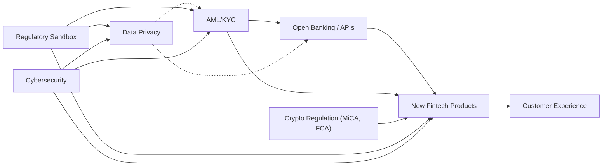

# Fintech - Sector Cyber Resilience & Credit Intelligence Research Q01-Q15 (merged)

**Merge date:** 2026-11-03 | **Merged evidence cut-off:** not stated in either file; gap-fill research accessed 3 November 2026 (see Section 1.1, C-01) | **Status:** Merge of two supplied research files plus labelled gap-fill research | **Language:** English (UK); both files supplied in Portuguese and translated in full

---

## 1. Merge statement

### 1.1 Source files

| Item | File A | File B |
|---|---|---|
| File name | `fintech.md` | `fintech_2.md` |
| Assignment basis | Neither file states which questions it covers. `fintech.md` is treated as File A (Q01-Q09) and `fintech_2.md` as File B (Q10-Q15) by file order (C-02, NEEDS_REVIEW) | As File A |
| Title | "Resumo Executivo" (no document title) | "Resumo Executivo" (no document title) |
| Content | Global fintech market study: market size and regional markets, business models and unit economics, valuation multiples, M&A and funding, regulation and risks by region, SWOT, 10 action opportunities. No cyber incidents, threat scenarios, controls, credit-transmission scenarios, questionnaire or Q09 assembly | Global fintech market study: market size and projections, funding and M&A, regulation and key policies (with a Mermaid flowchart), emerging technologies and risks, customer adoption, business models and KPIs, top-20 company table, opportunities and risks, five strategic recommendations. No fraud register, Cyber/ICT exposure, third-party concentration, governance-failure, cross-sector or rating analysis |
| Research date | Not stated | Not stated |
| Evidence cut-off | Not stated; latest data points 2025 (market size, segment shares), forecasts to 2031 and 2033 | Not stated; latest data point H1 2026 (US$103.1bn fintech investment), forecasts to 2030 and 2034 |
| Citations | No statement-level citations or URLs; named inline: BCG/FT Partners, Mordor Intelligence, McKinsey, "BCG and public transaction data"; unnamed "recent reports" and "sector data" | No statement-level citations or URLs; named inline: IMARC, McKinsey, Capgemini, EY; closing line names KPMG, McKinsey, Fortune/Statista, EY and states "each key data point is cited inline" (no inline citations are present; C-41) |
| Figures and diagrams | 1 table (9 rows); 3 figure captions without images | 1 table (20 rows); 2 figure captions without images; 1 Mermaid flowchart |
| Instruction-like text | None. "10 action opportunities" are analytical content addressed to investors and incumbents, not instructions to the merger | None. "Strategic recommendations" are analytical content, not instructions to the merger |

**Merged evidence cut-off:** neither file states a cut-off or research date, so the earlier-of-two rule cannot be applied. File A's latest observed data are for 2025; File B's latest observed data are for H1 2026. Gap-fill research was accessed on 3 November 2026; each gap-fill item carries its own event and publication date. Temporal classes use the merge date: current (2026), prior half-year (H2 2025), contextual (H1 2025 within 18 months, i.e. after 3 May 2025), historical (older than 18 months).

**Scope adopted for merged conclusions:** File A covers global fintech: digital payments and wallets, digital banking/neobanks, lending (including BNPL), investments/robo-advisers, insurtech, regtech, crypto/DeFi, embedded finance and Banking-as-a-Service (BaaS), by region, with investors and incumbents as audience. File B covers global fintech: payments, digital wallets and payment infrastructure, digital lending/BNPL, B2B2X, insurtech, wealthtech, regtech, embedded finance and crypto-assets, plus big-tech and incumbent competition. The narrower common scope is **non-bank and digital-first providers of payments, wallets, digital banking, digital lending (including BNPL), wealth and brokerage platforms, insurtech, regtech, embedded finance/BaaS and crypto-asset services**. Incumbent banks, card networks, central-bank payment infrastructure and general cloud providers are kept as dependencies or counterparties and marked **partial scope** where gap-fill evidence concerns them (Section 7.3). Geography: global in both files; gap-fill evidence covers the US, UK, EU, Brazil, India, South Korea, the UAE and Iran.

**Merge statement (supplied content):** File A and File B content is translated and restructured only; no facts, figures, sources or dates were added to it. **Gap-fill statement:** both files are market and strategy studies without cyber, fraud, resilience, governance-failure or rating content. Following the user's standing instruction from earlier sector runs ("merge it, fill the gaps and make sure that the final result comes in English"), the same approach is applied here: public-source research performed on 3 November 2026 fills the missing questions. Every gap-fill item is marked **[GF]** and cites sources S-011 onward; gap-fill ratings in Q15 are labelled "Gap-fill - Provisional" (File B proposed none).

### 1.2 Step 1 - Inventory

| Inventory item | File A | File B |
|---|---|---|
| Sector definition | Global fintech sector (revenue, segments, regions, business models, M&A, regulation) | Global fintech sector (market, funding, regulation, technology, adoption, business models, competition) |
| Subsectors | Digital payments (wallets, acquiring, remittances); digital banking/neobanks; lending; investments/robo-advisers; insurtech; regtech; crypto/DeFi; BNPL; embedded finance; BaaS | Payments; digital wallets and payment infrastructure; digital credit (lending/BNPL); B2B2X; insurtech; wealthtech; regtech; embedded finance; crypto-assets/blockchain; neobanks |
| Geography | Global; North America; Europe and UK; Asia-Pacific (China, India, South-East Asia, Australia/Korea/Japan); Latin America; Africa and Middle East | Global; North America; Asia-Pacific; Europe/UK; Latin America; Africa/Middle East |
| Questions covered (substantive) | Q01 (market, regions, segments, business models, unit economics); Q05 (partial: risks, barriers, SWOT threats); Q06 (partial: regulation by region); Q07 (partial: China, regulatory fragmentation, CBDCs); Q11 (partial: AI, crypto); Q12 (partial: BaaS dependence); Q13 (partial: M&A, funding, valuation); Q14 (partial: fintech vs banks growth); Q09 (executive summary, SWOT, 10 opportunities) | Q01 (market, segments, adoption, business models, KPIs, top-20 companies); Q05 (partial: opportunities and risks); Q06 (partial: AML/KYC, open banking, crypto, data protection, sandboxes, flowchart); Q07 (partial: crypto bans); Q10 (partial: "advanced fraud" as risk); Q11 (partial: AI/ML, cloud and APIs, blockchain, cybersecurity and resilience); Q12 (partial: cloud and network dependency); Q13 (partial: funding, M&A, investors, unicorns); Q09 (executive summary, recommendations) |
| Questions missing | Q02, Q03, Q04, Q08, Q10, Q14 (cross-sector), Q15 | Q02, Q03, Q04, Q08, Q14, Q15; no Q10A-Q10D |
| Sources | 4 named publishers (BCG, FT Partners, Mordor Intelligence, McKinsey) + unnamed "recent reports/sector data"; no URLs | 4 named publishers (IMARC, McKinsey, Capgemini, EY) + closing sources line; no URLs |
| Incidents / fraud cases | 0 / 0 | 0 / 0 |
| Scenarios | 0 (SWOT threats only) | 0 (risk list only) |
| Metrics | Global and regional market size and CAGR, segment shares, VC and M&A, unit economics (CAC, gross margins), valuation multiples, regional investment | Global market size and CAGR, regional shares, segment sizes, funding by year, IPOs and market capitalisation, adoption rates, company revenues and valuations |
| Regulatory items | 6 regional regimes (US, Europe/UK, China, India, Latin America, Africa/Middle East) plus regional notes (PSD2, MiCA, GDPR, CBDCs, Pix, UPI, Aadhaar) | 5 themes (AML/KYC; PSD2/open banking; crypto-assets and stablecoins; data protection; sandboxes) plus flowchart |
| Ratings / questionnaire | None / None | None / None |
| Tables | 1 (business models by segment, 9 rows) | 1 (top-20 companies) |
| Partial coverage flags | No citations; currency inconsistency in Europe figures (C-08); unidentifiable entity "Banco de Barabará" (C-16) | No citations despite claim of inline citation (C-41); internal inconsistency on projections (C-04) and US$520bn figure (C-07); Visa/Plaid listed both as 2024 example and as cancelled (C-15) |

### 1.3 Acronyms (defined at first use in this file)

AI - artificial intelligence; AML - anti-money laundering; API - application programming interface; APP - authorised push payment (fraud); ASPSP - account-servicing payment service provider; AUM - assets under management; B2B / B2C / B2B2X - business-to-business / business-to-consumer / business-to-business-to-any; BaaS - Banking-as-a-Service; BCB - Banco Central do Brasil; BEC - business email compromise; BNPL - buy now, pay later; BSA - US Bank Secrecy Act; CAC - customer acquisition cost; CAGR - compound annual growth rate; CASP - crypto-asset service provider (MiCA); CBDC - central bank digital currency; CCPA/CPRA - California Consumer Privacy Act / California Privacy Rights Act; CERT-In - Indian Computer Emergency Response Team; CFPB - US Consumer Financial Protection Bureau; CFTC - US Commodity Futures Trading Commission; CSIRT-Fin - India's financial-sector computer security incident response team; CTPP - ICT third-party provider designated for direct EU oversight under DORA; CVM - Comissão de Valores Mobiliários (Brazil); DeFi - decentralised finance; DORA - EU Digital Operational Resilience Act (Regulation (EU) 2022/2554); DPRK - Democratic People's Republic of Korea; EBA - European Banking Authority; EBITDA - earnings before interest, taxes, depreciation and amortisation; ESAs - European Supervisory Authorities (EBA, EIOPA, ESMA); ESG - environmental, social and governance; ESMA - European Securities and Markets Authority; FATF/GAFI - Financial Action Task Force; FBI - US Federal Bureau of Investigation; FCA - UK Financial Conduct Authority; FinCEN - US Financial Crimes Enforcement Network; FSC - Financial Services Commission (South Korea); GCC - Gulf Cooperation Council; GDPR - EU General Data Protection Regulation; GENIUS Act - US Guiding and Establishing National Innovation for U.S. Stablecoins Act 2025; IC3 - FBI Internet Crime Complaint Center; ICT - information and communication technology; IMF - International Monetary Fund; IPO - initial public offering; KPI - key performance indicator; KYC - know your customer; LGPD - Brazil's General Data Protection Law; LTV - lifetime value; M&A - mergers and acquisitions; MAS - Monetary Authority of Singapore; MiCA - EU Markets in Crypto-Assets Regulation (Regulation (EU) 2023/1114); ML - machine learning; MTU - monthly transacting users; NBFC - non-banking financial company (India); NIS2 - EU Directive (EU) 2022/2555; NYDFS - New York State Department of Financial Services; OFAC - US Office of Foreign Assets Control; P2P - peer-to-peer; PE - private equity; PROV - provisional questionnaire identifier; PSD2 / PSD3 - EU Payment Services Directive 2 / 3; PSP - payment service provider; PSR (EU) - EU Payment Services Regulation (proposed); PSR (UK) - UK Payment Systems Regulator; PSTI - Prestador de Serviços de Tecnologia da Informação (Brazilian IT service provider connecting institutions to the national financial network); RBI - Reserve Bank of India; SaaS - software as a service; SEC - US Securities and Exchange Commission; SME/PME - small and medium-sized enterprise; SPAC - special-purpose acquisition company; SPB - Sistema de Pagamentos Brasileiro; SWOT - strengths, weaknesses, opportunities, threats; TED - Transferência Eletrônica Disponível (Brazilian wire transfer); TRM - TRM Labs (blockchain intelligence firm); UPI - Unified Payments Interface (India); UX/CX - user / customer experience; VASP - virtual asset service provider; VC - venture capital.

**Evidence labels used throughout:** [S-nnn] = unified source ID (Section 10). **[GF]** = gap-fill research added in this run; not from File A or File B. File statements without a named source are marked "(File A; uncited)" or "(File B; uncited)". "Merge note" = analysis added during the merge. Figures, units, periods and qualifiers are kept as written; Portuguese number formats are rendered in English ("mil M" = billion; "bi" = billion; "tri" = trillion; decimal commas become decimal points) and en-dash ranges become hyphens.

---

## 2. Executive summary for Senior Credit Officers

**Ratings (Gap-fill - Provisional; File B proposed none)**
- **Fraud:** High; Provisional; confidence Medium.
- **Cyber/ICT:** High; Provisional; confidence Medium.
- **Operational resilience / TPRM:** High; Provisional; confidence Medium.
- **Governance / operating model:** High; Provisional; confidence Medium.

**Five findings**
1. Crypto-asset platforms carry the largest single-event losses: about $6.3 billion left Binance on 29 October 2026 after a compromised engineer laptop, following Bybit (~$1.5 billion, 2025) and Bitget ($387.5 million, September 2026) [S-011, S-016, S-057]. [GF]
2. Payment connectivity providers are a shared weak point: credential abuse at C&M Software and Sinqia diverted hundreds of millions of reais through Brazil's Pix in 2025, prompting a R$15,000 transaction cap [S-022, S-027, S-031]. [GF]
3. BaaS failures freeze customer money: Synapse left a $60-90 million shortfall and accounts frozen for weeks or months [S-036]. [GF]
4. Controls lag growth: Monzo (£21.1 million), Starling (£29 million) and Block (US$40 million plus US$255 million) were penalised for financial-crime and fraud failings [S-068, S-071]. [GF]
5. Fraud volume is rising: UK APP losses rose 19% to £576.4 million in 2025 [S-041]. [GF]

**Three borrower questions**
1. How are withdrawal and payment-signing paths protected from a single compromised engineer, vendor tool or API credential? [GF]
2. Which partner banks, connectivity providers and cloud regions would stop the service, and how fast can customer balances be reconciled? (File B; [GF])
3. Have financial-crime controls kept pace with customer growth, and what open enforcement or remediation remains? [GF]

---
## 3. Findings by question

*Each section opens with its conclusion. File content is translated from Portuguese; regional and segment sections are kept whole where they mix several questions, and cross-referenced.*

## Q01 - Sector Operating Model & Key Dependencies

*Conclusion: Fintech revenue is concentrated in digital payments, wallets and digital banking, and in a small group of scaled firms (about 60% of revenue from firms above US$500 million revenue, File A). The model rests on cloud, open APIs, partner banks and instant-payment rails (File B; File A), so a small set of shared providers carries most operational dependency. The two files disagree materially on market size (C-03, C-04); neither cites a primary source.*

### Q01.1 Global market (File A, "Global FinTech Market (2020-2030)")

According to recent reports, the global FinTech market totalled around **US$420-450bn in 2024**, jumping to **US$504bn in 2025**. This growth (≈21% p.a.) was four times the growth rate of traditional banks (≈6% p.a.) [S-005]. Revenues are estimated to reach around **US$600-700bn in 2030** (global CAGR ≈20% over the next 5 years, according to BCG/FTPartners) [S-001, S-002].

The main countries/regions hold the largest market shares. The US alone represents ≈70% of the North American market, while in Asia-Pacific China leads with 40% and India grows rapidly. In the EU, the United Kingdom led with 21.6% of the market in 2025 (merge note: wording kept; the UK is not an EU member, C-29). The globally dominant product segments are: **Digital Payments** (wallets, acquiring, remittances), **Digital Banking/Neobanks**, followed by **Lending**, **Investments/Robo-advisers**, **Digital Insurance (Insurtech)**, **Regtech** and **Crypto/DeFi**. In terms of scaled revenue (>US$500M), the current "winners" are concentrated in digital payments ($126B in 2024) and wallets ($67B). Fast-growing emerging segments include BNPL (Pay Later) and embedded financial infrastructure (File A; uncited).

**Historical revenues and forecasts:** sector data indicate [S-005]:
- **North America:** ~US$60bn (2024) to US$67bn (2025), projecting ~US$154bn by 2031 (CAGR ~14.9%).
- **Europe (incl. UK):** ~€85.5bn (2025) to €98.1bn (2026), ~€195.4bn by 2031 (CAGR ~14.8%).
- **Asia-Pacific:** ~US$144.9bn (2025) to US$167.7bn (2026), ~US$348.1bn in 2031 (CAGR ~15.8%).
- **Latin America:** US$13.1bn in 2024, projected ~US$49.6bn by 2033 (CAGR ~15.9%).
- **Africa/Middle East:** FinTechs still represent limited volume; McKinsey projects that the African market grows ~5× from 2023 to 2028, reaching around US$47bn [S-004]. In the Middle East, estimates point to ~US$1.6bn (2024) to US$3.7bn by 2033 (CAGR ~9.7%) [S-005].

*Figure (File A, image not supplied): FinTech market size (EUR, Europe) - projection to 2031.*

### Q01.2 North America (US & Canada) (File A)

The North American market is the largest *by revenue and funding*. Mordor Intelligence estimated **US$67.0bn in 2025**, reaching US$77.0bn in 2026 and US$154.3bn in 2031 (CAGR 14.9%). The US represents ~72% of this total (2025) [S-003] (C-42). Growth is driven by (File A; uncited unless marked):
- **Payments and Digital Wallets:** held 47.9% of the FinTech market in 2025. "Employers" (as written; likely "players") such as PayPal, Apple Pay, Square (Block), and start-ups such as Stripe dominate transaction volumes. The FedNow and RTP rails increase the adoption of instant payments, complementing cards and wallets.
- **Neobanks/Challenger Banks:** examples such as Chime and Varo capture a growing share among young people, keeping CAC (customer acquisition cost) low.
- **Digital Lending:** financing to consumers and companies via online platforms (e.g. LendingClub, SoFi, Upstart) grows strongly; there are already ~US$500bn in loans originated by FinTechs worldwide.
- **Investments & WealthTech:** robo-adviser platforms (e.g. Robinhood, Betterment) expand among retail investors.
- **Digital Insurance (Insurtech):** start-ups such as Lemonade experiment with on-demand underwriting models and data (AI) for dynamic underwriting. This segment grows at high speed (forecast CAGR >20%).
- **Crypto/DeFi:** although it still represents ~4% of scaled revenues, companies such as Coinbase and Gemini are notable players. The cryptocurrency market is large, but volatility and regulation (SEC) are challenges.

Recently (2023-2024) a recovery in venture capital investment was observed: in 2024, NA FinTech *equity funding* was US$58B (up 53% vs. 2023) (C-12). Mergers and acquisitions exceeded those of banks for the first time, signalling consolidation (e.g. acquisitions of regtech or BaaS start-ups by incumbents). On regulation, the region faces: CFPB supervision (and a new FinTech charter), data security laws (cybersecurity frameworks), and legislative pressure for consumer protection in digital payments (e.g. overdraft rules in apps). Adoption barriers include security concerns (fraud), compliance costs and competition from established institutions (File A; uncited).

*Figure (File A, image not supplied): FinTech market size (USD, Asia-Pacific) - projection to 2031.*

### Q01.3 Europe and United Kingdom (File A)

The European market (European Union + United Kingdom) reached around **USD 85.5bn (2025)**, in accelerated growth. Mordor projections indicate **~USD 195.4bn by 2031** (CAGR ≈14.8%) [S-003] (currency conflict with Q01.1 and Q09.1, C-08). Strong sectors (File A; uncited):
- **Instant Payments and Open Banking:** the PSD2 obligation and European instant-payment initiatives have expanded FinTech transactions. Digital wallets (Skrill, Wise) and local acquirers (Worldline) are leaders. In 2025, digital payments were ~52.7% of the European market.
- **Neobanks and BaaS:** Starling Bank (UK), N26 (Germany) and others challenge traditional banks. Banking-as-a-Service grows, with FinTechs providing banking back-offices for smaller fintechs (banking APIs).
- **Insurtech:** high penetration in the EU; growth of ~16.6% p.a. is forecast. Companies such as Bima (mobile insurance) grow in retail.
- **RegTech** and compliance: with GDPR and AML regulation, FinTechs specialised in compliance for banks and fintechs emerge (Onfido, TrueLayer).
- **Crypto:** European regulators advance with the MiCA regulation (crypto-assets) in 2024-25, creating a legal framework (certified virtual-asset services). It includes restrictions on stablecoins and exchanges. Crypto adoption in the EU is moderate, but countries such as Switzerland and Malta are hubs.

**Regulation:** the EU differentiates itself through harmonisation via PSD2/instant payments and regtech; however, there is still fragmentation (the United Kingdom outside the EU, with its own Open Banking and an independent regulatory sandbox). Risks include strict data protection rules (GDPR) and uncertainty about the Digital Euro (the ECB's CBDC). The European Central Bank is trialling the *Digital Euro*, which should create new use cases (public wallets). Barriers for FinTechs: expensive banking licences, strict compliance and consumer preference for traditional players in certain services (e.g. mortgages) (File A; uncited).

### Q01.4 Asia-Pacific (incl. China and India) (File A)

Region of greatest potential and rapid growth. The APAC FinTech market was **US$144.9bn (2025)** and should reach **US$348.1bn in 2031** (CAGR 15.8%) [S-005]. Highlights (File A; uncited):
- **China** (≈40% of APAC) has giants (Ant Group/Alipay, Tencent/WeChat Pay) controlling payments and embedded credit. However, it imposed strong regulation in 2020-22 (suspension of Ant's IPO, restrictions on digital lending and cryptocurrencies). The government promotes the Digital Yuan (CBDC pilots) and fintech regulation for financial stability.
- **India** has explosive expansion: the UPI (Unified Payments Interface) infrastructure processed US$1.8 trillion in 2024. Local FinTechs (PhonePe, Paytm, MobiKwik) and neobanks (Yono SBI) proliferate. Open banking is under development by the RBI (central bank).
- **South-East Asia:** markets such as Singapore, Indonesia and Vietnam grow with mobile solutions. Regional super-apps (Grab, Gojek) incorporate wallets and credit.
- **Australia/Korea/Japan:** payment and investment FinTechs are also rising, although comparatively smaller.

Main segments: digital payments dominate (>64% of the 2025 market); **digital banking** and **lending** (P2P/SME) grow strongly (neobanks at 30% p.a.). **Insurtech and wealthtech** are expanding niches. **Crypto/DeFi:** China banned it, but Japan and Korea advance on crypto regulation (licensed exchanges). Public blockchain adoption focuses on cross-border remittances (new Project Nexus corridor UPI-PayNow-PromptPay).

**Regulation/Risks:** varies greatly. China strictly controls fintechs and crypto; India regulates emerging ones (e.g. financial sandbox); Singapore/MAS and Hong Kong are pro-crypto with stablecoin and token regulations; emerging markets struggle with deficient supervision and systemic risk (e.g. the FTX collapse affected confidence). Internet (mobile) access widens the base, but the risk of cyberattacks and cross-border fraud exists. Barriers include political/regulatory instability in some countries (e.g. Indonesia, Philippines) and weak rural banking infrastructure (access via mobiles) (File A; uncited).

### Q01.5 Latin America (File A)

Market initially smaller (US$13.1bn in 2024) but in *accelerated growth*. Projected to reach ~US$49.6bn by 2033 (CAGR ~15.9%) [S-005]. Regional sectors and trends (File A; uncited):
- **Digital Payments and Pix:** in Brazil, the Pix system revolutionised instant transfers, lifting payment fintechs (PagSeguro, Stone). Across the region, mobile wallets and remittances (migrant transfers) are vital. In 2025, payments represent ~45% of the LATAM FinTech market.
- **Neobanks and Lending:** fintechs such as Nubank (BR), Ualá (AR) and Banco Original (BR) win millions of customers with aggressive marketing. Digital loans and consumer credit (and SME credit) grow because of high bank interest rates. BNPL (such as Clip in Mexico) advances in unserved markets.
- **Insurtech/Wealth:** still incipient, but start-ups offer affordable insurance (e.g. "N26 for insurance", as written) and investment platforms (e.g. XP Investimentos, Empiricus) gain ground.
- **Crypto:** countries with high inflation (Argentina, Venezuela) see crypto adoption (Bitcoin, stablecoins). Exchanges (Ripio) and crypto payment services grow. Brazil implemented virtual-asset regulation (CVM resolution on crypto).

**Regulation:** Brazil leads in open finance and a regulatory sandbox for fintech. Mexico and Colombia have FinTech laws (inclusion, open banking). Risks: macro instability (inflation, exchange rate) and compliance across several regimes. Barriers are credibility (trust in fintechs versus the informal "jeitinho"), lower formal banking penetration (part of the population still without an account) and dependence on fragile legacy systems (File A; uncited).

### Q01.6 Africa and Middle East (File A)

Emerging markets at an early stage. Sub-Saharan Africa had **US$857M in funding in 2024** (a 45% fall vs 2023), but M&A and mergers have signalled consolidating trends. McKinsey projects the African fintech market growing 5× by 2028, reaching ~US$47bn [S-004]. Regional highlights (File A; uncited):
- **Nigeria and South Africa:** fintech hubs (ChamsMobile, Paystack, Flutterwave) focus on payments and loans for informal workers. Mobile penetration enables innovation (M-Pesa in East Africa). Remittance and credit start-ups are rising. Barriers: infrastructure (power grid, internet), digital fraud, political/regulatory instability.
- **Other African markets:** Kenya (M-Pesa), Egypt (rising value of local fintechs); unbanked citizens reached by mobile fintechs. There are regional sandbox initiatives (Nigeria, Ghana). The financial ecosystem lags other regions, but CBDC projects and cooperative partnerships boost fintechs.
- **Middle East (GCC):** payment and remittance FinTechs (e.g. Beam Wallet, Tamara BNPL) grow amid "pro-CSA" policies (term not defined in source) and diversified markets (high smartphone penetration and a young population). The Islamic (Sharia) sector is expanding, making the region (with an estimated 341bn in Islamic transactional volume; currency not stated) fertile ground for Sharia-compliant fintechs. Challenges: dependence on remittances, oil-price volatility and fragmented regulation (each country with its own monetary authority).

### Q01.7 Business models, unit economics and valuation multiples (File A, "Business Models and Revenue Sources")

| FinTech segment | Business model / revenue source | Examples / comments |
|---|---|---|
| Digital payments | Transaction fees, acquiring commissions, platform subscription | Visa/Mastercard (network fees); PayPal/CashApp charge a % per operation, optional subscription; wallets (Apple Pay/Google Pay) pass through to the card issuer |
| Online lending | Interest margin (spread), origination/underwriting fees, bank partnerships | LendingClub/SoFi charge fixed fees + spread; payroll-loan fintechs apply competitive rates; BNPL (Klarna, "Pagar Depois") earns from merchant fees and interest from defaulting customers |
| Investments/wealth | Fees on AUM, premium subscription, advice, commissions per trade | Robo-advisers (Betterment) charge a % of AUM; apps (Robinhood) earn from payment for order flow and paid services; fintech crowdfunding platforms charge a % of funds raised |
| Insurtech | Premium share (brokerage), direct underwriting, insurance SaaS services | Lemonade retains part of the premium and invests reserves; start-ups sell "on demand" insurance; digital brokers (Policygenius) charge a commission from the insurer |
| Regtech | Software licensing (SaaS), compliance consulting, subscription | KYC/AML platforms (Onfido) charge per user or transaction volume; regulatory reporting APIs ("RegTek") sell monthly plans |
| Crypto/DeFi | Trading fees, staking, collateralised lending, network/blockchain fees | Exchanges (Binance, Coinbase) retain brokerage fees; DeFi protocols earn from swap/liquidity-provision fees; custody services charge a percentage fee |
| BNPL | Interest on arrears, fixed merchant fee, product sponsors | Klarna/Affirm charge the merchant for each purchase; late fees paid by consumers; some charge a subscription (e.g. Klarna Premium) |
| Embedded finance | Revenue share with host platforms, fee per service | Fintech companies (Stripe, "Marqueta" as written) provide APIs embedded in e-commerce platforms or mobility apps, earning a % of each transaction or a usage fee |
| Banking-as-a-Service | Monthly/per-account fee, transactional %, integration of banking services | BaaS providers (Solaris, Synapse) charge set-up/integration + per-account/transaction fees; partner banks earn interest and service revenue from licensed fintechs |

**Typical unit economics:** digital FinTechs leverage low incremental cost per customer but incur high *CAC*. For example, neobank start-ups aim for CAC <US$25 per new account. LTV depends on fees (e.g. merchant fees, credit interest) and retention, so monetising quickly (cross-sell) is essential (source wording "crítico" reworded). Gross margins vary: BaaS and software (Regtech) can exceed 40-50%; payment services ~20-30% (due to network cost); lending depends on default and bank spread (~10-20%) (File A; uncited).

**Valuation multiples:** in mature markets, public FinTech companies frequently trade above 5-10× sales (e.g. consolidated payment fintechs). At the 2021-22 peak, investors paid 15-20× revenue for FinTech unicorns, but recent corrections (2023) pulled multiples down (e.g. credit fintechs fell to ~3-5×). In general, B2B FinTechs (infrastructure, SaaS) continue to command higher multiples than B2C ones (e.g. BNPL experienced volatility). *Sources:* BCG and public transaction data suggest average multiples of ~8× revenue for consolidated FinTechs in 2024 [S-001].

### Q01.8 Market size and projections 2023-2030 (File B)

- **Global market:** in 2025 the world fintech market reached around US$650bn in revenues. Projections point to growth of ~16-21% p.a., reaching US$1.5 trillion or more in 2030 (File B; uncited). IMARC estimates ~US$303bn in 2026, exceeding US$900bn by 2034 (CAGR ~15%) [S-006]. Fintechs still hold a small share of the financial total (<5%), indicating high expansion potential (File B; uncited) (C-03, C-04).
- **By region:** North America leads in value (≈35-40% of the market), with the US projected at around US$520bn in revenues by 2030. Asia-Pacific grows fastest (CAGR ~27%) and should become the largest market around 2030. Europe/UK is the third largest (~20%), supported by open regulation (PSD2/Open Banking). Latin America and Africa/Middle East grow strongly (LatAm ~29% p.a. 2021-25; driven by financial inclusion) (File B; uncited) (C-06, C-07, C-09, C-10).
- **By segment:** payments remain dominant (≃29% of the market in 2025, projected to reach ~US$520bn by 2030). Next come digital wallets and payment infrastructure. Digital credit (lending/BNPL) grows fast; estimates put global BNPL at ~US$8bn (2024) and B2B2X fintechs at ~US$440bn by 2030. Insurtech is still smaller (~US$3.1bn in 2023) but growing via on-demand insurance. Wealthtech (robo-advisers, asset management) also advances. Regtech and embedded finance are niches, with rapid growth in digital compliance and integrated APIs. Crypto-assets (blockchain) represent a growing share of financial transactions, although most stablecoin volume is "internal (NFT/trading)" as written (File B; uncited) (C-26).

*Figure (File B, image not supplied): projection of the global fintech market (2024-2030) according to market sources.*

### Q01.9 Customer adoption and behaviour (File B)

- **Growing use:** globally, more than 60% of consumers use multiple fintech services. Payment apps, wallets and digital banks have overtaken traditional internet-banking adoption in many emerging markets. In 2024, around 3bn people used payment fintechs. Demand for digital financial services is driven by convenience, smartphone ubiquity and the unbanked (in APAC/Africa) (File B; uncited).
- **Expectations:** consumers expect integrated platforms. According to a Capgemini report, >60% want banks and fintechs to operate in unified "digital ecosystems" [S-008]. EY surveys show that 64% of global consumers already use multiple fintech products (digital credit card, online loan, investments, etc.) [S-009]. Fintechs offering simple access, superior UX and personalisation (via data analytics) gain competitiveness. Established banks respond by modernising channels and forming partnerships (to stay competitive on CX) (File B; uncited).
- **Risk behaviours:** young people (Generation Z/millennials) lead adoption of fintechs and crypto. Users migrate quickly between platforms that combine personal finance with lifestyle (e.g. apps bringing together banking, accounting and benefits). However, there is caution: risk perceptions about crypto are part of behaviour. Fintechs with strong service and transparency build trust quickly (File B; uncited).

### Q01.10 Business models and KPIs (File B)

- **Revenues:** each segment has a distinct model. *Payments:* a "take rate" per transaction (Stripe, Adyen) or integration via subscription (Square/Block). *Lending:* interest and origination fees (SoFi, Nubank). *Asset management:* percentage fees on assets under management (robo-advisers, Wealthfront). *Insurance:* premiums and service fees (Lemonade, Oscar). *Regtech:* software/SaaS licensing per user (ComplyAdvantage). *B2B fintech:* subscriptions or processing fees (Marqeta, Toast). *Embedded finance:* generally monetises via co-branded fees/integrations in e-commerce (Klarna) (File B; uncited).
- **Example KPIs:** *LTV (lifetime value)* vs *CAC (acquisition cost)*, an essential ratio for sustainability (source wording "crítica" reworded); *take rate* (margin per transaction); *burn multiple* (capital burned for growth); *average ticket*; *market share* in key products; *churn rate*; *loan approval rate*; *growth in in-app transactions*. Mature fintechs demonstrate rigorous unit economics ("IF tornou-se triplo nos últimos anos", meaning unclear in source, C-23), requiring low CAC and recurring revenue. McKinsey stresses that successful fintechs combine scalability with profitability: rapid growth must come with healthy margins [S-007].

### Q01.11 Competition and leading companies (File B)

The sector is highly competitive. Prominent fintechs include Stripe (US, online payments, valued at ~US$50B), Adyen (Netherlands, payment infrastructure, €2.4B revenue 2025), PayPal (US, digital payments) and Square/Block (US, POS and financial services). In *lending*, Klarna (Sweden, BNPL), Affirm (US, BNPL) and SoFi (US, personal loans) stand out. In *wealthtech*, Robinhood (US, brokerage) and Moneyfarm (EU, robo-adviser) are among the leaders. Notable *insurtechs*: Lemonade (US), Oscar Health (US) and Alan (France). *Regtech*: ComplyAdvantage (UK) and Onfido (UK) provide compliance solutions. *Crypto/blockchain*: Coinbase (US, exchange), Binance (global, exchange) and Chainalysis (US, blockchain analytics) are at the top. *Neobanks*: Revolut (UK), N26 (Germany), Chime (US) and Nubank (BR) are key examples. *B2B fintech*: Marqeta (US, card issuing), Toast (US, payments for restaurants) and FIS (US, legacy firm investing in fintech) make up this niche. *Embedded finance*: Plaid (US, financial APIs), Grab Financial (Singapore, super-app) and GoTo Financial (Indonesia) extend the concept. Simplified table of 20 leaders (File B; uncited):

| Company | HQ | Segment | Revenue / funding / value | Business model | Main markets |
|---|---|---|---|---|---|
| Stripe | US | Payments | Valued ~$50bn (2023) | B2B2C payments platform (take rate per transaction) | Global (US, Europe) |
| Adyen | Netherlands | Payments | €2.4bn revenue (2025) | Payments platform for businesses | Global |
| PayPal | US | Payments | ~$34bn revenue (2023) | Wallets and online payments, fees per transaction | Global |
| Square/Block | US | Payments/Neobank | ~$20bn revenue (2023) | Mobile POS, financial services (fee per transaction) | US, Canada, Japan |
| Klarna | Sweden | Lending | Valued ~$6-7bn (2023) | BNPL (partners and e-commerce) | Europe, US |
| Revolut | UK | Neobank | Valued ~$33bn (pre-IPO) | Digital account, mobile banking services | Europe, US |
| Nubank | Brazil | Neobank | US IPO; market cap ~$30bn | Digital account and loans (interest) | LatAm |
| Robinhood | US | Wealth | IPO in 2021; market cap ~$6bn | Investment brokerage (margin fees and services) | US |
| Coinbase | US | Crypto | Market cap ~$100bn (2021) | Crypto exchange (commission per trade) | Global |
| Binance | Global | Crypto | Private (founded in Malta, as written) | Crypto exchange (transaction fees) | Global |
| Chainalysis | US | RegTech | Last round: $1.8bn valuation | Blockchain analytics (SaaS) | US, Europe, Asia |
| Lemonade | US | Insurtech | ~$300m revenue (2022) | Home insurance (fixed premium + AI) | US, Europe |
| Oscar Health | US | Insurtech | ~$2.9bn revenue (2022) | Health insurance (policy premiums) | US |
| Alan | France | Insurtech | €670m valuation (2024) | Corporate health insurance (SaaS) | France |
| Marqeta | US | B2B fintech | IPO (2021), valuation ~$16bn | Corporate card issuing (B2B APIs) | US, Europe |
| Toast | US | B2B fintech | IPO (2021), valuation ~$30bn | POS and payments for restaurants | US |
| Ant Group | China | Payments/Wealth | Ex-IPO valuation $313bn | Alipay, financial services (payments, lending, asset management) | China |
| GoTo Financial | Indonesia | Embedded finance | Part of GoTo value (~US$12bn) | Fintech super-app (payments, insurance) | Indonesia |
| Razorpay | India | Payments | Valued ~$7.5bn (2023) | Payment and lending APIs for businesses | India |
| Plaid | US | APIs/Embedded | Sold to Visa ($5.3bn, cancelled) | Bank integration APIs (SaaS) | US |

### Q01.12 Dependency additions **[GF]**

| Dependency | Evidence | S- IDs |
|---|---|---|
| Payment-system connectivity providers (Brazil PSTIs) | C&M Software connects small banks, cooperatives, payment institutions and credit companies without direct Pix access to the BCB; its compromise made Pix temporarily unavailable at several smaller banks | S-022, S-026 |
| Partner (sponsor) banks for BaaS | Evolve's breach affected customers of fintech partners Affirm, Wise and Bilt; Synapse moved fintech customers' funds across several partner banks whose records did not match | S-034, S-035, S-036 |
| Cloud regions | The AWS us-east-1 outage of 20 October 2025 disrupted Coinbase, Robinhood, Venmo and Chime | S-081 |
| Third-party security and network appliances | Bitget's wallet environment was reached through two third-party security appliances; Marquis was breached through its SonicWall firewall | S-057, S-058, S-079 |
| Outsourced customer support | Coinbase data was taken through bribed support contractors outside the US | S-019, S-020 |
| Stablecoin issuers and chain operators (recovery path) | Tether, Circle, Ripple, World Liberty Financial and Arbitrum's Security Council froze about US$2.7 billion after the Binance theft | S-011, S-012 |

**Cross-references:** Q06, Q07, Q11, Q12, Q13; DEP register; FIN-A01 to FIN-A31, FIN-B01 to FIN-B19; conflicts C-03 to C-16, C-23, C-26, C-29, C-42.

---

## Q02 - Major Cyber Incidents & Case Studies **[GF]**

*Conclusion: The largest fintech losses come from compromise of the money-movement path, not data theft: one engineer laptop at Binance, one wallet-software developer at Bybit, two security appliances at Bitget and abused credentials at two Brazilian Pix connectivity providers each moved hundreds of millions to billions. BaaS failures (Evolve, Synapse) show how one partner's breach or ledger failure reaches many fintechs' customers. Neither file contains incidents.*

### Q02.1 Incident register

| INC | Organisation | Subsector | Country | Event date | Class | Mechanism (as reported) | Outcome | Horizon | S- IDs |
|---|---|---|---|---|---|---|---|---|---|
| INC-01 | Binance | Crypto exchange (CASP) | Global | 29 Oct 2026 | Intrusion -> cyber-enabled theft | Company: initial investigation suggests a compromised DevOps engineer laptop gave access to a service container used to submit unauthorised withdrawals; further breach points found; no evidence private keys were stolen | Binance estimate ~US$6.3bn; TRM: ~US$6.36bn across 10 blockchains, mostly in ~20 minutes; ~US$2.7bn frozen (TRM) or ~US$3bn (Binance); deposits and withdrawals suspended; Binance says losses will be covered and set aside >US$6.34bn; attribution to TraderTraitor by TRM (high confidence) and Chainalysis, not confirmed by Binance | Last 30 days (new) | S-011, S-012, S-013, S-014, S-015 |
| INC-02 | Bybit | Crypto exchange | UAE (Dubai) | 21 Feb 2025 | Intrusion (supply chain) -> cyber-enabled theft | Safe{Wallet} developer machine compromised; malicious code in Safe{Wallet} AWS S3 JavaScript altered a cold-to-warm wallet transfer | ~US$1.5bn ETH stolen; FBI attributed to DPRK "TraderTraitor"; forensics found no compromise of Bybit infrastructure (interim) | Historical landmark | S-016, S-017, S-018 |
| INC-03 | Bitget | Crypto exchange | Global | 24 Sep 2026 (earliest activity 31 Aug 2026) | Intrusion (third-party product zero-day) -> cyber-enabled theft | Zero-day in third-party security appliances; privileged access, web shell, lateral movement into wallet environment; forged withdrawal commands | US$387.5m from hot and warm wallets (first figure US$351.6m); withdrawals halted then resumed | Last 12 months | S-057, S-058, S-059 |
| INC-04 | C&M Software | Payment connectivity provider (PSTI) | Brazil | 30 Jun - 1 Jul 2025 (dates vary, C-31) | Insider-enabled intrusion -> cyber-enabled fraud | Employee credentials sold to a criminal group; fraudulent Pix transfers from institutions' reserve accounts at the BCB; funds partly converted to crypto | Amount reported as ≥R$400m, R$541m from one institution (police), R$800m, up to R$1bn (C-30); C&M disconnected from SPB by BCB, partial resumption 3 Jul 2025; payment institutions suspended from Pix as suspected recipients | Prior half-year | S-022, S-023, S-024, S-025, S-026 |
| INC-05 | Sinqia (Evertec) | Payment connectivity provider | Brazil | 29 Aug 2025 | Intrusion (vendor credentials) -> cyber-enabled fraud | Legitimate credentials of Sinqia IT vendors used to insert unauthorised B2B Pix transactions | ~R$710m (HSBC ~R$670m; Artta ~R$40-41m); R$589m (83%) blocked per later report, R$366m initially; Sinqia disconnected from Pix | Prior half-year | S-027, S-028, S-029, S-030 |
| INC-06 | Coinbase | Crypto exchange | US | Began 26 Dec 2024 (as reported); detected/extortion email 11 May 2025; disclosed 15 May 2025 | Insider (bribery) -> data theft -> cyber-enabled fraud | Overseas support contractors bribed to copy customer data from support tools; data used to impersonate Coinbase; US$20m extortion refused | Estimated US$180-400m remediation and voluntary customer reimbursement; data of <1% of MTU (~70,000 customers as reported); no passwords, private keys or funds accessed | Contextual | S-019, S-020, S-021 |
| INC-07 | Evolve Bank & Trust | BaaS partner bank (partial scope) | US | Feb and May 2024; detected 29 May 2024 | Intrusion (ransomware, data theft) | LockBit; data leaked after ransom refused | 7,640,112 individuals notified; customers of Affirm, Wise and Bilt affected; customer funds reported safe | Historical landmark | S-034, S-035 |
| INC-08 | Synapse Financial Technologies | BaaS middleware | US | Bankruptcy 22 Apr 2024; CFPB complaint 21 Aug 2025 | Operational outage (non-cyber; ledger and reconciliation failure) | Records of consumer funds did not match partner banks' records | Shortfall US$60-90m (CFPB) or US$65-95m (trustee); consumers without access for weeks or months; US$265m frozen for >100,000 customers (secondary); ~85,000 Yotta customers locked out; judgment entered 12 Sep 2025; CFPB allocated US$46m on 28 Nov 2025 | Historical (outcomes prior half-year) | S-036, S-037, S-038, S-039, S-040 |
| INC-09 | Marquis Software Solutions | Fintech vendor to banks and credit unions | US | 14 Aug 2025 | Intrusion (ransomware via firewall) | Access through SonicWall firewall, allegedly using data from a separate SonicWall breach | 74+ banks and credit unions; 672,075 individuals per March 2026 filing (earlier reports ~400,000 and ~780,000) | Prior half-year | S-079, S-080 |
| INC-10 | AWS us-east-1 | Cloud provider (partial scope) | US / global | 20 Oct 2025 | Operational outage (non-cyber) | DNS resolution issues affecting the DynamoDB API endpoint | Coinbase, Robinhood, Venmo and Chime disrupted; >4m user reports (Ookla, as reported); restored the same day | Prior half-year | S-081, S-082 |
| INC-11 | Indian NBFCs, digital lenders and PSPs | Digital lending / payments | India | Oct 2026 (campaigns) | Intrusion -> cyber-enabled fraud | Stolen payment-aggregator, gateway and partner-bank API credentials used to call fund-transfer APIs from the victim's own trusted infrastructure | One NBFC lost ₹3.3 crore through 183 transfers in 87 minutes; media estimate ~₹300 crore over two months and ~150 cases; ~20 institutions (secondary, low) | Last 30 days | S-060, S-061, S-062, S-063, S-064 |
| INC-12 | South Korean financial institutions incl. Bithumb | Banks (partial scope), card issuers, brokerages, crypto exchange | South Korea | Sep - Oct 2026 | Intrusion (data theft) | Attacks on less-protected externally reachable systems (loan-agent service, mobile work tool) using AI agents (as reported) | Shinhan ~25,000 customers; KB Kookmin >100; Daishin 38,490; Bithumb incident reported, data loss unconfirmed; FSC ordered sector-wide checks | Last 30 days | S-065, S-066 |
| INC-13 | Nobitex | Crypto exchange | Iran | 18 Jun 2025 | Intrusion (geopolitical, destructive) | Hot wallet compromised; pro-Israel group Predatory Sparrow claimed; funds sent to addresses without known keys ("burned") | Over US$90m identified (Elliptic); source code release threatened | Contextual | S-086 |

**Last-30-days items not entered as incidents (claims or aggregator-only):** N0n leak-site claim against US payments fintech Finzly (19 October 2026) [S-067]; reported Ledger hardware-wallet supply-chain implant and other October 2026 wallet compromises listed by a crypto aggregator [S-089] (G-09).

### Q02.2 Top five (decision relevance)

1. **INC-01 Binance (2026)** - largest recorded crypto theft; single endpoint compromise reached withdrawal signing; tests exchange liquidity and counterparties [S-011, S-013].
2. **INC-04 C&M Software (2025)** - one connectivity provider's credentials drained central-bank reserve accounts of client institutions [S-022, S-026].
3. **INC-02 Bybit (2025)** - supplier (wallet software) compromise bypassed multi-signature controls [S-016, S-017].
4. **INC-08 Synapse (2024-2025)** - BaaS ledger failure froze consumer funds across many fintechs (non-cyber) [S-036].
5. **INC-06 Coinbase (2025)** - insider bribery at outsourced support led to customer fraud and a US$180-400m cost estimate [S-019].

Selection criteria: financial and operational consequence, transferability to fintech borrowers and their counterparties, evidence quality. Fraud cases are ranked in Q10.

### Q02.3 Case studies

**Case 1 - Binance (October 2026; preliminary).** *Timeline:* on 29 October 2026 about US$6.36 billion left Binance wallets on ten blockchains, most of it in roughly 20 minutes from 20:05 UTC (TRM) [S-012, S-013]. TRM says preparation began at least 36 hours earlier and the attack code was rehearsed on test wallets [S-013]. *Mechanism:* Binance's initial investigation points to a compromised DevOps engineer laptop that gave access to a service container used to submit unauthorised withdrawals; Binance later reported additional breach points and found no evidence that private keys were stolen [S-011, S-012]. *Response:* deposits and withdrawals suspended, affected address authorisation revoked; stablecoin issuers and Arbitrum froze about US$2.7 billion (TRM) [S-011]; Binance says user losses will be covered and set aside over US$6.34 billion [S-015]; one regional outlet reports US$4.7 billion of client withdrawals afterwards (low confidence) [S-014]. *Attribution:* TRM (high confidence) and Chainalysis to DPRK TraderTraitor; not confirmed by Binance [S-011]. *Lesson:* a single privileged workstation close to signing infrastructure is a solvency-scale exposure. *Does not establish:* final loss net of freezes, root cause, insurance, or regulatory outcome (G-04).

**Case 2 - Brazil Pix connectivity providers: C&M Software and Sinqia (2025).** *C&M:* C&M connects smaller banks, cooperatives, payment institutions and credit companies without direct Pix access to the BCB [S-026]. Fraudulent transfers ran on 30 June - 1 July 2025 from reserve accounts held at the BCB, using credentials an employee had sold; the BCB disconnected C&M from the SPB and allowed partial resumption on 3 July; payment institutions suspected of receiving funds were suspended from Pix [S-023, S-024, S-025]. Estimates range from at least R$400 million to over R$1 billion (C-30) [S-022, S-024, S-025]. The BCB said individual customers were not directly affected because the money sat in institutions' reserve accounts [S-026]. *Sinqia:* on 29 August 2025, legitimate credentials of Sinqia's IT vendors were used to process about R$710 million of unauthorised B2B Pix transactions, mainly from HSBC (~R$670 million) and Artta (~R$40 million); R$589 million (83%) was later blocked [S-027, S-028, S-029, S-030]. *Regulatory response:* on 5 September 2025 the BCB capped Pix and TED at R$15,000 per transaction for unauthorised payment institutions and those connecting through PSTIs, raised PSTI minimum capital to R$15 million and brought forward the authorisation deadline to May 2026 [S-031, S-032]. *Lesson:* intermediated access to instant-payment rails concentrates credential risk outside the regulated perimeter. *Does not establish:* final net losses or recoveries for each institution.

**Case 3 - BaaS partner failure: Evolve and Synapse (2024-2025).** *Evolve:* LockBit took data of 7,640,112 individuals, including customers of fintech partners Affirm, Wise and Bilt; Wise had ended its partnership in 2023 and was still affected [S-034, S-035]. *Synapse:* after its April 2024 Chapter 11 filing, partner banks held less than Synapse's records showed for consumers, a US$60-90 million shortfall (CFPB; trustee US$65-95 million); consumers lost access for weeks or months; the CFPB obtained a judgment on 12 September 2025 and allocated US$46 million from its civil penalty fund on 28 November 2025 [S-036, S-037, S-038]. *Lesson:* a fintech's customer balances are only as reliable as the weakest ledger and partner bank in the chain. *Does not establish:* losses at partner banks or the fintech programme managers.

**Cross-references:** Q03, Q05, Q07, Q10, Q12; INC register; FRD-C1 to FRD-C3, FRD-C6; conflicts C-30 to C-38.

---

## Q03 - Cyber Threat Landscape & Attack Scenarios **[GF]**

*Conclusion: The dominant high-loss threat is state-linked theft from exchange signing infrastructure through developer, DevOps or supplier compromise; the dominant high-frequency threat is credential and API abuse to push payments, and social engineering of customers. File B lists "advanced fraud" and cyberattacks as technology risks without analysis.*

| THR | Scenario | Mechanism | Evidence | Confidence |
|---|---|---|---|---|
| THR-01 | Theft from exchange hot/warm/cold wallet signing paths | Compromise of a developer or DevOps endpoint, or of wallet software, to alter or submit withdrawals | Binance [S-011]; Bybit [S-016, S-017]; DPRK-linked actors stole ≥US$2.02bn in 2025, ~59% of US$3.4bn total theft (Chainalysis) [S-018] | High |
| THR-02 | Credential and API abuse to initiate payments | Stolen connectivity-provider, aggregator or partner-bank credentials used to call fund-transfer interfaces directly | C&M, Sinqia [S-022, S-027]; CERT-In/CSIRT-Fin advisory of 9 Oct 2026 [S-060] | High |
| THR-03 | Insider recruitment at outsourced operations | Bribery of support staff or employees for data or credentials | Coinbase [S-019]; C&M employee credential sale [S-024] | High |
| THR-04 | Ransomware and data theft at BaaS banks and fintech vendors | Intrusion via phishing or edge devices, data leak extortion | Evolve [S-034]; Marquis via SonicWall [S-079]; N0n claim on Finzly (unconfirmed) [S-067] | Medium-High |
| THR-05 | Exploitation of third-party security or network products | Zero-day or stolen configuration used to gain privileged internal access | Bitget [S-057, S-058]; Marquis [S-080] | Medium-High |
| THR-06 | Concentrated cloud or ICT outage | Provider fault stops apps and trading | AWS 20 Oct 2025 [S-081] | Medium |
| THR-07 | AI-assisted intrusion against externally reachable systems | AI agents and tools used for reconnaissance and exploitation | Korea wave [S-065, S-066]; CERT-In advisory of 15 Oct 2026 (as reported) [S-061] | Medium (emerging; secondary sources) |
| THR-08 | Scam-driven customer fraud | Social engineering via online platforms and telecoms leading to authorised payments | UK APP losses £576.4m in 2025, 66% of cases starting online [S-041, S-043]; IC3 crypto investment fraud US$7.2bn [S-047] | High |

**File statements (threat-related):** File B: AI introduces risks such as algorithmic bias and adversarial attacks; crypto risks include DeFi attacks and smart-contract exploits; attacks on financial institutions and fintechs are increasingly sophisticated (Q11.2). File A: cybersecurity (online banking fraud) is an adoption barrier; Asia-Pacific faces cyberattack and cross-border fraud risk; vulnerabilities include DDoS (Q05.1, Q05.2).

**Cross-references:** Q02, Q04, Q07, Q10, Q11; THR register; conflict C-40.

---

## Q04 - Control Weaknesses, Resilience Capabilities & Benchmarks **[GF]**

*Conclusion: Documented weaknesses are concentrated in privileged access to money-movement systems, vendor and appliance trust, API secret management, insider controls at outsourced operations, ledger reconciliation across partner banks, and financial-crime controls that did not scale with customer growth.*

| CTL | Capability / weakness | Evidence | S- IDs |
|---|---|---|---|
| CTL-C1 | Isolation of signing and withdrawal paths from engineer endpoints | Binance: laptop -> service container -> withdrawals; Bybit: developer machine -> signing interface | S-011, S-016, S-017 |
| CTL-C2 | Third-party security appliance and vendor access control | Bitget appliances A and B gave privileged access; Marquis firewall entry | S-057, S-058, S-079 |
| CTL-C3 | API credential hygiene and transaction validation | CERT-In: long-lived static tokens in code, plaintext credentials, services without MFA; a valid credential alone should not authorise an invalid transfer | S-060, S-064 |
| CTL-C4 | Insider-risk controls for outsourced support | Coinbase had flagged support agents accessing data without business need before the extortion email | S-020 |
| CTL-C5 | Customer-fund ledger reconciliation with partner banks | Synapse records did not match partner banks | S-036, S-037 |
| CTL-C6 | Financial-crime controls scaling with growth | Monzo (customers from ~600,000 to >5.8m, controls did not keep pace; >34,000 high-risk customers onboarded despite restriction); Starling; Block alert backlog from 18,000 (2018) to >169,000 (2020) | S-068, S-069, S-072 |
| CTL-C7 | Transaction limits and circuit breakers | BCB R$15,000 cap for unauthorised payment institutions and PSTI-connected participants | S-031, S-033 |
| CTL-C8 | Basic cyber hygiene (File B) | File B: fintechs must invest in multi-factor authentication, end-to-end encryption and continuity plans; regulators require operational robustness (digital stress tests, third-party control) | S-010 (File B section; uncited) |
| CTL-M1 | Cost benchmark | Financial-sector average breach cost US$5.56m in 2025 vs global US$4.44m (IBM, via vendor summary) | S-085 |
| CTL-M2 | Governance benchmark | IMF: better cyber governance at firms could help mitigate cyber incident risk | S-083 |

**Cross-references:** Q03, Q06, Q08, Q11, Q12, Q13; CTL register.

---

## Q05 - Financial Impact, Disruption & Credit Transmission

*Conclusion: Fintech credit exposure transmits through four channels in the evidence: direct theft (exchanges), loss of access to payment rails or partner banks (Brazil, Synapse), fines and remediation (Block, Monzo, Coinbase) and customer outflows after an event (Binance). File A and File B describe high CAC, funding dependence and macro sensitivity but contain no incident cost data.*

### Q05.1 File A, "SWOT Analysis and Strategic Implications"

- **Strengths:** rapid innovation and **technological scalability** (cloud, AI, data); focus on underserved niches (e.g. the unbanked population); variable-cost model; digitally native customer engagement; flexible partnerships with financial institutions. Large players already profitable and with defensible B2B positions.
- **Weaknesses:** regulatory and compliance costs; dependence on a few main segments (payments and lending); low revenue penetration in traditional sectors (still <5%); continuing need to raise capital (many businesses still not self-sustaining). Low initial margins due to the war for users.
- **Opportunities:** B2B fintechs (infrastructure, APIs, security) have broad potential; unbanked markets (Africa, South-East Asia, rural areas of Europe) offer new customers; products based on **AI/analytics** can improve personalised credit and investment offers; integration into existing platforms (*embedded finance*); penetration of new segments (insurtech in health insurance, green fintech aligned with ESG); consolidation potential (mergers of start-ups with banks); e-commerce and the on-demand economy generate demand for embedded financial solutions.
- **Threats:** new restrictive regulation or litigation (e.g. actions against credit or cryptocurrency fintechs); competition from technology giants (payment big techs such as Amazon/Google); **integration of fintechs by banks** (abandonment of partnerships); macro instability (high interest rates, recessions) that can halt credit; market saturation in popular segments (e.g. digital wallets saturated in certain countries); and technological vulnerabilities (cybersecurity, DDoS attacks) (File A; uncited).

### Q05.2 File A, "Risks & Adoption Barriers" (from "Regulatory Landscape and Risks")

Global and sectoral. Examples: cybersecurity (online banking fraud), data privacy, compliance (KYC/AML complexity increases costs). Fintechs depend on user trust; in markets with low financial education or high fraud rates, uptake is lower. Customer acquisition costs and high CAC (digital marketing) compress initial margins. Incumbents may react (partnerships or regulatory lobbying). In economic instability, credit fintechs face high credit risk. Specific regional barriers include lack of infrastructure (e.g. lower smartphone penetration in rural areas, inefficient banking networks) and cultural barriers (fear of leaving traditional banks) (File A; uncited).

### Q05.3 File B, "Investment Opportunities and Risks"

The Fintech sector offers several opportunities: markets still under-penetrated in many countries, emerging technologies (generative AI, tokenisation), consumer migration to digital finance and regulatory support (e.g. open banking) are growth vectors. According to McKinsey, fintechs already generate 4% of global financial revenues, leaving room for significant growth [S-007]. Areas such as financialisation of infrastructure (blockchain for supply chains, central bank digital currency) and fintech for small businesses (B2B) should attract capital. However, the risks include strong regulatory barriers (especially in crypto), growing competition (Big Tech entering finance), exposure to cyberattacks and macro risks (e.g. tight monetary policy raises the cost of capital). Business models dependent on interest spreads may suffer in a low-rate environment. Investors should consider the solidity of unit economics ("LTV/CAC < 3-4", as written, C-24; controlled burn) as a condition for investing (File B; uncited).

### Q05.4 Disclosed cyber and fraud financial outcomes **[GF]**

| Item | Outcome | Statistic type | S- IDs |
|---|---|---|---|
| Binance theft | ~US$6.3bn (company estimate); ~US$2.7-3bn frozen; >US$6.34bn set aside to cover users | Preliminary estimate; disclosed by company and analytics firm | S-011, S-012, S-015 |
| Bybit theft | ~US$1.5bn | Reported; FBI attribution | S-016 |
| Bitget theft | US$387.5m; covered by Protection Fund and own capital (secondary) | Company figure | S-057 |
| Coinbase breach | US$180-400m remediation and voluntary reimbursement | Company estimate (8-K) | S-019 |
| C&M Software | ≥R$400m to >R$1bn; R$541m from one institution | Media and police estimates | S-022, S-024, S-025 |
| Sinqia | ~R$710m processed; R$589m blocked | Company filing (Evertec) and media | S-027, S-029 |
| Synapse | US$60-90m shortfall; US$46m CFPB allocation | Regulator figures | S-036, S-038 |
| Block (Cash App) | CFPB US$55m penalty + up to US$120m redress; 48 states US$80m; NYDFS US$40m | Regulatory penalties | S-071 |
| Monzo / Starling | £21,091,300 (after 30% discount from £30.1m) / £29m | Regulatory fines | S-068, S-069 |
| Indian NBFC | ₹3.3 crore in 87 minutes | Complaint figure | S-064 |

**Credit-transmission notes (merge analysis):** (1) customer-fund shortfalls and frozen access (Synapse) and transaction caps (BCB) cut fee income and raise redemption pressure; (2) outflows after a theft (Binance, US$4.7bn reported, low confidence [S-014]) test liquidity even where losses are covered; (3) penalties come with monitors and remediation programmes (Block, Monzo) that raise cost bases [S-071, S-068]; (4) File A notes credit fintechs face high credit risk in economic instability and File B notes funding cost sensitivity to tight monetary policy (Q05.2, Q05.3). No figure in this section is added to another (dataset and currency differ).

### Q05.5 Disruption scenarios **[GF]** - *Illustrative - not a forecast or loss estimate*

| SCN | Band | Trigger (evidence-based analogue) | Operational effect | Financial transmission | Signposts | Limiting conditions |
|---|---|---|---|---|---|---|
| SCN-1 | 1 week | Cloud-region or exchange withdrawal pause (AWS 20 Oct 2025; Binance withdrawals paused) | Apps, trading or withdrawals unavailable for hours to days | Lost transaction revenue; customer outflows on restart; reimbursement of affected users | Provider status pages; withdrawal suspension notices; stablecoin freezes | Multi-region design; adequate reserves |
| SCN-2 | 4 weeks | Disconnection of a payment connectivity provider or partner bank after credential abuse (C&M, Sinqia) | Pix or account services unavailable at client institutions; transaction caps | Fraud losses net of blocking; fee income fall; recapitalisation or authorisation costs (R$15m PSTI capital) | Central-bank suspensions; caps; vendor disconnection | Direct rail access; second provider; fast blocking |
| SCN-3 | 8 weeks | BaaS ledger failure or partner-bank breach (Synapse, Evolve) | Customer balances frozen while records are reconciled | Customer redress; litigation; partner termination; loss of deposits base | Bankruptcy filings; regulator statements; partner exits | Daily reconciliation; segregated, named accounts |

Scenario bands follow the prompt's 1-, 4- and 8-week structure; amounts are not modelled.

**Cross-references:** Q02, Q10, Q12, Q15; FIN register; SCN register; reconciliation check 5 (Section 4.13).

---

## Q06 - Regulation & Resilience Expectations

*Conclusion: Both files describe regulation as intensifying (AML/KYC, open banking, crypto, data protection) but several of their statements are now out of date: MiCA's transitional period ended on 1 July 2026, the US GENIUS Act became law on 18 July 2025 and the CFPB's open-banking rule is enjoined and being rewritten [S-053, S-056, S-077]. DORA's direct oversight of 19 designated ICT providers and the EU's agreed fraud-liability rules are the main resilience changes.*

### Q06.1 File A, "Regulatory Landscape and Risks" (by region)

- *United States:* fragmented regulation (states + federal). CFPB/SEC/CFTC focus on consumer protection and money laundering. In 2024-25 there were proposals for specific bank charters for fintechs, although controversial. Capital/trading requirements for crypto under debate. Risks: new rules could raise costs; the lack of a federal charter prevents some fintechs from operating nationally.
- *Europe/UK:* PSD2/Instant Payments shape the payments landscape. Germany, France and others adopt regulatory sandboxes. MiCA (crypto-assets) "will enter into force", imposing licensing on exchanges (C-17). European regulators (EBA, FCA) emphasise systemic stability and data protection. Risk: **re-regulation** (e.g. review of Open Banking, pressure to restrict AI/Big Data in finance) may reduce agility.
- *China:* central government and banks regulate fintechs strictly, banning Ant Group's predatory lending and prohibiting crypto offerings. What remains are financial systems backed by large state-owned firms and banks; FinTechs need strict licences. Despite a gigantic market, the environment is highly controlled, limiting independent business models.
- *India:* regulators foster innovation (UPI, fintech start-ups linked to banks) but also reinforce KYC requirements and supervision of fintechs. Federal ID networks (Aadhaar) simplify KYC but raise privacy concerns.
- *Latin America:* Brazil and Mexico lead with fintech legislation (e.g. the FinTech Law in Mexico), making the environment friendly. In many countries fintechs face less banking bureaucracy but may encounter political instability and corruption.
- *Africa/Middle East:* varied regulation: Nigeria created a banking licence for fintechs; South Africa has crowdfunding rules and a sandbox; the Middle East (GCC) invests in hubs (DIFC Fintech Hive, Abu Dhabi) and Islamic finance. Overall there is no regulatory uniformity and there are currency/inflation risks for business models (File A; uncited).

Regional regulatory notes in File A are kept in Q01.2 (US), Q01.3 (EU/UK), Q01.4 (APAC), Q01.5 (Latin America) and Q01.6 (Africa/Middle East).

### Q06.2 File B, "Regulation and Key Policies"

- **AML/KYC:** global FATF/GAFI standards require enhanced due diligence. Regulators impose strict identification and monitoring rules on fintech and crypto (e.g. the "travel rule" applicable to VASPs). New beneficial-ownership information requirements (US, EU, Brazil) aim at transparency. Fintechs must adapt compliance or obtain banking licences depending on jurisdiction.
- **PSD2/Open Banking:** in the EU (and UK) PSD2 already obliges banks to open APIs to fintechs. In the US, in October 2024 the CFPB finalised the "Open Banking" rule allowing consumers to instruct the sharing of bank data with third parties; staggered implementation to 2030 (C-18). In Brazil and other countries similar regimes follow (Bacen 2018, BC eSandbox). Open banking increases competition and access but raises data privacy and security questions.
- **Crypto-assets and stablecoins:** the EU implements MiCA, already partially in force and to be complete in 2025 (C-17). MiCA classifies stablecoins and crypto as financial assets, requiring authorisation for issuance and custody. The United Kingdom published in 2025 the draft "Cryptoassets Order", defining "qualifying stablecoins" and "qualifying cryptoassets" as regulated assets; a detailed regime is being studied up to 2027. In both, stablecoins are allowed for payments but subject to reserve and licence rules (in the UK, stablecoin use for payment was regulated only as an asset, not as a means of payment, for now). In the US, legislative proposals (GENIUS Act) "still debate" stablecoin supervision (C-19). Brazil and some developing countries are more cautious (e.g. central-bank regulation of digital assets in "token" form or prohibiting private currencies).
- **Data protection:** GDPR (EU) and LGPD (Brazil) restrict the use of customers' financial data. Fintechs must ensure consent and privacy under each region's data protection law. There are also cyber rules (e.g. NIS2 in the EU) that affect financial infrastructure. In the US, state laws (CCPA/CPRA in California) gain strength. Global regulatory changes intensify attention to the handling of bank data and digital identities.
- **Sandboxes and regulated innovation:** several countries maintain regulatory sandboxes (UK via FCA, Singapore via MAS, Emirates via ADGM, Brazil via the BC sandbox) to test fintechs without immediately complying with all rules. These stimulate controlled innovation, but rules may change according to results. Regulators also update capital/reserve requirements for large fintechs (e.g. "operational resilience" requirements in the EU/UK after systemic transactions) (File B; uncited).

*Flowchart (File B, labels translated): key regulatory interactions in fintech. AML/KYC and cybersecurity influence open banking and fintechs; privacy rules limit the use of data; crypto regulation adds new obligations; sandboxes connect these areas.*

### Q06.3 Cyber, resilience and fraud rules **[GF]**

| Instrument | Jurisdiction | Status and date type | Relevance | S- IDs |
|---|---|---|---|---|
| DORA | EU | In application since January 2025; first list of 19 designated ICT third-party providers (CTPPs) published 18 Nov 2025, reviewed annually | Direct ESA oversight of hyperscalers, data-centre, network and financial-technology providers used by fintechs and CASPs | S-050, S-051, S-091 |
| MiCA transitional period | EU | Ended 1 Jul 2026 (Art. 143(3)); only authorised CASPs may serve EU clients | Licensing gap is now a legal breach; 244 CASP authorisations by 1 Jul 2026 (secondary) | S-052, S-053, S-054 |
| GENIUS Act | US | Signed 18 Jul 2025 (Public Law); effective 18 Jan 2027 (or 120 days after final rules); implementing rules not finalised by 18 Jul 2026 deadline (as reported) | Federal payment-stablecoin regime | S-055, S-056 |
| CFPB Section 1033 rule | US | Final rule Oct 2024; enforcement preliminarily enjoined (Oct 2025); reconsideration; new proposal sent to OIRA Aug 2026 | Open-banking data access remains unsettled | S-077, S-078 |
| PSD3 / EU PSR | EU | Provisional political agreement 27 Nov 2025; earliest application H2 2027 (law-firm view) | PSP liability where fraud prevention fails; refund for impersonation of the PSP; platform liability to PSPs; name/IBAN matching | S-074, S-075, S-076 |
| APP reimbursement requirement | UK | In force since 7 Oct 2024; cap £85,000; cost split 50:50 between sending and receiving PSPs | 88% of in-scope losses (£173m) reimbursed in first year | S-044, S-045 |
| BCB security package | Brazil | 5 Sep 2025, immediate effect; PSTIs four months to comply | R$15,000 cap; PSTI capital R$15m; authorisation deadline brought forward to May 2026 | S-031, S-032 |
| CERT-In / CSIRT-Fin advisory CIAD-2026-0046; RBI advisory | India | 9 Oct 2026 (advisory); RBI advisory 19 Oct 2026 | Treat environment as compromised where credentials are exposed; API controls | S-060, S-061 |
| FSC sector-wide checks | South Korea | Oct 2026 (supervisory order) | Review of all externally reachable IT systems; on-site inspections | S-065 |
| FinCEN Section 311 final rule on Huione Group | US | Final rule Oct 2025 | Prohibits correspondent accounts for Huione | S-087, S-088 |

**Cross-references:** Q01, Q07, Q10, Q13; REG register; conflicts C-17, C-18, C-19.

---

## Q07 - Geopolitical Cyber Threats & Systemic Exposure

*Conclusion: Fintech is a direct target of state-linked revenue generation (DPRK theft from exchanges) and of conflict operations (Nobitex), and a channel for sanctioned scam networks (Prince Group, Huione). The files cover geopolitics only through regulation and market structure.*

### Q07.1 File statements (geopolitics and regulatory fragmentation)

- File A: China imposed strong regulation in 2020-22 (Ant IPO suspension, digital lending and crypto restrictions) and promotes the Digital Yuan; Europe faces Digital Euro uncertainty and UK/EU fragmentation; emerging markets face deficient supervision, political instability (Indonesia, Philippines) and the FTX collapse's effect on confidence; Africa/Middle East face political/regulatory instability, oil-price volatility and fragmented regulation (Q01.3 to Q01.6, Q06.1).
- File B: crypto faces "regulatory battles" including possible temporary bans in markets such as Turkey and Nigeria (Q11.2); Brazil and some developing countries are cautious on private currencies (Q06.2).

### Q07.2 Geopolitical register **[GF]**

| GEO | Driver | Evidence | Credit relevance | S- IDs |
|---|---|---|---|---|
| GEO-01 | DPRK state-linked theft | ≥US$2.02bn stolen in 2025 (+51%); cumulative US$6.75bn; Bybit; Binance attributed by TRM and Chainalysis; Upbit US$30m (as accused by South Korea) | Exchange solvency and counterparty risk | S-011, S-016, S-018 |
| GEO-02 | Israel-Iran conflict | Nobitex hacked, >US$90m sent to unrecoverable addresses; Bank Sepah targeted a day earlier (as reported) | Conflict-driven destructive operations against sanctioned-economy platforms | S-086 |
| GEO-03 | South-East Asian scam networks | Prince Group: 146 sanctions designations, ~127,271 BTC (~US$15bn) forfeiture action; Huione laundered ≥US$4bn incl. US$37m of DPRK heist proceeds | Exposure of payment and crypto platforms to sanctioned flows | S-087, S-088 |
| GEO-04 | Suspected China-based actor using AI tool (Korea, Sep 2026) | Researchers linked the September wave to a suspected China-based hacker using an AI penetration-testing tool (as reported) | Regional contagion across banks, brokerages and exchanges | S-066 |
| GEO-05 | Organised crime against payment rails (Brazil) | BCB framed measures as against organised crime | Rail-level controls affecting smaller payment institutions | S-031 |

**Cross-references:** Q02, Q03, Q10; GEO register.

---

## Q08 - Provisional Questionnaire-to-Sector Mapping **[GF]**

*Conclusion: No questionnaire was supplied; the items below are Provisional (PROV-) and map to merged THR, CTL, INC, DEP, REG and FRD records.*

| PROV | Question for borrower | Links |
|---|---|---|
| PROV-001 | Can any single engineer, DevOps or vendor account submit or approve withdrawals or payment batches? How is this tested? | THR-01, CTL-C1, INC-01, INC-02 |
| PROV-002 | Which third-party security, network or wallet products hold privileged access to signing or payment systems, and how are they patched and monitored? | THR-05, CTL-C2, INC-03, INC-09, DEP-07 |
| PROV-003 | How are API and partner-bank credentials stored, rotated and bound to transaction-level checks? | THR-02, CTL-C3, INC-11, REG-24 |
| PROV-004 | Which connectivity providers, partner banks and cloud regions would stop the service, and what is the fallback? | DEP-01 to DEP-03, INC-04, INC-10, SCN-1, SCN-2 |
| PROV-005 | How often are customer balances reconciled with each partner bank, and who owns the ledger of record? | CTL-C5, INC-08, DEP-02, SCN-3 |
| PROV-006 | What can outsourced support staff see and export, and what insider monitoring applies? | THR-03, CTL-C4, INC-06, FRD-C3, DEP-08 |
| PROV-007 | How have AML, KYC and fraud controls been resourced relative to customer growth? Any open enforcement, monitor or restriction? | CTL-C6, FRD-C4, FRD-C5, REG-20, REG-21 |
| PROV-008 | What share of fraud losses is reimbursed, and how is the APP 50:50 or PSD3/PSR liability provisioned? | FRD-T1, REG-17, REG-18 |
| PROV-009 | Is the firm authorised under MiCA, the GENIUS Act or local regimes for every service offered? | REG-14 to REG-16 |
| PROV-010 | What exposure exists to sanctioned or high-risk counterparties (e.g. Huione-linked flows), and how is it screened? | GEO-03, FRD-C7, REG-25 |

**Cross-references:** Q03, Q04, Q10, Q12, Q13; QMP register.

---

## Q09 - Assembly: Report, Narrative & Annex Outline

*Conclusion: File A and File B contain executive summaries and recommendations but no assembly; the updated assembly built from merged evidence is in Section 5. File content is preserved below.*

### Q09.1 File A executive summary (preserved)

The global FinTech sector accelerated in 2024-25, with worldwide revenues exceeding US$504bn in 2025 (growth of 22%/year) and EBITDA rising. A handful of "scaled FinTechs" (>US$500M revenues) already generate ~60% of the sector's global revenues (≈US$231bn). Despite this success, penetration of global banking and insurance is only ~3%, indicating ample room to grow. The leading segments are *digital payments* (e.g. digital wallets and acquiring) and *digital banking*, followed by fast-expanding *crypto* and *BNPL*. Between 2020-2025, FinTech grew 3-4× faster than the traditional financial sector (File A; uncited) (C-05, C-20).

Regionally, North America leads in size (FinTech market of US$67.0bn in 2025), driven by online payments, mobile wallets and neobanks. Europe (incl. UK) projects similar growth (≈€85.5bn in 2025 to €195.3bn in 2031), focused on instant payments (updated PSD2/IBAN), digital insurance and open banking (C-08). In Asia-Pacific, China and India stand out, with a FinTech market estimated at US$167.7bn (2026) and 348.1bn by 2031, supported by real-time payment systems (e.g. UPI, PayNow) and super-apps (Alipay, WeChat). Latin America, still smaller in value (US$13.1bn in 2024), grows fast thanks to neobanks and systems such as Pix in Brazil. Africa/Middle East start from a low base (investment <US$1 billion in 2024), but markets such as South Africa and Nigeria stand out; the African market is estimated to reach ~US$47bn by 2028 (File A; uncited).

**Recent trends:** FinTech is in a phase of "mature resurgence". In 2024 venture capital investment rose 53% to US$58B (C-11, C-12). Margins are rising (EBITDA +400 basis points at the largest listed firms) and 74% of large FinTechs are now profitable. The regulatory gap between banks and FinTechs is narrowing in the US, UK and EU, with charter applications and greater supervision. AI (especially "agentic AI") promises to redefine products and operations. Crypto/blockchain is maturing slowly (stable in volume, awaiting clear legislation) (File A; uncited).

**Strategic implications:** consolidation is creating scaled *winners*, favouring profitable companies with solid infrastructure. Incumbents (banks) tend to form partnerships (BaaS/APIs) or acquire start-ups to remain competitive. Barriers include regulation (data protection in the EU, review of Open Banking in the UK; sector bans in China), consumer trust (security/cyber-fraud) and customer acquisition costs. Globally, key opportunities include B2B infrastructure fintechs, open banking, financial services embedded in platforms, and focus on underserved populations (emerging B2C) (File A; uncited).

*Figure (File A, image not supplied): FinTech market size (USD, North America) - with forecast to 2031.*

### Q09.2 File A, "10 Action Opportunities for Investors and Incumbents" (preserved)

- **Invest in FinTech infrastructure:** fund *B2B fintech* start-ups (e.g. payment platforms, banking APIs) with scalable SaaS models. These businesses deal directly with digital banking expansion and have predictable unit economics.
- **Strategic partnerships (incumbents-FinTech):** banks and insurers should integrate FinTech services (BaaS, open banking) to offer digital products without internalising all development, sharing revenue. Alliances accelerate adoption and reduce churn.
- **Expansion into emerging markets:** direct investment to FinTechs in LATAM, Africa and South-East Asia, where there is large pent-up demand. Specific opportunities: cross-border remittances, microcredit and financial inclusion via smartphone.
- **Focus on data and AI:** support solutions using AI and big data to personalise offers (credit, insurance) and reduce fraud. Incumbents can acquire or incubate AI labs to optimise credit/insurance using alternative data.
- **Consolidation of valued players:** with the market adjustment, opportunities arise in companies with depreciated valuations but good products (e.g. BNPL or investment marketplaces), ready for recovery. Opportunistic fintech acquisitions will attract future growth.
- **Regulatory innovation (regtech/compliance):** increase investment in regtech start-ups, helping the sector navigate complex regimes (e.g. automated compliance, digital KYC). In markets with new rules (crypto, open banking), this is essential (source wording "crítico" reworded).
- **ESG / sustainable finance products:** expand FinTechs focused on green credit, environmental impact tracking or climate insurance, capitalising on green regulation (EU Taxonomy) and institutional client demand.
- **Revenue diversification:** explore new sources (e.g. relevant advertising in financial apps, *open banking* monetised via data subscription) to complement traditional fees. Avoid dependence on a single model (e.g. transaction fees only).
- **Omnichannel experience integration:** combine offline/online channels (e.g. banking correspondents + apps) to reach non-digitised populations, and offer hybrid service. This can reduce adoption barriers in markets with low initial digitalisation.
- **Accelerate embedded products (embedded finance):** integrate financial services into other platforms (delivery apps, marketplaces, social networks). Technology and media companies can form *Alibaba-type* ecosystems to verticalise financial revenue within their core business.

Each opportunity leverages identified emerging trends (instant payments, AI, green finance, inclusion) and responds to challenges (regulation, acquisition costs, low penetration). Investors should align portfolios across regulated and disruptive areas with high profitability potential as the sector matures (File A; uncited).

### Q09.3 File B executive summary (preserved)

The global Fintech sector is in accelerated expansion, even after the 2022 correction. Studies indicate that fintech market revenue should grow from the current hundreds of billions of dollars to trillions in the next decade. North America leads today in absolute value (≈35% of the market), but Asia-Pacific and Latin America grow faster. Digital payments continue to dominate and should quadruple or more by 2030. Investment fell back after 2021 but shows signs of recovery in 2025/26 (e.g. ~US$103.1bn in H1 2026). Regulation is intensifying globally: stricter AML/KYC rules, API/open-banking regulation (EU/UK in force, US in roll-out), crypto rules (MiCA in the EU from 2025, projects in the UK) and data privacy laws (GDPR, LGPD, etc.). Key technologies (AI/ML, cloud, blockchain, APIs) are essential enablers (source wording "críticos" reworded); investors highlight AI platforms and crypto infrastructure, but they also bring risks (advanced fraud, cyberattacks, need for operational resilience). Consumers adopt fintechs en masse (e.g. 64% use multiple fintech services) and expect an integrated experience. Business models vary: payment fintechs charge fees/"take rates"; credit fintechs earn interest and spreads; wealth managers charge fees on assets; insurtechs underwrite premiums. Typical metrics include LTV/CAC, financial margin, cost per acquisition and churn (File B; uncited).

### Q09.4 File B, "Strategic Recommendations" and sources line (preserved)

1. **Focus on scalability and profitability:** develop products that combine rapid growth with profitability. Analyse unit economics (LTV/CAC) and seek a mix of recurring revenue (e.g. subscriptions, licences) to sustain high valuations.
2. **Partnerships and open ecosystems:** incumbents should integrate APIs and collaborate with start-ups (or acquire them) to meet demand for integrated platforms. Fintechs should use existing platforms (Amazon AWS, Google Cloud) to expand globally without heavy own infrastructure.
3. **Compliance and resilience:** invest heavily in compliance (AML/KYC) and cybersecurity. Align early with upcoming regulation (digital credit, open banking, crypto). Companies demonstrating robust governance tend to gain investor and customer confidence.
4. **Personalisation via technology:** use AI/ML to understand customer segments and offer personalised services. Implement automation to reduce operating costs. At the same time, develop transparent (explainable) AI processes to mitigate regulatory risk.
5. **Regional expansion and niches:** identify emerging markets with financial gaps (e.g. rural areas, low-income segments) using low-cost models. Explore fintech embedded in vertical sectors (health, retail, travel) to capture customers at the point of use.

**Sources (File B closing line):** "Reports and market studies (KPMG, McKinsey, Fortune/Statista, EY) and academic articles and specialist press. Each key data point is cited inline. Data not directly available were indicated as estimates based on sector trends." [S-010] (no inline citations are present; C-41).

### Q09.5 Updated assembly

See Section 5 (report outline, 12-slide narrative, annex outline), rebuilt from merged evidence. File A contains no "Pending Q10-Q15 research" placeholder.

**Cross-references:** Section 5; Q01, Q05, Q13, Q15.

---
## Q10 - Fraud Typologies & Loss Drivers **[GF]**

*Conclusion: Fintech fraud losses concentrate in three typologies: credential- or insider-enabled diversion of institutional funds through payment connectivity (Brazil, India), social engineering of customers enabled by leaked data or online platforms (Coinbase, UK APP, US investment fraud), and control failures that let platforms be used for fraud and laundering as they grow (Block, Monzo, Starling). The files mention fraud only as a risk and as an AI use case; no Q10A-Q10D subsections exist in File B.*

### Q10.1 File statements on fraud

- File B: key technologies bring risks including "advanced fraud" and cyberattacks (Q09.3); fintechs use AI/ML for fraud detection (Q11.1); crypto risks include fraud (DeFi attacks, smart-contract exploits) and crypto fintechs need strict AML protocols and token governance to mitigate fraud and laundering risk (Q11.1); technological advantages come with exposure to new fraud vectors (Q11.1) [S-010; File B uncited].
- File A: consumer trust (security/cyber-fraud) is a barrier (Q09.1); security concerns (fraud) are an adoption barrier in North America (Q01.2); cross-border fraud risk in Asia-Pacific (Q01.4); digital fraud is a barrier in Nigeria and South Africa (Q01.6); in markets with high fraud rates, uptake is lower (Q05.2); AI and big data can reduce fraud (Q09.2) (File A; uncited).

### Q10.2 Fraud register

| FRD | Case / typology | Classification | Perpetrator | Channel / rail | Loss (currency, statistic type) | Detection | Control weakness | Enforcement / outcome | Top-case rank | Linked INC | S- IDs |
|---|---|---|---|---|---|---|---|---|---|---|---|
| FRD-C1 | C&M Software Pix diversion | Hybrid (insider credential sale + system access) | Organised criminal group with bought employee credentials | Pix via reserve accounts at BCB | ≥R$400m to >R$1bn (estimates); R$541m from one institution (police) | Client institution (BMP) alerted C&M; transfers halted by 07:00 on 30 Jun (timeline) | Credential control at connectivity provider; no transaction limit | Arrests; R$5.5m crypto recovered and R$32m USDT blocked (timeline); BCB rule changes | 1 | INC-04 | S-022 to S-026 |
| FRD-C2 | Sinqia Pix diversion | Cyber-enabled | Unknown; vendor credentials | Pix (B2B) | ~R$710m processed; R$589m blocked | Sinqia detected suspicious activity same day | Vendor credential control | Disconnection from Pix; police arrests (as reported) | 2 | INC-05 | S-027 to S-030 |
| FRD-C3 | Coinbase customer impersonation scams | Hybrid (insider data theft -> social engineering) | External group bribing support contractors | Customer crypto transfers | US$180-400m remediation and voluntary reimbursement (company estimate) | Prior improper access flagged by monitoring; extortion email 11 May 2025 | Outsourced support data access | Contractors fired; arrest of a former agent in India (secondary) | 3 | INC-06 | S-019, S-020, S-021 |
| FRD-C4 | Block / Cash App fraud and AML failings | Non-cyber control failure enabling customer fraud and laundering | Third-party fraudsters; illicit users | P2P payments; bitcoin | CFPB US$55m penalty + up to US$120m redress; states US$80m; NYDFS US$40m | Regulatory examinations | Fraud handling and customer service (CFPB); KYC, monitoring, SAR backlog (NYDFS) | Independent monitor (NYDFS); 8,359 accounts linked to a Russian criminal network found in 2022 | 4 | - | S-071, S-072 |
| FRD-C5 | Monzo and Starling financial-crime control failings | Non-cyber control failure | High-risk customers | Account onboarding | £21,091,300 (Monzo); £29m (Starling) | FCA review | Onboarding on implausible information; breach of restriction on high-risk customers | FCA fines; remediation | 5 | - | S-068, S-069, S-070 |
| FRD-C6 | Indian NBFC / fintech API fund-transfer fraud | Cyber-enabled | Unknown; possibly AI-assisted (as reported) | Payment and disbursement APIs to mule accounts | ₹3.3 crore (one NBFC); ~₹300 crore over two months (media estimate) | Same-day detection at the Hyderabad NBFC | API credential storage and transaction validation | CERT-In and RBI advisories | 6 | INC-11 | S-060 to S-064 |
| FRD-C7 | Prince Group pig-butchering network | Cyber-enabled investment fraud (scam compounds) | Transnational criminal organisation | Crypto; laundering via Huione | ~127,271 BTC (~US$15bn) forfeiture action; Huione ≥US$4bn laundered (2021-2025) | US/UK investigation | Platform exposure to illicit flows | OFAC/UK sanctions on 146 targets; FinCEN 311 | 7 | - | S-087, S-088 |
| FRD-T1 | UK payment fraud (industry dataset) | APP: authorised (social engineering); unauthorised: card and remote banking | Various | Faster Payments, cards, remote banking | 2025: total £1.28bn (+4%); APP £576.4m (+19%), 248,070 cases; unauthorised £703.4m (-5%), 3.81m cases; investment scams £221.5m (+40%) | Member reporting | 66% of APP cases start online, 17% via telecoms | Reimbursed £354.3m (61%) of APP losses; PSR in-scope reimbursement 88% | - | - | S-041, S-042, S-043, S-044 |
| FRD-T2 | US internet-enabled crime (complaint dataset) | Cyber-enabled fraud | Various | Online, crypto, email | 2025: US$20.877bn total reported losses (+26%); investment fraud US$8.6bn; BEC >US$3bn; crypto-related ~US$11.3bn; crypto investment fraud US$7.2bn | Complaints to IC3 (1,008,597) | - | - | - | - | S-046, S-047, S-048 |

**Merge note:** FRD-T1 and FRD-T2 are national complaint or member datasets covering all providers, not fintech-only populations; they are not added together or to case losses (crypto-related IC3 losses overlap other IC3 categories).

### Q10.3 Typology summary and Cyber/Fraud split

| Typology | Cyber/ICT element (access mechanism) | Fraud element (deception and loss) | Records |
|---|---|---|---|
| Credential-enabled diversion of institutional funds | Stolen or sold connectivity, vendor or API credentials | Unauthorised transfers to mule or crypto accounts | FRD-C1, FRD-C2, FRD-C6 |
| Data-enabled customer impersonation | Insider data exfiltration | Customers persuaded to move funds | FRD-C3 |
| Scam-driven authorised payments | Online platforms and telecoms as channels | Victim authorises payment | FRD-T1, FRD-T2, FRD-C7 |
| Platform misuse through weak financial-crime controls | Not applicable | Fraud and laundering through accounts | FRD-C4, FRD-C5 |

Per the split rule, access mechanisms count under Cyber/ICT (Q11, Q15) and deception and loss under Fraud (Q15).

**Cross-references:** Q02, Q03, Q05, Q06, Q13, Q15; FRD register; conflicts C-30, C-32, C-38, C-39.

---

## Q11 - Technology Adoption & Cyber Exposure

*Conclusion: The fintech model depends on cloud, open APIs, AI and crypto infrastructure (File B; File A). Gap-fill evidence shows the exposure sits where these technologies hold privileged access to money: developer and DevOps endpoints, API secrets, wallet signing software and third-party security appliances.*

### Q11.1 File B, "Emerging Technologies and Risks"

- **AI/ML:** fintechs adopt artificial intelligence to customise offers, fraud detection, credit scoring and chatbots. According to McKinsey, AI lets fintechs launch products in weeks, not years [S-007]. AI accelerates innovation but introduces risks (algorithmic bias, adversarial attacks, dependence on quality data). Traditional banks also invest in AI (rivals now match on digital experience), requiring fintechs to anticipate the migration of R&D to algorithms and privacy (File B; uncited).
- **Cloud and APIs:** cloud computing and open APIs are pillars of the fintech model (branchless banks, integrations via APIs). This reduces infrastructure costs and enables fintech-as-a-service, but requires robust architecture and compliance (data residency, service continuity). It enables ecosystems (e.g. neobanks integrated with online accounting, embedded finance in e-commerce apps) (File B; uncited).
- **Blockchain and crypto:** focused on crypto-assets, stablecoins and private blockchain. By 2030, tokenised stablecoins are estimated to reach US$2-4 trillion in market value. Custody/trading fintechs and tokenised infrastructures gain relevance. Risks: volatility, regulatory battles (possible temporary bans in markets such as Turkey, Nigeria, etc.) and fraud (DeFi attacks, smart-contract exploits). Crypto fintechs must follow strict AML protocols and strengthen token governance to mitigate fraud and laundering risks (File B; uncited).
- **Cybersecurity and resilience:** attacks on financial institutions and fintechs are increasingly sophisticated. There are millions of breaches annually (e.g. in 2023, 343 million victims reported in the US; unsourced, G-07). Fintechs must invest in multi-factor authentication, end-to-end encryption and continuity plans. Regulators require operational robustness (digital stress tests, third-party control) under penalty of sanctions. In summary, technological advantages come with exposure to new fraud vectors and heavy dependence on cloud and network providers (source wording "crítica" reworded) (File B; uncited).

### Q11.2 File A technology statements (cross-referenced)

AI, especially "agentic AI", promises to redefine products and operations; crypto/blockchain is maturing slowly (Q09.1). Insurtechs use data (AI) for dynamic underwriting (Q01.2). SWOT strengths include technological scalability (cloud, AI, data) and threats include technological vulnerabilities (cybersecurity, DDoS) (Q05.1). Opportunities include AI and big data for personalisation and fraud reduction (Q09.2) (File A; uncited).

### Q11.3 Cyber exposure of the technology base **[GF]**

| Technology | Exposure observed | S- IDs |
|---|---|---|
| Hot-wallet and service-container infrastructure | Engineer laptop -> service container -> unauthorised withdrawals (Binance); TRM describes a compromise of hot-wallet signing infrastructure and use of an Ethereum delegation feature (EIP-7702, as reported) | S-011, S-013, S-015 |
| Multi-signature wallet software | Malicious JavaScript served from the wallet provider's cloud storage altered a signing interface (Bybit) | S-016, S-017 |
| Security appliances | Zero-day in third-party security products gave privileged access and a web shell (Bitget) | S-058 |
| APIs | Static long-lived tokens, plaintext secrets and missing MFA let attackers call fund-transfer APIs (India) | S-060 |
| AI-assisted attack tooling | AI agents and tools used against non-core externally reachable systems (Korea; CERT-In 15 Oct 2026, as reported) | S-061, S-065, S-066 |
| Cloud | Single-region outage disrupted fintech apps for hours | S-081 |

**Cross-references:** Q03, Q04, Q12, Q15; THR, CTL registers; conflict C-40.

---

## Q12 - Third-Party, Concentration & Supply-Chain Cyber Risk

*Conclusion: Fintechs are built on shared providers: hyperscale cloud, partner banks, payment connectivity providers, wallet software, security appliances and outsourced operations. Each documented failure reached many firms at once (Evolve, Marquis, AWS) or let one intruder reach the money path (C&M, Sinqia, Bybit, Bitget). The EU's designation of 19 ICT providers for direct oversight confirms the concentration is recognised by supervisors.*

### Q12.1 File statements on dependencies

- File B: cloud and open APIs are pillars of the model and require service continuity (Q11.1); fintechs face heavy dependence on cloud and network providers (Q11.1); recommendation to use existing platforms (Amazon AWS, Google Cloud) to expand globally without heavy own infrastructure (Q09.4); regulators require third-party control (Q11.1) (File B; uncited).
- File A: BaaS providers (Solaris, Synapse) charge per-account and transaction fees and partner banks earn revenue from licensed fintechs (Q01.7); FinTechs provide banking back-offices to smaller fintechs through banking APIs (Q01.3); incumbents form partnerships (BaaS/APIs) (Q09.1); Latin American fintechs depend on fragile legacy systems (Q01.5); threat of banks abandoning partnerships (Q05.1) (File A; uncited).

### Q12.2 Concentration evidence **[GF]**

| Concentration point | Evidence | Substitutability / switching | S- IDs |
|---|---|---|---|
| Designated ICT providers (EU) | 19 providers designated under DORA, including hyperscale cloud, data-centre, network and financial-technology providers; list reviewed annually | Designation criteria include degree of substitutability; switching time not published | S-049, S-050, S-051 |
| Cloud region | AWS us-east-1 outage disrupted Coinbase, Robinhood, Venmo and Chime the same day | Multi-region failover did not work effectively (secondary) | S-081, S-082 |
| Partner banks (BaaS) | Evolve breach reached Affirm, Wise and Bilt customers; Synapse funds held across several partner banks | Wise was affected after leaving Evolve in 2023 | S-034, S-035, S-036 |
| Payment connectivity (Brazil) | C&M and Sinqia each linked several institutions to Pix; BCB now restricts which institutions may act for unauthorised payment institutions (S1-S4, excluding cooperatives) and gave 180 days to adjust contracts | Disconnection lasted days (C&M partial resumption 3 Jul 2025) | S-026, S-031 |
| Fintech vendors to banks | Marquis served >700 banks and credit unions; 74+ affected | - | S-079 |
| Wallet software | Safe{Wallet} developer compromise targeted only Bybit's transaction | - | S-016, S-017 |
| Stablecoin issuers (recovery) | Freezes by Tether, Circle, Ripple and World Liberty Financial recovered ~US$2.67bn of the Binance theft | Recovery depends on issuer cooperation | S-011 |

**Cross-references:** Q01, Q02, Q06, Q11, Q15; DEP register; reconciliation check 3.

---

## Q13 - Governance, Ownership & Management Quality

*Conclusion: Fintech governance risk shows up as controls that do not keep pace with growth (Monzo, Starling, Block), weak oversight of outsourced partners and ledgers (Synapse, Coinbase) and funding concentrated in a few scaled firms (File B "fat tail"). File A and File B describe funding and M&A cycles but disagree on their timing (C-11).*

### Q13.1 File A, "Mergers, Acquisitions and Investment (M&A & Funding)"

**General trend:** after the 2019-21 retraction, 2024 showed a recovery: global venture capital jumped to US$58B (up 53%) (C-11, C-12). In North America and Asia, VC and PE flow again. Examples of large rounds 2023-26: Stripe (~US$30B), Klarna (~US$5B), Checkout.com (~US$3B), Nubank (~US$2B) (C-13, C-14).

**M&A:** FinTechs acquired banks for the first time in volume. Large recent deals include: "Banco de Barabará" (England) buying a card fintech, or Visa announcing the purchase of Checkout.com (later cancelled), etc. (C-16). In Brazil, large banks (Itaú, Santander) bought payment and credit fintechs. Consolidated companies (e.g. Visa/Mastercard) continue to acquire security and analytics start-ups. Despite more contained valuations, a peak in IPO exits (US and Brazil) was observed in 2022-2024.

**Regions:** emerging markets also attract investment focused on financial inclusion: e.g. investors back Brazilian neobanks (Nubank), remittance FinTechs in Mexico, or digital cooperatives in East Africa. Barriers such as legal uncertainty or lack of local liquidity may limit M&A in LATAM and Africa. However, specialised funds (5G Capital, Rise Fund) already redirect portfolios to emerging FinTechs, anticipating demographic and digital growth (File A; uncited).

### Q13.2 File B, "Funding and M&A Trends (2021-2026)"

- **Investment volume:** a peak of ~US$203bn in 2022, followed by a fall in 2023 (~US$121bn) and 2024 (~US$95.5bn). In 2025 a recovery (total ~US$116bn). In H1 2026, US$103.1bn in fintechs already recorded. This reflects concentration of capital in a few champions ("fat tail"), focus on scalable and profitable start-ups, and the return of IPOs (C-11).
- **Deal types:** VC and growth equity initially predominate; M&A was under-used but grew in 2024-25 through consolidation. In 2024 fintech M&A doubled in Q4 (e.g. Visa/Plaid) (C-15). In 2025 fintech IPOs resurged (31 new listings) and listed companies appreciated (total capitalisation ~US$850bn). According to McKinsey, more than 50 fintechs went public or were acquired [S-007].
- **Main investors:** traditional VC firms (Andreessen Horowitz, Sequoia, SoftBank, Tiger Global, etc.) lead. Global financial firms (Goldman, Citi Ventures, Google, etc.) also invest heavily in strategic fintechs. Large SPACs were active until 2021 ("sounded the alarm" and then ceased). The current focus is on financial stability: billions invested in large-scale fintechs (Stripe, Nubank, etc.) and in technology niches such as AI and crypto infrastructure.
- **Unicorns and exits:** the sector has hundreds of unicorns. Examples: Stripe (~US$50bn), Nubank (IPO in 2021, ~US$30bn market value), Revolut (≈US$33bn pre-IPO), Klarna (~US$6-7bn after revaluations). Several fintechs were acquired: e.g. Kabbage by Amex ($750M, 2020), Plaid by Visa (US$5.3bn, cancelled), or IPO routes (SoFi, Robinhood). Exit values vary, but the market suggests incentives for consolidation (File B; uncited).

*Figure (File B, image not supplied): funding by fintech sector in 2024 (payments dominate, followed by regtech and crypto).*

### Q13.3 Governance evidence **[GF]**

| Firm | Finding | Governance factor | S- IDs |
|---|---|---|---|
| Monzo | £21.1m FCA fine; controls failed to keep pace with growth from ~600,000 (2018) to >5.8m (2022) customers; >34,000 high-risk customers onboarded Aug 2020 - Jun 2022 despite a restriction; tenth FCA bank fine for financial-crime failings in four years | Growth outpacing control investment; breach of supervisory restriction | S-068, S-069 |
| Starling | £29m FCA fine (Oct 2024); >54,000 accounts opened for high-risk customers | As above | S-069, S-070 |
| Block (Cash App) | NYDFS: rapid growth without a robust compliance function; alert backlog 18,000 -> >169,000; independent monitor | Compliance resourcing | S-071, S-072 |
| Revolut | Bank of Lithuania AML fine (~US$3.8m, April 2025) | AML controls | S-073 |
| Synapse | Records did not match partner banks; CFPB complaint and judgment | Ledger governance across partners | S-036, S-037 |
| Coinbase | Outsourced support agents bribed; plan to open a US support hub | Oversight of outsourced operations | S-019, S-020 |

**File statements:** File B: companies demonstrating robust governance tend to gain investor and customer confidence (Q09.4); File A: regulatory gap between banks and fintechs narrowing, with charter applications and more supervision (Q09.1); many businesses not yet self-sustaining and need continuing capital raising (Q05.1).

**Cross-references:** Q01, Q05, Q06, Q10, Q15; conflicts C-11 to C-16; reconciliation check 3.

---

## Q14 - Peer Benchmarks & Sector Comparators

*Conclusion: The files compare fintech only with traditional finance on growth and penetration. Gap-fill benchmarks place financial services among the costliest sectors per breach and show that crypto-asset services concentrate the largest single-event cyber losses in finance.*

| BMK | Benchmark | Value | Dataset type / comparability | S- IDs |
|---|---|---|---|---|
| BMK-01 | Fintech vs bank revenue growth | ≈21% p.a. vs ≈6% p.a.; fintech grew 3-4× faster 2020-2025 | File A; uncited market estimate | S-005 |
| BMK-02 | Fintech share of financial revenue | ~3% of banking and insurance (File A); <5% (File A SWOT; File B); 4% (McKinsey, File B) | Market estimates; definitions differ | S-005, S-007 |
| BMK-03 | Average breach cost [GF] | Financial US$5.56m vs global US$4.44m (2025) | IBM survey via vendor summary; cross-industry | S-085 |
| BMK-04 | Share of cyber incidents in finance [GF] | Nearly one-fifth of incidents affect financial firms; tail direct losses at least US$2.5bn | IMF GFSR April 2024 (historical; method disclosed in chapter) | S-083 |
| BMK-05 | Direct losses to financial firms [GF] | ~US$12bn over two decades | IMF via WEF summary (historical) | S-084 |
| BMK-06 | Concentration of crypto theft [GF] | DPRK-linked ≈59% of US$3.4bn (2025); Bybit >1,000× median theft (as reported) | Chainalysis via media; crypto ecosystem only | S-018 |
| BMK-07 | APP reimbursement [GF] | 61% (UK Finance 2025) vs 88% (PSR, in-scope FPS claims Oct 2024 - Sep 2025) vs 65% (Frontier Economics) | Different scope and date bases; not comparable | S-041, S-044, S-045 |
| BMK-08 | Supervisory intensity [GF] | Monzo fine was the FCA's tenth on a bank for financial-crime failings in four years | FCA enforcement count (as reported) | S-068 |

**Cross-references:** Q04, Q05, Q15; BMK register; conflict C-39.

---

## Q15 - Exposure Ratings & Credit Watch-List Triggers **[GF]**

*Conclusion: All four dimensions are rated High inherent exposure (Gap-fill - Provisional, confidence Medium). File B proposed no ratings; these are gap-fill judgements for this merge, not File B ratings, and are not bank-specific.*

| Dimension | Inherent | Residual (sector view) | Status | Confidence | Drivers (evidence) |
|---|---|---|---|---|---|
| Fraud | High | Medium | Gap-fill - Provisional | Medium | Rising APP and investment fraud (FRD-T1, FRD-T2); credential-enabled diversion through payment rails (FRD-C1, FRD-C2, FRD-C6); platform misuse penalties (FRD-C4, FRD-C5); mitigants: UK reimbursement and EU liability rules shift loss allocation, BCB caps (REG-16 to REG-18) |
| Cyber/ICT | High | Medium (High for crypto-asset service providers) | Gap-fill - Provisional | Medium | Billion-scale thefts from exchange signing paths (INC-01, INC-02, INC-03); vendor and insider access (INC-06, INC-09); API credential campaigns (INC-11); state-linked actor (GEO-01) |
| Operational resilience / TPRM | High | Medium | Gap-fill - Provisional | Medium | Shared cloud, BaaS and connectivity dependencies (DEP-01 to DEP-03; INC-07, INC-08, INC-10); DORA designation of 19 providers (REG-13) |
| Governance / operating model | High | Medium | Gap-fill - Provisional | Medium | Controls lagging growth (Monzo, Starling, Block); ledger and outsourcing oversight failures (Synapse, Coinbase); funding concentration (File B "fat tail"); File A notes many firms not self-sustaining |

**Cyber/Fraud split note:** for C&M, Sinqia, Coinbase and the Indian API campaign, the access mechanism (credentials, insider exfiltration, API abuse) is counted under Cyber/ICT and the deception and loss under Fraud; amounts are not counted twice (Section 4.13, check 5).

**Watch-list triggers (Provisional):**
1. Theft, withdrawal suspension or proof-of-reserves gap at the borrower or a custodian or exchange it uses (INC-01 to INC-03).
2. Suspension, cap or disconnection by a central bank or payment-system operator, or loss of a partner bank or connectivity provider (INC-04, INC-05, INC-08).
3. Regulatory restriction, monitor appointment or financial-crime fine (FRD-C4, FRD-C5).
4. Disclosure of insider or vendor compromise affecting customer data (INC-06, INC-09).
5. Loss of authorisation or failure to obtain it under MiCA, the GENIUS Act or local regimes (REG-14 to REG-16).

**Cross-references:** Q02 to Q14; RAT register; reconciliation checks 1 and 2.

---
## 4. Unified registers

*Full detail for INC, FRD, THR and CTL is in Q02.1, Q10.2, Q03 and Q04; the registers below are the deduplicated index with cross-references.*

### 4.1 INC - Incident register [GF]

| INC | Name | Class | Horizon | Top-five rank | Case study | Linked FRD | Questions | S- IDs |
|---|---|---|---|---|---|---|---|---|
| INC-01 | Binance theft | Intrusion -> cyber-enabled theft | Last 30 days | 1 | Case 1 | - | Q02, Q03, Q05, Q07, Q11, Q15 | S-011 to S-015 |
| INC-02 | Bybit theft | Intrusion (supply chain) | Historical landmark | 3 | - | - | Q02, Q03, Q07, Q11, Q12 | S-016, S-017, S-018 |
| INC-03 | Bitget theft | Intrusion (third-party zero-day) | Last 12 months | - | - | - | Q02, Q03, Q11, Q12 | S-057, S-058, S-059 |
| INC-04 | C&M Software Pix diversion | Insider-enabled intrusion -> cyber-enabled fraud | Prior half-year | 2 | Case 2 | FRD-C1 | Q02, Q05, Q10, Q12 | S-022 to S-026 |
| INC-05 | Sinqia Pix diversion | Intrusion (vendor credentials) -> cyber-enabled fraud | Prior half-year | - | Case 2 | FRD-C2 | Q02, Q05, Q10, Q12 | S-027 to S-030 |
| INC-06 | Coinbase insider data theft | Insider -> cyber-enabled fraud | Contextual | 5 | - | FRD-C3 | Q02, Q10, Q13 | S-019, S-020, S-021 |
| INC-07 | Evolve Bank & Trust ransomware | Intrusion | Historical landmark | - | Case 3 | - | Q02, Q12 | S-034, S-035 |
| INC-08 | Synapse collapse | Operational outage (non-cyber) | Historical (outcomes prior half-year) | 4 | Case 3 | - | Q02, Q05, Q12, Q13 | S-036 to S-040 |
| INC-09 | Marquis Software ransomware | Intrusion | Prior half-year | - | - | - | Q02, Q11, Q12 | S-079, S-080 |
| INC-10 | AWS us-east-1 outage | Operational outage (non-cyber) | Prior half-year | - | - | - | Q02, Q05, Q12 | S-081, S-082 |
| INC-11 | Indian NBFC/fintech API campaign | Intrusion -> cyber-enabled fraud | Last 30 days | - | - | FRD-C6 | Q02, Q06, Q10, Q11 | S-060 to S-064 |
| INC-12 | South Korean financial-sector wave | Intrusion (data theft) | Last 30 days | - | - | - | Q02, Q03, Q07, Q11 | S-065, S-066 |
| INC-13 | Nobitex | Intrusion (geopolitical, destructive) | Contextual | - | - | - | Q02, Q07 | S-086 |

### 4.2 FRD - Fraud register [GF]

| FRD | Case / typology | Classification | Top-case rank | Linked INC | S- IDs |
|---|---|---|---|---|---|
| FRD-C1 | C&M Software Pix diversion | Hybrid | 1 | INC-04 | S-022 to S-026 |
| FRD-C2 | Sinqia Pix diversion | Cyber-enabled | 2 | INC-05 | S-027 to S-030 |
| FRD-C3 | Coinbase impersonation scams | Hybrid | 3 | INC-06 | S-019, S-020, S-021 |
| FRD-C4 | Block / Cash App fraud and AML failings | Non-cyber | 4 | - | S-071, S-072 |
| FRD-C5 | Monzo and Starling financial-crime failings | Non-cyber | 5 | - | S-068, S-069, S-070 |
| FRD-C6 | Indian API fund-transfer fraud | Cyber-enabled | 6 | INC-11 | S-060 to S-064 |
| FRD-C7 | Prince Group investment-fraud network | Cyber-enabled | 7 | - | S-087, S-088 |
| FRD-T1 | UK payment fraud 2025 | APP and unauthorised | - | - | S-041 to S-044 |
| FRD-T2 | US IC3 2025 | Cyber-enabled fraud | - | - | S-046, S-047, S-048 |

### 4.3 THR - Threat scenarios (Q03) [GF]

THR-01 exchange signing-path theft [S-011, S-016, S-018]; THR-02 credential and API abuse to initiate payments [S-022, S-027, S-060]; THR-03 insider recruitment at outsourced operations [S-019, S-024]; THR-04 ransomware and data theft at BaaS banks and vendors [S-034, S-079, S-067]; THR-05 exploitation of third-party security or network products [S-057, S-058, S-080]; THR-06 concentrated cloud outage [S-081]; THR-07 AI-assisted intrusion [S-061, S-065, S-066]; THR-08 scam-driven customer fraud [S-041, S-043, S-047]. Full table in Q03.

### 4.4 CTL - Control weakness and capability matrix

CTL-C1 signing-path isolation [S-011, S-016, S-017]; CTL-C2 third-party appliance and vendor access [S-057, S-058, S-079]; CTL-C3 API credential hygiene and transaction validation [S-060, S-064]; CTL-C4 insider controls at outsourced support [S-020]; CTL-C5 ledger reconciliation with partner banks [S-036, S-037]; CTL-C6 financial-crime controls scaling with growth [S-068, S-069, S-072]; CTL-C7 transaction limits [S-031, S-033]; CTL-C8 basic cyber hygiene per File B (MFA, encryption, continuity plans, digital stress tests, third-party control) [S-010]; CTL-M1 breach-cost benchmark [S-085]; CTL-M2 IMF governance finding [S-083]. Full table in Q04.

### 4.5 DEP - Dependency matrix

| DEP | Dependency | File evidence | Gap-fill evidence | Concentration / substitutability | Propagation (Q07) | S- IDs |
|---|---|---|---|---|---|---|
| DEP-01 | Hyperscale cloud and network providers | File B: cloud and APIs are pillars; heavy dependence on cloud and network providers; use AWS/Google Cloud | AWS us-east-1 outage; DORA designation includes hyperscale cloud | High; few providers | Same-day multi-firm outage | S-010, S-050, S-081 |
| DEP-02 | Partner (sponsor) banks and BaaS middleware | File A: BaaS providers (Solaris, Synapse); partner banks earn revenue from fintechs | Evolve breach; Synapse ledger failure | Medium-High; switching slow, legacy exposure persists (Wise) | Data and fund access across many fintechs | S-034, S-036 |
| DEP-03 | Payment-rail connectivity providers and instant rails | File A: Pix, UPI, FedNow/RTP, PayNow; File B: payment infrastructure | C&M, Sinqia; BCB limits on who may act for unauthorised institutions | High in Brazil for smaller institutions | Reserve-account drain; disconnection | S-022, S-027, S-031 |
| DEP-04 | Card networks and acquirers | File A: Visa/Mastercard network fees; payment margins ~20-30% due to network cost | - | High (two networks named) | Not evidenced in gap-fill | S-005 |
| DEP-05 | Open-banking APIs and data aggregators | File A/B: PSD2, open banking, Plaid | CFPB 1033 enjoined; PSD3/PSR access obligations | Medium | Regulatory access risk | S-074, S-077 |
| DEP-06 | Stablecoin issuers and blockchain infrastructure | File B: stablecoins US$2-4tn by 2030; crypto infrastructure | Issuer freezes after Binance theft | Medium-High (few issuers) | Recovery depends on issuers | S-011 |
| DEP-07 | Third-party security, wallet and network products | - | Bitget appliances; Safe{Wallet}; Marquis firewall | Medium | Privileged path into money systems | S-016, S-057, S-079 |
| DEP-08 | Outsourced customer support | - | Coinbase overseas contractors | Medium | Data leakage to scam networks | S-019 |

### 4.6 GEO - Geopolitical register

GEO-01 DPRK theft [S-011, S-016, S-018]; GEO-02 Israel-Iran conflict (Nobitex) [S-086]; GEO-03 South-East Asian scam networks (Prince Group, Huione) [S-087, S-088]; GEO-04 suspected China-based actor in the Korea wave [S-066]; GEO-05 organised crime against Brazilian rails [S-031]. File statements on China, Digital Euro, crypto bans and political instability are in Q07.1. Full table in Q07.2.

### 4.7 FIN - Financial and quantitative metrics

**File A (disclosed in file; uncited market estimates unless a source is named)**

| FIN | Metric | Value as written | Period | S- IDs |
|---|---|---|---|---|
| FIN-A01 | Global market | US$420-450bn | 2024 | S-005 |
| FIN-A02 | Global market / growth | US$504bn; 22%/year (summary); ≈21% p.a. (body) | 2025 | S-005 |
| FIN-A03 | Traditional bank growth | ≈6% p.a. | n/s | S-005 |
| FIN-A04 | Global forecast | US$600-700bn; CAGR ≈20% next 5 years | 2030 | S-001, S-002 |
| FIN-A05 | Scaled fintechs' share | ~60% of revenues (≈US$231bn) | n/s | S-005 |
| FIN-A06 | Penetration | ~3% of banking and insurance; <5% (SWOT) | n/s | S-005 |
| FIN-A07 | Relative growth | 3-4× faster than traditional finance | 2020-2025 | S-005 |
| FIN-A08 | Scaled revenue by segment | Digital payments $126B; wallets $67B | 2024 | S-005 |
| FIN-A09 | US share of NA | ≈70% (global section); ~72% (NA section) | 2025 | S-003, S-005 |
| FIN-A10 | Country shares | China 40% of APAC; UK 21.6% (EU market) | 2025 | S-005 |
| FIN-A11 | North America | ~US$60bn (2024); US$67bn (2025); US$77.0bn (2026); ~US$154bn / US$154.3bn (2031); CAGR 14.9% | 2024-2031 | S-003, S-005 |
| FIN-A12 | Europe | €85.5bn or USD 85.5bn (2025); €98.1bn (2026); €195.3bn / €195.4bn / USD 195.4bn (2031); CAGR ~14.8% | 2025-2031 | S-003, S-005 |
| FIN-A13 | Asia-Pacific | US$144.9bn (2025); US$167.7bn (2026); US$348.1bn (2031); CAGR 15.8% | 2025-2031 | S-005 |
| FIN-A14 | Latin America | US$13.1bn (2024); ~US$49.6bn (2033); CAGR ~15.9% | 2024-2033 | S-005 |
| FIN-A15 | Africa | ~5× growth to ~US$47bn | 2023-2028 | S-004 |
| FIN-A16 | Middle East | ~US$1.6bn (2024) to US$3.7bn (2033); CAGR ~9.7% | 2024-2033 | S-005 |
| FIN-A17 | NA payments and wallets share | 47.9% | 2025 | S-003 |
| FIN-A18 | Fintech-originated loans | ~US$500bn worldwide | n/s | S-005 |
| FIN-A19 | NA insurtech / crypto | Insurtech CAGR >20%; crypto ~4% of scaled revenues | n/s | S-005 |
| FIN-A20 | Venture capital | US$58B (+53%), global (summary, M&A) or NA equity (NA section) | 2024 | S-005 |
| FIN-A21 | Profitability | EBITDA +400bp (largest listed); 74% of large fintechs profitable | n/s | S-005 |
| FIN-A22 | Europe segment data | Digital payments ~52.7%; insurtech ~16.6% p.a. | 2025 | S-005 |
| FIN-A23 | India UPI | US$1.8 trillion processed | 2024 | S-005 |
| FIN-A24 | APAC segment data | Payments >64%; neobanks 30% p.a. | 2025 | S-005 |
| FIN-A25 | LatAm payments share | ~45% | 2025 | S-005 |
| FIN-A26 | Sub-Saharan Africa funding | US$857M (-45% vs 2023); Africa/ME <US$1bn | 2024 | S-005 |
| FIN-A27 | GCC Islamic transactions | 341bn (currency not stated) | n/s | S-005 |
| FIN-A28 | Neobank CAC target | <US$25 per account | n/s | S-005 |
| FIN-A29 | Gross margins | BaaS/regtech >40-50%; payments ~20-30%; lending ~10-20% | n/s | S-005 |
| FIN-A30 | Valuation multiples | 5-10× sales (mature); 15-20× (2021-22 peak); credit ~3-5× (2023); ~8× average (2024) | 2021-2024 | S-001 |
| FIN-A31 | Large rounds | Stripe ~US$30B; Klarna ~US$5B; Checkout.com ~US$3B; Nubank ~US$2B | 2023-26 | S-005 |

**File B (disclosed in file; uncited unless a source is named)**

| FIN | Metric | Value as written | Period | S- IDs |
|---|---|---|---|---|
| FIN-B01 | Global market | ~US$650bn revenue | 2025 | S-010 |
| FIN-B02 | Global forecast | ~16-21% p.a.; ≥US$1.5 trillion | 2030 | S-010 |
| FIN-B03 | IMARC forecast | ~US$303bn; >US$900bn; CAGR ~15% | 2026; 2034 | S-006 |
| FIN-B04 | Fintech share of financial total | <5% | n/s | S-010 |
| FIN-B05 | North America | ≈35% (summary); ≈35-40%; US ~US$520bn revenue by 2030 | 2030 | S-010 |
| FIN-B06 | Regional growth | APAC CAGR ~27%; Europe/UK ~20% share; LatAm ~29% p.a. | 2021-25 (LatAm) | S-010 |
| FIN-B07 | Payments | ≃29% of market (2025); ~US$520bn (2030); quadruple or more by 2030 | 2025-2030 | S-010 |
| FIN-B08 | Segments | BNPL ~US$8bn (2024); B2B2X ~US$440bn (2030); insurtech ~US$3.1bn (2023) | 2023-2030 | S-010 |
| FIN-B09 | Investment volume | ~US$203bn (2022); ~US$121bn (2023); ~US$95.5bn (2024); ~US$116bn (2025); US$103.1bn (H1 2026) | 2022-H1 2026 | S-010 |
| FIN-B10 | Listings | 31 fintech IPOs (2025); listed capitalisation ~US$850bn; >50 fintechs public or acquired (McKinsey) | 2025 | S-007, S-010 |
| FIN-B11 | Valuations | Stripe ~US$50bn; Nubank ~US$30bn; Revolut ≈US$33bn; Klarna ~US$6-7bn | n/s | S-010 |
| FIN-B12 | Acquisitions | Kabbage/Amex $750M (2020); Plaid/Visa US$5.3bn (cancelled) | 2020; n/s | S-010 |
| FIN-B13 | Tokenised stablecoins | US$2-4 trillion market value | 2030 | S-010 |
| FIN-B14 | Breach victims | 343 million victims reported in the US | 2023 | S-010 |
| FIN-B15 | Adoption | >60% use multiple fintech services; >60% want ecosystems (Capgemini); 64% use multiple products (EY) | n/s | S-008, S-009 |
| FIN-B16 | Payment fintech users | ~3bn people | 2024 | S-010 |
| FIN-B17 | Fintech share of revenues | 4% of global financial revenues (McKinsey) | n/s | S-007 |
| FIN-B18 | Investment condition | "LTV/CAC < 3-4" | n/s | S-010 |
| FIN-B19 | Company table | 20 rows of revenue, funding or valuation figures (Q01.11) | 2021-2025 | S-010 |

**Gap-fill [GF] (each row keeps its own dataset; not aggregated)**

| FIN | Metric | Value | Dataset type | S- IDs |
|---|---|---|---|---|
| FIN-G01 | Binance theft | ~US$6.3bn (company); ~US$6.36bn (TRM); ~US$2.7bn (TRM) / ~US$3bn (company) frozen | Company and analytics estimates (preliminary) | S-011, S-012, S-013 |
| FIN-G02 | Bybit theft | ~US$1.5bn | Reported; FBI | S-016 |
| FIN-G03 | Bitget theft | US$387.5m (first US$351.6m) | Company | S-057 |
| FIN-G04 | Crypto theft 2025 | US$3.4bn total; DPRK ≥US$2.02bn (+51%); DPRK cumulative US$6.75bn | Chainalysis (analytics) | S-018 |
| FIN-G05 | Crypto security losses Q3 2026 | US$1.26bn (247 incidents); September ~US$769m (99 incidents), US$495.3m after freezes/returns | CertiK via media | S-059 |
| FIN-G06 | Crypto hacks H1 2026 | ~US$972m vs ~US$2.3bn a year earlier | Media (low) | S-090 |
| FIN-G07 | Coinbase | US$180-400m | Company estimate | S-019 |
| FIN-G08 | C&M Software | ≥R$400m; R$541m (one institution); R$800m; >R$1bn | Media/police estimates | S-022, S-024, S-025 |
| FIN-G09 | Sinqia | ~R$710m; R$589m blocked (83%); R$366m initially secured | Company filing and media | S-027, S-029, S-030 |
| FIN-G10 | Synapse | US$60-90m (CFPB); US$65-95m (trustee); US$46m allocation | Regulator / trustee | S-036, S-038 |
| FIN-G11 | Evolve | 7,640,112 individuals | Breach notification | S-034 |
| FIN-G12 | Marquis | 672,075 individuals; 74+ institutions | Breach notification | S-079, S-080 |
| FIN-G13 | UK payment fraud 2025 | Total £1.28bn (+4%); APP £576.4m (+19%), 248,070 cases; unauthorised £703.4m (-5%), 3.81m cases; investment £221.5m (+40%); reimbursed £354.3m (61%); £1.68bn unauthorised fraud prevented; 66% of APP cases online, 17% telecoms | Industry member data | S-041, S-042, S-043 |
| FIN-G14 | UK APP reimbursement | 88% (£173m) of in-scope losses, 7 Oct 2024 - 30 Sep 2025; 188,000 in-scope claims; Frontier: -21% (~£73m/year), reimbursement 54% -> 65% | Regulator data; independent evaluation | S-044, S-045 |
| FIN-G15 | US IC3 2025 | US$20.877bn total (+26%); 1,008,597 complaints; cyber-enabled fraud ~85% of losses (US$17.6-17.7bn as reported); investment US$8.6bn; BEC >US$3bn; tech support US$2.1bn; crypto-related ~US$11.3bn; crypto investment fraud US$7.2bn | Complaint data | S-046, S-047, S-048 |
| FIN-G16 | Block penalties | CFPB US$55m + up to US$120m redress; states US$80m; NYDFS US$40m | Regulatory | S-071 |
| FIN-G17 | FCA fines | Monzo £21,091,300 (undiscounted £30,130,475); Starling £29m | Regulatory | S-068, S-069 |
| FIN-G18 | India | ₹3.3 crore (one NBFC, 183 transfers, 87 minutes); ~₹300 crore over two months | Complaint; media estimate (low) | S-062, S-064 |
| FIN-G19 | Korea | Shinhan ~25,000 customers; KB Kookmin >100; Daishin 38,490 | Company disclosures via media | S-065, S-066 |
| FIN-G20 | Breach cost | Financial US$5.56m; global US$4.44m | IBM survey via vendor | S-085 |
| FIN-G21 | IMF | ~one-fifth of incidents affect financial firms; tail direct losses ≥US$2.5bn; ~US$12bn direct losses over two decades | IMF (historical) | S-083, S-084 |
| FIN-G22 | Prince Group / Huione | ~127,271 BTC (~US$15bn); Huione ≥US$4bn laundered | US government via media | S-087, S-088 |
| FIN-G23 | Nobitex | >US$90m | Analytics | S-086 |
| FIN-G24 | AWS outage | >4m users reported issues; 1,000+ companies (as reported) | Vendor summary (low) | S-082 |
| FIN-G25 | BCB cap basis | 99% of company Pix/TED below R$15,000; affected institutions hold 3% of accounts | Central bank statements via media | S-033 |

### 4.8 SCN - Disruption scenarios (Q05.5) [GF]

SCN-1 (1 week): cloud or withdrawal pause [S-011, S-081]; SCN-2 (4 weeks): connectivity-provider or partner-bank disconnection [S-022, S-027, S-031]; SCN-3 (8 weeks): BaaS ledger failure [S-036]. *Illustrative - not a forecast or loss estimate.*

### 4.9 REG - Regulatory register

| REG | Item | Jurisdiction | Legal status / date type | Source file | S- IDs |
|---|---|---|---|---|---|
| REG-01 | Fragmented state/federal regime; CFPB/SEC/CFTC; fintech charter proposals 2024-25; crypto capital rules under debate | US | Mixed (law; proposals) | File A | S-005 |
| REG-02 | PSD2/instant payments; sandboxes; MiCA; EBA/FCA focus; Open Banking review; GDPR; Digital Euro trial | EU/UK | Law in force (PSD2, GDPR); trial (Digital Euro) | File A | S-005 |
| REG-03 | Strict fintech and crypto controls; Ant lending ban; Digital Yuan pilots | China | Regulation; pilots | File A | S-005 |
| REG-04 | UPI; KYC and supervision; Aadhaar; RBI open banking under development | India | Regulation; in development | File A | S-005 |
| REG-05 | Mexico FinTech Law; Brazil open finance and sandbox; CVM crypto resolution; Colombia fintech law | Latin America | Law/regulation | File A | S-005 |
| REG-06 | Nigeria fintech banking licence; South Africa crowdfunding and sandbox; GCC hubs (DIFC Fintech Hive, Abu Dhabi) | Africa/ME | Regulation; hubs | File A | S-005 |
| REG-07 | FATF due diligence; travel rule for VASPs; beneficial-ownership requirements (US, EU, Brazil) | Global | Standards and national law | File B | S-010 |
| REG-08 | PSD2 open APIs; CFPB open-banking rule (Oct 2024, staggered to 2030 per File B); Brazil open banking (Bacen 2018) | EU/UK/US/Brazil | Law; US status superseded by REG-19 | File B | S-010 |
| REG-09 | MiCA (partial, complete 2025 per File B); UK draft Cryptoassets Order 2025, regime to 2027; GENIUS Act "still debated" per File B | EU/UK/US | See REG-14, REG-15 for current status | File B | S-010 |
| REG-10 | GDPR, LGPD, NIS2, CCPA/CPRA | EU/Brazil/US | Law in force | File B | S-010 |
| REG-11 | Sandboxes (FCA, MAS, ADGM, BCB); operational resilience requirements EU/UK | UK/SG/UAE/BR/EU | Supervisory frameworks | File B | S-010 |
| REG-12 | DORA | EU | Regulation in application since January 2025 | GF | S-091 |
| REG-13 | DORA designation of 19 ICT third-party providers | EU | Supervisory designation 18 Nov 2025; annual review | GF | S-049, S-050, S-051 |
| REG-14 | MiCA transitional period end | EU | Ended 1 Jul 2026 (Art. 143(3)) | GF | S-052, S-053, S-054 |
| REG-15 | GENIUS Act | US | Enacted 18 Jul 2025; effective 18 Jan 2027 at latest; rules pending (as reported) | GF | S-055, S-056 |
| REG-16 | BCB security package (R$15,000 cap; PSTI capital R$15m; authorisation by May 2026) | Brazil | Regulation, effective 5 Sep 2025 | GF | S-031, S-032 |
| REG-17 | APP reimbursement requirement (£85,000 cap; 50:50 split) | UK | In force 7 Oct 2024 | GF | S-044, S-045 |
| REG-18 | PSD3 / EU PSR (fraud liability, impersonation refunds, platform liability, name/IBAN matching) | EU | Provisional political agreement 27 Nov 2025; not yet law; earliest application H2 2027 (law-firm view) | GF | S-074, S-075, S-076 |
| REG-19 | CFPB Section 1033 rule | US | Final rule Oct 2024; enforcement enjoined (preliminary injunction, Oct 2025); reconsideration; proposal to OIRA Aug 2026 | GF | S-077, S-078 |
| REG-20 | FCA enforcement: Monzo (8 Jul 2025), Starling (Oct 2024) | UK | Final notices (enforcement) | GF | S-068, S-069 |
| REG-21 | US enforcement: Block (CFPB, states, NYDFS 10 Apr 2025); Synapse (CFPB judgment 12 Sep 2025) | US | Consent orders / judgment | GF | S-036, S-071, S-072 |
| REG-22 | FSC sector-wide security checks | South Korea | Supervisory instruction, Oct 2026 | GF | S-065 |
| REG-23 | RBI advisory on data breaches and exposed credentials | India | Supervisory advisory, 19 Oct 2026 | GF | S-061 |
| REG-24 | CERT-In / CSIRT-Fin advisory CIAD-2026-0046 | India | Advisory, 9 Oct 2026 | GF | S-060 |
| REG-25 | FinCEN Section 311 final rule (Huione); OFAC/UK sanctions (Prince Group) | US/UK | Final rule and sanctions, Oct 2025 | GF | S-087, S-088 |

### 4.10 BMK - Cross-sector benchmarks

BMK-01 to BMK-08 as in Q14 (dataset types and comparability stated there) [S-005, S-007, S-018, S-041, S-044, S-045, S-068, S-083, S-084, S-085].

### 4.11 RAT - Rating matrix (Q15) [GF]

| Dimension | Inherent | Residual | Status | Confidence | Key evidence IDs |
|---|---|---|---|---|---|
| Fraud | High | Medium | Gap-fill - Provisional | Medium | FRD-C1 to FRD-C7, FRD-T1, FRD-T2, REG-16 to REG-18 |
| Cyber/ICT | High | Medium (High for CASPs) | Gap-fill - Provisional | Medium | INC-01 to INC-03, INC-06, INC-09, INC-11, GEO-01 |
| Operational resilience / TPRM | High | Medium | Gap-fill - Provisional | Medium | DEP-01 to DEP-03, INC-07, INC-08, INC-10, REG-13 |
| Governance / operating model | High | Medium | Gap-fill - Provisional | Medium | FRD-C4, FRD-C5, INC-06, INC-08, Q13.3 |

### 4.12 QMP - Questionnaire map (Q08; Provisional) [GF]

PROV-001 to PROV-010 as in Q08, each linked to THR, CTL, INC, DEP, REG and, where a fraud weakness is relevant, FRD records (PROV-006 -> FRD-C3; PROV-007 -> FRD-C4, FRD-C5; PROV-008 -> FRD-T1; PROV-010 -> FRD-C7).

### 4.13 Step 4 - Cross-question reconciliation results

| Check | Result |
|---|---|
| 1. Q15 drivers cite evidence in the merged registers | Pass. Every driver cites INC, FRD, DEP, GEO or REG records that exist; File B proposed no ratings, so all ratings are gap-fill and labelled. |
| 2. Cyber/Fraud split stated in Q15 | Pass. Split note in Q15 and Q10.3. |
| 3. Consistency Q03 vs Q11; Q01 vs Q12; Q13 vs Q01 | Q03 and Q11 consistent (same incidents and mechanisms). Q01 and Q12 consistent (cloud, BaaS, rails). Q13 and Q01 consistent (rapid growth model vs controls lagging growth). File B's US open-banking, MiCA and GENIUS statements are out of date (C-17 to C-19). |
| 4. Q08 linked to THR, CTL, INC, DEP, REG, FRD | Pass (Q08 table and 4.12). |
| 5. Q05 vs Q10 double counting | Pass. Q05.4 lists case outcomes once; Q10 typology datasets (FRD-T1, FRD-T2) are national datasets not added to case losses; C&M and Sinqia amounts appear in both Q05.4 and FRD-C1/C2 as the same figures, not summed. |

---

## 5. Updated Q09 assembly (merged evidence)

### 5.1 Report outline (each section opens with its conclusion)

1. **Executive Sector Assessment** - Conclusion: fintech exposure is High across all four dimensions (Gap-fill - Provisional); the largest losses arise where one compromised identity reaches the money-movement path.
2. **Sector Operating Model & Dependencies** - Conclusion: revenue concentrates in payments and scaled firms; operations depend on a few cloud, partner-bank and rail-connectivity providers (Q01, Q12).
3. **Cyber Threat Landscape & Attack Scenarios** - Conclusion: exchange signing-path theft and credential/API abuse dominate losses; scams dominate volume (Q03).
4. **Geopolitical Cyber Exposure** - Conclusion: DPRK theft, conflict operations and sanctioned scam networks target fintech directly (Q07).
5. **Major Cyber Incidents & Case Studies** - Conclusion: Binance, Brazil's Pix connectivity providers and BaaS failures show solvency-, liquidity- and access-scale consequences (Q02).
6. **Control Weaknesses & Resilience Priorities** - Conclusion: privileged access, vendor trust, API secrets, insider controls, reconciliation and financial-crime scaling are the documented gaps (Q04).
7. **Regulatory & Supervisory Resilience Expectations** - Conclusion: DORA oversight, MiCA licensing, the GENIUS Act and fraud-liability rules raise compliance and loss-allocation demands; US open banking is unsettled (Q06).
8. **Operational & Financial Consequences and Credit Transmission** - Conclusion: theft, rail disconnection, frozen balances, fines and outflows are the transmission channels (Q05, Q10).
9. **Questionnaire Mapping & Credit Officer Engagement** - Conclusion: ten Provisional questions target signing paths, dependencies, reconciliation and control scaling (Q08).
10. **Methodology, Confidence & Limitations** - Conclusion: file content is uncited market analysis; cyber and fraud evidence is gap-fill and partly preliminary (Sections 1, 8).
11. **References** - Unified source register (Section 10).

### 5.2 12-slide narrative

**Slide 01 - Sector Intelligence Cover.** Fintech - Sector Cyber Resilience & Credit Intelligence (merged Q01-Q15); merge date 3 November 2026; cut-off not stated in files, gap-fill accessed 3 November 2026.

**Slide 02 - Executive Sector Risk Snapshot.**
- Headline: Fintech exposure is High on all four dimensions; money-movement paths are the weak point.
- Evidence: Fraud High (Provisional, Medium confidence) - rising APP and investment fraud and credential-enabled Pix diversion. Cyber/ICT High (Provisional, Medium) - US$6.3bn Binance theft after one laptop compromise. Operational resilience High (Provisional, Medium) - shared cloud, partner-bank and connectivity failures. Governance High (Provisional, Medium) - repeated fines where controls lagged growth.
- Significance: losses reach solvency scale at exchanges and liquidity scale at payment firms.
- Credit Lens: focus on custody and signing controls, partner concentration and enforcement history.
- Limitation: ratings are gap-fill judgements; File B proposed none.
- Source strip: S-011 (Oct 2026); S-022 (Jul 2025); S-036 (2025); S-041 (2025 data); S-068 (Jul 2025).
- Suggested visual: four-tile rating panel with status and confidence.

**Slide 03 - Sector Anatomy: Key Operations & Dependencies.**
- Headline: Revenue concentrates in payments and scaled firms; operations rest on a few shared providers.
- Evidence: scaled fintechs ~60% of revenue; payments dominant; cloud, APIs, partner banks and instant rails are pillars; 19 ICT providers designated under DORA.
- Significance: a single provider failure reaches many borrowers.
- Credit Lens: map each borrower's cloud region, partner banks and rail access.
- Limitation: market sizes conflict between files (US$504bn vs ~US$650bn for 2025).
- Source strip: S-005 (2024-2025); S-010 (2025); S-050 (Nov 2025); S-081 (Oct 2025).
- Suggested visual: dependency map (fintech -> cloud / partner bank / rail connector / card network).

**Slide 04 - Cyber Threat Landscape & Attack Scenarios.**
- Headline: Signing-path theft and credential abuse drive the largest losses.
- Evidence: Binance, Bybit and Bitget thefts; C&M and Sinqia credential abuse; CERT-In warning on API fund-transfer attacks; DPRK ≥US$2.02bn in 2025.
- Significance: one compromised engineer, vendor tool or API key can move funds at scale.
- Credit Lens: ask how many independent approvals stand between an endpoint and a withdrawal.
- Limitation: attribution and root causes for 2026 events are preliminary.
- Source strip: S-011 (Oct 2026); S-016 (Feb 2025); S-018 (2025); S-057 (Sep 2026); S-060 (Oct 2026).
- Suggested visual: threat heat map (THR-01 to THR-08 by frequency and severity).

**Slide 05 - Geopolitical Cyber Threat Outlook.**
- Headline: State-linked theft and sanctioned scam networks target fintech directly.
- Evidence: DPRK theft record in 2025 and attribution of the Binance theft; Nobitex destructive hack during the Israel-Iran conflict; Prince Group and Huione actions.
- Significance: losses fund sanctioned programmes and create sanctions exposure for platforms.
- Credit Lens: screen borrower flows for sanctioned counterparties; assess custody of crypto reserves.
- Limitation: attribution rests on analytics firms and FBI statements; Korea attribution is secondary.
- Source strip: S-011 (Oct 2026); S-018 (Dec 2025); S-086 (Jun 2025); S-087 (Oct 2025).
- Suggested visual: map of actor groups and targeted platforms.

**Slide 06 - Major Cyber Incidents & Lessons Learned.**
- Headline: Three case studies show solvency, liquidity and access shocks.
- Evidence: Binance US$6.3bn (2026); C&M and Sinqia Pix diversions (2025); Evolve and Synapse BaaS failures (2024-2025).
- Significance: losses are covered by reserves at large exchanges but freeze funds at smaller firms.
- Credit Lens: compare borrower reserves and partner diversity with these cases.
- Limitation: Binance figures are early; C&M amounts vary from ≥R$400m to >R$1bn.
- Source strip: S-011 (Oct 2026); S-022 to S-030 (Jul-Sep 2025); S-034 (Jul 2024); S-036 (2025).
- Suggested visual: timeline of incidents with loss bars (each in its own currency).

**Slide 07 - Control Weaknesses & Resilience Priorities.**
- Headline: Privileged access, vendor trust and controls that lag growth are the documented gaps.
- Evidence: CTL-C1 to CTL-C8; Monzo onboarded >34,000 high-risk customers despite a restriction; Block alert backlog grew to >169,000.
- Significance: weaknesses recur across firms and jurisdictions.
- Credit Lens: request evidence of independent testing of signing paths and reconciliation.
- Limitation: control evidence comes from failures, not from a population survey.
- Source strip: S-011, S-057, S-060 (2026); S-068, S-072 (2025).
- Suggested visual: control matrix (weakness x incident).

**Slide 08 - Regulatory & Supervisory Resilience Expectations.**
- Headline: Licensing and liability rules tightened in 2025-2026; US open banking remains unsettled.
- Evidence: DORA designation (Nov 2025); MiCA transition ended 1 Jul 2026; GENIUS Act effective by 18 Jan 2027; UK APP reimbursement; PSD3/PSR agreement; BCB caps; Section 1033 enjoined.
- Significance: unlicensed activity is now a legal breach in the EU; fraud losses shift to PSPs.
- Credit Lens: confirm authorisations and reimbursement provisioning.
- Limitation: PSD3/PSR is not yet law; GENIUS rules pending.
- Source strip: S-050 (Nov 2025); S-053 (2026); S-055 (Jul 2026); S-044 (Jan 2026); S-074 (Nov 2025); S-077 (2026).
- Suggested visual: regulatory timeline 2024-2027.

**Slide 09 - Financial Impact of Cyber Incidents.**
- Headline: Event losses range from millions to billions; fraud losses are shown separately by dataset.
- Evidence: Binance ~US$6.3bn; Bybit ~US$1.5bn; Bitget US$387.5m; Coinbase US$180-400m; Sinqia ~R$710m. Fraud (separate datasets): UK payment fraud £1.28bn (2025, industry data); US IC3 US$20.877bn (2025, complaint data).
- Significance: tail events dominate; reimbursement rules raise fintech-borne fraud cost.
- Credit Lens: size borrower reserves against single-event theft and reimbursement liabilities.
- Limitation: figures are not additive across currencies, datasets or periods.
- Source strip: S-011, S-016, S-057 (2025-2026); S-019 (May 2025); S-027 (Sep 2025); S-041 (2025); S-047 (2025).
- Suggested visual: separate bar charts for event losses and fraud datasets.

**Slide 10 - Cyber-to-Credit Risk Transmission & Stress Scenarios.** *Illustrative - not a forecast or loss estimate.*
- Headline: Three stress bands translate disruption into liquidity and earnings pressure.
- Evidence: SCN-1 (1 week, cloud or withdrawal pause); SCN-2 (4 weeks, connectivity or partner disconnection); SCN-3 (8 weeks, BaaS ledger freeze).
- Significance: outflows, fee loss, redress and fines compound.
- Credit Lens: test covenant headroom and liquidity under each band.
- Limitation: amounts are not modelled; analogues are from other firms.
- Source strip: S-011, S-081 (2025-2026); S-022, S-031 (2025); S-036 (2025).
- Suggested visual: three-band stress ladder.

**Slide 11 - Questionnaire-to-Sector Intelligence Mapping.** *Provisional.*
- Headline: Ten Provisional questions map to merged threats, controls and dependencies.
- Evidence: PROV-001 to PROV-010 linked to THR, CTL, INC, DEP, REG and FRD.
- Significance: focuses engagement on documented failure points.
- Credit Lens: use answers to set residual ratings per borrower.
- Limitation: no supplied questionnaire; items are Provisional.
- Source strip: Q08 (merged registers; S-011 to S-091).
- Suggested visual: matrix of PROV items vs register IDs.

**Slide 12 - Credit Officer Engagement: Key Questions & Actions.**
- Headline: Ask about signing paths, dependencies, reconciliation and control scaling.
- Evidence: three borrower questions (Section 2); five watch-list triggers (Q15).
- Significance: early warning of theft, disconnection or enforcement.
- Credit Lens: add triggers to monitoring; escalate on any trigger.
- Limitation: sector view; not bank- or borrower-specific.
- Source strip: S-011 (Oct 2026); S-031 (Sep 2025); S-036 (2025); S-068 (Jul 2025).
- Suggested visual: action checklist.

### 5.3 Evidence annex outline

- **A1 Incident Register** - INC-01 to INC-13 (Q02.1, 4.1); last-30-days items not entered (G-09).
- **A2 Detailed Case Studies** - Binance; C&M Software and Sinqia; Evolve and Synapse (Q02.3).
- **A3 Sector Fraud, Cyber & Resilience Metrics** - FIN-A, FIN-B, FIN-G (4.7); fraud datasets separate by type.
- **A4 Regulatory Requirements by Jurisdiction** - REG-01 to REG-25 (4.9).
- **A5 Exposure Rating Methodology & Justification** - RAT (Q15, 4.11); gap-fill status.
- **A6 Questionnaire-Control-to-Threat Mapping** - PROV-001 to PROV-010 (Q08, 4.12).
- **A7 Confidence, Assumptions, Sources & Methodology** - Sections 1, 6, 7, 8, 10.

---

## 6. Conflict register

| ID | Item | File A value and source | File B value and source | Treatment | Status |
|---|---|---|---|---|---|
| C-01 | Research date and evidence cut-off | Not stated | Not stated | Gap-fill access date (3 Nov 2026) used; each item dated | Open - NEEDS_REVIEW |
| C-02 | Question assignment of files | No Q labels (`fintech.md`) | No Q labels (`fintech_2.md`) | Assigned by file order; content of both merged in full, so assignment does not change content | Open - NEEDS_REVIEW |
| C-03 | Global market 2025 | US$504bn [S-005] | ~US$650bn [S-010] | Both kept; neither cites a primary source | Open - NEEDS_REVIEW |
| C-04 | Global forecast | US$600-700bn by 2030, CAGR ≈20% [S-001, S-002] | ≥US$1.5tn by 2030 (16-21% p.a.) [S-010]; IMARC ~US$303bn (2026) and >US$900bn (2034) [S-006] (internally inconsistent with US$650bn in 2025) | All kept; different definitions likely; not used in conclusions | Open - NEEDS_REVIEW |
| C-05 | Global growth rate 2025 | 22%/year (summary) vs ≈21% p.a. (body) [S-005] | - | Both kept (internal File A) | Resolved (rounding) |
| C-06 | North America share | NA US$67bn of US$504bn global (merge arithmetic ≈13%) [S-003, S-005] | ≈35% (summary); ≈35-40% [S-010] | Both kept; different market definitions likely | Open |
| C-07 | US$520bn figure | - | Used for both US revenue by 2030 and payments segment by 2030 [S-010] | Both kept (internal File B) | Open |
| C-08 | Europe currency and 2031 value | €85.5bn (summary, list) vs USD 85.5bn (Europe section); €195.3bn (summary) vs €195.4bn (list) vs USD 195.4bn (section) [S-003, S-005] | - | All kept as written (internal File A) | Open |
| C-09 | Asia-Pacific growth | CAGR 15.8% (2025-2031) [S-005] | CAGR ~27% [S-010] | Both kept; periods not stated in File B | Open |
| C-10 | Latin America growth | CAGR ~15.9% (2024-2033) [S-005] | ~29% p.a. (2021-25) [S-010] | Both kept; different periods | Resolved (not comparable) |
| C-11 | Funding cycle | Retraction 2019-21, recovery 2024 to US$58B (+53%) [S-005] | Peak ~US$203bn in 2022; ~US$95.5bn in 2024; ~US$116bn 2025 [S-010] | Both kept; different scope (VC vs total investment) likely | Open - NEEDS_REVIEW |
| C-12 | US$58B scope | Global VC (summary, M&A section) vs NA equity funding (NA section) [S-005] | - | Both kept (internal File A) | Open |
| C-13 | Stripe | Round ~US$30B (2023-26) [S-005] | Valued ~US$50bn (2023) [S-010] | Different metrics; both kept | Resolved (not comparable) |
| C-14 | Klarna | Round ~US$5B [S-005] | Valued ~US$6-7bn (2023) [S-010] | Different metrics; both kept | Resolved (not comparable) |
| C-15 | Visa/Plaid | - | Cited as 2024 Q4 M&A example and as cancelled acquisition [S-010] | Both kept (internal File B); not used | Open |
| C-16 | M&A examples | "Banco de Barabará" (England) buying a card fintech; Visa/Checkout.com "later cancelled" [S-005] | - | Kept as written; entity not identifiable; not used in conclusions | Open |
| C-17 | MiCA status | "In 2024-25"; "will enter into force" [S-005] | "Partially in force, complete in 2025" [S-010] | Gap-fill primary: transitional period ended 1 Jul 2026 [S-053]; file statements kept | Resolved (gap-fill primary) |
| C-18 | US open-banking rule | - | Finalised Oct 2024, staggered to 2030 [S-010] | Gap-fill: enforcement enjoined, under reconsideration [S-077, S-078] | Resolved (gap-fill) |
| C-19 | GENIUS Act | - | "Still debated" [S-010] | Gap-fill: enacted 18 Jul 2025 [S-055, S-056] | Resolved (gap-fill) |
| C-20 | Fintech penetration | ~3% of banking and insurance; <5% (SWOT) [S-005] | <5%; 4% of revenues (McKinsey) [S-007, S-010] | Broadly consistent; definitions differ | Resolved |
| C-21 | Recovery timing | "Mature resurgence" with 2024 recovery [S-005] | Fall in 2023-2024, recovery 2025 [S-010] | See C-11 | Open |
| C-22 | Payments share | NA payments 47.9%; Europe ~52.7%; APAC >64%; LatAm ~45% [S-003, S-005] | Global payments ≃29% (2025) [S-010] | Different geographies and definitions; kept | Resolved (not comparable) |
| C-23 | Unit economics phrase | - | "IF tornou-se triplo nos últimos anos" [S-010] | Kept in Portuguese; meaning unclear; not used | Open |
| C-24 | Investment condition | - | "LTV/CAC < 3-4" [S-010] | Kept as written; possible inversion; not used | Open |
| C-25 | Africa funding | <US$1bn (summary); US$857M (-45%) (section) [S-005] | - | Consistent | Resolved |
| C-26 | Stablecoin volume | - | "Most stablecoin volume is internal (NFT/trading)" [S-010] | Kept; meaning unclear; not used | Open |
| C-27 | Breach victims | - | 343 million US victims in 2023 (unsourced) [S-010] | Kept; not comparable with IC3 complaint data | Open |
| C-28 | M&A firsts | M&A exceeded banks' for the first time; fintechs acquired banks for the first time in volume [S-005] | - | Kept; no source; not used | Open |
| C-29 | UK in EU market | "In the EU, the United Kingdom led with 21.6%" [S-005] | Europe/UK combined [S-010] | Kept as written; noted | Resolved (noted) |
| C-30 | C&M amount | - | - | GF: ≥R$400m (Valor via Baguete); R$541m from one institution (police); R$800m (police via Band); up to/over R$1bn [S-022, S-024, S-025, S-026] | Open - NEEDS_REVIEW |
| C-31 | C&M event date | - | - | GF: 30 Jun 2025 (timeline) vs 1 Jul vs 1-2 Jul [S-022, S-023, S-026] | Open |
| C-32 | Sinqia amount blocked | - | - | GF: R$366m initially vs R$589m later [S-029, S-030] | Resolved (different dates) |
| C-33 | Sinqia Artta loss | - | - | GF: R$40m vs R$41m [S-027, S-029] | Resolved (rounding) |
| C-34 | Binance amounts | - | - | GF: US$6.3bn (company), US$6.36bn (TRM), US$6.4bn (Chainalysis), early US$5.8bn; frozen ~US$2.7bn vs ~US$3bn [S-011, S-012, S-013] | Open - NEEDS_REVIEW (evolving) |
| C-35 | Bybit amount | - | - | GF: ~US$1.5bn vs US$1.46bn vs US$1.4bn (as reported) [S-016, S-018] | Resolved (rounding) |
| C-36 | Synapse shortfall | - | - | GF: US$60-90m (CFPB) vs US$65-95m (trustee) [S-036, S-038] | Resolved (both kept) |
| C-37 | Marquis individuals | - | - | GF: ~400,000 / ~780,000 (Dec 2025 reports) vs 672,075 (Mar 2026 filing) [S-079, S-080] | Resolved (latest filing preferred) |
| C-38 | Coinbase affected | - | - | GF: <1% of MTU (company) vs ~70,000 (as reported) [S-019, S-021] | Resolved (consistent) |
| C-39 | APP reimbursement | - | - | GF: 61% (UK Finance) vs 88% (PSR) vs 65% (Frontier) [S-041, S-044, S-045] | Resolved (different scope) |
| C-40 | Q03 vs Q11 consistency | AI and crypto as opportunities; DDoS as threat | AI risks, DeFi exploits, sophisticated attacks | Consistent with gap-fill threats | Resolved |
| C-41 | Citation claim | - | Closing line says each key data point is cited inline; none are [S-010] | All File B figures marked uncited unless a publisher is named | Open - NEEDS_REVIEW |
| C-42 | US share of North America | ≈70% (global section) vs ~72% (NA section) [S-003, S-005] | - | Both kept (internal File A) | Resolved (rounding) |

---

## 7. Merge log

### 7.1 Duplicates merged

| What | From | Into |
|---|---|---|
| North America, Europe, APAC, LatAm, Africa figures repeated in File A summary, global section and regional sections | File A | Q01.1 to Q01.6 and FIN-A11 to FIN-A16 (differences kept as C-08, C-42) |
| US$58B VC (+53%) stated three times | File A summary, NA section, M&A section | FIN-A20; scope difference C-12 |
| "64% use multiple fintech services" (summary) and EY 64% (adoption) | File B | FIN-B15; summary kept in Q09.3 |
| ">60% of consumers use multiple services" and Capgemini ">60% want ecosystems" | File B | FIN-B15 (distinct statements, one row) |
| Stripe, Klarna, Nubank, Revolut valuations in funding section and company table | File B | FIN-B11 and Q01.11 |
| Plaid/Visa (funding section, company table) | File B | FIN-B12; C-15 |
| McKinsey (File A) and McKinsey (File B) | Both | Kept as S-004 and S-007 (no titles or dates to confirm same report) |
| EY inline and EY in closing line | File B | S-009 and S-010 kept separate (closing line is a combined note) |
| Binance coverage (5 outlets), Bybit (3), C&M (5), Sinqia (4), Synapse (5) | Gap-fill | One INC record each, multiple S- IDs |
| C&M and Sinqia as incidents and fraud cases | Gap-fill | INC-04/FRD-C1 and INC-05/FRD-C2 linked |

### 7.2 Items reworded for language controls

| Location | Original | Treatment |
|---|---|---|
| File B summary | "habilitadores críticos" | "essential enablers" |
| File B cybersecurity | "dependência crítica de provedores de nuvem e redes" | "heavy dependence on cloud and network providers" |
| File B KPIs | "relação crítica para sustentabilidade" | "an essential ratio for sustainability" |
| File A unit economics | "rentabilizar rapidamente (cross-sell) é crítico" | "monetising quickly (cross-sell) is essential" |
| File A opportunities | "isso é crítico" | "this is essential" |
| DORA term | Official term includes a restricted word | Rendered as "designated ICT third-party provider (CTPP)" |
| IMF GFSR | Term for tail losses includes a restricted word | Rendered as "tail direct losses" |
| CERT-In advisory rating | Rated at the highest severity level using a restricted word | Rendered as "advisory CIAD-2026-0046" |
| Source S-091 URL | URL slug contains a restricted word | Reproduced unchanged for traceability (NEEDS_REVIEW) |

En-dash ranges in both files converted to hyphens; Portuguese number formats converted; US spellings in gap-fill titles kept only where part of a proper name.

### 7.3 Items flagged as outside or partial scope

| Item | Reason |
|---|---|
| Evolve Bank & Trust (INC-07); Korean banks (INC-12); HSBC Brasil (INC-05 victim) | Incumbent banks; kept as partner or counterparty evidence |
| AWS (INC-10); Marquis (INC-09) | Cloud provider and bank vendor; kept as dependency evidence |
| Nobitex (INC-13) | Sanctioned-economy exchange; geopolitical evidence only |
| Prince Group (FRD-C7) | Criminal network, not a fintech; channel evidence |
| UK Finance and IC3 datasets (FRD-T1, FRD-T2) | All-provider datasets; not fintech-only |
| File A card-network and big-tech statements; File B FIS and Ant Group | Incumbents and big tech; kept as competitors |

---

## 8. Gaps and limitations (combined, deduplicated)

| ID | Gap | Questions affected | What would change the findings |
|---|---|---|---|
| G-01 | No research date or cut-off in either file | All | Dated file versions |
| G-02 | No statement-level citations in either file; File B claims inline citations that are absent | Q01, Q05, Q06, Q13 | Source list with URLs and dates |
| G-03 | Market-size figures conflict and lack definitions | Q01, Q14 | A single primary market dataset |
| G-04 | Binance root cause, final net loss, insurance and regulatory response unknown | Q02, Q05, Q15 | Company post-incident report |
| G-05 | Final net losses and recoveries for C&M and Sinqia by institution not public | Q02, Q05, Q10 | BCB or company disclosures |
| G-06 | No fintech-specific fraud loss dataset; UK and US data cover all providers | Q10, Q14 | Segmented fraud data by provider type |
| G-07 | File B "343 million victims" (2023) unsourced | Q11 | Source |
| G-08 | No supplied questionnaire; Q08 Provisional | Q08 | Bank questionnaire |
| G-09 | Last-30-days items not confirmed: Finzly leak-site claim; Ledger supply-chain implant and other October 2026 wallet compromises (aggregator) | Q02 | Company or authority confirmation |
| G-10 | Korea incident attribution and AI-agent use rest on secondary reporting | Q03, Q07 | Authority findings |
| G-11 | Indian loss estimates (~₹300 crore, ~20 institutions) from secondary, low-confidence sources | Q02, Q10 | RBI or CERT-In data |
| G-12 | No public switching-time data for cloud, BaaS or connectivity providers | Q12 | Supervisory registers of information |
| G-13 | GENIUS Act implementing rules and CFPB 1033 outcome pending | Q06 | Final rules |
| G-14 | PSD3/PSR final text and application date not confirmed | Q06, Q10 | Official Journal publication |
| G-15 | UK regime for third parties designated by HM Treasury as systemic to the financial sector, and UK cryptoasset regime status, not researched in gap-fill | Q06, Q12 | HM Treasury/FCA publications |
| G-16 | Binance client-outflow figure (US$4.7bn) from one regional outlet | Q05 | Exchange data |
| G-17 | Unidentifiable or unclear file items (Banco de Barabará; "pro-CSA"; "IF tornou-se triplo"; stablecoin "internal" volume) | Q01, Q13 | Clarification by file authors |
| G-18 | Ratings are sector-level gap-fill judgements, not borrower assessments | Q15 | Borrower evidence and questionnaire answers |

---

## 9. Completeness check

| Question | Covered in A | Covered in B | Merged status | Note |
|---|---|---|---|---|
| Q01 | Yes | Yes | Complete | All market, regional, model and company content translated; dependency additions [GF] |
| Q02 | No | No | Complete (gap-fill) | 13 incidents, top five, three case studies |
| Q03 | Partial (threat mentions) | Partial (risk mentions) | Complete (gap-fill) | THR-01 to THR-08 |
| Q04 | No | Partial (MFA, encryption, continuity) | Complete (gap-fill) | CTL-C1 to CTL-C8, CTL-M1/M2 |
| Q05 | Partial (SWOT, risks) | Partial (opportunities and risks) | Complete | Outcomes and illustrative scenarios [GF] |
| Q06 | Partial | Partial | Complete | Updated status [GF]; C-17 to C-19 |
| Q07 | Partial | Partial | Complete | GEO-01 to GEO-05 [GF] |
| Q08 | No | No | Partial (Provisional) | No questionnaire supplied |
| Q09 | Partial (summary, opportunities) | Partial (summary, recommendations) | Complete | Section 5 rebuilt |
| Q10 | Partial (mentions) | Partial (mentions) | Complete (gap-fill) | No Q10A-Q10D in either file |
| Q11 | Partial | Yes | Complete | Exposure table [GF] |
| Q12 | Partial | Partial | Complete | Concentration table [GF] |
| Q13 | Yes (M&A, funding) | Yes (funding, M&A) | Complete | Governance evidence [GF] |
| Q14 | Partial (fintech vs banks) | Partial (penetration) | Complete | BMK-01 to BMK-08 |
| Q15 | No | No | Complete (gap-fill, Provisional) | File B proposed no ratings |

**Item-count reconciliation (Step 1 vs merged file):** File A - 12 sections, 1 table (9 rows), 3 figure captions, 5 source references, 6 regional regulatory items, SWOT (4 quadrants), 10 opportunities: all present (Q01.1 to Q01.7, Q05.1, Q05.2, Q06.1, Q09.1, Q09.2, Q13.1). File B - 11 sections, 1 table (20 rows), 2 figure captions, 1 Mermaid flowchart, 5 source references, 5 regulatory themes, 4 technology items, 3 adoption items, 5 recommendations: all present (Q01.8 to Q01.11, Q05.3, Q06.2, Q09.3, Q09.4, Q11.1, Q13.2). Nothing dropped.

---
## 10. Reference mapping and unified source register

### 10.1 Reference mapping (original reference -> S- ID)

*Neither file contains citation tokens, numbered sources or URLs. Each publisher or source note named in a file is one S- ID per file.*

| Original reference | S- ID |
|---|---|
| File A ("segundo BCG/FTPartners"; "Fontes: BCG e dados públicos de transações"): BCG | S-001 |
| File A ("BCG/FTPartners"): FT Partners | S-002 |
| File A ("Mordor Intelligence estimou"; "Projeções da Mordor"): Mordor Intelligence | S-003 |
| File A ("McKinsey projeta"): McKinsey | S-004 |
| File A ("Segundo relatórios recentes"; "Dados setoriais"; "estimativas apontam"): Not stated | S-005 |
| File B ("A IMARC estima"): IMARC | S-006 |
| File B ("De acordo com a McKinsey"; "Segundo o McKinsey"; "A McKinsey ressalta"; "Segundo a McKinsey"): McKinsey | S-007 |
| File B ("relatório Capgemini"): Capgemini | S-008 |
| File B ("Pesquisas EY"): EY | S-009 |
| File B (closing "Fontes" line): KPMG, McKinsey, Fortune/Statista, EY, academic and specialist press | S-010 |

### 10.2 Unified source register

**Notes:** File A and File B sources have no URLs, titles or dates; temporal class is not stated. Gap-fill sources (S-011 to S-091) were accessed on 3 November 2026; dates are from the page or URL, and "n/s" means not stated on the page retrieved. Temporal class is relative to the merge date (3 Nov 2026): current (2026), prior half-year (H2 2025), contextual (H1 2025 within 18 months), historical (older than 18 months; retained for landmark cases, stable legal background or benchmarks). Tier (merge classification): T1 official, regulator, supervisor or intergovernmental body; T2 independent research or industry body with method; T3 media, vendor blog, law-firm commentary, aggregator or secondary summary. Locator = URL (single-page articles) unless stated. Original or secondary: T1 and T2 are original; T3 rows are secondary unless they quote the affected organisation directly (as noted in the tier column). Confidence: High for T1/T2, Medium for T3, Low where marked "low". URLs containing a restricted word, reproduced unchanged for traceability (NEEDS_REVIEW): S-091.

| S- ID | Origin | Publisher | Title / description | URL | Date | Tier (merge) | Temporal class | Questions |
|---|---|---|---|---|---|---|---|---|
| S-001 | File A | BCG | Global CAGR ≈20% to 2030 (with FT Partners); average valuation multiple ~8× revenue (2024) | not supplied | n/s | T2/T3 (consultancy) | Undated | Q01 |
| S-002 | File A | FT Partners | Global CAGR ≈20% to 2030 (jointly with BCG) | not supplied | n/s | T2/T3 (advisory) | Undated | Q01 |
| S-003 | File A | Mordor Intelligence | North America and Europe market size and CAGR | not supplied | n/s | T3 (market research) | Undated | Q01 |
| S-004 | File A | McKinsey | African fintech market ~5× to ~US$47bn by 2028 | not supplied | n/s | T2/T3 (consultancy) | Undated | Q01 |
| S-005 | File A | Not stated | Global and regional market estimates and all other uncited File A statements | not supplied | n/s | n/s | Undated | Q01, Q14 |
| S-006 | File B | IMARC | ~US$303bn (2026); >US$900bn by 2034; CAGR ~15% | not supplied | n/s | T3 (market research) | Undated | Q01 |
| S-007 | File B | McKinsey | >50 fintechs public or acquired; AI launches in weeks; scalability with profitability; 4% of global financial revenue | not supplied | n/s | T2/T3 (consultancy) | Undated | Q01, Q05, Q11, Q13, Q14 |
| S-008 | File B | Capgemini | >60% want unified digital ecosystems | not supplied | n/s | T2/T3 (consultancy) | Undated | Q01 |
| S-009 | File B | EY | 64% of global consumers use multiple fintech products | not supplied | n/s | T2/T3 (consultancy) | Undated | Q01 |
| S-010 | File B | KPMG, McKinsey, Fortune/Statista, EY, academic and specialist press | Closing sources note; applied to all uncited File B statements | not supplied | n/s | n/s | Undated | Q04, Q09, Q10 |
| S-011 | Gap-fill [GF] | BleepingComputer | Binance links $6.3 billion crypto theft to compromised DevOps laptop | https://bleepingcomputer.com/news/security/binance-links-63-billion-crypto-theft-to-compromised-devops-laptop | 30 Oct 2026 | T3 (reports company statement and TRM) | Current (last 30 days) | Q01, Q02, Q03, Q04, Q05, Q07, Q11, Q12 |
| S-012 | Gap-fill [GF] | Help Net Security | Binance hit by $6.3 billion theft in what could be the biggest crypto heist on record | https://helpnetsecurity.com/2026/10/30/binance-crypto-hack | 30 Oct 2026 | T3 | Current (last 30 days) | Q01, Q02, Q05 |
| S-013 | Gap-fill [GF] | Payment Expert | Binance hack: $6.36bn, North Korea, TRM | https://paymentexpert.com/2026/10/30/binance-hack-6-36bn-north-korea-trm/ | 30 Oct 2026 | T3 (quotes company statement) | Current (last 30 days) | Q02, Q11 |
| S-014 | Gap-fill [GF] | Mexico Business News | Binance outflows top US$4.7 billion following record cyberattack | https://mexicobusiness.news/finance/news/binance-outflows-top-us47-billion-following-record-cyberattack | Oct-Nov 2026 (n/s) | T3 (low) | Current (last 30 days) | Q02, Q05 |
| S-015 | Gap-fill [GF] | SiliconANGLE | Hackers steal $6.3B from Binance in biggest-ever crypto heist | https://siliconangle.com/2026/10/30/hackers-steal-6-3b-from-binance-in-biggest-ever-crypto-heist/ | 30 Oct 2026 | T3 | Current (last 30 days) | Q02, Q05, Q11 |
| S-016 | Gap-fill [GF] | SecurityWeek | FBI says North Korea hacked Bybit as details of $1.5B heist emerge | https://www.securityweek.com/fbi-says-north-korea-hacked-bybit-as-details-of-1-5b-heist-emerge/ | 27 Feb 2025 | T3 (reports FBI PSA) | Historical | Q02, Q03, Q04, Q05, Q07, Q11, Q12 |
| S-017 | Gap-fill [GF] | The Block | Lazarus appears to compromise Safe developer machine in lead up to $1.5 billion Bybit hack: report | https://www.theblock.co/post/343530 | 26 Feb 2025 | T3 (reports Sygnia interim report) | Historical | Q02, Q03, Q04, Q11, Q12 |
| S-018 | Gap-fill [GF] | The Record (Recorded Future News) | Over $3.4 billion in crypto stolen throughout 2025, with North Korea again the top culprit | https://therecord.media/over-3-billion-crypto-stolen-2025-north-korea | Dec 2025 | T3 (reports Chainalysis, T2) | Prior half-year | Q02, Q03, Q07, Q14 |
| S-019 | Gap-fill [GF] | The Record (Recorded Future News) | Coinbase offers $20 million bounty after extortion attempt with stolen data | https://therecord.media/coinbase-extortion-attempt-company-offers-20million-reward | 15 May 2025 | T3 (reports Form 8-K) | Contextual | Q01, Q02, Q03, Q05, Q10, Q13 |
| S-020 | Gap-fill [GF] | Claims Journal (Bloomberg) | Coinbase: support agents bribed; US$180-400m cost estimate | https://www.claimsjournal.com/news/national/2025/05/15/330621.htm | 15 May 2025 | T3 | Contextual | Q01, Q02, Q04, Q10, Q13 |
| S-021 | Gap-fill [GF] | The Register | Coinbase confirms insider breach affects nearly 70,000 customers | https://www.theregister.com/2025/05/21/coinbase_confirms_insider_breach_affects/ | 21 May 2025 | T3 (reports filing; read via syndication) | Contextual | Q02, Q10 |
| S-022 | Gap-fill [GF] | Baguete | Ataque à C&M pode ter desviado mais de R$ 1 bilhão | https://www.baguete.com.br/noticias/ataque-a-cm-pode-ter-desviado-mais-de-r-1-bilhao | 2 Jul 2025 | T3 | Prior half-year | Q01, Q02, Q03, Q05, Q10 |
| S-023 | Gap-fill [GF] | LACNIC Blog | Ataque bilionário ao sistema financeiro (timeline compiled from press) | https://blog.lacnic.net/wp-content/uploads/2025/08/ataque-bilionaario-ao-sistema-financeiro.pdf | Aug 2025 | T3 (secondary compilation) | Prior half-year | Q02, Q10 |
| S-024 | Gap-fill [GF] | Band (Estadão Conteúdo) | Entenda golpe que desviou R$ 800 milhões da C&M | https://www.band.com.br/economia/noticias/entenda-golpe-que-desviou-r-800-milhoes-da-cm-202507050827 | 5 Jul 2025 | T3 | Prior half-year | Q02, Q03, Q05, Q10 |
| S-025 | Gap-fill [GF] | Diário do Comércio | Criminosos invadiram sistema ligado ao Banco Central e desviaram mais de R$ 540 milhões via Pix | https://diariodocomercio.com.br/mix/criminosos-invadiram-sistema-ligado-ao-banco-central-e-desviaram-mais-de-r-540-milhoes-via-pix/ | Page dated 23 Aug 2026 (event Jul 2025) | T3 (reports police) | Current (publication); event prior half-year | Q02, Q05, Q10 |
| S-026 | Gap-fill [GF] | InvestNews | Ataque hacker a empresa ligada ao Pix afeta as contas de clientes? De quem é o problema? | https://investnews.com.br/financas/ataque-hacker-a-empresa-ligada-ao-pix-afeta-as-contas-de-clientes-de-quem-e-o-problema/ | Jul 2025 | T3 (reports BCB) | Prior half-year | Q01, Q02, Q10, Q12 |
| S-027 | Gap-fill [GF] | Tecnoblog | Ataque hacker a empresa que opera o Pix desviou R$ 710 milhões | https://tecnoblog.net/noticias/ataque-hacker-a-empresa-que-opera-o-pix-desviou-r-710-milhoes/ | Sep 2025 | T3 (reports Evertec filing) | Prior half-year | Q02, Q03, Q05, Q10 |
| S-028 | Gap-fill [GF] | Infosecurity Magazine | Brazilian fintech giant Sinqia reveals $130m heist attempt | https://www.infosecurity-magazine.com/news/brazilian-fintech-giant-sinqia/ | Sep 2025 | T3 (quotes Evertec 8-K) | Prior half-year | Q02, Q10 |
| S-029 | Gap-fill [GF] | Canaltech | Ciberataque no Pix do HSBC e da fintech Artta desviou até R$ 710 milhões | https://canaltech.com.br/seguranca/ciberataque-no-pix-do-hsbc-e-da-fintech-artta-desviou-ate-r-710-milhoes/ | Sep 2025 | T3 | Prior half-year | Q02, Q05, Q10 |
| S-030 | Gap-fill [GF] | Poder360 | Sinqia diz que recuperou parte de R$ 710 mi desviados em ataque hacker | https://www.poder360.com.br/poder-economia/sinqia-diz-que-recuperou-parte-de-r-710-mi-desviados-em-ataque-hacker/ | 2 Sep 2025 | T3 | Prior half-year | Q02, Q10 |
| S-031 | Gap-fill [GF] | Diário do Nordeste | BC cria teto de R$ 15 mil para Pix após ataques do crime organizado | https://diariodonordeste.verdesmares.com.br/negocios/bc-cria-teto-de-r-15-mil-para-pix-apos-ataques-do-crime-organizado-veja-outras-mudancas-1.3687918 | 5 Sep 2025 | T3 (reports BCB) | Prior half-year | Q02, Q04, Q06, Q07, Q12 |
| S-032 | Gap-fill [GF] | Diario de Pernambuco | BC anuncia limite de R$ 15 mil para Pix e TED de instituições não autorizadas após ataques de hackers | https://www.diariodepernambuco.com.br/economia/2025/09/11695062-bc-anuncia-limite-de-rs-15-mil-para-pix-e-ted-de-instituicoes-nao-autorizadas-apos-ataques-de-hackers.html | 5 Sep 2025 | T3 (reports BCB) | Prior half-year | Q02, Q06 |
| S-033 | Gap-fill [GF] | NSC Total | O que explica o teto de R$ 15 mil para Pix e quem está sujeito à nova regra | https://www.nsctotal.com.br/noticias/o-que-explica-o-teto-de-r-15-mil-para-pix-e-quem-esta-sujeito-a-nova-regra | Sep 2025 | T3 (reports BCB) | Prior half-year | Q04 |
| S-034 | Gap-fill [GF] | The Register | Evolve Bank & Trust confirms LockBit stole 7.6 million people's data | https://www.theregister.com/2024/07/09/evolve_lockbit_attack | 9 Jul 2024 | T3 | Historical | Q01, Q02, Q03, Q12 |
| S-035 | Gap-fill [GF] | BleepingComputer | Evolve Bank says data breach impacts 7.6 million Americans | https://www.bleepingcomputer.com/news/security/evolve-bank-says-data-breach-impacts-76-million-americans/ | Jul 2024 | T3 | Historical | Q01, Q02, Q12 |
| S-036 | Gap-fill [GF] | CFPB | Enforcement action: Synapse Financial Technologies, Inc. | https://www.consumerfinance.gov/enforcement/actions/synapse-financial-technologies-inc/ | Aug-Sep 2025 | T1 (regulator) | Prior half-year | Q01, Q02, Q04, Q05, Q12, Q13 |
| S-037 | Gap-fill [GF] | FinTech Futures | CFPB files complaint and proposed stipulated final judgment and order against Synapse | https://www.fintechfutures.com/regulatory-actions/cfpb-files-complaint-against-synapse | Aug 2025 | T3 (reports CFPB) | Prior half-year | Q02, Q04, Q13 |
| S-038 | Gap-fill [GF] | Crowdfund Insider | CFPB allocates $46M to victims of Synapse fintech collapse | https://www.crowdfundinsider.com/2025/12/256754-cfpb-allocates-46m-to-victims-of-synapse-fintech-collapse/ | Dec 2025 | T3 | Prior half-year | Q02, Q05 |
| S-039 | Gap-fill [GF] | CeFPro Connect | CFPB to sue Synapse over missing millions in consumer deposits | https://connect.cefpro.com/article/view/cfpb-to-sue-synapse-over-missing-millions-in-consumer-deposits | 15 Aug 2025 | T3 | Prior half-year | Q02 |
| S-040 | Gap-fill [GF] | Finextra | Synapse Financial Technologies (news listing, incl. Yotta customers locked out) | https://www.finextra.com/company-news/4938/synapse-financial-technologies | 2024-2025 | T3 | Historical | Q02 |
| S-041 | Gap-fill [GF] | FinTech Futures | UK payment fraud losses topped £1.28bn in 2025, new UK Finance report finds | https://www.fintechfutures.com/financial-crime-fraud-prevention/uk-payment-fraud-losses-topped-1-28bn-in-2025-new-uk-finance-report-finds | Jun 2026 | T3 (reports UK Finance) | Current | Q03, Q10, Q14 |
| S-042 | Gap-fill [GF] | UK Finance | Annual Fraud Report 2026 (contents; "Our Fraud Data" pp. 4, 47) | https://www.ukfinance.org.uk/system/files/2026-06/UK%20Finance%20Fraud%20Report%202026.pdf | Jun 2026 | T2 (industry body; member data with stated method) | Current | Q10 |
| S-043 | Gap-fill [GF] | Neopay | UK Finance Fraud Report 2026: payment fraud losses reach £1.28 billion | https://www.neopay.co.uk/uk-finance-fraud-report-2026-payment-fraud-losses-reach-1-28-billion/ | Jun 2026 | T3 | Current | Q03, Q10 |
| S-044 | Gap-fill [GF] | Payment Systems Regulator (UK) | APP scams reimbursement dashboard (updated 30 January 2026) | https://www.psr.org.uk/information-for-consumers/app-scams-reimbursement-dashboard | 30 Jan 2026 | T1 (regulator) | Current | Q06, Q10, Q14 |
| S-045 | Gap-fill [GF] | Bratby Law | APP fraud reimbursement: the evidence after one year (Frontier Economics evaluation) | https://bratby.law/app-fraud-reimbursement-evaluation/ | Jul 2026 | T3 (law-firm summary of T2 evaluation) | Current | Q06, Q14 |
| S-046 | Gap-fill [GF] | The Record (Recorded Future News) | Cyber fraud surges to $17 billion: FBI IC3 | https://therecord.media/cyber-fraud-surges-to-17-billion-fbi-ic3 | Apr 2026 | T3 (reports FBI) | Current | Q10 |
| S-047 | Gap-fill [GF] | Help Net Security | Cybercrime losses break the $20 billion mark | https://helpnetsecurity.com/2026/04/07/online-crime-financial-losses-fbi-report | 7 Apr 2026 | T3 (reports FBI) | Current | Q03, Q10 |
| S-048 | Gap-fill [GF] | SecurityWeek | FBI: Cybercrime losses neared $21 billion in 2025 | https://securityweek.com/fbi-cybercrime-losses-neared-21-billion-in-2025 | Apr 2026 | T3 (reports FBI) | Current | Q10 |
| S-049 | Gap-fill [GF] | KPMG Germany (Klardenker) | Die ESAs benennen kritische IKT-Dienstleister im Rahmen des DORA | https://klardenker.kpmg.de/financialservices-hub/regulatory-update/die-esas-benennen-kritische-ikt-dienstleister-im-rahmen-des-digital-operational-resilience-act/ | Nov 2025 | T3 | Prior half-year | Q12 |
| S-050 | Gap-fill [GF] | CNMV (Spain) | The ESAs designate ICT third-party service providers under DORA (communication; links EBA list) | https://internet.cnmv.es/DocPortal/Ciberseguridad/Com_proveedores_2025_en.pdf | 19 Nov 2025 | T1 (supervisor) | Prior half-year | Q06, Q12 |
| S-051 | Gap-fill [GF] | Banco de España | Supervision Report 2025, Box 3.1 (supervision of designated ICT providers) | https://www.bde.es/f/webbe/Secciones/Publicaciones/PublicacionesAnuales/MemoriaSupervisionBancaria/25/SupervisionReport2025_Box3_1.pdf | 2026 | T1 (supervisor) | Current | Q06, Q12 |
| S-052 | Gap-fill [GF] | Elvinger Hoss Prussen | MiCA: the transitional period has come to an end - what comes next for CASPs? | https://elvingerhoss.lu/insights/publications/mica-transitional-period-has-come-end-what-comes-next-casps | 1 Jul 2026 | T3 (law firm) | Current | Q06 |
| S-053 | Gap-fill [GF] | AMF (France) | End of the MiCA transitional period: ESMA sets out its expectations of professionals and warns retail investors | https://www.amf-france.org/en/news-publications/news/end-mica-transitional-period-esma-sets-out-its-expectations-professionals-and-warns-retail-investors | 2026 | T1 (regulator) | Current | Q06 |
| S-054 | Gap-fill [GF] | Ecovis Lithuania | MiCA transitional period has ended: the European crypto market after the deadline | https://ecovis.lt/?p=9652 | Jul 2026 | T3 (advisory; cites ESMA) | Current | Q06 |
| S-055 | Gap-fill [GF] | Tazapay | The GENIUS Act one year on: rulemaking status and the January 2027 effective date | https://tazapay.com/blog/genius-act-one-year-later-stablecoin-rules-2026 | Jul 2026 | T3 (vendor) | Current | Q06 |
| S-056 | Gap-fill [GF] | Morgan Lewis | GENIUS Act passes in US Congress: a breakdown of the landmark stablecoin law | https://www.morganlewis.com/pubs/2025/07/genius-act-passes-in-us-congress-a-breakdown-of-the-landmark-stablecoin-law | 17 Jul 2025 | T3 (law firm) | Prior half-year | Q06 |
| S-057 | Gap-fill [GF] | BleepingComputer | Bitget hacked via zero-day in third-party security products | https://bleepingcomputer.com/news/security/bitget-hacked-via-zero-day-in-third-party-security-products | 30 Sep 2026 | T3 | Current | Q01, Q02, Q03, Q04, Q05 |
| S-058 | Gap-fill [GF] | The Hacker News | Bitget confirms third-party zero-day | https://thehackernews.com/2026/10/bitget-confirms-third-party-zero-day.html | 1 Oct 2026 | T3 | Current | Q01, Q02, Q03, Q04, Q11 |
| S-059 | Gap-fill [GF] | Cointelegraph | Bitget's $388M hack pushes Q3 crypto security losses past $1B | https://cointelegraph.com/news/bitget-hack-q3-industry-losses-1-26-billion | 1 Oct 2026 | T3 (reports CertiK) | Current | Q02 |
| S-060 | Gap-fill [GF] | Digital Terminal | CERT-In warns NBFCs and fintech firms of cyberattacks targeting fintech payment infrastructure | https://digitalterminal.in/trending/cert-in-warns-nbfcs-and-fintech-firms-of-cyberattacks-targeting-fintech-payment-infrastructure | Oct 2026 | T3 (reports CERT-In advisory) | Current (last 30 days) | Q02, Q03, Q04, Q06, Q10, Q11 |
| S-061 | Gap-fill [GF] | Kotak Neo | RBI tightens data breach rules for banks, payment firms amid cyberattack concerns | https://www.kotakneo.com/news/regulations/rbi-data-breach-rules-banks-payment-firms-customer-data/ | Oct 2026 | T3 (reports RBI) | Current (last 30 days) | Q02, Q03, Q06, Q10, Q11 |
| S-062 | Gap-fill [GF] | TaxGuru | Reported cyberattacks on small NBFCs (losses and cases as reported by media on 29 Oct 2026) | https://taxguru.in/?p=1096020 | Late Oct 2026 | T3 (secondary; low) | Current (last 30 days) | Q02, Q10 |
| S-063 | Gap-fill [GF] | The420.in | Stolen bank credentials and weak APIs expose 20 financial institutions to cyberattacks | https://the420.in/?p=98797 | Oct 2026 | T3 (low) | Current (last 30 days) | Q02, Q10 |
| S-064 | Gap-fill [GF] | Siasat | Hyderabad NBFC loses Rs 3.3 crore in 87-minute cyberattack | https://www.siasat.com/hyderabad-nbfc-loses-rs-3-3-crore-in-87-minute-cyberattack-3562826/ | Oct 2026 | T3 | Current (last 30 days) | Q02, Q04, Q05, Q10 |
| S-065 | Gap-fill [GF] | FinTech Global | Korea's FSC orders bank-wide checks after AI cyberattacks | https://fintech.global/2026/10/13/koreas-fsc-orders-bank-wide-checks-after-ai-cyberattacks/ | 13 Oct 2026 | T3 | Current (last 30 days) | Q02, Q03, Q06, Q11 |
| S-066 | Gap-fill [GF] | TechCrunch | South Korea's financial industry hit by fresh wave of cyberattacks | https://techcrunch.com/2026/10/28/south-koreas-financial-industry-hit-by-fresh-wave-of-cyberattacks/ | 28 Oct 2026 | T3 | Current (last 30 days) | Q02, Q03, Q07, Q11 |
| S-067 | Gap-fill [GF] | DeXpose | N0n ransomware group attacks fintech Finzly Corp (leak-site claim) | https://www.dexpose.io/n0n-ransomware-group-attacks-fintech-leader-finzly-corp/ | 19 Oct 2026 | T3 (leak-site monitor; claim only; low) | Current (last 30 days) | Q02, Q03 |
| S-068 | Gap-fill [GF] | Financial Reporter | FCA fines Monzo £21m for failings in financial crime controls | https://www.financialreporter.co.uk/fca-fines-monzo-21m-for-failings-in-financial-crime-controls.html | 8 Jul 2025 | T3 (reports FCA) | Prior half-year | Q04, Q05, Q10, Q13, Q14 |
| S-069 | Gap-fill [GF] | Moneylaundering.com | Britain's Monzo Bank fined £21 million | https://www.moneylaundering.com/news/britains-monzo-bank-fined-21-million-over-aml-failings | 8 Jul 2025 | T3 (reports FCA) | Prior half-year | Q04, Q05, Q10, Q13 |
| S-070 | Gap-fill [GF] | DIGIT | Monzo fined £21M for financial crime control failings | https://www.digit.fyi/monzo-fined-21m-for-financial-crime-control-failings/ | Jul 2025 | T3 | Prior half-year | Q10, Q13 |
| S-071 | Gap-fill [GF] | Payments Dive | Block Cash App compliance deficiency: New York penalty | https://www.paymentsdive.com/news/block-cash-app-compliance-deficiency-new-york-penalty-fine/745119/ | Apr 2025 | T3 (reports NYDFS, CFPB) | Historical | Q05, Q10, Q13 |
| S-072 | Gap-fill [GF] | BankersOnline | Block, Inc. to pay $40M for failures in BSA/AML program (NYDFS consent order summary) | https://bankersonline.com/penalty/177333 | 10 Apr 2025 | T3 (summarises consent order) | Historical | Q04, Q10, Q13 |
| S-073 | Gap-fill [GF] | American Banker | New York fines Block for Cash App anti-money-laundering lapses | https://www.americanbanker.com/payments/news/block-fined-for-aml-lapses | Apr 2025 | T3 | Historical | Q13 |
| S-074 | Gap-fill [GF] | Vixio | EU edges closer to new payments framework with PSD3 and PSR agreement | https://vixio.com/insights/pc-eu-edges-closer-new-payments-framework-psd3-and-psr-agreement | 27 Nov 2025 | T3 | Prior half-year | Q06 |
| S-075 | Gap-fill [GF] | William Fry | PSR/PSD3: EU payment services legislation is agreed | https://www.williamfry.com/knowledge/psr-psd3-eu-payment-services-legislation-is-agreed/ | n/s (after 27 Nov 2025) | T3 (law firm) | Prior half-year | Q06 |
| S-076 | Gap-fill [GF] | Hogan Lovells | Final texts for PSD3 and PSR awaited as European Parliament and Council announce provisional political agreement | https://www.hoganlovells.com/en/publications/final-texts-for-psd3-and-psr-awaited-as-european-parliament-and-council-of-eu-announce-provisional | Nov-Dec 2025 | T3 (law firm) | Prior half-year | Q06 |
| S-077 | Gap-fill [GF] | Open Banking Tracker | Section 1033 - CFPB personal financial data rights (status) | https://openbankingtracker.com/regulation/usa-1033 | Mid-2026 | T3 (tracker) | Current | Q06 |
| S-078 | Gap-fill [GF] | Consumer Finance Monitor (Ballard Spahr) | CFPB sends new Section 1033 "open banking" proposal to OIRA for review | https://www.consumerfinancemonitor.com/2026/08/06/cfpb-sends-new-section-1033-open-banking-proposal-to-oira-for-review/ | 6 Aug 2026 | T3 (law firm) | Current | Q06 |
| S-079 | Gap-fill [GF] | BleepingComputer | Marquis data breach impacts over 74 US banks, credit unions | https://www.bleepingcomputer.com/news/security/marquis-data-breach-impacts-over-74-us-banks-credit-unions/ | 3 Dec 2025 | T3 | Prior half-year | Q01, Q02, Q03, Q04, Q12 |
| S-080 | Gap-fill [GF] | CU Times | Breach affected more than 670,000, Marquis Software Solutions reports | https://www.cutimes.com/amp/2026/03/23/breach-affected-more-than-670000-marquis-software-solutions-reports/ | 23 Mar 2026 | T3 | Current | Q02, Q03 |
| S-081 | Gap-fill [GF] | The Paypers | AWS outage disrupts global apps and services | https://thepaypers.com/fintech/news/aws-outage-disrupts-global-apps-and-services | 20 Oct 2025 | T3 | Prior half-year | Q01, Q02, Q03, Q11, Q12 |
| S-082 | Gap-fill [GF] | JetStor | AWS outage disrupts major apps worldwide | https://jetstor.com/news/aws-outage-disrupts-major-apps-worldwide | 22 Oct 2025 (updated 30 Oct) | T3 (vendor; low) | Prior half-year | Q02, Q12 |
| S-083 | Gap-fill [GF] | IMF | Global Financial Stability Report April 2024, Chapter 3 summary: Cyber Risk - A Growing Concern for Macrofinancial Stability | https://imf.org/-/media/Files/Publications/GFSR/2024/April/English/ch3sum.ashx | Apr 2024 | T1 (intergovernmental; method in chapter) | Historical | Q04, Q14 |
| S-084 | Gap-fill [GF] | World Economic Forum | Global financial stability at risk due to cyber threats, IMF warns | https://weforum.org/agenda/2024/05/financial-sector-cyber-attack-threat-imf-cybersecurity | May 2024 | T3 (reports IMF) | Historical | Q14 |
| S-085 | Gap-fill [GF] | Northdoor | Financial data breaches and AI security trends: 2025 industry analysis (IBM Cost of a Data Breach data) | https://www.northdoor.co.uk/insight/blog/financial-data-breaches-ai-security-trends/ | 27 Nov 2025 | T3 (vendor summary of IBM survey) | Prior half-year | Q04, Q14 |
| S-086 | Gap-fill [GF] | Elliptic | Iranian crypto exchange Nobitex hacked for over $90 million by pro-Israel group | https://www.elliptic.co/blog/iranian-crypto-exchange-nobitex-hacked-pro-israel-group | 18 Jun 2025 | T2/T3 (blockchain analytics firm) | Contextual | Q02, Q07 |
| S-087 | Gap-fill [GF] | Asia Times | DOJ seizes $15 billion bitcoin in SE Asia crypto scam bust | https://asiatimes.com/2025/10/doj-seizes-15-billion-bitcoin-in-se-asia-crypto-scam-bust/ | Oct 2025 | T3 (reports Treasury and DOJ) | Prior half-year | Q06, Q07, Q10 |
| S-088 | Gap-fill [GF] | Money Laundering News (Ballard Spahr) | FinCEN bars Huione Group from financial system | https://www.moneylaunderingnews.com/2025/10/fincen-bars-huione-group-from-financial-system/ | Oct 2025 | T3 (links FinCEN final rule) | Prior half-year | Q06, Q07, Q10 |
| S-089 | Gap-fill [GF] | The Crypto Times | October 2026 becomes worst month for crypto hacks in history | https://www.cryptotimes.io/2026/10/30/october-2026-becomes-worst-month-for-crypto-hacks-in-history/ | 30 Oct 2026 | T3 (aggregator; low) | Current (last 30 days) | Q02 |
| S-090 | Gap-fill [GF] | BeInCrypto | Coinsbuy faces reported $7.9 million crypto hack amid rising 2026 attacks | https://beincrypto.com/coinsbuy-hack-crypto-august/ | Aug 2026 | T3 (low) | Current | Registers only |
| S-091 | Gap-fill [GF] | Vixio | ESAs' list of designated ICT providers marks key milestone for DORA implementation (title shortened) | https://vixio.com/insights/pc-esas-list-critical-ict-providers-marks-key-milestone-dora-implementation | 21 Nov 2025 | T3 | Prior half-year | Q06 |

---
## Final checks

| Check | Result |
|---|---|
| Every question Q01-Q15 has a section | Pass (15 sections, each with a conclusion and a "Cross-references" line) |
| Nothing from either file missing (Step 1 counts vs merged file) | Pass. File A: 12 sections, 1 table (9 rows), 3 figure captions, 5 source references, 6 regional regulatory items, SWOT, 10 opportunities. File B: 11 sections, 1 table (20 rows), 2 figure captions, 1 flowchart, 5 source references, 5 regulatory themes, 4 technology items, 3 adoption items, 5 recommendations. All located in Section 9 |
| Every S- ID used exists in the register; no unused IDs | Pass (S-001 to S-091; 0 unknown, 0 unused) |
| No URLs in the slide narrative (Section 5) | Pass |
| No new facts, figures, sources or ratings added to File A or File B content | Pass. All additions are marked [GF] with sources S-011 to S-091; ratings are labelled "Gap-fill - Provisional" |
| All conflicts in the conflict register | Pass (C-01 to C-42); NEEDS_REVIEW: C-01, C-02, C-03, C-04, C-11, C-30, C-34, C-41 |
| Language controls | Pass: no restricted words outside URLs; no em or en dashes; UK spelling (US spelling kept only inside proper titles); acronyms defined in Section 1.3. One gap-fill URL contains a restricted word (S-091, NEEDS_REVIEW) |
| Executive summary length | 245 words (limit 300) |
| Slide labels | Slide 10 labelled "Illustrative - not a forecast or loss estimate"; Slide 11 labelled "Provisional" |
