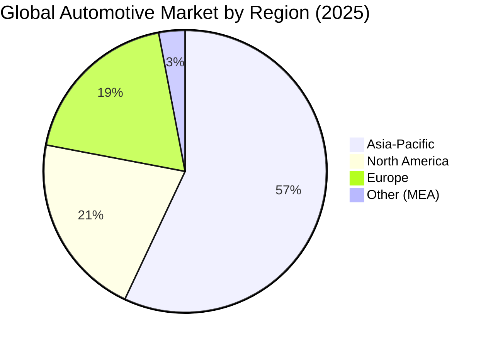
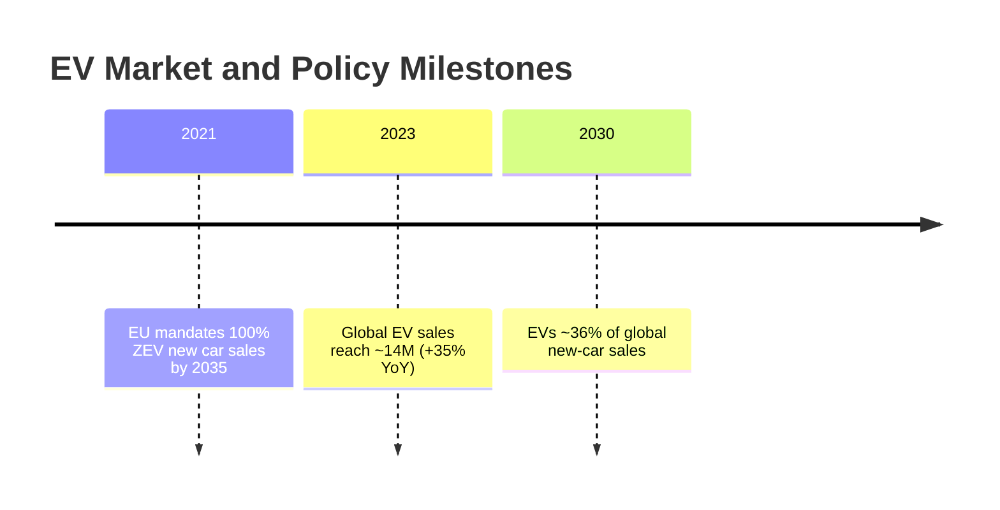

# Automotive - Sector Cyber Resilience & Credit Intelligence Research Q01-Q15 (merged)

**Merge date:** 2026-11-02 | **Merged evidence cut-off:** not stated in either file; gap-fill research accessed 2 November 2026 (see Section 1.1, C-01) | **Status:** Merge of two supplied research files plus labelled gap-fill research | **Language:** English (UK); both files supplied in English (US spelling converted)

---

## 1. Merge statement

### 1.1 Source files

| Item | File A | File B |
|---|---|---|
| File name | `automotive_q1-q9.md` | `Automotive_q10-q15.md` |
| Title | Executive Summary (no document title) | Global Automotive Sector Analysis (2024-2035) |
| Questions covered (as labelled) | Q01-Q09 by file name; content is a market, segmentation, OEM, supply-chain, technology, regulation, financing, SWOT and scenario analysis. No cyber incidents, threat scenarios, controls, credit-transmission scenarios, geopolitical cyber register, questionnaire or Q09 assembly | Q10-Q15 by file name; content is a market forecast, regional, OEM, technology, supply-chain, regulation, consumer, M&A, risk-scenario and recommendation analysis. No fraud, Cyber/ICT, third-party concentration, governance-failure, cross-sector or rating analysis |
| Research date | Not stated | Not stated |
| Evidence cut-off | Not stated; latest data points 2025 (production, revenues), forecasts to 2030 | Not stated; latest data points H1 2025 and 2025 (production, shortages), forecasts to 2035 |
| Citations | None at statement level; named inline: IMF, IEA (Stated Policies), "Alix" (AlixPartners); table note "revenue from official sources" | None at statement level; named inline: IEA and "industry reports" (chart note), AlixPartners; closing line "Latest industry reports, OEM filings, and expert analyses" |
| Figures and diagrams | 3 tables; 1 Mermaid timeline | 2 Mermaid charts (pie; "barChart", not a valid Mermaid type) |
| Instruction-like text | None | None (strategic recommendations are analytical content, not instructions to the merger) |

**Merged evidence cut-off:** neither file states a cut-off or research date, so the earlier-of-two rule cannot be applied. File A's latest observed data are for 2025; File B's latest observed data are for 2025 and H1 2025. Gap-fill research was accessed on 2 November 2026; each gap-fill item carries its own event and publication date. Temporal classes use the merge date: current (2026), prior half-year (H2 2025), contextual (H1 2025 within 18 months, i.e. after 2 May 2025), historical (older than 18 months).

**Scope adopted for merged conclusions:** File A covers the global automotive industry including passenger cars, light commercial vehicles, heavy trucks/buses and two-wheelers, OEMs, Tier-1 suppliers, battery and semiconductor supply chains and financing. File B covers new-vehicle markets (mainly light vehicles), OEMs, suppliers, battery makers, charging, mobility services, ride-hailing, leasing/subscription and OEM insurance/finance arms. The narrower common scope is **vehicle manufacturers (OEMs) of passenger cars and commercial vehicles, their Tier-1/Tier-n component suppliers, and the dealer and captive-finance channels that sell their vehicles**. Two-wheelers (File A), mobility services, ride-hailing and charging networks (File B), semiconductor and rare-earth producers, and independent subprime auto lenders (gap-fill) are kept and marked **partial scope** (Section 7.3). Geography: global in both files; gap-fill evidence covers the UK, US, Japan, the EU, China and Israel.

**Merge statement (supplied content):** File A and File B content is restructured only; no facts, figures, sources or dates were added to it. **Gap-fill statement:** both files are market and strategy studies without cyber, fraud, resilience, governance-failure or rating content. Following the user's standing instruction from earlier sector runs ("merge it, fill the gaps and make sure that the final result comes in English"), the same approach is applied here: public-source research performed on 2 November 2026 fills the missing questions. Every gap-fill item is marked **[GF]** and cites sources S-009 onward; gap-fill ratings in Q15 are labelled "Gap-fill - Provisional" (File B proposed none).

### 1.2 Step 1 - Inventory

| Inventory item | File A | File B |
|---|---|---|
| Sector definition | Global automotive industry (vehicles, OEMs, suppliers, supply chain, financing) | Global automotive market (new vehicles, OEMs, suppliers, mobility and financing models) |
| Subsectors | Passenger cars; LCVs; heavy trucks/buses; two-wheelers; Tier-1 suppliers; semiconductors; batteries; raw materials | Light vehicles; ICE/HEV/PHEV/BEV/FCEV; batteries and charging; ADAS/SDV; mobility services; leasing/subscription; insurance/finance arms |
| Geography | Global; APAC, NA, Europe, China, India, SE Asia, LatAm, MEA | Global; NA, Europe, China, India, Japan/Korea, ASEAN, MEA |
| Questions covered (substantive) | Q01 (market, segments, OEMs, supply chain); Q05 (partial: SWOT, scenarios); Q06 (partial: emissions, safety incl. R155/R156, incentives, trade); Q07 (partial: trade policy, raw-material geopolitics); Q11 (partial: technology); Q13 (partial: capex, M&A, SPACs, VC); Q09 (executive summary) | Q01 (market, regions, OEMs, consumer models); Q05 (partial: risks and scenarios); Q06 (partial: emissions, safety, R155, data privacy, trade, incentives); Q07 (partial: geopolitical supply risk); Q11 (partial: technology, SDV, ISO/SAE 21434); Q12 (partial: supply-chain constraints); Q13 (partial: M&A); Q09 (executive summary, recommendations) |
| Questions missing | Q02, Q03, Q04, Q08, Q10, Q12 (cyber/third-party), Q14, Q15 | Q02, Q03, Q04, Q08, Q10, Q14, Q15; no Q10A-Q10D |
| Sources | 3 named publishers + 1 unspecified "official sources" note; no URLs | 2 named publishers + "industry reports" + closing line; no URLs |
| Incidents / fraud cases | 0 / 0 | 0 / 0 |
| Scenarios | 3 market scenarios (base, upside, downside) | 5 risk/scenario themes (supply shocks, policy shifts, technology adoption, market demand, strategic scenarios) |
| Metrics | Market value, CAGR, production, regional and powertrain shares, OEM units and revenues, chip and battery figures, capex, VC, scenario forecasts | Market value, CAGR, production, regional shares, US/China/India/Japan figures, OEM shares, battery-maker shares, ADAS/SDV adoption, shortage share, EV startup funding |
| Regulatory items | 4 themes (emissions; safety incl. R155/R156; incentives incl. IRA; trade/industry policy) | 4 themes (emissions/ZEV; safety and tech incl. R155, GDPR, CCPA; incentives incl. IRA, ETS, CBAM; other) |
| Ratings / questionnaire | None / None | None / None |
| Tables | 3 (OEM top 20; supply-chain bottlenecks; battery chemistries) | 0 (2 charts) |
| Partial coverage flags | No citations; internal inconsistencies in OEM table (C-19) and scenario shares (C-20) | No citations; invalid chart syntax (G-03); inconsistent 2024 production/sales figures (C-04) |

### 1.3 Acronyms (defined at first use in this file)

ACEA - European Automobile Manufacturers' Association; ADAS - advanced driver-assistance systems; ADS - automated driving system; AEB - automatic emergency braking; AEG - Anderson Economic Group; AV - autonomous vehicle; BEC - business email compromise; BEV - battery electric vehicle; BIS - US Bureau of Industry and Security; CAGR - compound annual growth rate; CARB - California Air Resources Board; CBAM - EU Carbon Border Adjustment Mechanism; CCPA - California Consumer Privacy Act; CLEPA - European Association of Automotive Suppliers; CMC - Cyber Monitoring Centre (UK); CSMS - cyber security management system; DMS - dealer management system; EBIT - earnings before interest and taxes; EBITDA - earnings before interest, taxes, depreciation and amortisation; EDG - UK Export Finance Export Development Guarantee; EPA - US Environmental Protection Agency; ETS - EU Emissions Trading System; EV - electric vehicle; FCEV - fuel-cell electric vehicle; GDPR - EU General Data Protection Regulation; HEV - hybrid electric vehicle; ICE - internal combustion engine; IEA - International Energy Agency; IMF - International Monetary Fund; IRA - US Inflation Reduction Act 2022; ISA - intelligent speed assistance; JIT - just-in-time; JLR - Jaguar Land Rover; LCV - light commercial vehicle; LFP/NMC/NCA/LMO - lithium-ion cathode chemistries (lithium iron phosphate; nickel manganese cobalt; nickel cobalt aluminium; lithium manganese oxide); MaaS - mobility as a service; MY - model year; NEV - new energy vehicle (China); NHTSA - US National Highway Traffic Safety Administration; NIS2 - EU Directive (EU) 2022/2555; OEM - original equipment manufacturer; OTA - over-the-air (software update); OT - operational technology; PHEV - plug-in hybrid electric vehicle; PROV - provisional questionnaire identifier; SDNY - US District Court / US Attorney for the Southern District of New York; SDV - software-defined vehicle; SPAC - special-purpose acquisition company; SPV - special-purpose vehicle; SUMS - software update management system; TISAX - Trusted Information Security Assessment Exchange (automotive); UKEF - UK Export Finance; UNECE - United Nations Economic Commission for Europe; USMCA - United States-Mexico-Canada Agreement; V2X - vehicle-to-everything; VC - venture capital; VCS - vehicle connectivity system; ZEV - zero-emission vehicle.

**Evidence labels used throughout:** [S-nnn] = unified source ID (Section 10). **[GF]** = gap-fill research added in this run; not from File A or File B. File statements without a named source are marked "(File A; uncited)" or "(File B; uncited)". "Merge note" = analysis added during the merge. Figures, units, periods and qualifiers are kept as written; US spellings are converted to UK spellings and en-dash ranges to hyphens.

---

## 2. Executive summary for Senior Credit Officers

**Ratings (Gap-fill - Provisional; File B proposed none)**
- **Fraud:** High; Provisional; confidence Medium.
- **Cyber/ICT:** High; Provisional; confidence Medium.
- **Operational resilience / TPRM:** High; Provisional; confidence Medium.
- **Governance / operating model:** Medium; Provisional; confidence Low.

**Five findings**
1. A single intrusion can stop a manufacturer for weeks: JLR halted UK production for five weeks from September 2025, booked £196 million plus £64 million of direct costs, and needed a £1.5 billion government-backed loan guarantee for its suppliers [S-009, S-013, S-017]. [GF]
2. Shared software creates sector-wide outages: the CDK Global ransomware attack cost US dealers an estimated $1.02 billion over three weeks [S-025]. [GF]
3. Ransomware drives the threat: it was 44% of 494 publicly reported automotive incidents in 2025, more than double 2024 [S-037]. [GF]
4. Financing fraud hit lenders directly: First Brands and Tricolor collapsed in 2025 amid alleged invoice manipulation and double-pledged collateral; JPMorgan took a $170 million hit [S-061, S-066, S-067]. [GF]
5. Single-source inputs halt lines: China's Nexperia export ban (October 2025) and rare-earth licensing (only about 25% approved) stopped supplier production, on margins often below 5% (File A; [S-052, S-057, S-058]).

**Three borrower questions**
1. If business IT were shut down, how long could plants run, and how quickly can OT and ordering systems be restored? [GF]
2. Which single software platforms or single-source components would stop sales or production, and what alternatives are qualified? (File B; [GF])
3. How are receivables, inventory financing and supplier bank details independently confirmed? [GF]

---
## 3. Findings by question

*Placement note: both files are thematic market studies. Their sections are placed below by topic; every paragraph, bullet, table and diagram of both files appears once, with its origin stated. Gap-fill blocks are marked [GF].*

## Q01 - Sector Operating Model & Key Dependencies

*Conclusion: A concentrated, capital-intensive, just-in-time manufacturing sector (top ten OEMs about 69% of production, margins often below 5%) that depends on a few Tier-1 suppliers, semiconductors, battery cells and China-concentrated rare earths, and increasingly on shared enterprise software and connected-vehicle back ends.*

### Q01.1 Market size and growth (File A, "Market Size & Growth")

(File A; uncited)
- **Global Market:** Valued at roughly $2.7-3.0 trillion in 2025, with ~3-4% CAGR to 2030. Vehicle production topped ~96 million units globally in 2025.
- **Regional Trends:** Asia-Pacific leads (>50% of volume and fastest growth). North America (NA) production is rising (2025 output +241k units) despite inventory resets; U.S. light-vehicle sales ~15.8 M in 2026 (with modest rebound to ~16.8 M by 2030). Europe saw improved 2025 production (+90k units); volumes in EU are largely flat through 2026. China remains largest market (~24-26 M sales by 2030). India and Southeast Asia are smaller but fast-growing (India ~5-6 M annual sales; two-wheelers dominate Asia). Latin America, MEA are ~minor shares.
- **Growth Drivers:** Rising vehicle ownership in emerging markets; EV/electrification; declining ICE share under regulation. In China, NEV (electric/plug-in) share exceeded 50% in late 2024 and is on track to ~80% by 2030. By contrast, a "new ICE age" is emerging in the U.S. (hybrids/ICE still ~dominant in near term).

### Q01.2 Segmentation (File A, "Segmentation by Powertrain and Vehicle Type")

(File A; uncited)
- **Powertrain:** ICE (gasoline/diesel) still ~85% of revenue share. Plug-in electrified vehicles (battery-EVs + PHEVs) grew ~35% YoY to ~14 M sales in 2023 (≈9-10% of new-car sales globally). Hybrids (non-plug) add a few % share (not specifically cited). Fuel-cell vehicles are <0.1% of market. CAGR 2024-30: BEVs ≈20-25%, PHEVs ~15-20% (targets vary by source) vs ICE/HV single digits.
- **Vehicle Types:** Passenger cars are ~70-75% of volume; light commercial vehicles (vans/light trucks) ~15-20%; heavy trucks/buses ~10%; motorcycles/two-wheelers comparable to car volumes in Asia (e.g. 58.6 M vs 66.7 M in 2021). Electrification is strongest in cars and LCVs; medium/heavy trucks are lagging (~9% electric share in 2025).

### Q01.3 Market forecast and regional markets (File B, "Market Forecast (2024-2035)"; "Major Regional Markets")

(File B; uncited except as noted)
- **Global market size:** Estimated at ≈US$2.33 trillion in 2026, growing to ~$2.98 trillion by 2035 (CAGR ~2.8%). Annual production was ~94 million vehicles in 2025, up from ~80 million in 2024. Growth is driven by EV/HEV demand and emerging-market recovery.
- **Regional production:** Asia-Pacific dominates (57% of global output in 2025), followed by North America (21%) and Europe (19%); Middle East/Africa ~3%.



- **Forecast by region:** The U.S. light-vehicle market is expected to dip from 16.2 million in 2025 to ~15.8 M in 2026, then rise to ~16.8 M by 2030. China's sales will drop ~10% in 2025 then recover to ~26.2 M by 2030. European sales are projected to stagnate or slowly grow; Chinese brands' share in Europe may hit ~17% by 2031. India and SE Asia will see stronger growth (e.g. India H1 2025 registrations +0.6% YoY, full-year growth expected with GDP). Japan and South Korea remain mature markets (Japan sales +10.7% in H1 2025, but zero/negative growth to 2030).
- [S-005] [S-007] **Vehicle types:** ICE vehicles still ~70-80% of sales in 2024, but EVs/hybrids surged to ~30% of sales. By 2030, plug-in vehicles (BEV+PHEV) are forecast at ~36% of sales. HEVs (non-plug hybrid) also grow globally. FCEVs (fuel-cell EVs) remain niche (mainly buses/trucks under development). The chart below compares ICE vs. electrified (plug-in+hybrid) share:

```mermaid
barChart
    title EV vs ICE Share of Global Car Sales
    xAxis 2020, 2025, 2030
    "ICE vehicles": 93, 75, 64
    "Electrified (BEV+PHEV+HEV)": 7, 25, 36
```

*(Sources: IEA, industry reports - File B. Chart type "barChart" is not valid Mermaid syntax; data reproduced as written, G-03.)*

(File B; uncited)
- **North America (USA, Canada, Mexico):** US sales ~15-16 M/year; 2026 forecast ~15.8 M. BEV share still low (~10% in 2025) but rising; PHEV and HEV growing due to relaxed EPA rules. Key OEMs: Ford, GM, Stellantis, Toyota/Kia, Tesla. EV infrastructure expanding (Superchargers, Blink, Electrify America). Regulatory: EPA emissions rules (tightening by 2026), California's 35-50% ZEV mandates, USMCA trade rules and EV tariffs (China vehicles subject to 25%). Consumers trend toward SUVs/trucks; used-vehicle market is large. New financing: EV leasing incentives, subscription plans (Volvo Care, etc.), and ride-hailing remain strong.
- **Europe:** ~16 M vehicles/year manufacturing (2025). EV/hybrid 24% of production. EU CO₂ rules mandate 55% cut by 2030 and 100% by 2035 (effectively banning new ICE by 2035). Strong EV incentives (Norway 100% ZEV sales by 2025; other countries ramping). Safety: from 2022 EU requires AEB, ISA, lane assist, etc. Top OEMs: VW Group, Stellantis, Renault-Nissan-Mitsubishi, BMW, Hyundai/Kia, Mercedes, Tesla (Gigafactory in Berlin). Chinese brands gaining share (on pace for ~16% Europe share by 2030). Brexit and component shortages pose constraints. Car sharing and urban micro-mobility are rising (MaaS).
- **China:** World's largest market (≈27 M cars in 2024). NEVs (EV+PHEV+FCEV) ~34% of 2023 sales (up from 27% in 2022) per government credits. 14% ZEV mandate for OEMs, targeting 40-50% by 2030. Domestic OEMs (BYD, SAIC, Geely/Volvo, Great Wall, Changan) lead; Tesla Shanghai and Volkswagen ID plants compete. Recent drop in 2025 sales ("involution"), but exports growing (10 M vehicles by 2026). Battery supply is ample (China supplies 70% of global EV batteries). Policy: continued subsidies for EVs, strict fuel-economy rules. Charging networks expanded rapidly (100,000+ public chargers). Connected car regulations tightening (cybersecurity standards).
- **India:** Growing market (~4-5 M/year, with two-wheeler EV boom). FAME subsidies for EVs; targets ~30% new electric cars by 2030. Local content requirements for EV incentives. ICE still dominant; hybrids slowly introduced by Toyota, Honda. Domestic OEMs (Maruti Suzuki, Tata, Mahindra) focusing on both EV and efficient ICE. Infrastructure lagging but improving (80,000 public chargers by 2025). Ride-hailing (Ola, Uber) major demand drivers.
- **Japan/South Korea:** Mature markets (~5.5 M each in 2024). Japan relies on hybrids (Toyota Prius) and a modest push toward EVs; target ~50% EV+HEV by 2030. Korea's EV share growing (Hyundai/Kia invest heavily, aiming 30-50% EV by 2030). Both subject to strict emissions/tariff rules under free trade; battery recycling initiatives (Japan). Trade: Japan/Korea have EV supply to Europe and NA; tariffs are low.
- **Southeast Asia (ASEAN):** Smaller volume (~5-7 M total). Thailand and Indonesia pushing local EV assembly (tax incentives). China dominates exports of affordable EVs to SEA. Scooters/motorbikes heavily electrifying. Regional market share of OEMs: Toyota/Honda strong in ICE; BYD/Geely expanding EV presence.

### Q01.4 OEM competitive landscape (File A, "OEM Competitive Landscape (Top 20 by Volume & Revenue)")

(File A; uncited; table note references "official sources" [S-004]) Major groups dominate global sales and revenue: Toyota (≈10-11 M units, $290 B revenue) and Volkswagen Group (~8-9 M units, $277 B) lead. Stellantis (~6 M, $163 B) and Hyundai-Kia (~7 M combined, ~$119 B) follow. GM (~4.5 M, $172 B) and Renault-Nissan (~7 M combined) are next, along with Japanese firms Honda and Suzuki (~4.5 M, ~$91 B and 2.8 M, $35 B). Chinese groups (SAIC, BYD, Geely, FAW, etc.) each sell multiple million units; BYD sold ~1.8 M EVs in 2024 (revenue $58.6 B). Tesla (≈1.5-2 M units, $77 B) ranks in top 15 by sales. The top 20 automakers accounted for ~$2.1 trillion revenue in 2024.

| Rank | OEM | 2024 Units (M) | 2024 Revenue (US$ Bn) |
|:---:|:---|:---:|:---:|
| 1 | Toyota (incl. Lexus/Daihatsu) | ~10.5 | 291 |
| 2 | Volkswagen Group (VW, Audi, etc.) | ~8.5 | 276.9 |
| 3 | Stellantis | ~6.2 | 163.4 |
| 4 | Hyundai-Kia | ~7.0 | 118.9 |
| 5 | General Motors | ~4.5 | 171.9 |
| 6 | Renault-Nissan | ~7.0 | 142.6† (Renault+Nissan sum) |
| 7 | Honda | ~4.6 | 91.9 |
| 8 | Ford | ~4.2 | 172.7 |
| 9 | Mercedes-Benz (incl. Smart) | ~2.1 | 132.4 |
| 10 | BMW (incl. Mini) | ~2.3 | 130.1 |
| 11 | SAIC (China) | ~4.0 | 105.2 |
| 12 | Tesla | ~1.6 | 77.0 |
| 13 | Kia (Hyundai grp) | ~3.0 | 72.9 |
| 14 | BYD | ~1.8 (all EV) | 58.6 |
| 15 | Renault | ~3.2 | 58.6 |
| 16 | Tata Motors (incl. JLR) | ~1.5 | 52.1 |
| 17 | Volvo Group (trucks/Volvo Cars) | ~0.9 | 36.3 |
| 18 | Suzuki | ~2.8 | 35.4 |
| 19 | Mazda | ~1.3 | 33.5 |
| 20 | Geely (incl. Volvo, Lotus) | ~2.0 | 32.9 |

*Note (File A): Volume figures are approximate based on public data; revenue from official sources.*

### Q01.5 Key OEMs and market shares (File B, "Key OEMs and Market Shares")

(File B; uncited) The global market is concentrated: the top ten OEMs produce ~69% of vehicles. Leading companies (approximate 2024 sales) include:
- Toyota Group (Japan): ~10-11% global market share.
- Volkswagen Group (Germany): ~9-10%.
- Hyundai-Kia (Korea): ~7-8%.
- General Motors (USA): ~5-6%.
- Stellantis (Europe/USA): ~6-7%.
- Tesla (USA): ~3-4% (rapidly growing).
- Honda (Japan): ~5%.
- SAIC, Geely/Volvo (China/Sweden): growing share in China and abroad (Geely ~3%).
- Others: Ford, Nissan, Renault-Nissan-Mitsubishi consortium, BYD (also counted as OEM).

Suppliers and technologies shift: OEMs are investing in battery gigafactories, software platforms, and consolidating suppliers. Many traditional OEMs are partnering (e.g. GM-LG, Stellantis-LG-Samsung). There is significant consolidation in ride services (Uber, Grab) and insurance/finance arms.

### Q01.6 Supply chain (File A, "Supply Chain (Semiconductors, Batteries, Raw Materials, Tier-1 Suppliers)")

(File A; uncited)
- **Semiconductors:** Automotive chips are a ~$90 B market in 2025, growing ~6% (to $139 B by 2031). EVs require 2-3× more semiconductor content than ICE cars, especially power ICs and silicon carbide components. Recent years saw shortages, but carmakers are now stockpiling and diversifying suppliers. Key bottlenecks: foundry capacity (especially for advanced nodes) and lead times for custom analog/RF chips.
- **Batteries:** Li-ion batteries dominate. Material supply is essential: demand for lithium is projected to increase ~6× by 2030 in the high-ambition scenario. High-grade nickel (20% from Russia) and cobalt are also tight. Average battery pack cost fell to $132/kWh in 2021 but is sensitive to metal prices. LFP chemistry (zero Co/Ni) is gaining share (more than double since 2020) as a less mineral-intensive alternative. Recycling (cathode recovery) is nascent, so mining and processing remain chokepoints.
- **Raw Materials:** Beyond battery minerals, key inputs include rare earths for electric motors (China supplies ~85% of NdFeB magnet ore), precious metals for catalysts, and aluminium/plastic for lightweighting. Geopolitical events can tighten supplies (e.g. rare-earth export limits, lithium/nickel price spikes in 2022).
- **Tier-1 Suppliers:** The industry relies on a few large global suppliers: Robert Bosch, Denso, Continental, ZF, Magna, Hyundai Mobis, etc. These Tier-1s provide powertrains, ADAS sensors, electronics and are investing in in-house capabilities (e.g. microcontrollers, chips). Consolidation continues among suppliers to achieve scale for costly R&D.

| Supply chain component | Key bottlenecks | Implications |
|---|---|---|
| Automotive Chips | Foundry capacity limits (especially <10nm), lengthy lead times | Vehicle production delays; higher semiconductor costs |
| Lithium | Mining/processing capacity; concentrate of reserves in few countries (Australia, Chile) | Price volatility; potential supply shortfall (need ~50 new mines by 2030) |
| Nickel/Cobalt | Dependence on Russian nickel (~20%) and Congo cobalt; refining constraints | Upside price shock; push for low-cobalt chemistries |
| Battery Cells | Gigafactory build-out pace; raw materials | Regional dependence (China leads ~70% of global capacity); delays in EV rollouts if cell shortage |
| Rare Earths (Nd/Pr) | Chinese export curbs risk; ore is concentrated | Motor/magnet shortages; higher costs or alternative motor designs needed |
| Other Components | Specialised auto-grade materials (wiring harnesses, sensors) also faced mid-'20s shortages | Production bottlenecks in ADAS, infotainment (e.g. radar/LiDAR supply) |

### Q01.7 Consumer trends and business models (File B, "Consumer Trends and Business Models")

(File B; uncited)
- **Consumer Demand:** Younger buyers are more open to EVs and digital features. Urbanisation drives smaller cars and shared mobility. Ride-hailing (Uber, Didi) and micromobility growth dampens individual car ownership growth. Subscription models (e.g. car-as-a-service) are rising: BMW, Volvo, GM all offer monthly EV subscriptions. Leasing remains popular, especially for EVs (lower depreciation uncertainty).
- **Mobility Services:** Shared fleets (e-scooters, robotaxis pilots) are growing. Many OEMs are investing in EV car-share (Hyundai Motional, GM Maven legacy). The shift to Mobility-as-a-Service (MaaS) is a risk to traditional sales but an opportunity for new revenue streams (services, data).
- **Financing:** Low interest rates (until recently) made car loans easier; now rising rates could cool demand. However, governments still offer favourable financing for EV purchases. New financing models include battery leasing (e.g. some Chinese EVs) and pay-as-you-go for usage.

### Q01.8 Dependency additions **[GF]**

| DEP | Dependency | Disruption mechanism (evidence) | Consequence | Substitutability / switching time | S- IDs |
|---|---|---|---|---|---|
| DEP-01 | Enterprise IT and plant OT (ordering, scheduling, production control) | JLR shut down IT systems after an intrusion; production stopped five weeks; normal production only by mid-November 2025 | Full production halt; supplier liquidity stress | Low; restart phased over weeks | S-012, S-013, S-021 |
| DEP-02 | Shared dealer software (DMS) | CDK Global ransomware forced most dealer systems offline from 19 June to 5 July 2024 | Lost vehicle sales; manual processes | Low (provider serves ~15,000 dealerships) | S-025, S-026, S-027 |
| DEP-03 | JIT parts flow from Tier-n suppliers | Ransomware at plastic-parts supplier Kojima stopped 28 lines at 14 Toyota plants for a day | Lost output of ~13,000 vehicles | Low (JIT, no buffer) | S-031, S-032 |
| DEP-04 | Commodity chips from single sources (Nexperia) | China export ban from 4 Oct 2025; Nexperia could not guarantee delivery from 10 Oct; line stoppages (e.g. Honda Mexico) | Assembly stoppages | Low (re-qualification takes weeks to months) | S-051, S-052, S-053, S-055 |
| DEP-05 | Rare-earth magnets | China licensing from April 2025; ~25% of supplier licence requests approved; European supplier lines shut | Supplier line closures | Low (>90% of magnet processing in China) | S-057, S-058 |
| DEP-06 | Third-party customer-service SaaS (CRM) | Stellantis customer data stolen via a third-party platform supporting North American customer service | Data breach; fraud exposure | Medium | S-034, S-035 |
| DEP-07 | Supply-chain and receivables financing | First Brands: ~$2.3 billion off-balance-sheet financing and ~$2.3 billion factoring liabilities (as stated in a filing) | Opaque leverage; sudden insolvency | n/a | S-062 |

**Merge notes:** (a) Market size, production and powertrain shares conflict between the files (C-03 to C-06). (b) File A's OEM table double-counts groups and their members (C-19). (c) US sales forecasts are identical in both files and are merged (Section 7.1). (d) India market size differs (C-22). (e) Two-wheelers, mobility services and ride-hailing are partial scope.

**Cross-references:** Q05, Q07, Q11, Q12, DEP register; conflicts C-02 to C-06, C-08, C-09, C-19, C-22 to C-24.

---

## Q02 - Major Cyber Incidents & Case Studies **[GF]**

*Conclusion: Automotive losses come from production stoppage, not data theft alone: JLR (five-week shutdown, UK-wide supply-chain effect), CDK Global (dealer sales loss of about $1 billion) and Toyota/Kojima (one-day national shutdown from a single supplier) show that IT and supplier compromises propagate through JIT chains. Neither file contains incidents.*

### Q02.1 Incident register

| INC | Organisation | Subsector | Country | Event date | Class | Mechanism (as reported) | Outcome | Horizon | S- IDs |
|---|---|---|---|---|---|---|---|---|---|
| INC-01 | Jaguar Land Rover (Tata Motors) | OEM | UK (plants also in Slovakia, Brazil, India) | 31 Aug / 1 Sep 2025; restart from 8 Oct; normal production mid-Nov 2025 | Intrusion -> operational outage | IT systems shut down; claimed by Scattered Lapsus$ Hunters; data theft confirmed (as reported) | Five-week UK production halt; Q2 FY26 revenue £4.9bn (-24%); £196m cyber exceptional costs; Q3 £64m more; Q3 revenue £4.5bn (-39%); CMC estimate £1.9bn UK economic cost, >5,000 organisations; £1.5bn UK loan guarantee | Historical (H2 2025 event); costs in last 12 months | S-009 to S-024 |
| INC-02 | CDK Global | Dealer software (DMS) | US / North America | From 19 Jun 2024; systems shut to 5 Jul 2024 | Intrusion (ransomware) -> operational outage | Ransomware attributed to BlackSuit; ~$25 million ransom reported, not confirmed | ~15,000 dealerships affected; AEG estimate $1.02 billion direct dealer losses and ~56,200 lost new-vehicle sales | Historical landmark | S-025 to S-030 |
| INC-03 | Kojima Industries / Toyota | Tier-n supplier -> OEM | Japan | 26 Feb - 2 Mar 2022 | Intrusion (ransomware) -> operational outage | Supplier received a threatening message, later confirmed as ransomware (as reported) | Toyota suspended 28 lines at 14 plants on 1 Mar 2022; ~13,000 vehicles (4-5% of monthly domestic output) | Historical landmark | S-031, S-032, S-033 |
| INC-04 | Stellantis | OEM | North America | Disclosed 21 Sep 2025 | Intrusion (third-party SaaS data theft) | Unauthorised access to a third-party service provider platform supporting customer service; ShinyHunters claimed >18 million Salesforce records | Contact information exposed; no financial or sensitive personal data (company) | Historical (H2 2025) | S-034, S-035, S-036 |
| INC-05 | Colmobil | Vehicle importer (dealer channel) | Israel | 14 Oct 2026; attribution 28 Oct 2026 | Intrusion (ransomware, double extortion) | SETTRA group (as reported) | Operations disrupted; Transport Ministry blocked access to the vehicle-registration system | Last 30 days (new) | S-075 |
| INC-06 | Nexperia supply disruption (non-cyber) | Semiconductor supplier | Netherlands / China / global | 30 Sep - Nov 2025 | Operational outage (geopolitical supply) | Dutch state control of Nexperia; China export ban on Nexperia China from 4 Oct 2025 | Delivery guarantee withdrawn 10 Oct; ACEA warned stocks would run out in weeks; Honda halted its Celaya (Mexico) plant on 29 Oct 2025 | Historical (H2 2025) | S-051 to S-056 |
| INC-07 | Rare-earth export licensing (non-cyber) | Raw materials -> suppliers | China / EU | From Apr 2025 | Operational outage (geopolitical supply) | Licence requirement for rare earths and magnets | Several European supplier lines and plants shut (CLEPA, 4 Jun 2025); magnet exports -51% April vs March | Historical (H1 2025, older than 18 months) | S-057, S-058, S-059 |

**Last-30-days items not entered as incidents:** breach of an unnamed German dealer software platform reported in October 2026 [S-077]; Qilin attack on subsidiaries of an unnamed Japanese Tier-1 supplier [S-079]; detention of a suspected Qilin leader announced 8 Oct 2026 [S-076] (G-09).

### Q02.2 Top five (decision relevance)

1. **INC-01 JLR (2025)** - longest disclosed OEM production stoppage; quantified company and macro cost; state liquidity support [S-009, S-014, S-017].
2. **INC-02 CDK Global (2024)** - one software provider halted dealer sales across North America [S-025].
3. **INC-06 Nexperia (2025)** - single-source component triggered assembly stoppages (non-cyber; geopolitical) [S-052, S-055].
4. **INC-03 Toyota/Kojima (2022)** - one supplier compromise stopped all domestic Toyota plants [S-031].
5. **INC-04 Stellantis (2025)** - customer data theft through a shared SaaS platform [S-034].

Selection criteria: operational and financial consequence, transferability to lending exposures (OEMs, suppliers, dealers), evidence quality. Fraud cases are ranked in Q10.

### Q02.3 Case studies

**Case 1 - Jaguar Land Rover (2025).** *Timeline:* attack around 31 August - 1 September 2025; production stopped across UK factories for five weeks [S-013]; restart from 8 October [S-010]; normal levels only by mid-November [S-021]. *Propagation:* operations also disrupted in Slovakia, Brazil and India [S-019]; CMC classed the event as Category 3 of 5 and estimated £1.9 billion UK cost across more than 5,000 organisations [S-014, S-015]. *Financial outcome:* Q2 FY26 revenue £4.9 billion (-24%), loss before tax and exceptional items £485 million, exceptional items £238 million including £196 million of cyber costs [S-011]; Q3 FY26 revenue £4.5 billion (-39%), £64 million further cyber costs, EBIT margin -6.8% [S-009]; £1.5 billion UK government-backed loan guarantee for the supply chain, outside UKEF's normal risk parameters [S-017, S-018]. *Lesson:* IT compromise at one OEM becomes a regional supplier liquidity event. *Does not establish:* the initial access route or insurance recovery (G-05).

**Case 2 - CDK Global (2024).** *Timeline:* attack from 19 June 2024; systems shut down for dealer customers until 5 July [S-026]. *Effect:* about 15,000 dealerships affected [S-027]; AEG estimates $1.02 billion of direct dealer losses and ~56,200 lost new-vehicle sales; the estimate excludes consumer, reputational and litigation damages [S-025, S-026]. *Attribution:* BlackSuit [S-028]. *Lesson:* dealer finance and floorplan borrowers share one software dependency. *Does not establish:* CDK's own costs; the reported ransom is unconfirmed [S-030].

**Case 3 - Toyota / Kojima Industries (2022).** *Timeline:* supplier received a threatening message on 26 February 2022, later confirmed as ransomware [S-033]; Toyota suspended 28 lines at 14 plants on 1 March and resumed on 2 March [S-031, S-033]. *Effect:* ~13,000 vehicles, 4-5% of monthly domestic output [S-032]. *Lesson:* a Tier-n supplier without a JIT buffer is a single point of failure for the OEM. *Does not establish:* financial loss.

**Cross-references:** Q03, Q05, Q07, Q12, INC register; conflicts C-29 to C-32, C-37.

---

## Q03 - Cyber Threat Landscape & Attack Scenarios **[GF]**

*Conclusion: Ransomware against OEM, supplier and dealer IT is the dominant disruptive threat; shared SaaS and DMS platforms and connected-vehicle back ends (APIs, telematics, cloud) create one-to-many exposure; payment fraud targets supplier finance teams.*

| THR | Scenario | Mechanism | Evidence | Confidence |
|---|---|---|---|---|
| THR-01 | Ransomware on OEM IT forcing production shutdown | Intrusion, encryption or containment shutdown of IT/OT | JLR [S-012, S-013]; ransomware 44% of 494 automotive incidents in 2025, more than double 2024 [S-037] | High |
| THR-02 | Supplier compromise stopping JIT production | Ransomware at Tier-n supplier severs ordering links | Kojima/Toyota [S-031, S-033]; Qilin linked to 178 manufacturing incidents Jan-Jul 2026 (vendor, as reported) [S-076] | High |
| THR-03 | Shared software platform compromise (DMS, CRM/SaaS) | One provider outage or data theft affects many dealers or customers | CDK [S-025]; Stellantis via third-party platform [S-035] | High |
| THR-04 | Connected-vehicle back-end attacks | API, telematics and cloud weaknesses | 67% of 2025 incidents involved telematics and cloud (secondary) or 61% stemmed from them (vendor page) [S-037, S-038]; 92% remote [S-039] | Medium |
| THR-05 | Payment fraud via email compromise | Impersonation of business partners; fraudulent transfers | Toyota Boshoku Europe ~$37 million [S-073, S-074] | High |

**Merge notes:** File A notes OTA updates, cloud connectivity, V2X and subscription software (Q11.1); File B notes vehicles as "rolling data centres", ISO/SAE 21434 and tightening cybersecurity regulation (Q11.2). Neither file assesses threats.

**Cross-references:** Q02, Q04, Q07, Q10, Q11, THR register; conflict C-33.

---

## Q04 - Control Weaknesses, Resilience Capabilities & Benchmarks **[GF]**

*Conclusion: Documented weaknesses are IT/OT dependence without rapid recovery, concentration on single software providers, unprotected supplier links, third-party SaaS access and payment approval; regulators now require a certified CSMS for vehicles but not for plant IT.*

| CTL | Capability / weakness | Evidence | S- IDs |
|---|---|---|---|
| CTL-C1 | IT/OT segmentation and tested plant restart | JLR needed about five weeks to restart and until mid-November to normalise | S-013, S-021 |
| CTL-C2 | Third-party software resilience and manual fallback | Dealers reverted to manual processes during the CDK outage (as reported); losses accrued weekly | S-025, S-026 |
| CTL-C3 | Supplier cyber resilience and safe data exchange | Toyota resumed only after finding a way to exchange order data with Kojima safely | S-031, S-033 |
| CTL-C4 | SaaS integration and token control | Stellantis data accessed via a third-party platform | S-035 |
| CTL-C5 | Payment release controls | Toyota Boshoku Europe BEC loss | S-073 |
| CTL-C6 | Vehicle CSMS and SUMS | UN R155/R156 mandatory for all new vehicles sold in the EU from July 2024 | S-044, S-045 |
| CTL-M1 | Connected-vehicle back-end exposure | Backend servers and APIs identified as the primary weak points; 92% of incidents remote | S-038, S-039 |
| CTL-M2 | Rating-agency benchmark | Moody's (as quoted): automotive had the highest share of issuers with a cyber incident in the prior 24 months; implementation of key cyber controls uneven | S-040 |

Neither file contains control content; File B notes ISO/SAE 21434 and tightening cybersecurity and data-privacy rules (Q11.2) and that companies hold higher inventory after COVID-era disruption (Q12.1).

**Cross-references:** Q03, Q06, Q08, Q11, Q12, CTL register.

---

## Q05 - Financial Impact, Disruption & Credit Transmission

*Conclusion: Thin margins (often below 5%), heavy electrification capex and high fixed costs (File A) mean that weeks of lost production translate quickly into losses and cash outflow, as JLR's quarters show; fraud-driven insolvencies (First Brands, Tricolor) transmitted directly to lenders.*

### Q05.1 File A, "SWOT Analysis"

(File A; uncited)
- **Strengths:** Massive global installed base (~1.4 billion vehicles worldwide) and large scale: six automakers each sell millions of units annually. Strong R&D pipelines in electrification and software. Integrated global supply chains (though diversifying). Established brand portfolios and dealer networks (though these are being rethought for EVs). High capital reserves (many OEMs generate >$30 B EBITDA).
- **Weaknesses:** Legacy manufacturing and dealer models give high fixed costs. Thin margins (often <5%) leave little buffer for price wars or R&D. Regulatory compliance (emissions, safety) adds cost. Complex multi-powertrain lineup (ICE, hybrid, EV) creates complexity. Slow software development cycles relative to tech firms. Some OEMs lack scale in fast-growing regions (e.g. Western OEMs in China). Vulnerable to commodity cycles (fuel, metals).
- **Opportunities:** Rapid electrification opens new product categories (EVs, e-bikes, autonomous shuttles). Software-defined vehicles can enable new revenue (subscriptions, data services). New markets and mobility services (ride-sharing, delivery robots, "HVAC systems for energy storage", as written). Repurposing ICE assets for hydrogen engines. Growing demand in emerging markets (where ownership is still low). Partnerships with tech giants (AI, cloud). Accessing new capital (green funds, ESG mandates).
- **Threats:** Intensified competition from Chinese OEMs (low-cost EVs for global markets). Geopolitical risks (trade barriers, national security restrictions on tech). Regulatory shocks (tightened emissions standards, heavy penalties). Supply chain shocks (chip shortages, raw material embargoes). Market saturation in developed regions (demand plateauing). Macroeconomic risk (auto sales drop sharply in downturns; IMF warns of global slowdown). Disruption by big tech (potential entrants like Apple Car) or mobility-as-a-service reducing vehicle ownership.

### Q05.2 File A, "Five-Year Outlook & Scenarios (2025-2030)"

(File A; IEA and Alix named [S-002] [S-003]) Using industry projections and scenario assumptions, we outline three cases:
- **Base Case (Stated Policies):** Global light-vehicle sales ~95-100 M by 2030. EV (BEV+PHEV) share ~35-40% of new sales (IEA/Stated Policies), driven by sustained incentives and automaker targets. China's EV share ~80% by 2030, Europe ~60%, U.S. ~50%. Non-EV hybrid/ICE share ~60-65%. Market shares largely reflect 2025 leaders: Toyota ~10%, VW ~9%, Chinese brands ~20% (globally), with Chinese brand share growing notably (Alix forecasts ~17% share in Europe by 2031). Battery supply expands but remains tight; semiconductor shortage gradually eases. Total global auto revenues reach ~$3.5 T by 2030.
- **Upside (Optimistic):** Faster EV adoption (due to stronger policy or cost declines) pushes EV share to ~50-60% by 2030. Global sales ~100-105 M (stronger economy, emerging market boom). Western OEMs accelerate EV rollout. Chinese OEM exports surge beyond 10 M (Alix), capturing market share abroad. Profitability improves as EV costs fall; healthy consumer spending. Infrastructure (charging) builds out swiftly. New mobility services grow steadily. Battery recycling and second-life use reduce resource pressure. Global revenues exceed $3.8 T.
- **Downside:** Economic stagnation or tightening incentives limit growth: global sales ~80-90 M by 2030. EV share only ~20-30% if subsidies end abruptly or costs remain high. Legacy ICE vehicles stay a majority into 2030. Supply chain shocks (new sanctions, mineral shortages) disrupt production. Trade conflicts trigger fragmented regional markets. Smaller OEMs face consolidation or exit. Global auto revenues shrink below $3 T.

**Key Quantitative Forecasts (2030) (File A):** Under base case, cumulative global vehicle stock ~1.5 billion, of which ~180-250 M are EVs (∼12-17%). New-car EV share ~35-40%. Plug-in market leads with BEVs ~30% and PHEVs ~10%. China remains ~60-65% of EV sales volume. EV battery demand ~3,000-3,500 GWh (Stated Policies), requiring ~500-600 kt Li annually. OEM unit market shares (base): Toyota ~10%, VW ~8%, Chinese OEMs collectively ~25%.

**Assumptions & Risks (File A):** Forecasts assume moderate GDP growth; rapid tech cost declines; continued EV incentives. Unspecified factors include pace of technology breakthroughs (e.g. solid-state batteries), geopolitical disruptions, and demand elasticity. A severe recession or policy rollback would push reality towards the downside scenario. Conversely, breakthroughs in costs or new policy mandates (e.g. tighter ICE bans) could achieve the upside.



### Q05.3 File B, "Risks and Scenarios"

(File B; uncited)
- **Supply Shocks:** Any new semiconductor crunch or raw-material bottleneck (e.g. a major lithium/nickel shortage) could delay vehicle production. Geopolitical risk (China-Taiwan, Middle East, Russia) could disrupt fuel or parts flows.
- **Policy Shifts:** Changes in government (e.g. US EPA rollbacks or EU mandate extensions) could slow EV adoption. Conversely, stricter policies (e.g. abrupt ICE bans) would accelerate change and create stranded assets. Tariff wars (US-China, Brexit UK-EU) could fragment the market.
- **Technology Adoption:** If battery costs decline faster (solid-state breakthroughs), EV adoption could surpass forecasts. Conversely, range anxiety or charging issues could slow consumer uptake. Autonomous vehicles achieving true L4/L5 capability is still uncertain and could disrupt car ownership patterns sooner or later.
- **Market Demand:** Economic downturns could dent auto sales (though historically resilient). A structural shift where consumers prefer new mobility over car ownership (as seen in some cities) would reduce volumes. A rise in used-car market or ride-hailing might moderate new-sales growth.
- **Strategic Scenarios:** Companies should model multiple futures (rapid EV/AV adoption vs. gradual shift, tight vs. loose regulations). For example, a scenario where battery recycling technology matures could alleviate raw-material risks. Another scenario: aggressive protectionism forces OEMs to regionalise fully (Fortress NA, Fortress EU).

### Q05.4 Disclosed cyber and fraud financial outcomes **[GF]**

| Event | Metric | Value | Basis | S- IDs |
|---|---|---|---|---|
| JLR Q2 FY26 | Revenue; loss before tax and exceptional items; cyber exceptional costs | £4.9bn (-24%); £485m; £196m | Company results (as reported) | S-010, S-011 |
| JLR Q3 FY26 | Revenue; cyber exceptional costs; EBIT margin; loss before tax | £4.5bn (-39%); £64m; -6.8%; £310m | Company release; media | S-009, S-021 |
| JLR Q3 FY26 | Wholesale volumes | 59,200 (-43%) | Company (as reported) | S-023 |
| JLR Q3 FY26 | Free cash flow | £(1.5)bn outflow | Secondary summary | S-024 |
| JLR (macro) | UK economic cost | £1.9bn; >5,000 organisations | CMC model estimate | S-014, S-015 |
| JLR | Government-backed loan guarantee | Up to £1.5bn, five years, EDG covers up to 80% of lender risk | Government | S-017 |
| CDK Global | Dealer direct losses | $1.02bn; ~56,200 new-vehicle sales | AEG estimate | S-025 |
| Toyota/Kojima | Lost output | ~13,000 vehicles in one day | Company / Nikkei | S-031, S-032 |

### Q05.5 Disruption scenarios **[GF]** - *Illustrative - not a forecast or loss estimate*

| SCN | Duration | Anchoring evidence | Operational effect | Credit channels |
|---|---|---|---|---|
| SCN-1W | One week | Toyota/Kojima one-day national stoppage [S-031]; CDK first-week dealer losses (AEG weekly estimates) [S-025] | Lost production days; dealer sales deferred | Revenue deferral; supplier working capital |
| SCN-4W | Four weeks | CDK three-week outage ($1.02bn) [S-025]; Nexperia stock run-down "within weeks" [S-053] | Multi-week stoppage; manual dealer operations | Losses at thin margins (<5%, File A); supplier liquidity calls |
| SCN-8W | Eight weeks | JLR: five-week halt plus about six weeks to normal production; Q3 revenue -39% and £1.5bn FCF outflow [S-009, S-021, S-024] | OEM and supplier base shut for a quarter | Covenant pressure; state or parent support; supplier defaults |

**Merge notes:** (a) File A and File B scenarios are market scenarios, not cyber scenarios. (b) File A internal share inconsistencies (VW ~9% vs ~8%; Chinese brands ~20% vs ~25%) (C-20). (c) JLR cost figures differ by source (C-29, C-30). (d) Fraud losses are in Q10 only (no double count).

**Cross-references:** Q01, Q02, Q07, Q10, Q13, FIN and SCN registers; conflicts C-20, C-28, C-29, C-30, C-32.

---

## Q06 - Regulation & Resilience Expectations

*Conclusion: Both files cover emissions, safety, incentives and trade; both mention UN R155 vehicle cybersecurity. Gap-fill adds that R155/R156 apply to all new vehicles sold in the EU from July 2024, that vehicle manufacturers are NIS2 Annex II important entities, that China's GB 44495 applies from 2026 and that the US prohibits Chinese and Russian connected-vehicle software from MY2027.*

### Q06.1 File A, "Regulatory & Policy Environment"

(File A; uncited)
- **Emissions:** Global regulations are tightening. EU "Fit for 55" mandates 100% zero-emission new cars by 2035. California and many countries (UK, Canada) have similar targets (mostly 2035). In 2023 the EU eased near-term CO₂ targets but re-affirmed long-term decarbonisation. Fuel efficiency and CO₂ caps (e.g. -55% by 2030 in EU) continue pressuring OEMs to sell more EVs. Meanwhile, heavy-duty emission standards (e.g. Euro VII) will raise costs.
- **Safety:** Type-approval rules are converging. Euro NCAP and US NCAP star ratings push ADAS adoption. Mandates now require automatic emergency braking, lane-keep assist and intelligent speed assist on all new models in EU/US. New UN regulations (e.g. R155 cybersecurity, R156 software updates for trucks) are also in force. Overall, compliance costs are rising with complex safety and emissions tests (e.g. hidden compliance costs up to ~$2k/car for new USMCA rules).
- **Incentives:** Many governments still subsidise EVs. For example, Europe offers purchase grants and tax breaks (Germany/France up to €4-6k; Nordic registration tax exemptions). China extended EV purchase tax exemption through 2027 and maintains fuel economy/NEV quotas. In the U.S., the 2022 Inflation Reduction Act provides up to $7,500 federal credit for qualifying EVs (with local assembly and material sourcing conditions). Some subsidies are phasing out as costs fall, but many countries keep incentive schemes (e.g. for charging infrastructure).
- **Trade/Industry Policy:** *(in Q07.1)*

### Q06.2 File B, "Regulatory and Policy Landscape"

(File B; uncited)
- **Emissions & ZEV Mandates:** The EU requires a 55% reduction in fleet CO₂ by 2030 and 100% by 2035 (effectively banning new ICE cars by 2035). The US EPA is proposing similar tailpipe standards (equivalent to ~67 MPG combined by 2032 under one rule). China's NEV credit policy targets ~50% NEV by 2030. California and dozens of US states mandate 35-100% ZEV sales by 2035. India proposes 30% EV by 2030 (different by segment). Japan/Korea have targets ~20-30% EV by 2030. These policies drive OEM R&D and consumer incentives.
- **Safety and Tech Regulations:** New crash-avoidance tech is mandated: from 2022, the EU requires lane-keeping, AEB, ISA; the US (NHTSA) mandates AEB on all new cars by 2025. Data privacy (e.g. GDPR, California CCPA) affects connected services. Cybersecurity standards (UNECE R155) require secure software for cars in many markets. Trade: *(in Q07.2)*.
- **Incentives and Subsidies:** Governments worldwide subsidise EVs (tax credits, rebates). The Inflation Reduction Act (US) offers up to $7,500 credit for EVs meeting local content rules. EU and China have generous buy-back and charging incentives. Conversely, some countries are phasing out tax breaks for ICE. Emission trading schemes (EU ETS) and carbon border taxes (CBAM) will indirectly affect automotive sectors.
- **Others:** Fuel economy and MPG standards remain key. Safety recalls and liability (e.g. Tesla Autopilot accidents) are under scrutiny. Environmental rules push OEMs to cleaner production (e.g. steel CO₂ rules, battery recycling directives).

### Q06.3 Cyber, connected-vehicle and fraud rules **[GF]**

| Instrument | Jurisdiction | Legal status / date type | Relevance | S- IDs |
|---|---|---|---|---|
| UN R155 (CSMS) and R156 (SUMS), via Regulation (EU) 2019/2144 | EU and UNECE contracting parties | Mandatory for new vehicle types from July 2022 and for all new vehicles from July 2024; motorcycles from December 2027 | No type approval, and so no EU market access, without an audited CSMS | S-044, S-045 |
| NIS2 Directive, Annex II point 5(e) "Manufacture of motor vehicles, trailers and semi-trailers" | EU | Directive in force; important entities (medium and large, 50+ staff or €10m+ turnover) | Entity-level cyber risk management and incident reporting for OEMs and parts makers in NACE C29 | S-048, S-049, S-050 |
| BIS connected-vehicle rule (ICTS supply chain) | US | Final rule 14 Jan 2025, effective 17 Mar 2025; software prohibitions MY2027; hardware MY2030 (or 1 Jan 2029); vehicles over 10,000 lb exempt | Prohibits PRC/Russia-linked VCS and ADS software and VCS hardware; annual Declarations of Conformity | S-041, S-042, S-043 |
| GB 44495-2024 (vehicle cybersecurity) and GB 44496-2024 (software updates) | China | Mandatory national standards issued 23 Aug 2024; in force 1 Jan 2026 for new type approvals; existing types by 1 Jan 2028 (an amendment of 28 Jan 2026 is reported to move new-type application to 1 Jul 2026, C-34) | Domestic CSMS requirement parallel to R155 | S-046, S-047 |
| UK loan-guarantee direction (EDG) | UK | Ministerial direction 26 Sep 2025 | Public liquidity support following a cyber event | S-017, S-018 |
| US emissions enforcement (Clean Air Act; Hino plea) | US | Plea accepted Mar 2025 | Penalties for falsified certification data | S-070, S-071, S-072 |

**Merge notes:** (a) File A describes R156 as "software updates for trucks"; gap-fill sources show R155/R156 apply to cars and commercial vehicles (C-13). (b) US AEB timing differs between the files (C-12). (c) File A's executive summary says the "EU and US ban new ICE sales by 2035"; File A Q06.1 and File B describe US rules as state-level or proposed (C-11). (d) Fit for 55 and ZEV dates are consistent between files (merged, Section 7.1).

**Cross-references:** Q04 (CTL-C6), Q07, Q08, Q11, REG register; conflicts C-10 to C-14, C-34.

---

## Q07 - Geopolitical Cyber Threats & Systemic Exposure

*Conclusion: Geopolitics reaches the sector mainly through supply chokepoints (China-controlled rare earths and Nexperia chips, Russian nickel, Taiwan foundry capacity) and through connected-vehicle bans; cyber-driven systemic effects are shown by JLR's UK-wide supply-chain impact.*

### Q07.1 File A, "Trade/Industry Policy" (from "Regulatory & Policy Environment")

(File A; uncited) Geopolitical tensions are reshaping supply chains. The US has tightened rules on Chinese tech (e.g. requiring two sourcing streams under new USMCA-inspired rules). Import tariffs have been levied on Chinese EVs (up to 27.5% under the US Chips Act) and China has 25% tariffs on some US-made EVs. The EU has launched anti-subsidy investigations on Chinese EV imports. Additionally, proposals for "Buy America" requirements or new USMCA terms could increase production costs (e.g. potential $2k/vehicle added cost). Trade policy thus forces regionalisation and dual-design strategies.

### Q07.2 File B, trade and geopolitical statements

(File B; uncited) Trade: The US enforces a 25% tariff on Chinese EVs/batteries (with waivers for some tech). The EU is considering tariffs on low-priced imports (e.g. Chinese EVs, steel). USMCA (NAFTA 2.0) furthers North American content for cars. *(From "Safety and Tech Regulations".)* Other parts: plastics, steel, and chip shortages have normalised, but can resurge (e.g. geopolitical tensions with Taiwan/China affecting TSMC capacity). *(Full supply-chain text in Q12.1; risk scenarios in Q05.3.)*

### Q07.3 Geopolitical register **[GF]**

| GEO | Actor / driver | Activity | Relevance | Evidence | Confidence |
|---|---|---|---|---|---|
| GEO-01 | China (export controls) | Rare-earth and magnet licensing from April 2025; ~25% of supplier licence requests approved | Supplier line shutdowns in Europe | [S-057, S-058, S-059] | High |
| GEO-02 | China / Netherlands (Nexperia) | Dutch state control (Goods Availability Act); Chinese export ban on Nexperia China | Commodity-chip shortage; assembly stoppages | [S-051, S-052, S-053, S-055] | High |
| GEO-03 | US connected-vehicle policy | Prohibition of PRC/Russia-linked connected-vehicle software (MY2027) and hardware (MY2030) | Redesign and sourcing cost for OEMs selling in the US | [S-041, S-042] | High (rule); implementation uncertain (G-14) |
| GEO-04 | Organised criminal groups (Scattered Lapsus$ Hunters, BlackSuit, ShinyHunters, Qilin, SETTRA) | Ransomware and data extortion against OEMs, dealers, suppliers | Systemic supply-chain disruption | [S-020, S-028, S-034, S-075, S-076] | High |
| GEO-05 | Files: trade tariffs, Russian nickel, Taiwan risk, Chinese OEM competition | Tariffs; supply concentration | Margin and supply shocks that amplify cyber outages | File A Q07.1, Q01.6; File B Q07.2, Q05.3 | High (files; uncited) |

**Merge notes:** (a) US tariff level and legal basis differ: "up to 27.5% under the US Chips Act" (File A) vs 25% (File B) (C-10). (b) File A's statement on US "two sourcing streams" is unclear (C-25).

**Cross-references:** Q01, Q05, Q06, Q12, GEO register; conflicts C-10, C-25, C-37.

---

## Q08 - Provisional Questionnaire-to-Sector Mapping **[GF]**

*Neither file contains a questionnaire; items are gap-fill provisional identifiers. Status: Provisional.*

| PROV | Control area | Adverse answer indicates | Related | Plausible consequence | Non-technical question |
|---|---|---|---|---|---|
| PROV-001 | IT/OT segmentation and plant restart | Plants cannot run without business IT; no tested restart plan | THR-01; INC-01; DEP-01 | Weeks of lost production | "If office systems were shut down tomorrow, how long until the plants run normally again?" |
| PROV-002 | Shared software platforms (DMS, CRM, SaaS) | Single provider for sales, ordering or service; no manual fallback | THR-03; INC-02, INC-04; DEP-02, DEP-06 | Sales halt; data breach | "Which outside software, if it failed for three weeks, would stop you selling or servicing vehicles?" |
| PROV-003 | Supplier cyber resilience (Tier-n) | No visibility of key suppliers' cyber posture; no JIT buffer | THR-02; INC-03; DEP-03 | Line stoppages | "Which suppliers could stop your lines within a day, and how do you check their security?" |
| PROV-004 | Payment and bank-detail controls | Transfers released on email instruction alone | THR-05; FRD-C1 | Direct cash loss | "What must happen before a supplier's bank details are changed or a large payment is released?" |
| PROV-005 | Receivables and inventory financing integrity | No independent check of invoices or collateral pledged to financiers | FRD-C2, FRD-C3; DEP-07 | Hidden leverage; sudden insolvency | "How do you and your auditors confirm that invoices and collateral are not pledged twice?" |
| PROV-006 | Single-source components | Single source for chips or magnets; no qualified alternative | INC-06, INC-07; DEP-04, DEP-05 | Assembly stoppage | "How many weeks of stock do you hold for single-source chips and magnets?" |
| PROV-007 | Vehicle cybersecurity compliance | No certified CSMS/SUMS; China- or Russia-linked connected-vehicle components | REG (R155, GB 44495, BIS rule) | Loss of type approval; US sales ban | "Is every vehicle type covered by a certified CSMS, and are any connected-vehicle parts affected by the US rule?" |
| PROV-008 | Regulatory data integrity (emissions, safety) | Certification data not independently tested | FRD-C4, FRD-C5 | Fines; import bans | "Who independently checks the emissions and safety data you submit to regulators?" |

**Cross-references:** Q03, Q04, Q06, Q10, Q12, QMP register.

---

## Q09 - Assembly: Report, Narrative & Annex Outline

*Neither file contains an assembly or placeholder. The executive summaries, recommendations and source lines are preserved below; the updated assembly is in Section 5.*

### Q09.1 File A executive summary (preserved)

[S-001] [S-002] (File A; IMF and IEA named) The global automotive industry remains a ~$2.7-3.0 trillion market (2025) and is projected to grow at ~3-4% annual CAGR. Asia-Pacific dominates volume (~50% share) and growth, led by China and India. Light vehicles (passenger cars and LCVs) account for the bulk of production, while two-wheelers are comparable in volume to cars in Asia. Internal-combustion vehicles (ICE) still represent roughly 85% of sales, but electrified vehicles (battery-EVs, PHEVs) are rapidly expanding. In 2023 global EV sales hit ~14 million units (≈35% YoY gain). OEM consolidation leaves Toyota, VW, Stellantis, Hyundai-Kia, GM and Chinese groups (SAIC, BYD, Geely, etc.) as market leaders. Supply chains face capacity strains: automotive semiconductors ($90 B market in 2025) are in high demand, and key battery materials (Li, Ni, Co) are supply-constrained. Advanced driver-assist systems (ADAS), connectivity and software-defined vehicles are growth areas. Emissions regulations are tightening (EU and US ban new ICE sales by 2035) and generous EV incentives continue in many markets (e.g. Europe and China). Financing trends reflect heavy capex (>$50 B by major OEMs for electrification) and a past wave of EV SPAC listings (Rivian, Lucid, etc.) followed by caution as valuations normalise. Key risks include economic slowdowns (IMF now sees 2025 GDP growth ~1.8% for the US), trade tensions (new USMCA rules and Chinese export curbs on inputs), and commodity price spikes (lithium prices were 7× higher in early 2022 vs 2021). Over a 5-year horizon, base-case forecasts see global light-vehicle sales ~100 M by 2030 with plug-in electrified vehicles ~35-40% of new sales; an optimistic scenario pushes EV share above 50%, while a downside case (weaker demand or policy rollbacks) could slow growth and limit EV share to ~20-30%.

### Q09.2 File B executive summary (preserved)

(File B; uncited) The global automotive market is undergoing a major transformation driven by electrification, regional realignment, and technology. After 2024's roughly 80 million new-vehicle sales (a 5% rise year-over-year), advanced economies face stagnant volumes while Asia continues growth. China leads production (34% of global output) and EV manufacturing (70% of global EVs). By 2030, plug-in vehicles (BEVs and PHEVs) are forecast to reach ~36% of global new-car sales, driven by policy mandates and consumer shifts. Key challenges include semiconductor shortages (43% of OEMs disrupted) and battery raw-material constraints (e.g. lithium, nickel). Western markets are pivoting back to ICE/hybrids for near-term profits, but risk losing competitiveness against Chinese entrants. Major automakers (Toyota, VW, Hyundai/Kia, GM, Stellantis, etc.) control ~69% of production and are investing heavily in EV powertrains, software-defined architectures (48% adoption rate in 2025), and ADAS. Regulatory pressure is intensifying: the EU and China have aggressive ZEV mandates, the US is tightening emissions/safety rules, and trade tariffs (e.g. US/China EV tariffs) are reshaping supply chains. Financing models are shifting toward leasing and subscription (driving steady demand), while investors flock to EV technologies and mobility services. M&A has been muted at the OEM level but strong in technology (e.g. battery gigafactories, software firms) and startups. Strategic recommendations include diversifying supply (localising chips and batteries), accelerating software/EV R&D, and contingency planning for policy or supply shocks. Overall, incumbents must adapt rapidly or cede share to new players.

### Q09.3 File B "Strategic Recommendations" and sources line

(File B; uncited; AlixPartners named [S-006])
- **For OEMs:**
  - **Diversify and Localise:** Secure supply by multi-sourcing key components and building capacity in major markets. Form joint ventures for chips and batteries (e.g. US consortia for chips).
  - **Invest in Software and EV Platforms:** Accelerate transition to SDV architectures and over-the-air ecosystems. Leverage data/AI (see Alix's "AI-defined vehicles" concept).
  - **Flexible Product Mix:** Maintain hybrid/ICE lines where profitable in the short term, but plan rapid ramp-up of EV models to meet mandates. Use modular platforms to adapt to different powertrains.
  - **Partnerships:** Collaborate with tech firms (5G, AI, cybersecurity) and consider cross-OEM alliances to share R&D costs (like BMW/Toyota in fuel cells). Engage with adjacent sectors (battery storage, robotics) opportunistically.
  - **Consumer Engagement:** Emphasise charging ease, TCO benefits, and digital services to drive EV adoption. Expand mobility offerings (e.g. subscription/micro-mobility) to build brand affinity.
- **For Suppliers:**
  - **Specialisation vs. Diversification:** Identify core competencies (e.g. sensors, power electronics, software) and either deepen investments or partner with others.
  - **Scale Up EV Components:** Ramp up EV-specific production (motors, inverters, battery packs) and secure raw inputs (invest in mines, recycling).
  - **Develop New Businesses:** Use know-how to enter new markets (e.g. battery-as-service, energy storage). Pursue quality and cost improvements to stay competitive against low-cost entrants.
- **For Investors:**
  - **Focus on Growth Areas:** Allocate to battery tech, charging infrastructure, software platforms, and EV market leaders. Monitor regulatory changes and regional shifts (e.g. invest in US battery supply to align with IRA, or in Chinese EV makers for global EV penetration).
  - **Risk Hedging:** Expect consolidation: be cautious with pure-play ICE technology bets. Consider supporting flexible technologies (like hybrid powertrains) and key supply nodes (lithium mining, chip fabs).
  - **Long-term View:** Automakers face structural change; value chains are re-aligning. Invest in companies building scale in new segments (e.g. next-gen EV OEMs, component suppliers with technology moat).
  - **Scenario Planning:** Be ready to adjust with policy: e.g. if tighter emissions laws are passed, pure ICE assets may devalue.

[S-008] **Sources (File B):** Latest industry reports, OEM filings, and expert analyses have been used to compile this report.

**Merge notes:** (a) No Q09 assembly or placeholder existed; Section 5 builds it. (b) File A's executive summary and File B's executive summary disagree on market size, ICE share and 2024 volumes (C-03, C-04, C-06). (c) File A has no closing source list.

**Cross-references:** Section 2, Section 5, Q01, Q05, Q06, Q07; conflicts C-03, C-04, C-06, C-11.

---
## Q10 - Fraud Typologies & Loss Drivers **[GF]**

*Conclusion: The largest automotive-sector fraud losses for lenders came from receivables and inventory financing fraud (First Brands, Tricolor), not cyber theft; regulatory-data fraud (Hino, Volkswagen) produced multi-billion penalties; BEC remains a direct cash-loss channel for suppliers. Neither file contains fraud content.*

### Q10.1 Fraud register

| FRD | Case | Class | Perpetrator | Channel / rail | Loss / outcome | Currency | Statistic type | Dataset type | Linked | S- IDs |
|---|---|---|---|---|---|---|---|---|---|---|
| FRD-C1 | Toyota Boshoku Europe | Cyber-enabled (BEC) | External | Email; wire transfer to attacker-controlled account | ~4 billion yen (more than $37 million) expected maximum loss (2019) | JPY / USD | Single loss | Company statement (as reported) | THR-05 | S-073, S-074 |
| FRD-C2 | First Brands Group (auto parts supplier) | Non-cyber (receivables and inventory financing fraud; alleged) | Management (founder and brother, alleged) | Invoice factoring; SPV inventory finance | Bankruptcy Sep 2025; filing cites $6.1bn on-balance-sheet debt, $2.3bn off-balance-sheet financing, $800mn supply-chain finance, $2.3bn factoring liabilities; indictment alleges ~US$2bn undisclosed off-balance-sheet debt and inflated or duplicated invoices; indicted Jan 2026 | USD | Liabilities; alleged amounts | Court filings; indictment (as reported) | DEP-07 | S-060 to S-065 |
| FRD-C3 | Tricolor Holdings (subprime auto lender and used-car retailer; partial scope) | Non-cyber (collateral fraud; alleged) | Management (alleged) | Double-pledged auto-loan collateral; falsified loan data | Chapter 7 Sep 2025; JPMorgan $170m hit; Fifth Third $200m loss; two executives pleaded guilty; SEC charges allege ~$2bn raised since 2020 and a $1.9bn collapse | USD | Lender losses; alleged amounts | Indictment; SEC complaint; bank disclosures (as reported) | DEP-07 | S-066 to S-069 |
| FRD-C4 | Hino Motors (Toyota subsidiary) | Non-cyber (regulatory data fraud) | Company | Emissions and fuel-consumption certification data | Guilty plea; $521.76m criminal fine; $1.087bn forfeiture; $525m civil penalty; >$1.6bn total; five-year US import ban on its diesel engines | USD | Penalties | DOJ/EPA resolution (as reported) | PROV-008 | S-070, S-071, S-072 |
| FRD-C5 | Volkswagen "Dieselgate" (2015) | Non-cyber (regulatory fraud) | Company | Defeat-device software | More than $20bn in fines, penalties and settlements; ~11 million vehicles | USD | Penalties (aggregate) | Secondary summary | PROV-008 | S-071 |

### Q10.2 Typology summary and Cyber/Fraud split

| Typology | Access mechanism (Cyber) | Deception and loss (Fraud) | Counted under |
|---|---|---|---|
| BEC / payment diversion | Email impersonation (no system intrusion disclosed) | Wire transfer to fraudster | Fraud (FRD-C1) |
| Receivables / inventory financing fraud | - | Inflated, duplicated or fictitious invoices; hidden SPV debt; double pledging | Fraud / governance (FRD-C2, FRD-C3) |
| Regulatory data fraud | Software functions concealed (Hino; VW defeat devices) | Penalties and import bans | Fraud / conduct (FRD-C4, FRD-C5) |
| Data theft enabling downstream fraud | Intrusion (INC-04 Stellantis) | Phishing risk to customers | Cyber (INC); no fraud loss recorded |

**Merge notes:** (a) First Brands and Tricolor are allegations; trials pending (G-12). (b) The number of counts in the First Brands indictment differs between sources (C-35). (c) Tricolor is an auto lender (partial scope) included because the collateral is vehicle loans and the lenders are banks. (d) Hino engine counts differ by source (C-36). (e) No fraud losses are summed with cyber losses.

**Cross-references:** Q03 (THR-05), Q05, Q08 (PROV-004, PROV-005, PROV-008), Q13, FRD register; conflicts C-35, C-36.

---

## Q11 - Technology Adoption & Cyber Exposure

*Conclusion: Both files describe rapid growth of connectivity, OTA updates, SDV architectures (48% in 2025), ADAS and cloud services; gap-fill shows that telematics, cloud and APIs are the main attack surface and that ransomware now dominates incidents.*

### Q11.1 File A, "Technology Trends (EV, Autonomy/ADAS, Connectivity)"

(File A; uncited)
- **Electrification:** EV adoption is accelerating under tighter emissions rules. Battery costs continue to fall (2010: $1,160/kWh; 2020: $137/kWh), improving BEV economics. LFP, NMC, NCA and emerging solid-state chemistries co-exist (Table below). BEVs and hybrids dominate R&D; fuel cells are limited to niche trucks/buses. Plug-in EVs are forecast to reach ~36-40% of global sales by 2030. OEMs now emphasise "software-defined vehicles" with OTA updates for drive and comfort features.
- **Autonomy/ADAS:** Advanced driver assistance is rapidly proliferating. Euro/US regulations now mandate basic systems (e.g. automatic emergency braking, lane-keep assist) on new vehicles. Premium models offer Level-2 (hands-off) or Level-3 functions in limited domains. True Level-4/5 autonomy remains mostly in testing or geo-fenced services, but AI-driven self-driving (beyond OTA software fixes) is a stated "next frontier". The transition to more automated driving hinges on dense sensor integration (cameras, radar, LiDAR) and powerful on-board compute (ADAS chips: ~24% of auto IC revenue).
- **Connectivity & Software:** Vehicles increasingly use high-speed networks (automotive Ethernet) and cloud connectivity. Features like AI-assisted voice controls, predictive maintenance, and vehicle-to-everything (V2X) communications are growing. Software subscription models are emerging (e.g. drive modes, infotainment). OTA updates are now mainstream for infotainment and expanding into powertrain calibration.

**Battery Chemistries Comparison (File A)**

| Chemistry | Cathode/Anode | Energy Density (≈Wh/kg) | Cost & Materials | Cycle Life | Pros | Cons |
|---|---|---|---|---|---|---|
| LFP (LiFePO₄) | LiFePO₄ / Graphite | 90-160 | Low cost; no cobalt or nickel | 2000+ cycles | Inexpensive; safe; long-lived (no thermal runaway) | Lower energy density; larger pack weight for same range |
| NMC (LiNiMnCoO₂) | NMC (e.g. 811) / Graphite | 160-250 | Moderate cost; high Ni/Co usage (especially older NMC111) | 1000-2000 | High energy; balanced power and energy; widely used by OEMs | Contains cobalt (ethical/price issues); expensive Ni |
| NCA (LiNiCoAlO₂) | NCA / Graphite | 200-300+ | High cost; high nickel, some cobalt | ~1000+ | Very high energy (Tesla uses NCA); good cycle life | Very expensive; safety (thermal) challenges; scarce Al |
| LMO (LiMn₂O₄) | LiMn₂O₄ / Graphite | ~150 | Manganese based; cheaper than Co/Ni | ~1000 | Low cost; good power discharge; used in hybrids/BEVs | Moderate energy; capacity fading (Mn dissolution) |
| Li-Sodium (Na-ion) | Na-based cathode | ~100 (under development) | No Li; abundant Na (low cost) | TBD | Safer; wide source; useful for short-range EVs or storage | Lower energy density; still nascent technology |
| Solid-State | Various (e.g. sulfide) | 300+ (theoretical) | Higher materials cost; new tech | >2000 (target) | Ultra-high energy; safer (solid electrolyte) | Very high R&D cost; scaling issues; TBD reliability |

*Chemistry notes (File A): LFP's share doubled since 2020 due to low cost and mineral constraints. NMC/NCA yield higher range at premium cost. OEMs mix chemistries by model/range vs cost needs.*

### Q11.2 File B, "Technology Trends"

(File B; uncited)
- **EV Powertrains & Batteries:** Continued R&D in cell chemistries: high-nickel NMC for range, LFP for cost/safer use (Tesla and VW using LFP in base models), and advances toward solid-state (Toyota, QuantumScape pilots). Battery energy density improving ~16% per year. Charging: Ultrafast chargers (300+kW) expanding, plus more public/at-home stations (e.g. Tesla's network, European Ionity, Chinese State Grid). Vehicle-to-grid (V2G) pilots are launching (not yet mainstream). Battery suppliers: CATL is #1 (≈36.8% global share in 2023), followed by BYD (~15.8% in 2023), Panasonic, LG Energy, SK On, Samsung SDI (each single digits). The industry is vertically integrating: e.g. CATL building lithium mines, OEMs investing in raw mineral projects.
- **ADAS / Autonomy:** Level 2-3 driver aids (adaptive cruise, lane assist) are on ~70% of new cars. High-end L2+ and L3 (hands-free on highways) are emerging (Tesla Full Self-Drive beta, MB Drive Pilot). Regulatory frameworks for AV are in early stages; no fully autonomous (L4+) fleets yet, but heavy investment (Waymo, Cruise, Baidu Apollo). ADAS sensors costs (radar, lidar) are falling; new EU mandate from 2024 requires automatic emergency braking in more scenarios, leading to ~100% adoption of basic ADAS by 2025. Future: Car cameras & sensors feed AI co-pilots (AI-defined vehicles).
- **Software-Defined & Connected Vehicles:** Vehicles are becoming rolling data centres. About 52% of new vehicles integrated connected tech in 2025 (cloud infotainment, telematics) and 48% using software-defined architectures. OTA (over-the-air) updates are expanding (Tesla leads; Ford, GM and others now also capability). Cybersecurity (ISO/SAE 21434 standard) and data privacy regulations are tightening globally. Connectivity (5G) enables V2X (vehicle-to-everything) features for traffic management and future autonomous driving.

### Q11.3 Cyber exposure of the technology base **[GF]**

- [S-037] Upstream 2026 report (494 publicly reported incidents in 2025): ransom-related incidents more than doubled and were 44% of all incidents; 71% attributed to black-hat actors (65% in 2024); 68% led to data or privacy breaches and 34% to service or business disruption.
- [S-038] Backend servers and APIs were the primary weak points; 67% of incidents involved telematics and cloud systems; 61% had the potential to affect thousands to millions of mobility assets (secondary summary; C-33).
- [S-039] 92% of attacks were remote and 86% required no physical proximity (secondary summary).
- [S-040] Moody's (as quoted by an Upstream executive): as of December 2025 the automotive sector had the highest share of issuers with a cyber incident in the prior 24 months.
- [S-035] Customer-service SaaS integrations were the route to Stellantis customer data.
- File A's OTA, cloud, V2X and subscription software (Q11.1) and File B's 52% connected and 48% SDV adoption (Q11.2) enlarge this surface; neither file assesses it.

**Merge notes:** (a) Upstream statistics differ between the vendor page and secondary summaries (C-33). (b) File B's ISO/SAE 21434 reference is consistent with gap-fill regulatory evidence (Q06.3).

**Cross-references:** Q03 (THR-04), Q04 (CTL-M1, CTL-M2), Q06, Q12; conflict C-33.

---

## Q12 - Third-Party, Concentration & Supply-Chain Cyber Risk

*Conclusion: Concentration sits in a few Tier-1 suppliers, single-source chips and magnets, China-led battery capacity, one dominant dealer software provider and shared SaaS platforms; JIT production converts any of these into line stoppages within days.*

### Q12.1 File B, "Supply Chain Constraints"

[S-006] (File B; AlixPartners named for one statement)
- **Semiconductors:** Chips remain essential. Post-2023 shortages eased somewhat, but new demand surges (AI/data centres) raise prices. AlixPartners notes data centres will consume ~50% of new memory chips by 2028, elevating auto chip costs. Automakers are diversifying supply (multi-sourcing), adopting "chiplet" designs and longer-term contracts. Still, 43% of OEMs reported shortages in 2025. Key semi suppliers (NXP, Infineon, Renesas, TSMC) are expanding automotive capacity, but lead times remain long (6+ months).
- **Battery and Raw Materials:** Lithium, nickel, cobalt, manganese supplies are strained by EV growth. Prices of lithium carbonate and cobalt surged (2021-22) then fell, but long-term tightness remains. Battery-grade graphite (anode) and rare earths (for motors) are also strategic bottlenecks. Cell manufacturers are switching to cobalt-free (LMFP) or low-cobalt chemistries. Recycling of batteries is ramping up (EU 2023 Battery Regulation mandates 50% material recovery by 2030). Many OEMs have equity stakes in mines or recycling startups to secure raw inputs.
- **Other Parts:** Plastics, steel, and chip shortages have normalised, but can resurge (e.g. geopolitical tensions with Taiwan/China affecting TSMC capacity). COVID-era logistic disruptions highlighted just-in-time risks; many companies are holding higher inventory or localising key parts. Global supply chains are becoming more regional (NAFTA, EU, China+ASEAN blocs) due to trade tensions.

### Q12.2 Concentration evidence **[GF]**

| Item | Concentration point | Evidence | S- IDs |
|---|---|---|---|
| DEP-02 | Dealer management software | CDK served ~15,000 dealerships; three-week outage | S-025, S-027 |
| DEP-03 | JIT Tier-n supplier | One plastic-parts supplier stopped 14 Toyota plants | S-031 |
| DEP-04 | Commodity chips (Nexperia) | ~80% of Nexperia products processed in China (as reported); replacement parts need certification taking weeks to months | S-051, S-056 |
| DEP-05 | Rare-earth magnets | China >90% of global magnet processing capacity | S-057 |
| DEP-01 | OEM as hub of a regional supply chain | JLR event affected >5,000 UK organisations | S-015 |
| DEP-06 | Shared CRM/SaaS | ShinyHunters claimed data from many companies' Salesforce instances, including Stellantis | S-034 |

**Merge notes:** (a) File A Q01.6 (Tier-1 concentration; China ~70% of cell capacity; ~85% of NdFeB ore) and File B (China 70% of EV batteries; CATL 36.8%) are consistent with gap-fill concentration evidence. (b) File B's "43% of OEMs reported shortages in 2025" is uncited.

**Cross-references:** Q01 (DEP register), Q02, Q07, Q11.

---

## Q13 - Governance, Ownership & Management Quality

*Conclusion: The files describe heavy capex, alliance-led M&A and a SPAC cycle; gap-fill shows founder-controlled financing fraud at a large supplier, executive fraud at an auto lender and long-running certification fraud at a Toyota subsidiary, all of which reached creditors before disclosure.*

### Q13.1 File A, "Financing & Investment Trends"

(File A; uncited)
- **Capital Expenditure:** OEMs are pouring billions into electrification and software. For instance, GM plans ~$35 B (2020-2025) for EV/AV projects; Volkswagen aims >€100 B by 2030 for e-mobility; Ford earmarked $50 B by 2030. Battery "Gigafactories" draw tens of billions in investment (LG Chem, CATL, Tesla, etc.). Suppliers invest heavily in chip design and EV components. These capex commitments pressure margins in the near term.
- **M&A and Partnerships:** Industry consolidation and cross-sector deals continue. Notable moves: Stellantis acquiring BlueSolutions (batteries); Honda/Toyota/VW joint ventures on fuel cells and charging networks; tech companies like Apple and Samsung exploring partnerships. The shift to software/EV has spurred alliances (e.g. Amazon+Ford on Alexa integration). M&A hurdles include antitrust and geopolitical reviews.
- **SPACs & Public Markets:** 2020-21 saw a flurry of SPAC listings for EV startups (Rivian, Lucid, Arrival, Polestar's listing via a SPAC, etc.). By late-2022, EV SPAC activity cooled as valuations corrected. Traditional IPOs and secondary offerings have resumed more cautiously.
- **Venture Capital:** Investments in automotive tech (software, sensors, new mobility) remain robust. Global VC funding for mobility startups reached ~$20-30 B/year pre-2022. After a brief slowdown, funding rebounded as strategic and government-backed funds (e.g. funds in Europe/China) continued. Key VC domains include EV charging, autonomous tech, battery recycling, and shared mobility. ESG-linked financing is rising (green bonds for EV factories, sustainability-linked debt for OEMs).

### Q13.2 File B, "M&A and Investment Activity"

(File B; uncited)
- **Capital Flows:** VCs and corporates are heavily investing in EV/AV startups and battery tech. Over $30 billion flowed into EV startups in 2023 (coupled with dozens of SPACs). Chinese companies (BYD, Geely) are acquiring foreign brands to expand global reach. Traditional OEMs are partnering rather than outright acquiring (e.g. Toyota-Panasonic joint battery venture, Stellantis-Cesium software JV). Auto industry M&A remains modest compared to past, but tech acquisitions (autonomy, AI, software) have accelerated (e.g. GM's Cruise JV adjustments).
- **Key Deals:** Examples include Volkswagen's €19B software spinoff (CARIAD), Ford investing $2B in Rivian, Stellantis raising $4B for electrification. Battery cell capacity deals: e.g. Tesla/Gigafactory JV with Panasonics/others; CATL partnerships with European OEMs; Korean trio LG/POSCO building US plants.
- **Investment Patterns:** Leading automakers and suppliers are setting up or expanding gigafactories in North America and Europe to comply with local content rules. Infrastructure (charging networks) is attracting private and public funding (e.g. Ionity, EVgo, Shell Recharge). M&A in traditional automotive (deal volume) has been subdued, reflecting market uncertainty, but consolidation in adjacent areas (fleet management, robotics, IoT) is ongoing.

### Q13.3 Governance evidence **[GF]**

| Item | Evidence | Credit relevance | S- IDs |
|---|---|---|---|
| Founder-controlled financing structures | First Brands: debt-funded roll-up of 20+ brands; lenders allegedly told there was no off-balance-sheet SPV financing (July 2025) while about $2bn existed (indictment) | Disclosure reliability; covenant integrity | S-060, S-061 |
| Executive fraud at an auto lender | Tricolor: CEO allegedly directed $6.25m bonuses as the company collapsed; fabricated records | Collateral audit; lender monitoring | S-066, S-067 |
| Regulatory-data culture | Hino falsified data from at least 2003 (company-commissioned panel, as reported); compliance and ethics programme ordered | Conduct risk; product-approval risk | S-071, S-070 |
| Public support after a cyber event | UK government directed UKEF to guarantee a JLR loan outside normal underwriting criteria | Parent and state support assumptions | S-018 |

**Merge notes:** (a) File A ("SPAC activity cooled by late-2022") and File B ("Over $30 billion ... in 2023, coupled with dozens of SPACs") differ (C-27). (b) Several deal statements in both files are unchecked (C-25, C-26).

**Cross-references:** Q05, Q10 (FRD-C2 to FRD-C5), Q14, Q15; conflicts C-25 to C-27.

---

## Q14 - Peer Benchmarks & Sector Comparators **[GF]**

| BMK | Metric | Value | Population / period | Comparability | S- IDs |
|---|---|---|---|---|---|
| BMK-01 | Ransom-related share of automotive incidents | 44% (more than double 2024) | 494 publicly reported incidents, 2025 | Vendor dataset; public reports only | S-037 |
| BMK-02 | Rated issuers with a cyber incident | Automotive highest share among sectors (24 months to Dec 2025) | Moody's-rated issuers (as quoted) | Rating-agency statistic, secondary | S-040 |
| BMK-03 | Manufacturing share of ransomware leak-site claims | 162 of 1,127 (14.4%) in October 2026 | Global leak-site claims | Aggregator; claims, not confirmed attacks | S-078 |
| BMK-04 | Dealer cyber incidence and downtime | 35% of dealers had an attack or incident (2024 study); average downtime 3.4 weeks (2023 study) | One DMS provider's surveys (as reported) | Vendor survey, secondary | S-077 |
| BMK-05 | Systemic cyber event scale (UK) | JLR Category 3 of 5; retail attacks (M&S, Co-op) Category 2 | CMC scale | Model-based estimates | S-014 |
| BMK-06 | Files: margins and concentration | Margins often <5% (File A); top ten OEMs ~69% of production (File B) | Sector | Uncited | File A; File B |

*Benchmarks describe exposure context; they are not borrower-specific and are not combined across datasets.*

**Cross-references:** Q04, Q05, Q11, BMK register.

---

## Q15 - Exposure Ratings & Credit Watch-List Triggers **[GF]**

*Neither file contains ratings. All ratings are Gap-fill - Provisional (inherent / residual after typical sector controls).*

| RAT | Dimension | Inherent | Residual | Rationale | Evidence |
|---|---|---|---|---|---|
| RAT-01 | Fraud | High | Medium | Receivables, inventory-finance and collateral fraud reached bank lenders (First Brands, Tricolor); multi-billion regulatory-data penalties; BEC losses | FRD-C1 to FRD-C5 [S-062, S-067, S-070, S-073] |
| RAT-02 | Cyber / ICT | High | Medium | Ransomware 44% of incidents; JLR and CDK multi-week outages; automotive top share of rated issuers with incidents | INC-01 to INC-05 [S-037, S-040, S-009, S-025] |
| RAT-03 | Operational resilience / TPRM | High | Medium | JIT chains with single-source chips, magnets, suppliers and software; JLR effect on >5,000 organisations | INC-01, INC-03, INC-06, INC-07; DEP-01 to DEP-06 [S-015, S-031, S-052, S-058] |
| RAT-04 | Governance | Medium | Low | Firm-specific governance failures (First Brands, Tricolor, Hino); thin margins and heavy capex (File A) | FRD-C2 to FRD-C4; Q13.3 [S-061, S-066, S-071] |

**Cyber/Fraud split:** intrusions and IT/OT outages (JLR, CDK, Kojima, Stellantis, Colmobil) are rated under Cyber/ICT; deception and loss (BEC, financing fraud, regulatory-data fraud) under Fraud. Toyota Boshoku is counted under Fraud only (no intrusion disclosed). Nexperia and rare earths are operational-resilience events, not cyber.

**Watch-list triggers (credit):**
1. Production stoppage at a borrower or its key customer attributed to a cyber incident, lasting more than one week [S-013, S-031].
2. Outage at a shared software provider (DMS, ERP, CRM) used by the borrower [S-025, S-035].
3. Supplier dependence on a single-source chip or magnet subject to export controls [S-052, S-057].
4. Opaque receivables factoring, SPV inventory finance or collateral pledged to multiple lenders [S-062, S-066].
5. Regulatory finding on emissions or safety certification data [S-070].
6. Loss of type approval or exposure to the US connected-vehicle prohibitions [S-041, S-044].

**Cross-references:** Section 2, Q02, Q05, Q10, Q13, RAT register.

---
## 4. Unified registers

*Registers combine File A, File B and gap-fill [GF] items. Full detail is in the question named. Rows sourced from S-009 to S-079 are gap-fill.*

### 4.1 INC - Incident register [GF]

| INC | Event | Scope | Date | Horizon | Class | Top-5 / case study | Q | S- IDs |
|---|---|---|---|---|---|---|---|---|
| INC-01 | JLR cyberattack and five-week shutdown | OEM (in scope) | Aug-Nov 2025 | Historical (H2 2025 event); financial effects in last 12 months | Intrusion -> operational outage | #1; case study 1 | Q02, Q05, Q12, Q13 | S-009 to S-024 |
| INC-02 | CDK Global ransomware | Dealer software (in scope: dealer channel) | 19 Jun - 5 Jul 2024 | Historical landmark | Intrusion -> operational outage | #2; case study 2 | Q02, Q05, Q12 | S-025 to S-030 |
| INC-03 | Kojima Industries ransomware / Toyota stoppage | Tier-n supplier (in scope) | Feb-Mar 2022 | Historical landmark | Intrusion -> operational outage | #4; case study 3 | Q02, Q05, Q12 | S-031, S-032, S-033 |
| INC-04 | Stellantis third-party SaaS data theft | OEM (in scope) | Sep 2025 | Historical (H2 2025) | Intrusion (data theft) | #5 | Q02, Q11, Q12 | S-034, S-035, S-036 |
| INC-05 | Colmobil ransomware | Vehicle importer (in scope: dealer channel) | 14-28 Oct 2026 | Last 30 days (new) | Intrusion (ransomware) | - | Q02 | S-075 |
| INC-06 | Nexperia supply disruption | Semiconductor supplier (partial scope) | Sep-Nov 2025 | Historical (H2 2025) | Operational outage (geopolitical, non-cyber) | #3 | Q02, Q07, Q12 | S-051 to S-056 |
| INC-07 | Rare-earth export licensing | Raw materials (partial scope) | From Apr 2025 | Historical | Operational outage (geopolitical, non-cyber) | - | Q02, Q07, Q12 | S-057, S-058, S-059 |

### 4.2 FRD - Fraud register [GF]

FRD-C1 Toyota Boshoku Europe BEC [S-073, S-074]; FRD-C2 First Brands financing fraud (alleged) [S-060 to S-065]; FRD-C3 Tricolor collateral fraud (alleged; partial scope) [S-066 to S-069]; FRD-C4 Hino emissions data fraud [S-070 to S-072]; FRD-C5 Volkswagen Dieselgate (historical context) [S-071]. Detail, classification, channels, statistic and dataset types in Q10.1. No cyber-enabled fraud appears as an incident; no INC link required.

### 4.3 THR - Threat scenarios (Q03) [GF]

THR-01 ransomware on OEM IT forcing shutdown; THR-02 supplier compromise stopping JIT production; THR-03 shared software platform compromise; THR-04 connected-vehicle back-end attacks; THR-05 payment fraud via email compromise.

### 4.4 CTL - Control weakness and capability matrix

| CTL | Item | Source | Q |
|---|---|---|---|
| CTL-F1 | Stockpiling and supplier diversification for chips (File A); multi-sourcing, chiplets, long-term contracts, higher inventory, localisation (File B) | File A, File B (uncited) | Q01, Q12 |
| CTL-F2 | ISO/SAE 21434 and tightening cybersecurity/data-privacy rules (File B); R155 in force (File A, File B) | File A, File B (uncited) | Q06, Q11 |
| CTL-C1 to CTL-C6 | IT/OT segmentation and restart; third-party software fallback; supplier data-exchange security; SaaS integration control; payment release; vehicle CSMS/SUMS | GF [S-013, S-021, S-025, S-026, S-031, S-033, S-035, S-044, S-045, S-073] | Q04 |
| CTL-M1, CTL-M2 | Connected-vehicle back-end exposure; Moody's incident-share benchmark | GF [S-038, S-039, S-040] | Q04 |

### 4.5 DEP - Dependency matrix

DEP-01 to DEP-07 (Q01.8; GF). File-sourced dependency statements: Tier-1 concentration (Bosch, Denso, Continental, ZF, Magna, Hyundai Mobis); semiconductors (foundry capacity, 2-3× content in EVs); lithium, nickel (~20% Russian), cobalt; China ~70% of cell capacity; rare earths (~85% of NdFeB ore) (File A Q01.6); chips (43% of OEMs short in 2025; 6+ month lead times), graphite, rare earths, Taiwan/TSMC risk, regionalisation (File B Q12.1).

### 4.6 GEO - Geopolitical register

GEO-01 China rare-earth licensing [S-057 to S-059]; GEO-02 Nexperia dispute [S-051 to S-055]; GEO-03 US connected-vehicle rule [S-041, S-042]; GEO-04 organised ransomware and extortion groups [S-020, S-028, S-034, S-075, S-076] - all GF; GEO-05 file trade and supply geopolitics (tariffs, Russian nickel, Taiwan, Chinese competition) (File A Q07.1; File B Q07.2; uncited).

### 4.7 FIN - Financial and quantitative metrics

*Kept by file and source; figures with different populations, periods or bases are not combined. File A and File B metrics are uncited unless a publisher is named.*

| FIN | Metric | Value | Period | Basis / statistic | File | S- IDs |
|---|---|---|---|---|---|---|
| FIN-A01 | Global market value; CAGR | ~$2.7-3.0 trillion; ~3-4% | 2025; to 2030 | Estimate | A | uncited |
| FIN-A02 | Global production | ~96 million units | 2025 | Estimate | A | uncited |
| FIN-A03 | Regional production changes | NA +241k units; Europe +90k units | 2025 | Change | A | uncited |
| FIN-A04 | US light-vehicle sales | ~15.8 M (2026); ~16.8 M (2030) | 2026-2030 | Forecast | A | uncited |
| FIN-A05 | China sales; NEV share | ~24-26 M by 2030; >50% late 2024, ~80% by 2030 | 2024-2030 | Forecast | A | uncited |
| FIN-A06 | India annual sales | ~5-6 M | n/s | Estimate | A | uncited |
| FIN-A07 | ICE share | ~85% of sales (exec) / revenue share (segmentation) | n/s | Share | A | uncited |
| FIN-A08 | Plug-in EV sales | ~14 M (+35%); ≈9-10% of new-car sales | 2023 | Sales | A | uncited |
| FIN-A09 | Segment CAGRs | BEV ≈20-25%; PHEV ~15-20% | 2024-30 | Forecast | A | uncited |
| FIN-A10 | Vehicle-type mix | Cars ~70-75%; LCVs ~15-20%; heavy ~10%; two-wheelers 58.6 M vs cars 66.7 M (2021, Asia comparison); MHDV electric ~9% (2025) | Various | Shares | A | uncited |
| FIN-A11 | OEM units and revenues | Q01.4 table; top 20 ~$2.1 trillion revenue | 2024 | Revenue | A | S-004 (note) |
| FIN-A12 | Automotive chips | ~$90 B (2025) -> $139 B (2031), ~6%; ADAS chips ~24% of auto IC revenue | 2025-2031 | Market estimate | A | uncited |
| FIN-A13 | Battery costs | $1,160/kWh (2010); $137/kWh (2020); $132/kWh (2021) | 2010-2021 | Pack cost | A | uncited |
| FIN-A14 | Lithium demand; mines | ~6× by 2030 (high ambition); ~50 new mines by 2030; lithium prices 7× (early 2022 vs 2021) | to 2030 | Projection | A | uncited |
| FIN-A15 | Capex | GM ~$35 B (2020-2025); VW >€100 B by 2030; Ford $50 B by 2030; >$50 B by major OEMs | 2020-2030 | Plans | A | uncited |
| FIN-A16 | VC funding for mobility | ~$20-30 B/year pre-2022 | pre-2022 | Estimate | A | uncited |
| FIN-A17 | Installed base; EBITDA | ~1.4 billion vehicles; many OEMs >$30 B EBITDA; margins often <5% | n/s | Estimates | A | uncited |
| FIN-A18 | Scenario forecasts | Base ~95-100 M sales, EV 35-40%, revenues ~$3.5 T; upside EV 50-60%, >$3.8 T; downside 80-90 M, EV 20-30%, <$3 T (2030) | 2030 | Scenarios | A | S-002, S-003 |
| FIN-A19 | 2030 stock and battery demand | Stock ~1.5 billion, EVs ~180-250 M; battery demand ~3,000-3,500 GWh; ~500-600 kt Li | 2030 | Forecast | A | S-002 |
| FIN-A20 | US GDP forecast | ~1.8% | 2025 | IMF forecast | A | S-001 |
| FIN-A21 | Compliance cost | ~$2k/car or vehicle (USMCA rules) | n/s | Estimate | A | uncited |
| FIN-B01 | Global market value; CAGR | ≈US$2.33 trillion (2026) -> ~$2.98 trillion (2035); ~2.8% | 2026-2035 | Forecast | B | uncited |
| FIN-B02 | Production | ~94 million (2025); ~80 million (2024) | 2024-2025 | Estimate | B | uncited |
| FIN-B03 | New-vehicle sales | ~80 million (+5%) | 2024 | Estimate | B | uncited |
| FIN-B04 | Regional production shares | APAC 57%; NA 21%; Europe 19%; MEA ~3% | 2025 | Shares | B | uncited |
| FIN-B05 | US light-vehicle market | 16.2 M (2025); ~15.8 M (2026); ~16.8 M (2030) | 2025-2030 | Forecast | B | uncited |
| FIN-B06 | China | ≈27 M cars (2024); -10% (2025); ~26.2 M (2030); NEV ~34% of 2023 sales | 2023-2030 | Mixed | B | uncited |
| FIN-B07 | Electrified shares | ICE ~70-80%, EV/hybrid ~30% (2024); chart 93/7, 75/25, 64/36 (2020/2025/2030); plug-ins ~36% (2030) | 2020-2030 | Shares | B | S-005, S-007 |
| FIN-B08 | OEM concentration and shares | Top ten ~69% of production; Toyota ~10-11%; VW ~9-10%; etc. | 2024 | Shares | B | uncited |
| FIN-B09 | Battery makers | CATL ≈36.8%; BYD ~15.8%; China 70% of EV batteries | 2023 | Shares | B | uncited |
| FIN-B10 | Technology adoption | 52% connected; 48% SDV; L2-3 aids ~70% of new cars | 2025 | Shares | B | uncited |
| FIN-B11 | Chip shortage | 43% of OEMs reported shortages; lead times 6+ months; data centres ~50% of new memory chips by 2028 | 2025-2028 | Survey; forecast | B | S-006 (memory) |
| FIN-B12 | EV startup funding | >$30 billion | 2023 | Estimate | B | uncited |
| FIN-B13 | Other markets | India ~4-5 M/year; Japan/Korea ~5.5 M each (2024); ASEAN ~5-7 M; Europe ~16 M manufacturing (2025), EV/hybrid 24% | 2024-2025 | Estimates | B | uncited |
| FIN-G01 | JLR Q2 FY26 | Revenue £4.9bn (-24%); LBT before exceptional £485m; cyber costs £196m; exceptional £238m | Jul-Sep 2025 | Company (as reported) | GF | S-010, S-011 |
| FIN-G02 | JLR Q3 FY26 | Revenue £4.5bn (-39%); cyber costs £64m; EBIT -6.8%; LBT £310m; wholesale 59,200 (-43%) | Oct-Dec 2025 | Company | GF | S-009, S-021, S-023 |
| FIN-G03 | JLR FCF | £(1.5)bn outflow | Q3 FY26 | Secondary | GF | S-024 |
| FIN-G04 | UK economic cost (JLR) | £1.9bn; >5,000 organisations | 2025 | CMC model estimate | GF | S-014, S-015 |
| FIN-G05 | JLR loan guarantee | Up to £1.5bn; five years; EDG up to 80% | Sep 2025 | Government | GF | S-017 |
| FIN-G06 | CDK dealer losses | $1.02bn; ~56,200 sales; earlier $944m estimate | Jun-Jul 2024 | AEG estimate | GF | S-025, S-026 |
| FIN-G07 | Toyota/Kojima lost output | ~13,000 vehicles; 4-5% of monthly domestic output | 1 Mar 2022 | Company / Nikkei | GF | S-031, S-032 |
| FIN-G08 | Toyota Boshoku BEC | ~4 billion yen (>$37m) | 2019 | Company (as reported) | GF | S-073, S-074 |
| FIN-G09 | First Brands liabilities | $6.1bn on-BS debt; $2.3bn off-BS; $800mn SCF; $2.3bn factoring | Sep 2025 | Court filing (as reported) | GF | S-062 |
| FIN-G10 | Tricolor lender losses | JPMorgan $170m; Fifth Third $200m | 2025 | Bank disclosures (as reported) | GF | S-067 |
| FIN-G11 | Hino penalties | $521.76m fine; $1.087bn forfeiture; $525m civil; >$1.6bn total | 2025 | Penalties | GF | S-070 |
| FIN-G12 | VW Dieselgate | >$20bn | 2015 onwards | Penalties (secondary) | GF | S-071 |
| FIN-G13 | Upstream incident data | 494 incidents; 44% ransom-related; 68% data breaches; 34% disruption | 2025 | Vendor dataset | GF | S-037 |

### 4.8 SCN - Disruption scenarios (Q05.5) [GF]

SCN-1W, SCN-4W, SCN-8W - *Illustrative - not a forecast or loss estimate*; anchors S-009, S-021, S-024, S-025, S-031, S-053. File A (base, upside, downside) and File B (risk themes) market scenarios are in Q05.2 and Q05.3.

### 4.9 REG - Regulatory register

| REG | Instrument | Jurisdiction | Legal status / date type (as stated) | Origin | S- IDs |
|---|---|---|---|---|---|
| REG-A01 | EU "Fit for 55": 100% zero-emission new cars by 2035; -55% CO₂ by 2030 | EU | Mandate (as stated) | File A | uncited |
| REG-A02 | Euro VII heavy-duty standards | EU | Forthcoming (as stated) | File A | uncited |
| REG-A03 | Safety mandates (AEB, lane-keep, ISA) "on all new models in EU/US" | EU/US | Mandates now (as stated) | File A | uncited |
| REG-A04 | UN R155 (cybersecurity) and R156 ("software updates for trucks", as written) | UNECE | In force (as stated) | File A | uncited |
| REG-A05 | EV incentives (EU grants, China purchase-tax exemption to 2027, US IRA $7,500) | Multiple | In force (as stated) | File A | uncited |
| REG-A06 | Trade: US tariffs on Chinese EVs (up to 27.5%), China 25% on some US EVs, EU anti-subsidy investigation, USMCA/"Buy America" proposals | US/China/EU | Mixed (as stated) | File A | uncited |
| REG-B01 | EU CO₂ -55% by 2030, 100% by 2035 | EU | Mandate | File B | uncited |
| REG-B02 | US EPA proposed tailpipe standards (~67 MPG by 2032) | US | Proposal (as stated) | File B | uncited |
| REG-B03 | China NEV credit policy (~50% by 2030); 14% ZEV mandate | China | Policy | File B | uncited |
| REG-B04 | California and other states 35-100% ZEV by 2035 | US states | Mandates | File B | uncited |
| REG-B05 | India 30% EV by 2030; FAME subsidies; Japan/Korea targets | India/Japan/Korea | Targets | File B | uncited |
| REG-B06 | EU AEB/ISA/lane-keeping from 2022; NHTSA AEB "by 2025" | EU/US | Mandates (as stated) | File B | uncited |
| REG-B07 | GDPR; CCPA | EU/US-CA | In force | File B | uncited |
| REG-B08 | UNECE R155 | UNECE | In force (as stated) | File B | uncited |
| REG-B09 | US 25% tariff on Chinese EVs/batteries; USMCA content | US | In force (as stated) | File B | uncited |
| REG-B10 | IRA credit; EU ETS; CBAM | US/EU | In force / phased | File B | uncited |
| REG-B11 | EU 2023 Battery Regulation (50% material recovery by 2030, as written) | EU | Regulation (as stated) | File B | uncited |
| REG-G01 | UN R155/R156 via Regulation (EU) 2019/2144 | EU | All new vehicles from July 2024 | GF | S-044, S-045 |
| REG-G02 | NIS2 Annex II point 5(e) | EU | Directive; important entities | GF | S-048, S-049, S-050 |
| REG-G03 | BIS connected-vehicle rule | US | Final rule 14 Jan 2025; MY2027 software; MY2030 hardware | GF | S-041, S-042, S-043 |
| REG-G04 | GB 44495-2024 / GB 44496-2024 | China | In force 1 Jan 2026 for new types (C-34) | GF | S-046, S-047 |
| REG-G05 | UKEF EDG ministerial direction (JLR) | UK | 26 Sep 2025 | GF | S-017, S-018 |
| REG-G06 | Clean Air Act enforcement; DOJ plea (Hino) | US | Plea accepted Mar 2025 | GF | S-070, S-071 |
| REG-G07 | Federal fraud prosecutions (First Brands, Tricolor) | US (SDNY) | Indictments Dec 2025 and Jan 2026; SEC complaint 2026 | GF | S-063, S-066, S-068 |

### 4.10 BMK - Cross-sector benchmarks

BMK-01 to BMK-05 (Q14; GF); BMK-06 (files).

### 4.11 RAT - Rating matrix (Q15) [GF]

| RAT | Dimension | Rating (inherent / residual) | Status | Confidence | One-line justification |
|---|---|---|---|---|---|
| RAT-01 | Fraud | High / Medium | Gap-fill - Provisional | Medium | Financing and collateral fraud reached bank lenders; regulatory-data penalties; BEC |
| RAT-02 | Cyber / ICT | High / Medium | Gap-fill - Provisional | Medium | Ransomware 44% of incidents; multi-week OEM and dealer outages |
| RAT-03 | Operational resilience / TPRM | High / Medium | Gap-fill - Provisional | Medium | JIT chains with single-source chips, magnets, suppliers and software |
| RAT-04 | Governance / operating model | Medium / Low | Gap-fill - Provisional | Low | Firm-specific failures; thin margins and heavy capex |

*Section 2 shows the inherent rating for each dimension.*

### 4.12 QMP - Questionnaire map (Q08; Provisional) [GF]

| PROV | THR | CTL | INC | DEP | REG | FRD |
|---|---|---|---|---|---|---|
| PROV-001 | THR-01 | CTL-C1 | INC-01 | DEP-01 | REG-G02 | - |
| PROV-002 | THR-03 | CTL-C2, CTL-C4 | INC-02, INC-04, INC-05 | DEP-02, DEP-06 | REG-G02, REG-B07 | - |
| PROV-003 | THR-02 | CTL-C3 | INC-03 | DEP-03 | REG-G02 | - |
| PROV-004 | THR-05 | CTL-C5 | - | - | - | FRD-C1 |
| PROV-005 | - | - | - | DEP-07 | REG-G07 | FRD-C2, FRD-C3 |
| PROV-006 | - | CTL-F1 | INC-06, INC-07 | DEP-04, DEP-05 | - | - |
| PROV-007 | THR-04 | CTL-C6, CTL-M1 | - | - | REG-G01, REG-G03, REG-G04 | - |
| PROV-008 | - | - | - | - | REG-G06 | FRD-C4, FRD-C5 |

### 4.13 Step 4 - Cross-question reconciliation results

| Check | Result |
|---|---|
| 1. Q15 rating drivers cite evidence present in merged registers | File B has no ratings, so no File B driver exists to check. Gap-fill drivers reference INC, FRD, DEP and BMK rows that exist in Section 4 (Pass). Flag: ratings rest on gap-fill evidence (G-16). |
| 2. Fraud / Cyber split stated in Q15 | Stated: intrusions and IT/OT outages under Cyber; BEC, financing fraud and regulatory-data fraud under Fraud; Nexperia and rare earths under operational resilience. |
| 3a. Q03 threats vs Q11 cyber exposure | Consistent: ransomware, shared platforms and telematics/cloud/API exposure align with Upstream data and file technology trends. |
| 3b. Q01 dependencies vs Q12 concentration | Consistent: file supply-chain concentration (Tier-1s, chips, cells, rare earths) matches DEP-01 to DEP-07; cyber dependencies (DMS, SaaS, IT/OT) are gap-fill. |
| 3c. Q13 governance vs Q01 operating model | Consistent: debt-funded roll-ups and supply-chain finance (gap-fill) fit File A's capex intensity and thin margins. |
| 4. Q08 items linked to THR, CTL, INC, DEP, REG, FRD | Done (QMP). |
| 5. Q05 vs Q10 double counting | Controlled: cyber costs (FIN-G01 to FIN-G07) and fraud amounts (FIN-G08 to FIN-G12) are separate rows and not summed; JLR macro estimate (FIN-G04) is not added to company costs. |

---

## 5. Updated Q09 assembly (merged evidence)

*No assembly or placeholder existed in either file. This assembly uses merged file content and gap-fill evidence; ratings are the gap-fill provisional ratings.*

### 5.1 Report outline (each section opens with its conclusion)

1. **Executive Sector Assessment.** *Conclusion:* Automotive carries High provisional exposure on fraud, cyber/ICT and operational resilience and Medium on governance; JIT production and thin margins turn weeks of outage into losses and supplier stress. Content: RAT register; Section 2.
2. **Sector Operating Model & Dependencies.** *Conclusion:* A concentrated, capital-intensive sector dependent on few Tier-1s, single-source chips and magnets, China-led battery capacity and shared software. Content: Q01; DEP-01 to DEP-07.
3. **Cyber Threat Landscape & Attack Scenarios.** *Conclusion:* Ransomware on OEM, supplier and dealer IT dominates; shared platforms and connected-vehicle back ends widen exposure. Content: THR-01 to THR-05; Q11.
4. **Geopolitical Cyber Exposure.** *Conclusion:* Export controls and the Nexperia dispute show how geopolitics halts lines; US rules restrict Chinese and Russian connected-vehicle technology. Content: GEO-01 to GEO-05.
5. **Major Cyber Incidents & Case Studies.** *Conclusion:* JLR, CDK and Toyota/Kojima define the loss pathways. Content: INC-01 to INC-07.
6. **Control Weaknesses & Resilience Priorities.** *Conclusion:* IT/OT restart capability, software-provider fallback, supplier links, SaaS control and payment checks address documented failures. Content: CTL register.
7. **Regulatory & Supervisory Resilience Expectations.** *Conclusion:* Vehicle cybersecurity is a type-approval condition (R155/R156, GB 44495); manufacturers are NIS2 important entities; the US bans certain connected-vehicle technology. Content: REG register.
8. **Operational & Financial Consequences and Credit Transmission.** *Conclusion:* JLR lost about a quarter of revenue in Q2 and 39% in Q3 with £1.5bn FCF outflow; dealer losses from CDK reached about $1bn; financing fraud transmitted directly to lenders. Content: FIN, SCN.
9. **Questionnaire Mapping & Credit Officer Engagement.** *Conclusion:* Eight provisional items test IT/OT restart, shared software, suppliers, payments, financing integrity, single sources, vehicle compliance and regulatory data. Content: QMP.
10. **Methodology, Confidence & Limitations.** *Conclusion:* Both supplied files are uncited market analyses; all risk content is gap-fill, partly secondary. Content: Sections 6-8.
11. **References.** Unified source register S-001 to S-079 (Section 10).

### 5.2 12-slide narrative

**Slide 01 - Sector Intelligence Cover.** Sector: Automotive - OEMs, Tier-1/Tier-n suppliers, dealer and captive-finance channels (core); two-wheelers, mobility services, chips, rare earths and independent auto lenders (partial). Geography: global; UK, US, Japan, EU, China, Israel evidence. Evidence cut-off: 2 November 2026 (gap-fill access date; files state none). Status: merged Q01-Q15 with gap-fill; ratings Gap-fill - Provisional.

**Slide 02 - Executive Sector Risk Snapshot**
- *Headline:* Three High and one Medium provisional exposures, driven by production-stopping ransomware, single-source dependencies and financing fraud.
- *Evidence:* RAT-01 Fraud - High; Gap-fill - Provisional; confidence Medium; financing and collateral fraud reached banks. RAT-02 Cyber/ICT - High; Gap-fill - Provisional; Medium; ransomware 44% of incidents, multi-week outages. RAT-03 Operational resilience/TPRM - High; Gap-fill - Provisional; Medium; JIT and single sources. RAT-04 Governance - Medium; Gap-fill - Provisional; Low; firm-specific failures.
- *Significance:* An outage at one OEM or provider becomes a multi-borrower event across suppliers and dealers.
- *Credit Lens:* Test restart capability, single-source exposure and financing transparency together.
- *Limitation:* No ratings in File B; drivers are gap-fill (G-16).
- *Source strip:* S-037 (2025 data); S-040 (Dec 2025); S-009 (Q3 FY26); S-025 (Jul 2024); S-062 (Nov 2025).
- *Suggested visual:* Four-row rating matrix with status, confidence and one-line justification.

**Slide 03 - Sector Anatomy: Key Operations & Dependencies**
- *Headline:* A concentrated JIT production system relies on few Tier-1s, single-source chips and magnets, China-led cells and shared software.
- *Evidence:* Top ten OEMs ~69% of production (File B); margins often <5% (File A); China ~70% of cell capacity and ~85% of NdFeB ore (File A); DEP-01 to DEP-07.
- *Significance:* Few substitutes exist at the points that stop lines.
- *Credit Lens:* Ask for a single-point-of-failure map covering suppliers, components and software.
- *Limitation:* File figures uncited and inconsistent (C-03 to C-06).
- *Source strip:* File A, File B (n/s); S-031 (2022); S-052 (Oct 2025); S-057 (2025); S-025 (2024).
- *Suggested visual:* Supply-chain map with single points of failure.

**Slide 04 - Cyber Threat Landscape & Attack Scenarios**
- *Headline:* Ransomware against OEM, supplier and dealer IT is the dominant disruptive threat.
- *Evidence:* THR-01 to THR-05; ransomware 44% of 494 incidents (2025), more than double 2024; 92% remote; telematics and cloud the main vectors.
- *Significance:* Plant and dealer operations depend on IT that attackers can encrypt.
- *Credit Lens:* Ask for tested IT/OT restart plans and provider fallbacks.
- *Limitation:* Vendor dataset of public reports; statistics differ by source (C-33).
- *Source strip:* S-037 (Feb 2026); S-038, S-039 (2026); S-031 (2022); S-025 (2024).
- *Suggested visual:* Threat pathway table.

**Slide 05 - Geopolitical Cyber Threat Outlook**
- *Headline:* Geopolitics halts lines through export controls and component disputes, and restricts connected-vehicle technology.
- *Evidence:* GEO-01 rare-earth licensing (~25% approvals); GEO-02 Nexperia export ban and Honda Mexico stoppage; GEO-03 US MY2027/MY2030 prohibitions; GEO-04 organised extortion groups.
- *Significance:* Non-cyber geopolitical shocks compound cyber outages on the same JIT chain.
- *Credit Lens:* Weight borrowers with China-sourced chips, magnets or connected-vehicle parts.
- *Limitation:* Nexperia status at the cut-off not confirmed (G-13).
- *Source strip:* S-057, S-058 (Jun 2025); S-052, S-053, S-055 (Oct 2025); S-041 (Jan 2025).
- *Suggested visual:* Timeline 2025-2026 of controls and stoppages.

**Slide 06 - Major Cyber Incidents & Lessons Learned**
- *Headline:* JLR, CDK and Toyota/Kojima show how one compromise stops production or sales across a network.
- *Evidence:* INC-01 JLR five-week halt, £196m + £64m costs; INC-02 CDK ~15,000 dealers, $1.02bn losses; INC-03 Kojima stopped 14 plants; INC-04 Stellantis SaaS data theft; INC-05 Colmobil (Oct 2026).
- *Significance:* Losses arise from downtime, not ransom.
- *Credit Lens:* Map borrower exposure to OEM, supplier and dealer pathways.
- *Limitation:* Initial access and insurance recoveries undisclosed (G-05, G-06).
- *Source strip:* S-009 to S-021 (2025-2026); S-025 to S-028 (2024); S-031 to S-033 (2022); S-034 (Sep 2025); S-075 (Oct 2026).
- *Suggested visual:* Incident timeline with downtime and cost.

**Slide 07 - Control Weaknesses & Resilience Priorities**
- *Headline:* Restart capability, software-provider fallback, supplier links, SaaS control and payment checks are the priority gaps.
- *Evidence:* CTL-C1 to CTL-C6; Moody's: automotive top share of rated issuers with a cyber incident; key controls uneven.
- *Significance:* Each control maps to a disclosed loss.
- *Credit Lens:* Request evidence of OT restart tests and supplier cyber assessments.
- *Limitation:* Moody's figure via secondary quote (G-11).
- *Source strip:* S-013, S-021 (2025-2026); S-026 (2024); S-033 (2022); S-035 (2025); S-040 (2026).
- *Suggested visual:* Control-to-incident matrix.

**Slide 08 - Regulatory & Supervisory Resilience Expectations**
- *Headline:* Vehicle cybersecurity is a market-access condition; manufacturers face NIS2 and US connected-vehicle restrictions.
- *Evidence:* REG-G01 R155/R156 for all new EU vehicles from July 2024; REG-G02 NIS2 Annex II; REG-G03 BIS rule; REG-G04 GB 44495; file emissions, safety, incentive and trade rules.
- *Significance:* Non-compliance blocks sales in key markets.
- *Credit Lens:* Confirm CSMS certification and US-rule exposure by model year.
- *Limitation:* GB 44495 timing conflict (C-34); US rule implementation uncertain (G-14).
- *Source strip:* S-044, S-045 (2024-2026); S-048 to S-050 (2025-2026); S-041, S-042 (Jan 2025); S-046, S-047 (2026).
- *Suggested visual:* Jurisdiction table with legal status and dates.

**Slide 09 - Financial Impact of Cyber Incidents**
- *Headline:* Downtime drives losses: JLR revenue -24% (Q2) and -39% (Q3); CDK dealer losses about $1bn; fraud losses are shown separately.
- *Evidence:* Cyber (company and estimate data): JLR £196m + £64m direct costs, £1.5bn FCF outflow, CMC £1.9bn UK cost; CDK $1.02bn (AEG estimate). Fraud (court filings and disclosures, separate): First Brands $2.3bn off-balance-sheet financing; Tricolor JPMorgan $170m; Hino >$1.6bn penalties; Toyota Boshoku ~$37m BEC.
- *Significance:* Losses reach a material share of quarterly revenue and of lender exposures.
- *Credit Lens:* Treat cyber downtime and financing fraud as separate stress channels.
- *Limitation:* Different datasets and currencies; not summed.
- *Source strip:* S-009 to S-014 (2025-2026); S-025 (2024); S-062, S-067 (2025); S-070 (2025); S-073 (2019).
- *Suggested visual:* Bar chart by event and type, labelled by dataset.

**Slide 10 - Cyber-to-Credit Risk Transmission & Stress Scenarios** - *Illustrative - not a forecast or loss estimate*
- *Headline:* One-, four- and eight-week outages transmit through lost volume, supplier liquidity and covenant headroom.
- *Evidence:* SCN-1W (Kojima one-day stoppage); SCN-4W (CDK three weeks; Nexperia stock run-down); SCN-8W (JLR five-week halt plus recovery to mid-November).
- *Significance:* Thin margins (<5%) leave little buffer.
- *Credit Lens:* Run SCN-4W and SCN-8W for OEM and Tier-1 borrowers.
- *Limitation:* Scenario anchors are single cases.
- *Source strip:* S-031 (2022); S-025 (2024); S-053 (Oct 2025); S-009, S-021, S-024 (2026).
- *Suggested visual:* Three-column scenario table.

**Slide 11 - Questionnaire-to-Sector Intelligence Mapping** - *Provisional*
- *Headline:* Eight provisional items translate the evidence into borrower questions.
- *Evidence:* PROV-001 to PROV-008 linked to THR, CTL, INC, DEP, REG and FRD (QMP).
- *Significance:* Each item targets a pathway with a disclosed loss.
- *Credit Lens:* Use adverse answers as watch-list inputs.
- *Limitation:* No questionnaire supplied; items are gap-fill identifiers.
- *Source strip:* QMP register; S-013, S-025, S-031, S-062.
- *Suggested visual:* Item-to-threat mapping table.

**Slide 12 - Credit Officer Engagement: Key Questions & Actions**
- *Headline:* Three questions and six watch-list triggers.
- *Evidence:* Section 2 questions; Q15 triggers (cyber stoppage over one week; shared-provider outage; export-controlled single source; opaque factoring or double pledging; certification-data findings; type-approval or US-rule exposure).
- *Significance:* Triggers combine cyber, supply and fraud signals.
- *Credit Lens:* Escalate when a trigger coincides with thin margins or high leverage.
- *Limitation:* Ratings and triggers are gap-fill and provisional.
- *Source strip:* S-013 (2025); S-025 (2024); S-052 (2025); S-062, S-066 (2025); S-070 (2025); S-041, S-044 (2025-2026).
- *Suggested visual:* Question and trigger checklist.

### 5.3 Evidence annex outline
- **A1 Incident Register:** INC-01 to INC-07.
- **A2 Detailed Case Studies:** JLR, CDK Global, Toyota/Kojima (Q02.3).
- **A3 Sector Fraud, Cyber & Resilience Metrics:** FIN register (FIN-A, FIN-B, FIN-G separately; fraud rows with dataset type); BMK register.
- **A4 Regulatory Requirements by Jurisdiction:** REG register.
- **A5 Exposure Rating Methodology & Justification:** Q15 and RAT register.
- **A6 Questionnaire-Control-to-Threat Mapping:** QMP register.
- **A7 Confidence, Assumptions, Sources & Methodology:** Section 1, conflict register, merge log, gaps, source register.

---

## 6. Conflict register

| ID | Item | File A value | File B value | Treatment | Status |
|---|---|---|---|---|---|
| C-01 | Evidence cut-off | Not stated (latest data 2025) | Not stated (latest data 2025, H1 2025) | Earlier-of-two rule cannot be applied; gap-fill access date 2 Nov 2026 shown | Open - NEEDS_REVIEW |
| C-02 | Sector definition | Vehicles incl. two-wheelers, heavy trucks/buses; suppliers; financing | Light vehicles; mobility services; ride-hailing; insurance/finance arms | Narrower common scope: OEMs, Tier-1/Tier-n suppliers, dealer and captive-finance channels | Resolved (labelled) |
| C-03 | Global market value | ~$2.7-3.0 trillion (2025), ~3-4% CAGR; ~$3.5 T by 2030 (base) | ≈$2.33 trillion (2026) to ~$2.98 trillion (2035), ~2.8% CAGR | Different definitions and years; both kept | Open |
| C-04 | Production and sales volumes | ~96 million produced (2025) | ~94 million produced (2025), up from ~80 million (2024); exec: ~80 million new-vehicle sales (2024, +5%) | File B's 2024 figure appears in both production and sales contexts; implied 2024-25 production growth is not explained | Open - NEEDS_REVIEW |
| C-05 | Asia-Pacific share | ~50% (exec); >50% (market section) of volume | 57% of output (2025) | Different measures and precision | Resolved (labelled) |
| C-06 | ICE / electrified share | ICE ~85% of sales (exec) and revenue (segmentation); plug-ins ≈9-10% of new-car sales (2023) | ICE ~70-80% of sales and EV/hybrids ~30% (2024) | File B includes non-plug hybrids; File A internal basis differs (sales vs revenue) | Open |
| C-07 | EV share 2030 | 35-40% (base); ~36-40% (technology); ~36% (timeline); BEV ~30% + PHEV ~10% | ~36% | Consistent range | Resolved |
| C-08 | China | ~24-26 M sales by 2030; NEV >50% late 2024, ~80% by 2030 | ≈27 M (2024); ~26.2 M (2030); NEV ~34% of 2023 sales; target 40-50% (or ~50%) by 2030 | Different metrics (sales share vs policy target) | Open |
| C-09 | Chinese brands in Europe | ~17% by 2031 (Alix) | ~17% by 2031; ~16% by 2030 | Consistent | Resolved |
| C-10 | US tariff on Chinese EVs | "Up to 27.5% under the US Chips Act" | 25% (with waivers) | Level and legal basis differ; not checked | Open - NEEDS_REVIEW |
| C-11 | ICE phase-out | Exec: "EU and US ban new ICE sales by 2035"; Q06: California and other countries | EU effectively bans; US EPA "proposing"; states 35-100% ZEV | File A exec statement inconsistent with File A body and File B | Open |
| C-12 | AEB mandate | "Now" on all new models in EU/US | EU from 2022; US NHTSA "by 2025" | Not checked | Open |
| C-13 | R156 scope | "Software updates for trucks" | R155 "for cars in many markets" | Gap-fill: R155/R156 required for all new vehicles in the EU from July 2024 [S-044, S-045] | Resolved (labelled) |
| C-14 | IRA credit | Up to $7,500 with local assembly/material conditions | Up to $7,500 with local content | Consistent | Resolved |
| C-15 | Automotive chip market | ~$90 B (2025) growing ~6% to $139 B (2031) | - | Stated growth rate does not match the endpoint (merge arithmetic: about 7.5% a year) | Open (File A internal) |
| C-16 | Battery pack cost | $137/kWh (2020); $132/kWh (2021) | - | Consistent direction | Resolved |
| C-17 | China battery share | ~70% of global cell capacity | 70% of global EV batteries | Different measures; consistent | Resolved |
| C-18 | Concentration measures | Top 20 ~$2.1 trillion revenue | Top ten ~69% of production | Different measures | Resolved (labelled) |
| C-19 | File A OEM table | Groups and members both listed (Hyundai-Kia and Kia; Renault-Nissan and Renault); ranking not in unit order; BYD and Renault both $58.6 B; text vs table revenue rounding | - | Kept as written; not used in conclusions | Open (File A internal) |
| C-20 | File A scenario shares | Base: VW ~9%, Chinese brands ~20% | - | Key forecasts: VW ~8%, Chinese OEMs ~25% (File A internal) | Open |
| C-21 | Europe 2025 | Production +90k units | ~16 M manufacturing; EV/hybrid 24% | Different measures | Resolved (labelled) |
| C-22 | India market | ~5-6 M annual sales | ~4-5 M/year | Not reconciled | Open |
| C-23 | US light-vehicle forecast | ~15.8 M (2026); ~16.8 M (2030) | Same, plus 16.2 M (2025) | Identical; merged | Resolved (duplicate) |
| C-24 | File B electrified share | - | Text: ~30% EV/hybrid (2024); chart: 25% (2025) | File B internal | Open |
| C-25 | File A unclear statements | "New ICE age"; "HVAC systems for energy storage"; "two sourcing streams under new USMCA-inspired rules"; "~$2k/car" USMCA costs; "Stellantis acquiring BlueSolutions"; "Apple Car"; "EU eased near-term CO₂ targets in 2023"; LFP "no thermal runaway"; NCA "scarce Al" | - | Kept as written; not checked; not used in conclusions | Open - NEEDS_REVIEW |
| C-26 | File B unclear statements | - | "barChart" chart type; "~67 MPG by 2032"; "Norway 100% ZEV sales by 2025"; "VW €19B software spinoff (CARIAD)"; "Ford investing $2B in Rivian"; "Stellantis raising $4B"; "Stellantis-Cesium JV"; "Battery Regulation 50% material recovery by 2030"; "China exports 10 M vehicles by 2026" | Kept as written; not checked; not used in conclusions | Open - NEEDS_REVIEW |
| C-27 | SPAC / EV funding timing | SPAC activity cooled by late 2022 | >$30 billion into EV startups in 2023 "coupled with dozens of SPACs" | Not reconciled | Open |
| C-28 | Lithium prices | 7× higher in early 2022 vs 2021 | Surged 2021-22 then fell | Consistent | Resolved |
| C-29 | JLR Q2 cyber costs (gap-fill) | - | - | £196m (company results via several sources) [S-010, S-011, S-013] vs £178m (Reuters via secondary) [S-022]; £196m used | Resolved (labelled) |
| C-30 | JLR UK economic cost (gap-fill) | - | - | £1.9bn, Category 3 of 5 (CMC, Oct 2025) [S-014] vs "could cost £2.1bn" and described as the top category (secondary, Jan 2026) [S-023] | Open |
| C-31 | JLR timeline (gap-fill) | - | - | Attack 31 Aug or 1 Sep 2025; restart 8 Oct; normal levels mid-November [S-010, S-013, S-021] | Resolved (labelled) |
| C-32 | CDK losses and ransom (gap-fill) | - | - | $1.02bn for the three weeks to 5 Jul (AEG) [S-025] vs 19 Jun - 15 Jul window (secondary) [S-029]; earlier $944m estimate; ~$25m ransom reported only [S-030] | Open |
| C-33 | Upstream statistics (gap-fill) | - | - | Telematics/cloud: 61% (vendor page) vs 67% (secondary); massive-scale events 2% vs 20%; publication 18 Feb vs 26 May 2026 [S-037, S-038, S-039] | Open |
| C-34 | GB 44495 application date (gap-fill) | - | - | 1 Jan 2026 for new types (TÜV SÜD) [S-046] vs 1 Jul 2026 after a Jan 2026 amendment (secondary) [S-047] | Open - NEEDS_REVIEW |
| C-35 | First Brands indictment (gap-fill) | - | - | 18 counts [S-064] vs nine counts [S-065] | Open |
| C-36 | Hino engines (gap-fill) | - | - | >110,000 engines (2010-2022) [S-070] vs >105,000 non-conforming engines [S-072] | Resolved (labelled) |
| C-37 | Nexperia dates (gap-fill) | - | - | Control taken 29 or 30 Sep 2025, acknowledged 12 Oct; Goods Availability Act order 13 Oct [S-051, S-052, S-053] | Resolved (labelled) |

---

## 7. Merge log

### 7.1 Duplicates merged

| What | From | Into | Rule |
|---|---|---|---|
| US light-vehicle forecast (15.8 M 2026; 16.8 M 2030) | File A Q01.1; File B Q01.3 | FIN-A04 linked to FIN-B05 | Same figures (C-23) |
| EU 2035 zero-emission / -55% by 2030 | File A Q06.1; File B Q01.3, Q06.2 | REG-A01 linked to REG-B01 | Same rule |
| IRA $7,500 credit | File A Q06.1; File B Q06.2 | REG-A05 linked to REG-B10 | Same rule (C-14) |
| Chinese brand share in Europe (~17% by 2031) | File A Q01.1, Q05.2; File B Q01.3 | Linked | Same forecast (C-09) |
| EV share 2030 (~36%) | File A Q05.2, Q11.1, timeline; File B Q01.3, Q09.2 | FIN-A18 / FIN-B07 | Consistent (C-07) |

**Probable duplicate sources not merged:** IEA (S-002 File A; S-005 File B) and AlixPartners (S-003 File A; S-006 File B) are the same publishers but no titles, dates or URLs are given; kept separate.

### 7.2 Items reworded for language controls
*Original terms are not reproduced; each row names the restricted term type and the replacement.*

| Term type | Replacement used | Locations |
|---|---|---|
| Intensity adjective "c..." in File A (battery materials; "material supply is c..."; raw-material inputs) | "key", "essential" | File A Q09.1, Q01.6 |
| Same adjective in File B (chips "remain c..."; "c... parts"; "c... supply nodes") | "essential", "key" | File B Q12.1, Q09.3 |
| Same adjective in gap-fill source text (Nexperia, rare earths, JLR coverage) | Paraphrased | Q02, Q07 |
| Intensity term in a gap-fill quotation on Nexperia governance | Paraphrased ("governance deficiencies") | Section 6 (C-37), Q07 |
| En dashes (43 in File A; 18 in File B) | Hyphen in ranges | Throughout |
| Em dashes | None present | - |

**Exception (NEEDS_REVIEW):** gap-fill URLs are reproduced unchanged; any restricted word inside a URL is logged in Section 10.

**Other edits:** US to UK spelling (e.g. emphasise, normalise, regionalise, aluminium, centres, favourable); escaped dollar signs removed; table header bold markers removed; File B Mermaid charts reproduced verbatim (including invalid "barChart").

### 7.3 Items flagged as outside or partial scope
- Two-wheelers and motorcycles (File A); mobility services, ride-hailing, micromobility, charging networks (File B).
- Semiconductor supplier Nexperia and rare-earth producers (INC-06, INC-07) - upstream inputs.
- Tricolor (independent subprime auto lender and used-car retailer) - included for lender relevance (FRD-C3).
- Colmobil (vehicle importer) - dealer channel, Israel.
- VW Dieselgate (2015) - historical context only.

---

## 8. Gaps and limitations (combined, deduplicated)

| ID | Gap or limitation | Origin | Questions affected | What would change the findings |
|---|---|---|---|---|
| G-01 | Neither file contains cyber, fraud, resilience, governance-failure or rating evidence; all risk content is gap-fill | Merge | Q02-Q04, Q08, Q10, Q12, Q14, Q15 | Supplied Q01-Q15 cyber research for the sector |
| G-02 | No statement-level citations; File A has no source list; File B one closing line | A, B | All file-based findings | Source lists from the original research sessions |
| G-03 | File B chart uses an invalid Mermaid type ("barChart") | B | Q01 | Corrected chart |
| G-04 | No cut-off or research date in either file | A, B (C-01) | All | Research session metadata |
| G-05 | JLR initial access route and insurance recovery not disclosed | GF | Q02, Q05 | Company disclosure |
| G-06 | CDK's own costs and ransom payment unconfirmed | GF (C-32) | Q02, Q05 | Company or court records |
| G-07 | Kojima/Toyota financial loss not disclosed | GF | Q02, Q05 | Company disclosure |
| G-08 | Stellantis record count is an actor claim | GF | Q02 | Company or regulator notice |
| G-09 | Last-30-days items not confirmed: unnamed German dealer software platform [S-077]; Qilin attack on an unnamed Japanese Tier-1's subsidiaries [S-079] | GF | Q02 | Company statements |
| G-10 | Upstream dataset covers publicly reported incidents only; statistics differ across summaries | GF (C-33) | Q03, Q11, Q14 | Full report |
| G-11 | Moody's statistic quoted second-hand | GF | Q04, Q14 | Moody's publication |
| G-12 | First Brands and Tricolor allegations untried; Tricolor is partial scope | GF | Q10, Q13 | Court outcomes |
| G-13 | Nexperia supply status at the cut-off not confirmed | GF | Q02, Q07 | Company or government update |
| G-14 | Implementation status of the US connected-vehicle rule not confirmed | GF | Q06, Q07 | BIS notices |
| G-15 | No automotive-specific fraud loss dataset; BEC evidence is single-case | GF | Q10, Q14 | Sector fraud survey |
| G-16 | Gap-fill ratings use no approved rubric | GF | Q15 | Approved corporate rating methodology |
| G-17 | Many file figures unchecked and some inconsistent | A, B (C-03 to C-06, C-15, C-19, C-20, C-24 to C-27) | Q01, Q05, Q13 | Sourced figures |
| G-18 | No in-vehicle (fleet-level) cyber incident with a disclosed financial loss | GF | Q02, Q11 | OEM or regulator disclosures |

---

## 9. Completeness check

| Question | Covered in A | Covered in B | Merged status | Note |
|---|---|---|---|---|
| Q01 Operating model | Yes (market, segments, OEMs, supply chain) | Yes (forecast, regions, OEMs, consumer models) | Complete | Dependency map gap-fill |
| Q02 Incidents | No | No | Complete (gap-fill) | 7 INC |
| Q03 Threat scenarios | No | No | Complete (gap-fill) | 5 THR |
| Q04 Controls | No | No (ISO/SAE 21434 mention) | Complete (gap-fill) | - |
| Q05 Financial and credit | Partial (SWOT, scenarios) | Partial (risk themes) | Complete (gap-fill added) | SCN illustrative |
| Q06 Regulation | Partial (emissions, safety, R155/R156, incentives) | Partial (emissions, safety, R155, privacy, incentives) | Complete | Gap-fill adds R155 dates, NIS2, BIS rule, GB 44495 |
| Q07 Geopolitics | Partial (trade policy) | Partial (tariffs, Taiwan) | Complete (gap-fill added) | 5 GEO |
| Q08 Questionnaire | No | No | Complete (gap-fill, Provisional) | 8 PROV |
| Q09 Assembly | No (executive summary) | No (executive summary, recommendations) | Complete (built in merge) | Section 5 |
| Q10 Fraud | No | No | Complete (gap-fill) | No Q10A-Q10D |
| Q11 Cyber/ICT | Partial (technology) | Partial (technology, SDV, ISO/SAE 21434) | Complete (gap-fill added) | - |
| Q12 Operational resilience | Partial (supply chain in Q01) | Partial (supply-chain constraints) | Complete (gap-fill added) | - |
| Q13 Governance | Partial (capex, M&A, SPAC, VC) | Partial (M&A, investment) | Complete (gap-fill added) | - |
| Q14 Cross-sector | No | No | Complete (gap-fill) | Mostly vendor and agency data |
| Q15 Classification | No | No | Complete (gap-fill, Provisional) | Ratings not from File B |

**Item-count reconciliation (Step 1 vs merged file)**

| Item | File A | File B | Merged | Result |
|---|---|---|---|---|
| Sources | 3 named publishers + 1 table note | 2 named publishers + "industry reports" + closing line | 8 file sources (S-001 to S-008) + 71 gap-fill (S-009 to S-079) = 79 | No file source dropped; probable duplicates kept separate (Section 7.1) |
| Sections | 11 (exec summary; market; segmentation; OEMs; supply chain; technology; regulation; financing; SWOT; outlook; timeline) | 11 (exec summary; forecast; regions; OEMs; technology; supply chain; regulation; consumer; M&A; risks; recommendations) + sources line | Placed in Q01, Q05, Q06, Q07, Q09, Q11, Q12, Q13 | Complete; each placed once |
| Tables | 3 | 0 | All reproduced | Complete |
| Diagrams | 1 Mermaid timeline | 2 Mermaid charts | All reproduced | Complete (one invalid chart type noted) |
| Incidents / fraud cases / scenarios / ratings / questionnaire items | 0 / 0 / 3 market scenarios / 0 / 0 | 0 / 0 / 5 risk themes / 0 / 0 | 7 INC, 5 FRD-C, 5 THR, 3 SCN (+ file scenarios), 4 RAT, 8 PROV | File scenarios kept; others gap-fill |
| Regulatory items | 4 themes (6 REG rows) | 4 themes (11 REG rows) | 24 REG rows (incl. 7 gap-fill) | Complete |

---
## 10. Reference mapping and unified source register

### 10.1 Reference mapping (original reference -> S- ID)

*Neither file contains citation tokens, numbered sources or URLs. Each publisher or source note named in a file is one S- ID per file.*

| Original reference | S- ID |
|---|---|
| File A: IMF (File A text (exec summary)) | S-001 |
| File A: IEA (File A text (outlook)) | S-002 |
| File A: AlixPartners (File A text ("Alix")) | S-003 |
| File A: Not stated ("official sources") (File A table note) | S-004 |
| File B: IEA (File B chart note) | S-005 |
| File B: AlixPartners (File B text ("AlixPartners", "Alix")) | S-006 |
| File B: Not stated ("industry reports") (File B chart note) | S-007 |
| File B: Not stated (File B closing line) | S-008 |

### 10.2 Unified source register

**Notes:** File A and File B sources have no URLs, titles or dates; temporal class is not stated. Gap-fill sources (S-009 to S-079) were accessed on 2 November 2026; dates are from the page or URL, and "n/s" means not stated on the page retrieved. Temporal class is relative to the merge date (2 Nov 2026): current (2026), prior half-year (H2 2025), contextual (H1 2025 within 18 months), historical (older than 18 months; retained for landmark cases, stable legal background or benchmarks). Tier (merge classification): T1 official, regulator, company filing or company release; T2 independent research or association with method; T3 media, vendor blog, law-firm commentary, aggregator or secondary summary. Locator = URL (single-page articles). No URL contains a restricted word.

| S- ID | Origin | Publisher | Title / description | URL | Date | Tier (merge) | Temporal class | Questions |
|---|---|---|---|---|---|---|---|---|
| S-001 | File A (File A text (exec summary)) | IMF | US GDP growth forecast 2025 (~1.8%); global slowdown warning | not supplied | n/s | T1 (intergovernmental) | Undated | Q09 |
| S-002 | File A (File A text (outlook)) | IEA | Stated Policies scenario (EV share, battery demand) | not supplied | n/s | T1/T2 (intergovernmental) | Undated | Q05, Q09 |
| S-003 | File A (File A text ("Alix")) | AlixPartners | Chinese brand share in Europe; Chinese OEM exports | not supplied | n/s | T2/T3 (consultancy) | Undated | Q05 |
| S-004 | File A (File A table note) | Not stated ("official sources") | OEM revenue figures | not supplied | n/s | n/s | Undated | Q01 |
| S-005 | File B (File B chart note) | IEA | EV vs ICE share chart | not supplied | n/s | T1/T2 (intergovernmental) | Undated | Q01 |
| S-006 | File B (File B text ("AlixPartners", "Alix")) | AlixPartners | Memory-chip demand by 2028; "AI-defined vehicles" | not supplied | n/s | T2/T3 (consultancy) | Undated | Q09, Q12 |
| S-007 | File B (File B chart note) | Not stated ("industry reports") | EV vs ICE share chart | not supplied | n/s | n/s | Undated | Q01 |
| S-008 | File B (File B closing line) | Not stated | "Latest industry reports, OEM filings, and expert analyses" | not supplied | n/s | n/s | Undated | Q09 |
| S-009 | Gap-fill [GF] | JLR | JLR Q3 performance impacted by previously indicated challenges (Q3 FY26 results) | https://media.jaguarlandrover.com/news/2026/02/jlr-q3-performance-impacted-previously-indicated-challenges | Feb 2026 | T1 (company) | Current | Q02, Q05, Q15 |
| S-010 | Gap-fill [GF] | BleepingComputer | Jaguar Land Rover cyberattack cost the company over $220 million | https://www.bleepingcomputer.com/news/security/jaguar-land-rover-cyberattack-cost-the-company-over-220-million/ | Nov 2025 | T3 | Prior half-year | Q02, Q05 |
| S-011 | Gap-fill [GF] | Yahoo Finance (Wards Auto) | JLR cites cyberattack, US tariffs for 24% drop in Q2 revenue | https://finance.yahoo.com/news/jlr-cites-cyberattack-u-tariffs-094900056.html | Nov 2025 | T3 (reports company results) | Prior half-year | Q02, Q05 |
| S-012 | Gap-fill [GF] | Just Auto | JLR cyberattack drags Tata Motors into red | https://www.just-auto.com/newsletters/jlr-cyberattack-drags-tata-motors-into-red | Nov 2025 | T3 | Prior half-year | Q01, Q02, Q03 |
| S-013 | Gap-fill [GF] | Express & Star (PA) | Jaguar Land Rover plunges to loss after heavy cyber attack costs | https://www.expressandstar.com/uk-news/jaguar-land-rover-plunges-to-loss-after-heavy-cyber-attack-costs-5654637 | Nov 2025 | T3 | Prior half-year | Q01, Q02, Q03, Q04, Q15 |
| S-014 | Gap-fill [GF] | Silicon UK | Jaguar Land Rover attack costs UK estimated £1.9bn | https://www.silicon.co.uk/security/cyberwar/jlr-attack-cost-627136/amp | Oct 2025 | T3 (reports CMC) | Prior half-year | Q02, Q05, Q14 |
| S-015 | Gap-fill [GF] | Insurance Journal (Reuters) | JLR hack cost UK economy £1.9 billion (CMC report) | https://www.insurancejournal.com/news/international/2025/10/22/844686.htm | 22 Oct 2025 | T3 (reports CMC) | Prior half-year | Q02, Q05, Q12, Q15 |
| S-016 | Gap-fill [GF] | Infosecurity Magazine | JLR hack UK costliest ever, hitting economy with £1.9bn loss | https://www.infosecurity-magazine.com/news/jlr-hack-uk-costliest-ever-19bn/ | Oct 2025 | T3 (reports CMC) | Prior half-year | Q02 |
| S-017 | Gap-fill [GF] | UK Government (Department for Business and Trade) | Government backs Jaguar Land Rover with £1.5 billion loan guarantee | https://www.gov.uk/government/news/government-backs-jaguar-land-rover-with-15-billion-loan-guarantee | 28 Sep 2025 | T1 | Prior half-year | Q02, Q05, Q06 |
| S-018 | Gap-fill [GF] | Autocar Professional | UK Government backs £1.5bn loan guarantee for Jaguar Land Rover (UKEF direction) | https://www.autocarpro.in/news/uk-government-backs-%C2%A315bn-loan-guarantee-for-jaguar-land-rover-129409 | 27 Oct 2025 | T3 (reports ministerial direction) | Prior half-year | Q02, Q06, Q13 |
| S-019 | Gap-fill [GF] | Business Today | JLR wins £1.5 billion loan lifeline from UK govt | https://www.businesstoday.in/latest/corporate/story/jlr-wins-ps15-billion-loan-lifeline-from-uk-govt-as-cyberattack-halts-production-and-hits-jobs-496046-2025-09-28 | 28 Sep 2025 | T3 | Prior half-year | Q02 |
| S-020 | Gap-fill [GF] | SecurityAffairs | Jaguar Land Rover confirms major disruption and £196M cost from September cyberattack | https://securityaffairs.com/?p=184742 | 17 Nov 2025 | T3 | Prior half-year | Q02, Q07 |
| S-021 | Gap-fill [GF] | Autocar Professional | JLR production normalised, demand softness now key risk: CFO | https://www.autocarpro.in/news/jlr-production-normalised-demand-softness-now-key-risk-cfo-131015 | Feb 2026 | T3 (reports company call) | Current | Q01, Q02, Q04, Q05 |
| S-022 | Gap-fill [GF] | Fintool | JLR posts £310M loss after cyberattack halts production for five weeks | https://fintool.com/news/jlr-cyber-attack-q3-loss | 5 Feb 2026 | T3 (secondary) | Current | Q02 |
| S-023 | Gap-fill [GF] | The Register | Jaguar Land Rover wholesale volumes plummet 43% in cyberattack aftermath | https://www.theregister.com/2026/01/07/jlr_wholesale_volumes/ | 7 Jan 2026 | T3 | Current | Q02, Q05 |
| S-024 | Gap-fill [GF] | Whalesbook | Tata Motors Q3 FY26 earnings analysis (JLR FCF) | https://www.whalesbook.com/news/English/Auto/Tata-Motors-Slumps-on-JLR-Cyber-Chaos-But-Domestic-PV-Shines/69848746bf48f011a29cb38b | 2026 | T3 (secondary) | Current | Q02, Q05 |
| S-025 | Gap-fill [GF] | Anderson Economic Group | Dealer losses due to CDK cyberattack reach $1.02 billion | https://www.andersoneconomicgroup.com/dealer-losses-due-to-cdk-cyberattack-reach-1-02-billion/ | Jul 2024 | T2 (consultancy with method) | Historical | Q01, Q02, Q03, Q04, Q05, Q12, Q15 |
| S-026 | Gap-fill [GF] | Yahoo Finance (Detroit Free Press) | CDK cyberattack expected to cost car dealers more than $1 billion | https://uk.finance.yahoo.com/news/cdk-cyberattack-expected-cost-car-135946215.html | Jul 2024 | T3 | Historical | Q01, Q02, Q04 |
| S-027 | Gap-fill [GF] | Channel Futures | CDK Global cyberattack to cost auto dealers more than $1 billion | https://channelfutures.com/security/cdk-global-attack-costs-auto-dealers-over-1-billion | Jul 2024 | T3 | Historical | Q01, Q02, Q12 |
| S-028 | Gap-fill [GF] | TechTarget | The CDK Global outage: explaining how it happened | https://www.techtarget.com/WhatIs/feature/The-CDK-Global-outage-Explaining-how-it-happened | 2024 | T3 | Historical | Q02, Q07 |
| S-029 | Gap-fill [GF] | TVB | Dealerships lost $1.02b in business after CDK cyberattack | https://www.tvb.org/news/industry-news/dealerships-lost-1-02b-in-business-after-cdk-cyberattack/ | Jul 2024 | T3 | Historical | Q02 |
| S-030 | Gap-fill [GF] | Longterm Wiki | Cyber incident: CDK Global (ransom reported) | https://www.longtermwiki.com/events/cyber-incident-cdk-global | n/s | T3 (aggregator; low) | Historical | Q02 |
| S-031 | Gap-fill [GF] | TechRadar | Toyota forced to halt car production following supplier cyberattack | https://www.techradar.com/news/toyota-forced-to-halt-car-production-following-supplier-cyberattack | Feb-Mar 2022 | T3 (quotes company statement) | Historical | Q01, Q02, Q03, Q04, Q05, Q12, Q15 |
| S-032 | Gap-fill [GF] | IndustryWeek | Suspected supplier cyberattack halts Toyota Japanese production | https://www.industryweek.com/technology-and-iiot/cybersecurity/article/21234739/suspected-supplier-cyberattack-halts-toyotas-japanese-production | 28 Feb 2022 | T3 | Historical | Q01, Q02, Q05 |
| S-033 | Gap-fill [GF] | SoyaCincau | Toyota Group resumes production in Japan after major supplier hit by ransomware | https://soyacincau.com/2022/03/04/toyota-group-resumes-production-in-japan-after-major-supplier-hit-by-ransomware-here-are-the-series-of-events/ | 4 Mar 2022 | T3 | Historical | Q02, Q03, Q04 |
| S-034 | Gap-fill [GF] | BleepingComputer | Automaker giant Stellantis confirms data breach after Salesforce hack | https://bleepingcomputer.com/news/security/automaker-giant-stellantis-confirms-data-breach-after-salesforce-hack | 22 Sep 2025 | T3 | Prior half-year | Q01, Q02, Q07, Q12 |
| S-035 | Gap-fill [GF] | Salesforce Ben | Stellantis becomes latest target in Salesforce data breach (company statement) | https://www.salesforceben.com/stellantis-becomes-latest-target-in-salesforce-data-hack/ | Sep 2025 | T3 (quotes company statement) | Prior half-year | Q01, Q02, Q03, Q04, Q11, Q15 |
| S-036 | Gap-fill [GF] | Expert Insights | Auto giant Stellantis confirms data breach | https://expertinsights.com/news/auto-giant-stellantis-confirms-data-breach | 24 Sep 2025 | T3 | Prior half-year | Q02 |
| S-037 | Gap-fill [GF] | Upstream | 2026 Global Automotive and Smart Mobility Cybersecurity Report (summary page) | https://upstream.auto/?p=14857 | 2026 | T2 (vendor with stated dataset) | Current | Q03, Q11, Q14, Q15 |
| S-038 | Gap-fill [GF] | Manufacturing.net | Automotive ransomware attacks more than doubled in 2025 | https://www.manufacturing.net/cybersecurity/news/22961008/automotive-ransomware-attacks-more-than-doubled-in-2025 | 2026 | T3 (reports vendor) | Current | Q03, Q04, Q11 |
| S-039 | Gap-fill [GF] | Canadian Auto Dealer | Ransomware surges as auto cyberattacks double | https://canadianautodealer.ca/?p=76202 | 2026 | T3 (reports vendor) | Current | Q03, Q04, Q11 |
| S-040 | Gap-fill [GF] | WardsAuto | AI doubles automotive cyber attacks (Upstream; Moody's quote) | https://www.wardsauto.com/news/ai-doubles-automotive-cyber-attacks-sdvs-updtream/813455/ | Feb 2026 | T3 | Current | Q04, Q11, Q14, Q15 |
| S-041 | Gap-fill [GF] | US Bureau of Industry and Security | Commerce finalizes rule to secure connected vehicle supply chains | https://www.bis.gov/press-release/commerce-finalizes-rule-secure-connected-vehicle-supply-chains-foreign-adversary-threats | Jan 2025 | T1 | Historical (stable legal background) | Q06, Q07, Q15 |
| S-042 | Gap-fill [GF] | US Bureau of Industry and Security | Connected vehicles overview | https://media.bis.gov/node/22645 | 2025 | T1 | Historical (stable legal background) | Q06, Q07 |
| S-043 | Gap-fill [GF] | Repairer Driven News | Department of Commerce publishes final rule banning Chinese and Russian vehicle technology | https://www.repairerdrivennews.com/2025/01/15/department-of-commerce-publishes-final-rule-banning-chinese-and-russian-vehicle-technology/ | 15 Jan 2025 | T3 | Historical | Q06 |
| S-044 | Gap-fill [GF] | itemis | UNECE R155 glossary (timeline) | https://www.itemis.com/en/glossary/unece-r155/ | n/s | T3 (vendor) | Stable legal background | Q04, Q06, Q15 |
| S-045 | Gap-fill [GF] | Pasquale Pillitteri | UN R155 and R156: what it really takes to sell cars in Europe | https://pasqualepillitteri.it/en/news/9755/un-r155-r156-automotive-cybersecurity-chinese-carmakers | 2026 | T3 | Current | Q04, Q06 |
| S-046 | Gap-fill [GF] | TÜV SÜD | China implements vehicle cybersecurity technical requirements - GB 44495-2024 | https://www.tuvsud.com/en/knowledge-hub/technical-updates/consumer-products-and-retail-essentials/china-implements-vehicle-cybersecurity-technical-requirements | Jan 2026 | T2 (testing body) | Current | Q06 |
| S-047 | Gap-fill [GF] | Newly Possible (wiki) | Chinese automated driving standards (GB 44495 amendment) | https://newlypossible.org/wiki/Chinese_Automated_Driving_Standards | 2026 | T3 (wiki; self-described not authoritative) | Current | Q06 |
| S-048 | Gap-fill [GF] | Prighter (NIS2 text) | NIS2 Directive Annex II - Other sectors | https://prighter.com/resources/laws/nis2/articles/annex-ii.md | 14 May 2025 (page) | T1 text via T3 host | Stable legal background | Q06 |
| S-049 | Gap-fill [GF] | Taylor Wessing | IT security on the fast lane (NIS2 and automotive) | https://www.taylorwessing.com/en/insights-and-events/insights/2025/03/it-security-on-the-fast-lane | 17 Mar 2025 | T3 (law firm) | Historical (stable legal background) | Q06 |
| S-050 | Gap-fill [GF] | NISD2.eu | NIS2 for manufacturing companies | https://nisd2.eu/en/wiki/sectors/nis2-manufacturing | n/s | T3 | Stable legal background | Q06 |
| S-051 | Gap-fill [GF] | GCN | Dutch-Chinese dispute over chipmaker threatens to disrupt automotive supply chains | https://gcn.com/?p=11794 | Oct 2025 | T3 | Prior half-year | Q01, Q02, Q07, Q12 |
| S-052 | Gap-fill [GF] | Automotive Manufacturing Solutions | Nexperia standoff imperils global auto production within weeks | https://www.automotivemanufacturingsolutions.com/analysis/nexperia-standoff-imperils-global-auto-production-within-weeks/1590908 | Oct 2025 | T3 | Prior half-year | Q01, Q02, Q07, Q15 |
| S-053 | Gap-fill [GF] | Silicon UK | Carmakers brace for Nexperia chip disruption | https://www.silicon.co.uk/e-regulation/legal/carmakers-nexperia-disruption-627076 | Oct 2025 | T3 | Prior half-year | Q01, Q02, Q05, Q07 |
| S-054 | Gap-fill [GF] | Tom's Hardware | Europe carmakers warn of chip shortage as Nexperia halts China-bound wafer shipments | https://www.tomshardware.com/tech-industry/semiconductors/europes-carmakers-warn-of-chip-shortage-as-nexperia-halts-china-bound-wafer-shipments | Nov 2025 (n/s exact) | T3 | Prior half-year | Q02 |
| S-055 | Gap-fill [GF] | Ascendants | Nexperia Dutch chip crisis (Honda Celaya halt) | https://ascendants.in/spotlight/nexperia-dutch-chip-crisis-honda-govt/attachment/nexperia/ | Nov 2025 | T3 | Prior half-year | Q01, Q02, Q07 |
| S-056 | Gap-fill [GF] | iTiger (WSJ) | The auto industry is panicking about another potential chip shortage | https://www.itiger.com/news/2576708982 | Oct 2025 | T3 (reprints WSJ) | Prior half-year | Q02, Q12 |
| S-057 | Gap-fill [GF] | Wood Mackenzie | Global automotive industry faces bottlenecks as China tightens grip on rare earth supply chain | https://www.woodmac.com/press-releases/rare-earth-supply-chains-bottleneck/ | 2025 | T2 (research firm) | Historical (H1 2025, older than 18 months) | Q01, Q02, Q07, Q12, Q15 |
| S-058 | Gap-fill [GF] | AFIA (reprints CLEPA) | CLEPA: urgent action needed as China export restrictions on rare earths disrupt European automotive supply chains | https://www.afia.pt/industria-automovel/clepa-urgent-action-needed-as-chinas-export-restrictions-on-rare-earths-disrupt-european-automotive-supply-chains/ | 4 Jun 2025 | T2 (industry association) | Historical (older than 18 months) | Q01, Q02, Q07, Q15 |
| S-059 | Gap-fill [GF] | CP24 (Reuters) | Europe auto parts suppliers suspend output due to China rare earth curbs | https://www.cp24.com/news/money/2025/06/04/europes-auto-parts-suppliers-suspend-output-due-to-chinas-rare-earth-curbs | 4 Jun 2025 | T3 | Historical (older than 18 months) | Q02, Q07 |
| S-060 | Gap-fill [GF] | Truck Parts & Service | Prosecutors reveal details of multibillion-dollar fraud at First Brands | https://www.truckpartsandservice.com/business/finance/article/15820570/prosecutors-reveal-details-of-multibillion-dollar-fraud-at-first-brands | 2026 | T3 (reports indictment) | Current | Q10, Q13 |
| S-061 | Gap-fill [GF] | Global Trade Review | US prosecutors file criminal charges against First Brands founder | https://www.gtreview.com/?p=121167 | Jan 2026 | T3 (reports indictment) | Current | Q10, Q13, Q15 |
| S-062 | Gap-fill [GF] | Global Trade Review | First Brands accuses founder of receivables and inventory finance fraud (affidavit figures) | https://www.gtreview.com/?p=118845 | Nov 2025 | T3 (reports court filing) | Prior half-year | Q01, Q10, Q15 |
| S-063 | Gap-fill [GF] | Claims Journal (Bloomberg) | Founder of auto parts maker charged with fraud that wiped out billions | https://www.claimsjournal.com/news/national/2026/01/30/335391.htm | 30 Jan 2026 | T3 | Current | Q10 |
| S-064 | Gap-fill [GF] | Investment Executive (Bloomberg) | First Brands execs charged with fraud | https://www.investmentexecutive.com/?p=92798 | 2026 | T3 | Current | Q10 |
| S-065 | Gap-fill [GF] | Fintool | First Brands Patrick James fraud indictment | https://fintool.com/news/first-brands-patrick-james-fraud-indictment | 2026 | T3 (secondary) | Current | Q10 |
| S-066 | Gap-fill [GF] | ABC News (Good Morning America) | Fraud charges follow subprime auto lender Tricolor Holdings collapse | https://www.goodmorningamerica.com/amp/news/story/fraud-charges-follow-subprime-auto-lender-tricolor-holdings-128480305 | 17 Dec 2025 | T3 (reports indictment) | Prior half-year | Q10, Q13, Q15 |
| S-067 | Gap-fill [GF] | CNN (via ABC17) | Executives at subprime auto lender Tricolor face fraud charges following bankruptcy | https://abc17news.com/money/cnn-business-consumer/2025/12/17/executives-at-subprime-auto-lender-tricolor-face-fraud-charges-foll | 17 Dec 2025 | T3 | Prior half-year | Q10, Q13, Q15 |
| S-068 | Gap-fill [GF] | CNN (via KEYT) | SEC alleges executives fueled fraud at major subprime auto lender Tricolor | https://keyt.com/?p=1463716 | 2026 | T3 (reports SEC complaint) | Current | Q10 |
| S-069 | Gap-fill [GF] | Elevenflo | Tricolor Holdings bankruptcy (alleged collateral shortfall) | https://elevenflo.com/blog/tricolor-holdings-bankruptcy | n/s | T3 (secondary) | n/s | Q10 |
| S-070 | Gap-fill [GF] | Transport Topics | Hino Motors fined $1.6 billion for emissions violations | https://ttnews.com/articles/hino-fine-emissions-epa | Jan 2025 | T3 (reports DOJ/EPA) | Historical | Q06, Q10, Q13, Q15 |
| S-071 | Gap-fill [GF] | Autocar Professional (Reuters) | Toyota Hino Motors pleads guilty to US emissions fraud, fined $1.6 billion | https://www.autocarpro.in/news-international/toyotas-hino-motors-pleads-guilty-to-us-emissions-fraud-fined-$16-billion-report-125503?amp=1 | 20 Mar 2025 | T3 | Historical | Q06, Q10, Q13, Q15 |
| S-072 | Gap-fill [GF] | DieselNet | Hino Motors reaches $1.6 billion US diesel emissions settlement | https://dieselnet.com/news/2025/01epa.php | 15 Jan 2025 | T3 (reports DOJ/EPA) | Historical | Q06, Q10 |
| S-073 | Gap-fill [GF] | BleepingComputer | Over $37 million lost by Toyota Boshoku subsidiary in BEC scam | https://www.bleepingcomputer.com/news/security/over-37-million-lost-by-toyota-boshoku-subsidiary-in-bec-scam/ | 6 Sep 2019 | T3 (reports company statement) | Historical | Q03, Q04, Q10, Q15 |
| S-074 | Gap-fill [GF] | Security Boulevard | Toyota parts supplier loses $37 million in email scam | https://securityboulevard.com/2019/09/toyota-parts-supplier-loses-37-million-in-email-scam | Sep 2019 | T3 | Historical | Q03, Q10 |
| S-075 | Gap-fill [GF] | Calcalist | Ransomware group SETTRA behind cyberattack on Israel largest car importer | https://calcalistech.com/ctechnews/article/c3qzmnfiw | 28 Oct 2026 | T3 | Current (last 30 days) | Q02, Q07 |
| S-076 | Gap-fill [GF] | Illumio | What happens when manufacturing security debt comes due (Qilin) | https://www.illumio.com/blog/what-happens-when-manufacturings-security-debt-comes-due | 26 Oct 2026 | T3 (vendor blog) | Current (last 30 days) | Q02, Q03, Q07 |
| S-077 | Gap-fill [GF] | Helion Technologies | Auto dealership cybersecurity news: October 2026 | https://heliontechnologies.com/dealership-cybersecurity-news/ | Oct 2026 | T3 (vendor blog) | Current (last 30 days) | Q02, Q14 |
| S-078 | Gap-fill [GF] | Tech-Insider | Ransomware attacks October 2026: 1,127 claims | https://tech-insider.org/ransomware-attacks-october-2026-1127-claims-n0n-gentlemen-qilin-2026 | Oct 2026 | T3 (aggregator) | Current (last 30 days) | Q14 |
| S-079 | Gap-fill [GF] | Rankiteo | EV manufacturer: rethinking automotive cyber risk (Qilin Tier-1 claim) | https://blog.rankiteo.com/all1791030361-ev-manufacturer-breach-october-2026/ | Oct 2026 | T3 (aggregator; low) | Current (last 30 days) | Q02 |

---
## Final checks

| Check | Result |
|---|---|
| No new facts added to supplied content | Pass for File A and File B content (restructured only; UK spelling). Gap-fill content is added under the user's standing instruction from earlier sector runs and is marked [GF] with S-009 to S-079. |
| Nothing dropped | Pass: every section, bullet, table and diagram of both files is placed once (Section 9 reconciliation). |
| One event = one record | Pass: JLR is one record (INC-01); fraud and cyber amounts are held in separate FIN rows and not summed. |
| Conflicts shown | Pass: C-01 to C-37 (Section 6). |
| Cut-off and scope | Neither file states a cut-off (C-01, NEEDS_REVIEW); narrower common scope applied (Section 1.1); partial-scope items listed (Section 7.3). |
| Source register integrity | Pass: S-001 to S-079 all used; no unknown IDs. |
| Language controls | Pass: restricted words absent outside URLs; no em or en dashes; UK spelling; acronyms defined (Section 1.3). |
| Executive summary length | Pass: within 300 words (4 ratings, 5 findings, 3 questions). |
| Section 5 contains no URLs | Pass. |
| Slide 10 and Slide 11 labels | Pass: "Illustrative - not a forecast or loss estimate"; "Provisional". |
| Ratings status | All four ratings Gap-fill - Provisional (File B proposed none). |
| Unresolved items | NEEDS_REVIEW: C-01, C-04, C-10, C-25, C-26, C-34; gaps G-01 to G-18. |
