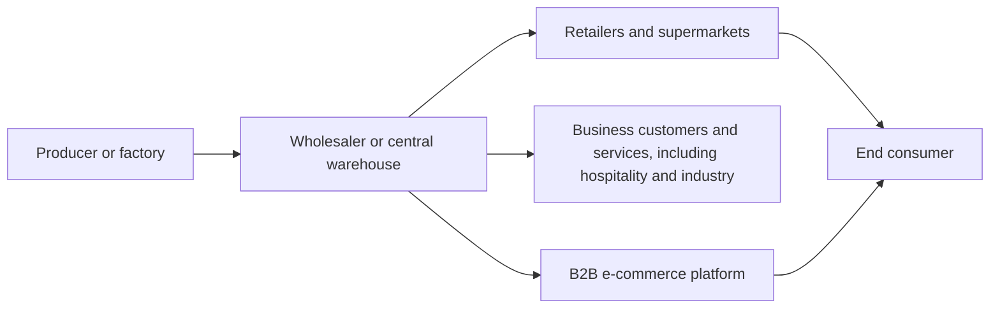

# Wholesale Trade - Sector Cyber Resilience & Credit Intelligence Research Q01-Q15 (merged)

## 1. Merge statement

**Purpose.** Consolidate the two supplied Markdown files. No web search or new research was performed, and no external facts, figures, sources, cases, dates or ratings were added.

**Input files, identified by actual contents.**

- **File A [S-014]: `deep-research-report (1).md`.** This is a general wholesale-trade market and operating-model report. It contains market indicators, subsectors, digitalisation, commercial regulation, workforce and skills, environmental, social and governance (ESG) themes, geopolitical and economic risks, investment and strategy material. It does **not** contain the detailed cyber Q01-Q09 report described in the task.
- **File B [S-015]: `deep-research-report (2).md`.** This is a short fraud, cyber exposure and classification summary. It contains a sector scope paragraph, four provisional exposure classifications, three main findings, a four-row classification table and five example sources. It does **not** contain the full Q10-Q15 research package, separate Q10A-Q10D analysis, or a complete source annex.

**Research dates and evidence cut-offs.** File A [S-014] does not state a research date or formal evidence cut-off. File B [S-015] states an evidence cut-off of **October 2026**, but does not separately state its research date. The source dates named across the files include 2020, 2023, 2024, June 2025 and September 2026. Since File A [S-014] has no stated cut-off, the earlier of the two file-level cut-offs cannot be calculated. **Merged evidence cut-off: not determinable from the supplied files.** Individual source dates and periods are retained where stated; no content is presented as more current than its own source permits.

**Scope adopted for merged conclusions.** The common scope is wholesale distribution of goods without transformation, excluding wholesale vehicle sales from merged conclusions while retaining automotive parts and accessories. Business-to-business (B2B) platforms and brokers are included where they support wholesale distribution. Geography is worldwide, with European Union (EU), United Kingdom (UK), United States (US) and Portugal-specific statements kept distinct. Vehicle wholesalers described in File B [S-015] are outside the narrower common scope and are not used to support merged conclusions. The files do not provide a consistent country-by-country cyber analysis.

**Method.** Source material has been translated into English, reorganised under Q01-Q15 and the requested registers, and cross-referenced. Duplicate descriptions have been consolidated only where they refer to the same underlying claim or case. Missing source details are labelled “Not supplied in source file”. Ratings remain exactly as proposed in File B [S-015]. Since the files do not contain all of the research described in the task, unsupported sections and registers are marked partial or missing rather than filled with assumed content.

## 2. Executive summary for Senior Credit Officers

The source material supports four **provisional inherent-exposure classifications**: Fraud - **Medium, Medium confidence**; Cyber / ICT - **High, High confidence**; Operational Resilience / Third-Party Risk Management (TPRM) - **High, Medium confidence**; Governance / Operating Model - **Medium, Medium confidence**. These are File B [S-015] ratings, not newly assessed ratings.

Five findings recur across the supplied material. First, wholesale distribution depends on inventory, enterprise resource planning (ERP), warehouse systems, e-commerce portals, email, payments and transport services. Second, food and pharmaceutical distributors have product-specific handling, licensing and continuity considerations, while machinery, construction materials, consumer goods and automotive-parts distributors face different demand and stock profiles. Third, File B [S-015] describes business email compromise (BEC), supplier impersonation, internal diversion and accounting manipulation as relevant fraud patterns, but it does not provide enough case-level evidence to estimate sector-wide frequency. Fourth, the named case examples include a €6.64 million counterfeit-mask fraud, a reported carrier-email incident associated with cargo theft, and a cyber incident affecting United Natural Foods, Inc. (UNFI); evidence quality and detail differ. Fifth, common cloud, ERP and logistics providers may create concentration pathways, but provider concentration is not quantified for wholesale trade in the files.

Three borrower discussion questions are supported by the sources: How are changes to supplier bank details and payment requests independently validated? How are essential ERP, inventory, order and warehouse processes restored if unavailable? How are logistics providers, agents and other outsourced parties overseen, including incident notification and continuity arrangements?

The files do **not** constitute a complete Q01-Q15 cyber research package. A complete deduplicated incident register, full attack-chain case studies, cyber-specific EU/UK/US regulatory analysis, quantified one-week/four-week/eight-week stress model, full Q11/Q12 benchmarks and a fully evidenced Q15 driver-to-register map are absent. These are recorded as gaps, not treated as zero exposure.

## 3. Question sections

## Q01 - Sector operating model and key dependencies

**Conclusion.** Wholesale trade intermediates between producers and business or retail customers. Continuity depends on purchasing, stock visibility, warehousing, order processing, payments, transport and supplier/customer data. File A [S-014] provides commercial operating-model detail, but not the full cyber dependency analysis requested in the original research specification.

### Definition, subsectors and boundaries

The sector includes businesses that buy and resell goods without transforming them, acting as intermediaries in distribution. File A [S-014] gives these product groups:

- **Food and beverages:** fresh and packaged food, beverages, alcoholic drinks and tobacco, supplying retailers, restaurants, supermarkets and hotels. File A [S-014] describes annual growth of approximately **2-3%** and margins of **2-5%**, with competition and perishability as stated drivers. Examples: Recheio and Metro/Makro.
- **Industrial products and machinery:** agricultural machinery, tools, bearings, industrial electronics and information technology (IT). The source describes exposure to industrial and construction cycles and margins of approximately **4-6%**. Electrical and telecommunications devices and automotive components are related subsegments; Sonepar and Samartex/Alfa are examples named in the source.
- **Chemicals and pharmaceuticals:** industrial chemicals, medicines and hygiene products. The source names Brenntag and Azelis in chemicals, describes margins of approximately **5-10%** and growth of approximately **1-3% per year**, and notes Registration, Evaluation, Authorisation and Restriction of Chemicals (REACH) and pharmaceutical import licences.
- **Construction materials and hobby products:** timber, iron, cement, paint, tools and gardening products. The source describes a cyclical segment sensitive to property and construction activity, with approximately **4%** margins.
- **Durable consumer goods and textiles:** clothing, footwear, household appliances and consumer electronics. The source describes a fragmented market, volume pressure and margins of approximately **3-5%**.
- **Automotive parts and accessories:** spare parts and accessories, excluding vehicle wholesalers. The source describes stable volume, margins of approximately **3%**, and sales focused on workshops and replacement parts.
- **Digital marketplaces, B2B platforms and agents:** File B [S-015] includes electronic markets and brokers in its initial definition; File A [S-014] describes B2B portals and marketplaces as channels. The narrower merged scope includes them only where they support wholesale distribution.

File B [S-015] additionally names wholesalers of durable goods such as vehicles. Wholesale vehicle sales are outside the narrower common scope used for merged conclusions; automotive parts remain in scope.

### Market size, growth and operating metrics stated in File A [S-014]

Values below are source claims. Methods, populations, sample sizes, exact publication dates and primary data locators are not consistently supplied. Estimates are not converted into confirmed sector totals.

| Indicator | Global estimate | EU-27 value stated in source | Portugal value stated in source | Evidence caveat |
|---|---:|---:|---:|---|
| Market size / turnover | **$15-20 trillion annually** in the table; the narrative also says several tens of trillions of dollars per year | Approximately **€6.5 trillion** | Approximately **€0.2 trillion, estimated** | Global and Portugal values are estimates; some global projections combine retail and wholesale. |
| Recent compound annual growth rate (CAGR), 2020-2023 | Approximately **5-8%** | Approximately **3-5%** | Approximately **4-6%** | Method and population not specified. |
| Value added | Not stated | Approximately **€778 billion** | Not stated | File A [S-014] attributes the EU figure to EuroCommerce and Eurostat/INE-based estimates. |
| Employment | Not stated | Approximately **9.7 million people** | Approximately **0.4 million for total trade**, not wholesale alone | Portugal figure is not wholesale-specific. |
| Small and medium-sized enterprises (SMEs) | Not stated | **99% of wholesale businesses** | **More than 95%, estimated** | Portugal method not supplied. |
| Average operating margin | Approximately **3-7%**, varying by subsector | Approximately **4% average** | Approximately **3-5%, estimated** | Not a cyber-loss measure. |
| Typical key performance indicators (KPIs) | Turnover per employee; inventory turnover **8-10 times**; days sales outstanding | Described as similar | Described as similar | Dataset and method not supplied. |
| Food and beverage wholesale growth | Not separately stated | Approximately **2-3%** | Not separately stated | Subsector estimate in File A [S-014]. |
| Chemicals and pharmaceuticals growth | Not separately stated | Approximately **1-3% per year** | Not separately stated | Subsector estimate in File A [S-014]. |
| Portugal wholesale growth in 2023 | Not stated | Not stated | Approximately **4.6% in 2023** | Attributed to INE in File A [S-014]; exact source publication not identified. |

File A [S-014] states that the EU has approximately **1.6 million wholesale enterprises**, **€6.5 trillion** in turnover for 2024, **€778 billion** in value added and **9.7 million employees**. Elsewhere it describes Germany as accounting for approximately **25%** of the EU market by volume and value, followed by France, Italy and Spain. The definitions, observation periods and measurement basis for the market-share statement are not specified.

The source's executive summary also says global wholesale trade moves “tens of trillions of euros” annually, while its market section and table express the global estimate in dollars. Those currency descriptions are both retained as source wording and are not reconciled. For Portugal, File A [S-014] says wholesale trade represents about half of total trade turnover in one passage and describes the wholesale sector as around half the size of retail in another; the exact denominator is unclear. It estimates combined wholesale-and-retail employment at around **15% of the labour force**, and says Portugal does not publish a separate public statistic for wholesale alone. It describes wholesale turnover as being in the tens of billions of euros, alongside the approximate **€0.2 trillion** estimate in the table. These claims are approximate and their bases are not consistent enough to combine.

File A [S-014] also cites a consultancy projection of approximately **8-9% CAGR through 2030** for the **combined retail and wholesale market**, and separately states an official-volume outlook of approximately **2-4% annually through 2025**. These are distinct source claims and are not directly comparable with the wholesale-only values above.

### Operating and revenue model

The typical product and order flow described by File A [S-014] is:

The source describes four common stages or channels:

1. **Producer to wholesaler:** industrial or agricultural suppliers sell in bulk. Distribution warehouses and cross-docking centres may receive large lots.
2. **Wholesaler to retail or industry:** goods are resold in smaller lots to retailers, industrial customers or hospitality businesses. Cash-and-carry operations may serve both business and retail customers.
3. **Alternative channels:** B2B portals allow corporate customers to order online. Some large platforms also serve end consumers, blurring traditional wholesale and retail channels.
4. **Logistics:** road and rail transporters and distribution centres move goods. Importers may act as border wholesalers. File A [S-014] states that Intrastat reporting applies to intra-EU trade.

The source names purchasing, stock management, order processing, distribution, delivery, credit and financing policies, and technology-enabled service differentiation as important operating functions. It also describes long payment terms as a cash-flow concern without giving a quantified sector distribution. Demand for wholesale services is linked to global trade growth, especially in Asia and North America. The source says components are less commonly purchased by manufacturers through wholesalers, because inputs are often sourced directly.

### Digital and physical dependencies

| Subsector or process | System or dependency named in the files | Potential business function affected | Source-supported disruption or concentration statement | Substitutability and switching time |
|---|---|---|---|---|
| Cross-sector core | ERP, customer relationship management (CRM), warehouse management system (WMS), business intelligence (BI), electronic data interchange (EDI), B2B portals, email, web and mobile ordering | Purchasing, finance, stock, order acceptance, invoicing and customer service | File A [S-014] describes increased digitalisation; File B [S-015] states that dependence on ERP, email, web, cloud and portals expands the attack surface. | Not supplied. |
| Warehousing and fulfilment | Central warehouses, distribution centres, cross-docking, warehouse automation and inventory systems | Receiving, storage, picking, dispatch and stock visibility | File A [S-014] describes these as typical; no cyber failure analysis is provided for each system. | Not supplied. |
| Food and beverage | Cold chain, environmental sensors and pallet trackers | Product condition, traceability and delivery | File A [S-014] identifies perishability and dedicated cold-chain requirements. | Not supplied. |
| Chemicals and pharmaceuticals | Chemical safety, pharmaceutical import licensing and product compliance | Safe storage, product handling and regulated distribution | File A [S-014] names REACH and pharmaceutical import licences; no related cyber incident is described. | Not supplied. |
| Logistics | Road and rail carriers, logistics partners and trade-visibility platforms | Goods movement, delivery confirmation and shipment visibility | File B [S-015] describes a reported email attack involving a carrier that resulted in cargo theft; File A [S-014] identifies reliance on carriers and distribution centres. | Not supplied. |
| Digital providers | Public cloud, ERP providers and logistics providers | Hosting, business applications and transport operations | File B [S-015] says common-provider concentration may create cascading effects; concentration in cloud services such as AWS/Azure is explicitly unquantified. | Not supplied. |
| Payments and supplier data | Email and payment exchanges; bank-detail validation | Accounts payable and supplier settlement | File B [S-015] identifies BEC and supplier impersonation as material fraud pathways. | Not supplied. |
| Power and telecommunications | Energy and connectivity are mentioned as general dependencies; no detailed dependency study is supplied | Warehouse operation, connectivity and hosted-service access | No wholesale-specific incident or dependency concentration data are supplied. | Not supplied. |

File A [S-014] also describes smart-supply-chain technologies: warehouse Internet of Things (IoT) sensors, pallet trackers, trade-visibility platforms, e-invoicing, automated VAT and Intrastat compliance, and movement from manual ordering, EDI and call centres to online and mobile interfaces. It states that demand forecasting can reduce stock-outs and that B2B portals allow business customers to order around the clock. These are stated operational benefits, not independently measured results in the files.

### Market participants and structure named in File A [S-014]

- **Global or integrated groups:** Walmart; Costco Wholesale; Schwarz Group, including the Lidl, Kaufland and Merkur banners named in the source; Walgreens Boots (with CVS named as a US example); Carrefour; SPAR; Tesco/Booker; Auchan; Metro AG/Makro; Sysco; McKesson; AmerisourceBergen; Alibaba Group; Rakuten; and Amazon Business.
- **Europe and specialist distribution:** Sonepar (electrical products), Brenntag and Azelis (chemicals), Tech Data/Ingram Micro (IT distribution), Makro and E.Leclerc. File A [S-014] characterises concentration as moderate in Europe, with large national operators in several markets, but provides no market-share table.
- **Portugal examples:** Recheio Cash & Carry, described in File A [S-014] as a foodservice leader; Makro; Bidfood/Aviludo; UDex; Gesfrescos; Sonepar; and Rexel. The source says the Portuguese market is fragmented and that its material contains no precise public market-share data.

File A [S-014] also names Amazon Business as a B2B platform and describes integrated supply chains and purchasing power among large groups. Some entities listed operate retail as well as wholesale businesses; the source does not provide a consistent legal-entity or revenue boundary for all examples.

### Other operating-model, workforce and strategy material from File A [S-014]

- **Workforce:** named profiles include drivers, warehouse and reception staff, B2B salespeople, and logistics and IT staff. Skills include inventory management, purchasing negotiation, English and Spanish, ERP, BI and e-commerce. The source describes digital-skill shortages, operational staff turnover and an ageing logistics workforce as challenges. It states gross monthly pay of approximately **€1,100-1,500** for unqualified workers, described as above the national average. It says future skills include data analysis, logistics cybersecurity for IoT, and global supply-chain management; some wholesalers outsource IT and use CEF training.
- **Digitalisation:** File A [S-014] says demand for B2B and B2C online purchasing is increasing; analytics and advanced technology, including artificial intelligence (AI) and big data, may improve service and inventory efficiency. It describes the movement from manual orders, EDI and call centres to web and mobile interfaces. A planning chart in the source gives this roadmap: assess digital needs in **November 2026**; define KPIs in the following month; implement ERP for sales over **December 2026-January 2027**; develop a B2B e-commerce portal over **February-March 2027**; train staff in **April 2027**; and optimise and analyse KPIs over **May-July 2027**. This is a roadmap illustration, not an observed implementation or measured result.
- **Competition:** no precise market-share figures are supplied. The source identifies delivery speed, cross-docking, credit / financing policies and technology-enabled monitoring as competitive levers.
- **Mergers and investment:** File A [S-014] describes moderate consolidation, local-company acquisitions and investment in logistics, supply-chain technology, B2B payment technology and automated logistics. It cites integration of Booker into Tesco and expansion by Schwarz as examples, and expects medium-sized Portuguese operators to combine or attract investment; no transaction dates or deal values are given. The source also mentions private capital in logistics and technology, fintechs for B2B payments, logistics-automation start-ups and financing for modern distribution centres.
- **Commercial strategy claims:** File A [S-014] recommends B2B online channels, marketplaces, direct online sales using hybrid B2B / business-to-consumer (B2C) channels, product-line diversification such as green or organic foods and premium technical construction products, cooperative purchasing, ERP/CRM/WMS integration, supplier EDI, app or web ordering, live KPIs, cross-docking, transport consortia or third-party logistics (3PL), just-in-time stock with minimum buffers, supplier diversification, alternative routes and emergency logistics partnerships for high-urgency hospital parts. It suggests exports to Spain, Angola, Mozambique and North Africa, trade-fair presence, cost-benefit analysis, lower-interest funding, accounts-receivable control, solar energy, electric fleets, ISO 14001 and reverse packaging logistics. The source says that sustainability certification may help in public tenders. It states that a digital roadmap could reduce operating costs by **10-20%** over the medium term, but gives no model or evidence of realised savings.
- **ESG:** environmental items include route optimisation, renewable energy in distribution centres, packaging waste management, recyclable packaging and pallet returns; social items include fair-trade supplier partnerships, raw-material supplier audits, diversity, warehouse safety training and personal protective equipment; governance items include anti-corruption compliance and tax transparency. File A [S-014] says larger businesses report carbon footprints, discusses carbon-emissions calculations, green fleets, greener cold chains and circular-economy practices, and states that relatively few wholesalers had begun electric or hybrid delivery-fleet projects. No dated or quantified adoption dataset is provided.
- **Economic risks and opportunities:** recession may reduce industrial demand; currency movements affect importers; interest-rate increases make inventory financing more expensive; Western European stagnation may pressure margins; Eastern Europe and Africa are described as expansion opportunities; ageing populations are described as supporting medical-goods demand, while saturation in categories such as smartphones and televisions may limit growth.
- **Sustainability and incentives:** File A [S-014] refers to the EU Green Deal, packaging rules, social due diligence, Portugal 2030 / Recovery and Resilience Plan incentives, European Investment Bank funding, and sustainability-linked customer preferences. These references are not a complete legal or funding eligibility analysis.

### Cross-sector concentration and dependencies

Potential propagation paths described in the supplied material include shared ERP or cloud services affecting multiple firms; a logistics-provider incident affecting deliveries; email compromise or supplier impersonation changing payment instructions; and disruption in a shared order, warehouse or inventory system affecting fulfilment and cash collection. Concentration is described qualitatively. Provider market shares, substitutability scores and switching-time estimates are not supplied.

**Cross-references:** Q02, Q03, Q04, Q05, Q06, Q07, Q10, Q11, Q12 and Q13; registers DEP-001 to DEP-008, THR-001 to THR-003 and CTL-001 to CTL-006.

## Q02 - Cyber incidents and case studies

**Conclusion.** The supplied files contain three described cases relevant to wholesale or related distribution activity, but not enough primary-source detail for five ranked incidents and three fully evidenced case studies. No incident is treated as representative of sector-wide frequency.

### Incident inventory from supplied material

| Incident ID | Organisation or victim description | Subsector / geography | Event and disclosure date | Incident class | What the files state | Attribution, impact and evidence limitations | Source IDs |
|---|---|---|---|---|---|---|---|
| INC-001 | Pharmaceutical company, not named | Pharmaceuticals; geography not stated | Fraud report dated 2020; exact event date not supplied | Fraud; cyber-enabled status not established | A criminal group reportedly defrauded **€6.64 million** by offering counterfeit masks. The source description says the report was confidential and secondary. | No victim name, exact timeline, payment rail, cyber access method, legal outcome or primary victim disclosure is supplied. Do not infer BEC or a network intrusion from the source description. | S-010 |
| INC-002 | Food distributor and transport carrier, not named | Food distribution; geography not stated | FreightWaves source dated September 2026; exact event date not supplied | Reported cyber-enabled fraud or theft; exact class unresolved | A FreightWaves panel description says an email attack against a carrier resulted in cargo theft. | The source is journalistic; no victim statement, police record, loss amount, initial access details or confirmed actor is supplied. The event cannot be assigned confidently to the last-30-days horizon from a month-only publication date. | S-011 |
| INC-003 | United Natural Foods, Inc. (UNFI) | Food wholesale; United States | Industrial Cyber article dated June 2025; event date not specified in the supplied file | Cyber intrusion / operational outage; exact mechanism not stated | The article states that UNFI reported operational impact after a cyberattack; the file says the impact was disclosed in a US Securities and Exchange Commission (SEC) filing. | Attack type, initial access, affected systems, recovery period, loss, regulatory consequences and attribution are not supplied. The article is secondary; the SEC filing is not identified by form or date. | S-012, S-013 |

### Aggregate BEC statistic, not an incident

The FBI Internet Crime Complaint Center (IC3) **Internet Crime Report 2023** is listed as reporting **21,489 business email compromise (BEC) complaints** and **adjusted losses above $2.9 billion** in the general dataset. These are aggregate figures, not Wholesale Trade-only statistics and not the loss from one incident. File B [S-015] labels confidence as high and the source as original. The figures belong in FIN and FRD as general-context evidence, not as a wholesale incident record. Source: S-008.

### Ranked shortlist and case studies

The supplied material does not contain a documented top-five incident ranking. The three cases above are an **unranked shortlist**, because their case-level detail and primary-source support are not comparable enough to justify ranking them. There are insufficient details for three full case studies with complete timelines, confirmed initial access, affected services, recovery constraints, financial outcomes and regulatory outcomes.

- **INC-001:** relevant to fraud in pharmaceutical supply and counterfeit goods; the source does not establish a cyber intrusion or a particular control failure.
- **INC-002:** relevant to trust in carrier communications and shipment release; the source does not identify the technical mechanism or quantify loss.
- **INC-003:** relevant to operational reliance on food-distribution systems; the supplied secondary report does not establish initial access, precise downtime or cost.

Historical landmark selection cannot be completed to the requested standard. INC-001 is associated with a 2020 report, INC-003 with a June 2025 article and INC-002 with a September 2026 source. Event dates are missing or imprecise, so publication date alone is not proof that an event occurred in a specific recent horizon.

**Cross-references:** Q03, Q05, Q10, Q11 and Q12; registers INC-001 to INC-003, FRD-002 and FIN-001 to FIN-003.

## Q03 - Threat scenarios, attack pathways and exploited weaknesses

**Conclusion.** The files point to BEC and supplier impersonation, compromise or disruption of digital business systems, and a carrier-related email attack associated with cargo theft. They do not provide complete observed attack chains, detailed tactics and techniques, or a reliable trend measure. The following scenarios are mapped from statements in the files and labelled according to evidence status.

| Threat ID | Scenario and mechanism | Source-supported pathway | Systems and processes named | Enabling weakness stated or implied | Evidence status, direction and confidence | Source IDs |
|---|---|---|---|---|---|---|
| THR-001 | BEC or supplier impersonation leading to payment diversion; **other: cyber-enabled fraud** | A deceptive email or supplier impersonation may influence payment or supplier-data exchange. File B [S-015] recommends email authentication and independent validation of bank details. | Email, supplier communications, payment processes and supplier bank details | Weak email authentication, insufficient independent verification of bank-detail changes, or inadequate segregation of payment duties are raised as concerns. The files do not document these weaknesses at a named victim. | Fraud pattern described as relevant; sector-wide frequency is not established. Trend direction not supplied. Confidence in a wholesale-specific rate is not assessable. | S-008, S-009, S-010, S-011 |
| THR-002 | Cyber compromise disrupting core digital operations; **targeted operational disruption or common digital dependency failure** | Compromise or outage affecting ERP, email, web portals, cloud-hosted applications or credentials could disrupt sales, orders, inventory, receivables or recovery work. | ERP, email, web, APIs, cloud, inventory and warehouse systems | File B [S-015] mentions credential compromise, ransomware, legacy systems and broad attack surface, but does not tie each weakness to a named incident. | UNFI is a named cyber incident with operational impact, but the attack mechanism is unknown in the supplied material. Trend direction is not established. | S-012, S-013 |
| THR-003 | Third-party logistics email compromise leading to cargo theft; **third- or fourth-party supply-chain concentration** | A reported email attack against a carrier preceded cargo theft. | Carrier email and freight / shipment process | Trust in third-party communications and shipment instructions is implicated by the account, but exact weakness and controls are not described. | Single journalistic account; no confirmed actor, exploit details or loss amount. Trend direction is not established. | S-011 |

### Control-weakness matrix

| Weakness or control area | Related scenario | File-supported evidence | Limitation | Source IDs |
|---|---|---|---|---|
| Email authentication and payment-message validation | THR-001 | Explicitly raised in File B [S-015] as a borrower-control question. | No control test, prevalence estimate or named failure is provided. | S-008, S-009, S-010 |
| Independent verification of supplier bank details | THR-001 | Explicitly raised in File B [S-015]. | No specific victim case or control outcome is supplied. | S-009, S-010 |
| Segregation of duties and financial control | THR-001; internal fraud | File B [S-015] refers to internal diversion, accounting manipulation and insufficient segregation of duties in fraud-case discussions. | No named organisation, audit finding or quantified prevalence is supplied. | S-009 |
| Protection of ERP, email, web portals and cloud applications | THR-002 | File B [S-015] identifies dependence on these technologies and mentions ransomware and credential compromise. | No technical timeline or confirmed exploited vulnerability for UNFI is supplied. | S-012, S-013 |
| Business continuity and recovery for essential systems | THR-002 | File B [S-015] asks whether borrowers have continuity plans for essential systems. | No recovery-time or recovery-point objective is supplied. | S-012 |
| Third-party oversight and carrier controls | THR-003 | File B [S-015] asks about oversight of carriers and agents; the cargo-theft example is described. | Incident detail and control failure are not confirmed. | S-011 |
| Cloud and provider concentration | THR-002; THR-003 | File B [S-015] names concentration in ERP, cloud services and transport providers as a possible systemic pathway. | Sector concentration is explicitly unquantified. | S-012, S-011 |

### Threat metrics and limitations

File B [S-015] describes a **64.3%** figure as the share of attacks targeting supply chains in the transport/logistics sector. No title, sample, observation period, denominator, method or source is provided in the attached file. It is retained as an untraceable cross-sector proxy, not a wholesale-trade incident rate. File B [S-015] also refers to a **53%** cyber-risk figure; File A [S-014] gives a separate wording for a 53% risk-perception figure. Their scope and statistic definitions are not sufficient to combine them into one benchmark. See FIN and the conflict register.

**Cross-references:** Q01, Q02, Q04, Q08, Q10, Q11, Q12 and Q13; registers THR-001 to THR-003 and CTL-001 to CTL-003.

## Q04 - Resilience capabilities and sector control benchmarks

**Conclusion.** The files mention relevant capabilities, but do not provide a sector control benchmark, maturity scale, mandated control baseline or quantified effectiveness assessment. The capabilities below consolidate controls and operational safeguards raised in the source files; they are not a maturity rating or external priority ranking.

| Control ID | Capability | Process protected | Related threat pathways | Status in source material | What failure may affect | Source IDs |
|---|---|---|---|---|---|---|
| CTL-001 | Email authentication and independent payment / bank-detail validation | Supplier communication and accounts payable | THR-001, FRD-001 | Borrower question stated in File B [S-015] | Payment diversion or supplier impersonation losses may affect profit, liquidity and working capital. | S-008, S-009, S-010 |
| CTL-002 | Business continuity for essential systems | Order processing, inventory, sales and service delivery | THR-002 | Borrower question stated in File B [S-015] | Unavailable systems may interrupt sales, delay receipts and require IT recovery expenditure. | S-012, S-013 |
| CTL-003 | Oversight of outsourced providers, carriers and agents | Transport, delivery and third-party service delivery | THR-003; dependency concentration | Borrower question stated in File B [S-015] | Provider failure or compromised communications may interrupt delivery or contribute to cargo theft. | S-011 |
| CTL-004 | ERP, CRM, WMS and inventory-process integration | Purchasing, stock, orders, fulfilment, sales and finance | THR-002 | Systems named in File A [S-014]; no cyber maturity assessment | Loss of access or integration may affect stock visibility, order handling and fulfilment. | S-001, S-002, S-003 |
| CTL-005 | Product-specific handling, traceability and compliance processes | Food cold chain, pharmaceutical distribution and chemical storage | Operational continuity and compliance; no detailed cyber scenario supplied | Context-dependent operational safeguard described in File A [S-014] | Product quality, safe handling, licensing or delivery may be affected if the relevant process is unavailable. | S-006, S-007 |
| CTL-006 | Digital skills and training | ERP, WMS, analytics, e-commerce and logistics technology | Cross-sector digital operations | File A [S-014] identifies skills needs and staff turnover as operating challenges; effectiveness is not quantified. | Manual workarounds, errors or slower adoption may affect execution; impact is not quantified. | S-001, S-004 |

The supplied files do not establish that the absence of a specific control caused INC-001, INC-002 or INC-003. No maturity levels, control coverage percentages, false-positive thresholds or response-time benchmarks are supplied. Legal obligations are addressed in Q06 and REG; general good practice is not treated as binding law.

**Cross-references:** Q01, Q02, Q03, Q06, Q08, Q11, Q12 and Q13; registers CTL-001 to CTL-006, THR-001 to THR-003 and REG-001 to REG-008.

## Q05 - Financial impact, disruption and credit transmission

**Conclusion.** Figures cover wholesale market economics and a small number of fraud or cyber-related observations. They do not establish a defensible wholesale-specific average breach cost, median breach cost, ransomware payment, recovery period or five-year cyber-loss trend. General fraud datasets and wholesale business metrics remain separate.

### Financial and operational figures supplied

| FIN ID | Metric | Value, currency and period | Population / dataset | Statistic type and method | Classification and caveat | Source IDs |
|---|---|---|---|---|---|---|
| FIN-001 | Counterfeit-mask fraud | **€6.64 million**; source report dated 2020 | Unnamed pharmaceutical company; case described as confidential | Case loss amount; method not supplied | Secondary report; not a sector average. | S-010 |
| FIN-002 | Median losses from occupational fraud in wholesale | **$361,000**; ACFE report dated 2024 | Investigated cases in the ACFE Occupational Fraud Report 2024; sample size not supplied | Median loss; case-study dataset | File B [S-015] labels confidence medium; not an incidence or probability estimate. | S-009 |
| FIN-003 | BEC complaints and adjusted losses | **21,489 complaints** and **more than $2.9 billion** in adjusted losses; report year 2023 | General FBI IC3 dataset, not wholesale-only | Count and aggregate adjusted loss; method not reproduced | File B [S-015] labels confidence high and source original; do not attribute these amounts to wholesale trade. | S-008 |
| FIN-004 | Share of attacks targeting supply chains in transport/logistics | **64.3%**; period not supplied | Cross-sector statement; denominator and sample not supplied | Share; method unknown | Proxy only; not a wholesale-trade rate. | File B [S-015] summary only; underlying source not identified |
| FIN-005 | Cyber-risk perception | **53%**; period and population not consistently defined | File A [S-014] attributes a 53% figure to a WTW risk survey; File B [S-015] says more than 50% classify cyber risk as high and also cites 53% | Survey share; exact question and population absent | Preserve File A [S-014] and File B [S-015] wordings separately; comparability unresolved. | S-005 |
| FIN-006 | EU wholesale turnover | Approximately **€6.5 trillion**, stated for 2024 in File A [S-014] | EU wholesale sector | Total turnover; method not supplied | Market context, not a cyber-loss measure. | S-001, S-002, S-003 |
| FIN-007 | EU wholesale value added and employment | Approximately **€778 billion** and **9.7 million people** | EU wholesale sector; period not consistently stated | Total value added and employment count | File A [S-014] also states 1.6 million enterprises. | S-001 |
| FIN-008 | Global market size | **$15-20 trillion annually**, table estimate | Global wholesale estimate; narrative also references combined retail and wholesale | Estimated market total | Definition and method not supplied; not combined with retail-plus-wholesale CAGR. | S-004 |
| FIN-009 | Operating margins | Global approximately **3-7%**; EU approximately **4%**; Portugal approximately **3-5%** | Sector estimates, with subsector variation | Margin estimate | Methods and populations not supplied. | S-001, S-002, S-003 |
| FIN-010 | Wholesale business growth | EU approximately **3-5%**; Portugal approximately **4-6%**; Portugal wholesale growth described as **4.6% in 2023** | Sector / national market statements | Growth rates; calculation basis not supplied | Periods and bases differ; do not combine. | S-001, S-002, S-003 |
| FIN-011 | Potential operating-cost reduction from digital roadmap | **10-20%** over the medium term | Recommendation for a medium-sized Portuguese wholesaler | Projection / claim, not disclosed realised outcome | Method, baseline and period definition absent. | File A [S-014] sector report |
| FIN-012 | Global retail-and-wholesale growth projection | Approximately **8-9% CAGR through 2030** | Combined retail and wholesale market | Consultancy projection | Not wholesale-only and not directly comparable with other market figures. | S-004 |
| FIN-013 | EU volume-growth outlook | Approximately **2-4% annually through 2025** | EU market outlook, attributed to Eurostat in File A [S-014] | Projection | Source title and method not supplied. | S-002 |

No ransom demanded, ransom paid, average or median cyber-breach cost, time-to-identification, time-to-containment, mean or median recovery time, incident frequency, remediation spend, cyber-specific revenue loss, EBITDA effect, credit-rating migration, covenant breach or debt-service effect is quantified for wholesale trade in the supplied files.

### Credit transmission pathways stated or supported by the files

- **Fraud loss:** payment diversion, supplier impersonation or counterfeit-goods fraud may reduce profit and liquidity, create detection and recovery costs, and reduce working capital. File B [S-015] states this but does not quantify a sector-wide effect.
- **Digital outage:** unavailable ERP or other core systems may interrupt sales, delay receipts and create IT recovery expenditure, affecting liquidity and cash generation.
- **Third-party disruption:** a logistics or technology-provider interruption may delay delivery and stock movement, increase working-capital needs and contribute to customer payment delays or defaults.
- **Operating-model pressure:** reported narrow margins in food, consumer goods and automotive parts may leave less room to absorb a shock, but the files do not measure the relationship between margin and cyber loss.
- **Commercial conditions:** File A [S-014] states that long payment terms affect cash flow and interest-rate increases make stock financing more expensive. These are business-model observations, not cyber-loss outcomes.

### One-week, four-week and eight-week scenarios

The task requests these duration bands, but neither file provides their assumptions, equations or borrower inputs. No loss estimates are created in this merge.

| Scenario ID | Duration | Source-derived scenario framing | Quantification status | Borrower-specific information not supplied |
|---|---|---|---|---|
| SCN-001 | One week | Temporary loss of ERP, inventory or order processes could interrupt sales and delivery; a payment-fraud event could reduce working capital. | Illustrative pathway only; no loss estimate. | Revenue by day, gross margin, backlog, inventory buffers, manual workarounds, recovery time, insurance and contractual protection. |
| SCN-002 | Four weeks | Sustained system or logistics-provider disruption could affect fulfilment, receipts and cash conversion; the source does not quantify the step-change at four weeks. | Scenario assumption only; no loss estimate. | SCN-001 data plus supplier substitution, customer concentration, extra logistics cost, liquidity and covenant headroom. |
| SCN-003 | Eight weeks | Prolonged disruption could require extended recovery effort and additional working capital; this is not a forecast or historical average. | Scenario assumption only; no loss estimate. | SCN-002 data plus recovery funding, debt service, insurance exclusions, alternative operations and supplier switching time. |

These are structured statements of the requested duration bands using source-supported pathways. They are not evidence that an event lasted one, four or eight weeks and do not supply historical averages or loss forecasts. **Double-counting check:** the €6.64 million counterfeit-mask loss is recorded once as a case loss, the $361,000 ACFE figure remains a median across an investigated-case dataset, and the FBI IC3 total remains a general complaint-dataset aggregate. No such figure is assigned to SCN-001 to SCN-003; no fraud amount is added to a separate cyber-disruption estimate.

**Cross-references:** Q02, Q03, Q08, Q10, Q11, Q12 and Q15; registers FIN-001 to FIN-013 and SCN-001 to SCN-003.

## Q06 - Regulation and resilience expectations

**Conclusion.** File A [S-014] contains commercial, tax, import, product-safety, accounting and sustainability references, but not the requested cyber and operational-resilience law comparison for the EU, UK and US. The legal status and precise applicability of several statements cannot be confirmed from the supplied text.

| REG ID | Instrument, requirement or framework named | Jurisdiction / area | Status as described | Date type and date stated | Source-supported detail and limitation | Source IDs |
|---|---|---|---|---|---|---|
| REG-001 | Regulation (EU) 2019/2152 | EU; intra-EU goods-trade statistics | Regulation identified as the basis for Intrastat statistics | Instrument year 2019; publication, entry-into-force and application dates not set out | File A [S-014] says businesses above an approximate **€500,000 per year** threshold must file Intrastat declarations with the Tax and Customs Authority and INE. It also says intra-EU transfers are zero-rated for the recipient but still require statistical reporting. Exact threshold applicability and national treatment are not established beyond the statement in File A [S-014]. | S-006, S-003 |
| REG-002 | Value-added tax (VAT) invoicing and periodic reporting | Portugal / general tax operations | Described as an existing tax requirement; exact instrument not cited | Not supplied | Normal VAT treatment, certified invoicing software and periodic reporting are described. Fuel wholesalers may have special margin treatment or other rules. | Source file only; primary instrument not supplied |
| REG-003 | Customs duties, import VAT, TARIC codes and product-specific import licences | EU / Portugal | Described as requirements for imports, exports and controlled products | Not supplied | File A [S-014] says imports from outside the EU may incur customs duties and import VAT on entry, unless a suspensive arrangement such as a customs warehouse applies. It mentions TARIC codes, and products subject to licensing such as weapons, hazardous chemicals and food products. Detailed instruments are absent. | Source file only; primary instruments not supplied |
| REG-004 | REACH | EU; chemicals | Named as a regulatory requirement | Identifier and dates not supplied | File A [S-014] links chemical distribution to REACH and chemical safety. Detailed obligation mapping is absent. | Source file only; primary instrument not supplied |
| REG-005 | Food hygiene, traceability and food hazard analysis and control process (HACCP) | Product handling; Portugal reference | Named as a safeguard / requirement | Dates and instrument identifiers absent | File A [S-014] refers to establishment licensing, hygiene, food safety and HACCP for food storage. Exact instruments and applicability are not listed. | S-007 and source file only |
| REG-006 | Establishment or warehouse authorisation for food and pharmaceutical wholesale | Portugal | File A [S-014] associates authorisation with ASAE / Infarmed, depending on activity | Not supplied | A government service is mentioned for food establishments; a complete licensing checklist is absent. | S-007 |
| REG-007 | Electronic invoicing | Several countries / B2B contexts | Described as mandatory in many countries, with requirements converging in the EU; national status not specified | Not supplied | Country-specific law, entity scope and implementation dates absent. Not treated as a single EU-wide obligation for every wholesaler. | Source file only; primary instruments not supplied |
| REG-008 | Portuguese Accounting Standard System (SNC) or International Financial Reporting Standards (IFRS) for listed companies | Portugal / listed entities | Accounting frameworks identified; applicability not fully mapped | Not supplied | Accounting context, not a cyber-resilience obligation. | Source file only; instruments not supplied |
| REG-009 | European packaging requirements and packaging-return schemes | EU | Described as a directive-based obligation | Directive identifier, legal status details and dates not supplied | File A [S-014] says wholesalers must communicate packaging-return schemes; exact instrument is not identified. | Source file only; primary instrument not supplied |
| REG-010 | EU Green Deal, sustainability reporting, carbon accounting and social due diligence | EU / larger business context | Broad regulatory pressure and targets; specific instruments not identified | Not supplied | File A [S-014] discusses decarbonisation, traceability and ESG reporting in general terms; entity-level obligations cannot be established. | Source file only; primary instruments not supplied |
| REG-011 | ISO 14001 | Environmental management | Named as a certification example | Edition and date not supplied | Presented as an optional sustainability practice, not a cyber obligation. | Source file only; standard reference not supplied |
| REG-012 | Labour and transport rules | Portugal / relevant operations | General requirements described | Not supplied | File A [S-014] refers to shifts and transport, without specific instruments. | Source file only; primary instruments not supplied |
| REG-013 | Portugal 2030 / Recovery and Resilience Plan funding | Portugal; digitalisation investment | Possible incentives, not legal cyber obligations | Not supplied | File A [S-014] says incentives may support digitalisation; programme criteria and amounts are absent. | Source file only; programme documents not supplied |

The files do not provide a full analysis of cybersecurity law, incident-reporting deadlines, competent cyber authorities, supervisory enforcement or binding cyber-resilience requirements for wholesale trade across the EU, UK and US. They do not establish applicability of a particular cyber framework to an individual wholesaler. These gaps are not filled with outside knowledge.

**Cross-references:** Q01, Q04, Q05, Q08, Q12, Q13 and Q15; register REG-001 to REG-013.

## Q07 - Geopolitical cyber threats and systemic exposure

**Conclusion.** File A [S-014] identifies conflict, trade tensions, energy and raw-material price pressure, and dependence on single-country suppliers as commercial risks. File B [S-015] identifies shared technology and logistics providers as possible cyber-propagation paths. Neither file documents a specific state-sponsored campaign against wholesale trade or supplies an attribution analysis.

| GEO ID | Driver or activity | Observed or speculative in the supplied files | Exposed subsectors / regions mentioned | Mechanism stated in the files | Early-warning indicators supplied | Source IDs |
|---|---|---|---|---|---|---|
| GEO-001 | War in Ukraine and wider international conflict | General geopolitical context, not a documented cyber campaign against wholesalers | Global supply chains; EU and suppliers exposed to energy or commodity effects | Conflict may raise energy and raw-material prices and reinforce the need to diversify suppliers. | None specified. | S-005 and File A [S-014] |
| GEO-002 | Trade tensions, tariffs and barriers | General business-risk statement | Agricultural and automotive supply chains | Price changes and trade barriers may force portfolio adaptation and supplier diversification. | None specified. | File A [S-014] |
| GEO-003 | Reliance on one country for components or materials | Structural risk statement | Semiconductors and metals are examples | Concentrated sourcing may expose product availability to country-specific disruption. No cyber operation is attributed. | None specified. | File A [S-014] |
| GEO-004 | Concentration in cloud, ERP and global transport providers | Analytical judgement from File B [S-015] | Wholesale businesses using common providers; regions not quantified | A provider incident may propagate to multiple organisations or interrupt operations. | No formal indicators supplied. | S-011, S-012 |
| GEO-005 | Cyber risk in supply chains and logistics | Proxy / general trend statement | Transport and logistics, with potential relevance to wholesale distribution | File B [S-015] cites a **64.3%** figure for attacks targeting supply chains in transport/logistics, but the source and method are missing. | None specified. | File B [S-015] summary only |

File A [S-014] also names inflation, currency fluctuations, rising interest rates, demand cycles, supply dependence for semiconductors or metals, commercial barriers, and possible expansion into Eastern Europe and Africa. These are business and supply-chain observations, not evidence of a cyber campaign. It describes supplier diversification and nearshoring as strategic responses, but the source provides no quantified effect.

No campaign is linked in the files to a state actor, hacktivist group, sanctions-related operation or specific geopolitical event. No campaign attribution source, confidence rating, country-targeting list or operational indicator set is supplied.

**Cross-references:** Q01, Q02, Q03, Q05, Q12 and Q14; registers GEO-001 to GEO-005 and DEP-001 to DEP-008.

## Q08 - Questionnaire-to-sector mapping and credit officer engagement

**Conclusion.** No borrower questionnaire is attached. The items below are therefore **Provisional**, with new identifiers `PROV-001` to `PROV-003`. They are limited to questions explicitly supported by File B [S-015]. They are not an audit, borrower score or automatic credit judgement. The files support three concise items, not the requested eight to twelve complete mappings.

| QMP ID | Control area | Potential weakness indicated by an adverse answer | Related scenarios, incidents and dependencies | Relevant regulatory expectation in supplied files | Potential operational / credit consequence | Non-technical follow-up questions | Practical improvement / specialist review indicator | Source IDs |
|---|---|---|---|---|---|---|---|---|
| PROV-001 | Supplier communication and payment validation | Supplier bank-detail changes or payment requests may not be independently authenticated and checked. | THR-001; INC-001 as a fraud-context case without assuming cyber access; FRD-001; supplier and email dependencies. | No cyber-specific regulation is identified. General invoicing and tax requirements in REG-002 and REG-007 are not a substitute for payment controls. | Payment diversion or counterfeit-supplier loss may reduce profit, liquidity and working capital. | How are supplier bank-detail changes checked? Are payment requests confirmed through a separate trusted channel? Are payment creation and approval separated? | Specialist review may be warranted where bank-detail changes are approved solely from email or duties are not separated. | S-008, S-009, S-010 |
| PROV-002 | Continuity of essential digital systems | ERP, inventory, order or other essential systems may not have a workable continuity and recovery arrangement. | THR-002; INC-003; ERP, cloud, inventory and warehouse dependencies. | The supplied files do not specify a cyber law or required recovery time for a borrower. | Sales, deliveries and receipts may be interrupted; IT recovery expenditure may affect cash generation and liquidity. | Which systems must be restored first to accept orders and ship goods? What manual workaround is available? When was recovery last tested? | Specialist review may be warranted where plans do not cover core order/inventory processes or recovery has not been demonstrated. | S-012, S-013 |
| PROV-003 | Oversight of carriers, agents and service providers | Third-party communications, access or continuity may not be adequately supervised. | THR-003; INC-002; transport, logistics and shared technology dependencies. | No wholesale-specific third-party cyber requirement is established by the source files. | Delivery interruption, cargo theft or supply-chain delay may increase working-capital needs and affect collections. | Which third parties can change shipment instructions or access systems? How are incidents and service outages notified? What alternative carrier or service can be used? | Specialist review may be warranted where key providers lack incident-notification routes or no alternative operating arrangement is known. | S-011, S-012 |

A complete eight-to-twelve-item map linking each item to detailed THR, CTL, INC, DEP, FRD and REG records cannot be completed from these files. The three items do not imply that other controls are absent.

**Cross-references:** Q01, Q02, Q03, Q04, Q05, Q06, Q10, Q11, Q12 and Q13; register QMP-001 to QMP-003.

## Q09 - Assembly: report and 12-slide narrative

**Conclusion.** The source files do not include a complete Q01-Q09 cyber report to assemble. The outline and slide narrative below consolidate only supplied material. Unsupported evidence fields are marked as unavailable. The four ratings come from File B [S-015] and are reproduced without alteration.

### 9.1 Report outline

1. **Executive Sector Assessment.** Wholesale trade depends on digital order, inventory, payment and logistics processes. File B [S-015] classifies Fraud as Medium / Medium confidence, Cyber / ICT as High / High confidence, Operational Resilience / TPRM as High / Medium confidence, and Governance / Operating Model as Medium / Medium confidence. [S-008, S-009, S-010, S-011, S-012]
2. **Sector Operating Model & Dependencies.** The sector purchases and resells goods without transformation across food, industrial machinery, chemicals and pharmaceuticals, construction products, consumer goods and automotive parts. ERP, WMS, e-commerce, email, payment and logistics processes support operations. Substitutability and switching times are not supplied. [S-001, S-002, S-003, S-004]
3. **Cyber Threat Landscape & Attack Scenarios.** The supplied material identifies BEC and supplier impersonation, digital-system disruption, and a carrier email attack associated with cargo theft. Full attack chains and sector-wide trend direction are not evidenced. [S-008, S-009, S-010, S-011, S-012]
4. **Geopolitical Cyber Exposure.** The files discuss conflict, trade tension, single-country supply dependence and shared-provider concentration, but do not link these to a confirmed state-sponsored wholesale campaign. [S-005, S-011, S-012]
5. **Major Cyber Incidents & Case Studies.** Three case candidates are recorded: a 2020 counterfeit-mask fraud, a carrier-email / cargo-theft report dated September 2026, and the UNFI cyber incident described in a June 2025 article. Their evidence standards differ and none can be ranked robustly. [S-010, S-011, S-012, S-013]
6. **Control Weaknesses & Resilience Priorities.** The explicitly raised controls are email authentication and payment validation, continuity for essential systems, and oversight of logistics providers and agents. No sector maturity benchmark is supplied. [S-008, S-009, S-010, S-011, S-012]
7. **Regulatory & Supervisory Resilience Expectations.** Commercial tax, trade, product and sustainability references are listed in Q06. Cyber-specific EU/UK/US obligations and reporting deadlines are not covered in the source files. [S-003, S-006, S-007]
8. **Operational & Financial Consequences and Credit Transmission.** Fraud losses and general BEC statistics are available, but no sector-specific cyber-cost, recovery-time or credit-rating impacts are supplied. [S-008, S-009, S-010]
9. **Questionnaire Mapping & Credit Officer Engagement.** Three Provisional questions cover supplier payment validation, continuity of essential systems and third-party oversight. [S-008, S-009, S-010, S-011, S-012]
10. **Methodology, Confidence & Limitations.** The files provide uneven source detail, with secondary summaries and untraceable cross-sector statistics. No additional research has been performed. [S-001 to S-013]
11. **References.** See the unified source register. The source files do not provide URLs for every item.

### 9.2 Twelve-slide narrative

#### Slide 01 - Sector Intelligence Cover

- **Sector:** Wholesale Trade, using the narrower merged scope described in the merge statement.
- **Reporting period:** Not stated consistently in the source files.
- **Geography:** Worldwide, with EU, UK, US and Portugal-specific statements kept separate.
- **Evidence cut-off:** Not determinable from both files; File B [S-015] states October 2026.
- **Classification:** Internal research merge; classification marking not supplied.
- **Version:** Merged edition, 28 October 2026.
- **Suggested visual:** Cover with geography, evidence-cut-off caveat and scope boundary.

#### Slide 02 - Executive Sector Risk Snapshot

- **Headline:** File B [S-015] rates Cyber / ICT and Operational Resilience / TPRM as High inherent exposure, with different confidence levels.
- **Evidence:** Fraud - Medium, Provisional, Medium confidence; Cyber / ICT - High, Provisional, High confidence; Operational Resilience / TPRM - High, Provisional, Medium confidence; Governance / Operating Model - Medium, Provisional, Medium confidence. These are source ratings, not new assessments.
- **Rating justifications:** Fraud - payment intensity, many suppliers and high-value inventory; Cyber / ICT - reliance on ERP, email, web, cloud and portals; Operational Resilience / TPRM - global supply chains and concentration in transport / IT providers; Governance / Operating Model - branches, outsourcing and decentralised financial controls.
- **Significance:** The source rationale centres on digital dependence, payment intensity, third-party concentration and decentralised operations.
- **Credit Lens:** Ask about payment validation, restoration of essential systems and third-party oversight.
- **Limitation:** Rating drivers are not fully traceable to a complete incident, dependency or control register in the files.
- **Source strip:** S-008 to S-012; sources dated 2020, 2023, 2024, June 2025 and September 2026 where specified.
- **Suggested visual:** Four-row rating matrix with status and confidence.

#### Slide 03 - Sector Anatomy: Key Operations & Dependencies

- **Headline:** Wholesale distribution relies on linked purchasing, stock, order, warehouse, payment and logistics processes.
- **Evidence:** File A [S-014] names ERP, CRM, WMS, EDI, B2B portals, cross-docking, distribution centres, carriers and digital inventory tools; File B [S-015] names cloud, email, web, APIs and third-party logistics dependencies.
- **Significance:** Disruption in a shared business process or provider may affect order fulfilment, stock visibility, delivery and cash collection.
- **Credit Lens:** Establish which systems and providers support the borrower’s order-to-cash process and whether alternatives exist.
- **Limitation:** Switching times and supplier concentration are not quantified.
- **Source strip:** S-001 to S-004, S-011, S-012.
- **Suggested visual:** Subsector dependency map.

#### Slide 04 - Cyber Threat Landscape & Attack Scenarios

- **Headline:** The supplied examples point to payment deception, disruption of digital operations and third-party logistics compromise.
- **Evidence:** File B [S-015] describes BEC and supplier impersonation; it also references ransomware and credential compromise. The carrier email / cargo-theft report is dated September 2026, but the exact event date and technical details are absent.
- **Significance:** These pathways can affect payments, orders, stock and delivery through different mechanisms.
- **Credit Lens:** Ask how supplier-payment changes are confirmed, how core systems are restored and how carrier instructions are authenticated.
- **Limitation:** No detailed technical attack chain or trend series is supplied.
- **Source strip:** S-008 to S-012.
- **Suggested visual:** Three-lane scenario flow: payment deception, system disruption and third-party logistics.

#### Slide 05 - Geopolitical Cyber Threat Outlook

- **Headline:** The material identifies geopolitical supply-chain exposure but does not establish a state-linked cyber campaign against wholesale trade.
- **Evidence:** File A [S-014] names the war in Ukraine, trade tensions, tariffs and reliance on single-country sources for semiconductors or metals; File B [S-015] discusses shared-provider concentration.
- **Significance:** Supply constraints and provider outages may affect availability and cost, but the supplied evidence does not quantify cyber propagation.
- **Credit Lens:** Identify concentrated sourcing and the operational alternatives available to the borrower.
- **Limitation:** No attributed campaign register or early-warning indicator set is provided.
- **Source strip:** S-005, S-011, S-012.
- **Suggested visual:** Driver-to-dependency diagram.

#### Slide 06 - Major Cyber Incidents & Lessons Learned

- **Headline:** Three case candidates are present, but source quality is insufficient for a defensible top-five ranking.
- **Evidence:** A counterfeit-mask fraud with a stated €6.64 million loss; a carrier-email report associated with cargo theft; and a UNFI cyber incident with operational impact. Dates, attribution and disclosed outcomes are incomplete.
- **Significance:** The cases point to fraud, logistics and operational continuity questions, but do not establish sector-wide frequency.
- **Credit Lens:** Discuss whether comparable processes at a borrower could interrupt payments, shipments or essential services.
- **Limitation:** INC-001 is based on a secondary confidential-case description; INC-002 is journalistic; the supplied UNFI detail is secondary and incomplete.
- **Source strip:** S-010 (2020), S-011 (September 2026), S-012 (June 2025), S-013.
- **Suggested visual:** Three-case timeline with evidence-quality labels.

#### Slide 07 - Control Weaknesses & Resilience Priorities

- **Headline:** The clearest control questions concern payment validation, system continuity and third-party oversight.
- **Evidence:** File B [S-015] raises email authentication, independent bank-detail validation, continuity plans for essential systems and supervision of carriers and agents.
- **Significance:** Each area maps to a source-described pathway involving payment loss, operational interruption or cargo theft.
- **Credit Lens:** Request a plain-language description of control operation and recovery testing rather than a general statement that controls exist.
- **Limitation:** No control maturity study, effectiveness statistic or causal finding is supplied.
- **Source strip:** S-008 to S-012.
- **Suggested visual:** Control-to-scenario matrix.

#### Slide 08 - Regulatory & Supervisory Resilience Expectations

- **Headline:** The supplied material discusses commercial compliance but does not provide a cyber-resilience obligation map for the EU, UK and US.
- **Evidence:** References include Regulation (EU) 2019/2152 for trade statistics, VAT, customs, REACH, food requirements, e-invoicing and sustainability themes.
- **Significance:** These subjects may affect wholesaler operations, but they cannot substitute for an entity-specific cyber-regulatory analysis.
- **Credit Lens:** Identify the borrower’s actual product, import, tax and licensing obligations separately from cyber controls.
- **Limitation:** Exact legal identifiers, entity scope, cyber incident deadlines and supervisory enforcement details are missing for most references.
- **Source strip:** S-003, S-006, S-007.
- **Suggested visual:** Instrument coverage table with “details not supplied” fields.

#### Slide 09 - Financial Impact of Cyber Incidents

- **Headline:** Available loss figures belong to distinct datasets and must not be combined into a wholesale-sector cyber-loss estimate.
- **Evidence:** €6.64 million is given for a counterfeit-mask fraud case; ACFE reports a $361,000 median occupational-fraud loss in wholesale cases; FBI IC3 reports 21,489 BEC complaints and over $2.9 billion in adjusted losses in a general dataset. A 64.3% transport/logistics figure lacks a traceable source in File B [S-015].
- **Significance:** Case losses, case-study medians and broad complaint totals answer different questions and have different populations.
- **Credit Lens:** Obtain borrower-specific loss, downtime, recovery and liquidity data before assessing materiality.
- **Limitation:** No wholesale-specific cyber incident cost or recovery-time benchmark is supplied.
- **Source strip:** S-008, S-009, S-010; dataset types remain separate.
- **Suggested visual:** Metrics table split by dataset and statistic type.

#### Slide 10 - Cyber-to-Credit Risk Transmission & Stress Scenarios

- **Label:** **Illustrative - not a forecast or loss estimate**
- **Headline:** System or provider disruption could affect fulfilment, cash collection and working-capital needs, but the files do not quantify a stress loss.
- **Evidence:** The source material describes sales interruptions, delayed receipts, IT recovery expenditure, logistics disruption and fraud losses. It does not provide one-week, four-week or eight-week loss calculations.
- **Significance:** Duration and ability to switch systems or providers are borrower-specific determinants of exposure.
- **Credit Lens:** Ask for daily sales and margin, inventory buffers, recovery assumptions, liquidity, covenant headroom, insurance and contractual protection.
- **Limitation:** The three duration bands are task-required scenario frames only; no forecast, historical average or loss estimate is inferred.
- **Source strip:** S-008 to S-012.
- **Suggested visual:** Scenario flow for one, four and eight weeks, with quantification explicitly blank.

#### Slide 11 - Questionnaire-to-Sector Intelligence Mapping

- **Label:** **Provisional**
- **Headline:** Three provisional borrower prompts are supported by the supplied files; a complete eight-to-twelve-item map is not.
- **Evidence:** PROV-001 payment validation; PROV-002 continuity of essential digital systems; PROV-003 oversight of carriers, agents and service providers.
- **Significance:** The prompts connect sector dependencies to potential operational and liquidity consequences.
- **Credit Lens:** Explore how the controls work in practice and how the borrower would continue operations during disruption.
- **Limitation:** No borrower questionnaire or complete Q03/Q04 control mapping is supplied.
- **Source strip:** S-008 to S-012.
- **Suggested visual:** Provisional question-to-scenario map.

#### Slide 12 - Credit Officer Engagement: Key Questions & Actions

- **Headline:** Credit discussions should focus on payment authenticity, restoration of essential processes and third-party continuity.
- **Evidence:** File B [S-015] names these three topics as the bank’s main questions; File A [S-014] describes narrow margins in several subsectors, digitalised ordering and logistics dependence.
- **Significance:** The questions connect operational processes with liquidity, delivery and cash-generation pathways described by the source material.
- **Credit Lens:** Ask how payment changes are confirmed, what operations can continue during a system outage, and what alternatives exist if a key provider is unavailable.
- **Limitation:** No borrower-specific answers, financial stress data or control test results are supplied.
- **Source strip:** S-001, S-008 to S-012.
- **Suggested visual:** Three-question discussion guide linked to payment, systems and logistics.

### 9.3 Evidence annex outline

- **A1 Incident Register:** INC-001 to INC-003, with evidence limitations retained.
- **A2 Detailed Case Studies:** case candidates for INC-001 to INC-003; full timelines and technical detail are unavailable.
- **A3 Sector Fraud, Cyber & Resilience Metrics:** FIN-001 to FIN-013, with datasets kept separate.
- **A4 Regulatory Requirements by Jurisdiction:** REG-001 to REG-013; cyber-specific EU/UK/US analysis is missing.
- **A5 Exposure Rating Methodology & Justification:** RAT-001 to RAT-004, exactly as stated in File B [S-015]; complete driver evidence is unavailable.
- **A6 Questionnaire-Control-to-Threat Mapping:** QMP-001 to QMP-003, Provisional.
- **A7 Confidence, Assumptions, Sources & Methodology:** unified source register, conflict register and limitations.

### 9.4 Analyst validation required

1. Obtain the intended full Q01-Q09 cyber report and the full Q10-Q15 research file, because the supplied files do not match the described content split.
2. Obtain exact source URLs, titles, publication dates, locators and primary-source records for material claims currently identified only by organisation or report name.
3. Clarify the source, population, observation period and method for the 64.3% transport/logistics figure and both 53% cyber-risk statements.
4. Obtain the primary case records for the counterfeit-mask fraud, carrier email / cargo-theft report and UNFI cyber incident.
5. Obtain the actual questionnaire if an eight-to-twelve-item QMP is required; do not infer borrower responses.
6. Obtain the exact legal and supervisory instruments needed for cyber-specific EU, UK and US obligations.
7. Confirm the date of research and formal evidence cut-off for File A [S-014] and File B [S-015].

**Cross-references:** Q01-Q15; all unified registers.

## Q10 - Fraud

**Conclusion.** File B [S-015] describes BEC, supplier impersonation, internal diversion and accounting manipulation as relevant fraud types. It provides a counterfeit-mask case, an occupational-fraud median for wholesale cases and general FBI BEC complaint data. It does not establish sector-wide frequency or provide a complete case-level dataset.

### Fraud typologies and case evidence

| Fraud ID | Typology | Classification | Perpetrator / channel / payment rail | Loss, currency and statistic type | Detection / control weakness / enforcement outcome | Linked incident | Source IDs |
|---|---|---|---|---|---|---|---|
| FRD-001 | BEC and supplier impersonation | Cyber-enabled fraud | Perpetrator type in general reports; email channel; payment rail not stated | General FBI IC3 dataset: **21,489 complaints**, adjusted losses **above $2.9 billion**, 2023; count and aggregate loss | File B [S-015] raises email authentication and bank-detail validation. Detection and enforcement outcomes not stated. | No single incident linked; aggregate dataset only | S-008 |
| FRD-002 | Counterfeit masks / false offer in pharmaceutical supply | Fraud; cyber-enabled or hybrid mechanism not established | Criminal group described in secondary account; channel and payment rail not stated | **€6.64 million** case loss; source report dated 2020 | Confidential secondary case description; detection and enforcement outcome not supplied. | INC-001 | S-010 |
| FRD-003 | Email attack involving a transport carrier followed by cargo theft | Reported cyber-enabled or hybrid fraud/theft; exact classification unresolved | Actor and payment rail not stated; carrier email channel reported | Loss amount and currency not stated | Exact access mechanism, detection, control weakness and enforcement outcome not supplied. | INC-002 | S-011 |
| FRD-004 | Occupational fraud in wholesale | Occupational-fraud dataset, not a single incident | Perpetrator type and channel vary within the report; no case details in the attached file | **$361,000 median loss**, ACFE 2024; case-study dataset | File B [S-015] says the figure comes from investigated cases; sample size and detailed method are absent. | No single incident linked | S-009 |
| FRD-005 | Internal diversion and accounting manipulation | Internal fraud / financial misconduct; cyber status not stated | Internal perpetrator implied by typology; channel and payment rail not stated | No separate value stated | File B [S-015] mentions these patterns and possible lack of segregation of duties; no named case or enforcement outcome supplied. | No incident ID supplied | S-009 and File B [S-015] summary |

File B [S-015] also identifies high payment volume, numerous suppliers and third parties, commission incentives and high-value inventory as structural fraud factors. It says sector-specific official statistics are scarce and subsidy abuse is not mapped. These are File B [S-015] assessments, not independent findings from this merge.

### Q10A-Q10D

Neither attached file contains separate Q10A, Q10B, Q10C or Q10D headings or underlying research. The absence is recorded rather than creating new sub-question content:

- **Q10A:** Not supplied as a separate section.
- **Q10B:** Not supplied as a separate section.
- **Q10C:** Not supplied as a separate section.
- **Q10D:** Not supplied as a separate section.

**Cross-references:** Q02, Q03, Q05, Q08, Q11, Q13 and Q15; registers FRD-001 to FRD-005, INC-001 to INC-002 and FIN-001 to FIN-005.

## Q11 - Cyber / ICT exposure

**Conclusion.** File B [S-015] rates Cyber / ICT exposure as High with High confidence. Stated structural drivers are dependence on ERP, email, web, public cloud, portals and legacy systems, plus a broad digital attack surface. The files do not provide a full exposure measurement framework, sector incident rate or maturity dataset.

### Source-derived exposure factors

- File B [S-015] states that digital dependence includes ERP, portals, cloud, email, web and APIs, and that credential compromise and ransomware can affect wholesale operations.
- File B [S-015] cites the UNFI incident as an example of a food wholesaler reporting operational impact after a cyberattack, but the supplied secondary description does not state the mechanism.
- File B [S-015] cites a **64.3%** attack share for supply-chain targets in the transport/logistics sector. The underlying dataset, sample, observation period and source are absent; the figure is not accepted as a Wholesale Trade statistic.
- File A [S-014] states that **53%** of companies consider digital attack risk high and also says cyber risk is a concern for more than half of firms. File B [S-015] gives a related 53% statement but describes the source differently. The two descriptions remain an unresolved metric-definition issue.
- File A [S-014] describes digitalisation through ERP integration, B2B marketplaces, analytics, IoT warehouse sensors, pallet tracking, inventory forecasting and automated invoicing. These technologies are operating-model context, not evidence of security maturity.

### Comparison with Q03

The Q03 scenarios are broadly consistent with File B [S-015]'s themes: payment deception / BEC, digital-system disruption and third-party logistics compromise. The files do not contain detailed incident pathways for testing each technology exposure against a known exploit or control failure. The consistency check is therefore **partial**, not a full validation against an evidenced threat register.

**Cross-references:** Q01, Q02, Q03, Q04, Q05, Q10, Q12 and Q15; registers THR-001 to THR-003, CTL-001 to CTL-006, FIN-004 to FIN-005 and RAT-002.

## Q12 - Operational resilience and third-party concentration

**Conclusion.** File B [S-015] rates Operational Resilience / TPRM exposure as High with Medium confidence. It attributes exposure to global supply chains, integrated logistics systems and concentration in a small number of transport and technology providers. The source explicitly says cloud-provider concentration is not quantified for the sector.

### Resilience and third-party findings

- File A [S-014] describes central warehouses, cross-docking, distribution centres, road and rail transport, carriers and integrated order/inventory processes.
- File B [S-015] states that third-party incidents may affect delivery and stock, and gives the carrier-email / cargo-theft report as an example. The source does not prove a specific control failure by the distributor or carrier.
- File B [S-015] identifies concentration in cloud services, including AWS/Azure examples, as a concern but states that sector-specific concentration is not quantified. Provider market shares, fallback capacity, switching time, service-level data and alternative-provider assessments are absent.
- File B [S-015] states that disruption to a supplier or essential system can halt delivery and inventory movement, increase working-capital requirements and raise customer-default risk. This is the source's credit-transmission rationale, not a quantified loss model.
- File A [S-014] identifies cold-chain handling for food, chemical safety and product traceability as subsector-specific dependencies. No cyber incident is linked to these safeguards in the supplied files.

The Q01 dependency matrix carries the same source-derived dependency claims as DEP-001 to DEP-008. Q12 adds no incident detail, resilience benchmark or measured concentration statistic. The Q01/Q12 consistency check is **qualitatively consistent but not quantitatively testable**.

**Cross-references:** Q01, Q02, Q03, Q04, Q05, Q07, Q08 and Q13; registers DEP-001 to DEP-008, INC-002 to INC-003, CTL-003 and RAT-003.

## Q13 - Governance and operating model

**Conclusion.** File B [S-015] rates Governance / Operating Model exposure as Medium with Medium confidence. It describes multiple branches and regional units, decentralised authority, outsourcing and complex supplier relationships as structural features, but supplies no comparable governance indicators or sufficiently broad case set to assess sector-wide governance effectiveness.

### Governance statements from the files

- File A [S-014] says wholesale groups may be international or regional, use subsidiaries and joint ventures, integrate acquisitions and outsource some technology or logistics work. It says the Portuguese market includes many specialists and that large groups can have integrated supply chains.
- File B [S-015] describes multi-branch structures, joint ventures, franchises, outsourced services and decentralised financial controls as possible operating-model features. It says insufficient segregation of duties and email-based payment controls are raised in fraud-case discussions, but supplies no named audit finding.
- File B [S-015] says public evidence of broad governance failures is limited, while internal audit and reports of weak segregation of duties add to the exposure assessment. The file does not identify those audits or reports in enough detail to reconstruct a case register.
- File A [S-014] says technology adoption and digital skills are increasingly relevant, and identifies digital-skill shortages and operational staff turnover as challenges. It does not link those workforce factors to a confirmed cyber-control failure.

### Cross-question reconciliation

The governance findings do not contradict File A [S-014]'s statements that groups may operate multiple sites, subsidiaries, joint ventures and outsourced functions. The files do not establish whether decentralisation caused weak visibility or accountability. Complexity is treated as a structural feature, not proof of poor governance.

Q13 governance evidence links to FRD-005 and CTL-001 at a general level. The files do not identify a primary audit, internal investigation or borrower-specific record supporting a sector-wide finding. The Q01 operating-model / Q13 governance consistency check is **partially supported**.

**Cross-references:** Q01, Q04, Q08, Q10, Q12 and Q15; registers CTL-001, DEP-001 to DEP-008, FRD-005 and RAT-004.

## Q14 - Cross-sector comparison

**Conclusion.** Neither file contains a structured comparison of Wholesale Trade with other sectors using common definitions, datasets, periods or methods. Cross-sector values remain labelled as general datasets or proxies and must not be interpreted as a wholesale-versus-other-sector ranking.

- The **64.3%** figure in File B [S-015] refers to supply-chain attacks in transport/logistics, but source, population, method and period are not provided. It is not comparable with wholesale-trade incidents.
- FBI IC3's **21,489 BEC complaints** and **more than $2.9 billion** in adjusted losses are general dataset values, not a sector-specific rate.
- WTW's **53%** risk-perception figure is a respondent share whose precise definition and scope differ across the file descriptions.
- File A [S-014]'s worldwide retail-and-wholesale growth projection of **8-9% CAGR** combines two sectors and is not comparable with wholesale-only estimates.
- File A [S-014] names groups with both wholesale and retail activities but provides no consistent segment-revenue comparison or peer table.

No relative exposure, fraud, cyber maturity, operational resilience or governance ranking across sectors is created. The requested cross-sector comparison is **missing as a structured analysis**.

**Cross-references:** Q01, Q05, Q10, Q11, Q12 and Q15; registers FIN-004, FIN-005, FIN-012 and BMK-001 to BMK-004.

## Q15 - Four-dimension classification

**Conclusion.** The four ratings below are reproduced from File B [S-015] without raising, lowering or otherwise changing them. Status is Provisional for every dimension. The supporting rationale is preserved, with evidence gaps recorded.

| RAT ID | Dimension | Rating | Status | Confidence | Structural drivers stated in File B [S-015] | Main evidence and cases stated in File B [S-015] | Credit consequence stated in File B [S-015] | Fraud / cyber overlap | Main gaps stated in File B [S-015] | Source IDs |
|---|---|---|---|---|---|---|---|---|---|---|
| RAT-001 | Fraud | **Medium** | **Provisional** | **Medium** | High payment volume; many suppliers and third parties; commission incentives; high-value inventory | Counterfeit-mask case with **€6.64 million** loss; ACFE median wholesale-fraud loss of **$361,000** | Direct effect on profit and liquidity; detection and recovery costs may reduce working capital | BEC social engineering overlaps with cyber risk | Sector-specific statistics are scarce; subsidy abuse is not mapped | S-008, S-009, S-010 |
| RAT-002 | Cyber / ICT | **High** | **Provisional** | **High** | Heavy IT dependence (ERP, email, web); public cloud; legacy systems; broad email and portal attack surface | FBI IC3 2023 general BEC data: **21,489 cases** and **$2.9 billion** in losses; UNFI affected by an unspecified cyberattack | Cyber failure may interrupt sales, delay receipts and require IT recovery spending, affecting liquidity and cash generation | BEC is both a financial-fraud vehicle and a cybersecurity pathway | Limited sector-comparative incident data; preparedness varies by firm | S-008, S-012, S-013 |
| RAT-003 | Operational Resilience / TPRM | **High** | **Provisional** | **Medium** | Global supply chains; concentration in a small number of transport and IT providers; integrated logistics systems | Reported third-party carrier attack associated with cargo theft; cloud concentration not quantified for the sector | Disrupted providers or systems may interrupt delivery and stock movement, raise working-capital needs and affect customer payment | No separate overlap specified in File B [S-015] | No sector dependency data or wholesale cloud-concentration ranking | S-011 |
| RAT-004 | Governance / Operating Model | **Medium** | **Provisional** | **Medium** | Multi-level structures, branches, joint ventures, franchises, distributed outsourcing and decentralised financial controls | File B [S-015] mentions segregation-of-duty and email-payment-control concerns in fraud cases; few public cases of broad governance failure | Governance gaps may lead to legal penalties or reputation effects, influencing credit ratings and funding cost | No separate overlap specified in File B [S-015] | Few comparable sector indicators; governance varies by company | S-009 and File B [S-015] summary |

### Q15 evidence-driver reconciliation

- **Fraud:** linked to FRD-001, FRD-002, FRD-004 and FIN-001 to FIN-003. The source supports the listed figures but not a sector-wide fraud frequency estimate.
- **Cyber / ICT:** linked to THR-001 to THR-002, INC-003 and FIN-003 to FIN-005. The 64.3% figure has no identified source and is not sufficient to support a wholesale-specific driver by itself.
- **Operational Resilience / TPRM:** linked to DEP-003 to DEP-008, INC-002 and INC-003. The files discuss concentration but contain no quantified provider ranking or switching-time evidence.
- **Governance / Operating Model:** linked to FRD-005 and CTL-001. Evidence on segregation of duties is general and not tied to a named primary audit or case.

**Fraud and Cyber / ICT split.** File B [S-015] notes that BEC overlaps across the dimensions, but does not document a formal split between the access mechanism under Cyber / ICT and the deception and loss under Fraud. The split is noted as a gap; ratings are unchanged.

**Cross-references:** Q01 to Q14; registers RAT-001 to RAT-004, INC-001 to INC-003, FRD-001 to FRD-005, THR-001 to THR-003, CTL-001 to CTL-006, DEP-001 to DEP-008, FIN-001 to FIN-013 and REG-001 to REG-013.

## 4. Unified registers

The detailed question sections contain the full register records. This section provides the consolidated register index and the cross-question links requested for merge review.

### 4.1 INC - Incident register

| Incident ID | Organisation / case | Subsector / geography | Event / disclosure date | Horizon | Class | Core facts retained | Attribution / outcome | Rank / case study | Source IDs | Questions |
|---|---|---|---|---|---|---|---|---|---|---|
| INC-001 | Unnamed pharmaceutical company; counterfeit masks | Pharmaceuticals; geography not stated | Report dated 2020; exact event date absent | Historical context | Fraud; cyber-enabled status not established | Criminal group reportedly defrauded €6.64 million by offering counterfeit masks. | Secondary account; primary outcome and enforcement detail absent. | Unranked candidate | S-010, S-015 | Q02, Q05, Q10, Q15 |
| INC-002 | Unnamed food distributor / carrier | Food distribution; geography not stated | FreightWaves source September 2026; exact event date absent | Recent publication; event horizon not determinable | Reported cyber-enabled fraud or theft; unresolved | Carrier email attack reportedly preceded cargo theft. | Actor, mechanism, loss and enforcement outcome absent. | Unranked candidate | S-011, S-015 | Q02, Q03, Q07, Q10, Q12, Q15 |
| INC-003 | UNFI | Food wholesale; US | Industrial Cyber article June 2025; event date absent | Contextual; publication is outside a rolling 12-month window ending October 2026 | Cyber incident / operational outage; exact class detail absent | UNFI reportedly stated that a cyberattack affected operations; secondary article says SEC disclosure exists. | Initial access, actor, impact duration, loss and recovery details absent. | Unranked candidate | S-012, S-013, S-015 | Q02, Q03, Q04, Q05, Q11, Q12, Q15 |

No incident qualifies for a defensible top-five ranking from the supplied detail. The exact event horizon cannot be established from publication month alone for INC-002. No event can be confirmed as new or updated in the last 30 days from the attached source data.

### 4.2 FRD - Fraud register

| Fraud ID | Typology | Classification | Perpetrator / channel / payment rail | Loss / statistic | Dataset type | Detection / weakness / outcome | Linked incident | Source IDs | Questions |
|---|---|---|---|---|---|---|---|---|---|
| FRD-001 | BEC and supplier impersonation | Cyber-enabled | Perpetrator and rail not supplied; email channel | 21,489 complaints; adjusted losses above $2.9 billion; 2023 | General FBI IC3 complaint dataset | Email authentication and bank-detail validation raised as controls; detection / enforcement not supplied | No single incident | S-008, S-015 | Q03, Q05, Q08, Q10, Q11, Q15 |
| FRD-002 | Counterfeit masks / false offer | Fraud; cyber pathway not established | Criminal group described; channel / rail not supplied | €6.64 million case loss | Secondary case report | Confidential case description; detection / enforcement not supplied | INC-001 | S-010, S-015 | Q02, Q05, Q08, Q10, Q15 |
| FRD-003 | Carrier email attack followed by cargo theft | Reported cyber-enabled / hybrid; unresolved | Actor and rail not supplied; carrier email channel | Loss amount not supplied | Journalistic incident description | Technical entry path and control failure not supplied | INC-002 | S-011, S-015 | Q02, Q03, Q08, Q10, Q12, Q15 |
| FRD-004 | Occupational fraud in wholesale | Occupational-fraud dataset, not a single incident | Perpetrator and channel vary; case details not supplied | $361,000 median loss; ACFE 2024 | Investigated case-study dataset | Sample size and control outcome absent | No single incident | S-009, S-015 | Q05, Q10, Q15 |
| FRD-005 | Internal diversion and accounting manipulation | Internal fraud; cyber status not stated | Internal perpetrator implied; channel / rail not supplied | No separate value | General typology | Segregation of duties mentioned; no named finding or enforcement outcome | No single incident | S-009, S-015 | Q03, Q08, Q10, Q13, Q15 |

### 4.3 THR - Threat scenarios

| Threat ID | Scenario | Mechanism tag | Attack-path detail available | Related controls | Related incidents / fraud | Trend | Confidence limitation | Source IDs | Questions |
|---|---|---|---|---|---|---|---|---|---|
| THR-001 | BEC / supplier impersonation causing payment diversion | Other - cyber-enabled fraud | General pathway only; no complete technical chain | CTL-001 | FRD-001, FRD-002; INC-001 is fraud context only | Not supplied | No wholesale frequency or individual BEC case trail | S-008, S-009, S-010, S-015 | Q03, Q04, Q08, Q10, Q11, Q15 |
| THR-002 | Compromise or outage of core digital systems | Common digital dependency failure / targeted operational disruption | ERP, email, web, cloud, portal, credential and ransomware themes; not tied to UNFI mechanism | CTL-002, CTL-004 | INC-003 | Not supplied | Attack chain and control failure absent | S-012, S-013, S-015 | Q03, Q04, Q05, Q11, Q12, Q15 |
| THR-003 | Carrier email compromise associated with cargo theft | Third- or fourth-party supply-chain concentration | Carrier email event followed by cargo theft, as reported | CTL-003 | INC-002, FRD-003 | Not supplied | Single journalistic account; attribution and technical facts absent | S-011, S-015 | Q03, Q04, Q07, Q08, Q12, Q15 |

### 4.4 CTL - Control-weakness and capability matrix

| Control ID | Area | Purpose / potential weakness | Threat IDs | Incident / dependency links | Maturity evidence | Source IDs | Questions |
|---|---|---|---|---|---|---|---|
| CTL-001 | Email authentication and payment validation | Independently check supplier-payment communications and bank-detail changes | THR-001 | FRD-001, FRD-005; DEP-004 | No maturity benchmark | S-008, S-009, S-010, S-015 | Q03, Q04, Q08, Q10, Q13, Q15 |
| CTL-002 | Continuity and recovery of essential systems | Ensure essential digital processes can be restored | THR-002 | INC-003; ERP and cloud dependencies | No recovery tests, targets or maturity data | S-012, S-013, S-015 | Q03, Q04, Q05, Q08, Q11, Q12 |
| CTL-003 | Third-party oversight | Supervise carriers, agents and service providers | THR-003 | INC-002; DEP-005 | No vendor-control benchmark | S-011, S-015 | Q03, Q04, Q08, Q12 |
| CTL-004 | Core business-system integration | Support order, inventory, warehouse and finance through ERP / WMS / EDI / B2B interfaces | THR-002 | DEP-001 to DEP-004 | Systems named; security effectiveness not assessed | S-001, S-002, S-003, S-014 | Q01, Q03, Q04, Q11 |
| CTL-005 | Subsector product handling and traceability | Maintain food cold chain, chemical safety, pharmaceutical compliance and product traceability | No specific cyber scenario established | DEP-007, DEP-008 | No cyber-control benchmark | S-006, S-007, S-014 | Q01, Q04, Q06, Q12 |
| CTL-006 | Digital capability and staff training | Support use of ERP, analytics, e-commerce and logistics technology | General operational context | Workforce and outsourced IT context | No training or maturity measure | S-001, S-004, S-014 | Q01, Q04, Q13 |

### 4.5 DEP - Dependency and concentration matrix

| Dependency ID | Function / subsector | Dependency | Type | Single point of failure stated? | Substitutability | Switching time | Propagation pathway | Documented or assumed | Source IDs | Questions |
|---|---|---|---|---|---|---|---|---|---|---|
| DEP-001 | Purchasing, finance and order-to-cash | ERP, CRM and finance systems | Digital business application | Not identified for a named borrower | Not supplied | Not supplied | Shared-system disruption may affect orders, stock, finance or sales | Dependency documented; failure pathway analytical | S-001, S-002, S-003, S-014 | Q01, Q03, Q04, Q12 |
| DEP-002 | Warehousing and fulfilment | WMS, inventory systems, central warehouses and cross-docking | Application / physical operation | Not identified | Not supplied | Not supplied | Loss of stock visibility or order processing may affect fulfilment | Systems and processes documented; specific failure assumed | S-001, S-004, S-014 | Q01, Q03, Q04, Q05 |
| DEP-003 | Online sales and supplier communications | B2B portals, web, email, APIs and EDI | Digital service / communication | Not identified | Not supplied | Not supplied | Shared access or communication disruption may affect orders and supplier data | Dependency documented; specific failure partly assumed | S-001, S-004, S-008, S-011, S-014, S-015 | Q01, Q03, Q10, Q11 |
| DEP-004 | Payments and supplier settlement | Email exchanges and bank-detail validation | Financial process / communication | Not identified | Not supplied | Not supplied | Supplier impersonation may lead to payment loss | Fraud pathway described; specific control failure not confirmed | S-008, S-009, S-010, S-015 | Q01, Q03, Q05, Q08, Q10 |
| DEP-005 | Logistics and transport | Carriers, road / rail transport and distribution centres | External service / physical logistics | Not identified for the sector | Not supplied | Not supplied | Carrier disruption may delay goods; carrier email event reportedly preceded theft | Dependency documented; one event is secondary / journalistic | S-001, S-011, S-014, S-015 | Q01, Q02, Q07, Q12 |
| DEP-006 | Hosted systems | Public cloud and shared technology providers; AWS/Azure are examples in File B [S-015] | External technology service | Concentration not quantified | Not supplied | Not supplied | Common-provider event may affect multiple customers | Analytical judgement in File B [S-015] | S-012, S-015 | Q01, Q07, Q11, Q12 |
| DEP-007 | Food and beverage | Cold chain, environmental sensors and pallet tracking | Product handling / IoT | Not identified | Not supplied | Not supplied | Disruption may affect handling, traceability or product condition | Operational dependency documented; cyber effect not evidenced | S-001, S-004, S-014 | Q01, Q04, Q06, Q12 |
| DEP-008 | Chemicals and pharmaceuticals | Safety, licensing, regulated storage and traceability | Product handling / compliance | Not identified | Not supplied | Not supplied | Disruption may affect compliant handling or delivery | Operational dependency documented; cyber effect not evidenced | S-006, S-007, S-014 | Q01, Q04, Q06, Q12 |

### 4.6 GEO - Geopolitical register

| GEO ID | Driver | Observed / speculative | Attribution source and confidence | Exposed subsectors / regions | Mechanism | Early-warning indicators | Source IDs | Questions |
|---|---|---|---|---|---|---|---|---|
| GEO-001 | War in Ukraine / international conflict | General geopolitical context; no cyber campaign documented | No cyber attribution given | Global supply chains; EU and energy / commodity-sensitive operations | Price and availability pressure may increase supplier-diversification needs | Not supplied | S-005, S-014 | Q07, Q14 |
| GEO-002 | Trade tensions, tariffs and barriers | General business risk | No cyber attribution given | Agricultural and automotive supply chains | Price and sourcing changes may force portfolio adaptation | Not supplied | S-014 | Q07, Q14 |
| GEO-003 | Single-country supply dependence for semiconductors or metals | Structural risk statement | No cyber attribution given | Industrial products and downstream distribution | Country or producer concentration may affect availability | Not supplied | S-014 | Q01, Q07, Q14 |
| GEO-004 | Shared cloud, ERP and transport services | Analytical judgement, not a documented campaign | No actor attribution given | Wholesale operations across regions | A common-provider issue may propagate to multiple firms | Not supplied | S-011, S-012, S-015 | Q01, Q07, Q12 |
| GEO-005 | Logistics and supply-chain cyber activity proxy | Proxy; source not identified | Attribution and confidence unavailable | Transport/logistics and potentially wholesale customers | File B [S-015] cites 64.3% without method or dataset | Not supplied | S-015 | Q03, Q07, Q11, Q14 |

### 4.7 FIN - Metrics register

| FIN ID | Figure | Period / population | Type / dataset | Disclosed or estimate | Use limits | Source IDs | Questions |
|---|---|---|---|---|---|---|---|
| FIN-001 | €6.64 million | 2020 report; unnamed pharmaceutical company | Single-case loss | Amount reported in secondary account | Not a sector average; event date and primary evidence missing | S-010, S-015 | Q02, Q05, Q10 |
| FIN-002 | $361,000 median loss | ACFE 2024; wholesale occupational-fraud cases | Median / investigated cases | Reported benchmark | Sample size and case mix absent from attached file | S-009, S-015 | Q05, Q10, Q15 |
| FIN-003 | 21,489 BEC complaints; more than $2.9 billion adjusted losses | FBI IC3 2023; general dataset | Count and aggregate loss | Reported aggregate | Not wholesale-specific | S-008, S-015 | Q05, Q10, Q11, Q15 |
| FIN-004 | 64.3% | Transport/logistics supply-chain attack share; period and sample missing | Share / untraceable dataset | Not assessable | Proxy only; source not identifiable | S-015 | Q03, Q07, Q11, Q14 |
| FIN-005 | 53% cyber-risk perception | File A [S-014] references WTW survey; File B [S-015] also refers to 53% without full source data | Survey share; exact question / population not supplied | Reported survey claim | Wording and population not consistent enough to merge | S-005, S-014, S-015 | Q03, Q11, Q14 |
| FIN-006 | €6.5 trillion EU wholesale turnover | 2024 as stated in File A [S-014] | Total market turnover | Reported market estimate | Underlying method absent | S-001, S-002, S-003, S-014 | Q01, Q05, Q14 |
| FIN-007 | €778 billion value added; 9.7 million employed; 1.6 million enterprises | EU wholesale context | Total value added, employment and business count | Reported figures | Exact observation dates vary or are not stated | S-001, S-014 | Q01, Q05, Q14 |
| FIN-008 | $15-20 trillion global market size | Annual estimate | Market-size estimate | Estimate | Definition and method absent | S-004, S-014 | Q01, Q05, Q14 |
| FIN-009 | Operating margin: global 3-7%; EU 4%; Portugal 3-5% | Period not supplied | Margin estimates | Estimate | Definitions and samples absent | S-001, S-002, S-003, S-014 | Q01, Q05 |
| FIN-010 | Growth: EU 3-5%; Portugal 4-6%; Portugal 4.6% in 2023 | Periods differ | Growth rates | Mix of estimates and stated national statistic | Do not combine incompatible periods or bases | S-001, S-002, S-003, S-014 | Q01, Q05 |
| FIN-011 | 10-20% operational cost reduction | Medium-term claim in a strategy recommendation | Projected cost reduction | Estimate / recommendation claim | Model, baseline and realised outcome absent | S-014 | Q01, Q05 |
| FIN-012 | 8-9% CAGR through 2030 | Combined retail and wholesale market | Projection | Forecast estimate | Not wholesale-only | S-004, S-014 | Q01, Q05, Q14 |
| FIN-013 | 2-4% volume growth annually through 2025 | EU market outlook | Projection | Forecast estimate | Source detail and method absent | S-002, S-014 | Q01, Q05 |

### 4.8 SCN - Disruption scenarios

| Scenario ID | Duration | Process / disruption | Financial and credit channel | Assumptions and limitations | Source IDs | Questions |
|---|---|---|---|---|---|---|
| SCN-001 | One week | Temporary loss of ERP, inventory or order processes; or payment fraud | Sales, delivery or collections may be interrupted; fraud may reduce liquidity and working capital | Duration band is requested by the task but not evidenced by a source case; no loss amount | S-008 to S-012, S-015 | Q05, Q09 |
| SCN-002 | Four weeks | Extended system or logistics-provider disruption | Delivery, receipts, cash conversion and working-capital needs may be affected | No measured four-week case or quantified effect in the files | S-011, S-012, S-015 | Q05, Q09 |
| SCN-003 | Eight weeks | Prolonged disruption requiring extended recovery effort | Additional working capital, recovery spending and debt-service pressure are possible pathways, not quantified outcomes | No measured eight-week case or loss estimate in the files | S-011, S-012, S-015 | Q05, Q09 |

### 4.9 REG - Regulatory register

| REG ID | Framework / requirement | Status and date detail supplied | Relevance | Source IDs | Questions |
|---|---|---|---|---|---|
| REG-001 | Regulation (EU) 2019/2152 / Intrastat | EU regulation; exact milestone dates not supplied | International goods-trade statistics | S-003, S-006, S-014 | Q06 |
| REG-002 | VAT invoicing and periodic reporting | Requirement described; exact instrument and dates absent | Tax and invoicing processes | S-014 | Q06 |
| REG-003 | Customs duties, import VAT, TARIC and product licences | Requirements described; specific instruments absent | Import / export and regulated goods | S-014 | Q06 |
| REG-004 | REACH | EU framework named; identifier details and dates absent | Chemicals | S-014 | Q06 |
| REG-005 | Food hygiene, traceability and HACCP | Requirement / safeguard named; instrument details absent | Food wholesale | S-007, S-014 | Q06 |
| REG-006 | Food or pharmaceutical establishment authorisation | Portugal requirement described; exact instrument and dates absent | Food / pharmaceutical distribution | S-007, S-014 | Q06 |
| REG-007 | Electronic invoicing | Described as mandatory in many countries; no country-specific law or date supplied | B2B invoicing | S-014 | Q06 |
| REG-008 | SNC / IFRS accounting frameworks | Frameworks named; entity-specific application not fully described | Financial reporting | S-014 | Q06 |
| REG-009 | EU packaging requirements | Directive-level reference only; title and dates absent | Packaging and returns | S-014 | Q06 |
| REG-010 | EU Green Deal, sustainability / carbon / due-diligence themes | Broad regulatory pressure; exact instruments absent | ESG and supply-chain transparency | S-014 | Q06 |
| REG-011 | ISO 14001 | Standard / certification example, not a cyber obligation | Environmental management | S-014 | Q06 |
| REG-012 | Labour and transport rules | General reference; instruments absent | Workforce and transport | S-014 | Q06 |
| REG-013 | Portugal 2030 / Recovery and Resilience Plan | Incentive programmes, not legal cyber obligations; criteria absent | Digitalisation investment | S-014 | Q06 |

### 4.10 BMK - Cross-sector benchmarks

| BMK ID | Benchmark / comparison | Dataset type | Comparability | Limitation | Source IDs | Questions |
|---|---|---|---|---|---|---|
| BMK-001 | 64.3% supply-chain attack share in transport/logistics | Dataset not identified | Not comparable with wholesale-only incidents | Source, period, population and method absent | S-015 | Q03, Q11, Q14 |
| BMK-002 | 21,489 BEC complaints and over $2.9 billion adjusted losses in 2023 | General FBI IC3 complaint dataset | Not wholesale-specific | Different population and statistic type from case-level wholesale loss figures | S-008, S-015 | Q05, Q10, Q14 |
| BMK-003 | 53% cyber-risk perception | WTW survey claim as referenced by File A [S-014]; exact details absent | Two file wordings are not demonstrably identical | Question wording, sample and observation period absent | S-005, S-014, S-015 | Q11, Q14 |
| BMK-004 | 8-9% CAGR projection through 2030 | Combined retail-and-wholesale market projection | Not comparable with wholesale-only figures | Combined-sector boundary and method absent | S-004, S-014 | Q01, Q14 |

### 4.11 RAT - Rating matrix

| RAT ID | Dimension | Rating | Status | Confidence | Supporting links | Evidence-driver gap | Source IDs |
|---|---|---|---|---|---|---|---|
| RAT-001 | Fraud | Medium | Provisional | Medium | FRD-001, FRD-002, FRD-004; FIN-001 to FIN-003 | Case and aggregate data do not establish wholesale-wide prevalence; cyber/fraud separation is incomplete. | S-008, S-009, S-010, S-015 |
| RAT-002 | Cyber / ICT | High | Provisional | High | THR-001, THR-002; INC-003; FIN-003 to FIN-005 | The 64.3% figure is unsourced in the file; sector-specific incident and control benchmarks are limited. | S-008, S-012, S-013, S-015 |
| RAT-003 | Operational Resilience / TPRM | High | Provisional | Medium | DEP-005, DEP-006; INC-002, INC-003 | Concentration, switching time and continuity capacity are not quantified. | S-011, S-012, S-015 |
| RAT-004 | Governance / Operating Model | Medium | Provisional | Medium | FRD-005, CTL-001, DEP-001 to DEP-008 | General concerns are not tied to named primary audits or a comparable sector dataset. | S-009, S-015 |

### 4.12 QMP - Provisional questionnaire map

| QMP ID | Provisional item | Related register records | Credit discussion purpose | Source IDs | Questions |
|---|---|---|---|---|---|
| QMP-001 / PROV-001 | Supplier communication and payment validation | THR-001, CTL-001, FRD-001, FRD-002, DEP-004, REG-002, INC-001 | Understand whether payment instructions and supplier bank-detail changes are independently validated. | S-008, S-009, S-010, S-015 | Q08 |
| QMP-002 / PROV-002 | Continuity of essential digital systems | THR-002, CTL-002, INC-003, DEP-001 to DEP-003 | Understand which order, inventory and sales processes need restoration and whether recovery is demonstrated. | S-012, S-013, S-015 | Q08 |
| QMP-003 / PROV-003 | Carrier, agent and provider oversight | THR-003, CTL-003, INC-002, FRD-003, DEP-005, DEP-006 | Understand notification routes, access and alternatives for essential logistics providers. | S-011, S-015 | Q08 |

## 5. Updated Q09 assembly

The full report outline and 12-slide narrative are in Q09. They use only supplied material and do not imply that missing evidence has been supplied. The four Q15 ratings replace any generic “Pending Q10-Q15 research” placeholder only because File B [S-015] expressly provides those four classifications. No additional rating or maturity score is introduced.

**Evidence annex outline**

- **A1 Incident Register:** INC-001 to INC-003, with limitations retained.
- **A2 Detailed Case Studies:** candidates for INC-001 to INC-003; full timelines and technical detail are unavailable.
- **A3 Sector Fraud, Cyber & Resilience Metrics:** FIN-001 to FIN-013, keeping datasets separate.
- **A4 Regulatory Requirements by Jurisdiction:** REG-001 to REG-013; cyber-specific EU/UK/US analysis is absent.
- **A5 Exposure Rating Methodology & Justification:** RAT-001 to RAT-004; exact ratings retained, but a complete evidence trail is unavailable.
- **A6 Questionnaire-Control-to-Threat Mapping:** QMP-001 to QMP-003, Provisional.
- **A7 Confidence, Assumptions, Sources & Methodology:** unified source register, conflict register and limitations.

## 6. Conflict register

| Item | File A [S-014] value and source | File B [S-015] value and source | Treatment | Status |
|---|---|---|---|---|
| Research date / evidence cut-off | No research date or formal cutoff in `deep-research-report (1).md`. | Evidence cut-off stated as October 2026; research date not separately stated in `deep-research-report (2).md`. | An earlier merged cutoff cannot be calculated. Preserve individual source dates and mark the merged cutoff as not determinable. | Open |
| Sector boundary | File A [S-014] describes wholesale goods distribution and excludes vehicle sales in its market-size context; automotive parts are included. | File B [S-015]'s opening scope includes durable goods such as vehicles, non-durable goods and electronic markets / brokers. | Adopt narrower common scope: wholesale goods excluding vehicle sales; retain automotive parts; flag vehicle wholesale outside scope. | Resolved for merged scope; source difference retained |
| Geography | File A [S-014] gives global / EU / Portugal market information and country examples. | File B [S-015] states worldwide analysis with EU / UK / US distinctions where applicable. | Keep global scope and label country-specific evidence; do not imply complete country-level coverage. | Resolved for presentation; coverage gap remains |
| 53% cyber-risk measure | File A [S-014] says 53% of companies consider digital attack risk high, with WTW named in source context; exact population and question are absent. | File B [S-015] says more than 50% rate cyber risk as high and separately references a 53% figure without complete metadata. | Preserve both descriptions in FIN-005; do not combine them into one benchmark before obtaining the source records. | Open |
| 64.3% transport/logistics attack share | No matching figure in File A [S-014]. | File B [S-015] cites 64.3% of attacks targeting supply chains in transport/logistics, without source title or method. | Retain as an untraceable proxy; do not use as a wholesale incident rate or sole rating evidence. | Open |
| UNFI cyber incident detail | No UNFI case in File A [S-014]. | File B [S-015] says UNFI was affected by an unspecified cyberattack and operational impact was disclosed in an SEC filing. | Retain secondary report and note that the primary filing is not identified. Do not infer attribution or recovery duration. | Open |
| Cargo-theft event | No corresponding case detail in File A [S-014]. | File B [S-015] cites FreightWaves, September 2026, for an email attack against a carrier followed by cargo theft. | Retain as a journalistic lead; event date, carrier, victim, loss and technical path remain unknown. | Open |
| Counterfeit-mask fraud | No corresponding case in File A [S-014]. | File B [S-015] cites a 2020 Europol/CSIRT-CY report, described as confidential and secondary, with €6.64 million loss. | Retain with cyber-enabled status unestablished and no inference of a cyber intrusion. | Open |
| Market growth projection | File A [S-014] states EU 3-5%, Portugal 4-6%, other period-specific estimates and a 2-4% EU volume outlook through 2025. | File B [S-015] gives no directly comparable wholesale growth figures. | Keep each measure with its own period and population. | No direct conflict |
| Four-dimension ratings | File A [S-014] contains no four-dimension cyber/fraud matrix. | File B [S-015] gives Fraud Medium / Medium confidence; Cyber / ICT High / High; Operational Resilience / TPRM High / Medium; Governance / Operating Model Medium / Medium, all Provisional. | Reproduce File B [S-015] ratings unchanged. | Resolved |
| Source roles and question coverage | File A [S-014] is a general wholesale market report, not the complete Q01-Q09 cyber report described in the task. | File B [S-015] is a short rating/fraud-cyber summary, not the complete Q10-Q15 research package described in the task. | Record actual contents and mark missing research rather than inventing it. | Open |
| Cyber-specific regulation | File A [S-014] contains commercial and trade compliance references, not a cyber-resilience comparison. | File B [S-015] has no complete EU/UK/US legal analysis. | Do not infer applicable cyber laws or deadlines; mark the requested legal comparison as missing. | Open |
| Incident top-five ranking | File A [S-014] has no cyber incident ranking. | File B [S-015] includes case leads but fewer than five fully evidenced incidents. | Do not rank incidents; list case candidates only. | Resolved by evidence limitation |
| Source URLs and bibliographic details | Multiple source names / frameworks but many source URLs, dates and locators absent. | Five example sources are named, and the file says full details are in an annex that was not attached. | Missing fields remain explicitly unprovided; no URL is inferred. | Open |

## 7. Merge log

| Log ID | Items merged or edited | From | Treatment / destination |
|---|---|---|---|
| MERGE-001 | Wholesale definition and sector boundary | Files A and B | Combined under Q01; vehicle sales excluded from merged conclusions while automotive parts and relevant B2B platforms remain in scope. |
| MERGE-002 | Food, industrial, chemical/pharmaceutical, construction, durable consumer and automotive-parts operating model | File A [S-014] | Translated and retained under Q01 with its figures and limitations. |
| MERGE-003 | Four exposure classifications and three main exposure statements | File B [S-015] | Consolidated into Q15 and RAT-001 to RAT-004. Ratings, Provisional status and confidence are unchanged. |
| MERGE-004 | Counterfeit-mask fraud case | File B [S-015] | Consolidated as INC-001 and FRD-002; the €6.64 million value is one case record cross-referenced elsewhere. |
| MERGE-005 | Carrier email / cargo-theft report | File B [S-015] | Consolidated as INC-002 and FRD-003; one underlying event is cross-referenced, not counted as multiple incidents. |
| MERGE-006 | UNFI cyber incident | File B [S-015] | Consolidated as INC-003 and referenced in Q02, Q03, Q04, Q11 and Q12; incomplete event detail retained. |
| MERGE-007 | FBI IC3 BEC aggregate | File B [S-015] | One dataset record, FIN-003 and FRD-001; not treated as a single incident or as wholesale-only. |
| MERGE-008 | ACFE wholesale occupational-fraud median | File B [S-015] | One benchmark record, FIN-002 and FRD-004; kept separate from the mask case and general FBI data. |
| MERGE-009 | Market indicators and digitalisation claims | File A [S-014] | Translated and reorganised into Q01, Q05, Q11 and FIN / BMK records; estimates and projections remain separate. |
| MERGE-010 | Commercial regulation and sustainability references | File A [S-014] | Consolidated into Q06 and REG-001 to REG-013; absent legal status or date detail not supplied by the merge. |
| MERGE-011 | Geopolitical and supply-chain drivers | Files A and B | Reorganised in Q07 and GEO-001 to GEO-005; no campaign or attribution added. |
| MERGE-012 | 53% cyber-risk wording | Files A and B | Both descriptions retained as an unresolved comparability issue in FIN-005 and the conflict register. |
| MERGE-013 | Source references | Files A and B | Sequential S-IDs assigned where a source or source entity is named. Missing URLs, dates and locators remain missing. |
| MERGE-014 | Language controls | Files A and B | Portuguese prose translated to English; prohibited intensifiers reworded neutrally; no em dash used. |
| MERGE-015 | Items outside narrower common scope | File B [S-015] | Wholesale vehicle sales flagged outside merged conclusions; automotive parts remain included. |
| MERGE-016 | Questionnaire depth | Files A and B | Three Provisional items assembled from source-supported questions. The eight-to-twelve-item requirement is marked incomplete. |
| MERGE-017 | Missing question-level research | Files A and B | Missing Q02-Q09 cyber research and Q10A-Q10D content explicitly recorded; no external material added. |
| MERGE-018 | Original market roadmap | File A [S-014] | The digitalisation roadmap is retained as a dated planning illustration in Q01, not represented as an observed implementation. |
| MERGE-019 | Repeated descriptions of provider concentration and BEC overlap | File B [S-015] and related File A [S-014] context | Consolidated into DEP / THR / FRD / RAT cross-references without counting a single event more than once. |

## 8. Gaps and limitations

| Gap ID | Gap or limitation | Questions affected | What would change the findings |
|---|---|---|---|
| GAP-001 | Attached files do not match the described Q01-Q09 / Q10-Q15 split. File A [S-014] is a general market report; File B [S-015] is a short cyber/fraud classification summary. | Q01-Q15 | The intended full source files, including original appendices. |
| GAP-002 | File A [S-014] research date and cut-off are absent; File B [S-015] states October 2026 but no separate research date. | All | Explicit research dates and evidence cut-offs for both source files. |
| GAP-003 | Many cited sources lack URLs, exact publication dates, locators and full bibliographic details in the Markdown. | All, especially Q02, Q05, Q06 and Q10 | Original source records with URLs and page / section locators. |
| GAP-004 | No complete incident register; only three case candidates, each with material missing fields. | Q02, Q03, Q05, Q09, Q10, Q11, Q12 | Primary victim, filing, regulator, law-enforcement or court records already included in the intended research package. |
| GAP-005 | Detailed attack chains, confirmed exploited weaknesses, technical tactics and techniques, and threat trend series are absent. | Q03, Q04, Q11 | The full underlying cyber research and incident references. |
| GAP-006 | No sector control benchmark or maturity study is supplied. | Q04, Q11, Q12, Q13 | Source-file benchmark tables with population, sample, method and period. |
| GAP-007 | Cyber financial-impact measures are absent, including breach cost, recovery duration, ransom data, revenue / EBITDA outcomes and credit consequences. | Q05, Q09 | Primary disclosed outcomes and labelled external datasets from the original research. |
| GAP-008 | One-week, four-week and eight-week financial stress estimates, assumptions and formulas are not present. | Q05, Q09 | Original scenario model or source assumptions. No values should be inferred from current material. |
| GAP-009 | Cyber-specific EU, UK and US legal and supervisory comparison is absent. | Q06, Q09 | Original regulatory research and primary instrument references. |
| GAP-010 | No state-sponsored or hacktivist cyber campaigns are attributed to wholesale trade in the files. | Q07 | Original campaign reports and attribution sources used by the intended research. |
| GAP-011 | The 64.3% transport/logistics figure has no identifiable source, period, population or method. | Q03, Q07, Q11, Q14, Q15 | Full reference and methodology for the statistic. |
| GAP-012 | The 53% risk-perception statements lack exact questions and comparable population / period definitions. | Q05, Q11, Q14, Q15 | Source survey records and exact wording used in each file. |
| GAP-013 | Fraud data lack sample sizes, payment rails, detection rates, enforcement outcomes and a full cyber-enabled / non-cyber split. | Q10, Q13, Q15 | Full ACFE, FBI and other source excerpts from the intended research. |
| GAP-014 | QMP has three items, not the requested eight to twelve; no borrower questionnaire is supplied. | Q08, Q09 | Real questionnaire or the original Q08 research section. |
| GAP-015 | Q10A-Q10D are not present as separate source sections. | Q10 | Original sub-question materials. |
| GAP-016 | Cross-sector comparison is not structured on common datasets or methods. | Q14 | Intended Q14 comparison research and common dataset definitions. |
| GAP-017 | Q15 drivers are only partly traceable to detailed source records; BEC's Fraud / Cyber split is not fully formalised. | Q10, Q11, Q13, Q15 | Full Q10-Q15 research with the original driver-to-evidence table. Ratings remain unchanged. |
| GAP-018 | Provider concentration, substitutability and switching times are not quantified. | Q01, Q07, Q12, Q13 | Dependency datasets and provider-specific evidence already in the source research. |
| GAP-019 | No direct source evidence establishes that a specific control weakness caused any named case. | Q02-Q04, Q08, Q10-Q13, Q15 | Primary incident root-cause, audit or regulatory materials. |

## 9. Completeness check

Counts below describe the **attached files**, not any research that may exist elsewhere. “Complete” in the inventory would mean a question's required content is fully supported; it does not mean all statements found in a source file have been retained. All Q01-Q15 headings are present, but the source material is insufficient to make the cyber research complete.

### 9.1 Source-file inventory

| Inventory item | File A [S-014]: `deep-research-report (1).md` | File B [S-015]: `deep-research-report (2).md` | Merged count / note |
|---|---|---|---|
| Lines / size | 135 lines; 26,301 bytes | 34 lines; 8,115 bytes | 169 source lines; 34,416 bytes before merge and translation |
| Research date | Not supplied | Not separately supplied | Not determinable |
| Evidence cut-off | Not supplied | October 2026 | Earlier merged cut-off cannot be determined |
| Sector definition | Wholesale-trade market and distribution model; vehicle sales excluded in market-size context | Wholesale goods, durable and non-durable goods, vehicles and B2B platforms / brokers | One narrower merged scope; wholesale vehicle sales flagged outside scope |
| Geography | Global / EU / Portugal detail; country-level scope not consistently defined | Worldwide with EU / UK / US distinctions where applicable | Worldwide scope; country-specific evidence stays distinct; no complete country cyber coverage |
| Questions directly named in source | No Q numbers; material relates mainly to operating model, business metrics, commercial regulation and general risk context | No full Q10-Q15 sections; contains scope, four-dimension classifications, fraud/cyber examples and source list | Q01-Q15 sections created; original support remains partial or missing |
| Named external source or instrument records | 7 main source / instrument references identifiable from the text, plus additional framework names without full bibliographic details | 5 listed example sources, plus an SEC filing referenced indirectly | 13 identifiable external source records, plus two source-file records = 15 S-IDs |
| Incident / case examples | No distinct cyber case; general business examples only | 3 described case candidates: counterfeit masks, carrier email / cargo theft, UNFI cyber incident | 3 incident records |
| Fraud records / typologies | No distinct cyber-fraud case study | 5 fraud records / typologies assembled from four named external source contexts and general pattern statements | 5 FRD entries, not five independent incidents |
| Threat scenarios | No explicit cyber attack-scenario table | No formal scenario table; BEC, digital disruption and carrier email / cargo theft themes | 3 source-derived scenarios, with material detail gaps |
| Metrics | Market size, growth, margin, employment, value added, SME share, operating KPIs, digital cost-reduction claim and risk-perception claim | 64.3% proxy, 53% risk wording, IC3 BEC figures, ACFE median and €6.64 million case | 13 FIN entries, keeping datasets separate |
| Regulatory items | Commercial, tax, product, accounting and sustainability references; some instrument details absent | No complete cyber-regulatory table | 13 REG entries; legal identifiers and dates are incomplete for many |
| Explicit Markdown tables in source files | 1 market-indicator table | 1 four-dimension rating table | 2 explicit input tables; merged output adds requested registers and crosswalk tables |
| Diagrams | 2 Mermaid diagrams: wholesale distribution flow and digitalisation roadmap | No diagram | Distribution flow and roadmap material retained in Q01 |
| Source-defined limitations | Source methods, dates, some URLs and locators absent | Source list labelled illustrative; source annex not present in the file | Combined in Sections 8 and 11 |

### 9.2 Question completeness check

| Question | Covered in File A [S-014] | Covered in File B [S-015] | Merged status | Note |
|---|---|---|---|---|
| Q01 | Partial: broad operating model and market context | Partial: initial definition and technology dependencies | **Partial** | No complete cyber dependency map, provider alternatives or switching-time evidence. |
| Q02 | Missing: no cyber incident register | Partial: three case candidates and aggregate data | **Partial** | Fewer than five incidents have sufficient detail for a defensible ranking. |
| Q03 | Missing: no threat-scenario table | Partial: BEC, digital disruption and carrier email / cargo-theft themes | **Partial** | Full attack chains, technical techniques and trend direction absent. |
| Q04 | Partial: operational and digital safeguards | Partial: control questions | **Partial** | No control benchmark or maturity study. |
| Q05 | Partial: market metrics and business-model impacts | Partial: fraud / BEC metrics and broad credit pathways | **Partial** | No wholesale cyber-loss metric set or quantified one-week / four-week / eight-week scenarios. |
| Q06 | Partial: commercial and product regulation | Missing: no cyber legal comparison | **Partial** | Cyber-specific EU/UK/US legal and supervisory analysis absent. |
| Q07 | Partial: geopolitical and sourcing risks | Partial: provider-concentration context | **Partial** | No attributed cyber-campaign register. |
| Q08 | Missing: no questionnaire map | Partial: borrower questions in prose | **Partial** | Three Provisional items; eight to twelve complete items not supportable from the files. |
| Q09 | Missing: no original assembly | Missing: no original assembly | **Partial** | Rebuilt narrative uses only available evidence; gaps remain explicit. |
| Q10 | Missing: no fraud section | Partial: fraud summary and source examples | **Partial** | Q10A-Q10D absent; dataset details are incomplete. |
| Q11 | Partial: digitalisation and technology context, not security exposure analysis | Partial: Cyber / ICT rating and evidence | **Partial** | No complete exposure taxonomy or maturity measurement. |
| Q12 | Partial: logistics and distribution dependency context | Partial: TPRM and concentration rationale | **Partial** | No quantified concentration or recovery metrics. |
| Q13 | Partial: corporate structure, outsourcing, workforce and governance context | Partial: governance rating and general weakness statements | **Partial** | No comparable governance data or primary audit cases. |
| Q14 | Partial: market and competitor discussion, not cyber cross-sector comparison | Partial: cross-sector proxies | **Partial** | No common cross-sector dataset or comparable rating model. |
| Q15 | Missing: no four-dimension classification | Partial: four provisional classifications | **Partial** | Ratings reproduced exactly; evidence-to-driver traceability is incomplete. |

**Completeness result.** Every requested heading Q01-Q15 is present. Q10A-Q10D are explicitly recorded as absent. The identifiable data in the two supplied files are carried into the question sections, registers, conflict register, merge log, limitations and source register. The source package itself remains incomplete relative to the research brief; the table above identifies each affected question. The line and byte counts are input-file counts, not a claim that a separate word-for-word comparison tool was run.

## 10. Reference mapping table and unified source register

The source files do not use a consistent in-text source-ID scheme. Sequential IDs have been assigned to named external sources or instrument records and to the two input documents, so that untraceable statements can still be attributed to the document in which they occur. URLs or locators not present in the attached files have not been inferred.

### 10.1 Reference mapping table

| Original reference in File A [S-014] or File B [S-015] | New S-ID | Merge note |
|---|---|---|
| EuroCommerce; source title *Support Europe's Wholesalers* as identified in the source context | S-001 | Used for EU enterprise count, value-added and employment statements. |
| Eurostat; general wholesale statistics and volume-growth outlook | S-002 | Exact dataset / table not supplied. |
| INE / Statistics Portugal; wholesale growth in 2023 and international goods-statistics context | S-003 | Exact publication title and URL not supplied in the attached Markdown. |
| ForInsights Consultancy; *Retail and Wholesale Market Size, Trends, Overview 2025-2034* | S-004 | Global / combined-market projection and digitalisation commentary. |
| WTW; *Supply Chain Risks and Trade Uncertainty* | S-005 | Risk-perception and supply-chain statements; full survey detail not supplied. |
| Regulation (EU) 2019/2152 | S-006 | Instrument named for international goods-trade statistics. |
| gov.pt government service for operating a food wholesale / retail establishment or warehouse | S-007 | English descriptor of the source reference; URL not supplied. |
| FBI Internet Crime Complaint Center (IC3), *Internet Crime Report 2023* | S-008 | General BEC dataset; File B [S-015] labels it original and high confidence. |
| Association of Certified Fraud Examiners (ACFE), *Occupational Fraud Report 2024* | S-009 | Wholesale occupational-fraud median; File B [S-015] labels confidence medium. |
| Europol / CSIRT-CY COVID-19 fraud report, 2020; exact title not supplied | S-010 | Secondary, confidential counterfeit-mask case description. |
| FreightWaves food-distribution CISO panel, September 2026; exact article title not supplied | S-011 | Journalistic account of carrier email incident and cargo theft. |
| Industrial Cyber UNFI article, June 2025; exact article title not supplied | S-012 | Secondary account of UNFI cyber incident and operational impact. |
| US Securities and Exchange Commission filing about UNFI, referenced indirectly; exact filing not supplied | S-013 | Listed because File B [S-015] says operational impact was disclosed in an SEC filing; primary filing identity is unknown. |
| File A [S-014]: `deep-research-report (1).md` | S-014 | Input document containing general wholesale market / operating-model research; not an external source. |
| File B [S-015]: `deep-research-report (2).md` | S-015 | Input document containing fraud, cyber exposure and classification summary; not an external source. |

### 10.2 Unified source register

**Register conventions.** “Not supplied in source file” means the field is absent from the attached Markdown. “Not stated” means the summary does not provide it. Source tiers follow the requested categories: primary official, independent research with method, or media and lead. An organisation name alone does not prove that an original document was reviewed.

| S-ID | Title | Publisher | URL | Publication date and precision | Event date | Observation period | Geography | Exact locator | Original / secondary | Tier | Temporal class | Dataset type | Confidence and reason | File(s) citing it |
|---|---|---|---|---|---|---|---|---|---|---|---|---|---|---|
| S-001 | *Support Europe's Wholesalers* | EuroCommerce | Not supplied in source file | Not supplied | Not applicable to general sector statistics | Not supplied | EU | Section / table not supplied; input cites enterprise count, value added and employment | Original source for the statistics as represented in the source context; full document not attached | Sector-body source; method not supplied | Contextual; exact date unavailable | Enterprise count, value added and employment | Not stated; method and period incomplete | File A [S-014] |
| S-002 | Eurostat wholesale statistics / volume-growth outlook; exact dataset title not supplied | Eurostat | Not supplied in source file | Not supplied | Not applicable | Periods mentioned include 2023 and through 2025; exact series absent | EU-27 | Exact table / paragraph not supplied | Primary official source named; original table not attached | Primary official by source identity; precise record absent | Historical / contextual | Market turnover, growth and volume-growth outlook | Not stated; exact series and method absent | File A [S-014] |
| S-003 | Statistics Portugal (INE) wholesale growth and international-goods-statistics reference; exact publication title not supplied | INE / Statistics Portugal | Not supplied in source file | Not supplied | 2023 growth statistic mentioned; exact event date not applicable | 2023 statement and unspecified trade-statistics period | Portugal | Exact table, page or paragraph not supplied | Primary official source named; specific source record not attached | Primary official by source identity; precise record absent | Contextual | Growth rate and trade-statistics context | Not stated; source title and exact series absent | File A [S-014] |
| S-004 | *Retail and Wholesale Market Size, Trends, Overview 2025-2034* | ForInsights Consultancy | Not supplied in source file | Not supplied; report title includes 2025-2034 | Not applicable | Projection through 2030; title covers 2025-2034 | Global / combined retail and wholesale | Exact locator not supplied | Secondary market research as represented in File A [S-014] | Independent research; method not disclosed in attached file | Contextual | Market-size estimate, CAGR projection and digitalisation commentary | Not stated; method and population absent | File A [S-014] |
| S-005 | *Supply Chain Risks and Trade Uncertainty* | WTW | Not supplied in source file | Not supplied | Not applicable | File A [S-014] references risk statements for 2025 and comparison with 2023; exact window absent | Geography not supplied | Exact table, section or sample description absent | Secondary survey / research source named in File A [S-014] | Independent research; method not included in supplied text | Contextual; exact date unavailable | Survey share / risk perception | Not stated; question wording, sample size and population absent | File A [S-014] |
| S-006 | Regulation (EU) 2019/2152 | European Union / European Commission instrument as named in File A [S-014] | Not supplied in source file | Instrument year 2019; publication-date precision absent | Not applicable | Legal instrument; applicable observation period not supplied | EU | Exact article / recital not supplied | Primary legal instrument named; full legal text not attached | Primary official by instrument identity; exact locator absent | Historical legal reference; current status not assessed here | Legal / trade-statistics requirement | Not stated; source file names instrument but has no legal analysis | File A [S-014] |
| S-007 | Government service: operating a food wholesale / retail establishment or warehouse | gov.pt | Not supplied in source file | Not supplied | Not applicable | Not supplied | Portugal | Service-page locator not supplied | Government service page named; full record not attached | Primary official service source as named; exact content absent | Temporal class not determinable | Establishment licensing / administrative service | Not stated; complete applicable rules not reproduced | File A [S-014] |
| S-008 | *Internet Crime Report 2023* | FBI Internet Crime Complaint Center (IC3) | Not supplied in source file | 2023; exact publication date absent | Not applicable to aggregate statistics | Reporting year 2023 | General dataset; precise geographic scope not reproduced | Exact table or page not supplied | File B [S-015] describes it as the original source | Primary official | Historical / contextual | Complaint count and adjusted aggregate loss | High confidence as labelled in File B [S-015]; exact locator and method still absent | File B [S-015] |
| S-009 | *Occupational Fraud Report 2024* | Association of Certified Fraud Examiners (ACFE) | Not supplied in source file | 2024; exact publication date absent | Not applicable to aggregate case statistic | Report year 2024; case observation period absent | Wholesale cases; geography not supplied | Exact table or page not supplied | Report named; original report not attached | Independent research; method not supplied in the attached file | Historical / contextual | Median loss across investigated occupational-fraud cases | Medium confidence as labelled in File B [S-015]; sample size and case detail absent | File B [S-015] |
| S-010 | COVID-19 fraud report; exact title not supplied | Europol / CSIRT-CY | Not supplied in source file | 2020; exact publication date absent | Event date absent; case described in a 2020 report | Case period not supplied | Not supplied | Exact locator not supplied | Explicitly described as secondary reporting in File B [S-015] | Secondary report; confidential case characterisation in File B [S-015] | Historical | Single fraud case, counterfeit masks | Medium confidence as labelled in File B [S-015]; victim and primary record absent | File B [S-015] |
| S-011 | Food-distribution CISO panel; exact article title not supplied | FreightWaves | Not supplied in source file | September 2026; month precision | Event date absent | Panel / incident observation period absent | Not supplied | Exact article or panel locator absent | Secondary journalism | Media and lead | Recent publication; event horizon not determinable from month-only date | Single reported carrier email / cargo-theft case | Medium confidence as labelled in File B [S-015]; victim and technical detail absent | File B [S-015] |
| S-012 | UNFI cyber incident article; exact title not supplied | Industrial Cyber | Not supplied in source file | June 2025; month precision | Event date absent | Incident and recovery periods absent | United States | Exact article locator absent | Secondary reporting | Media and lead / secondary | Contextual; publication predates October 2026 by more than 12 months | Single cyber incident with reported operational impact | Medium confidence as labelled in File B [S-015]; full primary filing not supplied | File B [S-015] |
| S-013 | UNFI SEC filing; form, title and filing date not supplied | US Securities and Exchange Commission (SEC) | Not supplied in source file | Not supplied | UNFI cyber incident date absent | Not supplied | United States | Filing number / locator absent | Original filing referenced indirectly; specific filing not attached or identified | Primary official by document type, but the specific record cannot be identified from the file | Temporal class not determinable | Corporate disclosure of operational impact, as described by S-012 | Not stated; exact filing unavailable | File B [S-015], indirect reference |
| S-014 | `deep-research-report (1).md` | User-supplied source file | Not applicable | Uploaded in this conversation; source research date absent | Not applicable | Covers general wholesale-sector market and operating-model material; no formal cutoff | Global / EU / Portugal content | Entire uploaded Markdown; 135 lines | Source document supplied directly | Source document, not an external evidence tier | Source date unavailable | Market / operating-model report with cited claims | High confidence that the statements appear in this file; underlying factual confidence varies and is not independently assessed | File A [S-014] |
| S-015 | `deep-research-report (2).md` | User-supplied source file | Not applicable | Uploaded in this conversation; source research date not separately stated | Case dates as stated in the file | File states October 2026 evidence cut-off; includes listed sources from 2020 to September 2026 | Worldwide scope statement; case geographies vary | Entire uploaded Markdown; 34 lines | Source document supplied directly | Source document, not an external evidence tier | File-level cut-off October 2026; individual source dates vary | Fraud, cyber exposure and classification summary | High confidence that the statements appear in this file; underlying factual confidence retained only where the file states it | File B [S-015] |

## 11. Final checks

- **Question headings:** Q01-Q15 are present in English. Q10A-Q10D are explicitly marked absent from the source files.
- **Source IDs:** Every S-ID used in the question sections or registers exists in the unified source register.
- **URLs:** No URLs were added or inferred. Missing URLs and locators are explicitly marked.
- **Ratings:** The four File B [S-015] ratings, Provisional status and confidence levels remain unchanged.
- **Metrics:** Different datasets, populations, periods, currencies and statistic types remain separate. The FBI aggregate is not treated as a wholesale loss; the ACFE median is not treated as an incident; the 64.3% figure is not treated as wholesale-specific.
- **Incidents:** Three incident / case records are retained. Repeated mentions are cross-references, not additional incident counts.
- **Conflicts:** Differences and non-comparable descriptions are listed in Section 6. None is resolved by guesswork.
- **Scope:** Wholesale vehicle sales are outside the narrower merged scope; automotive parts remain included. Portugal-only commercial claims are not generalised globally.
- **Tables and figures:** The source market table, rating table, source-derived figures, case details, regulatory references, two diagram concepts and source limitations are represented in the merged sections and registers. The inventory counts show the source-file table and diagram counts.
- **Language:** The file is in English, with proper names and established acronyms retained. Prohibited intensifiers and em dashes are not used.
- **No new research:** No web research was performed and no external facts, sources, cases, dates or ratings have been added. The mismatch between the requested input roles and actual attached contents is disclosed rather than concealed.
